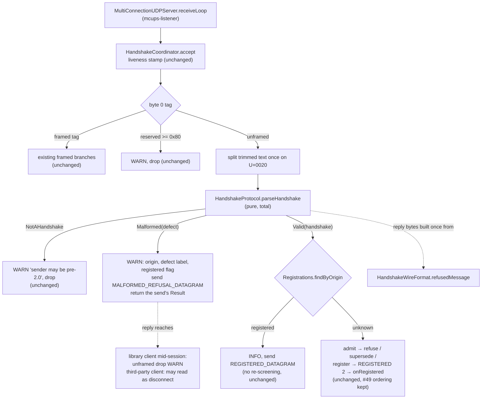

# Issue #38 — malformed `Iam` refusal (architecture)

- **Covers:** `SpartanLaboratories/WebTools#38` — *"Handshake parsing accepts an empty
  peer name on extra whitespace"*.
- **What this designs:** the `webtools-udp` server's validity rule for an unframed `Iam`
  line, how a malformed line is routed and answered, and which living documents and
  tests move with it. A contained bugfix in one module; no public API changes.
- **Status:** systems design — implementation plans to follow.
- **Baseline:** `master` `85cfbbe`; branch `fix/issue-38-handshake-empty-name` at `9b1fff7`
  adds only the research Markdown. `webtools-udp` is at `2.0.0`
  (`webtools-udp/build.gradle.kts:92`).
- **Related docs:**
  - [`research/README.md`](research/README.md) — the research questions, verification
    and summary this design rests on;
  - [`research/codebase-blast-radius.md`](research/codebase-blast-radius.md) — the
    inventory of code, tests, docs, line references and editing hazards;
  - [`research/malformed-line-handling.md`](research/malformed-line-handling.md) — the
    parse outcome and routing;
  - [`research/refusal-reply-text.md`](research/refusal-reply-text.md) — the reply text,
    the amplification arithmetic and draft protocol-doc wording (its draft for a
    registered origin predates the rule in §1 below and is superseded by it);
  - `docs/webtools-udp-protocol.md`, `docs/webtools-udp-architecture.md`, `README.md` —
    the living documents this work updates;
  - `docs/plans/11-handshake-refusal-and-credential/plan.md` — the refusal design the
    `REFUSED` reply comes from (historical; not edited).

Paths under `webtools-udp/src/main/kotlin/com/spartanlabs/webtools/udp/` are abbreviated
`main/`; paths under `webtools-udp/src/test/kotlin/com/spartanlabs/testing/` are
abbreviated `test/`. Line references are to `85cfbbe` unless marked otherwise.

---

## 1. Requirements

The server reads an unframed handshake by trimming the datagram's UTF-8 text and
splitting it on a single U+0020. A line whose first token is exactly `Iam` is a
handshake line. The work makes the server refuse a malformed one.

1. **Validity rule.** An `Iam` line is **malformed** when, after the trim and the
   single-U+0020 split:
   - the name slot is missing (a bare `Iam`), or
   - the name slot is `""` (`Iam  x`), or
   - the credential slot is present but `""` (`Iam bob  tok`).

   An absent credential (`Iam bob`) is not malformed; `admit()` receives it as `""`, as
   today. Nothing else is malformed. Tokens past the credential slot stay ignored, empty
   ones included: `Iam bob tok  x` is accepted with credential `tok`. The single-U+0020
   split is kept; splitting on `\s+` would redefine the wire format and silently turn
   `Iam bob  tok` into a different valid line.
2. **Every malformed `Iam` is answered `REFUSED malformed`**, whatever the state of its
   origin, registered or not. The reason `malformed` is informative wire text, not a
   contract; it is one fixed reason for all three shapes. The defect detail goes to the
   server log only.
3. **A malformed line** never reaches `admit()`, never supersedes a same-name
   registration, registers nothing, and fires no `onClientConnect`. From an origin that
   already holds a registration, the registration is not torn down, superseded or
   re-screened, and no `onClientDisconnect` fires; like every inbound datagram from a
   registered origin, the line still refreshes the registration's liveness stamp when
   idle detection is on.
   The rule "`REFUSED` only ever goes to an unregistered origin" is deliberately
   relaxed, and the protocol doc states the trade-off: a library client mid-session drops
   the unframed `REFUSED` with a WARN (`main/MultiConnectionUDPClient.kt:611-618`); a
   third-party client may take it as a disconnect while the server keeps it registered.
4. **A well-formed `Iam` from a registered origin** gets `REGISTERED 2` again, as
   today's retransmit, with no re-screening. A well-formed `Iam` from an unknown origin
   takes today's `admit`, supersede, register, `REGISTERED 2` path, unchanged, including
   the register-before-send ordering that #49 concerns.
5. **Only the three malformed shapes draw a reply.** A line whose first space-separated
   token is not exactly `Iam` (for example `Iam<TAB>bob`) is still not a handshake. It,
   and every other unrecognised datagram, stays as silent as today.
6. **Whitespace inside a token** other than U+0020 (tab, CR/LF, NBSP) keeps registering.
   That gap is #53's, settled together with #52's client-side checks. The protocol doc
   describes it as known and links #53.
7. **No public API change and no new public constant.** The release manager picks the
   version bump at landing; the repo's convention for a bugfix is a letter suffix.
8. **The parse and the routing never throw.** An exception thrown inside
   `HandshakeCoordinator.accept` ends the server's listener thread (§2). The general
   guard is #54; this work adds no throw path.
9. **Docs.** Protocol doc §3 and §8 describe the rule and the registered-origin
   trade-off, and carry a Boundary-Ring note on the replies a forged or unverified source
   can draw (sizes, ratios, the `REFUSED malformed` sent to a registered client's
   address, no address validation, no reply rate limiting). Every out-of-date source
   line reference in the protocol doc is refreshed after the code and KDoc edits (21 of
   37 are stale on `85cfbbe`). The architecture doc's `:52` reference
   (`MultiConnectionUDPServer.kt:254`, now `:260`) is refreshed and its handshake node
   reworded. The README's handshake sections are updated. Level-2 KDoc is updated
   wherever a public KDoc says refusal comes only from `admit` or that every other `Iam`
   is well-formed. The historical plan documents under `docs/plans/` are not edited.
10. **Test housekeeping.** The comment at `test/integration/.../ChannelByteGuardIntegrationTest.kt:25`
    gets the current line range of the raw-socket peer in `FramingNonFunctionalTest.kt`
    (`:187-215` on `85cfbbe`). The raw NUL and SOH bytes in the string literal at
    `test/component/.../HandshakeCoordinatorTest.kt:577` become the escapes
    `"\u0000\u0001"`, which give the same string.
11. **Tests.** The two tests that assert silence for a bare `Iam` flip to expecting
    `REFUSED` (`HandshakeCoordinatorTest` "a nameless Iam fails and registers nothing";
    `MultiConnectionUDPServerTest.kt:248`). New cases go at levels 1, 2, 3 and 4a. Any
    level-4b case sends from a raw socket, because #52 will make
    `MultiConnectionUDPClient.handshake("", …)` fail locally.

**Acceptance.** Each of the three malformed shapes, from an unknown origin and from a
registered origin, draws exactly one `REFUSED malformed`, calls no `admit`, adds,
supersedes and tears down no registration, fires no `onClientConnect`, and logs one WARN without the line, its
tokens, the name or the credential. `Iam bob`, `Iam bob tok` and `Iam bob tok  x`
register (or, from a registered origin, draw `REGISTERED 2`). `Iam<TAB>bob` and every
other unrecognised datagram draw nothing. A burst of malformed lines leaves the listener
thread alive and the registration count unchanged. Every protocol-doc line reference
points at what its prose says.

## 2. Current state

**Path from the socket to the handshake.** `MultiConnectionUDPServer.receiveLoop`
(`main/MultiConnectionUDPServer.kt:326-340`) calls `coordinator.accept(origin, bytes, text)`
(`:330`) and logs any `Result.failure` at WARN **with the exception** (`:336`). The text
is trimmed once, in `CommonChannel` (`main/CommonChannel.kt:78`); nothing downstream
trims again. `HandshakeCoordinator.accept` stamps liveness for a registered origin
before classifying (`main/HandshakeCoordinator.kt:147-152`), then `classify` switches on
byte 0 (`:159`); the `null` tag branch drops a reserved tag `>= 0x80` (`:222-225`) and
otherwise splits the text **twice** — once for `isHandshake`, once for `handleHandshake`
(`:227`). A non-`Iam` unframed datagram is dropped with the WARN "sender may be pre-2.0"
(`:229-231`).

**The parse today.** `HandshakeProtocol.parseHandshake` (`main/HandshakeProtocol.kt:55-59`)
is `runCatching { require(verb); require(size >= 2); Handshake(tokens[1], tokens.getOrElse(2) { "" }) }`.
So a bare `Iam` is `Result.failure(IllegalArgumentException)`; `Iam  x` parses to
`Handshake("", "x")`; `Iam bob  tok` parses to `Handshake("bob", "")`, indistinguishable
from `Iam bob`. `isHandshake` (`:77`) is verb-only; `extraTokenCount` (`:68-69`) counts
tokens past index 2. `REGISTERED_DATAGRAM` (`:30`) is the precomputed accepted reply.

**The routing today** (`main/HandshakeCoordinator.kt:243-293`): parse, then the
extra-token DEBUG (`:245-246`), then `findByOrigin` (`:248`). A hit repeats
`REGISTERED 2` with no `admit` (`:249-254`); a miss runs `admit` (`:260`), returns the
`REFUSED` send's `Result` on `Admission.Refused` (`:264-271`, with the comment "A
REFUSED datagram that went out is a successful server action, not a failure"),
supersedes a same-name registration (`:277-287`), then registers, sends `REGISTERED 2`
and fires `onRegistered` (`:288-291`). Consequences on `85cfbbe`: a bare `Iam` from any
origin gets no reply and a listener WARN with a stack trace; `Iam  x` and
`Iam bob  tok` from a registered origin get `REGISTERED 2`; from an unknown origin they
reach `admit` and register.

**Exceptions escape the listener.** `ResultExtensions.flatMap` is a plain `fold` that
does not catch (`main/ResultExtensions.kt:19-20`), and `receiveLoop` has no `try`, so an
exception thrown anywhere inside `accept` ends the `mcups-listener` thread (#54).

**The reply builder.** `HandshakeWireFormat.refusedMessage` (`main/HandshakeWireFormat.kt:117-120`)
trims and collapses the reason and compiles a `Regex` on every call (`:118`).

**Sealed outcomes are the module's idiom for domain results.** `Admission`
(`main/Admission.kt:8-20`), `ReliableChannelEngine.SendOutcome`
(`main/ReliableChannelEngine.kt:45`), `ReliableReorderBuffer.ReceiveOutcome` and
`ReliableRetransmitBuffer.OfferResult`. `Result` carries operational failures: a send, a
callback that throws.

**The client's side.** `MultiConnectionUDPClient.handshake` treats any `REFUSED` as a
refusal and does not branch on the reason (`main/MultiConnectionUDPClient.kt:313-315`).
Its session listener drops an unframed datagram with a WARN
(`main/MultiConnectionUDPClient.kt:611-618`).

**Tests and docs that state today's behaviour.** `test/component/.../HandshakeCoordinatorTest.kt:239-246`
and `test/integration/.../MultiConnectionUDPServerTest.kt:245-259` (the `"Iam"` element
at `:248`) assert silence for a bare `Iam`. `test/deterministic/.../HandshakeProtocolTest.kt:40-43,55-58`
and `test/gating/.../HandshakeProtocolGatingTest.kt:27-30` assert the `Result` failure
type. Protocol doc §3 (`docs/webtools-udp-protocol.md:58-101`) carries an "as-built
quirk" paragraph (`:74-78`) describing the defect; §8 (`:315-342`) has the bare-`Iam`
row at `:321`. The architecture doc's handshake node is at
`docs/webtools-udp-architecture.md:112` and its stale reference at `:52`. The README's
handshake prose is at `README.md:103-135` and `:217-251`.

**Verified outside-world facts** (sources and verification in
[`research/README.md` § Verification](research/README.md)):

- `String.split(Char)` keeps consecutive and trailing empty strings; `trim()` removes
  leading and trailing whitespace only. The empty slots exist because of the first;
  interior non-space whitespace survives because of the second.
- Kotlin's `Result` is for generic failures, not domain outcomes; a `when` over a sealed
  type is compiler-checked for exhaustiveness; exceptions are expensive to create
  (KEEP-0127).
- Logging guidance: a log line built from external input must neutralise CR/LF
  (CWE-117); access tokens do not belong in logs; a validation failure is suspicious,
  not proof of an attack (OWASP Logging Cheat Sheet).
- Amplification: QUIC caps pre-validation replies at 3x (MUST, RFC 9000 §8.1), DTLS 1.3
  at 3x (SHOULD, RFC 9147 §5.1), CoAP qualitatively (RFC 7252 §11.3); CISA defines the
  bandwidth amplification factor on UDP payload bytes. None binds this protocol. A bare
  `Iam` (3 bytes) answered `REFUSED malformed` (17 bytes) is a payload ratio of 5.7
  (1.45 on the wire with IPv4 and UDP headers); the server's default worst case today
  is 2.4 (`REGISTERED 2` for `Iam a`), and the README's own `invalid credential`
  refusal example is 5.2.
- No rate limiting, throttling, cookie or address-validation code exists in
  `webtools-udp/src/main`.
- ripgrep skips a file containing a NUL byte during recursive search; `-a` turns the
  detection off. `HandshakeCoordinatorTest.kt` is such a file.

## 3. Assumptions

- **#41 keys its rate bound on the log call site and a per-reason argument.** The new
  WARN uses one fixed message template with the defect label as an argument. If #41
  instead keys on the full rendered message, the template still works (the label
  vocabulary is three fixed strings), so nothing here would change.
- **The edit tooling round-trips the NUL and SOH bytes** in `HandshakeCoordinatorTest.kt`
  until the escape replacement lands. If it does not, the escape replacement must be the
  first edit to that file, made with a byte-aware tool, and checked with
  `grep -a -P '\x00'`. The design already orders it first (§10).
- **No consumer depends on a bare `Iam` drawing no reply.** The library client cannot
  observe the difference (it times out today and gets `HandshakeRefusedException`
  afterwards). A hand-rolled client that relied on silence would now see a `REFUSED`.
  If one existed, the behaviour is still the fix the issue asks for; only the release
  note wording would change.

## 4. Non-goals

- **#41** rate-bounding the per-datagram WARN logs. The new WARN joins that set.
- **#49** the register-before-send ordering and the orphaned registration. Untouched.
- **#52** client-side validation in `handshakeMessage` / `handshake()`. The client and
  `HandshakeWireFormat.handshakeMessage` are not edited.
- **#53** non-space whitespace inside a name or credential. Still registers; documented
  as a known gap.
- **#54** a throwing `onClientConnect` or any other exception escaping `accept`. This
  work adds no throw path and no guard.
- The liveness stamp a malformed `Iam` from a registered origin still refreshes
  (`accept` stamps before classifying, `:147-152`). Unchanged; recorded in §12.
- The two-argument `accept(origin, text)` overload (`:240-241`), a test seam, still does
  not trim. Component tests pass pre-trimmed text; the trailing-space-on-the-wire case
  (`Iam bob ` → trimmed `Iam bob`, accepted) is tested at level 3 through the real
  socket path.
- A version bump, release notes, and anything under `docs/plans/` other than this
  issue's folder.

## 5. System inventory

Two existing internal systems change shape. Nothing new is added to the public surface.

### 5.1 Handshake line validity rule — `HandshakeProtocol` (`main/HandshakeProtocol.kt`)

- **Responsibility:** decide, as a pure function of the split tokens, whether a line is
  not a handshake, a malformed handshake, or a valid handshake, and own the fixed wire
  bytes of the two server replies.
- **Placement:** unchanged — the `internal object HandshakeProtocol` in
  `com.spartanlabs.webtools.udp`, beside `Handshake`.
- **Owns:**
  - `parseHandshake(tokens): HandshakeParse` — a **total** function returning a sealed
    outcome. Three arms: `NotAHandshake` (the first token is not exactly `Iam`; the verb
    check is part of the outcome, so the function never throws), `Malformed(defect)`,
    and `Valid(handshake)`. The name slot is checked before the credential slot, so
    `Iam  x y` reports the name defect.
  - `HandshakeDefect` — an `internal enum` with three entries (name missing, name empty,
    credential empty), each carrying a fixed, log-safe `label`. #53 adds entries here.
  - The credential slot read with `getOrNull`: `null` is absent and becomes `""` in
    `Handshake`; `""` is present-but-empty and is malformed. `Handshake(name, credential)`
    keeps its shape; inside a `Handshake`, `""` now unambiguously means "absent", which
    is what `admit` documents.
  - `MALFORMED_REFUSAL_DATAGRAM` — an `internal val ByteArray`, built once from
    `HandshakeWireFormat.refusedMessage("malformed")`, beside `REGISTERED_DATAGRAM`. The
    reason string is a `private const val` on the object. Precomputed because the
    malformed path runs at a rate the sender chooses and `refusedMessage` compiles a
    `Regex` per call.
  - `isHandshake` and `extraTokenCount` — unchanged. `parseHandshake` uses
    `isHandshake` for its `NotAHandshake` arm, so recognition has one definition.
- **Does not own:** routing, logging, sockets, registrations. It still has no I/O and no
  state.

### 5.2 Handshake routing — `HandshakeCoordinator` (`main/HandshakeCoordinator.kt`)

- **Responsibility:** classify each unframed datagram once and route it to exactly one
  of four outcomes: silent drop (not a handshake), `REFUSED malformed` (malformed, any
  origin), `REGISTERED 2` retransmit (valid, registered origin), or the admit/supersede/
  register path (valid, unknown origin).
- **Placement:** unchanged — the `null`-tag branch of `classify` and `handleHandshake`.
- **Owns:**
  - **One split** of the trimmed text, after the reserved-tag check, so a `>= 0x80`
    datagram is never split and a hostile datagram costs one token list, not two.
  - **One parse**, then an exhaustive `when` over `HandshakeParse`:
    - `NotAHandshake` → the existing "sender may be pre-2.0" WARN and `Result.success`.
    - `Malformed` → one WARN (origin, defect label, whether the origin holds a
      registration, which is kept), then `send(MALFORMED_REFUSAL_DATAGRAM, origin)`,
      returning that send's `Result`, exactly as the `admit` refusal does. No `admit`,
      no lookup-by-name, no supersede, no registration, no `onRegistered`. The
      origin lookup here is read-only, for the log field.
    - `Valid` → the extra-token DEBUG (only here), then `findByOrigin`: a hit repeats
      `REGISTERED 2` with no re-screening; a miss runs today's `admit`, supersede,
      register, send, `onRegistered` body **unchanged**, including the #49 ordering.
  - **The logging contract** for the malformed arm: one WARN per datagram, one fixed
    message template, arguments limited to the origin (rendered from the socket
    address, never from payload bytes), the defect label and the registered flag. The
    raw line, its tokens, the name and the credential never appear. No exception
    object is attached.
  - **`accept`'s `@return` contract** narrows to: `Result.failure` only when a reply
    could not be delivered or `admit` threw. A malformed line is a handled datagram.
- **Does not own:** the validity rule (5.1), the trim (`CommonChannel`), the reply text
  (`HandshakeWireFormat`), liveness stamping (unchanged, runs before classification).

### 5.3 Public KDoc (no behaviour change)

`MultiConnectionUDPServer` (class KDoc `:15-23`, `:43-54`; `admit` KDoc `:354-386`) and
`HandshakeWireFormat` (the "`REFUSED` reply" section `:35-39`; `REFUSED_REPLY` `:52-57`)
say that `REFUSED` comes only from `admit` and that the default admits every well-formed
`Iam`. Both are updated to state: a malformed `Iam` is refused `REFUSED malformed`
before `admit` and whatever the origin's state; `admit` therefore never sees an empty
`name`, and sees `credential` either as `""` (absent) or as a non-empty token; the
reason text is informative. `HandshakeProtocol`'s and `HandshakeCoordinator`'s internal
KDoc change with their code.

## 6. Interactions

Dependency direction is unchanged: `MultiConnectionUDPServer` → `HandshakeCoordinator`
→ `HandshakeProtocol` → `HandshakeWireFormat`. Everything crosses a boundary as a call;
there are no events and no new shared state. `Registrations` is read by the coordinator
and written only on the valid/unknown path, as today.

What crosses each boundary:

| From → to | Crosses | Contract |
|---|---|---|
| `receiveLoop` → `accept` | origin, bytes, trimmed text | unchanged; `Result.failure` now means only "reply not deliverable" or "`admit` threw" |
| `classify` → `parseHandshake` | the token list | total; returns `HandshakeParse`; never throws |
| `handleHandshake` → `Registrations` | origin (read); name (read, write) only on the valid/unknown arm | a malformed line never writes |
| `handleHandshake` → `sender` | `MALFORMED_REFUSAL_DATAGRAM`, origin | the shared array is read-only, like `REGISTERED_DATAGRAM` |
| `HandshakeProtocol` → `HandshakeWireFormat` | `refusedMessage("malformed")`, once at class init | no new public member |

## 7. Integration with existing systems

| Existing system | How the design meets it |
|---|---|
| `MultiConnectionUDPServer.receiveLoop` (`:326-340`) | Unchanged in code. Its stack-trace WARN at `:336` stops firing for a bare `Iam`, because the malformed arm returns the send's `Result`. Class and `admit` KDoc updated (§5.3). |
| `CommonChannel` (`:78`) | Unchanged; the single trim is the contract the coordinator relies on. |
| `Registrations` | Unchanged; read for the log flag on the malformed arm, written only on the valid/unknown arm. |
| `HandshakeWireFormat` | Code unchanged; `refusedMessage` is called once more, at `HandshakeProtocol` init. KDoc updated (§5.3). |
| `MultiConnectionUDPClient` | Unchanged. `handshake()` already maps any `REFUSED` to `HandshakeRefusedException`; the session listener's unframed-drop WARN is what a registered client sees if a forged source draws `REFUSED malformed` to its address. |
| `Admission`, `HandshakeRefusedException` | Unchanged; a malformed refusal is not an `Admission`. |
| Test support `LogCapture` (`test/support/.../LogCapture.kt:23`) | Used by the level-2 cases to assert the WARN carries no payload text. |

### Adoption verdicts — every site that recognises or tokenises an `Iam` line

| Site | Does | Verdict |
|---|---|---|
| `main/HandshakeCoordinator.kt:227` | splits twice, gates on `isHandshake` | **in scope now:** one split, one parse, routes on the outcome (§5.2) |
| `main/HandshakeProtocol.kt:55-59` `parseHandshake` | `Result<Handshake>` with `getOrElse(2) { "" }` | **in scope now:** sealed outcome, `getOrNull` (§5.1) |
| `main/HandshakeProtocol.kt:68-69` `extraTokenCount` | counts tokens past index 2 | unchanged; called only for a `Valid` line |
| `main/HandshakeProtocol.kt:77` `isHandshake` | verb-only recognition | unchanged; now also the `NotAHandshake` arm's definition |
| `main/HandshakeWireFormat.kt:72-73` `handshakeMessage` | builds the client line unvalidated (`handshakeMessage("")` yields `Iam `) | **follow-up #52** (client-side validation) |
| `main/HandshakeWireFormat.kt:91-99` `registeredProtocolVersion` | tokenises the **reply** | unchanged; a different rule for a different line |
| `main/MultiConnectionUDPClient.kt:302` | calls `handshakeMessage` inside `runCatching` | **follow-up #52** |
| `main/HandshakeCoordinator.kt:261,265,278,290` | INFO/WARN lines that print the name | **follow-up #53** (CR/LF in a name reaches the log); the new malformed WARN deliberately prints no token |
| `test/integration/.../MultiConnectionUDPClientProbeTest.kt:64` | fake server replies to `text == "Iam" \|\| startsWith("Iam ")` | unchanged; a stand-in for client tests, not a parser under test |
| `test/integration/.../MultiConnectionUDPProtocolVersionTest.kt:35-45` | replies once without tokenising | unchanged |
| `test/deterministic/.../HandshakeWireFormatTest.kt:19-28` | builds `Iam bob [tok]` | unchanged |
| `test/deterministic/.../HandshakeProtocolTest.kt`, `test/gating/.../HandshakeProtocolGatingTest.kt` | read `parseHandshake(...).getOrThrow()` and assert the failure type | **in scope now:** follow the sealed outcome; the `IllegalArgumentException` test (`:55-58`) goes, the bare-`Iam` tests assert the name-missing defect, the empty-list and non-`Iam` tests assert `NotAHandshake` |

No other production or test code tokenises an `Iam` line
([inventory §8](research/codebase-blast-radius.md)).

### Relationship to the neighbouring issues

- **#41 (rate-bound drop WARNs).** The malformed WARN is one more per-datagram drop site
  with a fixed template and a per-reason argument (the defect label). #41's bound keys
  on that; nothing here needs to change when it lands.
- **#49 (registration orphaned on a failed `REGISTERED` send).** The valid/unknown arm is
  today's body, moved into its own branch, untouched. #49's fix lands inside that arm.
- **#52 (client-side validation).** `handshakeMessage` and `handshake()` are not edited.
  Once #52 lands the library client cannot send a malformed line, which is why every
  socket-level test of the new branch sends from a raw `DatagramSocket`.
- **#53 (non-space whitespace in tokens).** It widens `HandshakeDefect` with new entries
  and adds their checks inside `parseHandshake`; the coordinator's `Malformed` arm, the
  reply constant and the log template are reused without change. #53's issue text says
  "only an origin with no registration ever gets `REFUSED`"; that predates this design,
  and #53 inherits the rule here instead: every malformed line is refused whatever the
  origin's state. The protocol doc's known-gap paragraph is what #53 replaces.
- **#54 (a throwing `onClientConnect` ends the listener).** Orthogonal. This design
  makes the parse total and keeps every new path exception-free; #54's `try` in
  `receiveLoop` and its guard around `onRegistered` land independently.

## 8. Extension & stability

- **No new public surface.** `HandshakeParse`, `HandshakeDefect` and
  `MALFORMED_REFUSAL_DATAGRAM` are `internal`, inside an `internal object`, in a module
  where the handshake rules are deliberately server-private
  (`main/HandshakeProtocol.kt:15-17`). No stability tier is assigned because nothing is
  reachable by a consumer.
- **Closed set, by design.** `HandshakeParse` is sealed because the coordinator's
  routing is an exhaustive `when` over it and the compiler check is the guarantee that a
  future arm (such as #53's) is routed. `HandshakeDefect` is an enum for the same reason
  and because its labels are the log vocabulary #41 keys on.
- **Policy that stays fixed.** The reason text `malformed` is not parameterised. It is
  informative wire text, a third-party client must not branch on it, and an
  application's `admit` may return the same word; making it configurable would invite
  the branching the protocol doc warns against. The validity rule itself is the wire
  contract and is not a consumer-substitutable strategy; `admit` remains the consumer's
  policy seam, and a malformed line is refused before it.
- **Stable Core wire behaviour.** The protocol doc gains a documented behaviour: a
  malformed `Iam` draws `REFUSED` with an informative reason. The reply verb and its
  handling are already Stable Core (`REFUSED_REPLY`, `isRefused`, `refusalReason`); the
  reason text is explicitly outside the contract.
- **Stable Core KDoc contract on `admit`.** The `admit` KDoc now states that `name` is
  never empty and that `credential` is `""` only when absent. This documents enforced
  behaviour; it narrows `admit`'s input domain and is additive for every existing
  override.

## 9. Alternatives considered

- **Keep `Result<Handshake>` and treat every post-recognition failure as malformed.**
  Rejected: `runCatching` catches every `Throwable`, so an unrelated bug inside the parse
  would be answered `REFUSED malformed` instead of surfacing; it carries no defect for
  the log; it allocates a stack-trace-bearing exception per hostile datagram; and the
  Kotlin `Result` design reserves the type for generic failures. It would win only if
  zero churn in the two existing parse tests mattered more than those four points.
- **A typed `MalformedHandshakeException : IllegalArgumentException` inside `Result`.**
  Rejected for the stack-trace cost and the lost exhaustiveness; the coordinator would
  need `exceptionOrNull() as?` plus an `else` for failures it does not know. It would
  win if the project paradigm forbade sealed outcomes, which it does not (`Admission`,
  `SendOutcome`).
- **A separate validity check before parsing.** Rejected: two copies of the slot logic,
  a `Result` that can no longer fail, and a check a caller can forget.
- **Keep `isHandshake` as the gate in `classify` and a `require` on the verb inside
  `parseHandshake`.** Rejected because an exception inside `accept` ends the listener
  thread (§2); a total parse with a `NotAHandshake` arm costs one `when` arm and removes
  the only throw path. It would win only once #54's guard existed and even then the arm
  is cheaper.
- **Silence, or `REGISTERED 2`, for a registered origin's malformed line.** Not used:
  the registered peer and the unknown peer then follow different rules for the same
  bytes, and `REGISTERED 2` answers an accept to a line the server defines as malformed.
  One reply for every malformed line, whatever the origin, keeps the rule one sentence.
  The reflection and client-WARN costs this carries are stated in the protocol doc and
  in §12. Silence would win if a strict 3x anti-amplification bound were adopted as a
  module requirement; it is not.
- **`REFUSED malformed handshake`, a per-slot reason, or a bare `REFUSED`.** Not used:
  the first repeats "handshake" inside the client's own exception message and gives the
  3-byte trigger a ratio of 9; a per-slot reason makes three replies and an oracle for a
  prober; a bare `REFUSED` leaves the hand-rolled-client author, who is exactly who sends
  a malformed line, with no cause
  ([refusal-reply-text.md §7](research/refusal-reply-text.md)).
- **Splitting on `\s+`.** Rejected (§1.1): it redefines the wire format and silently
  accepts `Iam bob  tok` as a different valid line.
- **A `String?` credential or a `Credential` sum type in `Handshake`.** Rejected: the
  only consumer maps it straight back to `String` for `admit`, and `""` inside a
  `Handshake` is already unambiguous once the slot read rejects present-but-empty.

## 10. Decomposition

One plannable unit: the change is one system's behaviour (§5.1–§5.3) and the living
documents that describe it. It is planned in `plan.md`.

| # | Unit slug | Scope | Depends on | Lands |
|---|---|---|---|---|
| 1 | `malformed-iam-refusal` | The validity rule, the routing, its tests, its KDoc, and the living documents that describe it, in the two ordered stages below. | — | 1 |

**Stage A — code, tests and KDoc.**
- **Code.**
  - `HandshakeProtocol`: sealed `HandshakeParse`, `HandshakeDefect`, a total
    `parseHandshake` that reads the credential with `getOrNull`, and
    `MALFORMED_REFUSAL_DATAGRAM`.
  - `HandshakeCoordinator`: one split, one parse, the four-way routing, the malformed
    WARN contract, and the narrowed `accept` `@return`.
- **KDoc** in those two files and in `MultiConnectionUDPServer` and `HandshakeWireFormat`
  (§5.3).
- **Housekeeping.**
  - The escape replacement at `HandshakeCoordinatorTest.kt:577` is the **first** edit to
    that file.
  - The comment fix at `ChannelByteGuardIntegrationTest.kt:25`.
- **Tests.** The two flips, and new cases at:
  - **level 1:** `HandshakeProtocolGatingTest`, `HandshakeCoordinatorGatingTest`;
  - **level 2:**
    - `HandshakeCoordinatorTest`: the three shapes from an unknown and from a registered
      origin, `Iam bob tok  x`, an absent credential, no supersede, no `admit`, no
      `onRegistered`, the reply addressed to the origin only, and the log content via
      `LogCapture`;
    - `FramingComponentTest`: `Iam<TAB>bob` takes the unframed path;
  - **level 3:** the `MultiConnectionUDPServerTest` flip; `MultiConnectionUDPServerAdmissionTest`
    with `admit` never consulted; the trailing-space-trimmed case;
  - **level 4a:** the `HandshakeProtocolTest` truth table and the reply bytes;
  - **level 4c:** a burst case mirroring `MultiConnectionUDPServerAdmissionNonFunctionalTest.kt:104`,
    proving the listener survives a malformed burst (requirement 8).

  A 4b case is not required; if one is added, it sends from a raw socket.

**Stage B — living documents, after Stage A's line numbers are final.**
- **Protocol doc §3:** the rule, the registered-origin trade-off, the known #53 gap, the
  "informative, not contract" status of the reason, and the Boundary-Ring note on replies
  to unverified sources.
- **Protocol doc §8:** replace the bare-`Iam` row; add the empty-slot and
  registered-origin rows; tighten the non-`Iam` row to "first space-separated token is not
  exactly `Iam`".
- **Protocol doc line references:** recheck all 37 and refresh the 21 stale ones from the
  anchors in [inventory §5](research/codebase-blast-radius.md).
- **Architecture doc:** `:52` becomes the `coordinator` field's current line, and the
  `:112` handshake node is reworded.
- **README:** the message table, the retransmit/credential paragraph, the `admit`
  paragraph, and "Handshake screening & credentials" (define well-formed; link the rule).

Both stages ride one branch and one PR. Stage B runs last because its line references
are computed from the final code and KDoc. It is committed on its own, so the
documentation pass can be reviewed separately.

## 11. Risks at the systems level

- **Wire behaviour seen by third-party clients.** A bare `Iam`, which drew nothing, now
  draws `REFUSED malformed`; `Iam  x` and `Iam bob  tok`, which registered or drew
  `REGISTERED 2`, now draw `REFUSED malformed`. A hand-rolled client that sent one of
  these and relied on the old outcome will now fail its handshake with a reason. This is
  the fix. The reason text is documented as informative so no client builds on it.
- **Reflection toward registered clients.** A forged source that knows a registered
  client's `ip:port` can make the server send that client 17-byte unframed datagrams,
  one per trigger datagram, at a rate the sender chooses. The library client drops each
  with a WARN; a third-party client may read `REFUSED` mid-session as a disconnect while
  the server keeps it registered. Payload ratio 5.7 on the 3-byte trigger, inside the
  range `admit` refusals already produce; no state is created. The protocol doc states
  all of this and that there is no address validation and no reply rate limiting. The
  only server-side defence that would change the picture is an address-validation
  exchange or a rate limit, neither of which is part of this work.
- **Log noise until #41 lands.** Server side: one WARN per malformed datagram, at the
  sender's rate, with no stack trace (today a bare `Iam` already costs a WARN **with** a
  stack trace, so the per-line cost falls). Client side: one WARN per reflected
  `REFUSED malformed` a registered library client receives. Both are #41's surface.
- **No throw path, by construction.** The parse is total, the routing is an exhaustive
  `when`, and every new return is a `Result` from `send` or `Result.success`. The 4c
  burst case proves the listener survives. The general guard remains #54.
- **Liveness refresh by a spoofed malformed line.** `accept` stamps a registered
  origin's `lastInboundAt` before classification, so a forged malformed line keeps a
  registered client's idle timer fresh. This is pre-existing, unchanged, and not
  specific to `Iam`. The protocol doc's §5 already states that any inbound datagram from
  a registered origin stamps its liveness before classification, so the
  unverified-sources note does not repeat it.
- **Editing hazards.** `HandshakeCoordinatorTest.kt` contains raw NUL and SOH bytes at
  `:577`: ripgrep-based search skips the file, and a tool that normalises them corrupts
  the test. The escape replacement is the first edit to that file and is verified with
  `grep -a -P '\x00'` and a hunk-limited `git diff`. The three living docs are CRLF in
  the working tree with an LF index (`core.autocrlf=true`); an editor that writes LF
  produces a whole-file diff, so `git diff --stat` is checked after each doc edit. The
  docs and KDoc carry non-ASCII (`—`, `→`), so edits go through a UTF-8-safe path.
- **Ordering constraint.** The protocol doc's references into `HandshakeCoordinator.kt`,
  `HandshakeProtocol.kt`, `HandshakeWireFormat.kt` and `MultiConnectionUDPServer.kt`,
  and the architecture doc's `:52`, can only be recomputed after Stage A's code and KDoc
  edits are final. Stage B therefore runs last, from the inventory's anchors.
- **Breaking changes and cross-repo impact.** None in the public API. The wire change
  is a bugfix to documented-as-defective behaviour. No other repo is implied.
- **Concurrency and performance shape.** Everything runs on `mcups-listener` as today.
  The hostile path is cheaper than before: one split instead of two, no exception
  allocation, one precomputed reply array, no `Regex` per reply.

## 12. Known gaps

- The post-change line numbers are unknown until Stage A is written; Stage B recomputes
  every reference into an edited file from the anchors in
  [inventory §5](research/codebase-blast-radius.md).
- Whether the edit tooling round-trips the NUL and SOH bytes in
  `HandshakeCoordinatorTest.kt` is untested; §3 and §11 order the escape first.
- #41 has no design yet; the fixed-template-plus-label shape is an inference from its
  issue text.
- No Kotlin or JVM server with a rule for a malformed first message from a registered
  peer was found; the comparable UDP systems (DTLS, WireGuard, ENet) discard silently and
  none uses a text handshake. The design's rule is argued from this protocol's own
  coherence, not from precedent.
- The amplification ratios are derived from byte counts, not measured, and assume a
  28-byte IPv4+UDP header with no options.

## 13. Considerations

None. Every call this design makes follows from the requirements in §1 or from the
module's existing idioms, and no new public surface needs a stability tier.
