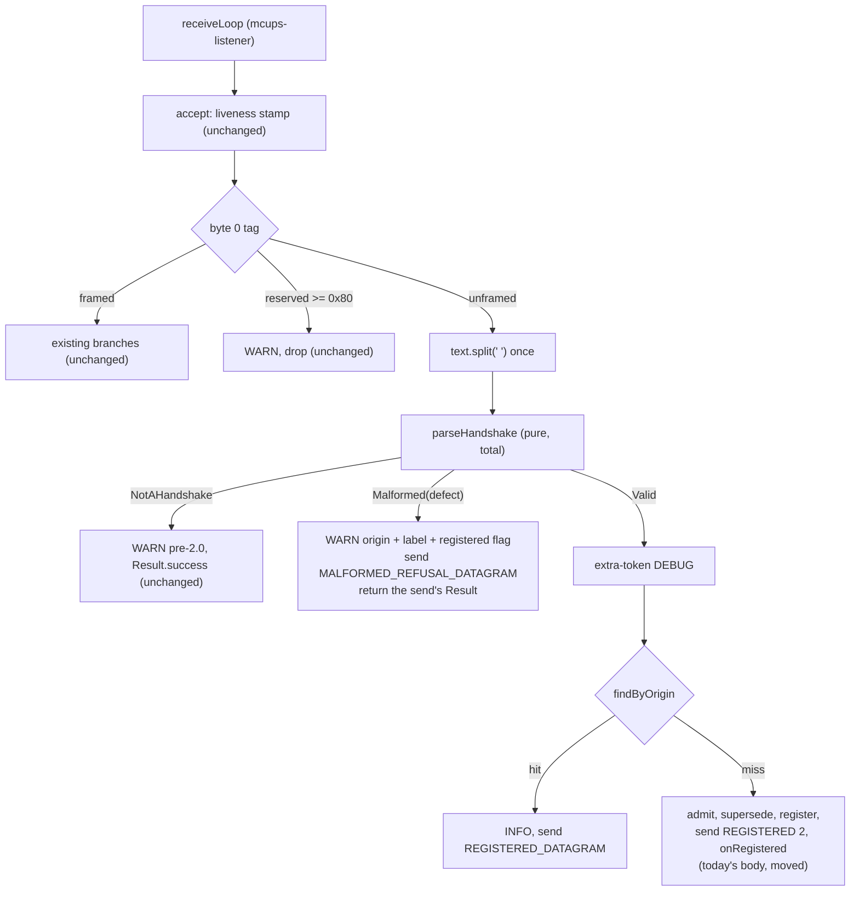

# Issue #38 — malformed `Iam` refusal (implementation plan)

- **Covers:** `SpartanLaboratories/WebTools#38` — *"Handshake parsing accepts an empty peer
  name on extra whitespace"*.
- **Architecture:** [`architecture.md`](architecture.md), unit `malformed-iam-refusal` (the
  only unit; §5 system inventory, §7 adoption verdicts, §10 scope in two stages).
- **Research:** [`research/README.md`](research/README.md) and the three findings files
  beside it.
- **Impact:** [`impact.md`](impact.md): adoption, blast radius and follow-ups.
- **Branch:** `fix/issue-38-handshake-empty-name` (exists; holds the research commits).
- **Commit:** on `fix/issue-38-handshake-empty-name`, in order:
  - research: `77b3786`, `7b58916`, `fbf9dc9`, `b6446de`, `31aab26`, `e8c2929`, `9b1fff7`;
  - `56a2121`: Commit 1. A-1 and A-2, with this plan, `architecture.md` and `impact.md`.
  - `1605bdd`: Commit 2. A-3..A-7.
  - `d3807b0`: Commit 3. C-1..C-4 and D-1..D-3, with the plan documents.
  - `c6be0f2`: Commit 4. C-T1..C-T8 and D-4.
  - `16d6849`: Commit 5. Stage B with C-D, C-B, D-5 and D-6.
  - `ca57a57`: Commit 6. The version bump to `webtools-udp` `2.0.0a`, with the README
    install snippet.

  The as-built documentation commit follows. The as-built record is
  [`final-implementation.md`](final-implementation.md).
- **PR:** [#59](https://github.com/SpartanLaboratories/WebTools/pull/59).
- **What this plans:** the `webtools-udp` server refuses a malformed `Iam` line with
  `REFUSED malformed` from any origin, never lets one reach `admit()` or touch a
  registration, and the code, KDoc, tests and living documents that say so.
- **Status:** implemented. Stages A–D are committed.
- **Target version:** `webtools-udp` `2.0.0a`, the bugfix after `2.0.0`. It is set in its
  own `build:` commit; the plan's own commits do not edit `webtools-udp/build.gradle.kts`.
- **Executor:** `rookie-dev`. Every step names its file, its anchor and `path:line` on
  baseline `85cfbbe`, the exact text, and the command that checks it. Where a step does
  not match the file as quoted, stop and report; do not improvise.

Paths under `webtools-udp/src/main/kotlin/com/spartanlabs/webtools/udp/` are abbreviated
`main/`; paths under `webtools-udp/src/test/kotlin/com/spartanlabs/testing/` are
abbreviated `test/`. Line numbers are on `85cfbbe` (the branch's code is identical) unless
marked "after". All commands run from `D:\Documents\Programming\WebTools` in Git Bash and
use `./gradlew.bat`.

---

## 1. Requirements

The server reads an unframed handshake by trimming the datagram's UTF-8 text and splitting
it on a single U+0020. A line whose first token is exactly `Iam` is a handshake line.

1. **Malformed.** An `Iam` line is malformed when, after the split:
   - the name slot is missing (a bare `Iam`), or
   - the name slot is `""` (`Iam  x`), or
   - the credential slot is present but `""` (`Iam bob  tok`).

   An absent credential (`Iam bob`) is not malformed; `admit()` receives it as `""`.
   Nothing else is malformed. Tokens past the credential slot stay ignored, empty ones
   included (`Iam bob tok  x` is accepted with credential `tok`). The single-U+0020 split
   is kept.
2. **Every malformed `Iam` is answered `REFUSED malformed`,** whatever the state of its
   origin. The reason is informative wire text, not a contract; one fixed reason covers all
   three shapes; the defect detail goes to the server log only.
3. **A malformed line** never reaches `admit()`, never supersedes a same-name registration,
   registers nothing, and fires no `onClientConnect`. From an origin that already holds a
   registration, that registration is not torn down, superseded or re-screened, and no
   `onClientDisconnect` fires; like every inbound datagram from a registered origin, the
   line still refreshes the registration's liveness stamp when idle detection is on.
   `REFUSED` may therefore reach a mid-session peer: a library client's session listener
   drops it with a WARN (`main/MultiConnectionUDPClient.kt:611-618`); a third-party client
   may read it as a disconnect while the server keeps it registered. The protocol doc
   states this.
4. **A well-formed `Iam` from a registered origin** gets `REGISTERED 2` again, with no
   re-screening. **From an unknown origin** it takes today's `admit`, supersede, register,
   `REGISTERED 2`, `onRegistered` path unchanged, including the register-before-send
   ordering (#49).
5. **Only the three malformed shapes draw a reply.** `Iam<TAB>bob`, and every datagram
   whose first space-separated token is not exactly `Iam`, keeps today's silent drop with
   the "sender may be pre-2.0" WARN.
6. **Whitespace other than U+0020 inside a name or credential** (tab, CR/LF, NBSP) keeps
   registering. That gap is #53; the protocol doc describes it as known and links #53.
7. **No public API change and no new public constant.** `HandshakeParse`, `HandshakeDefect`
   and the reply constant are `internal`.
8. **No new throw path.** The parse is total; the routing never throws. An exception
   thrown inside `HandshakeCoordinator.accept` ends the listener thread
   (`main/ResultExtensions.kt:19-20`; `main/MultiConnectionUDPServer.kt:326-340`). The
   general guard is #54.
9. **Docs** (Stage B): protocol doc §3 and §8; every out-of-date source line reference in
   `docs/webtools-udp-protocol.md` (21 of 37 on `85cfbbe`); the architecture doc's `:52`
   and handshake node; the README's handshake sections. Historical plan documents outside
   this issue's folder are not edited.
10. **Level-2 KDoc** is updated everywhere a public KDoc says refusal comes only from
    `admit`, that every other `Iam` is well-formed, or that `REFUSED` never reaches a
    session.
11. **Test housekeeping:** the raw NUL and SOH bytes at `test/component/.../HandshakeCoordinatorTest.kt:577`
    become the escapes `"\u0000\u0001"` (first edit to that file); the comment at
    `test/integration/.../ChannelByteGuardIntegrationTest.kt:25` gets the current line range
    of the raw-socket peer in `FramingNonFunctionalTest.kt`.
12. **Tests** at levels 1, 2, 3, 4a and 4c as in §8. The two tests that assert silence for
    a bare `Iam` flip to expecting `REFUSED malformed`.

**Acceptance.** Each of the three malformed shapes, from an unknown origin and from a
registered origin, draws exactly one `REFUSED malformed`, calls no `admit`, adds,
supersedes and tears down no registration, fires no `onClientConnect`, and logs one WARN
that contains neither the line, its tokens, the name nor the credential. A registered peer
that draws it stays registered and reachable. `Iam bob`, `Iam bob tok` and
`Iam bob tok  x` register (from a registered origin: draw `REGISTERED 2`). `Iam<TAB>bob`
and every other unrecognised datagram draw nothing. A burst of malformed lines leaves the
listener alive and the registration count unchanged. Every `File.kt:N` reference in the
protocol doc points at what its prose says.

## 2. Current state

Baseline `85cfbbe` (branch `9b1fff7` adds Markdown only). Baseline test run on this
checkout, all green: `gatingTest` 77, `componentTest` 223, `deterministicTest` 89,
`integrationTest` 110, `nonfunctionalTest` 62 (the e2e and uat levels were not run).

**Path from the socket to the handshake.**
- `main/MultiConnectionUDPServer.kt:326-340` `receiveLoop` calls
  `coordinator.accept(origin, bytes, text)` (`:330`); any `Result.failure` is logged at
  WARN with the exception (`:336`).
- The text is trimmed once, in `main/CommonChannel.kt:78`. Nothing downstream trims.
- `main/HandshakeCoordinator.kt:146-153` `accept` stamps liveness for a registered origin
  and calls `classify` (`:156`). `classify` switches on byte 0 (`:159`); its `null` branch
  (`:220-232`) drops a reserved tag `>= 0x80` (`:222-225`), otherwise splits the text
  **twice** (`:227`: `isHandshake(text.split(' ')) -> handleHandshake(origin, text.split(' '))`)
  and drops a non-`Iam` line with the WARN "sender may be pre-2.0" (`:229-231`).

**Root cause of the defect.**
- `main/HandshakeProtocol.kt:55-59` — `parseHandshake` is
  `runCatching { require(verb); require(size >= 2); Handshake(tokens[1], tokens.getOrElse(2) { "" }) }`.
  `Iam  x` parses to `Handshake("", "x")`; `Iam bob  tok` parses to `Handshake("bob", "")`,
  indistinguishable from `Iam bob` (`getOrElse(2) { "" }` conflates absent with
  present-but-empty); a bare `Iam` is a `Result.failure` that never reaches the origin
  lookup.
- `main/HandshakeCoordinator.kt:243-293` `handleHandshake` parses first
  (`HandshakeProtocol.parseHandshake(tokens).flatMap { (name, credential) -> … }`, `:244`),
  then logs the extra-token DEBUG (`:245-246`), then `findByOrigin` (`:248`): a hit repeats
  `REGISTERED 2` (`:249-254`), a miss runs `admit` (`:260`), the `Refused` reply
  (`:264-271`), supersede (`:277-287`), register, send, `onRegistered` (`:288-291`).
- Consequence: a bare `Iam` gets no reply and a stack-trace WARN from the listener; `Iam  x`
  and `Iam bob  tok` get `REGISTERED 2` from a registered origin and register (name `""`)
  from an unknown one.

**Tests and docs that state today's behaviour.**
- `test/component/.../HandshakeCoordinatorTest.kt:238-246` and
  `test/integration/.../MultiConnectionUDPServerTest.kt:245-259` (`"Iam"` at `:248`).
- `test/deterministic/.../HandshakeProtocolTest.kt:40-43,55-58` and
  `test/gating/.../HandshakeProtocolGatingTest.kt:27-30` read `parseHandshake(...)` as a
  `Result`.
- Protocol doc §3 (`docs/webtools-udp-protocol.md:58-101`, quirk paragraph `:74-78`) and §8
  row `:321`; architecture doc `:52`, `:111-112`; README `:103-135`, `:217-251`.

**Exceptions escape the listener.** `flatMap` is a plain `fold` that does not catch
(`main/ResultExtensions.kt:19-20`) and `receiveLoop` has no `try`, so a throw anywhere in
`accept` ends `mcups-listener`.

**Module idioms this plan follows.** Domain outcomes are sealed types (`Admission`
`main/Admission.kt:8-20`, `ReliableChannelEngine.SendOutcome`, `ReliableReorderBuffer.ReceiveOutcome`,
`ReliableRetransmitBuffer.OfferResult`; `data object` is used in all of them);
operational failures (a send, a throwing callback) are `Result`. Kotlin is `2.2.0`
(`build.gradle.kts:3`).

**Verified outside-world facts** (sources and verification in
[`research/README.md` § Verification](research/README.md)):
- `String.split(Char)` keeps consecutive and trailing empty strings; `trim()` removes only
  leading and trailing whitespace. So `Iam  x` has an empty slot; `Iam<TAB>bob` survives
  the trim as one token.
- Kotlin's `Result` is for generic failures; a `when` over a sealed type is checked for
  exhaustiveness (KEEP-0127; Kotlin sealed-class docs).
- A log line built from external input must neutralise CR/LF and must not carry access
  tokens (CWE-117; OWASP Logging Cheat Sheet).
- No standard binds this protocol's reply size: QUIC caps pre-validation replies at 3x
  (MUST, RFC 9000 §8.1), DTLS 1.3 at 3x (SHOULD, RFC 9147 §5.1), CoAP qualitatively
  (RFC 7252 §11.3). Payload ratios here: bare `Iam` (3 B) -> `REFUSED malformed` (17 B) is
  5.7 (1.45 with 28 B of IPv4+UDP headers); `Iam  x` (6 B) is 2.8; `Iam a` (5 B) ->
  `REGISTERED 2` (12 B) is 2.4.
- ripgrep (and so the `Grep` tool) skips a file that contains a NUL byte;
  `HandshakeCoordinatorTest.kt` is such a file until step A-1 lands; use `grep -a`.
- No rate-limiting, throttling, cookie or address-validation code exists in
  `webtools-udp/src/main` (keyword search `rate.?limit|throttl|cookie|token.bucket|address.valid|backoff`
  matches only the reliable channel's RTO backoff).

## 3. Assumptions

- **#41 keys its rate bound on the log call site and a per-reason argument.** The new WARN
  uses one fixed template with the defect label as an argument. If #41 keys on the rendered
  message instead, the label vocabulary is three fixed strings, so nothing here changes.
- **The edit tooling can write UTF-8 and LF/CRLF faithfully.** The three living documents
  are CRLF in the working tree (index LF, `core.autocrlf=true`); `*.kt` is LF
  (`.gitattributes`). §10 B-0 gives a convert-edit-convert procedure so the assumption is
  not load-bearing.
- **The Kotlin snippets compile as written.** They were not compiled (read-only planning).
  If one fails to compile, stop, report, and record the fix as a deviation in
  `final-implementation.md`.
- **No consumer depends on a bare `Iam` drawing no reply.** The library client times out
  today; a hand-rolled client that relied on silence would now see `REFUSED malformed`.
  Only the release note wording would change.

## 4. Non-goals

- **#41** rate-bounding the per-datagram WARN logs. The new WARN joins that set.
- **#49** the register-before-send ordering. The valid/unknown path is moved, not changed.
- **#52** client-side validation (`HandshakeWireFormat.handshakeMessage`,
  `MultiConnectionUDPClient.handshake`). Neither is edited.
- **#53** non-space whitespace inside a name or credential. Still registers; documented as
  a known gap and pinned by one test (§8, T-7).
- **#54** a throwing `onClientConnect` or any exception escaping `accept`.
- The liveness stamp a malformed `Iam` still refreshes for a registered origin
  (`accept` stamps before classifying, `main/HandshakeCoordinator.kt:147-152`).
- **#56** the registered-origin lookup is by origin, not name: a well-formed `Iam mallory`
  from alice's registered origin still gets `REGISTERED 2`. Unchanged; the protocol doc
  states it and links #56.
- **#57** address validation or reply rate limiting for unverified source addresses. None
  is added; the protocol doc's note on replies to unverified origins states the gap and
  links #57.
- The two-argument `accept(origin, text)` overload (`:240-241`) still does not trim; only
  its KDoc says so.
- Version bump, `CHANGELOG`/release notes, anything under `docs/plans/` except this
  issue's folder.

## 5. Design

Two internal systems change shape; nothing is added to the public surface.



**`HandshakeProtocol`** gains:
- `internal sealed interface HandshakeParse { NotAHandshake; Malformed(defect); Valid(handshake) }`;
- `internal enum class HandshakeDefect(val label: String)` with `NAME_MISSING("name missing")`,
  `NAME_EMPTY("name empty")`, `CREDENTIAL_EMPTY("credential empty")`;
- a total `parseHandshake(tokens): HandshakeParse` — verb check via `isHandshake`, then name,
  then credential, the credential read with `getOrNull`;
- `MALFORMED_REFUSAL_DATAGRAM`, built once beside `REGISTERED_DATAGRAM`.

`Handshake`, `isHandshake` and `extraTokenCount` keep their signatures. `MIN_TOKENS` (now
unused) is removed.

**`HandshakeCoordinator`**: `classify`'s `null` branch splits once and calls a new
`routeUnframed`, an exhaustive `when` over `HandshakeParse`. `refuseMalformed` handles the
malformed arm. `handleHandshake` (valid line: lookup, retransmit) and `admitAndRegister`
(today's `?: run { … }` body, moved verbatim) replace the old `handleHandshake`.

**Error-handling contract of every new or changed signature**

| Signature | Failure path | Expected failure (`Result`) vs programmer error (throw) | Unwrapped at |
|---|---|---|---|
| `parseHandshake(tokens: List<String>): HandshakeParse` | none: total. A non-handshake is `NotAHandshake`, a bad slot is `Malformed`; neither is a failure | none expected; no `require`, no `runCatching`, nothing throws | `routeUnframed`'s `when` |
| `HandshakeProtocol.MALFORMED_REFUSAL_DATAGRAM: ByteArray` | none | `refusedMessage("malformed")` is a pure string build at class init | n/a |
| `routeUnframed(origin, tokens): Result<Unit>` | `Result.failure` only if the malformed reply's send failed, the valid path's reply send failed, or `admit` threw | send failure and a throwing `admit` are expected operational failures | `receiveLoop`'s `.onFailure` (`main/MultiConnectionUDPServer.kt:331-338`, unchanged) |
| `refuseMalformed(origin, defect): Result<Unit>` | returns `send(...)`'s `Result`; `Result.success` when the reply went out (as the `Admission.Refused` path does at `:264-271`) | an undeliverable reply is the only failure | by `routeUnframed`'s caller chain, as above |
| `handleHandshake(origin, handshake): Result<Unit>` | as the old body: the repeat-reply send's `Result` | same | as above |
| `admitAndRegister(origin, handshake): Result<Unit>` | `Result.failure(cause)` if `admit` throws (via `runCatching`/`getOrElse`, unchanged); the send's failure | same as today | as above |
| `accept(...)`'s `@return` | `Result.failure` means a reply could not be delivered, `admit` threw, or a bound handler could not be handed to `dispatch` (for example after the server's dispatch executor has shut down) | n/a | `receiveLoop` |

**Concurrency.** Everything runs on `mcups-listener`, as today. `Registrations` is a
copy-on-write list. `MALFORMED_REFUSAL_DATAGRAM` is a shared array that is only read (like
`REGISTERED_DATAGRAM`); `sender` (`CommonChannel.send`) builds a `DatagramPacket` over it
without mutating it.

**Logging events** (slf4j; logback under test):

| Event | Level | Message template (fixed) | Arguments |
|---|---|---|---|
| Malformed `Iam`, any origin (new) | WARN | `"Refusing malformed handshake from {} ({}); origin registered: {}"` | origin, `defect.label`, `Boolean` |
| Non-`Iam` unframed text (moved, unchanged text) | WARN | `"Unframed datagram from {}; sender may be pre-2.0, dropping"` | origin |
| Extra tokens past the credential slot (moved, now `Valid` only) | DEBUG | `"Ignoring {} extra handshake token(s)"` | count |
| Retransmit from a registered origin (unchanged) | INFO | `"Repeating handshake reply for already-registered origin {}"` | origin |
| `admit` threw / refused, supersede, register (unchanged) | WARN / INFO | unchanged | unchanged |

The malformed WARN never carries the line, its tokens, the name, the credential, or an
exception object. The origin is rendered from the socket address, never from payload bytes.
It is the only log event for a malformed line (the listener's stack-trace WARN stops
firing, because the arm returns the send's `Result`).

## 6. Staging

| Stage | What | Commit |
|---|---|---|
| A | A-1, A-2 test housekeeping (first); A-3..A-6 code and KDoc; A-7 tests | Commit 1 (A-1, A-2 + plan docs), Commit 2 (A-3..A-7) |
| B | B-1..B-7 living documents, after Stage A's line numbers are final | Commit 3 |

Stage A's checks (§8.1) pass before Stage B starts: Stage B's line references are computed
from Stage A's final files.

## 7. File-by-file changes — Stage A

Stage C (§17) amends the KDoc and tests that Stage A introduces; the text below is Stage A
as it lands in Commit 2.

### A-1 `test/component/webtools/udp/HandshakeCoordinatorTest.kt` — escape the NUL/SOH bytes (FIRST edit to this file)

Line `:577` is
`        assertTrue(coordinator.accept(originA, byteArrayOf(0x00, 0x01), "<NUL><SOH>").isSuccess)`
where the string literal holds the raw bytes 0x00 0x01. Do not open this file with an
editor/Edit tool before this step; do not use `Grep`/`rg` on it (they skip it).

Byte-aware edit (tested on a scratch copy: result is 42091 bytes from 42081, bytes before
and after the literal are identical):

```bash
cd /d/Documents/Programming/WebTools
F=webtools-udp/src/test/kotlin/com/spartanlabs/testing/component/webtools/udp/HandshakeCoordinatorTest.kt
grep -a -c -P '\x00' "$F"      # expect 1 (the NUL is on one line)
perl -0777 -pe 's/"\x00\x01"/"\x5Cu0000\x5Cu0001"/' "$F" > "$F.tmp" && mv "$F.tmp" "$F"
```

(`\x5C` is a backslash; writing `\\u` in the replacement instead makes perl treat `\u` as
"uppercase next character" and corrupts the literal.) Checks:

```bash
grep -a -c -P '\x00' "$F"      # expect 0
grep -a -c -P '\x01' "$F"      # expect 0
sed -n 577p "$F"               # expect: ...byteArrayOf(0x00, 0x01), "\u0000\u0001").isSuccess)
git diff --stat -- "$F"        # expect: 1 file changed, 1 insertion(+), 1 deletion(-)
git diff -a -- "$F" | grep -a -c '^[-+][^-+]'   # expect 2
ls "$F.tmp" 2>/dev/null        # expect no output (temp file moved)
```

The Kotlin escape `"\u0000\u0001"` is the same two-character string, so no assertion
changes. From here on the file is ordinary text: `Grep` and the `Edit` tool work on it.

### A-2 `test/integration/webtools/udp/ChannelByteGuardIntegrationTest.kt:25` — comment

Re-check the target range first:
`sed -n '187p;215p' webtools-udp/src/test/kotlin/com/spartanlabs/testing/nonfunctional/webtools/udp/FramingNonFunctionalTest.kt`
must print `    // --- fuzzing the client-side receiveLoop ---` and `        }` (the end of
the `repeat(100) { … }` garbage send loop). Line `:191` is the raw `DatagramSocket` peer.
If the lines differ, find the same two anchors and use their numbers.

Edit line 25, replacing only `:140-149` with `:187-215`:

```text
old: // the client side (webtools-udp/src/test/kotlin/com/spartanlabs/testing/nonfunctional/webtools/udp/FramingNonFunctionalTest.kt:140-149).
new: // the client side (webtools-udp/src/test/kotlin/com/spartanlabs/testing/nonfunctional/webtools/udp/FramingNonFunctionalTest.kt:187-215).
```

Check (after A-1 and A-2): `./gradlew.bat :webtools-udp:compileTestKotlin :webtools-udp:componentTest`
-> BUILD SUCCESSFUL; component count stays 223. Then Commit 1 (§11).

### A-3 `main/HandshakeProtocol.kt` — replace the whole file

Replace the file (LF line endings; ASCII only) with:

```kotlin
package com.spartanlabs.webtools.udp

/**
 * The pure, socket-free rules of the [MultiConnectionUDPServer] handshake: how an
 * `Iam` line is classified and parsed, and the two fixed replies the server sends
 * without consulting the application (`REGISTERED <version>` and `REFUSED malformed`).
 *
 * Everything here is a deterministic function of its arguments with no I/O and no
 * state, so it can be tested exhaustively without binding a socket.
 *
 * The handshake stays plain UTF-8 text; every **post-`REGISTERED`** datagram is
 * framed with a 1-byte [DatagramType] tag ([TransportWireFormat]) and is
 * classified off byte 0, never off a token match, so an application payload can
 * no longer collide with a control token.
 *
 * The public subset of the handshake tokens is published as [HandshakeWireFormat];
 * this object additionally owns the server-only inbound parsing ([parseHandshake],
 * [extraTokenCount], [isHandshake]) that a client never needs.
 */
internal object HandshakeProtocol {
    /** The verb that opens a client handshake: `Iam <name>`. */
    const val VERB = HandshakeWireFormat.HANDSHAKE_VERB

    /** The verb of the server handshake-accepted reply (`REGISTERED <version>`). */
    const val REGISTERED_REPLY = HandshakeWireFormat.REGISTERED_REPLY

    /** The verb of the server's handshake-refused reply: `REFUSED <reason>`. */
    const val REFUSED_REPLY = HandshakeWireFormat.REFUSED_REPLY

    /** The exact accepted-reply datagram this build sends: `REGISTERED 2` as UTF-8 bytes. */
    val REGISTERED_DATAGRAM: ByteArray = HandshakeWireFormat.registeredMessage().toByteArray(Charsets.UTF_8)

    /**
     * The reason on the refusal of a malformed `Iam`. Informative wire text, not a
     * contract. It is one fixed word for every [HandshakeDefect], so the reply does
     * not reveal which slot was defective - that goes to the server log only.
     */
    private const val MALFORMED_REASON = "malformed"

    /**
     * The exact refusal datagram for a malformed `Iam`: `REFUSED malformed` as UTF-8
     * bytes. Built once because the malformed path runs at a rate the sender chooses
     * and [HandshakeWireFormat.refusedMessage] compiles a `Regex` per call. Shared and
     * read-only, like [REGISTERED_DATAGRAM]: callers must not mutate it.
     */
    val MALFORMED_REFUSAL_DATAGRAM: ByteArray =
        HandshakeWireFormat.refusedMessage(MALFORMED_REASON).toByteArray(Charsets.UTF_8)

    /** Index of the client-supplied name within a whitespace-split handshake line. */
    private const val NAME_INDEX = 1

    /** Index of the optional client-supplied opaque credential token. */
    private const val CREDENTIAL_INDEX = 2

    /**
     * Classifies the space-split text of an unframed datagram as not a handshake, a
     * malformed handshake, or a valid one, and parses a valid one into its name and
     * optional opaque credential.
     *
     * Pure and **total**: it never throws and returns no [Result], because a malformed
     * line is an expected domain outcome the caller routes on (see [HandshakeParse]),
     * not an operational failure.
     *
     * The first token must be exactly [VERB] ([isHandshake]'s definition), otherwise
     * the outcome is [HandshakeParse.NotAHandshake]. The slots are then checked in
     * order, so a line with two defects reports the first:
     * 1. `tokens[1]` missing -> [HandshakeDefect.NAME_MISSING];
     * 2. `tokens[1]` empty -> [HandshakeDefect.NAME_EMPTY];
     * 3. `tokens[2]` present but empty -> [HandshakeDefect.CREDENTIAL_EMPTY].
     *
     * An absent `tokens[2]` is not malformed: it becomes `""` in the [Handshake]. Any
     * token past the credential slot is never inspected, empty ones included (see
     * [extraTokenCount]).
     *
     * @param tokens the datagram text split on a single space; may be empty
     * @return [HandshakeParse.NotAHandshake], [HandshakeParse.Malformed] carrying the
     * first defect, or [HandshakeParse.Valid] carrying the parsed [Handshake]
     */
    fun parseHandshake(tokens: List<String>): HandshakeParse {
        val name = tokens.getOrNull(NAME_INDEX)
        val credential = tokens.getOrNull(CREDENTIAL_INDEX)
        return when {
            !isHandshake(tokens) -> HandshakeParse.NotAHandshake
            name == null -> HandshakeParse.Malformed(HandshakeDefect.NAME_MISSING)
            name.isEmpty() -> HandshakeParse.Malformed(HandshakeDefect.NAME_EMPTY)
            credential?.isEmpty() == true -> HandshakeParse.Malformed(HandshakeDefect.CREDENTIAL_EMPTY)
            else -> HandshakeParse.Valid(Handshake(name, credential.orEmpty()))
        }
    }

    /**
     * How many tokens past the optional credential slot a handshake line carries -
     * all of which are ignored. Zero for a clean `Iam <name>` or
     * `Iam <name> <credential>`; never negative.
     * @param tokens the handshake line split on spaces
     * @return the count of ignored trailing tokens, `>= 0`
     */
    fun extraTokenCount(tokens: List<String>): Int =
        (tokens.size - (CREDENTIAL_INDEX + 1)).coerceAtLeast(0)

    /**
     * True if [tokens] opens a handshake (verb match only; validity is
     * [parseHandshake]'s job, which reports the same recognition as
     * [HandshakeParse.NotAHandshake]).
     * @param tokens the datagram text split on spaces
     * @return true if [tokens] begins with the handshake verb
     */
    fun isHandshake(tokens: List<String>): Boolean = tokens.firstOrNull() == VERB
}

/**
 * The outcome of [HandshakeProtocol.parseHandshake]. Sealed because the coordinator
 * routes on it with an exhaustive `when`: a future arm cannot go unrouted.
 */
internal sealed interface HandshakeParse {
    /** The first token is not exactly [HandshakeProtocol.VERB]: not a handshake line. */
    data object NotAHandshake : HandshakeParse

    /**
     * An `Iam` line with a defective slot.
     * @property defect which slot is defective; [HandshakeDefect.label] is safe to log
     */
    data class Malformed(val defect: HandshakeDefect) : HandshakeParse

    /**
     * A well-formed `Iam` line.
     * @property handshake the parsed name and credential
     */
    data class Valid(val handshake: Handshake) : HandshakeParse
}

/**
 * Which slot of an `Iam` line is defective. The [label]s are the server-log
 * vocabulary for a malformed line; they are fixed text and never contain input.
 * @property label fixed, log-safe description of the defect
 */
internal enum class HandshakeDefect(val label: String) {
    /** The name slot is missing: a bare `Iam`. */
    NAME_MISSING("name missing"),

    /** The name slot is present but empty: `Iam  x`. */
    NAME_EMPTY("name empty"),

    /** The credential slot is present but empty: `Iam bob  tok`. */
    CREDENTIAL_EMPTY("credential empty"),
}

/**
 * The parsed content of a valid client `Iam` handshake line. Only
 * [HandshakeProtocol.parseHandshake] builds one, from a line whose name is non-empty
 * and whose credential slot is absent or non-empty.
 * @property name the client's chosen name (`tokens[1]`); never empty
 * @property credential the opaque credential token (`tokens[2]`), or the empty string
 * when the client sent a bare `Iam <name>`; never interpreted by the library. Empty
 * therefore means absent: a present-but-empty slot is [HandshakeDefect.CREDENTIAL_EMPTY]
 */
internal data class Handshake(val name: String, val credential: String)
```

Removed: `MIN_TOKENS` and the `runCatching`/`require` body. The smart casts in the `when`
(`name` non-null after the `name == null` arm; `credential.orEmpty()` on `String?`) are
the standard flow-typing pattern; if the compiler rejects one, rewrite that arm with an
explicit local and report it.

Check: `./gradlew.bat :webtools-udp:compileKotlin` fails in `HandshakeCoordinator.kt` only
(expected until A-4).

### A-4 `main/HandshakeCoordinator.kt` — five edits, top to bottom

Use the `Edit` tool with the quoted old text; each `old` below is copied from `85cfbbe`
and is unique in the file.

**E1 — class KDoc, the "handshake state machine" bullet (lines 11-20).**

```text
old (lines 11-20):
 * - the **handshake state machine** - a first `Iam` from a new origin is screened
 *   by [admit] before anything else; on [Admission.Refused] the server replies
 *   `REFUSED <reason>`, registers nothing, and does not fire [onRegistered].
 *   Otherwise it registers a [Connection] and replies `REGISTERED 2` (the
 *   accepted reply plus the framed-transport wire major); a retransmit from a
 *   known origin just re-sends it (no re-screening); a first `Iam` from a name
 *   that is already registered under a different, now-stale origin (e.g. after a
 *   NAT rebind) supersedes it - but only once [admit] has admitted the newcomer,
 *   so a refused name-spoof cannot evict the incumbent - the stale registration
 *   is terminated and removed before the new one is added;
new:
 * - the **handshake state machine** - an unframed `Iam` line is parsed once and
 *   routed. A **malformed** line (a missing or empty name, or a present-but-empty
 *   credential) is answered `REFUSED malformed` whatever the state of its origin:
 *   it never reaches [admit], registers nothing, supersedes nothing, fires no
 *   [onRegistered], and leaves any registration its origin already holds exactly as
 *   it was. A well-formed retransmit from a known origin just re-sends
 *   `REGISTERED 2` (no re-screening). A well-formed first `Iam` from a new origin is
 *   screened by [admit] before anything else; on [Admission.Refused] the server
 *   replies `REFUSED <reason>`, registers nothing, and does not fire [onRegistered].
 *   Otherwise it registers a [Connection] and replies `REGISTERED 2` (the accepted
 *   reply plus the framed-transport wire major); a first `Iam` from a name that is
 *   already registered under a different, now-stale origin (e.g. after a NAT
 *   rebind) supersedes it - but only once [admit] has admitted the newcomer, so a
 *   refused name-spoof cannot evict the incumbent - the stale registration is
 *   terminated and removed before the new one is added;
```

Also in the same KDoc, the "inbound-datagram router" bullet has one line (`:26`) that
says an unframed `Iam` simply "runs the handshake state machine". Replace that single
line only (the lines around it stay):

```text
old:  *   `Iam` (byte 0 `< 0x80`) runs the handshake state machine; any other unframed
new:  *   `Iam` (byte 0 `< 0x80`) is routed by the handshake state machine above; any other unframed
```

(Each `old`/`new` line begins with one space, then `*`, then three spaces.)

**E2 — `@param admit` (lines 58-62).**

```text
old:
 * @param admit the pre-accept screen for a first `Iam` from an unknown origin,
 * given the parsed name, origin, and opaque credential (`""` if none). Invoked
 * inline on the listener thread before any supersede or registration; expected to
 * return promptly. [Admission.Refused] short-circuits to a `REFUSED <reason>`
 * reply with nothing registered; a thrown exception drops the handshake.
new:
 * @param admit the pre-accept screen for a first well-formed `Iam` from an unknown
 * origin, given the parsed name (never empty), origin, and opaque credential (`""`
 * only when the client sent none; a present-but-empty slot is malformed and never
 * reaches it). Invoked inline on the listener thread before any supersede or
 * registration; expected to return promptly. [Admission.Refused] short-circuits to a
 * `REFUSED <reason>` reply with nothing registered; a thrown exception drops the
 * handshake.
```

**E3 — `accept` KDoc (lines 121-145).** Replace the whole KDoc block from `/**` (line 121)
through the `*/` (line 145) that precedes `fun accept(origin: InetSocketAddress, bytes: ByteArray, text: String)`:

```kotlin
    /**
     * The single entry point the listener loop calls for every inbound datagram.
     * Classifies before acting on the [DatagramType] tag (byte 0): a `0x80`
     * keepalive is dropped (success, no dispatch); a `0x81`/`0x82` probe is
     * answered / folded; a `0x90` frame from a registered origin has its stripped
     * payload routed to the bound handler; an `0xA0`/`0xA1` from a registered
     * origin is fed to that connection's [ReliableChannelEngine]
     * ([reliableEngineFor]). A `0x90`, `0xA0` or `0xA1` from an unregistered
     * origin is dropped at DEBUG; one from a registered origin whose channel byte
     * (byte 1) is not `0x00` is dropped with a WARN - nothing is delivered, no
     * acknowledgement in it is applied, and no engine is created for it. An
     * unframed datagram (byte 0 `< 0x80`) is split once on U+0020 and parsed
     * ([HandshakeProtocol.parseHandshake]): a first token other than `Iam` is
     * dropped with a WARN (a pre-`2.0` sender); a malformed `Iam` is answered
     * `REFUSED malformed` from any origin and changes no registration; a
     * well-formed `Iam` runs the handshake state machine inline. When idle
     * detection is enabled, `accept` also stamps the origin's last-inbound time
     * and clears any prior TIMEOUT latch, before classifying - for every datagram
     * from a registered origin, dropped or not.
     *
     * @param origin the datagram's post-NAT source - where any reply is addressed
     * @param bytes the exact-length datagram body; the tag switch works off
     * `bytes[0]` and, for a `0x90` frame, the stripped payload is what reaches a
     * bound bytes handler
     * @param text the trimmed datagram text - consulted only for the unframed
     * `Iam` handshake-bootstrap branch; it must already be trimmed, because the
     * coordinator does not trim again
     * @return [Result.success] if handled or harmlessly ignored - including a
     * malformed `Iam` whose `REFUSED malformed` reply went out - or [Result.failure]
     * only if a reply could not be delivered or [admit] threw
     */
```

**E4 — `classify`'s `null` branch (lines 220-232).**

```text
old:
            // ofTagByte(null) for a reserved same-major tag (0x83+/0xA2-0xAF) or an unframed byte 0.
            null -> when {
                byte0 != null && byte0 >= 0x80 ->
                    Result.success(Unit).also {
                        log.warn("Unhandled datagram type 0x{} from {}, dropping", Integer.toHexString(byte0), origin)
                    }

                HandshakeProtocol.isHandshake(text.split(' ')) -> handleHandshake(origin, text.split(' '))

                else -> Result.success(Unit).also {
                    log.warn("Unframed datagram from {}; sender may be pre-2.0, dropping", origin)
                }
            }
new:
            // ofTagByte(null) for a reserved same-major tag (0x83+/0xA2-0xAF) or an unframed byte 0.
            null -> when {
                byte0 != null && byte0 >= 0x80 ->
                    Result.success(Unit).also {
                        log.warn("Unhandled datagram type 0x{} from {}, dropping", Integer.toHexString(byte0), origin)
                    }

                // The one split of the trimmed text. It sits after the reserved-tag drop above, so a
                // >= 0x80 datagram is never split, and one token list serves recognition and parsing.
                else -> routeUnframed(origin, text.split(' '))
            }
```

**E5 — the two-argument `accept` KDoc (lines 236-239) and `handleHandshake` (lines 243-293).**

First the KDoc:

```text
old:
    /**
     * Two-argument [accept] overload retained for callers that only have the
     * datagram text - delegates with `bytes` derived from a UTF-8 encode of [text].
     */
new:
    /**
     * Two-argument [accept] overload retained for callers that only have the
     * datagram text - delegates with `bytes` derived from a UTF-8 encode of [text].
     * [text] is used as given: unlike the real receive path (`CommonChannel` trims
     * once), this overload does not trim, so a caller must pass trimmed text.
     */
```

Then replace the whole of lines 243-293 — from
`    private fun handleHandshake(origin: InetSocketAddress, tokens: List<String>): Result<Unit> =`
through the closing `        }` at line 293, ending just before the blank line and the
`/**` of `deliverData` — with the four functions below, in this order. The bodies of the
comments and of the admit/supersede/register block are the existing text, moved and
dedented by 8 spaces; the only mechanical changes are `val (name, credential) = handshake`
at the top, `return@flatMap X` -> `return X`, and `return send(...).map { … }` at the end.

```kotlin
    /**
     * Routes one unframed datagram, already split on U+0020, by the outcome of
     * [HandshakeProtocol.parseHandshake]. The `when` is exhaustive, so a new
     * [HandshakeParse] arm cannot go unrouted.
     *
     * @param origin the datagram's post-NAT source - where any reply is addressed
     * @param tokens the trimmed datagram text split on a single U+0020
     * @return [Result.success] for a dropped non-handshake; the reply send's [Result]
     * for a malformed line ([refuseMalformed]); otherwise what [handleHandshake] returns
     */
    private fun routeUnframed(origin: InetSocketAddress, tokens: List<String>): Result<Unit> =
        when (val parsed = HandshakeProtocol.parseHandshake(tokens)) {
            HandshakeParse.NotAHandshake ->
                Result.success(Unit).also {
                    log.warn("Unframed datagram from {}; sender may be pre-2.0, dropping", origin)
                }

            is HandshakeParse.Malformed -> refuseMalformed(origin, parsed.defect)

            is HandshakeParse.Valid -> {
                val extra = HandshakeProtocol.extraTokenCount(tokens)
                if (extra > 0) log.debug("Ignoring {} extra handshake token(s)", extra)
                handleHandshake(origin, parsed.handshake)
            }
        }

    /**
     * Answers a malformed `Iam` with the fixed
     * [HandshakeProtocol.MALFORMED_REFUSAL_DATAGRAM], whatever the state of [origin].
     * Touches no registration: nothing is added, superseded or torn down, [admit] is
     * not consulted and [onRegistered] does not fire. The registry is read once, only
     * to say in the log whether [origin] holds a registration (which is kept).
     *
     * Logs one WARN with a fixed message template. Its arguments are the origin
     * (rendered from the socket address), [defect]'s fixed label and the registered
     * flag - never the line, its tokens, the name or the credential, which are
     * untrusted input (CR/LF, access tokens) and stay out of the log.
     *
     * @param origin the datagram's post-NAT source - where the refusal is addressed
     * @param defect which slot of the line is defective
     * @return the reply send's [Result], as the [Admission.Refused] path does: a
     * `REFUSED` that went out is a successful server action, not a failure;
     * [Result.failure] only if the reply could not be delivered
     */
    private fun refuseMalformed(origin: InetSocketAddress, defect: HandshakeDefect): Result<Unit> {
        log.warn(
            "Refusing malformed handshake from {} ({}); origin registered: {}",
            origin, defect.label, registrations.findByOrigin(origin) != null,
        )
        return send(HandshakeProtocol.MALFORMED_REFUSAL_DATAGRAM, origin)
    }

    /**
     * Handles a well-formed [handshake] from [origin]: a retransmit from a known
     * origin repeats `REGISTERED 2`; a first `Iam` from an unknown origin goes
     * through [admitAndRegister].
     *
     * @param origin the datagram's post-NAT source
     * @param handshake the parsed name and credential
     * @return the repeat reply's send [Result], or what [admitAndRegister] returns
     */
    private fun handleHandshake(origin: InetSocketAddress, handshake: Handshake): Result<Unit> {
        if (registrations.findByOrigin(origin) != null) {
            // Retransmitted Iam from a known origin - repeat the token it already earned.
            // No re-screening: admit() runs once, at first registration - re-running a
            // non-deterministic admit() (e.g. a capacity gate) on a stray retransmit could
            // refuse an already-admitted client and desync the two sides.
            log.info("Repeating handshake reply for already-registered origin {}", origin)
            return send(HandshakeProtocol.REGISTERED_DATAGRAM, origin)
        }
        return admitAndRegister(origin, handshake)
    }

    /**
     * Screens a first well-formed `Iam` from an unknown [origin] with [admit], then
     * supersedes any same-name registration, registers the newcomer, sends
     * `REGISTERED 2` and fires [onRegistered]. This is the previous inline body,
     * moved unchanged; the register-before-send ordering is deliberate (#49).
     *
     * @param origin the datagram's post-NAT source
     * @param handshake the parsed name and credential
     * @return [Result.failure] if [admit] threw or a reply could not be delivered;
     * otherwise the send [Result] (a `REFUSED` that went out is a success)
     */
    private fun admitAndRegister(origin: InetSocketAddress, handshake: Handshake): Result<Unit> {
        val (name, credential) = handshake
        // Screen the newcomer BEFORE supersede / registration / reply. Because this runs
        // ahead of findByName(name), a Refused newcomer never reaches the supersede code,
        // so an attacker spoofing an existing name from a fresh origin cannot evict the
        // legitimate incumbent.
        val admission = runCatching { admit(name, origin, credential) }.getOrElse { cause ->
            log.warn("admit(...) threw for '{}' from {} - dropping the handshake", name, origin, cause)
            return Result.failure(cause)
        }
        if (admission is Admission.Refused) {
            log.info("Refused handshake for '{}' from {}: {}", name, origin, admission.reason)
            // A REFUSED datagram that went out is a successful server action, not a failure.
            return send(
                HandshakeWireFormat.refusedMessage(admission.reason).toByteArray(Charsets.UTF_8),
                origin,
            )
        }

        // A same-name registration under a different origin is a stale entry (e.g. a NAT
        // rebind), not a distinct client - supersede it directly against Registrations,
        // rather than relying solely on stale.connection.terminate(), so pruning stays
        // correct even for fakes whose terminate() doesn't reach back into this registry.
        registrations.findByName(name)?.let { stale ->
            log.info("Superseding stale registration for '{}': {} -> {}", name, stale.origin, origin)
            registrations.removeByOrigin(stale.origin)
            keepAliveSchedule.cancel(stale.origin)
            probeSchedule.cancel(stale.origin)
            retransmitSchedule.cancel(stale.origin)
            stale.reliable?.close() // D7: a supersede resets the reliable channel - fresh engine, fresh sequence space
            if (notifyingDisconnects) onDisconnect(stale.connection, DisconnectReason.SUPERSEDED)
            stale.connection.terminate()
                .onFailure { log.warn("Failed to terminate superseded connection '{}'", name, it) }
        }
        val connection = newConnection(name, origin, this)
        registrations.add(Registration(connection))
        log.info("Registered connection '{}' for {}", name, origin)
        return send(HandshakeProtocol.REGISTERED_DATAGRAM, origin).map { onRegistered(connection) }
    }
```

Before replacing, `diff` the moved block against the original to confirm nothing but the
three mechanical changes: for each of the log strings, comments and calls in
`admitAndRegister`, the text is identical to old lines 256-291.

Checks: `grep -n "handleHandshake\|routeUnframed\|refuseMalformed\|admitAndRegister" webtools-udp/src/main/kotlin/com/spartanlabs/webtools/udp/HandshakeCoordinator.kt`
shows each defined once and called as above; `grep -n "text.split" …HandshakeCoordinator.kt`
shows exactly one match (inside `classify`).

### A-5 `main/MultiConnectionUDPServer.kt` — KDoc only (no code)

**S1 — class KDoc, lines 15-23.**

```text
old:
 * A client registers by sending `Iam <name>` (optionally `Iam <name> <credential>`
 * with an opaque trailing token) to the common port from a socket it keeps open.
 * The handshake stays plain UTF-8 text. The server screens every new handshake
 * through [admit] and either replies - from that same socket, addressed straight
new:
 * A client registers by sending `Iam <name>` (optionally `Iam <name> <credential>`
 * with an opaque trailing token) to the common port from a socket it keeps open.
 * The handshake stays plain UTF-8 text. The server itself refuses a **malformed**
 * `Iam` - a missing or empty name, or a credential slot that is present but empty
 * (`Iam  x`, `Iam bob  tok`) - with `REFUSED malformed`, whatever the state of its
 * origin and without consulting [admit]. It screens every other new handshake
 * through [admit] and either replies - from that same socket, addressed straight
```

(The remaining lines 19-23 — "back to the datagram's source address and port - `REGISTERED 2` … `2.0.0`+." —
stay as they are.)

**S2 — "Handshake screening & credentials", lines 44-45.**

```text
old:
 * Override [admit] to accept or refuse a handshake before it is registered. The
 * default admits every well-formed `Iam` - identical to pre-`1.4.0` behaviour.
new:
 * Override [admit] to accept or refuse a handshake before it is registered. The
 * default admits every well-formed `Iam` - identical to pre-`1.4.0` behaviour. An
 * `Iam` is **well-formed** unless its name slot is missing or empty, or its
 * credential slot is present but empty. The server refuses a malformed one itself
 * (`REFUSED malformed`, an informative reason that a client must not branch on)
 * before [admit] is consulted, so [admit] never sees an empty `name` and sees
 * `credential` as `""` only when the client sent none. The refusal is sent even to
 * an origin that already holds a registration; that registration is left exactly as
 * it is, so a peer that is mid-session can receive the unframed `REFUSED`.
```

**S3 — `admit` KDoc, three edits (lines 355-357, 369-370, 377-382).**

```text
old:
     * Screens an incoming `Iam` handshake before it is accepted. The default
     * admits every well-formed handshake - today's behaviour. Override to validate
     * [credential] (an opaque token the client supplied, empty if it sent none) or
new:
     * Screens an incoming `Iam` handshake before it is accepted. The default
     * admits every well-formed handshake - today's behaviour. A **malformed** `Iam`
     * (a missing or empty name, or a credential slot that is present but empty)
     * never reaches here: the server answers it `REFUSED malformed` first, from any
     * origin, so [name] is never empty and [credential] is `""` only when the client
     * sent none. Override to validate
     * [credential] (an opaque token the client supplied, empty if it sent none) or
```

```text
old:
     * Called only for a first `Iam` from an unknown origin - not for a retransmit
     * from an already-registered origin. Called for a same-name reconnect from a
new:
     * Called only for a first well-formed `Iam` from an unknown origin - not for a
     * retransmit from an already-registered origin, and never for a malformed line.
     * Called for a same-name reconnect from a
```

```text
old:
     * @param name the client's chosen name
     * @param peer the client's observed post-NAT origin
     * @param credential the opaque token from `Iam <name> <credential>`, verbatim;
     * the empty string if the client sent `Iam <name>`. A custom implementation
     * must tolerate arbitrary/garbage credential strings (a legacy client may put
     * an unrelated trailing token there).
new:
     * @param name the client's chosen name; never empty
     * @param peer the client's observed post-NAT origin
     * @param credential the opaque token from `Iam <name> <credential>`, verbatim;
     * the empty string only if the client sent `Iam <name>` with no credential slot
     * (a present-but-empty slot is malformed and never reaches here). A custom
     * implementation must tolerate arbitrary/garbage credential strings (a legacy
     * client may put an unrelated trailing token there).
```

### A-6 `main/HandshakeWireFormat.kt` — KDoc only (no code)

**H1 — "The optional credential slot", lines 19-20.**

```text
old:
 * recommendation). An absent credential is delivered to `admit` as the empty
 * string. The credential rides **in cleartext**: this is a channel, not
new:
 * recommendation). An absent credential is delivered to `admit` as the empty
 * string; a slot that is present but empty (`Iam <name>  <credential>` with two
 * spaces) is not an absent credential but a malformed line, refused before `admit`
 * (see the `REFUSED` reply below). The credential rides **in cleartext**: this is a channel, not
```

**H2 — "The `REFUSED` reply", lines 35-39.**

```text
old:
 * ### The `REFUSED` reply
 * A `1.4.0`+ server may answer an `Iam` with `REFUSED <reason>` (or a bare
 * `REFUSED`) instead of an accepted reply - see [MultiConnectionUDPServer.admit].
 * `REFUSED` is interpreted **only** by [MultiConnectionUDPClient.handshake]
 * reading its single reply datagram; framed session traffic never carries it.
new:
 * ### The `REFUSED` reply
 * A `1.4.0`+ server may answer an `Iam` with `REFUSED <reason>` (or a bare
 * `REFUSED`) instead of an accepted reply, in two cases: [MultiConnectionUDPServer.admit]
 * refuses it, or the line is **malformed** - a missing or empty name, or a credential
 * slot that is present but empty. A malformed line is refused with the fixed reason
 * `malformed`, which is informative text, not a contract: a client must not branch on
 * it, and `admit` may return the same word. It is sent whatever the state of the
 * sender's origin and leaves any registration that origin holds exactly as it was.
 *
 * `REFUSED` is interpreted **only** by [MultiConnectionUDPClient.handshake]
 * reading its single reply datagram; framed session traffic never carries it. A
 * session listener can still receive one as an **unframed** datagram - the reply to a
 * malformed `Iam` from its address, for example from a forged source - and drops it
 * (the library client logs a WARN); a third-party client should not take a stray
 * `REFUSED` on an established session as proof that the server dropped it.
```

**H3 — `REFUSED_REPLY`, lines 52-57.**

```text
old:
    /**
     * The verb of the server's handshake-refused reply: `REFUSED <reason>` (or a
     * bare `REFUSED`). Sent by a `1.4.0`+ server instead of an accepted reply
     * when [MultiConnectionUDPServer.admit] returns [Admission.Refused].
     */
new:
    /**
     * The verb of the server's handshake-refused reply: `REFUSED <reason>` (or a
     * bare `REFUSED`). Sent by a `1.4.0`+ server instead of an accepted reply
     * when [MultiConnectionUDPServer.admit] returns [Admission.Refused], and when
     * the server rejects a malformed `Iam` itself (reason `malformed`, informative
     * text - not a contract).
     */
```

Check after A-3..A-6: `./gradlew.bat :webtools-udp:compileKotlin` -> BUILD SUCCESSFUL.
Also `git diff --stat` shows only the four `main/` files.

## 8. Tests — Stage A (A-7)

Conventions followed (read from the existing suites): `kotlin.test` assertions with
`org.junit.jupiter.api.Tag`; the level `@Tag` on every class; hand-written recording fakes
(`FakeConnection`, `FakePeriodicSchedule`) under `test/support/webtools/udp/`; log
assertions through `captureLogsOf`/`hasEventAt`/`hasWarnContaining`
(`test/support/webtools/udp/LogCapture.kt`); one test class per file; component tests pass
**pre-trimmed** text (`accept(origin, text)` does not trim). MockK is not used by these
suites. Every socket-level case sends from a raw `DatagramSocket`, never from
`MultiConnectionUDPClient.handshake("", …)` (#52 will make that call fail locally).
Test inputs `"Iam bob "` (trailing space) appear only at level 3, where `CommonChannel`
trims it to `Iam bob`.

Naming trap: `HandshakeCoordinatorTest` "admit receives an empty credential for a bare Iam"
(`:150-157`) and `MultiConnectionUDPServerAdmissionTest` "the default branch sees an empty
credential for a bare Iam" (`:93-100`) send `Iam alice` — an absent credential, not a
malformed line. They stay unchanged.

### T-1 Level 1 — `test/gating/webtools/udp/HandshakeProtocolGatingTest.kt` (replace the whole file)

```kotlin
package com.spartanlabs.testing.gating.webtools.udp

import com.spartanlabs.webtools.udp.HandshakeDefect
import com.spartanlabs.webtools.udp.HandshakeParse
import com.spartanlabs.webtools.udp.HandshakeProtocol
import org.junit.jupiter.api.Tag
import kotlin.test.Test
import kotlin.test.assertEquals
import kotlin.test.assertFalse
import kotlin.test.assertIs
import kotlin.test.assertTrue

// Level 1 - a fast pre-commit smoke over the handshake rules. No I/O, sub-millisecond.
// The exhaustive input->output mapping lives in the Level 4a deterministic suite.
@Tag("gating")
class HandshakeProtocolGatingTest {

    @Test
    fun `a well-formed Iam parses to its name`() {
        val parsed = assertIs<HandshakeParse.Valid>(HandshakeProtocol.parseHandshake(listOf("Iam", "alice")))
        assertEquals("alice", parsed.handshake.name)
    }

    @Test
    fun `a well-formed Iam with a credential parses to name and credential`() {
        val parsed = assertIs<HandshakeParse.Valid>(HandshakeProtocol.parseHandshake(listOf("Iam", "alice", "tok")))
        assertEquals("alice", parsed.handshake.name)
        assertEquals("tok", parsed.handshake.credential)
    }

    @Test
    fun `a nameless Iam is malformed with the name-missing defect`() {
        assertEquals(
            HandshakeParse.Malformed(HandshakeDefect.NAME_MISSING),
            HandshakeProtocol.parseHandshake(listOf("Iam")),
        )
    }

    @Test
    fun `an Iam with an empty name slot is malformed with the name-empty defect`() {
        assertEquals(
            HandshakeParse.Malformed(HandshakeDefect.NAME_EMPTY),
            HandshakeProtocol.parseHandshake(listOf("Iam", "", "x")),
        )
    }

    @Test
    fun `the handshake reply verb is REGISTERED and the datagram is versioned`() {
        assertEquals("REGISTERED", HandshakeProtocol.REGISTERED_REPLY)
        assertEquals("REGISTERED 2", String(HandshakeProtocol.REGISTERED_DATAGRAM, Charsets.UTF_8))
    }

    @Test
    fun `the malformed refusal datagram is REFUSED malformed`() {
        assertEquals("REFUSED malformed", String(HandshakeProtocol.MALFORMED_REFUSAL_DATAGRAM, Charsets.UTF_8))
    }

    @Test
    fun `isHandshake matches only an Iam-led token list`() {
        assertTrue(HandshakeProtocol.isHandshake(listOf("Iam", "alice")))
        assertFalse(HandshakeProtocol.isHandshake(listOf("HELLO", "there")))
        assertFalse(HandshakeProtocol.isHandshake(emptyList()))
    }
}
```

Changed tests: the first three of the old file (`.getOrThrow()` -> `assertIs<HandshakeParse.Valid>`;
the old "a nameless Iam is rejected" -> asserts the name-missing defect). New: empty-name
and the reply bytes. Net +2 tests (5 -> 7).

### T-2 Level 1 — `test/gating/webtools/udp/HandshakeCoordinatorGatingTest.kt` (one new test)

Insert immediately before the existing
`@Test fun \`an admitted Iam with a credential registers and the credential reaches admit\`()`
(`:65-66`), after the closing `}` of the "admit refusing a name" test (`:63`):

```kotlin
    @Test
    fun `a malformed Iam from an unknown origin gets REFUSED malformed and registers nothing`() {
        val replies = mutableListOf<Pair<String, InetSocketAddress>>()
        val coordinator = coordinator(replies)

        assertTrue(coordinator.accept(origin, "Iam").isSuccess)

        assertEquals(0, coordinator.size)
        assertTrue(created.isEmpty())
        assertTrue(admitCalls.isEmpty())
        assertEquals(listOf("REFUSED malformed" to origin), replies)
    }
```

No new imports (`assertEquals`, `assertTrue`, `InetSocketAddress` are present).

### T-3 Level 2 — `test/component/webtools/udp/HandshakeCoordinatorTest.kt`

A-1 must have landed. Edits in file order:

1. **Imports.** Add `import ch.qos.logback.classic.Level` as the first import (before
   `com.spartanlabs.testing.support.webtools.udp.FakeConnection`, `:3`); add
   `import com.spartanlabs.testing.support.webtools.udp.captureLogsOf` and
   `import com.spartanlabs.testing.support.webtools.udp.hasEventAt` after
   `…support.webtools.udp.ScheduleMethod` (`:5`); add `import kotlin.test.assertSame`
   between `assertNull` (`:25`) and `assertTrue` (`:26`).
2. **Fixture.** After `private var admitThrows = false` (`:55`) add:

   ```kotlin
       // The three malformed shapes, already trimmed (accept(origin, text) does not trim).
       private val malformedLines = listOf("Iam", "Iam  x", "Iam bob  tok")
   ```
3. **Flip + rename** the test at `:238-246` and add the new cases right after it (before
   `when the reply fails the client is still registered but onRegistered is not called`,
   `:248`). Replace lines 238-246 with:

```kotlin
    @Test
    fun `a nameless Iam is refused with REFUSED malformed and registers nothing`() {
        val coordinator = newCoordinator()

        assertTrue(coordinator.accept(originA, "Iam").isSuccess)

        assertEquals(0, coordinator.size)
        assertEquals(listOf("REFUSED malformed" to originA), sent)
        assertContentEquals(HandshakeProtocol.MALFORMED_REFUSAL_DATAGRAM, sentBytes.single().first)
        assertTrue(admitCalls.isEmpty())
        assertTrue(created.isEmpty())
        assertTrue(registeredNames.isEmpty())
    }

    @Test
    fun `an Iam with an empty name slot is refused with REFUSED malformed and registers nothing`() {
        val coordinator = newCoordinator()

        assertTrue(coordinator.accept(originA, "Iam  x").isSuccess)

        assertEquals(0, coordinator.size)
        assertEquals(listOf("REFUSED malformed" to originA), sent)
        assertTrue(admitCalls.isEmpty())
    }

    @Test
    fun `an Iam with a present-but-empty credential slot is refused with REFUSED malformed and registers nothing`() {
        val coordinator = newCoordinator()

        assertTrue(coordinator.accept(originA, "Iam bob  tok").isSuccess)

        assertEquals(0, coordinator.size)
        assertEquals(listOf("REFUSED malformed" to originA), sent)
        assertTrue(admitCalls.isEmpty())
    }

    @Test
    fun `a malformed Iam never reaches admit and fires no onRegistered`() {
        val coordinator = newCoordinator()

        malformedLines.forEach { line -> assertTrue(coordinator.accept(originA, line).isSuccess, line) }

        assertEquals(malformedLines.size, sent.size)
        assertTrue(admitCalls.isEmpty())
        assertTrue(created.isEmpty())
        assertTrue(registeredNames.isEmpty())
        assertEquals(0, coordinator.size)
    }

    @Test
    fun `a malformed Iam from a registered origin draws REFUSED malformed and leaves its registration untouched`() {
        val coordinator = newCoordinator()
        coordinator.accept(originA, "Iam alice")
        val registration = coordinator.snapshot().single()
        sent.clear()

        malformedLines.forEach { line ->
            assertTrue(coordinator.accept(originA, line).isSuccess, line)
            assertEquals(listOf("REFUSED malformed" to originA), sent, line)
            sent.clear()
            assertEquals(1, coordinator.size, line)
            assertSame(registration, coordinator.snapshot().single(), line)
        }

        assertEquals(1, created.size)
        assertEquals(listOf("alice"), registeredNames)
        assertTrue(disconnects.isEmpty())
        assertEquals(0, createdConnections.single().terminateCalls)
        assertEquals(1, admitCalls.size, "only the registering Iam consulted admit")
    }

    @Test
    fun `a malformed Iam under an existing name from another origin does not supersede the incumbent`() {
        val coordinator = newCoordinator()
        coordinator.accept(originA, "Iam alice")
        sent.clear()
        admitCalls.clear()

        assertTrue(coordinator.accept(originB, "Iam alice  tok").isSuccess)

        assertEquals(listOf("REFUSED malformed" to originB), sent)
        assertEquals(1, coordinator.size)
        assertEquals(originA, coordinator.snapshot().single().origin)
        assertTrue(disconnects.isEmpty())
        assertTrue(admitCalls.isEmpty())
        assertEquals(0, createdConnections.single().terminateCalls)
        assertEquals(1, created.size)
    }

    @Test
    fun `an empty token past the credential slot is ignored and the Iam is accepted`() {
        val coordinator = newCoordinator()

        assertTrue(coordinator.accept(originA, "Iam bob tok  x").isSuccess)

        assertEquals(Triple("bob", originA, "tok"), admitCalls.single())
        assertEquals("REGISTERED 2" to originA, sent.single())
        assertEquals(1, coordinator.size)
    }

    @Test
    fun `a malformed Iam whose refusal cannot be sent reports the send failure and registers nothing`() {
        val coordinator = newCoordinator()
        sendResult = Result.failure(RuntimeException("send failed"))

        assertTrue(coordinator.accept(originA, "Iam").isFailure)

        assertEquals(0, coordinator.size)
        assertTrue(admitCalls.isEmpty())
    }

    @Test
    fun `a malformed Iam logs one WARN naming the defect and the origin, and never the line`() {
        val coordinator = newCoordinator()

        captureLogsOf(HandshakeCoordinator::class.java) { events ->
            assertTrue(coordinator.accept(originA, "Iam leak-name  leak-cred").isSuccess)

            val event = events.single()
            assertEquals(Level.WARN, event.level)
            assertNull(event.throwableProxy, "no exception object is attached")
            val text = event.formattedMessage
            assertTrue(text.contains("Refusing malformed handshake from"), text)
            assertTrue(text.contains(originA.toString()), text)
            assertTrue(text.contains("credential empty"), text)
            assertTrue(text.contains("origin registered: false"), text)
            assertFalse(text.contains("leak-name"), text)
            assertFalse(text.contains("leak-cred"), text)
        }
    }

    @Test
    fun `a malformed Iam from a registered origin logs the registered flag and the defect`() {
        val coordinator = newCoordinator()
        coordinator.accept(originA, "Iam alice")

        captureLogsOf(HandshakeCoordinator::class.java) { events ->
            coordinator.accept(originA, "Iam  leak-cred")

            val text = events.single().formattedMessage
            assertTrue(text.contains("name empty"), text)
            assertTrue(text.contains("origin registered: true"), text)
            assertFalse(text.contains("leak-cred"), text)
        }
    }

    @Test
    fun `the extra-token DEBUG is logged for a valid line only`() {
        val coordinator = newCoordinator()

        captureLogsOf(HandshakeCoordinator::class.java, Level.DEBUG) { events ->
            coordinator.accept(originA, "Iam bob tok x")
            assertTrue(events.hasEventAt(Level.DEBUG, "Ignoring 1 extra handshake token(s)"))
        }
        captureLogsOf(HandshakeCoordinator::class.java, Level.DEBUG) { events ->
            coordinator.accept(originB, "Iam bob  tok x")
            assertTrue(events.none { it.formattedMessage.contains("extra handshake token") })
        }
    }
```

`HandshakeCoordinator` and `HandshakeProtocol` are already imported (`:9`, `:10`);
`assertFalse`, `assertNull`, `assertContentEquals` are already imported. Net: 1 test
renamed and flipped, 10 new -> component +10 here.

### T-4 Level 2 — `test/component/webtools/udp/FramingComponentTest.kt`

Three edits and one test:
1. Add `import kotlin.test.assertEquals` between `assertContentEquals` (`:17`) and
   `assertTrue` (`:18`).
2. After `private val origin = InetSocketAddress(loopback, 42001)` (`:28`) add
   `    private val sent = mutableListOf<Pair<String, InetSocketAddress>>()`.
3. In `newCoordinator()` replace `        sender = { _, _ -> Result.success(Unit) },` (`:32`) with
   `        sender = { bytes, to -> sent += String(bytes, Charsets.UTF_8) to to; Result.success(Unit) },`.
4. Append, as the last test of the class (before its closing `}`):

```kotlin
    @Test
    fun `a tab-separated Iam is not a handshake - it takes the unframed WARN path and draws no reply`() {
        val coordinator = newCoordinator()

        captureLogsOf(HandshakeCoordinator::class.java) { events ->
            assertTrue(coordinator.accept(origin, "Iam\tbob").isSuccess)
            assertTrue(events.hasWarnContaining("sender may be pre-2.0"))
        }

        assertTrue(sent.isEmpty())
        assertEquals(0, coordinator.size)
    }
```

Existing tests are unaffected (the recording sender replaces a no-op one). Component +1.

### T-5 Level 3 — `test/integration/webtools/udp/MultiConnectionUDPServerTest.kt` (flip, in place)

In the `@Order(11)` test (`:246-259`), replace the first statement (`:248`):

```text
old:
        listOf("", "   ", "HELLO world", "Iam").forEach(::assertNoReplyTo)
new:
        listOf("", "   ", "HELLO world", "Iam\tbob").forEach(::assertNoReplyTo)
        DatagramSocket().use { client ->
            assertEquals("REFUSED malformed", handshakeFrom(client, "Iam"))
        }
```

The test name stays. A refused line registers nothing, so later `@Order` tests that count
`connectedClients` are unaffected. Count unchanged.

### T-6 Level 3 — `test/integration/webtools/udp/MultiConnectionUDPServerAdmissionTest.kt` (four new tests)

Insert after `the default branch sees an empty credential for a bare Iam` (`:93-100`) and
before `a socket refused once can retry successfully on the same socket`. No new imports.

```kotlin
    @Test
    fun `every malformed Iam shape gets REFUSED malformed and admit is never consulted`() {
        val guarded = GuardedServer().also { server = it }
        listOf("Iam", "Iam  x", "Iam bob  tok").forEach { line ->
            DatagramSocket().use { client ->
                assertEquals("REFUSED malformed", client.exchange(line), line)
            }
        }
        Thread.sleep(SETTLE_MILLIS)
        assertTrue(guarded.seenCredentials.isEmpty())
        assertTrue(guarded.connected.isEmpty())
    }

    @Test
    fun `a malformed Iam from a registered socket is refused and leaves it registered`() {
        val guarded = GuardedServer().also { server = it }
        DatagramSocket().use { client ->
            assertEquals("REGISTERED 2", client.exchange("Iam alice"))
            assertEquals("REFUSED malformed", client.exchange("Iam  x"))
            assertEquals("REFUSED malformed", client.exchange("Iam"))
            assertEquals("REGISTERED 2", client.exchange("Iam alice"))
            Thread.sleep(SETTLE_MILLIS)
            assertEquals(listOf("alice"), guarded.connected.toList())
            assertEquals(1, guarded.seenCredentials.size, "the retransmit is not re-screened")
        }
    }

    @Test
    fun `a trailing space on the wire is trimmed so Iam bob with a trailing space registers bob`() {
        val guarded = GuardedServer().also { server = it }
        DatagramSocket().use { client ->
            assertEquals("REGISTERED 2", client.exchange("Iam bob "))
            Thread.sleep(SETTLE_MILLIS)
            assertEquals(listOf("bob"), guarded.connected.toList())
            assertEquals(listOf(""), guarded.seenCredentials.toList())
        }
    }

    @Test
    fun `an empty token past the credential slot is ignored and the credential reaches admit`() {
        val guarded = GuardedServer().also { server = it }
        DatagramSocket().use { client ->
            assertEquals("REGISTERED 2", client.exchange("Iam bob tok  x"))
            assertEquals(listOf("tok"), guarded.seenCredentials.toList())
        }
    }
```

Integration +4 (110 -> 114).

### T-7 Level 4a — `test/deterministic/webtools/udp/HandshakeProtocolTest.kt` (replace the whole file)

```kotlin
package com.spartanlabs.testing.deterministic.webtools.udp

import com.spartanlabs.webtools.udp.Handshake
import com.spartanlabs.webtools.udp.HandshakeDefect
import com.spartanlabs.webtools.udp.HandshakeParse
import com.spartanlabs.webtools.udp.HandshakeProtocol
import com.spartanlabs.webtools.udp.HandshakeWireFormat
import org.junit.jupiter.api.Tag
import kotlin.test.Test
import kotlin.test.assertEquals
import kotlin.test.assertFalse
import kotlin.test.assertIs
import kotlin.test.assertTrue

// Level 4a - exhaustive input -> output mapping for every pure function in HandshakeProtocol.
@Tag("deterministic")
class HandshakeProtocolTest {

    private fun parse(vararg tokens: String): HandshakeParse = HandshakeProtocol.parseHandshake(tokens.toList())

    private fun malformed(defect: HandshakeDefect) = HandshakeParse.Malformed(defect)

    // --- parseHandshake: valid ---

    @Test
    fun `parseHandshake returns name and empty credential for a clean Iam`() {
        assertEquals(HandshakeParse.Valid(Handshake("bob", "")), parse("Iam", "bob"))
    }

    @Test
    fun `parseHandshake returns name and the opaque credential token`() {
        assertEquals(HandshakeParse.Valid(Handshake("bob", "tok")), parse("Iam", "bob", "tok"))
    }

    @Test
    fun `parseHandshake keeps only name and credential when extra tokens follow`() {
        assertEquals(HandshakeParse.Valid(Handshake("bob", "tok")), parse("Iam", "bob", "tok", "x", "y"))
        assertEquals(2, HandshakeProtocol.extraTokenCount(listOf("Iam", "bob", "tok", "x", "y")))
    }

    @Test
    fun `parseHandshake ignores an empty token past the credential slot`() {
        assertEquals(HandshakeParse.Valid(Handshake("bob", "tok")), parse("Iam", "bob", "tok", "", "x"))
        assertEquals(HandshakeParse.Valid(Handshake("bob", "tok")), parse("Iam", "bob", "tok", ""))
        assertEquals(2, HandshakeProtocol.extraTokenCount(listOf("Iam", "bob", "tok", "", "x")))
    }

    // --- parseHandshake: malformed ---

    @Test
    fun `parseHandshake reports NAME_MISSING for a verb-only line`() {
        assertEquals(malformed(HandshakeDefect.NAME_MISSING), parse("Iam"))
    }

    @Test
    fun `parseHandshake reports NAME_EMPTY for an empty name slot`() {
        assertEquals(malformed(HandshakeDefect.NAME_EMPTY), parse("Iam", ""))
        assertEquals(malformed(HandshakeDefect.NAME_EMPTY), parse("Iam", "", "x"))
    }

    @Test
    fun `parseHandshake reports CREDENTIAL_EMPTY for a present-but-empty credential slot`() {
        assertEquals(malformed(HandshakeDefect.CREDENTIAL_EMPTY), parse("Iam", "bob", ""))
        assertEquals(malformed(HandshakeDefect.CREDENTIAL_EMPTY), parse("Iam", "bob", "", "tok"))
    }

    @Test
    fun `parseHandshake checks the name before the credential`() {
        assertEquals(malformed(HandshakeDefect.NAME_EMPTY), parse("Iam", "", ""))
        assertEquals(malformed(HandshakeDefect.NAME_EMPTY), parse("Iam", "", "", "z"))
    }

    // --- parseHandshake: not a handshake ---

    @Test
    fun `parseHandshake reports NotAHandshake for anything whose first token is not exactly Iam`() {
        assertEquals(HandshakeParse.NotAHandshake, HandshakeProtocol.parseHandshake(emptyList()))
        assertEquals(HandshakeParse.NotAHandshake, parse("Nope", "bob"))
        assertEquals(HandshakeParse.NotAHandshake, parse("iam", "bob"))
        assertEquals(HandshakeParse.NotAHandshake, parse(""))
        assertEquals(HandshakeParse.NotAHandshake, parse("HELLO"))
        assertEquals(HandshakeParse.NotAHandshake, parse("Iam\tbob"))
    }

    // --- parseHandshake: totality and the known #53 gap ---

    @Test
    fun `parseHandshake is total - every input yields one of the three outcomes`() {
        val inputs: List<List<String>> = listOf(
            emptyList(), listOf(""), listOf("Iam"), listOf("Iam", ""), listOf("Iam", "", ""),
            listOf("Iam", "bob"), listOf("Iam", "bob", ""), listOf("Iam", "bob", "tok", "", ""),
            listOf("iam"), listOf("Iam\tbob"), listOf("Iam", "\u0000", "\r\n"),
        )
        inputs.forEach { assertIs<HandshakeParse>(HandshakeProtocol.parseHandshake(it), "input: $it") }
    }

    // Known gap, tracked as #53: whitespace other than U+0020 inside a token is not rejected.
    // When #53 lands this test flips to a Malformed defect.
    @Test
    fun `parseHandshake accepts non-space whitespace inside a name - known gap tracked as 53`() {
        assertEquals(HandshakeParse.Valid(Handshake("bo\tb", "")), parse("Iam", "bo\tb"))
    }

    // --- extraTokenCount ---

    @Test
    fun `extraTokenCount truth table shifted by the credential slot`() {
        assertEquals(0, HandshakeProtocol.extraTokenCount(listOf("Iam", "bob")))
        assertEquals(0, HandshakeProtocol.extraTokenCount(listOf("Iam", "bob", "tok")))
        assertEquals(1, HandshakeProtocol.extraTokenCount(listOf("Iam", "bob", "tok", "z")))
    }

    @Test
    fun `extraTokenCount counts every token past the credential slot`() {
        assertEquals(2, HandshakeProtocol.extraTokenCount(listOf("Iam", "bob", "tok", "x", "y")))
    }

    @Test
    fun `extraTokenCount never goes negative`() {
        assertEquals(0, HandshakeProtocol.extraTokenCount(listOf("Iam")))
        assertEquals(0, HandshakeProtocol.extraTokenCount(emptyList()))
    }

    // --- reply tokens and datagrams ---

    @Test
    fun `REGISTERED_REPLY is the exact verb literal`() {
        assertEquals("REGISTERED", HandshakeProtocol.REGISTERED_REPLY)
    }

    @Test
    fun `REGISTERED_DATAGRAM decodes to the versioned accepted reply`() {
        assertEquals("REGISTERED 2", String(HandshakeProtocol.REGISTERED_DATAGRAM, Charsets.UTF_8))
    }

    @Test
    fun `MALFORMED_REFUSAL_DATAGRAM is the 17-byte REFUSED malformed reply`() {
        val reply = String(HandshakeProtocol.MALFORMED_REFUSAL_DATAGRAM, Charsets.UTF_8)
        assertEquals("REFUSED malformed", reply)
        assertEquals(17, HandshakeProtocol.MALFORMED_REFUSAL_DATAGRAM.size)
        assertTrue(HandshakeWireFormat.isRefused(reply))
        assertEquals("malformed", HandshakeWireFormat.refusalReason(reply))
    }

    @Test
    fun `HandshakeDefect labels are the fixed log vocabulary`() {
        assertEquals(
            listOf("name missing", "name empty", "credential empty"),
            HandshakeDefect.entries.map { it.label },
        )
    }

    // --- isHandshake ---

    @Test
    fun `isHandshake truth table`() {
        assertTrue(HandshakeProtocol.isHandshake(listOf("Iam", "x")))
        assertTrue(HandshakeProtocol.isHandshake(listOf("Iam")))
        assertTrue(HandshakeProtocol.isHandshake(listOf("Iam", "")))
        assertFalse(HandshakeProtocol.isHandshake(listOf("iam", "x")))
        assertFalse(HandshakeProtocol.isHandshake(listOf("")))
        assertFalse(HandshakeProtocol.isHandshake(listOf("HELLO")))
        assertFalse(HandshakeProtocol.isHandshake(listOf("KA")))
        assertFalse(HandshakeProtocol.isHandshake(listOf("Iam\tbob")))
        assertFalse(HandshakeProtocol.isHandshake(emptyList()))
    }
}
```

Removed: "parseHandshake rejects a verb-only line / an empty token list / a non-Iam verb" and
"parseHandshake failure carries an IllegalArgumentException" (the `Result` and the exception
no longer exist; the same inputs are asserted as `Malformed`/`NotAHandshake`). Net 13 -> 19
tests (+6).

### T-8 Level 4c — `test/nonfunctional/webtools/udp/MultiConnectionUDPServerAdmissionNonFunctionalTest.kt` (one new test)

Insert after `a burst of refusals leaves no registrations and the server still accepts a good client`
(`:103-125`), before `a slow admit serialises handshakes`. In the `private companion object`
add `const val MALFORMED_BURST = 600`. No new imports.

```kotlin
    @Test
    fun `a burst of malformed handshakes is refused, never reaches admit, and the listener survives`() {
        val admitted = ConcurrentLinkedQueue<String>()
        val connected = CopyOnWriteArrayList<String>()
        val server = object : MultiConnectionUDPServer() {
            override fun admit(name: String, peer: InetSocketAddress, credential: String): Admission {
                admitted += name
                return Admission.Admitted
            }
            override fun onClientConnect(connection: Connection) { connected += connection.name }
        }
        val malformedLines = listOf("Iam", "Iam  x", "Iam bob  tok")
        withServer(server) {
            repeat(MALFORMED_BURST) { i ->
                DatagramSocket().use { client ->
                    client.send(malformedLines[i % malformedLines.size])
                    assertEquals("REFUSED malformed", client.recv(2000))
                }
            }
            DatagramSocket().use { client ->
                client.send("Iam good")
                assertEquals("REGISTERED 2", client.recv())
            }
            Thread.sleep(200)
        }
        assertEquals(listOf("good"), admitted.toList(), "only the well-formed line reached admit")
        assertEquals(listOf("good"), connected.toList())
    }
```

The final `good` handshake succeeding is the liveness proof for the listener thread
(requirement 8). Nonfunctional +1 (62 -> 63).

### T-9 Levels 4b and 5

- **Level 4b (e2e):** added in Stage C (§17, C-T7): a real default server and a real
  `MultiConnectionUDPClient`, pinning that an empty name fails fast with a typed `malformed`
  refusal until #52 rejects it locally. Any e2e case that needs a malformed line other than
  the library client's own sends it from a raw `DatagramSocket`
  (`MultiConnectionUDPServerE2ETest.kt:44-94` has a private raw `Client`).
- **Level 5 (uat):** no UAT step. The change's only observable surface is the wire reply
  and the server log, and the level-3, 4b and 4c tests exercise both end to end over real
  loopback sockets; a manual pass would repeat those exchanges without adding product-fit
  information.
- **Not automatable:** the readability/accuracy of the documentation edits (Stage B) and
  the Boundary-Ring note's arithmetic are reviewed by reading; the line-reference check
  (§10, B-7) is a script plus a human read of first/last lines.

### 8.1 Stage A checks and expected counts

```bash
./gradlew.bat :webtools-udp:compileKotlin :webtools-udp:compileTestKotlin
./gradlew.bat :webtools-udp:gatingTest :webtools-udp:componentTest :webtools-udp:deterministicTest
./gradlew.bat :webtools-udp:integrationTest :webtools-udp:nonfunctionalTest :webtools-udp:e2eTest
./gradlew.bat :webtools-udp:test
```

All must end `BUILD SUCCESSFUL`. Expected per-level counts after Stage A (sum the `tests=`
attribute of `webtools-udp/build/test-results/<task>/*.xml`): gating **80** (77+3),
component **234** (223+11), deterministic **95** (89+6), integration **114** (110+4),
nonfunctional **63** (62+1), e2e **33** (unchanged), uat **13** (unchanged). After Stage C
(§17, C-6): gating **83**, component **235**, deterministic **96**, integration **115**,
e2e **34**, nonfunctional **65**, uat **13**. A single class:
`./gradlew.bat :webtools-udp:componentTest --tests 'com.spartanlabs.testing.component.webtools.udp.HandshakeCoordinatorTest'`.
The socket-binding tasks (integration, e2e, nonfunctional) are serialised by
`commonUdpPortLock`; run them in one Gradle invocation, not in parallel shells.

Static checks:

```bash
cd /d/Documents/Programming/WebTools
grep -rn "getOrThrow\|isFailure" webtools-udp/src/test/kotlin/com/spartanlabs/testing/deterministic/webtools/udp/HandshakeProtocolTest.kt webtools-udp/src/test/kotlin/com/spartanlabs/testing/gating/webtools/udp/HandshakeProtocolGatingTest.kt   # expect no output
grep -a -c -P '\x00' webtools-udp/src/test/kotlin/com/spartanlabs/testing/component/webtools/udp/HandshakeCoordinatorTest.kt   # expect 0
git status --short    # expect only the files named in this plan
```

## 9. Documentation impact

Audience-Reach rings touched:

| Ring | What moves |
|---|---|
| 1 Inner core (in-editor) | The comments in `HandshakeCoordinator.kt` that move with the code (retransmit and screen-first comments, kept verbatim); the split comment in `classify`; the test-file comment in `ChannelByteGuardIntegrationTest.kt:25` |
| 2 Component (KDoc) | `HandshakeProtocol` (object, `parseHandshake`, new types, `Handshake`), `HandshakeCoordinator` (class KDoc, `@param admit`, `accept` incl. `@return`, two-argument overload, new private functions), and the **public** KDoc of `MultiConnectionUDPServer` (class, `admit`) and `HandshakeWireFormat` (credential slot, "`REFUSED` reply", `REFUSED_REPLY`) — Stage A |
| 3 Boundary (protocol) | `docs/webtools-udp-protocol.md` §3 (rule, registered-origin trade-off, informative reason, #53 gap, replies to unverified origins with sizes and ratios) and §8 — Stage B |
| 4 Architectural | `docs/webtools-udp-architecture.md` `:52` reference and the `:111-112` flowchart nodes — Stage B |

**README currency.** The wire behaviour changes (a new reply, a new rule for `admit`), so
`README.md` is updated in the same PR (Stage B, B-6): the message table, the retransmit /
credential paragraph, the `admit` paragraph and "Handshake screening & credentials".
Historical plans under `docs/plans/` outside this folder are not edited. Level-2 KDoc
(`@param`/`@return`) is present on every new internal function and type.

## 10. File-by-file changes — Stage B (living documents)

Run Stage B only after Stage A's checks (§8.1) pass and Commit 2 exists. Every number below
is computed from Stage A's final files.

### B-0 Pre-checks and editing procedure

1. Confirm the "no address validation, no reply rate limiting" sentence the protocol doc
   will carry:
   `grep -rniE "rate.?limit|throttl|cookie|token.bucket|address.valid" webtools-udp/src/main --include=*.kt`
   -> expect no output. If anything matches, stop and report.
2. The three documents are CRLF in the working tree (`file <doc>` says "with CRLF line
   terminators"), non-ASCII (`—`, `→`), and must stay UTF-8 without BOM. For each document:
   convert to LF, edit with the `Edit` tool (multi-line `old_string` works on LF), convert
   back:

   ```bash
   sed -i 's/\r$//' docs/webtools-udp-protocol.md      # also README.md, docs/webtools-udp-architecture.md
   # ... edits ...
   sed -i 's/$/\r/' docs/webtools-udp-protocol.md
   file docs/webtools-udp-protocol.md                  # expect "... with CRLF line terminators" and nothing else
   git diff --stat -- docs/webtools-udp-protocol.md    # expect only the hunks edited, no whole-file diff
   ```

   Do not use PowerShell 5.1 file cmdlets on these files (default encodings corrupt `—`/`→`).
3. Compute the **line-reference values** (B-1, B-2) and write them down before editing any
   prose; the prose in B-3/B-4 uses them.

### B-1 Protocol doc — references into files this work does not edit (fixed values)

Apply with the `Edit` tool, one single-line replacement each, in `docs/webtools-udp-protocol.md`
(doc line numbers are on `85cfbbe`; apply by matching the text, not the number):

| Doc line | Old | New | Range anchors (first line / last line of the new range) |
|---|---|---|---|
| 28 | `TransportWireFormat.kt:78-149` | `TransportWireFormat.kt:81-152` | `fun keepaliveDatagram` / the `else datagram.copyOfRange(UNRELIABLE_PREFIX_BYTES, datagram.size)` line of `unreliablePayloadOf` |
| 42 | `MultiConnectionUDPClient.kt:16-29,194-195` | `MultiConnectionUDPClient.kt:16-29,200-201` | `/** The one socket used for the handshake…` / `private val socket = DatagramSocket()` |
| 98 | `MultiConnectionUDPClient.kt:790` | `MultiConnectionUDPClient.kt:835` | `private const val HANDSHAKE_TIMEOUT_MILLIS = 4000` |
| 153 | `MultiConnectionUDPClient.kt:524-528` | `MultiConnectionUDPClient.kt:536-540` | `DatagramType.PROBE_PING ->` / `} ?: log.warn("Malformed 0x81 probe from server, dropping")` |
| 170 | `MultiConnectionUDPClient.kt:535-542` | `MultiConnectionUDPClient.kt:547-571` | `DatagramType.UNRELIABLE -> {` / the `}` closing that branch (the `.trim()` is `:568`) |
| 186 | `ReliableChannelEngine.kt:99-104` | `ReliableChannelEngine.kt:104-109` | `DatagramType.RELIABLE_DATA -> {` / `emptyList()` after `log.warn("Malformed 0xA0…` |
| 187 | `` `:99-113` `` (shorthand) | `` `:104-118` `` | `DatagramType.RELIABLE_DATA -> {` / the `}` closing the `else` block after `(outcome as? …Delivered)?.messages ?: emptyList()` |
| 204 | `ReliableChannelEngine.kt:150-165` | `ReliableChannelEngine.kt:155-170` | `@Synchronized` above `fun onRetransmitTick` / the `}` closing it |
| 245 | `MultiConnectionUDPClient.kt:485` | `MultiConnectionUDPClient.kt:493` | `if (stopped) return Result.failure(IllegalStateException("client stopped"))` |
| 268 | `ReliableChannelEngine.kt:150-165` | `ReliableChannelEngine.kt:155-170` | as line 204 |
| 278 | `UdpChannel.kt:39-50` | `UdpChannel.kt:41-52` | `fun actuateBytes(` / `actuateBytes { onMessage(String(it, Charsets.UTF_8).trim()) }` |

Line 268 contains two references (`ReliableRetransmitBuffer.kt:103-136`, which stays, and the
`ReliableChannelEngine.kt` one, which changes). Line 42 contains `16-29` (stays) and
`194-195` (changes). Replace only the changing part. These files are not edited by this
work, so the values are final.

Already correct and unchanged (re-check with the script in B-7): lines 29, 44, 68, 119, 134,
157, 258, 261, 268 (`103-136`), 275.

### B-2 Protocol doc — references into files Stage A edited (compute from the final files)

Find the new numbers with `grep -n '<anchor>' <file>` and `sed -n 'A,Bp' <file>`
(`<src>` = `webtools-udp/src/main/kotlin/com/spartanlabs/webtools/udp`).

Shifts, computed once:
- `SHIFT_A` = (line of `fun accept(origin: InetSocketAddress, bytes: ByteArray, text: String)`
  in `HandshakeCoordinator.kt`) − `146`.
- `SHIFT_B` = (line of `private fun deliverData(` in `HandshakeCoordinator.kt`) − `301`.

| Placeholder | File | Range |
|---|---|---|
| `MCUS_PORT` | `MultiConnectionUDPServer.kt` | the line `const val COMMON_LISTEN_PORT = 9998` (was `:548`) |
| `MCUS_COORD` | `MultiConnectionUDPServer.kt` | the line `private val coordinator = HandshakeCoordinator(` (was `:260`) |
| `HWF_CRED` | `HandshakeWireFormat.kt` | two ranges: `### The optional credential slot` … `TTL, channel binding) or run over an encrypted underlay.` (was `14-22`); and the `/**` that opens the KDoc containing "Builds the `Iam <name>`" … the line `if (credential.isEmpty()) "$HANDSHAKE_VERB $name" else …` (was `59-73`) |
| `HWF_REGMSG` | `HandshakeWireFormat.kt` | the line `fun registeredMessage(): String = …` (was `:79`) |
| `HWF_REGVER` | `HandshakeWireFormat.kt` | `fun registeredProtocolVersion` … its closing `    }` (was `91-99`) |
| `HWF_REFUSED` | `HandshakeWireFormat.kt` | `fun refusedMessage` … its closing `    }` (was `117-120`) |
| `HWF_TABLE` | `HandshakeWireFormat.kt` | the `\| Client \| Server \| Reply seen \|` header … the `\| \`1.x\` \| \`2.0\` \|` row (was `29-33`) |
| `HP_PARSE` | `HandshakeProtocol.kt` | `fun parseHandshake` … the line `(tokens.size - (CREDENTIAL_INDEX + 1)).coerceAtLeast(0)` (KDoc excluded; was `55-69`) |
| `HP_DATAGRAM` | `HandshakeProtocol.kt` | `val MALFORMED_REFUSAL_DATAGRAM: ByteArray =` and its continuation line (two lines; new) |
| `HC_SPLIT` | `HandshakeCoordinator.kt` | the line `else -> routeUnframed(origin, text.split(' '))` (was `:227`) |
| `HC_EXTRA` | `HandshakeCoordinator.kt` | `val extra = HandshakeProtocol.extraTokenCount(tokens)` … `if (extra > 0) log.debug("Ignoring {} extra handshake token(s)", extra)` (two lines; was `245-246`) |
| `HC_MALFORMED` | `HandshakeCoordinator.kt` | `private fun refuseMalformed` … its closing `    }` (new) |
| `HC_HANDLING` | `HandshakeCoordinator.kt` | `private fun routeUnframed` … the closing `    }` of `admitAndRegister` (was `243-293`) |
| `HC_ACCEPT` | `HandshakeCoordinator.kt` | `146+SHIFT_A` … `153+SHIFT_A` (`fun accept(…)` … `return classify(origin, bytes, text)`) |
| `HC_PING` | `HandshakeCoordinator.kt` | `163+SHIFT_A` … `174+SHIFT_A` (`DatagramType.PROBE_PING -> {` … the `}` closing its `when`) |
| `HC_UNREL` | `HandshakeCoordinator.kt` | `184+SHIFT_A` … `191+SHIFT_A` (`DatagramType.UNRELIABLE -> {` … `}`) |
| `HC_RELDROP` | `HandshakeCoordinator.kt` | `193+SHIFT_A` … `198+SHIFT_A` (`DatagramType.RELIABLE_DATA, DatagramType.RELIABLE_ACK -> {` … the `reg == null` drop) |
| `HC_DELIVER` | `HandshakeCoordinator.kt` | `301+SHIFT_B` … `335+SHIFT_B` (`private fun deliverData` … its closing `    }`) |
| `HC_DELIVER_UNREG` | `HandshakeCoordinator.kt` | `302+SHIFT_B` … `303+SHIFT_B` (`val registration = registrations.findByOrigin(origin)` and the `?: return … "Dropped datagram from unregistered {}"` line) |
| `HC_SENDREL` | `HandshakeCoordinator.kt` | `486+SHIFT_B` … `487+SHIFT_B` (`val reg = registrations.findByOrigin(peer)` and the `?: return Result.failure(IllegalStateException("No registration for $peer"))` line in `override fun sendReliable`) |

For every range, `sed -n 'Ap;Bp'` must print the anchor text named in the table (its first
and last line). A range with a different first or last line is wrong; recompute it, do not
guess.

Existing doc references the placeholders replace (doc line numbers on `85cfbbe`):

| Doc line | Old reference | Placeholder |
|---|---|---|
| 40 | `MultiConnectionUDPServer.kt:540` | `MCUS_PORT` |
| 66 | `HandshakeWireFormat.kt:14-22,59-73` | `HWF_CRED` |
| 80 | `HandshakeWireFormat.kt:79` | `HWF_REGMSG` |
| 81 | `` `:91-99` `` | `HWF_REGVER` |
| 86 | `HandshakeWireFormat.kt:117-120` | `HWF_REFUSED` |
| 137 | `HandshakeCoordinator.kt:138-145` | `HC_ACCEPT` |
| 152 | `HandshakeCoordinator.kt:155-166` | `HC_PING` |
| 170 | `HandshakeCoordinator.kt:176-183,270-291` | `HC_UNREL`, `HC_DELIVER` |
| 172 | `HandshakeCoordinator.kt:271-272` | `HC_DELIVER_UNREG` |
| 190 | `HandshakeCoordinator.kt:185-189` | `HC_RELDROP` |
| 247 | `HandshakeCoordinator.kt:440-441` | `HC_SENDREL` |
| 352 | `HandshakeWireFormat.kt:29-33` | `HWF_TABLE` |
| 69, 72, 88 | rewritten in B-3 | `HC_SPLIT`, `HP_PARSE`, `HC_EXTRA`, `HC_HANDLING` |

### B-3 Protocol doc §3 — prose (`docs/webtools-udp-protocol.md`, lines 58-101 on `85cfbbe`)

Substitute the placeholder values from B-2 for every `{PLACEHOLDER}` below. Ranges are
written `File.kt:A-B` (or `:A` for a single line), like the rest of the document.

**P-A — lines 62-66.**

```text
old:
by a single space, to the server's common port from the socket it will use
for the session. `name` must be non-empty and whitespace-free; `credential`
is optional, whitespace-free, opaque to the library, and travels in
cleartext (`HandshakeWireFormat.kt:14-22,59-73`).
new:
by a single space, to the server's common port from the socket it will use
for the session. `name` must be non-empty and whitespace-free; `credential`
is optional, whitespace-free, opaque to the library, and travels in
cleartext (`HandshakeWireFormat.kt:{HWF_CRED}`). The server enforces only
the non-empty part (see the malformed-line rule below).
```

**P-B — lines 68-78 (the parse paragraph and the as-built quirk).** Replace the whole range
with:

```text
The server trims the datagram text (`CommonChannel.kt:78`), splits it once on a
single U+0020 (`HandshakeCoordinator.kt:{HC_SPLIT}`), and parses the tokens
(`HandshakeProtocol.kt:{HP_PARSE}`). A line whose first token is exactly `Iam` is a
handshake line; any other unframed datagram (`Iam<TAB>bob` included) is not, and is
dropped with a WARN ("sender may be pre-2.0") and no reply. `name = tokens[1]`;
`credential = tokens[2]`, or `""` when that slot is absent; any token past the
credential slot is ignored at DEBUG, empty ones included, so `Iam bob tok  x`
registers `bob` with credential `tok` (`HandshakeCoordinator.kt:{HC_EXTRA}`).

**Malformed lines.** Because the split is on a single space, consecutive spaces
produce empty tokens. An `Iam` line is **malformed** when:

- the name slot is missing (a bare `Iam`);
- the name slot is empty (`Iam  x`); or
- the credential slot is present but empty (`Iam bob  tok`).

An absent credential (`Iam bob`) is not malformed. The server answers every
malformed line `REFUSED malformed` — one fixed text for all three shapes —
whatever the state of the sender's origin
(`HandshakeCoordinator.kt:{HC_MALFORMED}`; the reply bytes are built once at
`HandshakeProtocol.kt:{HP_DATAGRAM}`). A malformed line never reaches `admit`,
never supersedes a same-name registration, registers nothing, and fires no
`onClientConnect`. Which slot was defective is written to the server log only, at
WARN, together with the origin and whether it holds a registration; the line and
its tokens are never logged.

The reason `malformed` is **informative, not contract**: a client treats any
`REFUSED` as a refusal and must not branch on the text, and an application's
`admit` may return the same text, so the text alone does not show which layer
refused.

*From an origin that already holds a registration,* the registration is not torn
down, superseded or re-screened, and no `onClientDisconnect` fires — but the reply
still goes out. Like every inbound datagram from a registered origin, the line also
refreshes that registration's liveness stamp and clears its idle-timeout latch when
idle detection is on (§5, `0x80` KEEPALIVE). A peer that is mid-session can
therefore receive an unframed
`REFUSED malformed`: the library client's session listener drops it with a WARN
(`MultiConnectionUDPClient.kt:611-618`), and a third-party client may read it as a
disconnect while the server keeps it registered. A genuine retransmit repeats the
registering line byte for byte, so it is well-formed and still gets `REGISTERED 2`.

**Known gap ([#53](https://github.com/SpartanLaboratories/WebTools/issues/53)).**
Only the single-space split is checked. Whitespace other than U+0020 *inside* a
name or credential — a tab, CR/LF, a no-break space — is not rejected, so such a
name still registers. Client-side validation of the same tokens is
[#52](https://github.com/SpartanLaboratories/WebTools/issues/52).
```

**P-C — lines 85-86 (the refusal paragraph) and the new Boundary-Ring note.**

```text
old:
Refusal: `REFUSED <reason>`, or a bare `REFUSED`; the reason is trimmed and
control/whitespace runs collapsed to one space (`HandshakeWireFormat.kt:117-120`).
new:
Refusal: `REFUSED <reason>`, or a bare `REFUSED`; the reason is trimmed and
control/whitespace runs collapsed to one space (`HandshakeWireFormat.kt:{HWF_REFUSED}`).
It is sent when `admit` returns `Refused`, and for a malformed line (reason
`malformed`, above).

**Replies to unverified origins.** The server answers a datagram before it can
know that the sender's source address is genuine, and UDP does not authenticate
source addresses, so a forged source makes the server send its reply to a third
party. A source address that holds no registration can draw three replies:
`REGISTERED 2` (12 bytes) to any well-formed `Iam <name>`, which also registers it;
`REFUSED <reason>` when `admit` refuses, of a length the application chooses; and
`REFUSED malformed` (17 bytes) to a malformed line, which registers nothing. A
source address that does hold a registration can draw two handshake replies:
`REGISTERED 2` to a well-formed `Iam`, and `REFUSED malformed` to a malformed one —
so a forged source that knows a registered client's `ip:port` can make the server
send that client unframed 17-byte datagrams, one per trigger datagram, at a rate the
sender chooses. Each handshake trigger draws at most one reply. Outside the
handshake, a registered source address also draws the transport's own replies: a
9-byte `0x82` for each valid `0x81` (§5), and at most one standalone 8-byte `0xA1` per
retransmit tick after an inbound `0xA0` (§6). In UDP payload bytes the
smallest well-formed trigger (`Iam a`, 5 bytes) draws 12, a ratio of 2.4; the
smallest malformed trigger (a bare `Iam`, 3 bytes) draws 17, a ratio of 5.7, and
`Iam  x` (6 bytes) a ratio of 2.8; with 28 bytes of IPv4 and UDP headers counted
in both directions the ratios are 1.2 and 1.45. The server performs no
address-validation exchange and no reply rate limiting
([#57](https://github.com/SpartanLaboratories/WebTools/issues/57)), so a deployment
reachable from untrusted networks should rate-limit unregistered sources at the
network edge.
```

**P-D — lines 88-95 (server handshake handling).**

```text
old:
Server handshake handling (`HandshakeCoordinator.kt:218-267`): an `Iam` from
an already-registered origin gets `REGISTERED 2` again with no `admit`; an
`Iam` from a new origin runs `admit` inline first — `Refused` replies
new:
Server handshake handling (`HandshakeCoordinator.kt:{HC_HANDLING}`): a malformed
`Iam` is refused as above, from any origin; a well-formed `Iam` from an
already-registered origin gets `REGISTERED 2` again with no `admit` and no
re-screening (the lookup is by origin, whatever name the line carries:
[#56](https://github.com/SpartanLaboratories/WebTools/issues/56)); a
well-formed `Iam` from a new origin runs `admit` inline first — `Refused` replies
```

(The following lines of the paragraph — "`REFUSED <reason>` and registers nothing; `Admitted`
supersedes … fires `onClientConnect` inline." — stay as they are.)

**P-E — lines 97-101 (client `handshake()`).** Append one sentence to the paragraph, after
"anything else → `IllegalStateException`.":

```text
A malformed line reaches the client as an ordinary `REFUSED`
(`HandshakeRefusedException`, `reason == "malformed"`). A library client sends one
whenever the line `handshake(name, credential = …)` builds has an empty name or
credential slot once the server trims it and splits it on single U+0020: for example
`handshake("")` (`Iam `, trimmed to a bare `Iam`), `handshake(" x")` (`Iam  x`),
`handshake("a  b")` (`Iam a  b`), and `handshake("bob ", credential = "tok")` or
`handshake("bob", credential = " tok")` (both `Iam bob  tok`). Not every input with a
space is malformed: `handshake("bob", credential = " ")` trims to the valid `Iam bob`,
and `handshake("a b")` is the valid `Iam a b` (name `a`, credential `b`). Client-side
validation ([#52](https://github.com/SpartanLaboratories/WebTools/issues/52)) will
reject such input locally.
```

### B-4 Protocol doc §8 (lines 315-342)

Replace the table rows at `:320` and `:321`:

```text
old (:320):
| Byte 0 `< 0x80` and the text does not start with the `Iam` token | WARN ("sender may be pre-2.0"), dropped | WARN, dropped |
new:
| Byte 0 `< 0x80` and the first space-separated token is not exactly `Iam` (`Iam<TAB>bob` included) | WARN ("sender may be pre-2.0"), dropped, no reply | WARN, dropped |

old (:321):
| `Iam` with no name token (a bare `Iam`) | handshake parse failure, logged at WARN by the listener ("Failed to handle incoming datagram"), nothing registered, no reply | *(not applicable — the client never receives `Iam`)* |
new (three rows):
| `Iam` with a missing name (a bare `Iam`), an empty name slot, or a present-but-empty credential slot, from any origin | WARN (origin, defect label, whether the origin is registered — never the line), nothing registered, no `admit`, no `onClientConnect`; reply `REFUSED malformed` (informative text, not contract) | *(the client never receives `Iam`)*; a handshaking client sees the reply as `HandshakeRefusedException` with `reason == "malformed"` |
| The same malformed `Iam` from an origin that already holds a registration | as above; the registration is not torn down, superseded or re-screened (like any inbound datagram, the line refreshes its liveness stamp when idle detection is on, §5) | a library client's session listener drops the unframed `REFUSED malformed` with a WARN (`MultiConnectionUDPClient.kt:611-618`); a third-party client may read it as a disconnect |
| `Iam` with a name and, optionally, a non-empty credential, followed by any further tokens (empty ones included) | extra tokens ignored at DEBUG; accepted (a registered origin gets `REGISTERED 2` again, whatever name the line carries: [#56](https://github.com/SpartanLaboratories/WebTools/issues/56)) | *(not applicable)* |
```

### B-5 Architecture doc (`docs/webtools-udp-architecture.md`)

- **Line 52.** Replace `(\`MultiConnectionUDPServer.kt:254\`, \`Registrations.kt:50,87\`)` with
  `(\`MultiConnectionUDPServer.kt:{MCUS_COORD}\`, \`Registrations.kt:50,87\`)`. Confirm
  `Registrations.kt:50,87` still read `class Registration` / `class Registrations`
  (`sed -n '50p;87p' <src>/Registrations.kt`); that file is not edited.
- **Lines 111-112 (flowchart).**

```text
old:
    TAG -->|"no"| ISIAM{"text starts with Iam?"}
    ISIAM -->|"yes"| HS["handshake state machine:<br/>admit, supersede, register,<br/>reply REGISTERED 2 or REFUSED"]
new:
    TAG -->|"no"| ISIAM{"first token is exactly Iam?"}
    ISIAM -->|"yes"| HS["handshake state machine:<br/>malformed line (any origin): REFUSED malformed<br/>registered origin: repeat REGISTERED 2<br/>new origin: admit, supersede, register,<br/>reply REGISTERED 2 or REFUSED"]
```

Line 45 (`HandshakeProtocol` row: "`Iam` parsing") stays.

### B-6 README (`README.md`)

Apply to the LF-converted file (B-0). Insert and replace exactly:

1. **Message table, after line 108** (the `REFUSED <reason>` row), insert:

   ```text
   | server → client | `REFUSED malformed` (an `Iam` with a missing or empty name, or a present-but-empty credential; the reason text is informative) | the **source address and port** of the malformed `Iam` datagram |
   ```

2. **Lines 125-127**, replace

   ```text
   old:
   retransmitted `Iam` from the same source is answered with another `REGISTERED <version>` and
   does not re-register. `<credential>` (`tokens[2]`, optional) is passed to `admit` verbatim; any token
   after it is ignored.
   new:
   retransmitted `Iam` from the same source is answered with another `REGISTERED <version>` and
   does not re-register. `<credential>` (`tokens[2]`, optional) is passed to `admit` verbatim; any token
   after it is ignored.

   The server splits the line on single spaces, so two spaces in a row make an empty token. An `Iam`
   whose `<name>` is missing or empty, or whose `<credential>` slot is present but empty (`Iam  x`,
   `Iam bob  tok`), is **malformed**: the server answers it `REFUSED malformed` — from any source,
   registered or not — without calling `admit`, registering anything, or firing `onClientConnect`. A
   source that already holds a registration keeps it. A missing credential (`Iam bob`) is not
   malformed. The reason `malformed` is informative text, not a contract; clients must not branch on
   it. The [protocol reference](docs/webtools-udp-protocol.md#3-handshake) has the details, including
   the replies an unverified source address can draw.
   ```

3. **Lines 133-135**, replace

   ```text
   old:
   workaround for a refuse-at-connect decision. `admit` is only consulted for a first `Iam`
   from an unknown origin, and runs *before* any same-name supersede, so a refused newcomer
   cannot evict a legitimate incumbent.
   new:
   workaround for a refuse-at-connect decision. `admit` is only consulted for a first well-formed
   `Iam` from an unknown origin (never for a malformed line, which the server refuses itself), and
   runs *before* any same-name supersede, so a refused newcomer cannot evict a legitimate incumbent.
   ```

4. **Line 219** ("Handshake screening & credentials"), replace

   ```text
   old: By default the server accepts every well-formed `Iam`. Override
   new:
   By default the server accepts every well-formed `Iam`: one whose name is non-empty and whose
   credential slot, if present, is non-empty. The server itself refuses any other `Iam` with
   `REFUSED malformed` before `admit` is consulted, so `admit` never sees an empty `name`. Override
   ```

5. **Lines 244-246**, replace `an absent credential arrives as the` / `empty string. It rides` with

   ```text
   old:
   structured or binary value), passed to `admit` verbatim; an absent credential arrives as the
   empty string. It rides **in cleartext** — the library gives you a channel, not
   new:
   structured or binary value), passed to `admit` verbatim; an absent credential arrives as the
   empty string (a present-but-empty slot is malformed and never reaches `admit`). It rides **in cleartext** — the library gives you a channel, not
   ```

### B-7 Stage B checks

```bash
cd /d/Documents/Programming/WebTools
src=webtools-udp/src/main/kotlin/com/spartanlabs/webtools/udp
# 1. every File.kt:N reference in the protocol doc: print the first and last line it cites
tr -d '\r' < docs/webtools-udp-protocol.md | grep -n -o -P '[A-Za-z]+\.kt:[0-9][0-9,\-]*' |
while IFS=: read -r docline file ranges; do
  for r in $(echo "$ranges" | tr ',' ' '); do
    a=${r%-*}; b=${r#*-}
    echo "doc:$docline $file:$r"
    echo "   first: $(sed -n "${a}p" $src/$file | cut -c1-90)"
    echo "   last:  $(sed -n "${b}p" $src/$file | cut -c1-90)"
  done
done
```

The script finds the `File.kt:N` references in the main source tree (it will not resolve
`MultiConnectionUDPClient.kt` etc. if the path is wrong; all cited files live in `$src`). Read
every pair against the prose sentence it supports. Check the two shorthand references by
hand: protocol doc `` `:91-99` `` (`registeredProtocolVersion`, §3 "Accepted reply") and
`` `:99-113` `` -> `` `:104-118` `` (§5 `0xA0`). Expect every `first:`/`last:` pair to
show the anchor text in B-1/B-2; none may show a blank line, a closing `*/`, or the wrong
function.

```bash
file docs/webtools-udp-protocol.md README.md docs/webtools-udp-architecture.md   # each: CRLF line terminators only
git diff --stat -- docs README.md      # only the hunks edited; no whole-file diff
grep -n "As-built quirk\|Failed to handle incoming datagram" docs/webtools-udp-protocol.md   # expect no output
grep -c "TBD\|{[A-Z_]*}" docs/webtools-udp-protocol.md   # expect 0: no unresolved placeholder or TBD
git status --short                     # only docs, README.md (and final-implementation.md if deviations were recorded)
```

## 11. Version control

- **Branch:** `fix/issue-38-handshake-empty-name` (exists; do not create another).
- **Commit sequence** (each a coherent unit; the `manager` agent performs the commits, the
  PR and the version bump):

  | # | Contents | Message (suggested) |
  |---|---|---|
  | 1 | A-1, A-2, plus `docs/plans/38-handshake-empty-name/plan.md`, `architecture.md` and `impact.md` | `test: escape the raw NUL/SOH bytes in HandshakeCoordinatorTest and refresh a stale line reference (Issue #38)` |
  | 2 | A-3..A-7 (code, KDoc, tests) | `fix: refuse a malformed Iam with REFUSED malformed instead of accepting or ignoring it (Issue #38)` |
  | 3 | C-1..C-4 and D-1..D-3 (production KDoc, the `#49` FIXME, `//region` markers) plus the updated `plan.md`, `architecture.md` and `impact.md` | `docs: state the exact registration and failure contracts of the malformed Iam refusal (Issue #38)` |
  | 4 | C-T1..C-T8 and D-4 (tests at levels 1, 2, 3, 4a, 4b, 4c) | `test: cover the remaining malformed Iam paths at every level (Issue #38)` |
  | 5 | B-1..B-6 as corrected by C-D and D-5, with every line reference recomputed in C-B and D-6 (protocol doc, architecture doc, README) | `docs: describe the malformed Iam refusal and refresh the protocol line references (Issue #38)` |
  | 6 | version bump to `2.0.0a` (the manager's `build:` commit; it also moves the README install snippet to `2.0.0a`) | the manager's convention |

  Commits 3 and 4 touch only `webtools-udp/src` and the plan documents; Commit 5 touches
  only `README.md` and `docs/`. Commit 5 comes last because its line references are
  computed from the files Commits 3 and 4 leave. Stage B's document edits sit uncommitted
  in the working tree while Commits 3 and 4 are made; stage those commits by path, never
  with `git add -A`.

  Commit 1 carries the plan so `git log --follow docs/plans/38-handshake-empty-name/plan.md`
  starts at the first implementation commit. `architecture.md` and `impact.md` are
  untracked today and are added in the same commit. The research Markdown is already
  committed.
- **Working tree:** at planning time only `docs/plans/38-handshake-empty-name/architecture.md`,
  `plan.md` and `impact.md` are untracked. If any other change is present when
  implementation starts, do not carry it into these commits; flag it for a separate commit.
- **Deviations:** any departure from this plan is appended, with its reasoning, to
  `docs/plans/38-handshake-empty-name/final-implementation.md` at the moment it is made, and
  committed with the commit that contains it.
- **No attribution of any kind** on any commit or PR: no `Co-Authored-By`, no
  `Claude-Session`, no "Generated with Claude Code", no trailers or footers.
- **After the PR merges:** the manager deletes the merged branch locally and on the remote.
  `Commit:` and `PR:` in this plan's header are filled with the real SHA(s) and PR number
  once they exist (SHAs by number after merge, not before).

## 12. Risks & edge cases

- **Wire behaviour change for third-party clients.** A bare `Iam` (silence before) and
  `Iam  x` / `Iam bob  tok` (accepted before) now draw `REFUSED malformed`. This is the
  fix; the reason is documented as informative so no client builds on it.
- **Reflection toward registered clients.** A forged source that knows a registered
  client's `ip:port` can make the server send it a 17-byte unframed datagram per trigger,
  at the sender's rate (payload ratio 5.7 on the 3-byte trigger, inside the range
  `admit()` refusals already produce; no state created). A library client drops each with a
  WARN; a third-party client may read it as a disconnect. The protocol doc states this,
  the missing address validation and the missing rate limit (B-3 P-C), and links #57.
- **Log noise until #41 lands.** One WARN per malformed datagram on the server (no stack
  trace; today's bare `Iam` already costs a stack-trace WARN), one WARN per reflected
  reply on a registered library client.
- **No throw path.** The parse is total; `routeUnframed` is an exhaustive `when`; every new
  return is `Result.success` or `send`'s `Result`. The 4c burst test and the final `good`
  handshake prove the listener survives. `admit` throwing remains handled as today; a
  throwing `onClientConnect` is still #54.
- **Unchanged quirks.** A spoofed malformed line still refreshes a registered origin's
  idle timer (the stamp runs before classification). A well-formed `Iam <other-name>` from
  a registered origin still gets `REGISTERED 2` (lookup by origin; #56).
- **Retransmit safety.** A genuine retransmit repeats the registering line byte for byte,
  so it is well-formed and still answered `REGISTERED 2`; the shape check is deterministic
  and does not reopen the `admit` desync the no-re-screening rule protects against.
- **Editing hazards.** `HandshakeCoordinatorTest.kt` holds raw NUL/SOH bytes until A-1
  (ripgrep and the `Grep` tool skip it; a tool that normalises them corrupts the test).
  The docs are CRLF with LF index; the docs and some KDoc carry `—`, `→`, `§`; edit through
  a UTF-8-safe path (§10 B-0). `*.kt` files are LF.
- **Ordering constraint.** The protocol doc's references into `HandshakeCoordinator.kt`,
  `HandshakeProtocol.kt`, `HandshakeWireFormat.kt` and `MultiConnectionUDPServer.kt` and the
  architecture doc's `:52` are computed only after Stage A and Stage C are final (C-B
  recomputes them).
- **Version label in the documents.** The KDoc and the protocol doc name `2.0.0a` as the
  first release that refuses a malformed `Iam` (C-2a, C-2b, C-2c, C-3, C-D1, C-D6). If the
  release label differs, every one of those mentions changes with it.
- **Test pinning a known gap.** `HandshakeProtocolTest` pins that a tab inside a name is
  still `Valid` (known gap #53); #53 flips it.
- **Compatibility.** No public API change; no cross-repo impact; no change to
  `webtools-udp/build.gradle.kts`.
- **Performance.** The hostile path gets cheaper: one split instead of two, no exception
  allocation, a precomputed reply array, no `Regex` per reply.

## 13. Interfaces with sibling units

None: single unit. (The unit's relationship to the neighbouring issues is in §4 and
§12: #41 keys on the malformed WARN's fixed template; #49's fix lands inside
`admitAndRegister`; #52 leaves `handshakeMessage` and `handshake()` for itself; #53 adds
`HandshakeDefect` entries and checks inside `parseHandshake` and replaces the protocol
doc's known-gap paragraph; #54 adds its guard in `receiveLoop` and around `onRegistered`.)

## 14. Sequencing & follow-ups

1. A-1, A-2, then Commit 1 (with this plan, `architecture.md` and `impact.md`).
2. A-3, A-4, A-5, A-6 (`compileKotlin`), then A-7 tests, then the §8.1 checks, then Commit 2.
3. Stage B: B-0 pre-checks, B-1 and B-2 (compute), B-3..B-6 (edit), B-7 (check). Its
   commit waits for Stage C.
4. Stage C (§17): C-0, C-1..C-4 then C-5; C-T1..C-T8 then C-6; C-D (document
   corrections), C-B (recompute every reference), C-7 (checks).
5. Stage D (§18), on Stage C's uncommitted tree: D-1..D-6, then D-7. Then Commit 3
   (C-1..C-4, D-1..D-3, plan documents), Commit 4 (C-T1..C-T8, D-4), Commit 5 (Stage B
   with C-D, C-B, D-5, D-6).
6. The manager commits the version bump to `2.0.0a`, opens the PR, and deletes the branch
   after merge.

Follow-ups (not part of this change): #41, #49, #52, #53, #54, #56, #57 as in §4.

## 15. Known gaps

- The Kotlin snippets in §7 and §8 were not compiled (read-only planning); §3 says what to
  do if one does not.
- The post-change line numbers for the protocol and architecture docs are unknown until
  Stage A is written; B-2 gives anchors and shifts, not numbers.
- The amplification ratios are derived from byte counts, not measured, and assume a 28-byte
  IPv4+UDP header with no options. No source gives a numeric rule that binds a custom text
  protocol; the 3x figures are QUIC and DTLS 1.3, applied by analogy.
- #41 has no design yet; keying its rate bound on the fixed template plus the defect label
  is an inference from its issue text.
- No Kotlin/JVM server with a rule for a malformed first message from a registered peer was
  found; the comparable UDP systems (DTLS, WireGuard, ENet) discard silently. The rule here
  is argued from this protocol's own coherence.

## 16. Considerations

None. The behaviour follows from the requirements in §1; no new public surface exists to
assign a stability tier; the one open-ended wording choice (the reason text) is fixed
(`malformed`) and documented as informative.

## 17. Stage C — contracts, coverage and document corrections

Stage C states the exact registration and failure contracts in the KDoc, marks the #49
defect where it lives, adds `//region` navigation to `HandshakeCoordinator.kt`, widens the
tests at every automated level, and corrects four protocol-doc passages. It starts from the
branch at Commit 2 (`1605bdd`) with Stage B's three documents edited but uncommitted.

- **Commit order:** its production and test edits (Commits 3 and 4) land before Stage B's
  documents are committed (Commit 5). They shift the lines those documents cite, and C-B
  recomputes every such reference.
- **How to use the steps:** each step names its file, its anchor (current `path:line` on
  `1605bdd`), the exact old and new text, and its check. Where a file does not match the
  old text as quoted, stop and report; do not improvise.
- **Apply by text:** use the `Edit` tool with the quoted old text, which is unique in its
  file. Line numbers are for orientation only.
- **Baseline** (the last full run on this tree, all green): gating 80, component 234,
  deterministic 95, integration 114, e2e 33, nonfunctional 63, uat 13.

### C-0 Preconditions

```bash
cd /d/Documents/Programming/WebTools
git log --oneline -1     # expect: 1605bdd fix: refuse a malformed Iam with REFUSED malformed ...
git status --short       # expect: M README.md, M docs/webtools-udp-architecture.md,
                         # M docs/webtools-udp-protocol.md, and the plan documents if this
                         # plan revision is not yet committed - nothing else
```

Do not edit `README.md` or anything under `docs/` before C-D. Stage Commits 3 and 4 by path.

### C-1 `main/HandshakeProtocol.kt` — the reply-bytes KDoc states only its contract (`:40-47`)

```text
old:
    /**
     * The exact refusal datagram for a malformed `Iam`: `REFUSED malformed` as UTF-8
     * bytes. Built once because the malformed path runs at a rate the sender chooses
     * and [HandshakeWireFormat.refusedMessage] compiles a `Regex` per call. Shared and
     * read-only, like [REGISTERED_DATAGRAM]: callers must not mutate it.
     */
    val MALFORMED_REFUSAL_DATAGRAM: ByteArray =
        HandshakeWireFormat.refusedMessage(MALFORMED_REASON).toByteArray(Charsets.UTF_8)
new:
    /**
     * The exact refusal datagram for a malformed `Iam`: the 17 bytes of
     * `REFUSED malformed` in UTF-8. Shared and read-only, like [REGISTERED_DATAGRAM]:
     * callers must not mutate it.
     */
    val MALFORMED_REFUSAL_DATAGRAM: ByteArray =
        // Built once, not per reply: the malformed path runs at a rate the sender chooses, and
        // HandshakeWireFormat.refusedMessage compiles a Regex on every call.
        HandshakeWireFormat.refusedMessage(MALFORMED_REASON).toByteArray(Charsets.UTF_8)
```

The `//` comment sits inside the initializer so that the KDoc stays attached to the
declaration.

### C-2 `main/HandshakeWireFormat.kt` — which release refuses, and what a refusal leaves of a registration

Three edits, top to bottom.

**C-2a — "The optional credential slot" (`:19-22`).**

```text
old:
 * recommendation). An absent credential is delivered to `admit` as the empty
 * string; a slot that is present but empty (`Iam <name>  <credential>` with two
 * spaces) is not an absent credential but a malformed line, refused before `admit`
 * (see the `REFUSED` reply below). The credential rides **in cleartext**: this is a channel, not
new:
 * recommendation). An absent credential is delivered to `admit` as the empty
 * string; a slot that is present but empty (`Iam <name>  <credential>` with two
 * spaces) is not an absent credential but a malformed line, which a `2.0.0a`+ server
 * refuses before `admit` (see the `REFUSED` reply below). The credential rides
 * **in cleartext**: this is a channel, not
```

**C-2b — "The `REFUSED` reply" (`:37-44`).**

```text
old:
 * ### The `REFUSED` reply
 * A `1.4.0`+ server may answer an `Iam` with `REFUSED <reason>` (or a bare
 * `REFUSED`) instead of an accepted reply, in two cases: [MultiConnectionUDPServer.admit]
 * refuses it, or the line is **malformed** - a missing or empty name, or a credential
 * slot that is present but empty. A malformed line is refused with the fixed reason
 * `malformed`, which is informative text, not a contract: a client must not branch on
 * it, and `admit` may return the same word. It is sent whatever the state of the
 * sender's origin and leaves any registration that origin holds exactly as it was.
new:
 * ### The `REFUSED` reply
 * A `1.4.0`+ server may answer an `Iam` with `REFUSED <reason>` (or a bare
 * `REFUSED`) instead of an accepted reply when [MultiConnectionUDPServer.admit]
 * refuses it. A `2.0.0a`+ server also answers a **malformed** `Iam` - a missing or
 * empty name, or a credential slot that is present but empty - with the fixed reason
 * `malformed`; an earlier server registers the empty-name and empty-credential shapes
 * and leaves a bare `Iam` unanswered. The reason `malformed` is informative text, not
 * a contract: a client must not branch on it, and `admit` may return the same word.
 * The refusal is sent whatever the state of the sender's origin. A registration that
 * origin already holds is not torn down, superseded or re-screened; like any inbound
 * datagram from a registered origin, the line does refresh that registration's
 * idle-detection stamp when the server's `idleTimeoutMillis` is positive.
```

**C-2c — `REFUSED_REPLY` (`:66-69`).**

```text
old:
     * bare `REFUSED`). Sent by a `1.4.0`+ server instead of an accepted reply
     * when [MultiConnectionUDPServer.admit] returns [Admission.Refused], and when
     * the server rejects a malformed `Iam` itself (reason `malformed`, informative
     * text - not a contract).
new:
     * bare `REFUSED`). Sent by a `1.4.0`+ server instead of an accepted reply
     * when [MultiConnectionUDPServer.admit] returns [Admission.Refused], and by a
     * `2.0.0a`+ server when it rejects a malformed `Iam` itself (reason `malformed`,
     * informative text - not a contract).
```

### C-3 `main/MultiConnectionUDPServer.kt` — "Handshake screening & credentials" (`:47-55`)

```text
old:
 * Override [admit] to accept or refuse a handshake before it is registered. The
 * default admits every well-formed `Iam` - identical to pre-`1.4.0` behaviour. An
 * `Iam` is **well-formed** unless its name slot is missing or empty, or its
 * credential slot is present but empty. The server refuses a malformed one itself
 * (`REFUSED malformed`, an informative reason that a client must not branch on)
 * before [admit] is consulted, so [admit] never sees an empty `name` and sees
 * `credential` as `""` only when the client sent none. The refusal is sent even to
 * an origin that already holds a registration; that registration is left exactly as
 * it is, so a peer that is mid-session can receive the unframed `REFUSED`.
new:
 * Override [admit] to accept or refuse a handshake before it is registered. The
 * default admits every well-formed `Iam`, which for a well-formed line is identical
 * to pre-`1.4.0` behaviour. An `Iam` is **well-formed** unless its name slot is
 * missing or empty, or its credential slot is present but empty. Since `2.0.0a` the
 * server refuses a malformed one itself (`REFUSED malformed`, an informative reason
 * that a client must not branch on) before [admit] is consulted, so [admit] never
 * sees an empty `name` and sees `credential` as `""` only when the client sent none;
 * an earlier server registered the empty-name and empty-credential shapes and left a
 * bare `Iam` unanswered. The refusal is sent even to an origin that already holds a
 * registration. That registration is not torn down, superseded or re-screened, and
 * no [onClientDisconnect] fires; like any inbound datagram from a registered origin,
 * the line does refresh its idle-detection stamp when [idleTimeoutMillis] is
 * positive (see "Connection liveness" below). A peer that is mid-session can
 * therefore receive the unframed `REFUSED`.
```

### C-4 `main/HandshakeCoordinator.kt` — contracts, the #49 marker, regions

Apply C-4a..C-4e first, then the region markers in C-4f.

**C-4a — class KDoc, the handshake-state-machine bullet (`:15-16`).**

```text
old:
 *   [onRegistered], and leaves any registration its origin already holds exactly as
 *   it was. A well-formed retransmit from a known origin just re-sends
new:
 *   [onRegistered], and does not tear down, supersede or re-screen a registration
 *   its origin already holds (that registration's liveness stamp is still refreshed,
 *   as for every inbound datagram - see the liveness tracker below). A well-formed
 *   retransmit from a known origin just re-sends
```

**C-4b — `accept` KDoc (`:141-143` and `:155-157`).** Two edits.

```text
old:
     * dropped with a WARN (a pre-`2.0` sender); a malformed `Iam` is answered
     * `REFUSED malformed` from any origin and changes no registration; a
     * well-formed `Iam` runs the handshake state machine inline. When idle
new:
     * dropped with a WARN (a pre-`2.0` sender); a malformed `Iam` is answered
     * `REFUSED malformed` from any origin and adds, supersedes or tears down no
     * registration; a well-formed `Iam` runs the handshake state machine inline. When idle
```

```text
old:
     * @return [Result.success] if handled or harmlessly ignored - including a
     * malformed `Iam` whose `REFUSED malformed` reply went out - or [Result.failure]
     * only if a reply could not be delivered or [admit] threw
new:
     * @return [Result.success] if handled or harmlessly ignored - including a
     * malformed `Iam` whose `REFUSED malformed` reply went out - or [Result.failure]
     * if a reply could not be delivered, [admit] threw, or a bound handler could not be
     * handed to [dispatch] (for example after the server's dispatch executor has shut
     * down)
```

The third failure source is real today: `deliverData` (`:409-416`) and `deliverReliable`
(`:460-468`) wrap the hand-off in `runCatching`, and the server's `dispatch` is
`dispatchExecutor.execute`, which throws `RejectedExecutionException` after shutdown.

**C-4c — the two-argument `accept` KDoc (`:247-252`).**

```text
old:
    /**
     * Two-argument [accept] overload retained for callers that only have the
     * datagram text - delegates with `bytes` derived from a UTF-8 encode of [text].
     * [text] is used as given: unlike the real receive path (`CommonChannel` trims
     * once), this overload does not trim, so a caller must pass trimmed text.
     */
new:
    /**
     * Two-argument [accept] overload retained for callers that only have the
     * datagram text - delegates with `bytes` derived from a UTF-8 encode of [text].
     *
     * @param origin the datagram's post-NAT source - where any reply is addressed
     * @param text the datagram text, already trimmed: unlike the real receive path
     * (`CommonChannel` trims once), this overload does not trim, so a caller must pass
     * trimmed text
     * @return the same [Result] the three-argument [accept] returns for these bytes
     */
```

**C-4d — `refuseMalformed` KDoc (`:283-287`).**

```text
old:
     * Answers a malformed `Iam` with the fixed
     * [HandshakeProtocol.MALFORMED_REFUSAL_DATAGRAM], whatever the state of [origin].
     * Touches no registration: nothing is added, superseded or torn down, [admit] is
     * not consulted and [onRegistered] does not fire. The registry is read once, only
     * to say in the log whether [origin] holds a registration (which is kept).
new:
     * Answers a malformed `Iam` with the fixed
     * [HandshakeProtocol.MALFORMED_REFUSAL_DATAGRAM], whatever the state of [origin].
     * Changes no registration itself: nothing is added, superseded or torn down,
     * [admit] is not consulted and [onRegistered] does not fire. (Before routing,
     * [accept] has already refreshed a registered origin's liveness stamp, as it does
     * for every inbound datagram.) The registry is read once, only to say in the log
     * whether [origin] holds a registration (which is kept).
```

**C-4e — `admitAndRegister`: the KDoc names #49 as a defect, and a `FIXME` marks the line
(`:332-333`, `:374-375`).** Two edits.

```text
old:
     * `REGISTERED 2` and fires [onRegistered]. This is the previous inline body,
     * moved unchanged; the register-before-send ordering is deliberate (#49).
new:
     * `REGISTERED 2` and fires [onRegistered]. The registration is added before the
     * send, so a send that fails leaves a registration whose [onRegistered] never
     * fired - a known defect, tracked as #49.
```

```text
old:
        val connection = newConnection(name, origin, this)
        registrations.add(Registration(connection))
new:
        val connection = newConnection(name, origin, this)
        // FIXME(#49): registers before the REGISTERED 2 send; a failed send orphans the registration.
        registrations.add(Registration(connection))
```

**C-4f — `//region` markers.** This is the file's first use of the IDE's region folding.
The markers are `//region <Name>` and `//endregion`, at member indentation (four spaces).

| Region | Members (lines on `1605bdd`) |
|---|---|
| `Inbound routing` | three-argument `accept` (`:128-167`), `classify` (`:169-245`), two-argument `accept` (`:247-254`) |
| `Handshake state machine` | `routeUnframed`, `refuseMalformed`, `handleHandshake`, `admitAndRegister` (`:256-378`) |
| `Delivery to bound handlers` | `deliverData`, `reliableEngineFor`, `deliverReliable` (`:380-469`) |
| `ClientChannel and scheduler shutdown` | every `ClientChannel` override, plus `shutKeepAlive`, `shutProbe`, `shutRetransmit` (`:471-596`); the region marker replaces the `// --- ClientChannel ---` divider |
| `Liveness` | `sweepIdleConnections` (`:598-620`) |
| `Server-wide fan-out` | `actuateAll`, `actuateAllBytes`, `actuateAllReliable`, both `broadcast` overloads, `broadcastReliable`, `terminateAll` (`:622-710`) |

The state block at the top of the class (`registrations` … `snapshot`, `:99-126`) and the
`private companion object` stay outside any region. Seven edits:

```text
C-4f-1 old:
    fun snapshot(): List<Registration> = registrations.snapshot()

    /**
     * The single entry point the listener loop calls for every inbound datagram.
C-4f-1 new:
    fun snapshot(): List<Registration> = registrations.snapshot()

    //region Inbound routing

    /**
     * The single entry point the listener loop calls for every inbound datagram.
```

```text
C-4f-2 old:
        accept(origin, text.toByteArray(Charsets.UTF_8), text)

    /**
     * Routes one unframed datagram, already split on U+0020, by the outcome of
C-4f-2 new:
        accept(origin, text.toByteArray(Charsets.UTF_8), text)

    //endregion

    //region Handshake state machine

    /**
     * Routes one unframed datagram, already split on U+0020, by the outcome of
```

```text
C-4f-3 old:
        return send(HandshakeProtocol.REGISTERED_DATAGRAM, origin).map { onRegistered(connection) }
    }

    /**
     * Delivers a `0x90` payload to [origin]'s bound handler. Screening order: [origin] must be
C-4f-3 new:
        return send(HandshakeProtocol.REGISTERED_DATAGRAM, origin).map { onRegistered(connection) }
    }

    //endregion

    //region Delivery to bound handlers

    /**
     * Delivers a `0x90` payload to [origin]'s bound handler. Screening order: [origin] must be
```

```text
C-4f-4 old:
    // --- ClientChannel ---

    override fun send(bytes: ByteArray, to: InetSocketAddress): Result<Unit> {
C-4f-4 new:
    //endregion

    //region ClientChannel and scheduler shutdown

    override fun send(bytes: ByteArray, to: InetSocketAddress): Result<Unit> {
```

```text
C-4f-5 old:
        reliableEngineFor(reg) // arm the tick even for the receive-only case (§3.3)
        return Result.success(Unit)
    }

    /**
     * Reports every registered connection that has been idle beyond
C-4f-5 new:
        reliableEngineFor(reg) // arm the tick even for the receive-only case (§3.3)
        return Result.success(Unit)
    }

    //endregion

    //region Liveness

    /**
     * Reports every registered connection that has been idle beyond
```

```text
C-4f-6 old:
                .onFailure { log.warn("onDisconnect(TIMEOUT) failed for '{}'", reg.connection.name, it) }
        }
    }

    /**
     * Binds [onMessage] as the handler on every registered connection, stopping at
C-4f-6 new:
                .onFailure { log.warn("onDisconnect(TIMEOUT) failed for '{}'", reg.connection.name, it) }
        }
    }

    //endregion

    //region Server-wide fan-out

    /**
     * Binds [onMessage] as the handler on every registered connection, stopping at
```

```text
C-4f-7 old:
            registration.connection.terminate().let { outcome -> terminated.flatMap { outcome } }
        }

    private companion object {
C-4f-7 new:
            registration.connection.terminate().let { outcome -> terminated.flatMap { outcome } }
        }

    //endregion

    private companion object {
```

### C-5 Checks after C-1..C-4, then Commit 3

```bash
src=webtools-udp/src/main/kotlin/com/spartanlabs/webtools/udp
./gradlew.bat :webtools-udp:compileKotlin :webtools-udp:gatingTest      # BUILD SUCCESSFUL; gating still 80
git diff --stat -- webtools-udp/src/main            # exactly the four files above
grep -c '^    //region ' $src/HandshakeCoordinator.kt    # 6
grep -c '^    //endregion$' $src/HandshakeCoordinator.kt # 6
grep -n -- '--- ClientChannel ---' $src/HandshakeCoordinator.kt   # no output
grep -n 'exactly as it' $src/*.kt                   # no output
grep -n -A1 'FIXME(#49)' $src/HandshakeCoordinator.kt   # the FIXME, then registrations.add(Registration(connection))
```

Commit 3 (§11) stages, by path, the four production files and `plan.md`, `architecture.md`
and `impact.md`.

### C-T Tests (Commit 4)

The conventions are as in §8: `kotlin.test` with the level `@Tag` on the class, the fakes and
`LogCapture` under `test/support/`, pre-trimmed text at level 2, raw sockets for any
malformed line at levels 3 and 4c.

**C-T1 — Level 1, `test/gating/webtools/udp/HandshakeProtocolGatingTest.kt` (+2).** Insert
two tests after the name-empty test (`:39-45`):

```text
old:
            HandshakeProtocol.parseHandshake(listOf("Iam", "", "x")),
        )
    }

    @Test
    fun `the handshake reply verb is REGISTERED and the datagram is versioned`() {
new:
            HandshakeProtocol.parseHandshake(listOf("Iam", "", "x")),
        )
    }

    @Test
    fun `an Iam with a present-but-empty credential slot is malformed with the credential-empty defect`() {
        assertEquals(
            HandshakeParse.Malformed(HandshakeDefect.CREDENTIAL_EMPTY),
            HandshakeProtocol.parseHandshake(listOf("Iam", "bob", "", "tok")),
        )
    }

    @Test
    fun `a line whose first token is not Iam is not a handshake`() {
        assertEquals(HandshakeParse.NotAHandshake, HandshakeProtocol.parseHandshake(listOf("HELLO", "there")))
    }

    @Test
    fun `the handshake reply verb is REGISTERED and the datagram is versioned`() {
```

No new imports.

**C-T2 — Level 1, `test/gating/webtools/udp/HandshakeCoordinatorGatingTest.kt` (+1 test,
+1 assertion).**

First, insert a registered-origin case after the unknown-origin malformed test (`:65-76`):

```text
old:
        assertTrue(admitCalls.isEmpty())
        assertEquals(listOf("REFUSED malformed" to origin), replies)
    }

    @Test
    fun `an admitted Iam with a credential registers and the credential reaches admit`() {
new:
        assertTrue(admitCalls.isEmpty())
        assertEquals(listOf("REFUSED malformed" to origin), replies)
    }

    @Test
    fun `a malformed Iam from a registered origin gets REFUSED malformed and keeps its registration`() {
        val replies = mutableListOf<Pair<String, InetSocketAddress>>()
        val coordinator = coordinator(replies)
        coordinator.accept(origin, "Iam alice")
        replies.clear()

        assertTrue(coordinator.accept(origin, "Iam  x").isSuccess)

        assertEquals(listOf("REFUSED malformed" to origin), replies)
        assertEquals(1, coordinator.size)
        assertEquals(listOf("alice"), created)
    }

    @Test
    fun `an admitted Iam with a credential registers and the credential reaches admit`() {
```

Then make the non-`Iam` drop test (`:146-152`) assert that nothing was sent:

```text
old:
    fun `an unframed non-Iam datagram from an unregistered origin is dropped`() {
        val coordinator = coordinator(mutableListOf())

        assertTrue(coordinator.accept(origin, "hello").isSuccess)
        assertEquals(0, coordinator.size)
    }
new:
    fun `an unframed non-Iam datagram from an unregistered origin is dropped`() {
        val replies = mutableListOf<Pair<String, InetSocketAddress>>()
        val coordinator = coordinator(replies)

        assertTrue(coordinator.accept(origin, "hello").isSuccess)
        assertEquals(0, coordinator.size)
        assertTrue(replies.isEmpty())
    }
```

No new imports.

**C-T3 — Level 2, `test/component/webtools/udp/HandshakeCoordinatorTest.kt` (1 renamed and
strengthened, +1).** A `0x00`-led datagram is unframed, so it is routed as a non-handshake
and never reaches `deliverData`. The existing test (`:729-735`) is renamed after what it
exercises, and a `0x90` case reaches `deliverData` with no handler bound:

```text
old:
    @Test
    fun `deliverData with no handler bound drops a binary datagram`() {
        val coordinator = newCoordinator()
        coordinator.accept(originA, "Iam alice")

        assertTrue(coordinator.accept(originA, byteArrayOf(0x00, 0x01), "\u0000\u0001").isSuccess)
    }
new:
    @Test
    fun `an unframed NUL-led datagram from a registered origin is dropped with no reply`() {
        val coordinator = newCoordinator()
        coordinator.accept(originA, "Iam alice")
        sent.clear()

        assertTrue(coordinator.accept(originA, byteArrayOf(0x00, 0x01), "\u0000\u0001").isSuccess)
        assertTrue(sent.isEmpty())
        assertEquals(1, coordinator.size)
    }

    @Test
    fun `deliverData with no handler bound drops a 0x90 frame with no reply`() {
        val coordinator = newCoordinator()
        coordinator.accept(originA, "Iam alice")
        sent.clear()
        val framed = TransportWireFormat.unreliableDatagram(byteArrayOf(0x00, 0x01))

        captureLogsOf(HandshakeCoordinator::class.java, Level.DEBUG) { events ->
            assertTrue(coordinator.accept(originA, framed, "").isSuccess)
            assertTrue(events.hasEventAt(Level.DEBUG, "No handler bound for"))
        }
        assertTrue(sent.isEmpty())
    }
```

`"\u0000\u0001"` is the Kotlin escape text, as the file already holds it. `Level`,
`captureLogsOf`, `hasEventAt`, `TransportWireFormat` and `HandshakeCoordinator` are
already imported.

**C-T4 — Level 3, `test/integration/webtools/udp/MultiConnectionUDPServerAdmissionTest.kt`
(+1 test, +1 exchange).**

First, the registered-socket test (`:116-127`) also sends an empty-credential line:

```text
old:
            assertEquals("REFUSED malformed", client.exchange("Iam  x"))
            assertEquals("REFUSED malformed", client.exchange("Iam"))
new:
            assertEquals("REFUSED malformed", client.exchange("Iam  x"))
            assertEquals("REFUSED malformed", client.exchange("Iam"))
            assertEquals("REFUSED malformed", client.exchange("Iam alice  tok"))
```

Then add a retry case after `a socket refused once can retry successfully on the same
socket` (`:149-156`):

```text
old:
            assertEquals("REFUSED banned", client.exchange("Iam banned"))
            assertEquals("REGISTERED 2", client.exchange("Iam guarded s3cret"))
        }
    }
new:
            assertEquals("REFUSED banned", client.exchange("Iam banned"))
            assertEquals("REGISTERED 2", client.exchange("Iam guarded s3cret"))
        }
    }

    @Test
    fun `a socket refused as malformed can retry a well-formed Iam on the same socket`() {
        val guarded = GuardedServer().also { server = it }
        DatagramSocket().use { client ->
            assertEquals("REFUSED malformed", client.exchange("Iam  x"))
            assertEquals("REGISTERED 2", client.exchange("Iam bob"))
            Thread.sleep(SETTLE_MILLIS)
            assertEquals(listOf("bob"), guarded.connected.toList())
        }
    }
```

No new imports.

**C-T5 and C-T6 — Level 4a, `test/deterministic/webtools/udp/HandshakeProtocolTest.kt` (+1,
1 renamed).**

First, the verb check runs before any slot check. Insert after the not-a-handshake test
(`:75-83`):

```text
old:
        assertEquals(HandshakeParse.NotAHandshake, parse("Iam\tbob"))
    }
new:
        assertEquals(HandshakeParse.NotAHandshake, parse("Iam\tbob"))
    }

    @Test
    fun `parseHandshake reports NotAHandshake before any slot defect`() {
        assertEquals(HandshakeParse.NotAHandshake, parse("HELLO", "", "x"))
        assertEquals(HandshakeParse.NotAHandshake, parse("iam", "", "x"))
        assertEquals(HandshakeParse.NotAHandshake, parse("iam", "bob", ""))
        assertEquals(HandshakeParse.NotAHandshake, parse("Nope", "bob", "", "tok"))
    }
```

Then rename the `isHandshake` test (`:156`) after its behaviour:

```text
old:
    fun `isHandshake truth table`() {
new:
    fun `isHandshake is true only when the first token is exactly Iam, whatever the slots hold`() {
```

`\t` is the Kotlin escape text, as the file already holds it.

**C-T7 — Level 4b, `test/e2e/webtools/udp/MultiConnectionUDPHandshakeRefusalE2ETest.kt`
(+1).** This test pins how the library client's empty name reaches the server today, and
flips when #52 lands.

First, the class comment (`:19-21`):

```text
old:
// Level 4b - a real MultiConnectionUDPClient against a real MultiConnectionUDPServer subclass
// over loopback, proving the admit() refusal path surfaces as a typed HandshakeRefusedException
// on the client and that a refused newcomer never disturbs an established connection.
new:
// Level 4b - a real MultiConnectionUDPClient against a real MultiConnectionUDPServer subclass
// over loopback, proving the admit() refusal path surfaces as a typed HandshakeRefusedException
// on the client, that a refused newcomer never disturbs an established connection, and that a
// malformed line built from an empty name is refused the same way.
```

Then insert the test after `against a default server a bare handshake still succeeds`
(`:123-138`):

```text
old:
            assertTrue(client.handshake("bob").isSuccess)
            Thread.sleep(SETTLE_MILLIS)
            assertEquals(1, server.connections.size)
        } finally {
            client.stop()
            server.stop()
        }
    }
new:
            assertTrue(client.handshake("bob").isSuccess)
            Thread.sleep(SETTLE_MILLIS)
            assertEquals(1, server.connections.size)
        } finally {
            client.stop()
            server.stop()
        }
    }

    // Pins today's library-client behaviour for an empty name: handshake("") sends `Iam `, which
    // the server trims to a bare `Iam`, and handshake("", credential = "tok") sends `Iam  tok`
    // with an empty name slot - both malformed, both refused. When #52 lands, both calls fail
    // locally with IllegalArgumentException before anything is sent; flip this test to assert that.
    @Test
    fun `a nameless handshake fails fast with a typed malformed refusal and registers nothing`() {
        val server = object : MultiConnectionUDPServer() {
            val connections = CopyOnWriteArrayList<Connection>()
            override fun onClientConnect(connection: Connection) { connections += connection }
        }
        val bare = MultiConnectionUDPClient(loopback, MultiConnectionUDPServer.COMMON_LISTEN_PORT)
        val withCredential = MultiConnectionUDPClient(loopback, MultiConnectionUDPServer.COMMON_LISTEN_PORT)
        try {
            listOf(
                bare.handshake(""),
                withCredential.handshake("", credential = "tok"),
            ).forEach { outcome ->
                // A typed refusal, not a SocketTimeoutException: the server answered.
                val cause = assertIs<HandshakeRefusedException>(outcome.exceptionOrNull())
                assertEquals("malformed", cause.reason)
            }
            Thread.sleep(SETTLE_MILLIS)
            assertTrue(server.connections.isEmpty())
        } finally {
            bare.stop()
            withCredential.stop()
            server.stop()
        }
    }
```

Each client calls `handshake` once, because a second call on one client is outside its
contract. No new imports.

**C-T8a — Level 4c,
`test/nonfunctional/webtools/udp/MultiConnectionUDPServerAdmissionNonFunctionalTest.kt` (+1,
and a named settle constant).** Five edits, top to bottom.

1. **Imports.**

```text
old:
import com.spartanlabs.webtools.udp.Admission
import com.spartanlabs.webtools.udp.Connection
import com.spartanlabs.webtools.udp.MultiConnectionUDPServer
new:
import com.spartanlabs.webtools.udp.Admission
import com.spartanlabs.webtools.udp.Connection
import com.spartanlabs.webtools.udp.DeliveryMode
import com.spartanlabs.webtools.udp.MultiConnectionUDPServer
import com.spartanlabs.webtools.udp.TransportWireFormat
```

2. **The class comment (`:22-25`).**

```text
old:
// Level 4c - robustness / security / timing properties of the admit() screening hook over a
// real socket: the credential arrives verbatim, a throwing admit never wedges the listener,
// a refusal burst leaks no state, a slow admit serialises handshakes (documented cost), and
// a multi-line refusal reason is collapsed to one wire line.
new:
// Level 4c - robustness / security / timing properties of the admit() screening hook over a
// real socket: the credential arrives verbatim, a throwing admit never wedges the listener,
// a refusal burst leaks no state, a malformed-handshake burst - from strangers and from a
// registered socket - draws exactly one refusal per datagram and never reaches admit, a slow
// admit serialises handshakes (documented cost), and a multi-line refusal reason is
// collapsed to one wire line.
```

3. **The settle wait in the malformed burst test (`:150`).**

```text
old:
            Thread.sleep(200)
        }
        assertEquals(listOf("good"), admitted.toList(), "only the well-formed line reached admit")
new:
            // onClientConnect runs after the REGISTERED 2 send; give it time to land before asserting.
            Thread.sleep(CONNECT_SETTLE_MILLIS)
        }
        assertEquals(listOf("good"), admitted.toList(), "only the well-formed line reached admit")
```

4. **The new test, after the malformed burst test.**

```text
old:
        assertEquals(listOf("good"), admitted.toList(), "only the well-formed line reached admit")
        assertEquals(listOf("good"), connected.toList())
    }

    @Test
    fun `a slow admit serialises handshakes`() {
new:
        assertEquals(listOf("good"), admitted.toList(), "only the well-formed line reached admit")
        assertEquals(listOf("good"), connected.toList())
    }

    @Test
    fun `a malformed burst that includes a registered socket draws one refusal per datagram and the peer stays registered and reachable`() {
        val connected = CopyOnWriteArrayList<Connection>()
        val server = object : MultiConnectionUDPServer() {
            override fun onClientConnect(connection: Connection) { connected += connection }
        }
        val malformedLines = listOf("Iam", "Iam  x", "Iam bob  tok")
        withServer(server) {
            DatagramSocket().use { peer ->
                DatagramSocket().use { stranger ->
                    peer.send("Iam peer")
                    assertEquals("REGISTERED 2", peer.recv())
                    // onClientConnect runs after the REGISTERED 2 send; give it time to land before asserting.
                    Thread.sleep(CONNECT_SETTLE_MILLIS)

                    repeat(MALFORMED_BURST_WITH_PEER) { i ->
                        val line = malformedLines[i % malformedLines.size]
                        val sender = if (i % 2 == 0) peer else stranger
                        sender.send(line)
                        assertEquals("REFUSED malformed", sender.recv(2000), line)
                    }
                    // One reply per datagram: after the burst nothing further is queued on either socket.
                    assertNull(runCatching { peer.recv(300) }.getOrNull(), "no extra reply to the registered peer")
                    assertNull(runCatching { stranger.recv(300) }.getOrNull(), "no extra reply to the stranger")

                    assertEquals(1, connected.size, "the peer is still the only registration")
                    assertTrue(connected.single().channel(DeliveryMode.UNRELIABLE).send("still-here").isSuccess)
                    peer.soTimeout = 5000
                    val packet = DatagramPacket(ByteArray(4096), 4096).also { peer.receive(it) }
                    val payload = TransportWireFormat.unreliablePayloadOf(packet.data.copyOf(packet.length))
                    assertEquals("still-here", payload?.toString(Charsets.UTF_8))
                }
            }
        }
    }

    @Test
    fun `a slow admit serialises handshakes`() {
```

5. **The constants.**

```text
old:
        const val MALFORMED_BURST = 600
    }
new:
        const val MALFORMED_BURST = 600
        const val MALFORMED_BURST_WITH_PEER = 300
        const val CONNECT_SETTLE_MILLIS = 200L
    }
```

Two notes on the new test:
- **Why "one reply per datagram" is checked only at the end.** Each send is followed by
  exactly one receive, so a second reply to any datagram would stay queued. The two final
  300 ms receives would then find it. That costs two waits rather than one per datagram.
- **Library members it uses:** `DatagramSocket.send(String)` and `recv(Int)` are this
  class's helpers; `peer.receive` is the JDK method.

**C-T8b — Level 4c, `test/nonfunctional/webtools/udp/HandshakeNonFunctionalTest.kt` (+1).**
Four edits, top to bottom.

1. **Imports.**

```text
old:
import com.spartanlabs.testing.support.webtools.udp.FakeConnection
import com.spartanlabs.testing.support.webtools.udp.FakePeriodicSchedule
new:
import ch.qos.logback.classic.Level
import com.spartanlabs.testing.support.webtools.udp.FakeConnection
import com.spartanlabs.testing.support.webtools.udp.FakePeriodicSchedule
import com.spartanlabs.testing.support.webtools.udp.captureLogsOf
```

```text
old:
import kotlin.test.assertEquals
import kotlin.test.assertTrue
new:
import kotlin.test.assertEquals
import kotlin.test.assertFalse
import kotlin.test.assertNull
import kotlin.test.assertTrue
```

2. **The class comment (`:25-29`).**

```text
old:
// Level 4c - non-functional properties of the multiplexed handshake / data path: the reply
// is only ever addressed to the datagram source; the server binds exactly one socket
new:
// Level 4c - non-functional properties of the multiplexed handshake / data path: the reply
// is only ever addressed to the datagram source; a hostile malformed line draws one bounded
// reply to its origin and never reaches the log; the server binds exactly one socket
```

3. **The new test, after the reply-addressing test (`:39-60`).**

```text
old:
        assertEquals(listOf(origin, origin), replyTargets)
    }
new:
        assertEquals(listOf(origin, origin), replyTargets)
    }

    @Test
    fun `a malformed Iam carrying CR-LF and a credential-like token draws one bounded reply to its origin and stays out of the log`() {
        val replies = mutableListOf<Pair<ByteArray, InetSocketAddress>>()
        val coordinator = HandshakeCoordinator(
            newConnection = { name, peer, _ -> FakeConnection(name, peer) },
            sender = { bytes, target -> replies += bytes to target; Result.success(Unit) },
            onRegistered = {},
            admit = { _, _, _ -> Admission.Admitted },
            dispatch = { it() },
            onDisconnect = { _, _ -> },
            idleTimeoutMillis = 0L,
            keepAliveSchedule = FakePeriodicSchedule(),
            probeSchedule = FakePeriodicSchedule(),
            retransmitSchedule = FakePeriodicSchedule(),
            reliableMaxMessageBytes = UdpChannel.DEFAULT_MAX_RELIABLE_MESSAGE_BYTES,
        )
        // The two spaces leave the credential slot empty, so the line is malformed. The name
        // token carries CR/LF and a forged log line; the last token stands in for an access token.
        val hostileLine = "Iam evil\r\nFORGED-LOG-LINE  sk_live_SECRET"

        captureLogsOf(HandshakeCoordinator::class.java) { events ->
            assertTrue(coordinator.accept(origin, hostileLine).isSuccess)

            val event = events.single()
            val message = event.formattedMessage
            assertEquals(Level.WARN, event.level)
            assertNull(event.throwableProxy, "no exception object is attached")
            assertTrue(message.contains("credential empty"), message)
            assertFalse(message.contains('\r'), message)
            assertFalse(message.contains('\n'), message)
            assertFalse(message.contains("FORGED-LOG-LINE"), message)
            assertFalse(message.contains("evil"), message)
            assertFalse(message.contains("sk_live_SECRET"), message)
        }

        val (bytes, target) = replies.single()
        assertEquals(origin, target)
        assertTrue(bytes.size <= 17, "the reply is ${bytes.size} bytes")
        assertEquals("REFUSED malformed", String(bytes, Charsets.UTF_8))
        assertEquals(0, coordinator.size)
    }
```

The line splits to `[Iam, "evil\r\nFORGED-LOG-LINE", "", "sk_live_SECRET"]`. Its credential
slot is empty, so it reports `CREDENTIAL_EMPTY` whatever its name token holds.

### C-6 Checks after the tests, then Commit 4

```bash
./gradlew.bat :webtools-udp:compileTestKotlin
./gradlew.bat :webtools-udp:gatingTest :webtools-udp:componentTest :webtools-udp:deterministicTest
./gradlew.bat :webtools-udp:integrationTest :webtools-udp:e2eTest :webtools-udp:nonfunctionalTest
git diff --stat -- webtools-udp/src/test     # exactly the eight test files named in C-T1..C-T8
```

All must end `BUILD SUCCESSFUL`. Expected counts, summed from the `tests=` attributes in
`webtools-udp/build/test-results/<task>/*.xml`:

| Level | Count | Change |
|---|---|---|
| gating | **83** | 80 + 3 |
| component | **235** | 234 + 1 |
| deterministic | **96** | 95 + 1 |
| integration | **115** | 114 + 1 |
| e2e | **34** | 33 + 1 |
| nonfunctional | **65** | 63 + 2 |
| uat | 13 | unchanged; not run |

Commit 4 (§11) stages the eight test files by path.

### C-D Document corrections (Stage B's files, still uncommitted)

Edit `docs/webtools-udp-protocol.md` through B-0 step 2's procedure: convert to LF, edit
with the `Edit` tool, convert back to CRLF. `README.md` and `docs/webtools-udp-architecture.md`
need no prose change in Stage C; C-B updates their line references. Six edits:

**C-D1 — scope line (`:3`).**

```text
old:
Applies to `webtools-udp` `2.x` — wire protocol version `2`. This is a
new:
Applies to `webtools-udp` `2.x` as of `2.0.0a` — wire protocol version `2`; §9
lists where an earlier release behaves differently. This is a
```

**C-D2 — §3, a registered origin's malformed line (`:100-102`).**

```text
old:
*From an origin that already holds a registration,* the registration is left
exactly as it is — no teardown, no `onClientDisconnect` — but the reply still goes
out. A peer that is mid-session can therefore receive an unframed
new:
*From an origin that already holds a registration,* the registration is not torn
down, superseded or re-screened, and no `onClientDisconnect` fires — but the reply
still goes out. Like every inbound datagram from a registered origin, the line also
refreshes that registration's liveness stamp and clears its idle-timeout latch when
idle detection is on (§5, `0x80` KEEPALIVE). A peer that is mid-session can
therefore receive an unframed
```

**C-D3 — §3, replies to unverified origins (`:130-135`).**

```text
old:
`REFUSED malformed` (17 bytes) to a malformed line, which registers nothing. A
source address that does hold a registration can draw two: `REGISTERED 2` to a
well-formed `Iam`, and `REFUSED malformed` to a malformed one — so a forged source
that knows a registered client's `ip:port` can make the server send that client
unframed 17-byte datagrams, one per trigger datagram, at a rate the sender
chooses. Each trigger datagram draws at most one reply. In UDP payload bytes the
new:
`REFUSED malformed` (17 bytes) to a malformed line, which registers nothing. A
source address that does hold a registration can draw two handshake replies:
`REGISTERED 2` to a well-formed `Iam`, and `REFUSED malformed` to a malformed one —
so a forged source that knows a registered client's `ip:port` can make the server
send that client unframed 17-byte datagrams, one per trigger datagram, at a rate the
sender chooses. Each handshake trigger draws at most one reply. Outside the
handshake, a registered source address also draws the transport's own replies: a
9-byte `0x82` for each valid `0x81` (§5), and at most one standalone 8-byte `0xA1` per
retransmit tick after an inbound `0xA0` (§6). In UDP payload bytes the
```

**C-D4 — §3, when a library client sends a malformed line (`:162-167`).**

```text
old:
A malformed line reaches the client as an ordinary `REFUSED`
(`HandshakeRefusedException`, `reason == "malformed"`). A library client sends one
today only when its name is empty or begins with a space, or its credential begins
with a space; client-side validation
([#52](https://github.com/SpartanLaboratories/WebTools/issues/52)) will reject those
locally.
new:
A malformed line reaches the client as an ordinary `REFUSED`
(`HandshakeRefusedException`, `reason == "malformed"`). A library client sends one
whenever the line `handshake(name, credential = …)` builds has an empty name or
credential slot once the server trims it and splits it on single U+0020: for example
`handshake("")` (`Iam `, trimmed to a bare `Iam`), `handshake(" x")` (`Iam  x`),
`handshake("a  b")` (`Iam a  b`), and `handshake("bob ", credential = "tok")` or
`handshake("bob", credential = " tok")` (both `Iam bob  tok`). Not every input with a
space is malformed: `handshake("bob", credential = " ")` trims to the valid `Iam bob`,
and `handshake("a b")` is the valid `Iam a b` (name `a`, credential `b`). Client-side
validation ([#52](https://github.com/SpartanLaboratories/WebTools/issues/52)) will
reject such input locally.
```

**C-D5 — §8, the registered-origin row (`:388`).** This is a fragment replacement inside the
row; the rest of the row stays.

```text
old:
| as above; the registration is left as it is (no teardown) |
new:
| as above; the registration is not torn down, superseded or re-screened (like any inbound datagram, the line refreshes its liveness stamp when idle detection is on, §5) |
```

**C-D6 — §9, a row for servers before `2.0.0a`.** Insert it after the `1.x` client row
(`:418`):

```text
old:
| `1.x` | `2.0` | client fails with `IllegalStateException`, but **the server has already registered it and fired `onClientConnect`** — that transient registration is removed only by idle detection, a supersede, or `terminate()` |
new:
| `1.x` | `2.0` | client fails with `IllegalStateException`, but **the server has already registered it and fired `onClientConnect`** — that transient registration is removed only by idle detection, a supersede, or `terminate()` |
| any | before `2.0.0a` (every `1.x`, and `2.0.0`) | a malformed `Iam` is not refused: `Iam  x` registers the name `""`, `Iam bob  tok` registers `bob` with credential `""` (the token after the empty slot is ignored), and a bare `Iam` gets no reply, so the client's `handshake()` times out. `REFUSED malformed` comes from `2.0.0a` on (§3) |
```

The "Source: `HandshakeWireFormat.kt:…`" line under the table keeps citing the KDoc
cross-version table; C-B updates its numbers.

### C-B Recompute every reference into the four edited production files

C-1..C-4 shifted the lines that Stage B's documents cite in `HandshakeCoordinator.kt`,
`HandshakeProtocol.kt`, `HandshakeWireFormat.kt` and `MultiConnectionUDPServer.kt`.
Recompute each one from its anchors rather than from B-2's shifts: the region markers sit
between anchors that B-2's shifts treated as one contiguous block. The blocks the `+N`
offsets span are unchanged inside by Stage C.

1. **Compute.** Run this from the repo root:

```bash
src=webtools-udp/src/main/kotlin/com/spartanlabs/webtools/udp
at() { grep -n -F -- "$2" "$src/$1" | cut -d: -f1; }   # line(s) of file $1 holding the fixed text $2
HC=HandshakeCoordinator.kt; HP=HandshakeProtocol.kt; HWF=HandshakeWireFormat.kt; MCUS=MultiConnectionUDPServer.kt
s=$(at $MCUS 'const val COMMON_LISTEN_PORT = 9998');                    echo "MCUS_PORT        $s"
s=$(at $MCUS 'private val coordinator = HandshakeCoordinator(');        echo "MCUS_COORD       $s"
a=$(at $HWF '### The optional credential slot'); b=$(at $HWF 'TTL, channel binding) or run over an encrypted underlay.')
c=$(( $(at $HWF 'Builds the `Iam <name>`') - 1 )); d=$(at $HWF 'if (credential.isEmpty()) "$HANDSHAKE_VERB $name" else')
                                                                         echo "HWF_CRED         $a-$b,$c-$d"
s=$(at $HWF 'fun registeredMessage(): String');                         echo "HWF_REGMSG       $s"
s=$(at $HWF 'fun registeredProtocolVersion(reply: String): Int? {');    echo "HWF_REGVER       $s-$((s+8))"
s=$(at $HWF 'fun refusedMessage(reason: String): String {');           echo "HWF_REFUSED      $s-$((s+3))"
s=$(at $HWF '| Client | Server | Reply seen |');                        echo "HWF_TABLE        $s-$((s+4))"
a=$(at $HP 'fun parseHandshake(tokens: List<String>): HandshakeParse {'); b=$(at $HP '(tokens.size - (CREDENTIAL_INDEX + 1)).coerceAtLeast(0)')
                                                                         echo "HP_PARSE         $a-$b"
s=$(at $HP 'val MALFORMED_REFUSAL_DATAGRAM: ByteArray =');              echo "HP_DATAGRAM      $s-$((s+3))"
s=$(at $HC "else -> routeUnframed(origin, text.split(' '))");           echo "HC_SPLIT         $s"
s=$(at $HC 'val extra = HandshakeProtocol.extraTokenCount(tokens)');    echo "HC_EXTRA         $s-$((s+1))"
s=$(at $HC 'private fun refuseMalformed(');                             echo "HC_MALFORMED     $s-$((s+6))"
a=$(at $HC 'private fun routeUnframed(')
b=$(( $(at $HC 'return send(HandshakeProtocol.REGISTERED_DATAGRAM, origin).map { onRegistered(connection) }') + 1 ))
                                                                         echo "HC_HANDLING      $a-$b"
a=$(at $HC 'fun accept(origin: InetSocketAddress, bytes: ByteArray, text: String)'); b=$(at $HC 'return classify(origin, bytes, text)')
                                                                         echo "HC_ACCEPT        $a-$b"
s=$(at $HC 'DatagramType.PROBE_PING -> {');                             echo "HC_PING          $s-$((s+11))"
s=$(at $HC 'DatagramType.UNRELIABLE -> {');                             echo "HC_UNREL         $s-$((s+7))"
s=$(at $HC 'DatagramType.RELIABLE_DATA, DatagramType.RELIABLE_ACK -> {'); echo "HC_RELDROP       $s-$((s+5))"
s=$(at $HC 'private fun deliverData(');                                 echo "HC_DELIVER       $s-$((s+34))"
s=$(at $HC 'val registration = registrations.findByOrigin(origin)');    echo "HC_DELIVER_UNREG $s-$((s+1))"
s=$(at $HC 'override fun sendReliable(peer: InetSocketAddress, bytes: ByteArray)'); echo "HC_SENDREL       $((s+1))-$((s+2))"
```

   Every line printed must hold one value, or one range of two numbers. A blank or a
   doubled value means an anchor did not match exactly once: stop and report it.

2. **Substitute.** Replace each current reference with its new value, matching the text
   rather than the doc line number:

| Document | Current text (on the working tree) | New value |
|---|---|---|
| protocol doc | `MultiConnectionUDPServer.kt:564` | `MultiConnectionUDPServer.kt:` + `MCUS_PORT` |
| protocol doc | `HandshakeWireFormat.kt:14-24,73-87` | `HandshakeWireFormat.kt:` + `HWF_CRED` |
| protocol doc | `HandshakeCoordinator.kt:242` | `HandshakeCoordinator.kt:` + `HC_SPLIT` |
| protocol doc | `HandshakeProtocol.kt:79-99` | `HandshakeProtocol.kt:` + `HP_PARSE` |
| protocol doc | `HandshakeCoordinator.kt:276-277` | `HandshakeCoordinator.kt:` + `HC_EXTRA` |
| protocol doc | `HandshakeCoordinator.kt:300-306` | `HandshakeCoordinator.kt:` + `HC_MALFORMED` |
| protocol doc | `HandshakeProtocol.kt:46-47` | `HandshakeProtocol.kt:` + `HP_DATAGRAM` |
| protocol doc | `HandshakeWireFormat.kt:93` | `HandshakeWireFormat.kt:` + `HWF_REGMSG` |
| protocol doc | `` (`:105-113`) `` (shorthand, `registeredProtocolVersion`) | `` (`: `` + `HWF_REGVER` + `` `) `` |
| protocol doc | `HandshakeWireFormat.kt:131-134` | `HandshakeWireFormat.kt:` + `HWF_REFUSED` |
| protocol doc | `HandshakeCoordinator.kt:266-378` | `HandshakeCoordinator.kt:` + `HC_HANDLING` |
| protocol doc | `HandshakeCoordinator.kt:159-166` | `HandshakeCoordinator.kt:` + `HC_ACCEPT` |
| protocol doc | `HandshakeCoordinator.kt:176-187` | `HandshakeCoordinator.kt:` + `HC_PING` |
| protocol doc | `HandshakeCoordinator.kt:197-204,386-420` | `HandshakeCoordinator.kt:` + `HC_UNREL` + `,` + `HC_DELIVER` |
| protocol doc | `HandshakeCoordinator.kt:387-388` | `HandshakeCoordinator.kt:` + `HC_DELIVER_UNREG` |
| protocol doc | `HandshakeCoordinator.kt:206-211` | `HandshakeCoordinator.kt:` + `HC_RELDROP` |
| protocol doc | `HandshakeCoordinator.kt:571-572` | `HandshakeCoordinator.kt:` + `HC_SENDREL` |
| protocol doc | `HandshakeWireFormat.kt:31-35` | `HandshakeWireFormat.kt:` + `HWF_TABLE` |
| architecture doc | `MultiConnectionUDPServer.kt:270` | `MultiConnectionUDPServer.kt:` + `MCUS_COORD` |

   A computed value that equals the current one needs no edit. References into other files
   (`MultiConnectionUDPClient.kt`, `CommonChannel.kt`, the reliable-channel files, the
   `:104-118` shorthand for `ReliableChannelEngine.kt`) are unchanged by Stage C. `README.md`
   holds no line references.

### C-7 Final checks, then Commit 5

Run B-7's script and checks unchanged, and read every `first:`/`last:` pair against its
sentence. Then:

```bash
grep -n "exactly as it is\|left as it is\|can draw two:\|only when its name is empty" docs/webtools-udp-protocol.md   # no output
grep -n "2.0.0a" docs/webtools-udp-protocol.md      # the scope line and the §9 row
grep -c "{[A-Z_]*}" docs/webtools-udp-protocol.md   # 0
file docs/webtools-udp-protocol.md README.md docs/webtools-udp-architecture.md   # CRLF line terminators
git status --short     # only README.md and docs/ (plus final-implementation.md if a deviation was recorded)
```

Commit 5 (§11) stages, by path, `README.md`, `docs/webtools-udp-protocol.md` and
`docs/webtools-udp-architecture.md`. The manager then makes the version-bump commit to
`2.0.0a`, whose README install snippet moves to `2.0.0a` with it.

## 18. Stage D — wording and one test probe

Stage D runs on the working tree as Stage C leaves it. Stage C's production, test and
document edits are applied but not yet committed.

| Step | File | Commit |
|---|---|---|
| D-1 | `main/HandshakeProtocol.kt` | 3 |
| D-2 | `main/HandshakeWireFormat.kt` | 3 |
| D-3 | `main/MultiConnectionUDPServer.kt` | 3 |
| D-4 | the 4c admission test | 4 |
| D-5 | protocol doc | 5 |
| D-6 | protocol and architecture docs | 5 |

Apply each step with the `Edit` tool using the quoted old text, which is unique in its file.
Line numbers are for orientation, on the current working tree.

### D-1 `main/HandshakeProtocol.kt` — which replies carry no application bytes (`:4-6`, +1 line)

```text
old:
 * The pure, socket-free rules of the [MultiConnectionUDPServer] handshake: how an
 * `Iam` line is classified and parsed, and the two fixed replies the server sends
 * without consulting the application (`REGISTERED <version>` and `REFUSED malformed`).
new:
 * The pure, socket-free rules of the [MultiConnectionUDPServer] handshake: how an
 * `Iam` line is classified and parsed, and the two fixed-text replies
 * (`REGISTERED <version>` and `REFUSED malformed`), whose bytes never come from the
 * application (unlike `REFUSED <reason>`).
```

A new origin's `REGISTERED 2` is sent only after `admit`. What is fixed is the reply's
text, not whether the application was consulted.

### D-2 `main/HandshakeWireFormat.kt` — name the artifact on the release labels (no line-count change)

Three edits. Each first mention of `2.0.0a` in a KDoc block, and the `1.4.0` label beside
it, names `webtools-udp`, because `2.0.0a` was also a version of the retired combined
`io.github.spartanlaboratories:WebTools` artifact.

**D-2a — "The optional credential slot" (`:20-23`).**

```text
old:
 * string; a slot that is present but empty (`Iam <name>  <credential>` with two
 * spaces) is not an absent credential but a malformed line, which a `2.0.0a`+ server
 * refuses before `admit` (see the `REFUSED` reply below). The credential rides
 * **in cleartext**: this is a channel, not
new:
 * string; a slot that is present but empty (`Iam <name>  <credential>` with two
 * spaces) is not an absent credential but a malformed line, which a `webtools-udp`
 * `2.0.0a`+ server refuses before `admit` (see the `REFUSED` reply below). The
 * credential rides **in cleartext**: this is a channel, not
```

**D-2b — "The `REFUSED` reply" (`:39-40`).**

```text
old:
 * A `1.4.0`+ server may answer an `Iam` with `REFUSED <reason>` (or a bare
 * `REFUSED`) instead of an accepted reply when [MultiConnectionUDPServer.admit]
new:
 * A `webtools-udp` `1.4.0`+ server may answer an `Iam` with `REFUSED <reason>` (or a
 * bare `REFUSED`) instead of an accepted reply when [MultiConnectionUDPServer.admit]
```

**D-2c — `REFUSED_REPLY` (`:71-74`).**

```text
old:
     * bare `REFUSED`). Sent by a `1.4.0`+ server instead of an accepted reply
     * when [MultiConnectionUDPServer.admit] returns [Admission.Refused], and by a
     * `2.0.0a`+ server when it rejects a malformed `Iam` itself (reason `malformed`,
     * informative text - not a contract).
new:
     * bare `REFUSED`). Sent by a `webtools-udp` `1.4.0`+ server instead of an accepted
     * reply when [MultiConnectionUDPServer.admit] returns [Admission.Refused], and by a
     * `webtools-udp` `2.0.0a`+ server when it rejects a malformed `Iam` itself (reason
     * `malformed`, informative text - not a contract).
```

The pre-1.4.0 mention in the `handshakeMessage` KDoc (`:86`) is outside the edited blocks
and stays.

### D-3 `main/MultiConnectionUDPServer.kt` — release labels and what refreshes liveness (+2 lines)

Three edits, top to bottom.

**D-3a — keepalive paragraph (`:34-37`, no line-count change).**

```text
old:
 * A client sends a bare `0x80` datagram on an idle interval (~20 s recommended) to
 * keep its NAT mapping warm; the server consumes inbound `0x80` without
 * dispatching it, but - when idle detection is enabled (see below) - an inbound
 * `0x80` also refreshes that client's per-connection liveness timestamp.
new:
 * A client sends a bare `0x80` datagram on an idle interval (~20 s recommended) to
 * keep its NAT mapping warm; the server consumes inbound `0x80` without
 * dispatching it, but - when idle detection is enabled (see below) - an inbound
 * `0x80`, like any other datagram from that client, refreshes its liveness timestamp.
```

**D-3b — "Handshake screening & credentials" (`:47-51`, +1 line).**

```text
old:
 * Override [admit] to accept or refuse a handshake before it is registered. The
 * default admits every well-formed `Iam`, which for a well-formed line is identical
 * to pre-`1.4.0` behaviour. An `Iam` is **well-formed** unless its name slot is
 * missing or empty, or its credential slot is present but empty. Since `2.0.0a` the
 * server refuses a malformed one itself (`REFUSED malformed`, an informative reason
new:
 * Override [admit] to accept or refuse a handshake before it is registered. The
 * default admits every well-formed `Iam`, which for a well-formed line is identical
 * to the behaviour before `webtools-udp` `1.4.0`. An `Iam` is **well-formed** unless
 * its name slot is missing or empty, or its credential slot is present but empty.
 * Since `webtools-udp` `2.0.0a` the server refuses a malformed one itself
 * (`REFUSED malformed`, an informative reason
```

The next line, `that a client must not branch on) before [admit] is consulted, ...`, stays.

**D-3c — "Connection liveness" (`:117-119`, +1 line).** The coordinator stamps every
datagram from a registered origin before it classifies it (`HandshakeCoordinator.kt:166-171`).

```text
old:
 * With a positive [idleTimeoutMillis], every registered connection carries the
 * monotonic time of its last inbound datagram (application data or a `0x80` keepalive), and a
 * dedicated `mcups-liveness` daemon thread periodically reports any connection
new:
 * With a positive [idleTimeoutMillis], every registered connection carries the
 * monotonic time of its last inbound datagram of any kind (application data, a
 * `0x80` keepalive, a probe, a handshake line - even one that is dropped), and a
 * dedicated `mcups-liveness` daemon thread periodically reports any connection
```

### D-4 4c test — the registered peer is probed through the registry

File: `test/nonfunctional/webtools/udp/MultiConnectionUDPServerAdmissionNonFunctionalTest.kt`.

The burst test (`:161-195`) currently probes through the captured server-side `Connection`,
which never consults the registry. The new version probes with `pushToAll`, which
addresses only the peers in `registrations.snapshot()` (`HandshakeCoordinator.kt:710-716`).
It also asserts that no `onClientDisconnect` fired before `stop()`, and that only the
registering line reached `admit`, as the class comment states.

The test's name is unchanged, so the counts are unchanged.

Three edits.

**D-4a — imports.** `DeliveryMode` is no longer used, and `DisconnectReason` is.

```text
old:
import com.spartanlabs.webtools.udp.Connection
import com.spartanlabs.webtools.udp.DeliveryMode
import com.spartanlabs.webtools.udp.MultiConnectionUDPServer
new:
import com.spartanlabs.webtools.udp.Connection
import com.spartanlabs.webtools.udp.DisconnectReason
import com.spartanlabs.webtools.udp.MultiConnectionUDPServer
```

**D-4b — the server and its recorders (`:163-166`).**

```text
old:
        val connected = CopyOnWriteArrayList<Connection>()
        val server = object : MultiConnectionUDPServer() {
            override fun onClientConnect(connection: Connection) { connected += connection }
        }
        val malformedLines = listOf("Iam", "Iam  x", "Iam bob  tok")
        withServer(server) {
            DatagramSocket().use { peer ->
new:
        val admitted = ConcurrentLinkedQueue<String>()
        val connected = CopyOnWriteArrayList<Connection>()
        val disconnects = CopyOnWriteArrayList<DisconnectReason>()
        val server = object : MultiConnectionUDPServer() {
            override fun admit(name: String, peer: InetSocketAddress, credential: String): Admission {
                admitted += name
                return Admission.Admitted
            }
            override fun onClientConnect(connection: Connection) { connected += connection }
            override fun onClientDisconnect(connection: Connection, reason: DisconnectReason) { disconnects += reason }
        }
        val malformedLines = listOf("Iam", "Iam  x", "Iam bob  tok")
        withServer(server) {
            DatagramSocket().use { peer ->
```

The old text is unique: `peer ->` occurs in no other test in this class.

**D-4c — the probe (`:186-187`).**

```text
old:
                    assertEquals(1, connected.size, "the peer is still the only registration")
                    assertTrue(connected.single().channel(DeliveryMode.UNRELIABLE).send("still-here").isSuccess)
new:
                    assertEquals(listOf("peer"), admitted.toList(), "only the registering line reached admit")
                    assertEquals(1, connected.size, "the peer is still the only registration")
                    assertTrue(disconnects.isEmpty(), "no onClientDisconnect fired before stop")
                    // pushToAll addresses only peers still in the registry, so receiving it proves the
                    // registration survived the burst.
                    assertTrue(server.pushToAll("still-here").isSuccess)
```

The lines after it stay. They set `peer.soTimeout`, receive the datagram, and assert that
its `0x90` payload is `still-here`.

`ConcurrentLinkedQueue`, `InetSocketAddress` and `Admission` are already imported.
`pushToAll(String)` is not deprecated. `onClientDisconnect` runs on the dispatch thread;
with idle detection off, nothing in this test can fire it before `stop()`.

### D-5 Protocol doc §9 — cite the source of every row (`:433`)

Edit through B-0 step 2's procedure: convert to LF, edit, convert back.

```text
old:
Source: `HandshakeWireFormat.kt:32-36`.
new:
Source: `HandshakeWireFormat.kt:32-36` (rows 1-3), `:41-44` (row 4).
```

D-2 leaves `HandshakeWireFormat.kt`'s line count unchanged, so these values are final.
Check them before editing:
- `sed -n '32p;36p'` must print the table header row and the `1.x`/`2.0` row;
- `sed -n '41p;44p'` must print `refuses it. A ... server also answers a **malformed**` and
  `and leaves a bare \`Iam\` unanswered`.

If either differs, recompute from those anchors.

### D-6 Recount the references D-1 and D-3 shifted

D-1 adds one line to `HandshakeProtocol.kt`, and D-3 adds two to
`MultiConnectionUDPServer.kt`. `HandshakeWireFormat.kt` and `HandshakeCoordinator.kt` keep
their line counts.

Rerun the four lines of C-B's script for `MCUS_PORT`, `MCUS_COORD`, `HP_PARSE` and
`HP_DATAGRAM`, then replace by matching the text:

| Document | Current text | Placeholder | Expected new value |
|---|---|---|---|
| protocol doc (`:41`) | `MultiConnectionUDPServer.kt:569` | `MCUS_PORT` | `MultiConnectionUDPServer.kt:571` |
| protocol doc (`:72`) | `HandshakeProtocol.kt:80-100` | `HP_PARSE` | `HandshakeProtocol.kt:81-101` |
| protocol doc (`:90`) | `HandshakeProtocol.kt:45-48` | `HP_DATAGRAM` | `HandshakeProtocol.kt:46-49` |
| architecture doc (`:52`) | `MultiConnectionUDPServer.kt:275` | `MCUS_COORD` | `MultiConnectionUDPServer.kt:277` |

Use the script's output, not the expected column. The column is a cross-check: a mismatch
means an edit did not land as quoted. In that case, stop and report it.

### D-7 Checks

```bash
cd /d/Documents/Programming/WebTools
src=webtools-udp/src/main/kotlin/com/spartanlabs/webtools/udp
./gradlew.bat :webtools-udp:compileKotlin :webtools-udp:compileTestKotlin
./gradlew.bat :webtools-udp:gatingTest :webtools-udp:componentTest :webtools-udp:deterministicTest
./gradlew.bat :webtools-udp:integrationTest :webtools-udp:e2eTest :webtools-udp:nonfunctionalTest
grep -c 'webtools-udp` `2.0.0a`' $src/HandshakeWireFormat.kt $src/MultiConnectionUDPServer.kt   # 2 and 1
grep -c 'webtools-udp` `1.4.0`' $src/HandshakeWireFormat.kt $src/MultiConnectionUDPServer.kt    # 2 and 1
grep -n 'without consulting the application\|pre-`1.4.0` behaviour\|application data or a `0x80` keepalive' $src/*.kt   # no output
grep -n 'DeliveryMode' webtools-udp/src/test/kotlin/com/spartanlabs/testing/nonfunctional/webtools/udp/MultiConnectionUDPServerAdmissionNonFunctionalTest.kt   # no output
```

The expected counts are unchanged from C-6: gating 83, component 235, deterministic 96,
integration 115, e2e 34, nonfunctional 65, uat 13.

Then run C-7 again: B-7's script, the shorthand references read by hand (now also `:41-44`),
and the greps.

Stage D's edits ride the pending commits:
- **Commit 3:** D-1..D-3, with `plan.md`.
- **Commit 4:** D-4.
- **Commit 5:** D-5 and D-6.
