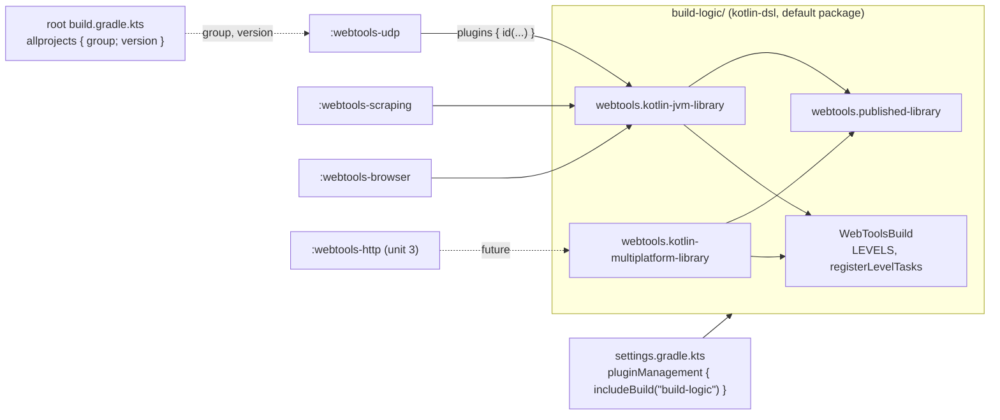
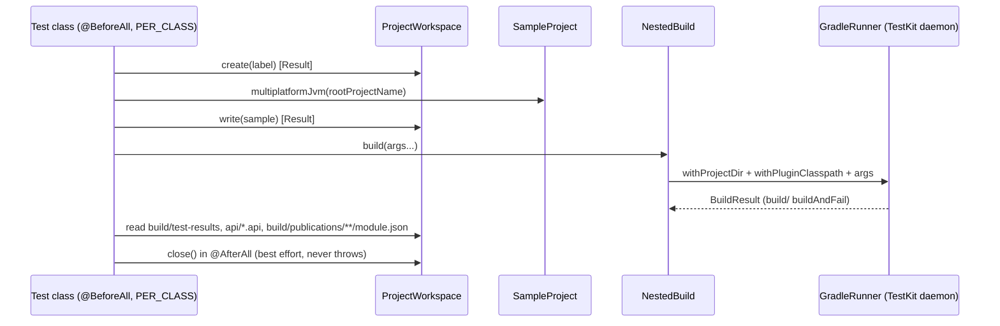

# Plan: `build-logic` — an included build with convention plugins and package-selected level tasks

- **Covers:** `SpartanLaboratories/WebTools#61` — *"Build: move shared configuration into an
  included `build-logic` build with convention plugins and package-selected level tasks"*
  (work level 3, `type: feature`). Sub-issue of the level-4 tracking issue
  `SpartanLaboratories/WebTools#55` (HTTP client stack).
- **Architecture:** [`../architecture.md`](../architecture.md), unit 1 `build-logic`
  (§6.1 *Shared build logic*, §8 rows for the root build, level tasks, `settings.gradle.kts`,
  the module build files, `README.md`, `gradle.properties`/`.gitignore` and the `@Tag`
  adoption row, §9 *build-logic plugins and WebToolsBuild*, §10 first alternative, §11 unit 1,
  §12 KGP risk, §13). Systems-level impact: [`../impact.md`](../impact.md). This unit's
  research: [`research/README.md`](research/README.md) with
  [`research/testkit-harness.md`](research/testkit-harness.md) and
  [`research/multiplatform-plugin-wiring.md`](research/multiplatform-plugin-wiring.md).
- **Branch:** `feat/issue-61-build-logic` (exists; cut from `master` at `834ce4a`; holds the
  research commits only).
- **Commit:** TBD — this `plan.md` is committed in the same commit as the first implementation
  commit (§12), so `git log --follow` binds the two.
- **PR:** TBD (the PR closes #61).
- **What this plans:**
  - the new included build `build-logic/`: the `WebToolsBuild` helper and the three precompiled
    script plugins `webtools.published-library`, `webtools.kotlin-jvm-library` and
    `webtools.kotlin-multiplatform-library`;
  - `build-logic`'s own tests, in the five-level layout with one task per level;
  - the rewrite of `settings.gradle.kts`, the root `build.gradle.kts` and the three module build
    files onto the plugins;
  - level tasks that select by package instead of by JUnit tag;
  - the README "Build & test" section.
- **Status:** implemented on the branch's working tree: the first version of this plan with
  amendments 1 and 2. The as-built record is [`final-implementation.md`](final-implementation.md).
- **Version moved:** none. `webtools-udp` stays `2.0.0a`; `webtools-scraping` and
  `webtools-browser` stay `1.0.0`. The published POMs, Gradle Module Metadata and jars of the
  three existing modules are unchanged (measured once, §9).

> **Amended after qa pass 1 (2026-10-22).** Amendment 1 completes `build-logic`'s test levels,
> corrects the harness and the documentation, and applies the rule that no procedure runs a test
> suite of `webtools-udp`, `webtools-scraping` or `webtools-browser`.
> - **Test levels** (§9). `build-logic` gains:
>   - a gating level, and one task per level that has tests;
>   - task filters that fail on an empty run;
>   - repeatable tests of the Kotlin/JVM plugin and of the publishing convention;
>   - an end-to-end check of the included-build path;
>   - the configuration-cache check moved to Level 4c.
> - **Harness.** `TestReports` reads each class name from the report's content, never from its file
>   name.
> - **Procedures.** Level 1 compares the modules' level tasks under `--test-dry-run`, and Level 5
>   is narrowed.
> - **Documentation fixes** apply across the scripts, the harness and the README.
> - **Sibling contracts.** §11 records what KGP's handling of target attributes and of
>   associated compilations means for units 2 and 4.
> - **Where it lives.** §16 lists every edit to the as-built tree. §6, §7, §9 and §10–§14 describe
>   the amended design.

> **Amended after the amendment-1 implementation run (2026-10-22).** Amendment 2 (§17) makes two
> changes:
> - `TestReports` takes class names from `<testcase classname>`. A multiplatform `jvmTest` report
>   names its suite `<SimpleName>[jvm]`, so `<testsuite name>` cannot serve.
> - The three nested-build tasks take a single-permit build service, `testKitHomeLock`, so they use
>   the shared TestKit home one after another. With the configuration cache, Gradle runs tasks of one
>   project at the same time.

---

## 1. Requirements

**R1. The included build.** `build-logic/` exists and is included by
`pluginManagement { includeBuild("build-logic") }` as the **first** statement of
`settings.gradle.kts`. The foojay 0.8.0 plugin and the `include(...)` line stay.

**R2. The root build.** `build.gradle.kts` keeps only
`allprojects { group = "io.github.spartanlaboratories"; version = "1.0.0" }`. Its comment is
reworded to say the shared configuration lives in `build-logic`. It has no `plugins` block, no
`subprojects {}` block, and therefore no `build`, `check` or `test` task of its own.

**R3. `WebToolsBuild`.** A public `object` in the default package of `build-logic` that holds
the ordered level list (`gating`, `component`, `integration`, `deterministic`, `e2e`,
`nonfunctional`, `uat`) and
`registerLevelTasks(project, classesDirs, classpath)`. The function registers seven plain
`Test` tasks `gatingTest` … `uatTest`, each selecting by the package filter
`com.spartanlabs.testing.<level>.*` with `isFailOnNoMatchingTests = false`.
`JAVA_FLOOR` is not part of this unit.

**R4. Three precompiled script plugins**, all in the default package of
`build-logic/src/main/kotlin`: `webtools.published-library`, `webtools.kotlin-jvm-library`,
`webtools.kotlin-multiplatform-library`. `webtools.kotlin-common-check` is not part of this
unit.

**R5. The three existing modules** each apply `id("webtools.kotlin-jvm-library")` and declare
their own `api("org.slf4j:slf4j-api:2.0.13")`. Coordinates and `pom { name; description }`
stay in each module. `webtools-udp`'s header comment (`:1-2`) is rewritten; its `2.0.0a`
version-history note, `version = "2.0.0a"` (`:101`) and port lock (`:103-117`) stay
byte-identical. `webtools-scraping` and `webtools-browser` get no `version` line.

**R6. Not in any plugin:** `explicitApi()`; any toolchain, `jvmTarget`, `-Xjdk-release`, Java
compatibility setting or `verifyJavaFloor` (unit 2); an ABI dump for any of the three existing
modules.

**R7. Published output stays identical.** For each of the three modules the POM, the Gradle
Module Metadata and the jars match those built from `834ce4a`. Measured once, before and after;
commands and results recorded in this issue's `final-implementation.md`. No permanent
golden-file test.

**R8. Level tasks.** They keep their names, `group = "verification"` and per-level
descriptions, dropping only the `(@Tag("…"))` mention. They stay out of `check`. The 95 `@Tag`
annotations stay. On the three existing modules the package filter selects exactly the classes
the tags select today.

**R9. Multiplatform plugin behaviour** (ready for the first multiplatform module, which is
unit 3):
- a `jvm()` target with an explicit `TargetJvmVersion` attribute valued at the major version
  of the JDK running the build (`JavaVersion.current()`), which is what an unpinned Kotlin/JVM
  module declares today;
- `kotlin("test")` in `commonTest`, and `kotlin("test-junit5")` plus
  `ch.qos.logback:logback-classic:1.5.6` in `jvmTest`; the JVM plugin carries the same three as
  `testImplementation`;
- `useJUnitPlatform()` on every `Test` task;
- the level tasks over `jvm().compilations["test"]`;
- a lifecycle `test` task that depends on `jvmTest`;
- `mavenPublishing { configure(KotlinMultiplatform(javadocJar = JavadocJar.Empty(), sourcesJar = SourcesJar.Sources())) }`;
- binary-compatibility-validator 0.18.2 on its defaults (no `apiValidation {}` block), plus the
  ASM 9.9.1 pin on its worker classpath.

**R10. Layout of `build-logic`** follows the organisation precedent
(`MyGameTools/build-logic`): a `kotlin-dsl` build; plugin-marker dependencies at literal
versions (the repository has no version catalog); its own `settings.gradle.kts` with
`rootProject.name = "build-logic"` and repositories `mavenCentral()` and
`gradlePluginPortal()`; Level-2 KDoc on `WebToolsBuild` and its public members.

**R11. `build-logic`'s own tests.** They follow the five-level layout under
`build-logic/src/test/kotlin/com/spartanlabs/testing/<level>/webtools/buildlogic/`, JUnit 5, one
class per file. Each level with tests has a task of its own name, and every one of these tasks
fails on an empty run.
- **Level 1, gating (`gatingTest`):** the build compiled its three plugin descriptors, and the
  plugin-under-test metadata carries the plugins they apply.
- **Level 2, component (`componentTest`):** `WebToolsBuild.registerLevelTasks` on a `ProjectBuilder`
  project, including that every task runs on the JUnit Platform.
- **Level 3, integration (`integrationTest`):** Gradle TestKit checks of generated samples. They
  check the following:
  - **The multiplatform plugin:**
    - `test` runs `jvmTest`;
    - the level tasks pick tests from `commonTest` and `jvmTest` by package, and `check` runs none
      of them;
    - `apiDump` writes the dump, and `apiCheck` is part of `check`;
    - the `TargetJvmVersion` attribute is published.
  - **The Kotlin/JVM plugin:** the same level selection over the `test` source set, `test` running
    every class, and no level task in `check`.
  - **The publishing convention of both library plugins:**
    - the shared POM metadata;
    - the Central repository and one signing task per publication;
    - the sources and javadoc jars.
- **Level 4a, deterministic (`deterministicTest`):** the level list.
- **Level 4b, e2e (`e2eTest`):** the plugins along the repository's own path. A generated
  composite includes a copy of `build-logic` through `pluginManagement`, and its module scripts use
  the generated accessors and read `WebToolsBuild`.
- **Level 4c, nonfunctional (`nonfunctionalTest`):** configuration-cache reuse.
- **`test`** runs the gating, component and deterministic levels. It is `build-logic`'s
  pre-commit gate.
- **What runs them.** The tasks that start nested builds (`integrationTest`, `e2eTest`,
  `nonfunctionalTest`) run on demand. `./gradlew build` runs none of these tasks. The unit-4
  publication check reuses the harness.

**R12. README "Build & test"** (`README.md:465-508`) states:
- the package-selection rule;
- the included `build-logic` build with its three plugin ids;
- what a module's build file adds;
- `build-logic`'s own level tasks, with `./gradlew :build-logic:test` as its pre-commit gate;
- the on-demand nested-build tasks.

It says nothing yet about multiplatform module layout.

**Acceptance.**
1. `./gradlew assemble testClasses` and `./gradlew build --dry-run` succeed. Under
   `--test-dry-run`, each module's seven level tasks select the same test classes as on
   `834ce4a` (§9, procedure B). No test body of the three modules runs.
2. The published-output identity procedure (§9, procedure A) shows no difference for any of the
   three modules.
3. A second identical invocation reuses the configuration-cache entry, and `--warning-mode all`
   shows no "Kotlin Gradle plugin was loaded multiple times" warning (§9, procedures D and E).
4. Every `build-logic` test task is green from the repository root:
   - `./gradlew :build-logic:test`;
   - `:build-logic:gatingTest`, `:build-logic:componentTest` and `:build-logic:deterministicTest`;
   - `:build-logic:integrationTest`, `:build-logic:e2eTest` and `:build-logic:nonfunctionalTest`.

   Each of these fails on an empty run (§9, procedure H).
5. `git diff` of `webtools-udp/build.gradle.kts` shows no change to the `2.0.0a` note,
   `version = "2.0.0a"` or the port lock.

---

## 2. Current state

**Baseline.** Branch `feat/issue-61-build-logic`, cut from `master` at `834ce4a`; `806ce8e`
(the architecture's baseline) differs from it only in documents. The working tree is clean.
Line references below are to this branch.

**Root build** (`build.gradle.kts`, 92 lines):
- `:1-5` — `plugins { kotlin("jvm") version "2.2.0" apply false; id("com.vanniktech.maven.publish") version "0.36.0" apply false }`;
- `:7-11` — comment saying the shared configuration is "configured here once";
- `:12-15` — `allprojects { group = "io.github.spartanlaboratories"; version = "1.0.0" }`;
- `:17-92` — `subprojects {}`: applies both plugins by id (`:18-19`), `repositories { mavenCentral() }`
  (`:21-23`), `api(slf4j-api:2.0.13)` plus `testImplementation` of `kotlin("test-junit5")`,
  `kotlin("test")` and `logback-classic:1.5.6` (`:25-33`), `useJUnitPlatform()` on every `Test`
  (`:35-37`), the seven level tasks over `sourceSets["test"]` with `useJUnitPlatform { includeTags(tag) }`
  (`:44-62`, `includeTags` at `:60`; description `"$describe (@Tag(\"$tag\"))."` at `:56`), and
  `mavenPublishing { publishToMavenCentral(); signAllPublications(); pom { … } }` (`:64-91`, shared
  `pom {}` at `:68-90`).

**Settings** (`settings.gradle.kts`): `:1-3` foojay-resolver-convention 0.8.0; `:5`
`rootProject.name = "WebTools"`; `:7` `include(":webtools-udp", ":webtools-scraping", ":webtools-browser")`.
`gradle.properties` holds only `kotlin.code.style=official`. The wrapper is Gradle 9.7.1.

**Modules.**
- `webtools-udp/build.gradle.kts`: `:1-2` header comment ("slf4j-api only (inherited from the root
  build)"), `:4-100` version history, `:101` `version = "2.0.0a"`, `:103-117` the port lock
  (`:115-117` calls `tasks.named<Test>(…)` on `test`, `integrationTest`, `e2eTest`,
  `nonfunctionalTest` at module evaluation), `:119-125` `mavenPublishing { coordinates(…); pom { … } }`.
  It has no `dependencies {}` block: slf4j arrives from the root.
- `webtools-scraping/build.gradle.kts`: `:1-2` header, `:4-8` `dependencies { implementation(skrapeit,
  jsoup, unirest) }`, `:10-16` `mavenPublishing`.
- `webtools-browser/build.gradle.kts`: `:1-3` header, `:5-7` `dependencies { implementation(selenium-java) }`,
  `:9-15` `mavenPublishing`.
- Task names confirmed by a read-only listing (`./gradlew :webtools-udp:tasks --all`):
  `jar`, `sourcesJar`, `plainJavadocJar`, `generatePomFileForMavenPublication`,
  `generateMetadataFileForMavenPublication`, the seven `*Test` level tasks and `test`.

**Tests.** 99 test files; the 95 tagged ones carry exactly one class-level `@Tag` equal to their
`com.spartanlabs.testing.<level>` package segment; the 4 untagged files are `testing/support/`
helpers in `webtools-udp` with no `@Test`; there are no `@Nested` classes. Per module and level:
`webtools-udp` gating 19, component 21, integration 20, deterministic 9, e2e 11, nonfunctional 11,
uat 1 (92 classes); `webtools-scraping` component 1; `webtools-browser` gating 1, uat 1. Tests
use `kotlin.test.Test`, not MockK (MockK appears nowhere). The package filter
`com.spartanlabs.testing.<level>.*` therefore selects the same classes as the tags. Baseline,
measured at `806ce8e` with only documents changed since: every level of every module passes, 642
tests executed and 15 `@Disabled` by design.

**Build host.** Windows, Oracle JDK 23.0.2, Gradle 9.7.1 wrapper. The maintainer's user-level
`~/.gradle/gradle.properties` turns the configuration cache on for every local build. **No publish
or sign task is run by this plan:** every procedure generates the POM, the module metadata and the
jars without publishing. Neither the repository's `gradle.properties` nor the user-level one sets a
`POM_*`, `mavenCentralPublishing` or `signAllPublications` property, so the explicit calls in the
shared block are the only source of Central publishing and signing.

**Other files.** `.gitattributes` covers `*.kt` and `*.kts` (`eol=lf`). `.gitignore` covers `build/`,
`.gradle` and `.kotlin` at any depth, which includes `build-logic/build/`, where the TestKit
projects and the TestKit Gradle user home live. `docs/dashboards/` shows `build-logic` as
`planned`. `webtools-browser/src/test/…/uat/…/WebViewerUatTest.kt` cites
`./gradlew :webtools-browser:uatTest`; task names do not change, so it stays valid.

**Verified outside-world facts this unit rests on** (65 claims re-opened at source on 2026-10-21;
all hold — [`research/README.md` § Verification](research/README.md)):
- Precompiled script plugins in an included build reached through `pluginManagement`, with typed
  `kotlin {}` and `mavenPublishing {}` accessors and `WebToolsBuild` visible from module scripts,
  were built and run on this toolchain; the three modules publish identical POMs and metadata
  ([`kmp-build-topology.md` F2](../research/kmp-build-topology.md)). Level tasks over the
  multiplatform test compilation, selected by package with `isFailOnNoMatchingTests = false`, and
  the lifecycle `test` task (F4). A multiplatform `jvm()` target writes no `org.gradle.jvm.version`
  unless the attribute is set on the target ([`java-11-floor.md` F1](../47-java-23-bytecode/research/java-11-floor.md)).
- `kotlin-dsl` applies `java-gradle-plugin`, which adds `gradleTestKit()`, `gradleApi()` and the
  plugin-under-test metadata to the `test` source set; `GradleRunner.withPluginClasspath()` reads
  that metadata ([`KotlinDslPlugin.kt`](https://github.com/gradle/gradle/blob/v9.7.1/platforms/core-configuration/kotlin-dsl-plugins/src/main/kotlin/org/gradle/kotlin/dsl/plugins/dsl/KotlinDslPlugin.kt),
  [`JavaGradlePluginPlugin.java`](https://github.com/gradle/gradle/blob/v9.7.1/platforms/extensibility/plugin-development/src/main/java/org/gradle/plugin/devel/plugins/JavaGradlePluginPlugin.java),
  [`GradleRunner.java`](https://github.com/gradle/gradle/blob/v9.7.1/platforms/extensibility/test-kit/src/main/java/org/gradle/testkit/runner/GradleRunner.java)).
  Gradle's own page uses this layout and invokes `./gradlew :build-logic:functionalTest` from the
  root ([`best_practices_testing.adoc`](https://github.com/gradle/gradle/blob/v9.7.1/platforms/documentation/docs/src/docs/userguide/best-practices/best_practices_testing.adoc)).
- `gradleApi()` carries the Groovy modules including `groovy-json`:
  [`DependencyClassPathProvider.GROOVY_MODULES`](https://github.com/gradle/gradle/blob/v9.7.1/subprojects/core/src/main/java/org/gradle/api/internal/DependencyClassPathProvider.java)
  lists `"groovy-json"`, and
  [`DependencyClassPathNotationConverter.gradleApiFileCollection`](https://github.com/gradle/gradle/blob/v9.7.1/platforms/software/dependency-management/src/main/java/org/gradle/api/internal/notations/DependencyClassPathNotationConverter.java)
  adds the local-Groovy jars to `gradleApi()`. The local 9.7.1 distribution's `lib/` holds
  `groovy-json-4.0.32.jar` and `slf4j-api-2.0.17.jar`. So `groovy.json.JsonSlurper` and
  `org.slf4j.Logger` need no declared dependency.
- binary-compatibility-validator 0.18.2: applied to one leaf project it touches only that project;
  defaults are dump directory `api`, KLib validation off; a `jvm()`-only module gets `apiDump`,
  `apiCheck`, `jvmApiBuild`, `jvmApiDump`, `jvmApiCheck`, `check` → `apiCheck`, and the dump
  `<module>/api/<Gradle project name>.api`; `apiCheck` fails until a dump exists; applying it also
  on an ancestor fails ("Cannot add a configuration with name 'bcv-rt-jvm-cp'"); it hard-codes ASM
  9.6, which rejects class files above Java 22 (major 66), so on this JDK 23 host (major 67)
  `apiDump` fails without the pin; ASM 9.9 adds Java 26 class files and 9.9.1 is its bug-fix
  release ([`multiplatform-plugin-wiring.md` F1–F7](research/multiplatform-plugin-wiring.md)).
- vanniktech 0.36.0: with no `configure(...)` call, its own `afterEvaluate` picks
  `KotlinJvm(JavadocJar.Javadoc(), SourcesJar.Sources())` for Kotlin/JVM modules (today's output);
  an explicit `configure(KotlinJvm())` would switch them to an empty javadoc jar
  (wiring F11).

---

## 3. Assumptions

**Established on this branch by the first implementation run** ([`final-implementation.md`](final-implementation.md)):
- The convention scripts compile and behave as the research reads them.
- `import WebToolsBuild` compiles from a named package.
- KGP supplies the JUnit Platform launcher to a multiplatform `jvmTest`.
- vanniktech works under an injected plugin classpath.
- Both `module.json` files carry `org.gradle.jvm.version` on the `jvm*Elements-published`
  variants.
- `ProjectBuilder` instantiates plain `Test` tasks.
- The nested daemon heap of `-Xmx2g` and the 30-minute timeout hold. A cold run of the first five
  TestKit classes took about 83 s.

**Established by the amendment-1 implementation run** ([`final-implementation.md`](final-implementation.md)):
- `--test-dry-run` reports every selected class as skipped and runs no test body, on the level
  tasks of `834ce4a` (selected by JUnit tag) and of this branch (selected by package). Procedure B
  found the two sides' selections identical for every module.
- The publishing samples publish only to a `testFolder` repository inside their own project,
  declared through the `publishing {}` accessor, with the `Sign` tasks that
  `signAllPublications()` registers disabled. Nothing is signed, and nothing reaches a remote
  repository.
- The end-to-end composite configures from a copy of `build-logic` (its settings file, its build
  script and `src/main`) and resolves the plugin markers into the shared TestKit home.
- `GradleRunner.withTestKitDir(...)` with one directory serves every nested-build task.
  `NestedBuild` passes the directory named by `webtools.testkit.home`.
- With the configuration cache, Gradle runs tasks of one project at the same time. Without a lock,
  the three nested-build tasks started in the same second.
- A multiplatform module's `jvmTest`, KGP's `KotlinJvmTest`, names each report's suite
  `<SimpleName>[jvm]`. Each `<testcase classname>` in the report holds the package-qualified class,
  as it does for a plain `Test` task.

**Established by the amendment-2 implementation run** ([`final-implementation.md`](final-implementation.md)):
- **`testKitHomeLock` serialises the nested-build tasks.** Sorted by their timestamps, the three
  tasks' reports do not interleave, and about a second separates one task's end from the next
  one's start.
  - Sharing the home at the same time caused no failure when measured: Gradle guards a Gradle user
    home with cross-process locks, as it does `~/.gradle`, and separate invocations rely on them.
  - Serialising keeps the nested daemon of one task at a time, with its 2 GB heap, at work on the
    home. The cost is wall time: 96 s warm for the three tasks, against 48 s when they overlapped.
- **`<testcase classname>` names the class** for a multiplatform `jvmTest` and for a plain level
  task alike: all 28 integration tests pass.

**Assumed, not exercised.**
- **A consumer's Gradle compiles `build-logic` with its own embedded Kotlin**
  (architecture §3). This unit does not exercise it.

---

## 4. Non-goals

- The Java floor: `JAVA_FLOOR`, `jvmTarget`, `-Xjdk-release`, `java { sourceCompatibility; targetCompatibility }`,
  `verifyJavaFloor`, the `1.0.0a` versions (unit 2).
- Any multiplatform module, `explicitApi()`, the `webtools.kotlin-common-check` plugin, the
  `:webtools-http*` settings entries (unit 3); the fixtures-publication check (unit 4).
- An ABI dump for `webtools-udp`, `webtools-scraping` or `webtools-browser`; applying
  binary-compatibility-validator at the root.
- A permanent golden-file publication test. The publishing convention is locked element by element
  instead (§9, Level 3).
- Running a test suite of `webtools-udp`, `webtools-scraping` or `webtools-browser`. Their code
  and tests do not change. Their level tasks are only listed (`--dry-run`) or dry-run
  (`--test-dry-run`, where no test body runs), and their published output is compared byte for
  byte (§9).
- Removing the 95 `@Tag` annotations (optional follow-up `remove-redundant-test-tags`).
- Enabling the configuration cache repository-wide (the requirement is compatibility);
  CI, `CONTRIBUTING.md`, `CHANGELOG.md`, tags, releasing and the foojay bump (#58).
- A `jvm-test-suite` for the TestKit tests; `withDebug(true)`; a dedicated Kotlin/JSON dependency.
- Updating `docs/dashboards/` (done by the run's presenter step after implementation).

---

## 5. Design

### 5.1 Topology



Plugin versions are pinned once, in `build-logic/build.gradle.kts` (KGP 2.2.0, vanniktech 0.36.0,
binary-compatibility-validator 0.18.2). The scripts apply plugins by id with no version: Gradle
forbids versions and `apply false` in precompiled script plugins and takes the plugin from
`build-logic`'s implementation classpath. Kotlin, the validator and vanniktech therefore share one
class loader, which the validator needs (it casts the `kotlin` extension to KGP's own types).

### 5.2 `build-logic` source layout

```
build-logic/
  settings.gradle.kts
  build.gradle.kts
  src/main/kotlin/
    WebToolsBuild.kt                                  (TestLevel + WebToolsBuild)
    webtools.published-library.gradle.kts
    webtools.kotlin-jvm-library.gradle.kts
    webtools.kotlin-multiplatform-library.gradle.kts
  src/test/kotlin/com/spartanlabs/testing/
    gating/webtools/buildlogic/BuildLogicPluginsGatingTest.kt
    component/webtools/buildlogic/RegisterLevelTasksComponentTest.kt
    integration/webtools/buildlogic/                  (the TestKit classes of §9, Level 3)
    deterministic/webtools/buildlogic/WebToolsBuildLevelsDeterministicTest.kt
    e2e/webtools/buildlogic/IncludedBuildEndToEndTest.kt
    nonfunctional/webtools/buildlogic/ConfigurationCacheReuseNonFunctionalTest.kt
    support/webtools/buildlogic/                      (harness: SampleProject, ProjectWorkspace,
                                                       NestedBuild, TestReports, ModuleMetadata,
                                                       PomFile, BuildLogicSource)
```

Every script ends up on `build-logic`'s classpath and is applied by plugin id. Each script opens
with a header comment (Ring 1) saying what it configures and what it leaves to modules, and groups
its sections in `//region` / `//endregion` blocks. The region names are the seams unit 2 edits
(§11).

### 5.3 Level tasks

`registerLevelTasks` replaces `build.gradle.kts:44-62`. Differences from today, all deliberate:
`includeTags(tag)` becomes `filter { includeTestsMatching("com.spartanlabs.testing.<level>.*"); isFailOnNoMatchingTests = false }`;
the description loses its `(@Tag("…"))` suffix; `testClassesDirs` and `classpath` are parameters, so the JVM
plugin passes `sourceSets["test"]` and the multiplatform plugin passes the `jvm()` test compilation;
`useJUnitPlatform()` is called by the function itself, so a level task works independently of the
plugin's `withType<Test>` hook. A test class outside every `com.spartanlabs.testing.<level>` package
(for example `testing.support`) runs under `test` / `jvmTest` and in no level task; this is stated in
the README and locked by a TestKit class.

### 5.4 Publishing

`webtools.published-library` moves `build.gradle.kts:21-23` and `:64-91` verbatim into a plugin
that applies vanniktech. **It never calls `configure(...)`**: vanniktech's own `afterEvaluate`
picks the platform from the applied Kotlin plugin, which for the three Kotlin/JVM modules is
`KotlinJvm(Javadoc(), Sources())`, today's output. The multiplatform plugin pins
`KotlinMultiplatform(Empty(), Sources())` explicitly, which equals auto-detection and keeps it
stable if a Dokka plugin is ever applied. vanniktech reads `group`, `name` and `version` lazily, so
a module's `version = "2.0.0a"` after its `plugins {}` block still applies.

### 5.5 Binary-compatibility-validator and the ASM pin

The multiplatform plugin lists the validator in its own `plugins {}` block and configures nothing.
The module's dump is `<module>/api/<Gradle project name>.api`; the first multiplatform module
(unit 3) commits its dump with its first public declaration. The validator must never also be
applied on the root or an ancestor project.

`"bcv-rt-jvm-cp"("org.ow2.asm:asm:9.9.1")` and `"bcv-rt-jvm-cp"("org.ow2.asm:asm-tree:9.9.1")`
raise the ASM version on the validator's worker classpath. The validator hard-codes 9.6, which
rejects class files above Java 22. Until the Java 11 floor compiles `main` to class-file major 55, a
module built on this JDK 23 host compiles to major 67 and `apiDump` fails; the TestKit `apiDump`
test fails without the pin on a JDK 23 or higher host, which makes it the pin's regression guard
for as long as the floor is absent. 9.9 is the ASM line that reads Java 26 class files, the newest
JDK that runs Gradle 9.7.1; 9.9.1 is its bug-fix release (an `OutOfMemoryError` on an invalid class
among the fixes). ASM keeps its 9.x API compatible and the validator only reads classes through the
tree API. Once the floor lands the pin is inert (Gradle takes the highest version on the
configuration); the script's comment says exactly this. The script's header comment also records the
known KGP 2.2.0 Gradle-10 `archives` deprecation (KT-78620) printed at `jvm()`, so nothing is ever
run with `--warning-mode=fail`.

### 5.6 TestKit harness



- **Injection.** `GradleRunner.withPluginClasspath()`, using the plugin-under-test metadata that
  `kotlin-dsl` already wires, serves every check except the end-to-end one.
  - **No live `build-logic`.** No generated project includes the live `build-logic`: a nested build
    would compile and write in the directory the outer build is executing in, and Gradle documents
    that builds sharing an included build may conflict.
  - **No real repository build.** The checks never drive it: no module applies the multiplatform
    plugin, the build writes into the working tree, and it would run the modules' test suites.
- **The end-to-end check** reaches the plugins the way the repository does, with no injection.
  - `BuildLogicSource` copies `build-logic`'s settings file, build script and `src/main` into a
    `build-logic/` directory inside the generated composite.
  - The composite's settings include that copy through `pluginManagement { includeBuild("build-logic") }`.
  - `NestedBuild` runs it with `injectPluginClasspath = false`.
- **The generated single-project samples** apply only `id("webtools.kotlin-multiplatform-library")`
  or only `id("webtools.kotlin-jvm-library")`.
  - **No Kotlin plugin of their own.** A second Kotlin plugin class loader trips KGP's
    isolated-classpath check.
  - **`settings.gradle.kts`** sets `rootProject.name`, which names the ABI dump and the artifacts,
    and `dependencyResolutionManagement { repositories { mavenCentral() } }`.
  - **`build.gradle.kts`** sets `group = "sample.webtools"` and `version = "1.0.0"`.
    `SampleProject.withLocalPublishing()` appends three things: a `testFolder` repository at
    `build/repo`, the POM name and description, and disabled `Sign` tasks.
  - **`gradle.properties`** is:

    ```properties
    org.gradle.configuration-cache=true
    org.gradle.vfs.watch=false
    kotlin.compiler.execution.strategy=in-process
    org.gradle.jvmargs=-Xmx2g -XX:MaxMetaspaceSize=1g
    ```

    TestKit ignores the user-level `gradle.properties`, so every setting the nested build needs is
    written here. §16.8 gives the reason for each setting in the source comment.
- **Sources of the samples.** Every sample has one public class, `sample.Greeter`. Each
  test class is a `kotlin.test` class.
  - **The multiplatform sample** has, in `commonTest`, `CommonSourceSetTest` in
    `com.spartanlabs.testing.component.sample`. In `jvmTest` it has `JvmSourceSetTest` in
    `com.spartanlabs.testing.integration.sample`, and an unleveled `UnleveledTest` in package
    `sample`.
  - **The Kotlin/JVM sample** has, in `test`, `JvmComponentTest` and `JvmIntegrationTest` in the
    same two level packages, plus `UnleveledTest`.
  - **The end-to-end composite** holds a `jvm-lib` module and a `kmp-lib` module.
    - Each has one component-package test: `JvmLibComponentTest` and `KmpLibComponentTest`.
    - `jvm-lib`'s script registers a `printLevels` task that prints `WebToolsBuild.LEVELS`.
    - Both scripts set `mavenPublishing { coordinates(…); pom { … } }`.
- **TestKit home.** `build-logic/build/testkit/home` is the TestKit directory, which is also the
  nested builds' Gradle user home.
  - `NestedBuild` passes it to `GradleRunner.withTestKitDir(...)` from the system property
    `webtools.testkit.home`. Every nested-build task sets that property.
  - Every nested build of every task, and later runs, share it, so only the first run downloads the
    Kotlin compiler, the test dependencies and the plugin markers.
  - The nested-build tasks take the single-permit build service `testKitHomeLock` (§6.3). Gradle
    runs them one after another, so no two of them use the home at once within one invocation.
  - It needs the network. A first run offline fails at dependency resolution and is never skipped.
    `clean` resets it.
- **Windows.** JUnit `@TempDir` fails a test when it cannot delete a file, so generated projects
  live in a harness-owned directory under `build-logic/build/testkit/projects/`.
  - Their names are short (`p-<label>-<base36>`), because KGP's intermediate paths are deep and
    Windows path limits are real.
  - They are `AutoCloseable`, with a best-effort deletion that never throws.
- **One workspace per sample.** Its nested build, or the ordered sequence of builds that §9 lists
  for the class, runs on that workspace in `@BeforeAll`, with `@TestInstance(Lifecycle.PER_CLASS)`
  (no `companion object` with `lateinit`).
  - A class normally holds one workspace. `PublishingConventionIntegrationTest` holds one per
    library plugin.
  - Each `BuildResult` that an assertion reads is kept in a property.
  - Assertions are JUnit `Assertions`.
  - `GradleRunner.build()` is used for expected success and `buildAndFail()` for expected failure,
    so an unexpected outcome fails the test with the full build output.
- **Test selection evidence.** `TestReports` reads which classes a task ran from the `classname`
  attribute of each `<testcase>` element in its reports. That attribute holds the package-qualified
  class name for a plain `Test` task and for KGP's `KotlinJvmTest` alike. The two other candidates
  do not serve:
  - **file names:** Gradle shortens a report file name longer than 106 bytes and appends a hash;
  - **`<testsuite name>`:** a multiplatform `jvmTest` report names its suite `<SimpleName>[jvm]`, for
    example `UnleveledTest[jvm]`.
- **The tasks.** Each `build-logic` level that has tests gets a plain `Test` task over the `test`
  source set, selecting `com.spartanlabs.testing.<level>.*` and failing on an empty run:
  `gatingTest`, `componentTest`, `integrationTest`, `deterministicTest`, `e2eTest` and
  `nonfunctionalTest`.
  - **`test`** runs the gating, component and deterministic levels, the ones that start no nested
    build. It is the pre-commit gate.
  - **Invocation.** The tasks run from the repository root as `./gradlew :build-logic:<task>`;
    `./gradlew -p build-logic <task>` is the fallback.
  - **Why not test suites.** A `jvm-test-suite` is not used, because a suite cannot share the
    `test` source directory.
  - **For later checks.** A later check (unit 4) can depend on any of them with
    `gradle.includedBuild("build-logic").task(":<task>")`, which works for a build included through
    `pluginManagement`.

### 5.7 Staging

The first version of this plan was implemented in three stages, and the working tree holds all of
them. Amendment 1 (§16) and amendment 2 (§17) are applied on top. The work then lands as three
commits, file by file (§12). Each commit leaves the build green:

| Commit | Content | Verification before commit |
|---|---|---|
| 1 | All of `build-logic/` (after §16 and §17), `settings.gradle.kts`, this `plan.md` | §9 procedures G and H (every `build-logic` task) |
| 2 | Root `build.gradle.kts`, the three module build files, `README.md` | §9 procedures B–F |
| 3 | `impact.md`, the reconciled `final-implementation.md` | none (documents) |

A file is never split across commits.

---

## 6. File-by-file changes

### 6.1 `settings.gradle.kts` (changed)

```kotlin
pluginManagement {
    includeBuild("build-logic")
}

plugins {
    id("org.gradle.toolchains.foojay-resolver-convention") version "0.8.0"
}

rootProject.name = "WebTools"

include(":webtools-udp", ":webtools-scraping", ":webtools-browser")
```
`pluginManagement` must precede `plugins` (Gradle requires it). Nothing else changes. Failure:
a Gradle configuration error if `build-logic` is missing; nothing to handle.

### 6.2 `build-logic/settings.gradle.kts` (new)

```kotlin
// Standalone build that holds the shared Gradle configuration for every WebTools module as
// precompiled convention plugins. Included by the root settings through
// pluginManagement { includeBuild("build-logic") }.

dependencyResolutionManagement {
    repositories {
        mavenCentral()
        gradlePluginPortal()
    }
}

rootProject.name = "build-logic"
```
`rootProject.name` is the name `gradle.includedBuild("build-logic")` resolves, so it is part of the
contract with unit 4.

### 6.3 `build-logic/build.gradle.kts` (new)

The final content is in §16.1. The design:
- **Dependencies.** The four plugin markers are `implementation` dependencies with literal
  versions. The test dependencies are the JUnit BOM, `junit-jupiter` and `junit-platform-launcher`.
  `kotlin-dsl` applies `java-gradle-plugin`, which already adds `gradleTestKit()`, `gradleApi()`
  (with Groovy's `groovy-json` and `slf4j-api`) and the plugin-under-test metadata.
- **One task per test level, built by a local function `registerBuildLogicLevelTest`.**
  `WebToolsBuild.registerLevelTasks` cannot be used here, because a build's own classes are not on
  its build script's classpath.
  - Each task is a plain `Test` over the `test` source set, in the `verification` group, on the
    JUnit Platform, selecting `com.spartanlabs.testing.<level>.*`.
  - Each task has `isFailOnNoMatchingTests = true`: every level here has tests, so an empty run
    means a broken filter or a lost class.
  - The tasks are `gatingTest`, `componentTest`, `integrationTest`, `deterministicTest`,
    `e2eTest` and `nonfunctionalTest`.
- **The nested-build tasks** (`integrationTest`, `e2eTest`, `nonfunctionalTest`) also get:
  - the system properties `webtools.testkit.projects`, read as `ProjectWorkspace.PROJECTS_PROPERTY`,
    and `webtools.testkit.home`, read as `NestedBuild.TESTKIT_HOME_PROPERTY`;
  - a 30-minute timeout;
  - the single-permit build service `testKitHomeLock`, an `abstract class TestKitHomeLock :
    BuildService<BuildServiceParameters.None>` registered with `maxParallelUsages = 1`. All three
    share the TestKit home, and with the configuration cache Gradle runs tasks of one project at
    the same time, so the service makes Gradle run them one after another. `webtools-udp`'s port
    lock serialises its socket-bound tasks the same way.
- **`e2eTest` only** gets two more things:
  - the system property `webtools.buildlogic.dir`, read as `BuildLogicSource.SOURCE_PROPERTY`;
  - the files it copies as task inputs (`settings.gradle.kts`, `build.gradle.kts`, `src/main`).
- **`test` is the fast aggregate.** It includes the gating, component and deterministic packages,
  with `isFailOnNoMatchingTests = true`.

None of these tasks is wired into `build-logic`'s `check`. `./gradlew build` from the root never
reaches them: the root has no `build` task, and an included build's tasks run only when asked.
Failure handling: a missing marker version is a Gradle resolution failure at configuration, and
there is nothing to handle.

### 6.4 `build-logic/src/main/kotlin/WebToolsBuild.kt` (new)

```kotlin
import org.gradle.api.Project
import org.gradle.api.file.FileCollection
import org.gradle.api.tasks.TaskProvider
import org.gradle.api.tasks.testing.Test
import org.gradle.kotlin.dsl.register

/**
 * One level of the project's 5-level test hierarchy, as a level test task selects it.
 *
 * Tests of a level live under the package `com.spartanlabs.testing.<id>` in every module, so the
 * level's task selects them by package.
 *
 * @property id the package segment and task-name stem, for example `gating`; never blank.
 * @property description the human-readable level, for example `Level 1 - local pre-commit gating tests`.
 * @throws IllegalArgumentException if [id] is blank.
 */
data class TestLevel(val id: String, val description: String) {
    init { require(id.isNotBlank()) { "A test level needs a non-blank id" } }

    /** The level's task name: `gatingTest`, … `uatTest`. */
    val taskName: String get() = "${id}Test"

    /** The test filter that selects the level: `com.spartanlabs.testing.<id>.*`. */
    val packagePattern: String get() = "${WebToolsBuild.LEVEL_PACKAGE_ROOT}.$id.*"

    /** The level's [description] followed by a full stop, used as the task description. */
    val taskDescription: String get() = "$description."
}

/**
 * Constants and helpers shared by every WebTools module build, read by the convention plugins in
 * this build and, where a module needs them, by module build scripts.
 */
object WebToolsBuild {
    /** The package every level package sits under: `com.spartanlabs.testing.<level>`. */
    const val LEVEL_PACKAGE_ROOT: String = "com.spartanlabs.testing"

    /** The seven levels of the test hierarchy, in order, as a read-only list. */
    val LEVELS: List<TestLevel> = listOf(
        TestLevel("gating", "Level 1 - local pre-commit gating tests"),
        TestLevel("component", "Level 2 - isolated component behaviour tests"),
        TestLevel("integration", "Level 3 - integration & external interface tests"),
        TestLevel("deterministic", "Level 4a - deterministic input-to-output tests"),
        TestLevel("e2e", "Level 4b - end-to-end system integration tests"),
        TestLevel("nonfunctional", "Level 4c - non-functional (robustness / security / performance) tests"),
        TestLevel("uat", "Level 5 - user-acceptance evaluation (manual; mostly @Disabled)"),
    )

    /**
     * Registers one plain [Test] task per level on [project]: `gatingTest` … `uatTest`.
     *
     * Each task runs on the JUnit Platform, belongs to the `verification` group, and selects its
     * tests by the level's package pattern. A level with no matching test passes
     * (`isFailOnNoMatchingTests = false`). The tasks are registered lazily and are not added to
     * `check`.
     *
     * @param project the module the tasks are registered on.
     * @param classesDirs the compiled test classes to scan, for example `sourceSets["test"].output.classesDirs`.
     * @param classpath the runtime classpath the tests run on.
     * @return the seven task providers, in level order, as a read-only list.
     * @throws org.gradle.api.InvalidUserDataException if a task with one of the level names already exists on [project].
     */
    fun registerLevelTasks(
        project: Project,
        classesDirs: FileCollection,
        classpath: FileCollection,
    ): List<TaskProvider<Test>> = LEVELS.map { level ->
        project.tasks.register<Test>(level.taskName) {
            group = "verification"
            description = level.taskDescription
            testClassesDirs = classesDirs
            this.classpath = classpath          // `this.` - the parameter would shadow the task property
            useJUnitPlatform()
            filter {
                includeTestsMatching(level.packagePattern)
                isFailOnNoMatchingTests = false
            }
        }
    }.also { project.logger.info("webtools: registered {} level test tasks in {}", it.size, project.path) }
}
```
- **Mutability.**
  - `LEVELS` and every returned list are read-only `List` views: `listOf` and `map {}` build lists
    that no caller can modify through the `List` type. They are not deeply immutable collections.
  - `TestLevel` is an immutable `data class` with two `val` strings. It is a repository-internal
    build type and is not published; the "no public data class" rule binds the `webtools-http` API
    only.
- **Failure.** A blank level id is a programmer error → `IllegalArgumentException` from
  `require`. A second registration of the same task name (two plugins both calling the function on
  one project) is a programmer error → Gradle's `InvalidUserDataException` propagates and fails
  configuration loudly; it is not wrapped in `Result` because configuration-time failure must fail
  the build, and the unwrap point is Gradle itself.
- **Logging.** One INFO event on registration (Gradle's logger is an slf4j logger).
- **Concurrency.** Configuration-time only; no shared mutable state. `JAVA_FLOOR` arrives in unit 2
  as `const val JAVA_FLOOR: Int = 11` beside `LEVEL_PACKAGE_ROOT`.

### 6.5 `build-logic/src/main/kotlin/webtools.published-library.gradle.kts` (new)

```kotlin
// Convention plugin: the Maven Central publishing skeleton shared by every published WebTools
// module. Per-module coordinates(...) and pom { name / description } stay in each module.
// Applies vanniktech, declares mavenCentral(), publishes to Central and signs every publication.
// It never calls configure(...): vanniktech's own afterEvaluate picks KotlinJvm(Javadoc(), Sources())
// for a Kotlin/JVM module, which is what every module published before this plugin existed (an
// explicit configure(KotlinJvm()) would switch to an empty javadoc jar in 0.36.0).
// A release needs, never committed: the Central credentials mavenCentralUsername and
// mavenCentralPassword, and a signing key - signing.keyId, signing.password and
// signing.secretKeyRingFile, or signingInMemoryKey with signingInMemoryKeyId and
// signingInMemoryKeyPassword - as Gradle properties (the in-memory ones also as
// ORG_GRADLE_PROJECT_-prefixed environment variables). Every publication is signed, so a publish to
// any repository, a local file repository included, needs a signing key unless its Sign tasks are
// disabled or its version ends in -SNAPSHOT.

plugins {
    id("com.vanniktech.maven.publish")
}

repositories {
    mavenCentral()
}

mavenPublishing {
    publishToMavenCentral()
    signAllPublications()
    // coordinates(...) and pom { name / description } are set per module.
    pom {
        // … moved verbatim from build.gradle.kts:68-90 (inceptionYear, url, licenses, developers, scm)
    }
}
```
Failure: configuration-time Gradle errors only. Logging: none (a script of declarations). The
header names the release's external needs by property key only, never by value.

### 6.6 `build-logic/src/main/kotlin/webtools.kotlin-jvm-library.gradle.kts` (new)

```kotlin
// Convention plugin: a published Kotlin/JVM library module. Applies the Kotlin/JVM plugin and
// webtools.published-library, adds the shared test dependencies, runs every Test task on the JUnit
// Platform and registers the seven level test tasks over the `test` source set. A module adds its
// dependencies (api(slf4j-api) included), its coordinates, its POM name and description, and any
// configuration that belongs to it alone (for example webtools-udp's version and UDP-port lock).
// explicitApi() is never set here. It sets no jvmTarget or toolchain: published class files and
// org.gradle.jvm.version follow the build JDK until #47 adds the Java floor.

plugins {
    id("org.jetbrains.kotlin.jvm")
    id("webtools.published-library")
}

// TODO(#47): the java floor region goes here.

//region test dependencies
dependencies {
    // logback is a logging *implementation*, so it is test-only - it must never leak onto a
    // module's runtime classpath. (Moved from the root build.gradle.kts at 834ce4a (`:25-33`);
    // api(slf4j-api) stays in each module.)
    testImplementation(kotlin("test-junit5"))
    testImplementation(kotlin("test"))
    testImplementation("ch.qos.logback:logback-classic:1.5.6")
}
//endregion

//region test tasks
tasks.withType<Test>().configureEach {
    useJUnitPlatform()
}

// `test` still runs every level; each level task runs exactly one, selected by package.
WebToolsBuild.registerLevelTasks(
    project,
    sourceSets["test"].output.classesDirs,
    sourceSets["test"].runtimeClasspath,
)
//endregion
```
It sets no `explicitApi()`, toolchain, `jvmTarget` or Java compatibility setting.

### 6.7 `build-logic/src/main/kotlin/webtools.kotlin-multiplatform-library.gradle.kts` (new)

```kotlin
import com.vanniktech.maven.publish.JavadocJar
import com.vanniktech.maven.publish.KotlinMultiplatform
import com.vanniktech.maven.publish.SourcesJar
import org.gradle.api.attributes.java.TargetJvmVersion

// Convention plugin: a published Kotlin Multiplatform library with a single jvm() target. Applies the
// multiplatform plugin, webtools.published-library and binary-compatibility-validator; sets the
// TargetJvmVersion attribute on the jvm target, the shared test dependencies, JUnit Platform, the
// seven level test tasks over the jvm test compilation and a lifecycle `test` task. Each module adds
// explicitApi(), its own dependencies, its coordinates, its POM name and description, and commits its
// ABI dump (api/<Gradle project name>.api).
// Declares no second JVM-based target: a second one moves the ABI dump to api/<target>/.
// Kotlin Gradle plugin 2.2.0 prints a Gradle-10 deprecation of the `archives` configuration at jvm()
// (KT-78620), so builds are never run with --warning-mode=fail.

plugins {
    id("org.jetbrains.kotlin.multiplatform")
    id("webtools.published-library")
    id("com.vanniktech.maven.publish")   // listed again so this script's own mavenPublishing {} accessor is generated; re-applying is idempotent
    id("org.jetbrains.kotlinx.binary-compatibility-validator")
}

//region jvm target
// The major version of the JDK running the build: what an unpinned Kotlin/JVM module declares today.
// TODO(#47): replace with WebToolsBuild.JAVA_FLOOR when the Java floor lands.
val targetJvmVersion: Int = JavaVersion.current().majorVersion.toInt()

kotlin {
    jvm {
        // A multiplatform jvm() target writes no org.gradle.jvm.version unless the attribute is set on
        // the target. KGP also copies the target's attributes onto every jvm compilation's classpath
        // configurations, so this value is also the JVM version those classpaths request.
        attributes {
            attribute(TargetJvmVersion.TARGET_JVM_VERSION_ATTRIBUTE, targetJvmVersion)
        }
        val testCompilation = compilations.getByName("test")
        WebToolsBuild.registerLevelTasks(
            project,
            testCompilation.output.classesDirs,
            // runtimeDependencyFiles is nullable in the KGP API. It holds the compilation's runtime
            // classpath configuration, and associateWith adds to that configuration rather than
            // replacing it, so a compilation associated with `test` later still reaches the level
            // tasks. A module script must not assign runtimeDependencyFiles itself.
            project.files(listOfNotNull(testCompilation.runtimeDependencyFiles, testCompilation.output.allOutputs)),
        )
    }
}
//endregion

//region test dependencies
kotlin {
    sourceSets {
        getByName("commonTest").dependencies {
            implementation(kotlin("test"))
        }
        getByName("jvmTest").dependencies {
            implementation(kotlin("test-junit5"))
            implementation("ch.qos.logback:logback-classic:1.5.6")
        }
    }
}
//endregion

//region test tasks
tasks.withType<Test>().configureEach {
    useJUnitPlatform()
}

// A multiplatform module has no `test` task, so `./gradlew test` would silently skip it.
tasks.register("test") {
    group = "verification"
    description = "Runs the JVM test suite (alias for jvmTest) so ./gradlew test covers this module."
    dependsOn("jvmTest")
}
//endregion

//region binary compatibility
// binary-compatibility-validator 0.18.2 hard-codes ASM 9.6 on its worker classpath, which rejects
// class files above Java 22. Until the Java 11 floor compiles main to major 55, a module built on
// a JDK 23 host emits major 67 and apiDump fails. ASM 9.9 is the line that reads Java 26 class
// files (the newest JDK that runs Gradle 9.7.1); 9.9.1 is its bug-fix release. Once the floor
// lands this pin is inert: Gradle takes the highest version on the configuration.
dependencies {
    "bcv-rt-jvm-cp"("org.ow2.asm:asm:9.9.1")
    "bcv-rt-jvm-cp"("org.ow2.asm:asm-tree:9.9.1")
}
//endregion

//region publishing
mavenPublishing {
    // Equals vanniktech's auto-detected choice for a multiplatform module (sources jars and an empty
    // javadoc jar), pinned so that it stays the same if a Dokka plugin is ever applied.
    configure(KotlinMultiplatform(javadocJar = JavadocJar.Empty(), sourcesJar = SourcesJar.Sources()))
}
//endregion
```
- **Known deprecation** (header comment): KGP 2.2.0 prints a Gradle-10 `archives` deprecation at
  `jvm()` (KT-78620). It fails on Gradle 10; the exit is a KGP 2.3.21+ move pinned in one line
  here (architecture §12). Never run with `--warning-mode=fail`.
- **`explicitApi()`** is not set here; unit 3's module sets it.
- **Not applied at the root:** the validator, ever.
- **Failure.** All configuration-time. `"bcv-rt-jvm-cp"` is created eagerly by the validator's
  `apply`, so it exists when the `dependencies {}` block runs; an `UnknownConfigurationException`
  there means the validator changed and is caught by the TestKit `apiDump` class.
- **Logging.** No script-level logging; the validator and vanniktech log through Gradle.

### 6.8 `build.gradle.kts` (changed)

Remove `:1-5` and `:17-92`. The file becomes:

```kotlin
// WebTools is published as three independent, single-concern artifacts (webtools-udp,
// webtools-scraping, webtools-browser). Everything they share - the Kotlin/JVM setup, the 5-level
// test-task layout (see the README's "Build & test" section) and the Maven Central publishing
// skeleton - lives in the included build-logic build as convention plugins
// (webtools.kotlin-jvm-library, webtools.kotlin-multiplatform-library, webtools.published-library).
// Each module's own build.gradle.kts applies one of them and adds its dependencies, its coordinates,
// its POM name and description, and any configuration that belongs to it alone (for example
// webtools-udp's version and UDP-port lock); only the group and the default version every module
// shares are set here.
allprojects {
    group = "io.github.spartanlaboratories"
    version = "1.0.0"
}
```
The root evaluates before the subprojects, so `group` and `version` are set before any plugin is
applied (and vanniktech reads them lazily anyway).

### 6.9 `webtools-udp/build.gradle.kts` (changed)

Lines `:1-2` become a rewritten header; two blocks are inserted between the header and the existing
`:3` (blank) / `:4` comment. Everything from `:4` to the end is untouched, byte for byte.

```kotlin
// webtools-udp - a multi-client UDP connection layer with a NAT-traversal handshake.
// Runtime dependencies: slf4j-api only, declared below as an api dependency; the Kotlin/JVM setup,
// test dependencies, level test tasks and publishing skeleton come from the
// webtools.kotlin-jvm-library convention plugin in build-logic.

plugins {
    id("webtools.kotlin-jvm-library")
}

dependencies {
    // Logging: a library depends only on the slf4j API, never on a concrete backend.
    api("org.slf4j:slf4j-api:2.0.13")
}

<existing line 3 onward, unchanged>
```
The port lock keeps working because the plugin that registers the level tasks is applied in the
`plugins {}` block, so `integrationTest`, `e2eTest` and `nonfunctionalTest` already exist when
`tasks.named<Test>(…)` runs at `:115-117`. If the `api(...)` accessor does not compile (it should:
KGP creates the `api` configuration), `"api"("org.slf4j:slf4j-api:2.0.13")` is the identical
declaration.

### 6.10 `webtools-scraping/build.gradle.kts` and `webtools-browser/build.gradle.kts` (changed)

Headers stay. A `plugins { id("webtools.kotlin-jvm-library") }` block is inserted after the header
and one line is added **first** in each `dependencies {}` block, so the POM and metadata dependency
order is unchanged (today `api(slf4j)` is declared before the module's own dependencies):

```kotlin
dependencies {
    // Logging: a library depends only on the slf4j API, never on a concrete backend.
    api("org.slf4j:slf4j-api:2.0.13")
    implementation("it.skrape:skrapeit:1.1.5")      // scraping; browser keeps its selenium-java line
    …
}
```
`mavenPublishing { coordinates(…); pom { name; description } }` is untouched. No `version` line is
added: both modules stay at the `allprojects` version `1.0.0` (unit 2 adds `1.0.0a`).

### 6.11 `README.md` (changed)

The "Build & test" section, `README.md:465` to the end of its "Shared build logic" subsection
(`:508` on the working tree), reads as below. §16.7 gives the edit. The command block's module
lines are unchanged.

````markdown
## Build & test

The repo is a Gradle multi-module build; the three modules are `:webtools-udp`,
`:webtools-scraping`, `:webtools-browser`. The configuration they share lives in the included
`build-logic/` build (see below).

```sh
./gradlew build                    # compile + full test suite, every module
./gradlew :webtools-udp:build      # one module only
./gradlew test                     # every test level, one JVM per module
./gradlew gatingTest               # Level 1  - fast pre-commit checks (all modules)
./gradlew componentTest            # Level 2  - isolated component behaviour
./gradlew integrationTest          # Level 3  - real sockets / external interfaces
./gradlew deterministicTest        # Level 4a - pure input->output mappings
./gradlew e2eTest                  # Level 4b - full-stack flows
./gradlew nonfunctionalTest        # Level 4c - robustness / security properties
./gradlew uatTest                  # Level 5  - manual acceptance (mostly @Disabled)
./gradlew :build-logic:test        # build-logic's pre-commit gate: its gating, component and deterministic checks
./gradlew :build-logic:integrationTest :build-logic:e2eTest :build-logic:nonfunctionalTest  # on demand: TestKit checks
```

Each module organises its tests by the project's 5-level testing hierarchy under
`<module>/src/test/kotlin/com/spartanlabs/testing/<level>/webtools/<module>/`. A level task
selects its tests by package (`com.spartanlabs.testing.<level>.*`), so any level can be run or
gated on its own; a test class outside those packages runs under `test` only. Shared fixtures live
under `testing/support/`.

### Shared build logic

`build-logic/` is a Gradle build included through `pluginManagement { includeBuild("build-logic") }`
in `settings.gradle.kts`. It holds the build configuration every module shares as three convention
plugins, which a module applies by id in its `plugins {}` block:

| Plugin id | Configures |
|---|---|
| `webtools.published-library` | the Maven Central publishing skeleton: signing and the shared POM metadata |
| `webtools.kotlin-jvm-library` | a Kotlin/JVM library: test dependencies, JUnit Platform, the level test tasks; applies `webtools.published-library` |
| `webtools.kotlin-multiplatform-library` | a Kotlin Multiplatform library with a `jvm()` target (no module uses it yet); applies binary-compatibility-validator — commit `api/<module>.api` — and sets the `TargetJvmVersion` attribute; applies `webtools.published-library` |

Change shared build behaviour there, not in a module's build file: a module's `build.gradle.kts`
adds its dependencies, its coordinates, its POM name and description, and any configuration that
belongs to it alone (for example `webtools-udp`'s version and its UDP-port lock).

`build-logic`'s own tests use the same level packages, and each of its levels with tests has a task
of the same name (`./gradlew :build-logic:gatingTest`, …). `./gradlew build` runs none of them.
`:build-logic:test` runs the levels that start no nested build, in seconds.
`:build-logic:integrationTest`, `:build-logic:e2eTest` and `:build-logic:nonfunctionalTest` run
nested Gradle builds against generated projects; their first run downloads the Kotlin compiler and
the test dependencies into `build-logic/build/testkit/home`, so it needs the network.
````

Rings: the README is Ring 3/4 for this change. `README.md:28` ("JDK 11 or newer") is untouched
here (unit 2).

### 6.12 Test sources

All of them are under `build-logic/src/test/kotlin/com/spartanlabs/testing/…`. §9 gives each class
its level and behaviours, §7 gives the harness signatures and their error handling, and §16 gives
the full text of every new or rewritten file.

---

## 7. Error handling and logging of the new signatures

| Signature | On failure | Expected vs programmer error | Unwrapped where |
|---|---|---|---|
| `TestLevel(id, description)` | `IllegalArgumentException` (blank `id`) | programmer error → throw | the plugin script that builds `LEVELS`; a bad constant fails build-logic's compile-time use immediately |
| `WebToolsBuild.registerLevelTasks(project, classesDirs, classpath): List<TaskProvider<Test>>` | Gradle `InvalidUserDataException` on a duplicate task name | programmer/misconfiguration → throw (configuration-time failure must fail the build) | Gradle itself, at configuration |
| Plugin scripts (`webtools.*`) | Gradle configuration errors | not expected at runtime | Gradle |
| `build-logic` level tasks (`gatingTest` … `nonfunctionalTest`, `test`) | the task fails when its filter matches no test (`isFailOnNoMatchingTests = true`) | an empty run is a broken filter or a lost class → fail | Gradle, at execution |
| `ProjectWorkspace.create(label): Result<ProjectWorkspace>` | `Result.failure(IllegalStateException)` when `webtools.testkit.projects` is unset, or the `IOException` creating the directory | expected (harness misconfiguration, filesystem) → `Result` | the test class' `@BeforeAll`, with `getOrThrow()` |
| `ProjectWorkspace.write(sample): Result<Unit>` | `Result.failure(IOException)` | expected → `Result` | `@BeforeAll`, `getOrThrow()` |
| `ProjectWorkspace.close()` | never throws; logs a WARN and leaves the directory for `clean` | best effort | `@AfterAll` |
| `BuildLogicSource.copyInto(workspace): Result<Unit>` | `Result.failure(IllegalStateException)` when `webtools.buildlogic.dir` is unset, or the `IOException` of the copy | expected → `Result` | `@BeforeAll`, `getOrThrow()` |
| `NestedBuild(workspace, injectPluginClasspath = true)` and `build / buildAndFail / run(args): BuildResult` | `build()` and `buildAndFail()` throw TestKit's `UnexpectedBuildFailure` / `UnexpectedBuildSuccess` | an unexpected build outcome *is* the test failure → throw | JUnit |
| `SampleProject.kotlinJvm / multiplatformJvm / includedBuildComposite(rootProjectName): SampleProject` | `IllegalArgumentException` for a blank name | programmer error → throw | the test class |
| `SampleProject.withLocalPublishing(): SampleProject` | `NoSuchElementException` when the sample has no root `build.gradle.kts` (only a factory bug) | programmer error → throw | the test class |
| `TestReports.resultClasses(workspace, taskName, projectDir = ""): Set<String>` | empty set when the report directory is absent (a level that matched nothing may leave no directory); a report that cannot be read or parsed throws `IOException` / `SAXException` | absent directory: expected → value; broken report: a broken nested build → throw | the assertion; JUnit |
| `PomFile.parse(file): Result<PomFile>` | `Result.failure` for a missing file or malformed XML | expected → `Result` | the assertion, `getOrThrow()` |
| `PomFile.text(path): String?` | `null` when no element is at `path` | expected → value | the assertion (`assertEquals(expected, …)`) |
| `ModuleMetadata.parse(file): Result<ModuleMetadata>` | `Result.failure` for a missing or malformed `module.json` | expected → `Result` | `@BeforeAll`, `getOrThrow()` |
| `ModuleMetadata.jvmVersion(variantName): Result<Int>` | `Result.failure(NoSuchElementException)` for a missing variant or attribute, or a non-number value; a number is converted with `toInt()` | expected → `Result` | the assertion, `getOrThrow()` / `assertEquals(Result.success(n), …)` |

All `Result` handling in the harness uses `fold` / `map` / `getOrThrow` at the assertion boundary,
not `try-catch`; the only `try`-shaped code is the best-effort delete, written as
`runCatching { … }.onFailure { log.warn(…) }`.

**Logging events.**
- **Plugins and `WebToolsBuild`** log through Gradle's logger: INFO
  `webtools: registered {} level test tasks in {}` on registration.
- **The harness** logs through slf4j (`LoggerFactory`; the API arrives with `gradleApi()`):
  - INFO per nested build: `nested build in {}: {}` with the arguments, and the duration on
    completion;
  - INFO when `BuildLogicSource` copies the sources: `copied build-logic into {}`;
  - WARN when workspace cleanup is incomplete.
- **No logback** is added to `build-logic`'s tests: `gradleApi()` already carries Gradle's own
  slf4j binding, and a second provider would produce a multiple-provider conflict. The build
  file's comment records the reason.
- **Credentials and the user-level Gradle properties** are never logged or forwarded.

---

## 8. Documentation impact

| Ring | What moves with this change |
|---|---|
| 1 — in-editor | Header comment and `//region` blocks in every script; `// TODO(#47):` on the attribute value and at the JVM plugin's java-floor seam; comments on the ASM pin, on the absent `configure(...)`, on why the attribute is set, on the pinned multiplatform `configure(...)` and on the level tasks' classpath; one clause per setting of the samples' `gradle.properties`; the system-property comments of `build-logic/build.gradle.kts`. |
| 2 — component / KDoc | KDoc (`@param`, `@return`, `@throws`) on `TestLevel`, `WebToolsBuild` and its public members, and on every public harness class and function in the test sources. A collection is described as read-only, never as immutable, unless it is deeply immutable. |
| 3 — boundary / integration | `README.md` "Build & test" (§6.11): the package-selection rule, the three plugin ids, what a module's build file adds, `build-logic`'s level tasks and its pre-commit gate, the on-demand nested-build tasks, the first-run network note. The plugin headers: what the Kotlin/JVM plugin leaves to the build JDK until #47, and what a release needs (credentials and signing key by property key only). `NestedBuild`'s KDoc: network, blocking calls with no timeout of their own, the daemon's lifetime. The root `build.gradle.kts` comment. `webtools-udp/build.gradle.kts` header (§6.9). |
| 4 — architectural | The architecture document and `impact.md` of #55 are unchanged by this unit. `docs/dashboards/` shows `build-logic` as `planned` and still describes the level tasks as selected "by JUnit tag"; the run's presenter step updates it after implementation, so it is **not** a file change of this plan. This issue's `impact.md` and the reconciled `final-implementation.md` land in commit 3 (§12). |

README currency: the change adds an included build (`build-logic`), its commands and a build/run
step, so the same change (commit 2) updates `README.md`.

---

## 9. Test plan

**Layout.**
- Levels follow the 5-level hierarchy. Test packages mirror the production package under a
  `testing`-rooted segment. The production package of `build-logic` is the default package, so the
  mirror is `webtools.buildlogic`.
- One test class per file. JUnit 5 (`org.junit.jupiter.api.Test`, `Assertions`).
- MockK is not used: it appears nowhere in the repository, and a Gradle `Project` is better built
  with `ProjectBuilder` than mocked.

**Running the tests.**
- Every `build-logic` level with tests has its own task, and every such task fails on an empty run
  (§6.3).
- **`./gradlew :build-logic:test` is `build-logic`'s pre-commit gate.** It runs the gating,
  component and deterministic levels in seconds.
- `integrationTest`, `e2eTest` and `nonfunctionalTest` start nested builds and run on demand.

**Standing rule.**
- No procedure in this plan runs a test suite of `webtools-udp`, `webtools-scraping` or
  `webtools-browser`. This change touches neither their code nor their tests.
- Their level tasks are only listed (`--dry-run`) or dry-run (`--test-dry-run`, which reports each
  selected class as skipped and runs no test body), and their published output is compared byte for
  byte.
- Every nested build in a `build-logic` test runs a generated sample, never a module's suite.

### Level 1 — gating

**Committed class.**
`build-logic/src/test/kotlin/com/spartanlabs/testing/gating/webtools/buildlogic/BuildLogicPluginsGatingTest.kt`
runs under `gatingTest` and `test`, starts no nested build and reads classpath resources only.
- **Each convention plugin has a descriptor naming its implementation class.** For each of the
  three plugin ids, `META-INF/gradle-plugins/<id>.properties` is on the test runtime classpath,
  and its `implementation-class` is not blank.
- **The injected plugin classpath carries the plugins the convention plugins apply.**
  `plugin-under-test-metadata.properties` is on the test runtime classpath, and its
  `implementation-classpath` names a `kotlin-gradle-plugin-*` jar, a
  `gradle-maven-publish-plugin-*` jar and a `binary-compatibility-validator-*` jar.

**One-off pre-commit procedures** (results go in `final-implementation.md`).
- Scratch material lives in a directory outside the repository.
- Scripts are kept in a different directory from extracted archives, and are run with explicit
  paths.
- A procedure already recorded in `final-implementation.md` is not repeated unless it says so.

**A. Published-output identity.** Done and recorded; the result stands.
- **How it was measured.** For each of the three modules, the POM, the module metadata and the
  jars of a clean export of the change were compared with a `834ce4a` baseline. None differed.
- **Why it is not repeated.** Amendment 1 changes only comments in the files the three modules
  read: the Kotlin/JVM plugin, the publishing plugin and the root build script. It changes no
  build statement. Amendment 2 changes only `build-logic`'s own test tasks and its test harness;
  the convention plugins stay as they are.
- **If that ever changes:** rerun A as recorded.

**B. Level-selection identity, run without running a test** (replaces the earlier
execution-based B).
- *Trees.* The baseline is `git archive 834ce4a | tar -x -C <scratch>/baseline`, reused if it
  still exists. The after side is the repository working tree after §16 is applied.
- *Run*, in each tree, after deleting every `*/build/test-results` directory:

  ```
  ./gradlew gatingTest --test-dry-run componentTest --test-dry-run integrationTest --test-dry-run deterministicTest --test-dry-run e2eTest --test-dry-run nonfunctionalTest --test-dry-run uatTest --test-dry-run --continue
  ```

  A task option applies to the task name before it, so each level gets its own `--test-dry-run`.
  `test` is not run.
- *Collect* with the throwaway `SuiteNames.java` below, for each module and side:
  `java SuiteNames.java <tree>/<module>/build/test-results`. It prints one line per report,
  `<task>  <class>  tests=<n>`, sorted. The class comes from the report's `<testsuite name>`, not
  from its file name: Gradle shortens long report names and appends a hash. The modules' level
  tasks are plain `Test` tasks, whose `<testsuite name>` is the package-qualified class.
  `TestReports` reads `<testcase classname>` instead, because it also reads multiplatform `jvmTest`
  reports.
- *Pass:*
  - the two sides' outputs are identical for every module;
  - every task exits 0;
  - for each module, the union of the classes over the seven level tasks is 92 classes for
    `webtools-udp`, 1 for `webtools-scraping` and 2 for `webtools-browser`.
- *Record:* the commands, the line counts per module and task, and the diff result.

```java
// SuiteNames.java - throwaway, kept outside the repository: java SuiteNames.java <test-results dir>
import java.nio.file.*;
import java.util.*;
import java.util.stream.*;
import javax.xml.parsers.DocumentBuilderFactory;

public class SuiteNames {
    public static void main(String[] a) throws Exception {
        Path root = Path.of(a[0]);
        List<String> lines = new ArrayList<>();
        try (Stream<Path> files = Files.walk(root)) {
            for (Path f : files.filter(p -> p.getFileName().toString().matches("TEST-.*\\.xml")).collect(Collectors.toList())) {
                var e = DocumentBuilderFactory.newInstance().newDocumentBuilder().parse(f.toFile()).getDocumentElement();
                lines.add(root.relativize(f.getParent()) + "  " + e.getAttribute("name") + "  tests=" + e.getAttribute("tests"));
            }
        }
        Collections.sort(lines);
        lines.forEach(System.out::println);
    }
}
```

**C. Root build.**
- `./gradlew assemble testClasses` exits 0: it compiles and assembles every module and runs no
  test.
- `./gradlew build --dry-run` exits 0: the full task graph configures.

**D. Configuration-cache reuse.** Run `./gradlew gatingTest componentTest --dry-run` twice with no
change in between. The second run's output contains `Reusing configuration cache.`. The entry
holds the modules' level tasks, and no test runs.

**E. Warnings.** Run `./gradlew build --dry-run --warning-mode all --no-configuration-cache`. Its
output contains no `Kotlin Gradle plugin was loaded multiple times`. Record any deprecation line
that appears.

**F. The `webtools-udp` port lock.**
- (1) `git diff` of `webtools-udp/build.gradle.kts` shows only additions and the header rewrite,
  nothing from the `2.0.0a` note to the end of the file. Done and recorded.
- (2) Configuration succeeds, so `tasks.named<Test>("test" | "integrationTest" | "e2eTest" |
  "nonfunctionalTest")` resolves. Done and recorded; procedures C–E repeat it.
- The lock's serialising effect is not observed: that would run the module's socket-bound suites
  (§14).

**G. Every `build-logic` task, from the repository root.**
- Run `./gradlew :build-logic:test --rerun :build-logic:gatingTest --rerun :build-logic:componentTest --rerun :build-logic:deterministicTest --rerun`.
- Then run `./gradlew :build-logic:integrationTest --rerun :build-logic:e2eTest --rerun :build-logic:nonfunctionalTest --rerun --continue`.
  Do this twice: first with `build-logic/build/testkit/home` deleted (cold), then warm.
- *Pass:*
  - all green;
  - the three nested-build tasks ran one after another. Sorted by the `timestamp` of their
    `<testsuite>` element, the `TEST-*.xml` reports of `integrationTest`, `e2eTest` and
    `nonfunctionalTest` under `build-logic/build/test-results/` do not interleave: every report of
    one task comes before every report of the next.
- *Record:*
  - the tests per task;
  - the cold and warm durations;
  - each nested-build task's span, from its earliest report `timestamp` to its latest `timestamp`
    plus that report's `time`;
  - the size of the TestKit home;
  - that the e2e class's dry run printed no `loaded multiple times`.

  If the e2e class needs more time or heap than §16.1 and §16.8 give, record it as a deviation.

**H. Every `build-logic` task fails on an empty run.**
- `./gradlew :build-logic:gatingTest --tests 'com.spartanlabs.testing.gating.NoSuchClass'`
  **fails** with `No tests found for given includes`.
- The same command with `componentTest` and the `component` package fails the same way.
- The other four tasks share the one registration function (§16.1), so the two runs cover it.
- Record both failures.

### Level 2 — component

`build-logic/src/test/kotlin/com/spartanlabs/testing/component/webtools/buildlogic/RegisterLevelTasksComponentTest.kt`
runs under `componentTest` and `test`. It builds a `ProjectBuilder` project with no plugin applied
and calls `WebToolsBuild.registerLevelTasks(project, project.files("classes"), project.files("cp"))`.
It checks that:
- the call returns seven `TaskProvider<Test>` in the order `gatingTest, componentTest, integrationTest, deterministicTest, e2eTest, nonfunctionalTest, uatTest`, and the project has exactly those tasks;
- each is a plain `org.gradle.api.tasks.testing.Test` with `group == "verification"`;
- **each runs on the JUnit Platform**: `task.options is JUnitPlatformOptions`, on the plugin-less
  project, where nothing but the function sets it;
- each description equals the per-level description plus a full stop and contains no `@Tag`;
- each `filter.includePatterns == setOf("com.spartanlabs.testing.<level>.*")` and
  `filter.isFailOnNoMatchingTests == false`;
- `testClassesDirs` and `classpath` are the collections passed in (the wiring both plugins rely on);
- a second call on the same project throws `InvalidUserDataException` (duplicate names).

### Level 3 — integration (`integrationTest`)

All TestKit classes are in
`build-logic/src/test/kotlin/com/spartanlabs/testing/integration/webtools/buildlogic/`. In each
class:
- `@TestInstance(Lifecycle.PER_CLASS)`;
- the nested builds run in `@BeforeAll`;
- `@AfterAll` closes the workspaces.

| Class | Nested builds | Behaviours locked |
|---|---|---|
| `LifecycleTestTaskIntegrationTest` (unchanged) | multiplatform sample: `test` | `:jvmTest` ends `SUCCESS`; `jvmTest`'s reports hold the three sample classes. (The lifecycle task's own outcome is not asserted.) |
| `LevelSelectionIntegrationTest` (gains one build and one test) | multiplatform sample: `tasks --group verification`; the seven level tasks plus `jvmTest`; **`check --dry-run`** | the seven level names and `test` are listed under `verification`; `componentTest` ran only `CommonSourceSetTest` (from `commonTest`); `integrationTest` only `JvmSourceSetTest` (from `jvmTest`); `gating`, `deterministic`, `e2e`, `nonfunctional`, `uat` ran nothing; `UnleveledTest` runs in `jvmTest` and in no level task; **`check` runs no level task** (no dry-run line starts with `:<level>Test `). |
| `JvmLevelSelectionIntegrationTest` (new) | Kotlin/JVM sample: `tasks --group verification`; the seven level tasks plus `test`; `check --dry-run` | the seven level names and `test` are listed under `verification`; `componentTest` ran only `JvmComponentTest`; `integrationTest` only `JvmIntegrationTest`; the other five levels ran nothing; `test` ran all three classes, `UnleveledTest` included, through the plugin's JUnit Platform hook and shared test dependencies; `UnleveledTest` runs in no level task; `check` runs no level task. |
| `ApiValidationIntegrationTest` (unchanged) | multiplatform sample: `apiCheck` (expected to fail), `apiDump`, `apiCheck`, `check --dry-run`, a public-API mutation then `apiCheck` (expected to fail) | before any dump `apiCheck` fails with `:jvmApiCheck` FAILED and output containing `Expected file with API declarations`; `apiDump` writes `api/<rootProject.name>.api` containing `sample/Greeter`; `apiCheck` then succeeds; `check --dry-run` output contains `:apiCheck`; after adding a public member to `Greeter`, `apiCheck` fails. On a JDK 23+ host the dump step is also the regression guard for the ASM pin. |
| `PublishedJvmVersionAttributeIntegrationTest` (unchanged) | multiplatform sample: `generateMetadataFileForJvmPublication generateMetadataFileForKotlinMultiplatformPublication` | in both `module.json` files, `jvmApiElements-published` and `jvmRuntimeElements-published` carry `org.gradle.jvm.version` equal to the feature version of the JVM running the tests. |
| `PublishingConventionIntegrationTest` (new; one workspace per library plugin) | Kotlin/JVM sample with local publishing: `tasks --all`, then `publishAllPublicationsToTestFolderRepository`. Multiplatform sample with local publishing: the same two builds. | the Kotlin/JVM sample registers `publishAllPublicationsToMavenCentralRepository` and `signMavenPublication`; the multiplatform sample registers `publishAllPublicationsToMavenCentralRepository`, `signKotlinMultiplatformPublication` and `signJvmPublication`; every published POM (Kotlin/JVM `sample`, multiplatform `sample` and `sample-jvm`) carries the eleven shared elements of §16.19, each asserted on its own; the Kotlin/JVM publication ships `sample-1.0.0.jar`, `-sources.jar` and `-javadoc.jar`; the multiplatform `jvm` publication ships `sample-jvm-1.0.0-sources.jar` and a `-javadoc.jar` with no entry besides `META-INF/` and `META-INF/MANIFEST.MF`. |

Rules common to the Level-3, 4b and 4c classes:
- never `--warning-mode=fail`;
- assertions on console output use `contains`, or a line prefix, only where no file exists to read
  (`tasks` listings, `--dry-run`, "Reusing configuration cache", the printed level line);
- a failed or offline nested build fails the test, and nothing is skipped silently.

**Publishing without credentials, signing or a remote.** `PublishingConventionIntegrationTest`
runs a publish task.
- **What it does.** It publishes each sample to a `testFolder` repository at `build/repo` inside
  the sample's own workspace, with the sample's `Sign` tasks disabled.
- **Why a publish runs.** The publication's artifact set (sources and javadoc jars) is observable
  only in a published repository layout. The POM and metadata generation tasks do not show it.
- **What it never touches.**
  - No remote repository.
  - No credentials: TestKit ignores the user-level `gradle.properties`.
  - No signing key.
- **Signing is still covered.** `signAllPublications()` is asserted by its tasks being registered,
  one per publication.

### Level 4a — deterministic

`build-logic/src/test/kotlin/com/spartanlabs/testing/deterministic/webtools/buildlogic/WebToolsBuildLevelsDeterministicTest.kt`
runs under `deterministicTest` and `test`, unchanged. It is pure input→output over
`WebToolsBuild.LEVELS` and `TestLevel`:
- the id order is exactly `gating, component, integration, deterministic, e2e, nonfunctional, uat`, with no duplicates;
- `taskName` is `<id>Test` and `packagePattern` is `com.spartanlabs.testing.<id>.*` for each;
- `taskDescription` equals the former Gradle description with its `(@Tag("<id>"))` suffix removed, byte for byte, for all seven;
- `TestLevel("", "x")` and `TestLevel("  ", "x")` throw `IllegalArgumentException`.

### Level 4b — e2e (`e2eTest`)

`build-logic/src/test/kotlin/com/spartanlabs/testing/e2e/webtools/buildlogic/IncludedBuildEndToEndTest.kt`
checks the convention plugins along the repository's own path.
- **The composite** is `SampleProject.includedBuildComposite("composite")`, plus
  `BuildLogicSource.copyInto(workspace)`. Its settings include the copy through
  `pluginManagement { includeBuild("build-logic") }`. It has two modules:
  - `jvm-lib` applies `webtools.kotlin-jvm-library`, configures `mavenPublishing {}` through the
    generated accessor, and has a `printLevels` task that reads `WebToolsBuild.LEVELS`;
  - `kmp-lib` applies `webtools.kotlin-multiplatform-library` and configures `mavenPublishing {}`
    the same way.
- **Nested builds,** with `NestedBuild(workspace, injectPluginClasspath = false)`:
  - `build --dry-run`;
  - `:jvm-lib:printLevels :jvm-lib:componentTest :kmp-lib:componentTest`.
- **Behaviours locked:**
  - the whole composite configures, and the dry run lists `:jvm-lib:compileKotlin`,
    `:kmp-lib:compileKotlinJvm` and `:kmp-lib:apiCheck`;
  - the dry run's output contains no `loaded multiple times`, so the Kotlin Gradle plugin is loaded
    once along the real path;
  - the printed line is `webtools-levels=` followed by the ids of `WebToolsBuild.LEVELS` joined
    with commas, so a module script can read `WebToolsBuild`;
  - each module's `componentTest` ran exactly its component-package class.

### Level 4c — nonfunctional (`nonfunctionalTest`)

`build-logic/src/test/kotlin/com/spartanlabs/testing/nonfunctional/webtools/buildlogic/ConfigurationCacheReuseNonFunctionalTest.kt`
replaces `integration/…/ConfigurationCacheReuseIntegrationTest.kt`.
- **What it runs:** `componentTest` twice on the multiplatform sample, with the configuration cache
  on.
- **What it asserts:** the second run's output contains `Reusing configuration cache`.

`build-logic/src/test/kotlin/com/spartanlabs/testing/nonfunctional/webtools/buildlogic/JvmConfigurationCacheReuseNonFunctionalTest.kt`
is its counterpart for `webtools.kotlin-jvm-library`.
- **What it runs:** `componentTest` twice on the Kotlin/JVM sample, with the configuration cache on.
- **What it asserts:** the second run's output contains `Reusing configuration cache`.

Configuration-cache compatibility is the non-functional property this unit has to keep, and every
Level-3 and 4b nested build also runs with the cache on.

### Level 5 — user acceptance (manual)

One manual pass on the finished branch:
- read the README's "Build & test" section against the actual layout;
- run `./gradlew :build-logic:test`, then
  `./gradlew :build-logic:integrationTest :build-logic:e2eTest :build-logic:nonfunctionalTest`;
- run `./gradlew build --dry-run` and
  `./gradlew gatingTest componentTest integrationTest deterministicTest e2eTest nonfunctionalTest uatTest --dry-run`,
  which shows the task graph only. No module test runs.

Not automatable: the README reading, IntelliJ import of `build-logic`, and any host other than
Windows with JDK 23.

### What cannot be tested automatically

- **The `webtools-udp` port lock's serialising effect.** Observing it would run the module's
  socket-bound suites (§14).
- **Offline behaviour of a first nested-build run.** The run needs the network by design.
- **JDKs other than Oracle 23, and Linux.**
- **That the published output matches future builds.** There is deliberately no golden-file test.

---

## 10. Risks and edge cases

- **Published-output drift.**
  - *Likely causes:* dependency order, a different javadoc-jar choice, and a changed `pom {}`.
  - *Mitigations:* `api(slf4j)` first in each module; no `configure(...)` in the JVM path; the
    `pom {}` block copied verbatim; procedure A. Amendment 1 changes no build statement on the
    modules' path.
  - *Repeatable guard:* `PublishingConventionIntegrationTest` now locks the shared POM metadata and
    the jar set for both library plugins.
- **Test selection drift.**
  - A test class outside `com.spartanlabs.testing.<level>` no longer runs in a level task, where
    tags previously selected it by annotation.
  - None exists today. Procedure B shows it without running a test.
  - The README states the rule, and a future class that violates it still runs under `test`.
  - Both plugins' level selection is locked by Level-3 classes.
- **Kotlin plugin loaded twice.** Plugins are applied by id only. Procedure E checks the warning on
  the repository, and `IncludedBuildEndToEndTest` checks it along the real included-build path.
  The injected samples apply no Kotlin plugin of their own.
- **The `jvm()` attribute reaches dependency resolution** (KGP 2.2.0, read in its source).
  - *How:* `UserDefinedAttributesSetupAction` copies each compilation's attributes onto every
    configuration it owns, including the compile and runtime classpaths. A compilation's attributes
    inherit all of its target's.
  - *Today:* the `TargetJvmVersion` set on the `jvm()` target is therefore the JVM version every
    `jvm` classpath requests. The value is the build JDK, which every dependency meets.
  - *From unit 2:* the floor makes it 11, and Gradle then rejects any dependency, test-only
    included, whose metadata declares a higher JVM version. That is the check the Java plugin
    applies to the Kotlin/JVM modules once `targetCompatibility = 11`.
  - *Recorded:* in §11 for unit 2.
- **A replaced `runtimeDependencyFiles`** (KGP 2.2.0, read in its source).
  - *What the level tasks capture:* the multiplatform plugin captures
    `testCompilation.runtimeDependencyFiles` once. It holds the test compilation's runtime classpath
    configuration.
  - *Why that stays current:* `associateWith`, the KGP mechanism a fixtures compilation uses,
    adds dependencies to that configuration rather than replacing the property. So a compilation
    associated with `test` later still reaches the level tasks.
  - *What would break it:* only an explicit assignment of `runtimeDependencyFiles` in a module
    script, or a future KGP that replaces the property. The plugin's comment forbids the first, and
    §11 records it for unit 4.
- **Accessor generation.**
  - *What relies on it:* `mavenPublishing {}` in the module scripts, and `publishing {}` in the
    publishing samples, rely on Kotlin DSL accessors for plugins applied transitively by the
    convention plugin. The earlier prototype and the e2e composite both exercise this.
  - *If it fails:* a module script lists `id("com.vanniktech.maven.publish")` in its `plugins {}`
    block too (idempotent), and a sample script uses `extensions.getByType<PublishingExtension>()`.
- **`runtimeDependencyFiles` nullability** (`listOfNotNull`), and a possible deprecation warning in
  KGP's compilation API. That would be a warning, not an error: `kotlin-dsl` does not enable
  warnings-as-errors by default.
- **Windows.** Against long paths and locked files the harness uses short directory names,
  best-effort cleanup and the in-process Kotlin compiler (no Kotlin daemon). TestKit shuts a
  lingering TestKit daemon down when the test JVM ends.
- **Cold-run cost.**
  - The first nested-build run downloads into `build-logic/build/testkit/home`: the Kotlin
    compiler, the test dependencies and, for the e2e composite, the plugin markers that its copy of
    `build-logic` resolves.
  - It compiles that copy of `build-logic` too.
  - The 30-minute timeouts and `-Xmx2g` held for the first five classes. Procedure G records the
    cold and warm runs of every class.
  - Later runs reuse the TestKit home.
- **Concurrency.**
  - With the configuration cache, Gradle runs tasks of one project at the same time. Without a
    lock, the three nested-build tasks started in the same second when measured.
  - Sharing the TestKit home that way caused no failure, but it puts a nested daemon per task to
    work at once, each allowed a 2 GB heap, all contending for the home's caches. So each task takes
    the single-permit build service `testKitHomeLock`, and Gradle runs them one after another.
  - *The cost:* when all three are requested together, the wall time is roughly their sum rather
    than the longest of them. The measured per-class times put that near three and a half minutes
    cold and under two minutes warm.
  - Across separate invocations, Gradle's own cross-process locks guard a Gradle user home.
  - TestKit classes run sequentially (one test fork).
  - The `webtools-udp` port lock is a `BuildService` on the UDP module's `Test` tasks and is
    unaffected by the plugin move.
  - `build-logic` tests run in their own JVM, never in a module's test worker.
- **Performance.** `build-logic` compiles once per Gradle invocation that needs it and is cached
  afterwards. The configuration cache stays compatible (procedure D, the Level-4c class, and every
  nested build).
- **Maintenance risk of the validator and KGP.**
  - binary-compatibility-validator 0.18.2 is in maintenance mode, and Gradle 9 is outside its own
    test matrix.
  - KGP 2.2.0 raises one Gradle-10 deprecation at `jvm()`.
  - Both are pinned in one file. The exit is KGP 2.3.21 or later with
    `languageVersion = apiVersion = 2.2` (architecture §12).
- **Regressions in the plugins are noticed only on demand.** `./gradlew build` runs none of
  `build-logic`'s tasks. Until #58 brings CI, the plugins are guarded by `:build-logic:test` as
  the pre-commit gate and by the on-demand nested-build tasks. From unit 3 the first multiplatform
  module's own build guards them too.
- **Cross-repo impact:** none designed or raised here.

---

## 11. Interfaces with sibling units

None of the siblings has landed. Each contract is the architecture's description, stated as
precisely as this unit's side needs.

**Unit 2 — `java-floor` (#47, level 2).**

*What it expects from this unit:*
- the three plugins in the shape of §6.4–6.7, with the named seams below;
- a TestKit class whose expected attribute value is one line.

*What unit 2 does:*
- adds `const val JAVA_FLOOR: Int = 11` to `WebToolsBuild`, beside `LEVEL_PACKAGE_ROOT`.
- **In `webtools.kotlin-jvm-library.gradle.kts`,** it replaces the line
  `// TODO(#47): the java floor region goes here.`, between the `plugins {}` block and
  `//region test dependencies`, with a new `//region java floor`. The region holds:
  - `kotlin { compilerOptions { jvmTarget; freeCompilerArgs.add("-Xjdk-release=…") } }` and
    `java { sourceCompatibility; targetCompatibility }`, both from `JAVA_FLOOR`;
  - the registration of `verifyJavaFloor`, with `tasks.named("check") { dependsOn(…) }`.

  It also drops the header's sentence that class files follow the build JDK.
- **In `webtools.kotlin-multiplatform-library.gradle.kts`,** it does three things:
  1. replaces the initialiser of the script's `val targetJvmVersion` in `//region jvm target`
     (marked `TODO(#47)`) with `WebToolsBuild.JAVA_FLOOR`;
  2. adds `compilerOptions { jvmTarget; freeCompilerArgs }` inside the same `jvm { … }` block;
  3. adds a `//region java floor` after `//region publishing`, registering `verifyJavaFloor` into
     `check`.
- changes the expected value in **one place in one TestKit class**: the private
  `expectedJvmVersion` of `PublishedJvmVersionAttributeIntegrationTest` (today
  `Runtime.version().feature()`) becomes `11`.
- sets `version = "1.0.0a"` in `webtools-scraping` and `webtools-browser`, where this unit adds no
  `version` line, and extends `webtools-udp`'s `2.0.0a` note, which this unit leaves untouched.
- may remove the ASM pin. This unit's comment on the pin says it is inert after the floor.

*What the floor also does to dependency resolution.* KGP 2.2.0 copies the `jvm` target's
attributes onto every configuration of every `jvm` compilation.
- **Where it is copied:** the dependency-scope configurations and the resolvable compile and
  runtime classpaths alike (`UserDefinedAttributesSetupAction`; a compilation's attributes inherit
  all of its target's).
- **The effect:** from unit 2 on, `JAVA_FLOOR` is the `org.gradle.jvm.version` that the classpaths
  of `main`, `test` and unit 4's fixtures compilation request. Gradle then rejects any dependency,
  test-only included, whose Gradle Module Metadata declares a JVM version above 11.
- **Why it is welcome:** this is the resolution-time check the Java plugin applies to the
  Kotlin/JVM modules once `targetCompatibility = 11`. It complements `verifyJavaFloor`'s
  class-file scan, which also covers dependencies that publish no metadata.
- **Nothing breaks today:** every candidate dependency is at or below 11
  ([`java-11-floor.md`](../47-java-23-bytecode/research/java-11-floor.md) F4).
- **Unit 2 adds a TestKit assertion** that the sample's `jvmRuntimeClasspath` requests the floor.

*What else holds with the floor.*
- `check --dry-run` assertions use `contains(":apiCheck")` and "no line starts with
  `:<level>Test `", so `verifyJavaFloor` appearing in `check` breaks none of them.
- After the floor lands, the `apiDump` step no longer guards the ASM pin.
- `build-logic`'s own level tasks fail on an empty run, so unit 2's new tests must sit in a level
  package of their own.

**Unit 3 — `http-core` (#62).**

*What `webtools-http` gets from the plugin:*
- Kotlin Multiplatform 2.2.0 with the `jvm()` target already declared. The module may call
  `jvm { … }` to configure it, and must declare no second JVM-based target, or the dump moves to
  `api/<target>/`.
- `mavenCentral()`.
- vanniktech with `publishToMavenCentral()`, `signAllPublications()`, the shared `pom {}` and the
  pinned `KotlinMultiplatform(Empty(), Sources())` publication.
- `kotlin("test")` in `commonTest`, and `kotlin("test-junit5")` plus logback 1.5.6 in `jvmTest`.
- `useJUnitPlatform()` on every `Test` task.
- the seven level tasks over the `jvm()` test compilation, and the lifecycle `test` task.
- the `TargetJvmVersion` attribute: the build JDK's major version until unit 2.
- binary-compatibility-validator on its defaults with the ASM pin, so `apiDump`, `apiCheck` and
  `jvmApiBuild/Dump/Check` exist and `check` depends on `apiCheck`.

*What it must declare itself:*
- `kotlin { explicitApi() }`;
- its source-set dependencies: `kotlinx-coroutines-core` as `api` in `commonMain`; `okhttp-jvm`,
  `caffeine` and `slf4j-api` as `implementation` in `jvmMain`;
- `mavenPublishing { coordinates(…); pom { name; description } }`;
- its `logback-test.xml`;
- its committed dump `webtools-http/api/webtools-http.api`, generated by `:webtools-http:apiDump`
  with its first public declaration. The file name is the Gradle project name, and `apiCheck` fails
  until the file exists.

It must not apply the validator itself, and no one may apply it at the root or on an ancestor.

*What unit 3 adds:*
- `webtools.kotlin-common-check` in `build-logic/src/main/kotlin/`. That plugin does **not** apply
  `webtools.published-library`, so it declares its own `repositories { mavenCentral() }`. The
  markers this unit puts in `build-logic/build.gradle.kts` already cover it, so it needs no new
  dependency.
- a TestKit class for that plugin in the integration package, on the harness of §5.6.
- `:webtools-http` and `:webtools-http-commoncheck` in the `include(...)` of `settings.gradle.kts`.

**Unit 4 — `test-support` (#63).**

*What it reuses from this unit:*
- the harness classes in `com.spartanlabs.testing.support.webtools.buildlogic`:
  - `SampleProject`: it adds its own factories and uses `withFile` and `withLocalPublishing`.
    `withLocalPublishing` publishes to a folder in the sample with its `Sign` tasks disabled, which
    is one way past signing;
  - `ProjectWorkspace`, `NestedBuild`, `TestReports`, `ModuleMetadata`, `PomFile`;
  - `BuildLogicSource`, with `NestedBuild(workspace, injectPluginClasspath = false)`, for a check
    that must go through a real `includeBuild`.
- the level tasks. A class in `com.spartanlabs.testing.integration.webtools.buildlogic` runs under
  `integrationTest`, and one in `…e2e.webtools.buildlogic` under `e2eTest`.
- the shared TestKit home `build-logic/build/testkit/home`, so its nested builds do not download
  again. A task of its own that starts nested builds sets the same system properties as §6.3's
  nested-build tasks and takes the same `testKitHomeLock`, so it never uses the home alongside them.
- `NestedBuild.runner(vararg args)`, for builds that need a `GradleRunner` it configures further.

*What it adds:* the fixtures-publication check, wired into `check`. The root project has no `check`
task (R2). These are that unit's to settle:
- where the check attaches: a root lifecycle `check`, or a module's `check`;
- whether it gets a task of its own beside the level task that selects it;
- how its publish gets past `signAllPublications()`.

*What it can rely on:*
- **`WebToolsBuild` is visible to module scripts.** It is a public `object` in the default
  package, readable from any module build script, so `webtools-http/build.gradle.kts` can read
  `WebToolsBuild.JAVA_FLOOR` once unit 2 adds it. `IncludedBuildEndToEndTest` locks that.
- **`gradle.includedBuild("build-logic").task(":<task>")` resolves** for a build included through
  `pluginManagement` (`rootProject.name = "build-logic"`). The call belongs in a build script, not
  in settings.
- **A later-associated compilation reaches the level tasks.** The multiplatform plugin's level
  tasks take their classpath from `testCompilation.runtimeDependencyFiles`, read once. That property
  holds the test compilation's runtime classpath configuration. KGP 2.2.0's `associateWith` adds to
  that configuration and does not replace the property. So the fixtures compilation, associated
  with `test` in `webtools-http/build.gradle.kts`, reaches the level tasks as it reaches `jvmTest`.
  - *The condition:* no module script may assign `runtimeDependencyFiles`.
  - *Unit 4 confirms it* by running its fixtures-using tests through a level task, not only through
    `jvmTest`.

**Unit 10 — `feeds`.** It applies `webtools.kotlin-multiplatform-library` to `webtools-feeds`
with the same contract as unit 3: it declares its own `explicitApi()`, coordinates, dependencies
and dump `webtools-feeds/api/webtools-feeds.api`. Its `webtools-feeds-commoncheck` module applies
`webtools.kotlin-common-check` (unit 3's plugin), nothing from this unit.

---

## 12. Version control

- **Branch:** `feat/issue-61-build-logic`.
- **Commits.** The working tree holds the finished first version and amendments 1 and 2, so the
  commits are file-granular and no file is split across two commits.
  - Each commit is coherent and leaves the build green.
  - The commit type is `build:` for the first two. The manager agent makes the final call.
  - Subject lines carry `(Issue #61)`, as the branch's earlier commits do.
  - **No attribution trailers.**

  The commits are:
  1. `build: add the build-logic included build with its convention plugins and tests (Issue #61)`.
     It holds this `plan.md`, everything under `build-logic/` (scripts, `WebToolsBuild.kt`, build
     files, every test and harness class) and `settings.gradle.kts`.
     - The root build and the modules are not yet on the plugins, so the build is unchanged for
       them.
     - The commit contains no file under `build-logic/build/` or `build-logic/.gradle/`.
  2. `build: move the shared module configuration onto the convention plugins (Issue #61)`. It
     holds the root `build.gradle.kts`, the three module build files and `README.md`.
  3. `docs: record the build-logic impact and as-built results (Issue #61)`. It holds this issue's
     `impact.md` and the reconciled `final-implementation.md`.
- **Never carried in:** any unrelated working-tree change, and IDE files. `build-logic/build/` is
  ignored.
- **No version bump:** the published output is unchanged (procedure A).
- **PR:** base `master`, body `Closes #61`. After the merge the branch is deleted, locally and on
  the remote.

---

## 13. Sequencing and follow-ups

**Order of operations.**
1. Amendment 1 (§16) is applied to the working tree, and its §9 procedures have run in this order:
   H, then G (every `build-logic` task, cold then warm), then B (both trees), then C, D and E.
2. Amendment 2 (§17) is applied, and procedure G has rerun warm.
3. `final-implementation.md` is the reconciled as-built record, and `impact.md` is reconciled with
   it.
4. The quality gate runs, and it performs the Level-5 pass (§9). Then commits 1, 2 and 3 are made
   (§12).

**Follow-ups deliberately left:**
- **`remove-redundant-test-tags`** (optional): drop the 95 `@Tag` annotations that the package
  filter made redundant.
- **The sibling units:**
  - unit 2: the floor and its guard, including the classpath attribute assertion of §11;
  - unit 3: the first multiplatform module and the common-check plugin with its TestKit class;
  - unit 4: the publication check and where it attaches to `check`.
- **Dropping the ASM pin** once the floor has landed (optional; it is inert then).
- **The stale port-lock comment.** `webtools-udp/build.gradle.kts` says "the lock lives here, not in
  the root build", and that comment predates the move. Acceptance 5 keeps the lock's lines
  byte-identical in this change, so the comment is left for a later level-1 documentation change.

---

## 14. Known gaps

- **The port lock's serialising effect is not observed.** Observing it would run `webtools-udp`'s
  socket-bound suites. Procedure F shows the lines unchanged and the task names resolving.
- **KGP's copying of the `jvm` target's attribute onto the classpaths** is read in KGP 2.2.0's
  source, not exercised. With today's value it changes no resolution. Unit 2 asserts it with the
  floor.
- **Whether a Kotlin or Gradle daemon holds generated-project files on Windows** is not
  established. The first runs left no generated directory behind, and the harness-owned directory
  makes it harmless either way.
- **Not exercised:** JDKs other than Oracle 23, Linux, and IntelliJ import of `build-logic`.
- **The `.module` size and checksum lines** are excluded from procedure A's byte comparison
  because they depend on jar timestamps. Their agreement is implied by identical jar entries, not
  asserted.
- **`docs/dashboards/`** still describes the level tasks as selected "by JUnit tag". The run's
  presenter step updates it; it is not a file of this plan.

---

## 15. Considerations

None. Every call this unit needs is settled in the design above.


---

## 16. Amendment 1: the edits to the as-built tree

Apply these to the working tree in order. Each item names one file.
- **Replace** gives the file's complete final text.
- **Create** gives a new file's complete text.
- **Delete** removes a file.
- **Edit** gives exact text to find and its replacement. The text to find occurs once in the file.

Everything not listed stays as it is. Paths are relative to the repository root, and test sources
are abbreviated `…/testing/` for `build-logic/src/test/kotlin/com/spartanlabs/testing/`. After the
last item, run the §9 procedures as §13 orders them.

### 16.1 Replace `build-logic/build.gradle.kts`

This replacement gives `build-logic` its gating level, one task per test level, task filters
that fail on an empty run, the shared TestKit home, and comments that name where each system
property is read. The block below is the file's final text: amendment 2 (§17.1) adds the
`testKitHomeLock` lines to the text amendment 1 applied.

```kotlin
import java.time.Duration

plugins {
    // kotlin-dsl is safe here: this is a separate included build compiled on the build-script
    // classpath, not a library module (it is never published and never on a module's runtime).
    `kotlin-dsl`
}

dependencies {
    // Plugin marker artifacts, so the convention plugins can apply these by id with no version.
    // Each Kotlin marker's POM has exactly one dependency, kotlin-gradle-plugin:2.2.0.
    implementation("org.jetbrains.kotlin.jvm:org.jetbrains.kotlin.jvm.gradle.plugin:2.2.0")
    implementation("org.jetbrains.kotlin.multiplatform:org.jetbrains.kotlin.multiplatform.gradle.plugin:2.2.0")
    implementation("com.vanniktech.maven.publish:com.vanniktech.maven.publish.gradle.plugin:0.36.0")
    implementation("org.jetbrains.kotlinx.binary-compatibility-validator:org.jetbrains.kotlinx.binary-compatibility-validator.gradle.plugin:0.18.2")

    // Test - JUnit 5. kotlin-dsl applies java-gradle-plugin, which already adds gradleTestKit(),
    // gradleApi() (with Groovy's groovy-json and slf4j-api) and the plugin-under-test metadata to
    // the `test` source set, so nothing else is declared. Gradle 9 needs an explicit launcher for
    // JUnit 5 in a plain `test` source set. No version catalog: literal coordinates. No logback:
    // gradleApi() already carries Gradle's own slf4j binding, and a second provider would conflict.
    testImplementation(platform("org.junit:junit-bom:5.11.4"))
    testImplementation("org.junit.jupiter:junit-jupiter")
    testRuntimeOnly("org.junit.platform:junit-platform-launcher")
}

//region build-logic's own test levels
// build-logic's tests follow the 5-level layout: one package per level,
// com.spartanlabs.testing.<level>.webtools.buildlogic, and one task per level that has tests.
// WebToolsBuild.registerLevelTasks is not used here: a build's own classes are not on its build
// script's classpath. Unlike a module's level task, each of these fails on an empty run: every one
// of them has tests, so an empty run means a broken filter or a lost test class.

// Read by the harness as ProjectWorkspace.PROJECTS_PROPERTY: generated projects live here, not in
// @TempDir (Windows file locks).
val testKitProjects: String = layout.buildDirectory.dir("testkit/projects").get().asFile.absolutePath

// Read by the harness as NestedBuild.TESTKIT_HOME_PROPERTY: one TestKit directory, which is also the
// nested builds' Gradle user home, shared by every nested-build task, so only the first run downloads.
val testKitHome: String = layout.buildDirectory.dir("testkit/home").get().asFile.absolutePath

// Read by the harness as BuildLogicSource.SOURCE_PROPERTY: the end-to-end check copies this build's
// sources from here into a generated composite.
val buildLogicDir: String = layout.projectDirectory.asFile.absolutePath

// The three nested-build tasks share that one TestKit home, and with the configuration cache Gradle
// runs tasks of one project at the same time. Gradle's cross-process locks keep a shared home
// consistent, but three nested daemons at once contend for its caches and for memory. Each
// nested-build task therefore takes this single-permit service, so Gradle runs them one after
// another, as webtools-udp's port lock does for its socket-bound tasks.
abstract class TestKitHomeLock : BuildService<BuildServiceParameters.None>

val testKitHomeLock: Provider<TestKitHomeLock> =
    gradle.sharedServices.registerIfAbsent("testKitHomeLock", TestKitHomeLock::class) {
        maxParallelUsages = 1
    }

fun registerBuildLogicLevelTest(level: String, summary: String, startsNestedBuilds: Boolean): TaskProvider<Test> =
    tasks.register<Test>("${level}Test") {
        group = "verification"
        description = summary
        testClassesDirs = sourceSets.test.get().output.classesDirs
        classpath = sourceSets.test.get().runtimeClasspath // carries the plugin-under-test metadata
        useJUnitPlatform()
        filter {
            includeTestsMatching("com.spartanlabs.testing.$level.*")
            isFailOnNoMatchingTests = true
        }
        if (startsNestedBuilds) {
            systemProperty("webtools.testkit.projects", testKitProjects)
            systemProperty("webtools.testkit.home", testKitHome)
            usesService(testKitHomeLock)
            // The first cold run of the nested-build checks took about 83 s on the maintainer's host;
            // 30 minutes leaves room for a cold TestKit home on a slow network.
            timeout.set(Duration.ofMinutes(30))
        }
    }

registerBuildLogicLevelTest("gating", "Level 1 - build-logic's pre-commit gating checks.", startsNestedBuilds = false)
registerBuildLogicLevelTest("component", "Level 2 - WebToolsBuild in isolation.", startsNestedBuilds = false)
registerBuildLogicLevelTest(
    "integration",
    "Level 3 - TestKit checks of the convention plugins (nested builds; first run needs the network).",
    startsNestedBuilds = true,
)
registerBuildLogicLevelTest("deterministic", "Level 4a - pure checks of the level list.", startsNestedBuilds = false)
registerBuildLogicLevelTest(
    "e2e",
    "Level 4b - the included-build path end to end (nested build; first run needs the network).",
    startsNestedBuilds = true,
).configure {
    systemProperty("webtools.buildlogic.dir", buildLogicDir)
    // The check copies these files into its composite, so they are inputs of the task.
    inputs.files("settings.gradle.kts", "build.gradle.kts").withPathSensitivity(PathSensitivity.RELATIVE)
    inputs.dir("src/main").withPathSensitivity(PathSensitivity.RELATIVE)
}
registerBuildLogicLevelTest(
    "nonfunctional",
    "Level 4c - configuration-cache compatibility of the convention plugins (nested builds; first run needs the network).",
    startsNestedBuilds = true,
)

// `test` is the fast aggregate and build-logic's pre-commit gate: the levels that start no nested
// build. It fails on an empty run too.
tasks.named<Test>("test") {
    useJUnitPlatform()
    filter {
        includeTestsMatching("com.spartanlabs.testing.gating.*")
        includeTestsMatching("com.spartanlabs.testing.component.*")
        includeTestsMatching("com.spartanlabs.testing.deterministic.*")
        isFailOnNoMatchingTests = true
    }
}
//endregion
```

### 16.2 Edit `build-logic/src/main/kotlin/WebToolsBuild.kt`

Two edits, describing the lists as read-only.

Find:
```kotlin
    /** The seven levels of the test hierarchy, in order. An immutable list. */
```
Replace with:
```kotlin
    /** The seven levels of the test hierarchy, in order, as a read-only list. */
```

Find:
```kotlin
     * @return the seven task providers, in level order, as an immutable list.
```
Replace with:
```kotlin
     * @return the seven task providers, in level order, as a read-only list.
```

### 16.3 Edit `build-logic/src/main/kotlin/webtools.published-library.gradle.kts`

One edit, naming the release's external needs by property key only.

Find:
```kotlin
// for a Kotlin/JVM module, which is what every module published before this plugin existed (an
// explicit configure(KotlinJvm()) would switch to an empty javadoc jar in 0.36.0).
```
Replace with:
```kotlin
// for a Kotlin/JVM module, which is what every module published before this plugin existed (an
// explicit configure(KotlinJvm()) would switch to an empty javadoc jar in 0.36.0).
// A release needs, never committed: the Central credentials mavenCentralUsername and
// mavenCentralPassword, and a signing key - signing.keyId, signing.password and
// signing.secretKeyRingFile, or signingInMemoryKey with signingInMemoryKeyId and
// signingInMemoryKeyPassword - as Gradle properties (the in-memory ones also as
// ORG_GRADLE_PROJECT_-prefixed environment variables). Every publication is signed, so a publish to
// any repository, a local file repository included, needs a signing key unless its Sign tasks are
// disabled or its version ends in -SNAPSHOT.
```

### 16.4 Edit `build-logic/src/main/kotlin/webtools.kotlin-jvm-library.gradle.kts`

Three edits: the header states what a module adds and what follows the build JDK, a `TODO(#47)` marks
unit 2's seam, and the test-dependency comment names the commit the dependencies moved from.

Find:
```kotlin
// Platform and registers the seven level test tasks over the `test` source set. Each module adds only
// its own dependencies (api(slf4j-api) included), its coordinates and its POM name and description.
// explicitApi() is never set here.
```
Replace with:
```kotlin
// Platform and registers the seven level test tasks over the `test` source set. A module adds its
// dependencies (api(slf4j-api) included), its coordinates, its POM name and description, and any
// configuration that belongs to it alone (for example webtools-udp's version and UDP-port lock).
// explicitApi() is never set here. It sets no jvmTarget or toolchain: published class files and
// org.gradle.jvm.version follow the build JDK until #47 adds the Java floor.
```

Find:
```kotlin
    id("webtools.published-library")
}

//region test dependencies
```
Replace with:
```kotlin
    id("webtools.published-library")
}

// TODO(#47): the java floor region goes here.

//region test dependencies
```

Find:
```kotlin
    // logback is a logging *implementation*, so it is test-only - it must never leak onto a
    // module's runtime classpath. (Moved from build.gradle.kts:25-33; api(slf4j-api) stays in each module.)
```
Replace with:
```kotlin
    // logback is a logging *implementation*, so it is test-only - it must never leak onto a
    // module's runtime classpath. (Moved from the root build.gradle.kts at 834ce4a (`:25-33`);
    // api(slf4j-api) stays in each module.)
```

### 16.5 Edit `build-logic/src/main/kotlin/webtools.kotlin-multiplatform-library.gradle.kts`

Three edits: why the attribute is set, why the multiplatform publication is pinned, and the
classpath note recorded for unit 4 (§11).

Find:
```kotlin
    jvm {
        attributes {
```
Replace with:
```kotlin
    jvm {
        // A multiplatform jvm() target writes no org.gradle.jvm.version unless the attribute is set on
        // the target. KGP also copies the target's attributes onto every jvm compilation's classpath
        // configurations, so this value is also the JVM version those classpaths request.
        attributes {
```

Find:
```kotlin
            // runtimeDependencyFiles is nullable in the KGP API
```
Replace with:
```kotlin
            // runtimeDependencyFiles is nullable in the KGP API. It holds the compilation's runtime
            // classpath configuration, and associateWith adds to that configuration rather than
            // replacing it, so a compilation associated with `test` later still reaches the level
            // tasks. A module script must not assign runtimeDependencyFiles itself.
```

Find:
```kotlin
mavenPublishing {
    configure(KotlinMultiplatform(javadocJar = JavadocJar.Empty(), sourcesJar = SourcesJar.Sources()))
}
```
Replace with:
```kotlin
mavenPublishing {
    // Equals vanniktech's auto-detected choice for a multiplatform module (sources jars and an empty
    // javadoc jar), pinned so that it stays the same if a Dokka plugin is ever applied.
    configure(KotlinMultiplatform(javadocJar = JavadocJar.Empty(), sourcesJar = SourcesJar.Sources()))
}
```

### 16.6 Edit `build.gradle.kts` (root)

One edit: what a module adds, and the pointer to the README instead of CLAUDE.md.

Find:
```kotlin
// WebTools is published as three independent, single-concern artifacts (webtools-udp,
// webtools-scraping, webtools-browser). Everything they share - the Kotlin/JVM setup, the 5-level
// test-task layout (see CLAUDE.md) and the Maven Central publishing skeleton - lives in the
// included build-logic build as convention plugins (webtools.kotlin-jvm-library,
// webtools.kotlin-multiplatform-library, webtools.published-library). Each module's own
// build.gradle.kts applies one of them and adds only its dependencies and its coordinates; only
// the coordinates every module shares are set here.
```
Replace with:
```kotlin
// WebTools is published as three independent, single-concern artifacts (webtools-udp,
// webtools-scraping, webtools-browser). Everything they share - the Kotlin/JVM setup, the 5-level
// test-task layout (see the README's "Build & test" section) and the Maven Central publishing
// skeleton - lives in the included build-logic build as convention plugins
// (webtools.kotlin-jvm-library, webtools.kotlin-multiplatform-library, webtools.published-library).
// Each module's own build.gradle.kts applies one of them and adds its dependencies, its coordinates,
// its POM name and description, and any configuration that belongs to it alone (for example
// webtools-udp's version and UDP-port lock); only the group and the default version every module
// shares are set here.
```

### 16.7 Edit `README.md`

Three edits, covering what a module adds, `build-logic`'s pre-commit gate and its new tasks, and what
the multiplatform plugin applies. The result is the block in §6.11.

Find:
```
./gradlew :build-logic:test             # fast checks of the shared build logic
./gradlew :build-logic:integrationTest  # on demand: TestKit checks of the convention plugins
```
Replace with:
```
./gradlew :build-logic:test        # build-logic's pre-commit gate: its gating, component and deterministic checks
./gradlew :build-logic:integrationTest :build-logic:e2eTest :build-logic:nonfunctionalTest  # on demand: TestKit checks
```

Find:
```
Change shared build behaviour there, not in a module's build file: a module's `build.gradle.kts`
adds only its dependencies, its coordinates and its POM name and description. `./gradlew build`
does not run `build-logic`'s own tests. `:build-logic:integrationTest` runs nested Gradle builds
against a generated project; its first run downloads the Kotlin compiler and the test dependencies
into `build-logic/build/tmp/integrationTest`, so it needs the network.
```
Replace with:
```
Change shared build behaviour there, not in a module's build file: a module's `build.gradle.kts`
adds its dependencies, its coordinates, its POM name and description, and any configuration that
belongs to it alone (for example `webtools-udp`'s version and its UDP-port lock).

`build-logic`'s own tests use the same level packages, and each of its levels with tests has a task
of the same name (`./gradlew :build-logic:gatingTest`, …). `./gradlew build` runs none of them.
`:build-logic:test` runs the levels that start no nested build, in seconds.
`:build-logic:integrationTest`, `:build-logic:e2eTest` and `:build-logic:nonfunctionalTest` run
nested Gradle builds against generated projects; their first run downloads the Kotlin compiler and
the test dependencies into `build-logic/build/testkit/home`, so it needs the network.
```

Find:
```
| `webtools.kotlin-multiplatform-library` | a Kotlin Multiplatform library with a `jvm()` target (no module uses it yet); applies `webtools.published-library` |
```
Replace with:
```
| `webtools.kotlin-multiplatform-library` | a Kotlin Multiplatform library with a `jvm()` target (no module uses it yet); applies binary-compatibility-validator — commit `api/<module>.api` — and sets the `TargetJvmVersion` attribute; applies `webtools.published-library` |
```

### 16.8 Replace `…/testing/support/webtools/buildlogic/SampleProject.kt`

This replacement adds:
- the read-only wording, and one comment clause per `gradle.properties` setting;
- the Kotlin/JVM sample, the local-publishing variant and the end-to-end composite.

The multiplatform sample is unchanged.

```kotlin
package com.spartanlabs.testing.support.webtools.buildlogic

/**
 * A read-only description of a generated Gradle project for a TestKit check: every file it holds,
 * keyed by its path relative to the project directory (forward slashes), with its full text.
 *
 * Rendering is pure: the factories, [withFile] and [withLocalPublishing] build new values and touch
 * no file system; [ProjectWorkspace.write] puts a sample on disk.
 *
 * @property files the project's files, relative path to content; a read-only map.
 */
class SampleProject private constructor(val files: Map<String, String>) {

    /**
     * Returns a copy of this project with [relativePath] set to [content], replacing any file
     * already at that path. This project is unchanged.
     *
     * @param relativePath the file's path relative to the project directory, with forward slashes.
     * @param content the file's full text.
     * @return the new project description.
     * @throws IllegalArgumentException if [relativePath] is blank.
     */
    fun withFile(relativePath: String, content: String): SampleProject {
        require(relativePath.isNotBlank()) { "A sample file needs a non-blank path" }
        return SampleProject(files + (relativePath to content))
    }

    /**
     * Returns a copy of this single-project sample whose build script also publishes to a folder
     * inside the project, `build/repo` (repository `testFolder`), names its POM, and disables its
     * `Sign` tasks. No signing key exists in a TestKit build, so a publish could not get past
     * `signAllPublications()` otherwise; the `Sign` tasks stay registered. This project is
     * unchanged.
     *
     * @return the new project description.
     * @throws NoSuchElementException if this sample has no root `build.gradle.kts`.
     */
    fun withLocalPublishing(): SampleProject =
        withFile("build.gradle.kts", files.getValue("build.gradle.kts") + LOCAL_PUBLISHING)

    companion object {
        //region constants
        /** The package-qualified name of the multiplatform sample's `commonTest` class, in the Level-2 package. */
        const val COMMON_TEST_CLASS: String = "com.spartanlabs.testing.component.sample.CommonSourceSetTest"

        /** The package-qualified name of the multiplatform sample's `jvmTest` class, in the Level-3 package. */
        const val JVM_TEST_CLASS: String = "com.spartanlabs.testing.integration.sample.JvmSourceSetTest"

        /** The package-qualified name of the test class outside every level package, in either single-project sample. */
        const val UNLEVELED_TEST_CLASS: String = "sample.UnleveledTest"

        /** The path of the multiplatform sample's one public `commonMain` class, `sample.Greeter`. */
        const val GREETER_PATH: String = "src/commonMain/kotlin/sample/Greeter.kt"

        /** The package-qualified name of the Kotlin/JVM sample's Level-2 test class. */
        const val JVM_COMPONENT_TEST_CLASS: String = "com.spartanlabs.testing.component.sample.JvmComponentTest"

        /** The package-qualified name of the Kotlin/JVM sample's Level-3 test class. */
        const val JVM_INTEGRATION_TEST_CLASS: String = "com.spartanlabs.testing.integration.sample.JvmIntegrationTest"

        /** The directory of the end-to-end composite's Kotlin/JVM module. */
        const val COMPOSITE_JVM_MODULE: String = "jvm-lib"

        /** The directory of the end-to-end composite's multiplatform module. */
        const val COMPOSITE_MULTIPLATFORM_MODULE: String = "kmp-lib"

        /** The package-qualified name of the composite's Kotlin/JVM module's Level-2 test class. */
        const val COMPOSITE_JVM_COMPONENT_TEST_CLASS: String = "com.spartanlabs.testing.component.sample.JvmLibComponentTest"

        /** The package-qualified name of the composite's multiplatform module's Level-2 test class. */
        const val COMPOSITE_MULTIPLATFORM_COMPONENT_TEST_CLASS: String = "com.spartanlabs.testing.component.sample.KmpLibComponentTest"

        /** The prefix of the line the composite's `printLevels` task prints, before the level ids. */
        const val LEVELS_LINE_PREFIX: String = "webtools-levels="
        //endregion

        //region factories
        /**
         * A minimal Kotlin Multiplatform project with a single `jvm()` target that applies only
         * `id("webtools.kotlin-multiplatform-library")` (no Kotlin plugin of its own, so the
         * injected plugin classpath holds the only Kotlin Gradle plugin).
         *
         * It holds `settings.gradle.kts` (the root project name and `mavenCentral()`),
         * `build.gradle.kts` (the plugin, `group = "sample.webtools"`, `version = "1.0.0"`),
         * `gradle.properties` (configuration cache on, file-system watching off, in-process Kotlin
         * compiler, nested daemon heap), the public class `sample.Greeter` in `commonMain`, and the
         * three test classes [COMMON_TEST_CLASS], [JVM_TEST_CLASS] and [UNLEVELED_TEST_CLASS].
         *
         * @param rootProjectName the root project's name, which also names the ABI dump
         *   `api/<rootProjectName>.api`.
         * @return the project description.
         * @throws IllegalArgumentException if [rootProjectName] is blank.
         */
        fun multiplatformJvm(rootProjectName: String): SampleProject {
            require(rootProjectName.isNotBlank()) { "A sample project needs a non-blank root project name" }
            return SampleProject(
                mapOf(
                    "settings.gradle.kts" to settings(rootProjectName),
                    "build.gradle.kts" to BUILD_SCRIPT,
                    "gradle.properties" to GRADLE_PROPERTIES,
                    GREETER_PATH to GREETER,
                    "src/commonTest/kotlin/com/spartanlabs/testing/component/sample/CommonSourceSetTest.kt" to COMMON_TEST,
                    "src/jvmTest/kotlin/com/spartanlabs/testing/integration/sample/JvmSourceSetTest.kt" to JVM_TEST,
                    "src/jvmTest/kotlin/sample/UnleveledTest.kt" to UNLEVELED_TEST,
                ),
            )
        }

        /**
         * A minimal Kotlin/JVM project that applies only `id("webtools.kotlin-jvm-library")` (no
         * Kotlin plugin of its own, so the injected plugin classpath holds the only Kotlin Gradle
         * plugin).
         *
         * It holds `settings.gradle.kts`, `build.gradle.kts` (the plugin, `group = "sample.webtools"`,
         * `version = "1.0.0"`), `gradle.properties`, the public class `sample.Greeter` in `main`, and
         * the three test classes [JVM_COMPONENT_TEST_CLASS], [JVM_INTEGRATION_TEST_CLASS] and
         * [UNLEVELED_TEST_CLASS] in `test`.
         *
         * @param rootProjectName the root project's name, which also names the published artifact.
         * @return the project description.
         * @throws IllegalArgumentException if [rootProjectName] is blank.
         */
        fun kotlinJvm(rootProjectName: String): SampleProject {
            require(rootProjectName.isNotBlank()) { "A sample project needs a non-blank root project name" }
            return SampleProject(
                mapOf(
                    "settings.gradle.kts" to settings(rootProjectName),
                    "build.gradle.kts" to JVM_BUILD_SCRIPT,
                    "gradle.properties" to GRADLE_PROPERTIES,
                    "src/main/kotlin/sample/Greeter.kt" to GREETER,
                    "src/test/kotlin/com/spartanlabs/testing/component/sample/JvmComponentTest.kt" to JVM_COMPONENT_TEST,
                    "src/test/kotlin/com/spartanlabs/testing/integration/sample/JvmIntegrationTest.kt" to JVM_INTEGRATION_TEST,
                    "src/test/kotlin/sample/UnleveledTest.kt" to UNLEVELED_TEST,
                ),
            )
        }

        /**
         * A two-module composite that reaches the convention plugins the way the repository does:
         * its `settings.gradle.kts` includes `build-logic` through
         * `pluginManagement { includeBuild("build-logic") }`. The `build-logic/` directory itself is
         * not part of this description; [BuildLogicSource.copyInto] adds it.
         *
         * Module [COMPOSITE_JVM_MODULE] applies `webtools.kotlin-jvm-library`, sets
         * `mavenPublishing { coordinates; pom }` through the generated accessor, and registers
         * `printLevels`, which prints [LEVELS_LINE_PREFIX] followed by the ids of
         * `WebToolsBuild.LEVELS`, comma-separated. Module [COMPOSITE_MULTIPLATFORM_MODULE] applies
         * `webtools.kotlin-multiplatform-library` and sets `mavenPublishing` the same way. Each module
         * holds `sample.Greeter` and one Level-2 test class. The root build script sets `group` and
         * `version` for all projects, as the repository's root build does.
         *
         * @param rootProjectName the composite's root project name.
         * @return the project description.
         * @throws IllegalArgumentException if [rootProjectName] is blank.
         */
        fun includedBuildComposite(rootProjectName: String): SampleProject {
            require(rootProjectName.isNotBlank()) { "A sample project needs a non-blank root project name" }
            return SampleProject(
                mapOf(
                    "settings.gradle.kts" to compositeSettings(rootProjectName),
                    "build.gradle.kts" to COMPOSITE_ROOT_BUILD_SCRIPT,
                    "gradle.properties" to GRADLE_PROPERTIES,
                    "$COMPOSITE_JVM_MODULE/build.gradle.kts" to COMPOSITE_JVM_BUILD_SCRIPT,
                    "$COMPOSITE_JVM_MODULE/src/main/kotlin/sample/Greeter.kt" to GREETER,
                    "$COMPOSITE_JVM_MODULE/src/test/kotlin/com/spartanlabs/testing/component/sample/JvmLibComponentTest.kt" to
                        COMPOSITE_JVM_COMPONENT_TEST,
                    "$COMPOSITE_MULTIPLATFORM_MODULE/build.gradle.kts" to COMPOSITE_MULTIPLATFORM_BUILD_SCRIPT,
                    "$COMPOSITE_MULTIPLATFORM_MODULE/src/commonMain/kotlin/sample/Greeter.kt" to GREETER,
                    "$COMPOSITE_MULTIPLATFORM_MODULE/src/commonTest/kotlin/com/spartanlabs/testing/component/sample/KmpLibComponentTest.kt" to
                        COMPOSITE_MULTIPLATFORM_COMPONENT_TEST,
                ),
            )
        }
        //endregion

        //region script templates
        private fun settings(rootProjectName: String): String =
            //language=kotlin
            """
            dependencyResolutionManagement {
                repositories {
                    mavenCentral()
                }
            }

            rootProject.name = "$rootProjectName"
            """.trimIndent() + "\n"

        private fun compositeSettings(rootProjectName: String): String =
            //language=kotlin
            """
            pluginManagement {
                includeBuild("build-logic")
            }

            rootProject.name = "$rootProjectName"

            include(":$COMPOSITE_JVM_MODULE", ":$COMPOSITE_MULTIPLATFORM_MODULE")
            """.trimIndent() + "\n"

        //language=kotlin
        private val BUILD_SCRIPT: String = """
            plugins {
                id("webtools.kotlin-multiplatform-library")
            }

            group = "sample.webtools"
            version = "1.0.0"
            """.trimIndent() + "\n"

        //language=kotlin
        private val JVM_BUILD_SCRIPT: String = """
            plugins {
                id("webtools.kotlin-jvm-library")
            }

            group = "sample.webtools"
            version = "1.0.0"
            """.trimIndent() + "\n"

        //language=kotlin
        private val COMPOSITE_ROOT_BUILD_SCRIPT: String = """
            allprojects {
                group = "sample.webtools"
                version = "1.0.0"
            }
            """.trimIndent() + "\n"

        //language=kotlin
        private val COMPOSITE_JVM_BUILD_SCRIPT: String = """
            plugins {
                id("webtools.kotlin-jvm-library")
            }

            mavenPublishing {
                coordinates(group.toString(), "$COMPOSITE_JVM_MODULE", version.toString())
                pom {
                    name.set("Sample JVM library")
                    description.set("A TestKit end-to-end sample.")
                }
            }

            // A module script reads WebToolsBuild from build-logic, as later modules read its constants.
            tasks.register("printLevels") {
                val ids = WebToolsBuild.LEVELS.map { it.id }
                doLast { println("$LEVELS_LINE_PREFIX" + ids.joinToString(",")) }
            }
            """.trimIndent() + "\n"

        //language=kotlin
        private val COMPOSITE_MULTIPLATFORM_BUILD_SCRIPT: String = """
            plugins {
                id("webtools.kotlin-multiplatform-library")
            }

            mavenPublishing {
                coordinates(group.toString(), "$COMPOSITE_MULTIPLATFORM_MODULE", version.toString())
                pom {
                    name.set("Sample multiplatform library")
                    description.set("A TestKit end-to-end sample.")
                }
            }
            """.trimIndent() + "\n"

        // Appended to a single-project sample's build script by withLocalPublishing().
        //language=kotlin
        private val LOCAL_PUBLISHING: String = "\n" + """
            // Publishes to a folder inside this project only; nothing reaches a remote repository.
            publishing {
                repositories {
                    maven {
                        name = "testFolder"
                        url = uri(layout.buildDirectory.dir("repo"))
                    }
                }
            }

            // No signing key exists in a TestKit build, so the Sign tasks that signAllPublications()
            // registers are disabled; they stay registered.
            tasks.withType<org.gradle.plugins.signing.Sign>().configureEach {
                enabled = false
            }

            mavenPublishing {
                pom {
                    name.set("Sample")
                    description.set("A TestKit sample.")
                }
            }
            """.trimIndent() + "\n"

        // TestKit ignores the user-level gradle.properties, so every setting the nested builds need is
        // written here:
        // - org.gradle.configuration-cache=true: the nested builds exercise the plugins' configuration-cache
        //   compatibility, which the maintainer's own builds rely on;
        // - org.gradle.vfs.watch=false: TestKit already forces it on Windows; it is written for every host,
        //   as vanniktech's own TestKit suite does;
        // - kotlin.compiler.execution.strategy=in-process: no separate Kotlin daemon outlives a test and holds
        //   files in a generated project on Windows;
        // - org.gradle.jvmargs=-Xmx2g -XX:MaxMetaspaceSize=1g: the Kotlin compiler runs inside the nested
        //   daemon; these values held through the cold and warm runs of the first measurement.
        //language=properties
        private val GRADLE_PROPERTIES: String = """
            org.gradle.configuration-cache=true
            org.gradle.vfs.watch=false
            kotlin.compiler.execution.strategy=in-process
            org.gradle.jvmargs=-Xmx2g -XX:MaxMetaspaceSize=1g
            """.trimIndent() + "\n"

        //language=kotlin
        private val GREETER: String = """
            package sample

            class Greeter {
                fun greet(name: String): String = "Hello, " + name
            }
            """.trimIndent() + "\n"

        //language=kotlin
        private val COMMON_TEST: String = """
            package com.spartanlabs.testing.component.sample

            import sample.Greeter
            import kotlin.test.Test
            import kotlin.test.assertEquals

            class CommonSourceSetTest {
                @Test
                fun greets() {
                    assertEquals("Hello, common", Greeter().greet("common"))
                }
            }
            """.trimIndent() + "\n"

        //language=kotlin
        private val JVM_TEST: String = """
            package com.spartanlabs.testing.integration.sample

            import sample.Greeter
            import kotlin.test.Test
            import kotlin.test.assertEquals

            class JvmSourceSetTest {
                @Test
                fun greets() {
                    assertEquals("Hello, jvm", Greeter().greet("jvm"))
                }
            }
            """.trimIndent() + "\n"

        //language=kotlin
        private val JVM_COMPONENT_TEST: String = """
            package com.spartanlabs.testing.component.sample

            import sample.Greeter
            import kotlin.test.Test
            import kotlin.test.assertEquals

            class JvmComponentTest {
                @Test
                fun greets() {
                    assertEquals("Hello, component", Greeter().greet("component"))
                }
            }
            """.trimIndent() + "\n"

        //language=kotlin
        private val JVM_INTEGRATION_TEST: String = """
            package com.spartanlabs.testing.integration.sample

            import sample.Greeter
            import kotlin.test.Test
            import kotlin.test.assertEquals

            class JvmIntegrationTest {
                @Test
                fun greets() {
                    assertEquals("Hello, integration", Greeter().greet("integration"))
                }
            }
            """.trimIndent() + "\n"

        //language=kotlin
        private val COMPOSITE_JVM_COMPONENT_TEST: String = """
            package com.spartanlabs.testing.component.sample

            import sample.Greeter
            import kotlin.test.Test
            import kotlin.test.assertEquals

            class JvmLibComponentTest {
                @Test
                fun greets() {
                    assertEquals("Hello, jvm-lib", Greeter().greet("jvm-lib"))
                }
            }
            """.trimIndent() + "\n"

        //language=kotlin
        private val COMPOSITE_MULTIPLATFORM_COMPONENT_TEST: String = """
            package com.spartanlabs.testing.component.sample

            import sample.Greeter
            import kotlin.test.Test
            import kotlin.test.assertEquals

            class KmpLibComponentTest {
                @Test
                fun greets() {
                    assertEquals("Hello, kmp-lib", Greeter().greet("kmp-lib"))
                }
            }
            """.trimIndent() + "\n"

        //language=kotlin
        private val UNLEVELED_TEST: String = """
            package sample

            import kotlin.test.Test
            import kotlin.test.assertEquals

            class UnleveledTest {
                @Test
                fun greets() {
                    assertEquals("Hello, unleveled", Greeter().greet("unleveled"))
                }
            }
            """.trimIndent() + "\n"
        //endregion
    }
}
```

### 16.9 Edit `…/testing/support/webtools/buildlogic/ProjectWorkspace.kt`

Every nested-build task sets the property now, so three edits.

Find:
```kotlin
 * It lives under the directory named by the system property [PROJECTS_PROPERTY] (set by
 * `:build-logic:integrationTest` to `build-logic/build/testkit/projects`), not in a JUnit
```
Replace with:
```kotlin
 * It lives under the directory named by the system property [PROJECTS_PROPERTY] (set by
 * build-logic's nested-build test tasks, `integrationTest`, `e2eTest` and `nonfunctionalTest`, to
 * `build-logic/build/testkit/projects`), not in a JUnit
```

Find:
```kotlin
         *   is unset (the class was not run through `:build-logic:integrationTest`), or the I/O
```
Replace with:
```kotlin
         *   is unset (the class was not run through one of build-logic's nested-build test tasks), or the I/O
```

Find:
```kotlin
                ?: Result.failure(IllegalStateException("System property $PROJECTS_PROPERTY is not set; run through :build-logic:integrationTest")))
```
Replace with:
```kotlin
                ?: Result.failure(IllegalStateException("System property $PROJECTS_PROPERTY is not set; run through :build-logic:integrationTest, :build-logic:e2eTest or :build-logic:nonfunctionalTest")))
```

### 16.10 Replace `…/testing/support/webtools/buildlogic/NestedBuild.kt`

This replacement adds:
- the KDoc on network use, blocking calls and the daemon's lifetime;
- the shared TestKit home;
- the no-injection mode that the end-to-end check needs.

```kotlin
package com.spartanlabs.testing.support.webtools.buildlogic

import org.gradle.testkit.runner.BuildResult
import org.gradle.testkit.runner.GradleRunner
import org.slf4j.Logger
import org.slf4j.LoggerFactory
import java.io.File

/**
 * Runs nested Gradle builds of a [ProjectWorkspace] through Gradle TestKit.
 *
 * By default the convention plugins are injected by `GradleRunner.withPluginClasspath()` (the
 * plugin-under-test metadata that `kotlin-dsl` wires into the `test` source set). A workspace that
 * holds its own copy of `build-logic` (see [BuildLogicSource]) runs with [injectPluginClasspath]
 * off, so its builds reach the plugins only through `pluginManagement { includeBuild("build-logic") }`.
 *
 * The TestKit directory, which is also the nested builds' Gradle user home, is the one named by the
 * system property [TESTKIT_HOME_PROPERTY]: `build-logic/build/testkit/home`, set by build-logic's
 * nested-build test tasks. Every nested build of every such task, and later runs, share it. Without
 * the property, TestKit's default directory is used. Nothing from the user-level Gradle properties
 * is forwarded.
 *
 * A cold TestKit home downloads the Kotlin compiler and the test dependencies, so the first run needs
 * the network. [build], [buildAndFail] and [run] block until the nested build ends and have no timeout
 * of their own: only the calling task's 30-minute timeout bounds them. The TestKit daemon outlives
 * each call and is reused until the test JVM exits.
 *
 * @param workspace the project the builds run in.
 * @param injectPluginClasspath whether the convention plugins are injected with
 *   `GradleRunner.withPluginClasspath()`; `false` for a workspace that includes its own copy of
 *   `build-logic`.
 */
class NestedBuild(
    private val workspace: ProjectWorkspace,
    private val injectPluginClasspath: Boolean = true,
) {

    /**
     * A runner for [args] in the workspace, with the shared TestKit directory and, unless switched
     * off, the plugin classpath injected, for a build that the caller configures further before
     * running it.
     *
     * @param args the Gradle command-line arguments, for example task names.
     * @return the configured, not yet started runner.
     */
    fun runner(vararg args: String): GradleRunner =
        GradleRunner.create()
            .withProjectDir(workspace.dir.toFile())
            .let { runner -> System.getProperty(TESTKIT_HOME_PROPERTY)?.let { runner.withTestKitDir(File(it)) } ?: runner }
            .let { runner -> if (injectPluginClasspath) runner.withPluginClasspath() else runner }
            .withArguments(*args)

    /**
     * Runs a build that is expected to succeed.
     *
     * @param args the Gradle command-line arguments.
     * @return the build's result.
     * @throws org.gradle.testkit.runner.UnexpectedBuildFailure if the build fails; its message holds the full output.
     */
    fun build(vararg args: String): BuildResult = timed(args) { runner(*args).build() }

    /**
     * Runs a build that is expected to fail.
     *
     * @param args the Gradle command-line arguments.
     * @return the build's result.
     * @throws org.gradle.testkit.runner.UnexpectedBuildSuccess if the build succeeds; its message holds the full output.
     */
    fun buildAndFail(vararg args: String): BuildResult = timed(args) { runner(*args).buildAndFail() }

    /**
     * Runs a build without expecting a particular outcome.
     *
     * @param args the Gradle command-line arguments.
     * @return the build's result, whatever its outcome.
     */
    fun run(vararg args: String): BuildResult = timed(args) { runner(*args).run() }

    private fun timed(args: Array<out String>, start: () -> BuildResult): BuildResult {
        val command = args.joinToString(" ")
        log.info("nested build in {}: {}", workspace.dir, command)
        val startedAt = System.nanoTime()
        return start().also {
            log.info("nested build in {} finished in {} ms: {}", workspace.dir, (System.nanoTime() - startedAt) / 1_000_000, command)
        }
    }

    /** The system property that names the shared TestKit directory. */
    companion object {
        /** The system property naming the TestKit directory every nested build shares. */
        const val TESTKIT_HOME_PROPERTY: String = "webtools.testkit.home"

        private val log: Logger = LoggerFactory.getLogger(NestedBuild::class.java)
    }
}
```

### 16.11 Replace `…/testing/support/webtools/buildlogic/TestReports.kt`

This replacement reads each class name from the report's content, never from its file name, and
takes an optional project directory for the composite's modules. The block below is the file's
final text. Amendment 2 (§17.2) replaces the text amendment 1 applied, so that class names come from
`<testcase classname>`. A multiplatform `jvmTest` report names its suite `<SimpleName>[jvm]`, so its
`<testsuite name>` does not hold the package-qualified class.

```kotlin
package com.spartanlabs.testing.support.webtools.buildlogic

import org.w3c.dom.Element
import java.nio.file.Files
import java.nio.file.Path
import javax.xml.parsers.DocumentBuilderFactory
import kotlin.streams.asSequence

/**
 * Reads which test classes a nested build's test task ran, from the JUnit XML reports it wrote.
 *
 * The XML files, not task outcomes, are the evidence of test selection: a level task whose package
 * matches nothing may still end `SUCCESS`. Each class name is read from the `classname` attribute of
 * the report's `<testcase>` elements, which holds the package-qualified name for a plain `Test` task
 * and for a multiplatform `jvmTest` alike. Neither the file name nor `<testsuite name>` serves:
 * Gradle shortens a report file name longer than 106 bytes and appends a hash to it, and a
 * multiplatform `jvmTest` report names its suite `<SimpleName>[jvm]`.
 */
object TestReports {

    /**
     * The package-qualified names of the test classes that [taskName] of the project in
     * [projectDir] wrote a report for: the `classname` attribute of every `<testcase>` element of
     * each `<projectDir>/build/test-results/<taskName>/TEST-*.xml` in [workspace].
     *
     * @param workspace the generated project.
     * @param taskName the test task's name, for example `jvmTest` or `componentTest`.
     * @param projectDir the project's directory relative to [workspace], with forward slashes; empty
     *   for the root project.
     * @return the class names, as a read-only set; an empty set when the report directory is absent
     *   (a level that matched nothing may leave no directory).
     * @throws java.io.IOException if a report cannot be read.
     * @throws org.xml.sax.SAXException if a report is not well-formed XML; a broken report means a
     *   broken nested build, so the calling test fails.
     */
    fun resultClasses(workspace: ProjectWorkspace, taskName: String, projectDir: String = ""): Set<String> =
        resultClasses(
            workspace.resolve(
                if (projectDir.isEmpty()) "build/test-results/$taskName" else "$projectDir/build/test-results/$taskName",
            ),
        )

    private fun resultClasses(reportDir: Path): Set<String> =
        if (!Files.isDirectory(reportDir)) emptySet()
        else Files.list(reportDir).use { entries ->
            entries.asSequence()
                .filter { report -> report.fileName.toString().let { it.startsWith("TEST-") && it.endsWith(".xml") } }
                .flatMap { report -> testCaseClassNames(report).asSequence() }
                .toSet()
        }

    // Every <testcase classname="<package-qualified class name>" ...> of a JUnit XML report: a plain
    // Test task and KGP's KotlinJvmTest both write the full name there, while KotlinJvmTest names the
    // suite "<SimpleName>[jvm]". Gradle writes these reports itself; a DOCTYPE declaration is refused
    // all the same.
    private fun testCaseClassNames(report: Path): List<String> {
        val testCases = DocumentBuilderFactory.newInstance()
            .apply { setFeature("http://apache.org/xml/features/disallow-doctype-decl", true) }
            .newDocumentBuilder()
            .parse(report.toFile())
            .getElementsByTagName("testcase")
        return (0 until testCases.length).map { (testCases.item(it) as Element).getAttribute("classname") }
    }
}
```

### 16.12 Edit `…/testing/support/webtools/buildlogic/ModuleMetadata.kt`

Four edits: the import comment, the read-only map, the documented number conversion, and the
failure message that matches it.

Find:
```kotlin
import groovy.json.JsonSlurper
```
Replace with:
```kotlin
import groovy.json.JsonSlurper // groovy-json arrives with gradleApi(); no dependency is declared for it
```

Find:
```kotlin
 * build's `generateMetadataFileFor<Publication>Publication` task wrote them.
 *
 * Parsed with Groovy's `JsonSlurper`, which `gradleApi()` already puts on the test classpath.
 *
 * @property variantAttributes each variant's name mapped to its attributes; an immutable map.
```
Replace with:
```kotlin
 * build's `generateMetadataFileFor<Publication>Publication` task wrote them.
 *
 * @property variantAttributes each variant's name mapped to its attributes; a read-only map.
```

Find:
```kotlin
     * @return the attribute's value, or a failure ([NoSuchElementException]) when the variant or
     *   the attribute is missing or the value is not an integer.
```
Replace with:
```kotlin
     * @return the attribute's value converted with `toInt()`, or a failure ([NoSuchElementException])
     *   when the variant or the attribute is missing or the value is not a number.
```

Find:
```kotlin
                    ?: throw NoSuchElementException("Variant '$variantName' has no integer $JVM_VERSION_ATTRIBUTE: $attributes")
```
Replace with:
```kotlin
                    ?: throw NoSuchElementException("Variant '$variantName' has no numeric $JVM_VERSION_ATTRIBUTE: $attributes")
```

### 16.13 Create `…/testing/support/webtools/buildlogic/BuildLogicSource.kt`

It supports the end-to-end check.

```kotlin
package com.spartanlabs.testing.support.webtools.buildlogic

import org.slf4j.Logger
import org.slf4j.LoggerFactory
import java.nio.file.Files
import java.nio.file.Path
import java.nio.file.StandardCopyOption
import kotlin.streams.asSequence

/**
 * The sources of this `build-logic` build, copied into a generated composite so that its nested
 * builds reach the convention plugins the way the repository does: through
 * `pluginManagement { includeBuild("build-logic") }`, with no injected plugin classpath.
 *
 * The source directory comes from the system property [SOURCE_PROPERTY], which `:build-logic:e2eTest`
 * sets to this build's project directory. Only `settings.gradle.kts`, `build.gradle.kts` and
 * `src/main/` are copied, never `build/`, `.gradle/` or the tests, so no nested build works in the
 * directory the outer build is executing in.
 */
object BuildLogicSource {
    /** The system property naming this build's project directory. */
    const val SOURCE_PROPERTY: String = "webtools.buildlogic.dir"

    private val log: Logger = LoggerFactory.getLogger(BuildLogicSource::class.java)

    /**
     * Copies this build's settings file, build script and `src/main/` into `build-logic/` under
     * [workspace], replacing files already there.
     *
     * @param workspace the generated composite.
     * @return success, or a failure: an [IllegalStateException] when [SOURCE_PROPERTY] is unset (the
     *   class was not run through `:build-logic:e2eTest`), or the I/O error of the copy.
     */
    fun copyInto(workspace: ProjectWorkspace): Result<Unit> =
        (System.getProperty(SOURCE_PROPERTY)
            ?.let { Result.success(Path.of(it)) }
            ?: Result.failure(IllegalStateException("System property $SOURCE_PROPERTY is not set; run through :build-logic:e2eTest")))
            .mapCatching { source -> copy(source, workspace.resolve("build-logic")) }
            .onSuccess { log.info("copied build-logic into {}", workspace.resolve("build-logic")) }

    private fun copy(source: Path, target: Path) {
        val mainSources = Files.walk(source.resolve("src/main")).use { paths ->
            paths.asSequence().filter { Files.isRegularFile(it) }.toList()
        }
        (listOf(source.resolve("settings.gradle.kts"), source.resolve("build.gradle.kts")) + mainSources).forEach { file ->
            val destination = target.resolve(source.relativize(file))
            Files.createDirectories(destination.parent)
            Files.copy(file, destination, StandardCopyOption.REPLACE_EXISTING)
        }
    }
}
```

### 16.14 Create `…/testing/support/webtools/buildlogic/PomFile.kt`

It supports the publishing check.

```kotlin
package com.spartanlabs.testing.support.webtools.buildlogic

import org.w3c.dom.Element
import java.nio.file.Path
import javax.xml.parsers.DocumentBuilderFactory

/**
 * A published POM file, read for the text of its elements by path below `<project>`, for example
 * `licenses/license/name`.
 */
class PomFile private constructor(private val project: Element) {

    /**
     * The trimmed text of the element at [path] below `<project>`, following the first child of each
     * name in turn.
     *
     * @param path the element names from `<project>` down, separated by `/`, for example `scm/url`.
     * @return the text, or `null` when no element is at [path].
     */
    fun text(path: String): String? =
        path.split('/')
            .fold(project as Element?) { element, name -> element?.let { firstChild(it, name) } }
            ?.textContent
            ?.trim()

    private fun firstChild(parent: Element, name: String): Element? =
        (0 until parent.childNodes.length)
            .map { parent.childNodes.item(it) }
            .filterIsInstance<Element>()
            .firstOrNull { it.tagName == name }

    /** Factory for parsed POM files. */
    companion object {
        /**
         * Parses a POM file.
         *
         * @param file the `.pom` file.
         * @return the parsed POM, or a failure when the file is missing or is not well-formed XML.
         */
        fun parse(file: Path): Result<PomFile> = runCatching {
            DocumentBuilderFactory.newInstance()
                .apply { setFeature("http://apache.org/xml/features/disallow-doctype-decl", true) }
                .newDocumentBuilder()
                .parse(file.toFile())
                .documentElement
        }.map { PomFile(it) }
    }
}
```

### 16.15 Create `…/testing/gating/webtools/buildlogic/BuildLogicPluginsGatingTest.kt`

It is `build-logic`'s Level-1 gate.

```kotlin
package com.spartanlabs.testing.gating.webtools.buildlogic

import org.junit.jupiter.api.Assertions.assertFalse
import org.junit.jupiter.api.Assertions.assertTrue
import org.junit.jupiter.api.Assertions.fail
import org.junit.jupiter.api.Test
import java.io.File
import java.util.Properties

/**
 * Level 1 - build-logic's pre-commit gate: the build compiled and exposes its three convention
 * plugins, and the plugin-under-test metadata that the TestKit checks inject carries the plugins
 * those convention plugins apply. It reads classpath resources only and starts no nested build.
 */
class BuildLogicPluginsGatingTest {

    private val conventionPluginIds: List<String> = listOf(
        "webtools.published-library",
        "webtools.kotlin-jvm-library",
        "webtools.kotlin-multiplatform-library",
    )

    // The jar-name prefixes of the plugins the convention plugins apply by id.
    private val appliedPluginJarPrefixes: List<String> = listOf(
        "kotlin-gradle-plugin-",
        "gradle-maven-publish-plugin-",
        "binary-compatibility-validator-",
    )

    private fun loadProperties(resource: String): Properties =
        javaClass.classLoader.getResourceAsStream(resource)
            ?.use { stream -> Properties().apply { load(stream) } }
            ?: fail("$resource is not on the test runtime classpath")

    @Test
    fun `each convention plugin has a descriptor naming its implementation class`() {
        conventionPluginIds.forEach { id ->
            val implementationClass = loadProperties("META-INF/gradle-plugins/$id.properties").getProperty("implementation-class")
            assertFalse(implementationClass.isNullOrBlank(), "$id names no implementation-class")
        }
    }

    @Test
    fun `the injected plugin classpath carries the plugins the convention plugins apply`() {
        val jarNames = loadProperties("plugin-under-test-metadata.properties")
            .getProperty("implementation-classpath").orEmpty()
            .split(File.pathSeparatorChar)
            .map { File(it).name }
        appliedPluginJarPrefixes.forEach { prefix ->
            assertTrue(jarNames.any { it.startsWith(prefix) }, "no $prefix jar in the plugin-under-test metadata: $jarNames")
        }
    }
}
```

### 16.16 Edit `…/testing/component/webtools/buildlogic/RegisterLevelTasksComponentTest.kt`

Three parts: the JUnit Platform assertion, its import and the class KDoc.

Find:
```kotlin
import org.gradle.api.tasks.testing.Test
```
Replace with:
```kotlin
import org.gradle.api.tasks.testing.Test
import org.gradle.api.tasks.testing.junitplatform.JUnitPlatformOptions
```

Find:
```kotlin
 * plugin applied: the seven tasks it registers, their group, description and package filter, the
```
Replace with:
```kotlin
 * plugin applied: the seven tasks it registers, that each runs on the JUnit Platform, their group,
 * description and package filter, the
```

Find:
```kotlin
            assertEquals("verification", task.group)
        }
    }
```
Replace with:
```kotlin
            assertEquals("verification", task.group)
        }
    }

    @JUnitTest
    fun `each task runs on the JUnit Platform`() {
        // The function sets useJUnitPlatform() itself: on this plugin-less project nothing else does.
        register().map { it.get() }.forEach { task ->
            assertTrue(task.options is JUnitPlatformOptions, "${task.name} does not run on the JUnit Platform: ${task.options.javaClass.name}")
        }
    }
```

### 16.17 Edit `…/testing/integration/webtools/buildlogic/LevelSelectionIntegrationTest.kt`

Four parts: `check` runs no level task, on the multiplatform path.

Find:
```kotlin
 * in no level task. The evidence is the result XML files, not task outcomes.
```
Replace with:
```kotlin
 * in no level task, and `check` runs none of the level tasks. The evidence is the result XML files
 * and the `check` dry run, not task outcomes.
```

Find:
```kotlin
    private lateinit var levelsResult: BuildResult
```
Replace with:
```kotlin
    private lateinit var levelsResult: BuildResult
    private lateinit var checkDryRun: BuildResult
```

Find:
```kotlin
        levelsResult = build.build(*(levelTasks + "jvmTest").toTypedArray())
```
Replace with:
```kotlin
        levelsResult = build.build(*(levelTasks + "jvmTest").toTypedArray())
        checkDryRun = build.build("check", "--dry-run")
```

Find:
```kotlin
                "${SampleProject.UNLEVELED_TEST_CLASS} ran in $task",
            )
        }
    }
}
```
Replace with:
```kotlin
                "${SampleProject.UNLEVELED_TEST_CLASS} ran in $task",
            )
        }
    }

    @Test
    fun `check runs no level task`() {
        val inCheck = levelTasks.filter { task -> checkDryRun.output.lineSequence().any { it.startsWith(":$task ") } }
        assertEquals(emptyList<String>(), inCheck, "level tasks in the check dry run")
    }
}
```

### 16.18 Create `…/testing/integration/webtools/buildlogic/JvmLevelSelectionIntegrationTest.kt`

It locks the Kotlin/JVM plugin's level selection and keeps level tasks out of `check`.

```kotlin
package com.spartanlabs.testing.integration.webtools.buildlogic

import com.spartanlabs.testing.support.webtools.buildlogic.NestedBuild
import com.spartanlabs.testing.support.webtools.buildlogic.ProjectWorkspace
import com.spartanlabs.testing.support.webtools.buildlogic.SampleProject
import com.spartanlabs.testing.support.webtools.buildlogic.TestReports
import org.gradle.testkit.runner.BuildResult
import org.junit.jupiter.api.AfterAll
import org.junit.jupiter.api.Assertions.assertEquals
import org.junit.jupiter.api.Assertions.assertTrue
import org.junit.jupiter.api.BeforeAll
import org.junit.jupiter.api.Test
import org.junit.jupiter.api.TestInstance

/**
 * Level 3 - TestKit check of `webtools.kotlin-jvm-library`, the plugin the published Kotlin/JVM
 * modules apply. It registers the seven level test tasks over the `test` source set, each selecting
 * its tests by package. `test` runs every test class on the JUnit Platform with the shared test
 * dependencies. A class outside every level package runs in `test` and in no level task. `check`
 * runs no level task. The evidence is the result XML files and the `check` dry run, not task
 * outcomes. It runs a generated sample, never a module's test suite.
 */
@TestInstance(TestInstance.Lifecycle.PER_CLASS)
class JvmLevelSelectionIntegrationTest {

    private val levelTasks: List<String> = listOf(
        "gatingTest", "componentTest", "integrationTest", "deterministicTest", "e2eTest", "nonfunctionalTest", "uatTest",
    )

    private lateinit var workspace: ProjectWorkspace
    private lateinit var tasksResult: BuildResult
    private lateinit var checkDryRun: BuildResult

    @BeforeAll
    fun runLevelTasks() {
        workspace = ProjectWorkspace.create("jvm").getOrThrow()
        workspace.write(SampleProject.kotlinJvm("sample")).getOrThrow()
        val build = NestedBuild(workspace)
        tasksResult = build.build("tasks", "--group", "verification")
        build.build(*(levelTasks + "test").toTypedArray())
        checkDryRun = build.build("check", "--dry-run")
    }

    @AfterAll
    fun closeWorkspace() {
        workspace.close()
    }

    /** The task names listed in the `Verification tasks` section of the `tasks` report. */
    private fun verificationTaskNames(): Set<String> =
        tasksResult.output.lineSequence()
            .dropWhile { it.trim() != "Verification tasks" }
            .drop(2) // the heading and its underline
            .takeWhile { it.isNotBlank() }
            .map { it.substringBefore(" - ").trim() }
            .toSet()

    @Test
    fun `the seven level tasks and test are listed under verification`() {
        val listed = verificationTaskNames()
        (levelTasks + "test").forEach { name ->
            assertTrue(name in listed, "$name is not listed under verification: $listed")
        }
    }

    @Test
    fun `componentTest runs only the component-package class`() {
        assertEquals(setOf(SampleProject.JVM_COMPONENT_TEST_CLASS), TestReports.resultClasses(workspace, "componentTest"))
    }

    @Test
    fun `integrationTest runs only the integration-package class`() {
        assertEquals(setOf(SampleProject.JVM_INTEGRATION_TEST_CLASS), TestReports.resultClasses(workspace, "integrationTest"))
    }

    @Test
    fun `the levels with no sample class run nothing`() {
        listOf("gatingTest", "deterministicTest", "e2eTest", "nonfunctionalTest", "uatTest").forEach { task ->
            assertEquals(emptySet<String>(), TestReports.resultClasses(workspace, task), "$task ran tests")
        }
    }

    @Test
    fun `test runs every sample class`() {
        assertEquals(
            setOf(SampleProject.JVM_COMPONENT_TEST_CLASS, SampleProject.JVM_INTEGRATION_TEST_CLASS, SampleProject.UNLEVELED_TEST_CLASS),
            TestReports.resultClasses(workspace, "test"),
        )
    }

    @Test
    fun `the unleveled class runs in no level task`() {
        levelTasks.forEach { task ->
            assertTrue(
                SampleProject.UNLEVELED_TEST_CLASS !in TestReports.resultClasses(workspace, task),
                "${SampleProject.UNLEVELED_TEST_CLASS} ran in $task",
            )
        }
    }

    @Test
    fun `check runs no level task`() {
        val inCheck = levelTasks.filter { task -> checkDryRun.output.lineSequence().any { it.startsWith(":$task ") } }
        assertEquals(emptyList<String>(), inCheck, "level tasks in the check dry run")
    }
}
```

### 16.19 Create `…/testing/integration/webtools/buildlogic/PublishingConventionIntegrationTest.kt`

It locks the publishing convention of both library plugins. It holds the eleven shared POM elements in `sharedPom`.

```kotlin
package com.spartanlabs.testing.integration.webtools.buildlogic

import com.spartanlabs.testing.support.webtools.buildlogic.NestedBuild
import com.spartanlabs.testing.support.webtools.buildlogic.PomFile
import com.spartanlabs.testing.support.webtools.buildlogic.ProjectWorkspace
import com.spartanlabs.testing.support.webtools.buildlogic.SampleProject
import org.gradle.testkit.runner.BuildResult
import org.junit.jupiter.api.AfterAll
import org.junit.jupiter.api.Assertions.assertEquals
import org.junit.jupiter.api.Assertions.assertTrue
import org.junit.jupiter.api.BeforeAll
import org.junit.jupiter.api.Test
import org.junit.jupiter.api.TestInstance
import java.nio.file.Files
import java.nio.file.Path
import java.util.zip.ZipFile

/**
 * Level 3 - TestKit check of the publishing convention, `webtools.published-library`, as both
 * library plugins apply it. It checks four things:
 * - every published POM carries the shared metadata;
 * - the Maven Central repository and one signing task per publication are registered;
 * - the Kotlin/JVM publication ships a sources jar and a javadoc jar;
 * - the multiplatform `jvm` publication ships a sources jar and an empty javadoc jar.
 *
 * Each sample publishes only to a folder inside its own project, with its `Sign` tasks disabled:
 * nothing reaches a remote repository, and nothing is signed.
 */
@TestInstance(TestInstance.Lifecycle.PER_CLASS)
class PublishingConventionIntegrationTest {

    // The shared POM metadata webtools.published-library sets: element path below <project> to text.
    private val sharedPom: Map<String, String> = mapOf(
        "inceptionYear" to "2026",
        "url" to "https://github.com/SpartanLaboratories/WebTools",
        "licenses/license/name" to "The Apache License, Version 2.0",
        "licenses/license/url" to "http://www.apache.org/licenses/LICENSE-2.0.txt",
        "licenses/license/distribution" to "http://www.apache.org/licenses/LICENSE-2.0.txt",
        "developers/developer/id" to "SpaSinghOut",
        "developers/developer/name" to "Spartak Singh",
        "developers/developer/url" to "https://github.com/SpaSinghOut",
        "scm/url" to "https://github.com/SpartanLaboratories/WebTools/",
        "scm/connection" to "scm:git:git://github.com/SpartanLaboratories/WebTools.git",
        "scm/developerConnection" to "scm:git:ssh://git@github.com/SpartanLaboratories/WebTools.git",
    )

    // Each sample's folder repository: group sample.webtools, version 1.0.0.
    private val repoDir: String = "build/repo/sample/webtools"

    private lateinit var jvmWorkspace: ProjectWorkspace
    private lateinit var multiplatformWorkspace: ProjectWorkspace
    private lateinit var jvmTasks: BuildResult
    private lateinit var multiplatformTasks: BuildResult

    @BeforeAll
    fun publishBothSamples() {
        jvmWorkspace = ProjectWorkspace.create("pubj").getOrThrow()
        jvmWorkspace.write(SampleProject.kotlinJvm("sample").withLocalPublishing()).getOrThrow()
        NestedBuild(jvmWorkspace).also { build ->
            jvmTasks = build.build("tasks", "--all")
            build.build("publishAllPublicationsToTestFolderRepository")
        }
        multiplatformWorkspace = ProjectWorkspace.create("pubm").getOrThrow()
        multiplatformWorkspace.write(SampleProject.multiplatformJvm("sample").withLocalPublishing()).getOrThrow()
        NestedBuild(multiplatformWorkspace).also { build ->
            multiplatformTasks = build.build("tasks", "--all")
            build.build("publishAllPublicationsToTestFolderRepository")
        }
    }

    @AfterAll
    fun closeWorkspaces() {
        jvmWorkspace.close()
        multiplatformWorkspace.close()
    }

    /** The task names a `tasks --all` report lists, one per `<name> - <description>` line. */
    private fun listedTasks(result: BuildResult): Set<String> =
        result.output.lineSequence().map { it.substringBefore(" - ").trim() }.toSet()

    private fun assertSharedPom(pom: Path) {
        val parsed = PomFile.parse(pom).getOrThrow()
        sharedPom.forEach { (path, expected) -> assertEquals(expected, parsed.text(path), "$path in $pom") }
    }

    @Test
    fun `the Kotlin JVM sample registers the Central repository and signs its publication`() {
        val listed = listedTasks(jvmTasks)
        listOf("publishAllPublicationsToMavenCentralRepository", "signMavenPublication").forEach { task ->
            assertTrue(task in listed, "$task is not registered")
        }
    }

    @Test
    fun `the multiplatform sample registers the Central repository and signs both publications`() {
        val listed = listedTasks(multiplatformTasks)
        listOf(
            "publishAllPublicationsToMavenCentralRepository",
            "signKotlinMultiplatformPublication",
            "signJvmPublication",
        ).forEach { task ->
            assertTrue(task in listed, "$task is not registered")
        }
    }

    @Test
    fun `the Kotlin JVM POM carries the shared metadata`() {
        assertSharedPom(jvmWorkspace.resolve("$repoDir/sample/1.0.0/sample-1.0.0.pom"))
    }

    @Test
    fun `both multiplatform POMs carry the shared metadata`() {
        assertSharedPom(multiplatformWorkspace.resolve("$repoDir/sample/1.0.0/sample-1.0.0.pom"))
        assertSharedPom(multiplatformWorkspace.resolve("$repoDir/sample-jvm/1.0.0/sample-jvm-1.0.0.pom"))
    }

    @Test
    fun `the Kotlin JVM publication ships a sources jar and a javadoc jar`() {
        listOf("sample-1.0.0.jar", "sample-1.0.0-sources.jar", "sample-1.0.0-javadoc.jar").forEach { name ->
            assertTrue(Files.isRegularFile(jvmWorkspace.resolve("$repoDir/sample/1.0.0/$name")), "$name was not published")
        }
    }

    @Test
    fun `the multiplatform jvm publication ships a sources jar and an empty javadoc jar`() {
        val dir = "$repoDir/sample-jvm/1.0.0"
        assertTrue(
            Files.isRegularFile(multiplatformWorkspace.resolve("$dir/sample-jvm-1.0.0-sources.jar")),
            "sample-jvm-1.0.0-sources.jar was not published",
        )
        val javadocEntries = ZipFile(multiplatformWorkspace.resolve("$dir/sample-jvm-1.0.0-javadoc.jar").toFile()).use { zip ->
            zip.entries().toList().map { it.name }.filterNot { it == "META-INF/" || it == "META-INF/MANIFEST.MF" }
        }
        assertEquals(emptyList<String>(), javadocEntries, "the javadoc jar is not empty")
    }
}
```

### 16.20 Create `…/testing/e2e/webtools/buildlogic/IncludedBuildEndToEndTest.kt`

It checks the included-build path end to end.

```kotlin
package com.spartanlabs.testing.e2e.webtools.buildlogic

import WebToolsBuild
import com.spartanlabs.testing.support.webtools.buildlogic.BuildLogicSource
import com.spartanlabs.testing.support.webtools.buildlogic.NestedBuild
import com.spartanlabs.testing.support.webtools.buildlogic.ProjectWorkspace
import com.spartanlabs.testing.support.webtools.buildlogic.SampleProject
import com.spartanlabs.testing.support.webtools.buildlogic.TestReports
import org.gradle.testkit.runner.BuildResult
import org.junit.jupiter.api.AfterAll
import org.junit.jupiter.api.Assertions.assertEquals
import org.junit.jupiter.api.Assertions.assertFalse
import org.junit.jupiter.api.Assertions.assertTrue
import org.junit.jupiter.api.BeforeAll
import org.junit.jupiter.api.Test
import org.junit.jupiter.api.TestInstance

/**
 * Level 4b - the convention plugins along the repository's own path, end to end.
 *
 * A generated composite includes a copy of this `build-logic` build through
 * `pluginManagement { includeBuild("build-logic") }`, with no injected plugin classpath. One module
 * applies each library plugin by id and configures `mavenPublishing {}` through its generated
 * accessor, and a module script reads [WebToolsBuild].
 *
 * It checks that:
 * - the whole composite configures (a dry run of `build`) with the Kotlin Gradle plugin loaded
 *   once;
 * - the module script prints the level list;
 * - a level task runs in each kind of module.
 */
@TestInstance(TestInstance.Lifecycle.PER_CLASS)
class IncludedBuildEndToEndTest {

    private lateinit var workspace: ProjectWorkspace
    private lateinit var dryRun: BuildResult
    private lateinit var levelRun: BuildResult

    @BeforeAll
    fun runComposite() {
        workspace = ProjectWorkspace.create("e2e").getOrThrow()
        workspace.write(SampleProject.includedBuildComposite("composite")).getOrThrow()
        BuildLogicSource.copyInto(workspace).getOrThrow()
        val build = NestedBuild(workspace, injectPluginClasspath = false)
        dryRun = build.build("build", "--dry-run")
        levelRun = build.build(":jvm-lib:printLevels", ":jvm-lib:componentTest", ":kmp-lib:componentTest")
    }

    @AfterAll
    fun closeWorkspace() {
        workspace.close()
    }

    @Test
    fun `the composite configures through the included build`() {
        listOf(":jvm-lib:compileKotlin", ":kmp-lib:compileKotlinJvm", ":kmp-lib:apiCheck").forEach { task ->
            assertTrue(dryRun.output.contains(task), "$task is not in the build dry run")
        }
    }

    @Test
    fun `the Kotlin Gradle plugin is loaded once`() {
        assertFalse(dryRun.output.contains("loaded multiple times"), "the Kotlin Gradle plugin was loaded more than once")
    }

    @Test
    fun `a module script reads WebToolsBuild`() {
        val expected = SampleProject.LEVELS_LINE_PREFIX + WebToolsBuild.LEVELS.joinToString(",") { it.id }
        assertTrue(levelRun.output.lineSequence().any { it.trim() == expected }, "'$expected' was not printed")
    }

    @Test
    fun `a level task runs in each kind of module`() {
        assertEquals(
            setOf(SampleProject.COMPOSITE_JVM_COMPONENT_TEST_CLASS),
            TestReports.resultClasses(workspace, "componentTest", SampleProject.COMPOSITE_JVM_MODULE),
        )
        assertEquals(
            setOf(SampleProject.COMPOSITE_MULTIPLATFORM_COMPONENT_TEST_CLASS),
            TestReports.resultClasses(workspace, "componentTest", SampleProject.COMPOSITE_MULTIPLATFORM_MODULE),
        )
    }
}
```

### 16.21 Move the configuration-cache check to Level 4c

The configuration-cache check moves to Level 4c.

Delete `…/testing/integration/webtools/buildlogic/ConfigurationCacheReuseIntegrationTest.kt`.

Create `…/testing/nonfunctional/webtools/buildlogic/ConfigurationCacheReuseNonFunctionalTest.kt`:

```kotlin
package com.spartanlabs.testing.nonfunctional.webtools.buildlogic

import com.spartanlabs.testing.support.webtools.buildlogic.NestedBuild
import com.spartanlabs.testing.support.webtools.buildlogic.ProjectWorkspace
import com.spartanlabs.testing.support.webtools.buildlogic.SampleProject
import org.gradle.testkit.runner.BuildResult
import org.junit.jupiter.api.AfterAll
import org.junit.jupiter.api.Assertions.assertTrue
import org.junit.jupiter.api.BeforeAll
import org.junit.jupiter.api.Test
import org.junit.jupiter.api.TestInstance

/**
 * Level 4c - TestKit check that a module applying `webtools.kotlin-multiplatform-library` is
 * configuration-cache compatible. That is the non-functional property the maintainer's builds rely
 * on. The second identical invocation reuses the cache entry the first one stored. The generated
 * project turns the cache on in its own `gradle.properties`, because TestKit ignores the user-level
 * one.
 */
@TestInstance(TestInstance.Lifecycle.PER_CLASS)
class ConfigurationCacheReuseNonFunctionalTest {

    private lateinit var workspace: ProjectWorkspace
    private lateinit var secondRun: BuildResult

    @BeforeAll
    fun runTwice() {
        workspace = ProjectWorkspace.create("cc").getOrThrow()
        workspace.write(SampleProject.multiplatformJvm("sample")).getOrThrow()
        val build = NestedBuild(workspace)
        build.build("componentTest")
        secondRun = build.build("componentTest")
    }

    @AfterAll
    fun closeWorkspace() {
        workspace.close()
    }

    @Test
    fun `the second identical invocation reuses the configuration cache`() {
        assertTrue(secondRun.output.contains("Reusing configuration cache"), "no configuration-cache reuse:\n${secondRun.output}")
    }
}
```

---

## 17. Amendment 2: the edits to the as-built tree

Apply these to the working tree after amendment 1, in order. The conventions are §16's:
- **Replace** gives, or points to, a file's complete final text.
- **Edit** gives exact text to find and its replacement; the text to find occurs once in the file.

Paths are relative to the repository root, and `…/testing/` abbreviates
`build-logic/src/test/kotlin/com/spartanlabs/testing/`.

**Scope.** Amendment 2 touches only `build-logic`'s own test tasks and its `TestReports` harness
class. The convention plugins, and so every module's build, stay as they are: procedures A–F and H
stand as recorded.

**After the last item,** rerun §9 procedure G warm, with the TestKit home in place: both of its
commands. It passes when:
- every test passes, `LifecycleTestTaskIntegrationTest` and `LevelSelectionIntegrationTest`
  included;
- the reports show the three nested-build tasks running one after another, as procedure G sets
  out.

Record the results as procedure G does, each nested-build task's span included.

### 17.1 Edit `build-logic/build.gradle.kts`

This edit serialises the three nested-build tasks on the shared TestKit home, in two parts. The
result equals the block in §16.1.

Find:
```kotlin
val buildLogicDir: String = layout.projectDirectory.asFile.absolutePath
```
Replace with:
```kotlin
val buildLogicDir: String = layout.projectDirectory.asFile.absolutePath

// The three nested-build tasks share that one TestKit home, and with the configuration cache Gradle
// runs tasks of one project at the same time. Gradle's cross-process locks keep a shared home
// consistent, but three nested daemons at once contend for its caches and for memory. Each
// nested-build task therefore takes this single-permit service, so Gradle runs them one after
// another, as webtools-udp's port lock does for its socket-bound tasks.
abstract class TestKitHomeLock : BuildService<BuildServiceParameters.None>

val testKitHomeLock: Provider<TestKitHomeLock> =
    gradle.sharedServices.registerIfAbsent("testKitHomeLock", TestKitHomeLock::class) {
        maxParallelUsages = 1
    }
```

Find:
```kotlin
            systemProperty("webtools.testkit.home", testKitHome)
```
Replace with:
```kotlin
            systemProperty("webtools.testkit.home", testKitHome)
            usesService(testKitHomeLock)
```

`BuildService`, `BuildServiceParameters` and `Provider` come from Gradle's default script imports
(`org.gradle.api.services.*` and `org.gradle.api.provider.*`), so the script needs no new import.
`webtools-udp/build.gradle.kts` declares its `CommonUdpPortLock` the same way.

### 17.2 Replace `…/testing/support/webtools/buildlogic/TestReports.kt`

Replace the file with the block in §16.11. Class names now come from the `classname` attribute of
each `<testcase>` element, and there is a new `org.w3c.dom.Element` import. The public signature
`resultClasses(workspace, taskName, projectDir = "")` and its empty-set behaviour are unchanged, so
no caller changes.
