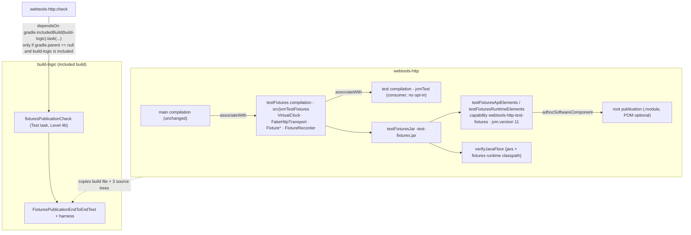
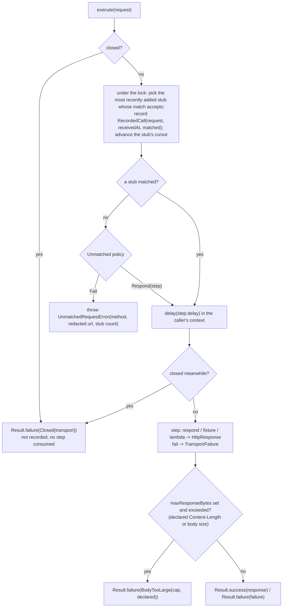
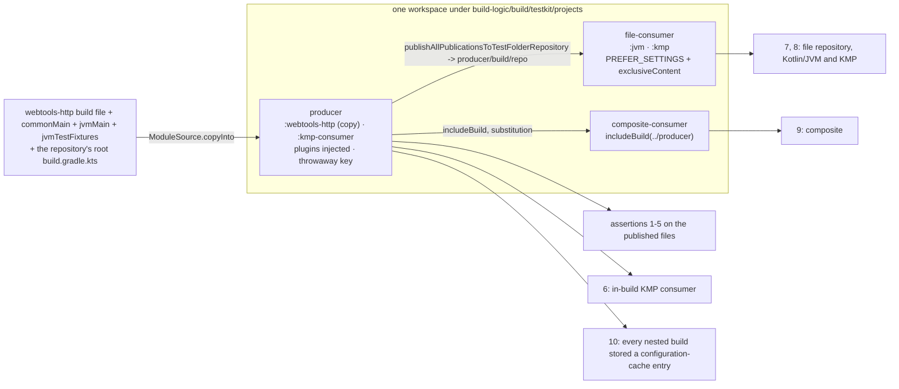

# Plan: `test-support` — the `webtools-http` test-fixtures variant and the fixtures-publication check

- **Covers:** `SpartanLaboratories/WebTools#63` — *"webtools-http: published test-fixtures variant with the
  fake transport, virtual clock, `.http` fixtures, recorder and the publication check"* (work level 3,
  `type: feature`). Sub-issue of the level-4 tracking issue `SpartanLaboratories/WebTools#55` (HTTP client
  stack). Blocked by #62, landed. Blocks #65, #66, #67 and #69 directly (units 6, 7, 8 and 10), and through
  them #68 and #70.
- **Architecture:** [`../architecture.md`](../architecture.md), unit 4 `test-support` (§6.7 *Published test
  support*, §6.1 *Shared build logic* (the fixtures-publication check and `verifyJavaFloor`), §9 *Extension &
  stability*, §11 unit 4, §12 and §13; also §1 requirements 6 and 9). Systems-level impact:
  [`../impact.md`](../impact.md) §7 (the open point this unit settles: where the publication check attaches)
  and §8 (units 1 to 3 as built).
- **Research:** [`research/README.md`](research/README.md) with
  [`research/publication-check-wiring.md`](research/publication-check-wiring.md) and
  [`research/publication-check-mechanics.md`](research/publication-check-mechanics.md); the design of the
  fixtures' own types comes from [`../research/test-support-and-time.md`](../research/test-support-and-time.md)
  and [`../research/kmp-test-fixtures.md`](../research/kmp-test-fixtures.md).
- **Branch:** `feat/issue-63-test-support` (exists; cut from `master` at `7de8207`; holds the research
  commits).
- **Commit:** TBD — this `plan.md` is committed in the same commit as the implementation (§11), so
  `git log --follow` binds the two.
- **PR:** TBD (the PR closes #63).
- **What this plans:**
  - the `testFixtures` compilation of `webtools-http` and its publication as two Gradle Module Metadata
    variants beside a `-test-fixtures.jar` (recipe B), with the fixtures jar and the fixtures' runtime
    classpath added to `verifyJavaFloor`;
  - the public fixtures in the package `com.spartanlabs.webtools.http.testing`: `VirtualClock`,
    `FakeHttpTransport` with `RequestMatch`, `Step`, `Unmatched`, `RecordedCall` and `UnmatchedRequestError`,
    `Fixture`, `FixtureLoader` and `FixtureError` with the `.http` codec, and `FixtureRecorder` with
    `RecordingGate`, `RecordMode` and `Redaction`;
  - the fixtures-publication check in `build-logic` — the task `fixturesPublicationCheck`, its TestKit class
    and harness additions — and its edge from `webtools-http`'s `check`;
  - the tests of all of it (Level 1 to Level 4c) and the Level 5 pass; the `.gitattributes` line; the README
    lines.
- **Status:** planning only. The implementer appends each deviation from this plan, with its reasoning, to
  [`final-implementation.md`](final-implementation.md) §2 at the moment it is made, and records the
  procedures' results in its §4 and the Level 5 pass in its §5.
- **Version moved:** none. `webtools-http` `1.0.0` stays unreleased until #55's stack is complete and is
  **not a release candidate** when this unit lands. No existing module moves a version.
- **Baseline:** `master` at `7de8207`. Line references are to it.

Code blocks in this plan are the intended implementation. They were written against the research's compiled
probes and the as-built sources of `webtools-http`, but the blocks themselves have not been compiled. The
executor fixes a compile error mechanically, and records any change to a rule (as opposed to a spelling) in
`final-implementation.md` §2.

> **Amended during implementation (2026-10-25).** Amendment 1 makes §9's secret-scrubbing rows agree with the
> detection list of §6.8, which is unchanged.
> - The recorder refuses a file only when a detected form survives the replacement. The detected forms are:
>   - the three replaced forms;
>   - the lower-hex variant of the query-encoded and the form-encoded form;
>   - the full percent-escape of the secret's bytes, in either hex case.
> - An echo escaped only in part (some bytes escaped, others not, such as `SECRET%2dCANARY` for
>   `SECRET-CANARY`) is in none of those sets. It is neither replaced nor detected: the same boundary as a
>   base64, hashed or truncated echo. Redaction covers the exact secret values a caller supplies, raw and
>   encoded, and the survival search is their backstop, not a decoder of transformed forms.
> - §9's Level 2 (`RedactionComponentTest`) and Level 3 (`FixtureRecorderIntegrationTest`) rows now name the
>   detected forms. §6.8 and §10 name the partial-escape boundary.

> **Amended during implementation (2026-10-25).** Amendment 2 filters the fixtures' runtime classpath before
> it reaches `verifyJavaFloor`.
> - For an associated compilation, the Kotlin Gradle plugin puts the main compilation's `output.allOutputs` in
>   `runtimeDependencyFiles`. That includes `build/classes/java/jvmMain` and `build/processedResources/jvm/main`,
>   which this module never creates: it has no Java source and no resources, so `compileJvmMainJava` and
>   `jvmProcessResources` are `NO-SOURCE`.
> - `JavaFloorScan.classFiles` refuses a root that is neither a directory nor a file. That fail-closed rule is
>   part of the guard's contract ("an unreadable input fails the task") and stays.
> - The module therefore hands the guard only the entries that exist:
>   `checkNotNull(fixturesCompilation.runtimeDependencyFiles) { … }.filter(Spec<File> { it.exists() })`. It is
>   lazy and keeps the collection's task dependencies.
> - The main classes directory is then scanned a second time, as a class directory, beside the `jvm` jar.
>   That only raises the counts.
> - §6.2, §7.1, R8 and P6.2 say so. `build-logic/src/main` does not change (P11 and the blast radius stand).

> **Amended after qa pass 1 (2026-10-25).** Amendment 3 adds eight test behaviours and records one exclusion.
> - **Added to §9:**
>   - Level 2, `RedactionComponentTest`: the upper-hex full escape is detected; the form-encoded form is replaced
>     and its lower-hex variant is detected; an echo escaped only in part is neither replaced nor detected;
>     replacement runs longest form first.
>   - Level 3, `FixtureRecorderIntegrationTest`: concurrent recordings to one name.
>   - Level 4b:
>     - a new class, `FixturesCheckWiringEndToEndTest`, run by `e2eTest` only. Its dry runs show the edge
>       scheduling the check when WebTools is the root build, and a build that includes WebTools never
>       scheduling it.
>     - test 5 of `FixturesPublicationEndToEndTest` also refuses any entry of the fixtures jar outside
>       `META-INF/` that is not a class (`JarClasses.entries`).
>   - Level 4c:
>     - the concurrency class releases its callers together from a start barrier;
>     - the codec class gains a linear-time test for large heads and bodies;
>     - the secrecy class gains a canary with reserved characters, checked in its encoded forms too, and
>       checks the recorder's wrapper and an `Enabled` gate.
> - **Recorded in R9 and `NestedBuild`'s KDoc:** the environment scrub covers `ORG_GRADLE_PROJECT_*` only. JVM
>   options that set `org.gradle.project.*` system properties are out of scope.
> - Acceptance 6, §7.6, P9, §10 (flaky timing), §12, §14 and "What cannot be tested automatically" follow.

---

## 1. Requirements

### R1. The fixtures compilation and its publication

- `webtools-http` gains a JVM-only `testFixtures` compilation on its single `jvm()` target, associated with
  `main` (so it reaches `internal` declarations); the `test` compilation is associated with it. Its sources
  are `webtools-http/src/jvmTestFixtures/kotlin`; the package is `com.spartanlabs.webtools.http.testing`;
  `src/jvmTestFixtures/resources` does not exist, so the jar ships no fixture file and no `logback-test.xml`.
- The publication is recipe B, written in the module's own build file:
  - `testFixturesJar` (`archiveClassifier` `test-fixtures`) from the compilation's outputs;
  - two consumable configurations, `testFixturesApiElements` (usage `java-api`, extends `jvmTestFixturesApi`)
    and `testFixturesRuntimeElements` (usage `java-runtime`, extends `jvmTestFixturesApi`,
    `jvmTestFixturesImplementation` and `jvmTestFixturesRuntimeOnly`);
  - each with category `library`, libraryelements `jar`, bundling `external`, `TargetJvmVersion` =
    `WebToolsBuild.JAVA_FLOOR`, the capability `"${project.group}:${project.name}-test-fixtures:${project.version}"`
    and the jar as its artifact;
  - both added to the root publication through `kotlin.publishing.adhocSoftwareComponent`, mapped with
    `mapToMavenScope` and `mapToOptional`;
  - the capability warning silenced with `suppressPomMetadataWarningsFor` on both variant names.
- The compile task `compileTestFixturesKotlinJvm` runs with `-Xexplicit-api=strict`. `explicitApi()` of the
  module does not reach the compilation, and no module-wide `explicitApi` change is made.
- **Dependencies** on `jvmTestFixturesApi`, and nothing else: `project(project.path)` (the module itself),
  `org.jetbrains.kotlinx:kotlinx-coroutines-test:1.10.2`, `com.squareup.okhttp3:mockwebserver3:5.5.0`.
  `mockwebserver3` is declared now for unit 6, as unit 3 declared OkHttp and Caffeine for later units; no
  class of this unit uses it. No `mockwebserver3-junit5`, `okhttp-tls`, JUnit, JSON library or logback.
- `kotlinx-coroutines-core` stays the main variant's one `api` dependency. Neither main variant (root or
  `-jvm`) nor the `-jvm` POM lists `kotlinx-coroutines-test` or `mockwebserver3`; the root POM lists them only
  as `optional`.
- No main-source change: `commonMain`, `jvmMain` and `api/webtools-http.api` are untouched.
  binary-compatibility-validator 0.18.2 dumps only the `main` compilation, so no ABI dump covers the variant.
- No version moves and no `publish*` task of the repository's own build is run.

### R2. Tier, style and documentation of the fixtures

- Tier: **Stable Core, source compatibility only** (architecture §9). Consumers compile their tests against
  the fixtures in their own build; a change that keeps consumer test sources compiling may ship in a feature
  release. Defaulted parameters are allowed (the builder rule of the production API does not bind the fakes);
  no ABI dump; **no public `data class` or `data object`** anywhere in the fixtures.
- One public type per file; a top-level factory or extension lives in its class's file. Every fixtures class
  is `final`.
- `-Xexplicit-api=strict` enforces visibility and return types. KDoc (`@param`, `@return`, `@throws`) on every
  public declaration names the tier, the contract, the thread-safety, the behaviour under virtual time and
  what `toString()` never prints. KDoc coverage is a review item checked mechanically (P12).
- Worked examples: `FakeHttpTransport` (of the `HttpTransport` seam) and the recorder's decorating transport
  (the decorator pattern that is the transport's observation hook) say in their KDoc that they are written to
  be read.
- The only logging is through the module's internal `logger(name)` seam (`Log.kt`), reached through the
  association with `main`, and only the recorder logs. `HttpSyntax`, `encodeQueryComponent`,
  `encodePathSegment`, `catchNonFatal`, `flatMap` and `logger` are reached the same way.
- Every fixtures type is JVM-only; none is reachable from `commonMain` or `commonTest`.

### R3. The opt-in

- Each fixtures declaration that implements a gated port carries `@OptIn(ExperimentalForInheritanceWebToolsApi::class)`
  on itself: `FakeHttpTransport`, the private `WallClock` implementation inside `VirtualClock`, and the
  recorder's decorating transport.
- There is **no** source-set-wide opt-in for the fixtures compilation: a worked example shows exactly the
  opt-in a consumer's own implementation needs, and a future implementer in the fixtures that forgets it fails
  to compile.
- Consumers of the fixtures, and `webtools-http`'s own `jvmTest`, need no opt-in to use them
  (`@SubclassOptInRequired` binds implementers, not users of a final fake).

### R4. `VirtualClock`

`VirtualClock(scheduler, startEpochMillis)` exposes `timeSource`, `wallClock`, `dispatcher`,
`maintenanceExecutor`, `elapsed` and `advanceBy`, plus `TestScope.virtualClock(...)`, using only
`kotlinx-coroutines-test` 1.10.2 API without `@ExperimentalCoroutinesApi`: never `currentTime`,
`advanceTimeBy(Long)`, the `TestScope` extensions `advanceTimeBy`/`runCurrent`/`advanceUntilIdle`/`testTimeSource`,
or `UnconfinedTestDispatcher`. Readings are safe from any thread (Caffeine maintenance threads); `advanceBy`
is called from the test's thread. Signatures are in §6.4.

### R5. `FakeHttpTransport` and its script types

- `FakeHttpTransport` implements `HttpTransport` under the eight-point contract: it never blocks a thread,
  mirrors `Closed("transport")` after `close()` and `BodyTooLarge` over a configured cap, and mirrors nothing
  else (policy, DNS, TLS, redirects and timeouts belong to the real transport).
- The most recently added matching stub wins; a stub's steps run in order and the last repeats; each step has
  a virtual-time delay and responds, answers from a fixture, or fails with a `TransportFailure`.
- Calls are recorded with virtual stamps; an unmatched request throws `UnmatchedRequestError` (an
  `AssertionError`, the redacted URL, never the query) unless `Unmatched.Respond(step)` is set.
- `RequestMatch` is a `fun interface` (a frozen single-method predicate the consumer writes, not a seam).
  Query matching follows OkHttp 5.5.0's `HttpUrl` decoding (§6.6).
- One lock guards stubs, cursors, the call log and the closed flag, and is never held across a suspension.

### R6. Fixtures and the `.http` codec

`Fixture`, `FixtureLoader` and `FixtureError` with the `.http` format (§6.7): optional leading `# …`
provenance lines, a status line, header lines, a blank line, every remaining byte the body verbatim; a body-only
resource by extension. Round trip is byte-exact. Fixtures load from the consumer's own classpath. Errors name
the origin and the line number and never a header value or body byte.

### R7. The recorder

`FixtureRecorder` with `RecordingGate`, `RecordMode` and `Redaction` (§6.8): a decorating transport
constructible only from a `RecordingGate.Enabled`; the gate is `Disabled` unless `WEBTOOLS_HTTP_RECORD` has a
recognised value and `Disabled` whenever any of the twelve CI variables is present; it records successful
responses only, never writes a request header, redacts sensitive query names by token and sensitive response
headers, drops `Set-Cookie` and four more headers, scrubs caller-supplied secrets from the whole file and
refuses to write if one survives, and writes atomically to a deterministic name.

### R8. The floor guard

The fixtures jar and the existing entries of the fixtures compilation's runtime classpath join
`verifyJavaFloor`; the generated root `.module`, which holds the fixtures variants, is already read because the
guard reads every `GenerateModuleMetadata` output. No module script assigns `runtimeDependencyFiles`.

### R9. The fixtures-publication check

- A Gradle TestKit class in `build-logic`'s test source set, `FixturesPublicationEndToEndTest` (Level 4b), run
  by a dedicated `Test` task `fixturesPublicationCheck` shaped like `e2eTest`. It publishes a copy of
  `webtools-http` to a build-local file repository with a throwaway signing key and resolves
  `testFixtures("io.github.spartanlaboratories:webtools-http:<version>")` from that repository, through
  `includeBuild`, and from an in-build Kotlin Multiplatform module (§6.9).
- Ten assertions (§9, Level 4b). It is the only check on the experimental publishing API and the only run
  that signs a multiplatform publication carrying an adhoc variant before a release.
- Every nested build of the harness, the existing checks included, runs with `ORG_GRADLE_PROJECT_*` removed
  from its environment. That is the channel vanniktech documents for an in-memory key in the environment.
  JVM options that set `org.gradle.project.*` system properties, through `JAVA_TOOL_OPTIONS` or `GRADLE_OPTS`,
  are out of scope, and `NestedBuild`'s KDoc says so:
  - no supported release path passes a key that way;
  - filtering option strings would need a parser for quoted JVM arguments;
  - dropping the variables would break hosts that need them for a proxy or a trust store.
- It declares exactly the files it copies as inputs, so with unchanged inputs it is `UP-TO-DATE`.

### R10. The check's edge

`webtools-http`'s `check` depends on `:build-logic:fixturesPublicationCheck`, declared lazily, only when
WebTools is the root build and includes `build-logic`. `./gradlew build`, `./gradlew check` and
`./gradlew :webtools-http:check` all run it; the root `build.gradle.kts` and `settings.gradle.kts` do not
change; the root project's task list does not change; a build that includes the WebTools build never runs it;
the configuration cache is reused on a repeat.

### R11. Files and the README

- `.gitattributes` gains `**/fixtures/**/*.http -text` with a one-line comment.
- `README.md` changes in the same landing (§8): the install line, a paragraph on the fixtures, the command, the
  `testing/support/` sentence, the "belongs to it alone" example, and the sentence that said `./gradlew build`
  runs none of `build-logic`'s checks.

### R12. Tests and runs

Every test sits at a level and a path (§9). Only the tests that exercise the change run. No suite of
`webtools-udp`, `webtools-scraping` or `webtools-browser` runs; no root `./gradlew build` or `test` is
executed (the root wiring is proved with `--dry-run`). No `publish*` task of the repository's own build runs.
No credential value, machine-local path or attribution is written anywhere.

### Acceptance

1. `:webtools-http:compileTestFixturesKotlinJvm` passes under `-Xexplicit-api=strict`; the two canaries (P2)
   fail as expected and are removed.
2. `:webtools-http:gatingTest componentTest deterministicTest` and then `integrationTest nonfunctionalTest`
   pass, and the result XML of those tasks lists the fixtures test classes (the level tasks reach the
   fixtures).
3. The generated POM and Gradle Module Metadata show the shape of R1; `apiCheck` passes with the dump
   unchanged; `verifyJavaFloor` passes and its report counts two jars.
4. `:build-logic:fixturesPublicationCheck` passes its ten tests cold and warm, with timings recorded.
5. `./gradlew :webtools-http:check` runs it; an immediate repeat reports it `UP-TO-DATE` with "Reusing
   configuration cache"; `./gradlew build --dry-run` and `./gradlew check --dry-run` list it; the root
   project's task list is unchanged.
6. `:build-logic:e2eTest` (its three classes), `:build-logic:integrationTest` and
   `:build-logic:nonfunctionalTest` pass with the changed harness underneath, one after another.
7. The three mutations of P10 each fail the check; the module build file is restored and `git diff` is empty.
8. `git diff --stat` for the three legacy modules and for `webtools-http/src/commonMain`, `src/jvmMain`,
   `api/` and `webtools-http-commoncheck` is empty.
9. The mechanical rules of P12 hold; the README and `.gitattributes` read as §8 says.

---

## 2. Current state

**Baseline.** `master` at `7de8207`; the branch holds only the research commits. Units 1 (`build-logic`, #61),
2 (`java-floor`, #47) and 3 (`http-core`, #62) have landed.

**The module** (`webtools-http/build.gradle.kts`).
- `:11-15` is the header comment (the convention plugin's shared parts, `explicitApi()`, the dependencies, the
  opt-in, the dump); `:17-19` applies `webtools.kotlin-multiplatform-library`; `:25-54` sets `explicitApi()`,
  the `commonMain`/`jvmMain` opt-in and the dependencies; `:56-62` is `mavenPublishing`. There is no
  `testFixtures` compilation, no `src/jvmTestFixtures`, and no edge to `build-logic`.
- `src/commonMain/kotlin/com/spartanlabs/webtools/http/` holds 24 files and `src/jvmMain/…` two. The names the
  fixtures use: `HttpTransport` (`HttpTransport.kt:29-45`; the eight-point contract at `:7-24`, `execute` at
  `:38`, `close()` at `:44`), `WallClock` (`WallClock.kt:12-31`), `HttpResponse` and its factory
  (`HttpResponse.kt:14`, `:82`), `HttpHeaders` and its factory (`HttpHeaders.kt:14`, `:190`; `get`/`getAll`
  are ASCII-insensitive, `Entry.isSensitive` is `HttpHeaders.kt:78`), `HttpRequest` (`HttpRequest.kt:14`,
  factory `:67`), `RequestBody`, `Url` (`Url.kt:21-66`; `encodedPath`, `encodedQuery: String?`, `redacted()`),
  `TransportFailure` and its public constructors (`TransportFailure.kt:38-240`), `HttpFailure.Closed`
  (`HttpFailure.kt:43`), and the `internal` helpers `HttpSyntax` (`HttpSyntax.kt:9`),
  `encodePathSegment`/`encodeQueryComponent` (`UrlEncoding.kt:94`, `:101`), `catchNonFatal` (`NonFatal.kt:15`),
  `flatMap` (`ResultExtensions.kt:20`) and `logger` (`Log.kt:17`, `Log.jvm.kt`).
- `src/jvmTest/` holds the module's JVM-only tests; the existing paths are
  `src/jvmTest/kotlin/com/spartanlabs/testing/<level>/webtools/http/…` and `src/jvmTest/resources/logback-test.xml`.
  OkHttp 5.5.0 and Caffeine 3.3.1 are on `jvmTest`'s classpath through the association with `main`.

**The build logic.**
- `build-logic/src/main/kotlin/webtools.kotlin-multiplatform-library.gradle.kts`: `:29-52` declares `jvm()` with
  `jvmTarget`, `-Xjdk-release` and the `TargetJvmVersion` attribute from `WebToolsBuild.JAVA_FLOOR`
  (`WebToolsBuild.kt:45`, 11) and registers the seven level tasks over the `test` compilation, reading
  `testCompilation.runtimeDependencyFiles` once (`:41-50`); `:90-106` registers `verifyJavaFloor` over the
  `jvmJar`, the module metadata and the main compilation's `runtimeDependencyFiles`, and wires it into `check`.
  Its java-floor comment (`:91-93`) says a module that adds another published jar, the test-fixtures jar, adds
  it to `verifyJavaFloor`'s `jars`.
- `VerifyJavaFloor` (`VerifyJavaFloor.kt:40`, `:51`) exposes `jars` and `runtimeClasspath` as
  `ConfigurableFileCollection`s; `registerVerifyJavaFloor` adds every `GenerateModuleMetadata` task of the
  project to `moduleMetadata` (`WebToolsBuild.kt:116-132`). `JavaFloorScan.classFiles` accepts a jar or a
  class directory.
- `build-logic/build.gradle.kts`: `:36`, `:40`, `:44` the three nested-build path properties; `:51-56` the
  single-permit `testKitHomeLock`; `:58-77` `registerBuildLogicLevelTest` (selects `com.spartanlabs.testing.<level>.*`,
  `isFailOnNoMatchingTests = true`, and for a nested-build task the two TestKit properties,
  `usesService(testKitHomeLock)` and a 30-minute timeout); `:87-96` registers `e2eTest` with the
  `webtools.buildlogic.dir` property and its copied files as inputs; `:105-113` the fast `test` aggregate.
  `build-logic` has no `src/test/resources` directory; the harness writes its files from string templates.
- The TestKit harness (`build-logic/src/test/kotlin/com/spartanlabs/testing/support/webtools/buildlogic/`):
  `NestedBuild` always runs in `workspace.dir`, injects the plugins with `withPluginClasspath()` unless told
  not to, and passes no environment of its own (`NestedBuild.kt:46-51`), so a nested build inherits the
  environment of the build running the check. `ModuleMetadata` reads variant attributes only,
  `PomFile` reads element text by path only, `SampleProject` holds string templates and the single
  `GRADLE_PROPERTIES` (`SampleProject.kt:343`), `SampleProject.withLocalPublishing()` disables the `Sign` tasks
  (`:307`), `BuildLogicSource` copies `build-logic` into a composite, `JarClasses.majors` reads class-file
  majors, `TestReports.resultClasses` reads the JUnit XML. Nothing in it generates a signing key.
- The root: `settings.gradle.kts:1-3` includes `build-logic` through `pluginManagement`; `:11` includes the five
  modules; `build.gradle.kts:11-14` is `allprojects { group = "io.github.spartanlaboratories"; version = "1.0.0" }`.
  The root project has no task of its own (no `check`, `build`, `assemble`, `clean`), so `./gradlew build`
  reaches no task of the included `build-logic` build and `check` does not either.
- `.gitattributes:1-4` holds the two `*.kt`/`*.kts` rules (CRLF in the working tree, LF in the index;
  `core.autocrlf=true`). `README.md` is CRLF in the working tree and LF in the index too.

**Outside-world facts this unit rests on** (each measured or source-read in the research, which re-opened every
load-bearing claim: 45 items, none fails):
- Recipe B on the module's real sources publishes exactly the specified shape: two variants in the root
  `.module` with the capability, `org.gradle.jvm.version` 11, the `-test-fixtures.jar` and the dependencies
  `webtools-http`, `kotlinx-coroutines-test`, `mockwebserver3` and the Kotlin plugin's `kotlin-stdlib`; no test
  library on a main variant or in the `-jvm` POM; the two test libraries `optional` in the root POM
  ([`publication-check-mechanics.md`](research/publication-check-mechanics.md) F1).
- Kotlin/JVM, Kotlin Multiplatform (in-build and from the file repository) and Java consumers select the
  variants without `org.jetbrains.kotlin.platform.type` or `org.gradle.jvm.environment`, because only the two
  fixtures variants carry the requested capability and a missing attribute is compatible (F7, F8). The Kotlin
  Gradle plugin's KDoc for the adhoc component asks that added variants do not match the default ones
  (`KotlinPublishing.kt`, tag `v2.2.0`).
- vanniktech 0.36.0 requires signing unless the version ends in `-SNAPSHOT`; a throwaway RSA-2048 OpenPGP key
  from BouncyCastle (`org.bouncycastle:bcpg-jdk18on:1.86`, still the latest) in the producer's
  `gradle.properties` (`signingInMemoryKey`, `signingInMemoryKeyPassword`) is accepted, and every published
  file gets an `.asc`, the fixtures jar's included (F3, F4). An `ORG_GRADLE_PROJECT_*` variable in the
  environment of the build running the check beats the workspace's `gradle.properties` (measured: it broke the
  producer) (F5).
- The convention plugins declare `mavenCentral()` on each project, which under the default
  `RepositoriesMode.PREFER_PROJECT` hides a settings-level file repository; `PREFER_SETTINGS` with an
  `exclusiveContent` block pins the lookup (F6).
- `gradle.includedBuild(name).task(path)` is the only reference that crosses builds; `check` and `build` do not
  cross (gradle/gradle#22335, open). Inside the WebTools build, `gradle.includedBuild("build-logic")` is always
  WebTools' own plugin build, and `gradle.parent == null` is the root-build test. The edge was measured to run
  the check on `build`, `check` and `:lib:check` and to leave the root's task list and a consumer composite
  untouched ([`publication-check-wiring.md`](research/publication-check-wiring.md) F1 to F7).
- `kotlinx-coroutines-test` 1.10.2 without `@ExperimentalCoroutinesApi`: `StandardTestDispatcher(...)`,
  `TestDispatcher`, `TestScope.testScheduler`, `TestCoroutineScheduler.advanceTimeBy(Duration)`,
  `runCurrent()`, `advanceUntilIdle()` (the scheduler's own) and `timeSource`
  ([`research/README.md`](research/README.md) "Facts read at source" 1;
  [`TestCoroutineScheduler.kt`](https://github.com/Kotlin/kotlinx.coroutines/blob/1.10.2/kotlinx-coroutines-test/common/src/TestCoroutineScheduler.kt)).
  `advanceTimeBy` does not run tasks due at exactly `currentTime + delay`, so a clock helper follows it with
  `runCurrent()`.
- OkHttp 5.5.0 decodes query names and values with `+` as a space, splits the query on `&` then on the first
  `=`, and gives a name without `=` a `null` value
  ([`HttpUrl.kt`](https://github.com/square/okhttp/blob/parent-5.5.0/okhttp/src/commonJvmAndroid/kotlin/okhttp3/HttpUrl.kt)).
- `@SubclassOptInRequired` gates implementers of a port, not users of a final fake (measured on Kotlin 2.2.0:
  [`../research/test-support-and-time.md`](../research/test-support-and-time.md) F4).
- `-Xexplicit-api=strict` on the fixtures compile task takes effect ("Visibility must be specified in explicit
  API mode"); `explicitApi()` does not reach it (same file F5; mechanics F10).
- A committed LF `*.http` came back CRLF under `core.autocrlf=true`; with `*.http -text` it came back unchanged
  (same file F8).
- A `Test` task is `UP-TO-DATE` when only an environment variable changes, unless the build declares the
  variable as an input (same file F7).
- Cost of the check: about one minute warm (53 to 78 s over five runs on JDK 17 and 23), cold 55 to 62 s plus
  once 8.7 MB of BouncyCastle in the outer Gradle cache; the probe's fixtures were one class (mechanics F11).

**Blast radius.** New trees: `webtools-http/src/jvmTestFixtures/`, the new `webtools-http/src/jvmTest/` files
and resources, and under `build-logic/src/test/` the check class and harness additions. Edited shared files:
`webtools-http/build.gradle.kts`, `build-logic/build.gradle.kts`, `.gitattributes`, `README.md`, and the harness
files `NestedBuild.kt`, `ModuleMetadata.kt`, `PomFile.kt`, `SampleProject.kt` (every existing nested-build
check runs through the changed `NestedBuild`, hence P9). `git log` of these areas shows only #61, #47, #62 and
the research commits. Nothing in the three legacy modules references any of it.

**Adoption verdicts carried from the architecture (§8).**

| Site | Verdict | In this plan |
|---|---|---|
| `SampleProject.withLocalPublishing()` (disables the `Sign` tasks) | kept for its users; the fixtures check signs with a throwaway key instead, to assert the fixtures jar's signature | §6.9, §7.6 |
| `NestedBuild`, `ModuleMetadata`, `PomFile`, `SampleProject`, `TestReports`, `JarClasses` | extended, not replaced | §7.6 |
| `BuildLogicSource` (copies `build-logic` into a composite) | a sibling `ModuleSource` is added for the module | §7.6 |
| `webtools-udp`'s fixed-port lock (`webtools-udp/build.gradle.kts:118-132`) | not needed: `mockwebserver3` binds port 0 in unit 6 | no file |
| `README.md`'s "Shared fixtures live under `testing/support/`" sentence | reworded so it cannot be read as the published fixtures | §8 |
| `logback-test.xml` (four byte-identical copies) | never goes in the fixtures jar | no file |

---

## 3. Assumptions

- **`jvmTest` receives the fixtures' `api` dependencies through the association**, as it receives `main`'s
  `implementation` dependencies (OkHttp and Caffeine are on its classpath today). The tests need
  `kotlinx-coroutines-test` (`runTest`) and the fixtures themselves. If `jvmTest` does not see
  `kotlinx-coroutines-test`, add `jvmTestImplementation("org.jetbrains.kotlinx:kotlinx-coroutines-test:1.10.2")`
  in the module's build file (it does not reach any published variant) and record the line as a deviation.
- **Injected plugin classpath reaches an included build.** The composite consumer includes the producer, which
  has no `pluginManagement`, and the producer applies `webtools.kotlin-multiplatform-library` by id. Measured
  on Gradle 9.7.1, undocumented; a Gradle upgrade that changes it fails the composite consumer loudly.
- **The fixtures' `runtimeDependencyFiles` holds only classes at or below major 55.** `kotlin-stdlib` 2.2.x,
  `okio`, `okhttp`, `mockwebserver3` and `kotlinx-coroutines-test` publish JVM 8 class files; P6 proves it on
  the real classpath. If a dependency held a newer class, the guard would name it and the dependency would have
  to be replaced.
- **The `import` names of the recipe-B block** (`Usage`, `Category`, `LibraryElements`, `Bundling`, `Jar`,
  `MavenPublication`) resolve as Gradle's default imports, as in the research probe, which imported only
  `TargetJvmVersion`, `ExperimentalKotlinGradlePluginApi` and `KotlinJvmCompile`. A name that does not resolve
  gets its explicit import (mechanical).
- **`Files.move(…, ATOMIC_MOVE)` replaces an existing target** on NTFS and on POSIX file systems. A file system
  that refuses an atomic move (`AtomicMoveNotSupportedException`) falls back to `Files.move(…, REPLACE_EXISTING)`
  (§7.5, `FixtureRecorder`).
- **Java's strict UTF-8 decoder (`CharsetDecoder` with `REPORT`) rejects exactly the sequences Okio rejects**
  for well-formed input, and the replacement-character count for ill-formed percent-escaped input may differ
  from Okio's. The `QueryPairs` differential draws escapes from valid sequences; a fixed ill-formed list is
  compared exactly and narrowed to "contains U+FFFD" if the counts differ (recorded as a deviation).
- **The probe's timings hold for the real fixtures** within a factor of two (about 60 s warm). The producer
  compiles the whole module on every run with changed inputs.
- **JDK 17 to 26** builds the module (Gradle 9.7.1's range); the check passed on JDK 17, 21 and 23. JDK 24 to
  26 are not run (§14).
- **`core.autocrlf=true` on the maintainer's host.** Files with CRLF working-tree endings (`README.md`,
  `.gitattributes`) keep them; the index stays LF.

## 4. Non-goals

- `LoopbackTransports`, `webtoolsUrl`, `Fixture.toMockResponse()` and `MockWebServer.enqueue(fixture)` (unit 6,
  #65); `RecordingBudgetObserver` and `FakeBudgetStore` (unit 8, #67).
- The "three clocks move together" proof against the real cache and the real budget (re-run in units 7 and 8);
  this unit proves the clock with a Caffeine cache standing in for the cache unit 7 builds.
- Any `FeedParserContract` fixtures; `webtools-feeds` is unit 10's.
- Extracting recipe B into `build-logic`: only this module has fixtures in 1.0.0; the extraction waits for a
  second module (§13).
- A sources or javadoc jar for the fixtures jar, unless Central refuses the artifact at the first release
  (§13).
- Any main-source change in `webtools-http`, any ABI dump of the fixtures, any version move, any publish.
- A fixtures-publication check for the three legacy modules; a Maven-consumer check (a Maven build cannot select
  a variant by capability and the README says so).
- JUnit extensions, `@StartStop`, `mockwebserver3-junit5`, a conditional-GET `Dispatcher` (BotTools and
  `webtools-feeds` write their own), HAR or WireMock formats, body pattern-scrubbing beyond caller-supplied
  secrets.
- Editing `docs/dashboards/` (the admin team's presenter does) and `docs/webtools-http-architecture.md`
  (unit 11).

---

## 5. Approach and staging

The code lands in one commit (§11) and is built in an order that puts the unproven mechanism first: the
variant compiles and publishes before the fixtures are written, the fixtures are written from the simplest to
the most involved, and the check, which needs the whole variant, comes last and is wired into `check` last.



| Stage | Content | Verified by |
|---|---|---|
| S1 | The recipe-B block, `.gitattributes`, a first fixtures class (`VirtualClock`) so the compilation is not empty, then the two canaries | P1, P2 |
| S2 | `VirtualClock` complete, `TestScope.virtualClock`, its two Level 2 classes (three clocks) | P3 |
| S3 | `FixtureError`, `HttpMessageCodec`, `Fixture`, `FixtureLoader`, the sample resources, their tests | P3 |
| S4 | `QueryPairs`, `RequestMatch`, `Step`, `Unmatched`, `RecordedCall`, `UnmatchedRequestError`, `FakeHttpTransport`, their tests, the permanent Level 1 consumer | P3 |
| S5 | `SensitiveNames`, `Redaction`, `SecretScrubber`, `FixtureFileNames`, `RecordMode`, `RecordingGate`, `RecordingHttpTransport`, `FixtureRecorder`, their tests, the Level 4c classes | P3, P4 |
| S6 | `verifyJavaFloor` additions; the publication read by hand; `apiCheck` | P5, P6 |
| S7 | The harness additions, the `fixturesPublicationCheck` task, the check class; then the edge in the module's build file | P7, P8, P9, P10 |
| S8 | The unaffected-module proofs, the mechanical rules, the README, the Level 5 pass, the as-built record | P11, P12, P13 |

A stage that fails its procedure stops the next one; a result that differs from this plan is a deviation, and
is understood before anything is built on it.

---

## 6. Design

### 6.1 Mechanism per type (architecture §6.9, for this unit's types)

| Type | Mechanism | Tier | Equality |
|---|---|---|---|
| `VirtualClock` | `final` class over a `TestCoroutineScheduler`; one private inner `WallClock` implementer (`@OptIn`) | Stable Core, source compatibility only | identity |
| `FakeHttpTransport` | `final` class implementing the gated `HttpTransport` (`@OptIn`), constructor with defaulted parameters | same | identity |
| `RequestMatch` | `fun interface` with a default `and` and a companion of factories (a frozen predicate, not a seam) | same | — |
| `Step` | `final` class, `private` constructor, factories only | same | identity |
| `Unmatched` | `sealed interface`: the fake interprets exactly `Fail` and `Respond` | same | identity |
| `RecordedCall` | `final` class, `internal` constructor | same | identity |
| `UnmatchedRequestError`, `FixtureError` | `final` classes extending `AssertionError`, `internal` constructors | same | identity |
| `Fixture` | `final` class, public constructor; bytes copied in and out | same | status + headers + body bytes |
| `FixtureLoader` | `final` class | same | identity |
| `RecordingGate` | `sealed interface` with `Enabled` and `Disabled` (internal constructors) and a companion `evaluate` | same | identity |
| `RecordMode` | `enum class` (a consumer-chosen input) | same | — |
| `Redaction` | `final` class, public constructor with defaulted parameters | same | identity |
| `FixtureRecorder` | `final` class; `wrap` returns an `HttpTransport` | same | identity |
| `RecordingHttpTransport` (decorator), `QueryPairs`, `HttpMessageCodec`, `SensitiveNames`, `SecretScrubber`, `FixtureFileNames`, the reason table | `internal` | none | — |

Nothing here is `data class`/`data object`, `open` or `abstract`. `Unmatched` is `sealed` because the fake
interprets exactly two policies and the closed pair is the contract; `RecordingGate` is `sealed` because the
recorder accepts only `Enabled`.

### 6.2 The fixtures compilation and its publication (`webtools-http/build.gradle.kts`)

Recipe B goes in the module's own build file, in a `//region test fixtures` block. The convention plugin's
java-floor comment already says a module adds its own test-fixtures jar to `verifyJavaFloor`, and only this
module has fixtures in 1.0.0. The block is the one measured in
[`publication-check-mechanics.md`](research/publication-check-mechanics.md) "The recipe-B block", with two
refinements the research confirmed (F13): `configurations.consumable(...)` and `suppressPomMetadataWarningsFor`
on both variant names.

What each part does and why it is there:

| Part | Why |
|---|---|
| `compilations.create("testFixtures") { associateWith(main) }`, `compilations.getByName("test").associateWith(fixtures)` | the fixtures reach `internal` declarations of `main`; `jvmTest` reaches the fixtures |
| `-Xexplicit-api=strict` on `compileTestFixturesKotlinJvm` | `explicitApi()` does not reach this compilation; visibility and return types are compiler-enforced, KDoc is a review item |
| `testFixturesJar` | the artifact of both variants, beside the root module's files |
| `configurations.consumable("testFixturesApiElements")`, `("testFixturesRuntimeElements")` with the five attributes and `TargetJvmVersion` from `JAVA_FLOOR` | `TargetJvmVersion` set on the `jvm()` target does not reach hand-declared variants; the capability makes `testFixtures(...)` select them |
| `kotlin.publishing.adhocSoftwareComponent { addVariantsFromConfiguration(...) { mapToMavenScope(...); mapToOptional() } }` | adds the variants to the root publication; the root POM lists the test libraries as `optional` and no `webtools-http` dependency |
| `suppressPomMetadataWarningsFor(...)` | Gradle prints "Declares capability … which cannot be mapped to Maven" per variant otherwise |
| the three `jvmTestFixturesApi` dependencies | the fixtures' API: the module itself (so a consumer gets `main` at the same version), `kotlinx-coroutines-test`, `mockwebserver3` |

No attribute beyond recipe B's is added: adding `org.jetbrains.kotlin.platform.type` or
`org.gradle.jvm.environment` would move the variants towards the default Kotlin ones (the plugin's KDoc asks
that they not match) and gains nothing, because a missing attribute is compatible.

**The floor.** `verifyJavaFloor` gains the fixtures jar in `jars` and the fixtures compilation's
`runtimeDependencyFiles` in `runtimeClasspath` (what a consumer's test loads), filtered to the entries that
exist.
- The association puts `main`'s `output.allOutputs` in that collection, among them a Java classes directory
  and a processed-resources directory this module never creates.
- `JavaFloorScan` fails on a missing root by design, so the module filters them out at the input. The main
  classes directory is scanned a second time, which only raises the counts.
- The fixtures variants in the root `.module` are already read.
- No module script assigns `runtimeDependencyFiles`: the level tasks read the `test` compilation's once, and
  `associateWith` adds to it.

**Version coupling.** The fixtures call `internal` members of `main`, so the fixtures jar works only beside the
`webtools-http` jar of the same version. Gradle keeps the two together: the fixtures variants and the main
variants are variants of one component, and a dependency graph resolves one version of a component, whatever
a consumer forces. Only a hand-assembled classpath could mix them. The KDoc of `FakeHttpTransport` and
`VirtualClock`, the two entry points, states that the fixtures and the module are released and versioned
together (§10).

### 6.3 The opt-in, and what the fixtures show a consumer

`FakeHttpTransport`, the private clock implementer and the decorator are each a top-level (or inner) class
that implements a gated port, so each carries `@OptIn(ExperimentalForInheritanceWebToolsApi::class)` on itself.
The fixtures compilation has no `languageSettings.optIn`, so each `@OptIn` is the exact line a consumer's own
implementer needs, and a fixtures implementer that forgets it fails to compile with the marker's message
(canary, P2). `webtools-http`'s `jvmTest` stays a consumer: it names `FakeHttpTransport` as an `HttpTransport`
and the clock's `wallClock` as a `WallClock` with no `@OptIn` (Level 1, `FixturesConsumerGatingTest`).

### 6.4 `VirtualClock`

```kotlin
// VirtualClock.kt  (package com.spartanlabs.webtools.http.testing)
public class VirtualClock(
    private val scheduler: TestCoroutineScheduler,
    public val startEpochMillis: Long = DEFAULT_START_EPOCH_MILLIS,
) {
    public val timeSource: TimeSource.WithComparableMarks = scheduler.timeSource       // stable API
    private val origin: ComparableTimeMark = timeSource.markNow()                      // taken at construction
    public val elapsed: Duration get() = origin.elapsedNow()
    public val wallClock: WallClock = VirtualWallClock()
    public val dispatcher: CoroutineDispatcher = StandardTestDispatcher(scheduler, name = "VirtualClock")
    public val maintenanceExecutor: Executor = Executor { task -> task.run() }          // inline, on the calling thread

    public fun advanceBy(duration: Duration) {
        require(!duration.isNegative()) { "duration must not be negative" }
        scheduler.advanceTimeBy(duration)   // does not run tasks due exactly at the target ...
        scheduler.runCurrent()              // ... so run them now
    }

    override fun toString(): String = "VirtualClock(start=${Instant.ofEpochMilli(startEpochMillis)}, elapsed=$elapsed)"

    @OptIn(ExperimentalForInheritanceWebToolsApi::class)
    private inner class VirtualWallClock : WallClock {
        override fun nowEpochMillis(): Long = startEpochMillis + elapsed.inWholeMilliseconds
        override fun toString(): String = "VirtualClock.wallClock"
    }

    public companion object {
        public const val DEFAULT_START_EPOCH_MILLIS: Long = 1_767_225_600_000L   // 2026-01-01T00:00:00Z
    }
}

public fun TestScope.virtualClock(startEpochMillis: Long = VirtualClock.DEFAULT_START_EPOCH_MILLIS): VirtualClock =
    VirtualClock(testScheduler, startEpochMillis)
```

- One clock of three passes for the wrong reason (a cache on `TimeSource.Monotonic` beside a virtual budget does
  not expire its entry after 11 virtual minutes), so the fixtures' own Level 2 class proves a cache's ticker, a
  `delay` and a wall-clock index move together, and carries the control (§9).
- Any default dispatcher in the stack (`Dispatchers.Default` in the cache scope or a facade scope) must be a
  constructor parameter that `VirtualClock.dispatcher` can replace (units 7 and 9).
- Level 3 never uses `VirtualClock`: real I/O under `runTest` turns `withTimeout` into a spurious timeout
  because the scheduler jumps over idle virtual time while a real call is pending.
- Thread-safety: `timeSource`, `elapsed`, `wallClock` and `maintenanceExecutor` are safe from any thread
  (`currentTime` is read under the scheduler's lock); `advanceBy` is called from the test's thread.

### 6.5 The fake: behaviour



The contract the KDoc of `FakeHttpTransport` pins:
- **Lookup:** the most recently added stub whose `RequestMatch` accepts the request; a shared setup registers
  defaults and a test overrides one path.
- **Script:** steps run in order per stub, the last repeats (WireMock's recorded-scenario rule). The cursor and
  the call log are guarded by one `synchronized` lock that is released before any suspension.
- **Recording:** the call is recorded before any delay, with `receivedAt` the time elapsed on the injected
  `TimeSource` since construction; a request cancelled during its delay still counts (it was on the wire).
- **Delay:** `delay(step.delay)` runs in the caller's context, so it is virtual when the caller runs on the
  test scheduler (under `runTest`, or on `VirtualClock.dispatcher`) and real otherwise; cancellation throws
  `CancellationException`.
- **Unmatched:** recorded with `matched = false`, then `UnmatchedRequestError` is thrown. Through a cache loader
  it surfaces as the fatal `Error` rethrown to each waiter, which fails the test with the right message.
  `Unmatched.Respond(step)` is the opt-in for a lenient fake.
- **Fidelity:** a respond or fixture step builds `HttpResponse(status, request.url) { headers; body(bytes) }`; a
  lambda step returns its own response (final URL, `redirectChain`, …). With `maxResponseBytes` set, any
  response whose declared `Content-Length` (a non-empty run of digits that parses as a non-negative `Long`,
  else `null`) or body is above the cap becomes `Result.failure(TransportFailure.BodyTooLarge(cap, declared))`.
  A fail step is `Result.failure(failure)`; `Step.fail(failure)` returns the same instance on every repeat and
  `Step.fail { … }` a fresh one per call. After `close()` every call returns `Closed("transport")` without
  consuming a step. `close()` is idempotent and never throws.
- **Not mirrored:** URL policy, DNS, TLS, redirects, timeouts. Those are the real transport's job. The fake
  grows no leniency: nothing is defaulted to a `404`.
- **Exceptions from the consumer's matcher or lambda propagate** (a test-authoring error); they are not
  wrapped in the `Result`.
- It never blocks a thread (contract point 8, main-safety).

### 6.6 Query matching

`RequestMatch.get/request/path` compare `Url.encodedPath` exactly with the given path (an already
percent-encoded path, as `Url` prints it) and match query pairs through the `internal`
`decodeQueryPairs(encodedQuery: String?): List<Pair<String, String?>>` (`QueryPairs.kt`), which follows OkHttp
5.5.0's `HttpUrl` semantics:
- the query is split on `&` (an empty query `""` is one pair of an empty name, as OkHttp's
  `toQueryNamesAndValues` produces; a trailing `&` yields a last empty-name pair), then each piece on its
  **first** `=`; a name without `=` has a `null` value;
- names and values are percent-decoded as UTF-8 with `+` as a space; a malformed escape (`%` not followed by
  two hex digits) is kept as typed; the bytes decode through a strict-then-replace UTF-8 decoder
  (§3, assumption on replacement characters);
- an expected `name to value` pair matches when some decoded pair equals it; order and extra pairs are ignored;
  a `null`-valued decoded pair never matches an expected pair.

`Url.encodedQuery` is raw canonical text (`+` stays `+`, the query is not split); this decoder is the one
`Url` leaves to the fixtures. The Level 4a differential against `HttpUrl.queryParameterName/queryParameterValue`
pins the agreement.

### 6.7 The `.http` format and its codec

```text
# request: GET https://api.opendota.com/api/players/1/matches?api_key=REDACTED&limit=20
HTTP/1.1 200 OK
Content-Type: application/json
ETag: "v1"
X-RateLimit-Remaining-Minute: 59

[{"match_id":1}]
```

Reading (`HttpMessageCodec.parse(bytes, origin): Result<Fixture>`; every failure is a `FixtureError` naming the
origin and the line number, never a header value or a body byte):
1. Leading lines starting with `#` are provenance and are ignored; they are recognised only before the status
   line (`#` is a token character, so a `#name: v` line after the status line is a header).
2. The status line is `HTTP/<d>[.<d>] <three digits>[ <reason>]`; the reason is ignored; a status outside
   100..599 is refused. `HTTP/1.1 200 OK`, `HTTP/2 404` and `HTTP/1.1 304` are all valid.
3. Header lines are `Name: value`. The name must be an RFC 9110 token (`HttpSyntax.firstNonTokenIndex`); the
   value is trimmed of SP and HTAB (`HttpSyntax.trimOws`) and must pass the container rule
   (`HttpSyntax.isFieldValue`: no CR, LF, NUL). A line starting with SP or HTAB (obs-fold) is refused. Values
   are UTF-8, strictly decoded; a malformed byte is refused naming the line.
4. The head ends at the first blank line; every remaining byte is the body, verbatim. No blank line means an
   empty body. LF or CRLF is accepted in the head; a lone CR is refused. A blank line before the status line,
   a missing status line and an empty file are refused with a named error.
5. Headers are built with `HttpHeaders { add(name, value) }` after the checks above, so the builder cannot
   throw.

Writing (`HttpMessageCodec.write(status, headers, body, comments): ByteArray`): `# <comment>\n` lines, then
`HTTP/1.1 <status>[ <reason>]\n` with the RFC 9110 reason phrase for the common statuses (an internal table:
100, 101, 200, 201, 202, 204, 206, 301, 302, 303, 304, 307, 308, 400, 401, 403, 404, 405, 408, 409, 410, 412,
413 `Content Too Large`, 414, 415, 416, 422 `Unprocessable Content`, 429, 500, 501, 502, 503, 504; none for
others), then `Name: value\n` per entry in order (`Name: ` with an empty value), a blank `\n`, the body.
Round trip is byte-exact for the body and equal for status and headers; writing the parse of a canonical file
reproduces it. A comment holding CR or LF is an `IllegalArgumentException`.

A resource without the `.http` extension is a **body-only fixture**: status 200 and `Content-Type` by
extension (`json` → `application/json`, `xml` → `application/xml`, `rss` → `application/rss+xml`, `atom` →
`application/atom+xml`, `txt` → `text/plain; charset=utf-8`, `html`/`htm` → `text/html; charset=utf-8`, any
other or none → `application/octet-stream`; the extension is compared ASCII-lower-cased).

Fixtures load from the consumer's own classpath under `fixtures/` (`FixtureLoader.root` is a parameter); the
jar ships none. A consumer adds `**/fixtures/**/*.http -text` to its `.gitattributes`; this repository adds the
same line for its own `jvmTest` resources.

### 6.8 The recorder

```mermaid
sequenceDiagram
    participant T as test (live, under runBlocking)
    participant W as RecordingHttpTransport (decorator)
    participant D as delegate HttpTransport
    participant R as FixtureRecorder
    participant F as file system
    T->>W: execute(request)
    W->>D: execute(request)
    D-->>W: Result<HttpResponse>
    alt Result.success (any status)
        W->>R: record(request, response)
        R->>R: serialise: comment, status, redacted headers, body
        R->>R: scrub secrets, search again; a survivor -> refused
        R->>F: withContext(IO): temp file, ATOMIC_MOVE (mode New keeps an existing file)
        R-->>W: written / kept / refused (never throws for I/O)
    else failure
        Note over W: nothing is recorded
    end
    W-->>T: the delegate's result, untouched
```

**Gate.** `RecordingGate.evaluate(env)` returns:
- `Disabled(reason)` with a constant reason, never echoing a value, when `WEBTOOLS_HTTP_RECORD` is absent or
  empty (`recording is off: set WEBTOOLS_HTTP_RECORD to 1, true, new, all or overwrite to record`);
- `Disabled("refusing to record: <VAR> is set")`, naming the variable only, when any of
  `CI, GITHUB_ACTIONS, GITLAB_CI, JENKINS_URL, BUILDKITE, CIRCLECI, TF_BUILD, TEAMCITY_VERSION, TRAVIS, APPVEYOR,
  CODEBUILD_BUILD_ARN, BITBUCKET_COMMIT` is present in `env` with any value, empty included;
- `Disabled("WEBTOOLS_HTTP_RECORD is not 1, true, new, all or overwrite")` for any other value;
- `Enabled(New)` for the value (trimmed, ASCII case-insensitive) `1`, `true` or `new`, and `Enabled(Overwrite)`
  for `all` or `overwrite`.
Checks run in that order. Constructing a `FixtureRecorder` needs a `RecordingGate.Enabled`, whose constructor is
`internal`, so the live path cannot be reached without passing the gate. "Never runs in CI" holds for every CI
that sets one of the twelve variables; it is not a guarantee against a CI that sets none of them and a
developer who sets the variable there. The consumer's build declares the variable as an input of its test
tasks, because a `Test` task is otherwise `UP-TO-DATE` when only the variable changes (stated in the KDoc):

```kotlin
tasks.withType<Test>().configureEach {
    inputs.property("webtoolsHttpRecord", providers.environmentVariable("WEBTOOLS_HTTP_RECORD").orElse(""))
}
```

**What is written.**
- One comment `# request: <METHOD> <scheme>://<host>[:<non-default port>]<encodedPath>[?<redacted, sorted query>]`
  (an IPv6 host in brackets); the status line; the response headers in order with `Set-Cookie`, `Set-Cookie2`,
  `Transfer-Encoding`, `Connection` and `Keep-Alive` dropped (ASCII-insensitive) and the value of every entry
  that `isSensitive` or whose name tokenises as sensitive replaced by the placeholder (names kept); then the
  body bytes. **Request headers are never written.**
- **Sensitive names** (`SensitiveNames`): the name is split into tokens on non-alphanumerics, on camelCase and
  acronym boundaries and between letters and digits, ASCII-lower-cased (`apiKey` → `api`, `key`;
  `APIKey` → `api`, `key`; `X-Amz-Signature` → `x`, `amz`, `signature`; `key2` → `key`, `2`). A name is
  sensitive when a token is in {`key`, `apikey`, `token`, `secret`, `password`, `passwd`, `pwd`, `auth`,
  `authorization`, `sig`, `signature`, `session`, `sessionid`, `credential`, `credentials`, `jwt`, `bearer`}, or
  the whole name with its non-alphanumerics removed is in {`accesstoken`, `accesskey`, `apitoken`, `authtoken`,
  `clientsecret`, `idtoken`, `privatekey`, `refreshtoken`, `secretkey`, `sessiontoken`}, or it is in
  `extraSensitiveQueryParams`; and it is not in `keepQueryParams` (both ASCII case-insensitive). `code` is
  deliberately not sensitive (the OAuth parameter); `sort_key` is (the keep list restores it); `keyword`,
  `monkey`, `signal` and `design` are not.
- **Secrets:** each `Redaction.secrets` value (exact; at least `MIN_SECRET_LENGTH` = 6 characters) is replaced
  by the placeholder in the whole serialised file, comment and body included, in three forms: raw UTF-8,
  `encodeQueryComponent(secret)` and `java.net.URLEncoder.encode(secret, UTF_8)`. Afterwards the bytes are
  searched again for those forms, their lower-hex variants and the full percent-escape of the secret's bytes in
  either hex case; a file in which one survives is not written (listed in `refused`, logged at WARN without the
  secret). Body redaction beyond exact supplied secrets is not done. A key that appears in a body in a
  transformed form is neither replaced nor detected: base64, hashed, truncated, or percent-escaped only in part
  (`SECRET%2dCANARY` for `SECRET-CANARY`). Personal data in recorded bodies is a review task (§10).
- **File:** `<directory>/<group>/<method>-<path slug>-<8 hex>.http`, or `<directory>/<group>/<name>.http` when
  `nameFor(request)` returns a name. The method part is the method lower-cased with every run of
  non-`[a-z0-9]` replaced by `-`; the slug is the path lower-cased, every run of non-`[a-z0-9]` replaced by
  `-`, trimmed of `-`, cut at 60 characters and trimmed again, `root` when empty; the 8 hex are the first four
  bytes of SHA-256 of `"<METHOD> <encodedPath>?<redacted sorted query>"` (the `?` is always present; the query
  part is empty when there is none). The redacted sorted query is the comment's query: pairs in order of
  (raw name, rendered value), each sensitive pair's value replaced by the placeholder, so a rotated key lands on
  the same file. `group` is one or more `/`-separated segments and `nameFor`'s result one name, each
  `[A-Za-z0-9._-]+`, not `.` or `..` and not ending in `.` (Windows strips a trailing dot) — else
  `IllegalArgumentException`.
- **Mode:** `New` keeps an existing file (`kept`, INFO); `Overwrite` rewrites it (byte-identical for an
  unchanged response — no timestamp is written). Writes go to a temporary file in the target directory and are
  moved into place with `ATOMIC_MOVE` (fallback `REPLACE_EXISTING` where an atomic move is unsupported). An I/O
  failure lands the path in `refused` with a WARN and the delegate's result is still returned.
- **Threading:** the serialisation, scrubbing and file write run in `withContext(Dispatchers.IO)`, so the
  caller's thread never blocks (contract point 8). `written`, `kept` and `refused` are thread-safe snapshots.
  `close()` of the decorator forwards to the delegate.

### 6.9 The publication check



- **The producer** is a generated build with the real module as `:webtools-http` (its build file, `src/commonMain`,
  `src/jvmMain`, `src/jvmTestFixtures`, copied by `ModuleSource`; never `build/`, tests or `api/`) and an in-build
  Kotlin Multiplatform module `:kmp-consumer` declaring
  `jvmTestImplementation(testFixtures(project(":webtools-http")))` (the shape `webtools-feeds` declares). Its root
  `build.gradle.kts` is the repository's real root build file (so `group` and `version` are the repository's)
  followed by the check's `testFolder` repository block. Its `settings.gradle.kts` has no `pluginManagement`: the
  convention plugins are injected with `GradleRunner.withPluginClasspath()`, which saves about 25 to 30 s per
  warm run and a second compile of `build-logic`; the `pluginManagement` path itself is covered by
  `IncludedBuildEndToEndTest` and by every module of the repository.
- **The version** consumers request is read from the producer's repository (the single directory under
  `io/github/spartanlaboratories/webtools-http/`), not a harness constant: a constant would silently pass
  against a stale repository after a version change, while the directory is whatever the root build file
  produced. Assertion 2 checks the capability's version equals it.
- **Signing.** A throwaway RSA-2048 OpenPGP key is generated per run with BouncyCastle (a `build-logic` test
  dependency), written only into the producer's generated `gradle.properties` (`signingInMemoryKey` with
  newlines escaped, `signingInMemoryKeyPassword` a random passphrase), never on a command line or in a log.
  Disabling the `Sign` tasks, or a `-SNAPSHOT` version, would cost nothing but cannot show the fixtures jar
  signed, and a snapshot changes the capability's version.
- **Environment.** Every nested build runs with `System.getenv()` minus the `ORG_GRADLE_PROJECT_*` entries
  (ASCII case-insensitive on the prefix): a release key exported for a release workflow would otherwise beat the
  workspace's `gradle.properties` and reach the producer.
- **Consumers.** Three builds, four consumers, each compiling and running one test that uses `VirtualClock` and
  `FakeHttpTransport` and touches `kotlinx-coroutines-test` and `mockwebserver3`, so a missing runtime
  dependency fails it. The file-repository build declares its repository with `RepositoriesMode.PREFER_SETTINGS`
  and an `exclusiveContent` block for the group, because the convention plugins' project-level `mavenCentral()`
  otherwise hides it and, once `webtools-http` 1.0.0 is on Central, the lookup would silently pass from there.
- **Reading results.** The publication is read from the repository's `.module`, `.pom` and file listing. Resolution
  is read from a `resolutionReport` task that each consumer applies from a script written into its workspace
  (built on `incoming.resolutionResult.rootComponent` and `incoming.artifacts.resolvedArtifacts` as providers,
  configuration-cache compatible, one tab-separated file per configuration); `dependencyInsight` is console text
  and is not asserted on.
- **Cost.** About one minute warm, plus the producer's compile of the real fixtures; the nested builds run one
  after another under `testKitHomeLock`. With unchanged inputs the task is `UP-TO-DATE`.

### 6.10 Wiring the check into `build` and `check`

```kotlin
// in webtools-http/build.gradle.kts
if (gradle.parent == null && gradle.includedBuilds.any { it.name == "build-logic" }) {
    tasks.named("check") {
        dependsOn(gradle.includedBuild("build-logic").task(":fixturesPublicationCheck"))
    }
}
```

- Neither `build` nor `check` reaches the included `build-logic` on its own (task selectors do not cross builds);
  a string path (`dependsOn(":build-logic:…")`) resolves inside the calling build and fails. Only the
  `IncludedBuild.task(path)` reference crosses.
- Hanging the edge off this module's `check` makes `./gradlew build`, `./gradlew check` and
  `./gradlew :webtools-http:check` all run the check, and leaves the root with `group` and `version` only. A root
  lifecycle `check` is reached by `./gradlew check` only; adding a root `build` (or `lifecycle-base`) fixes
  `build` but still misses `:webtools-http:check` and adds two or four root tasks that a consumer composite can
  then address.
- `gradle.parent == null` keeps the edge out of a consumer's composite (BotTools' development composite): an
  explicit `:<included build>:webtools-http:check` there would otherwise start the check's nested builds in the
  WebTools checkout while the consumer's own build runs.
- The `includedBuilds` condition keeps the check's own producer copy, which injects the plugins and includes no
  `build-logic`, from reaching for an included build that is not there. The lazy `tasks.named("check")` already
  avoids the lookup unless `check` is realised; the condition removes the dependence on that.
- The check's inputs live outside `build-logic`'s project directory; they are declared with `inputs.files(…)`
  and `fileTree(…)` (never `inputs.dir(…)` on a directory that may not exist) and relative path sensitivity.
  Source edits re-run the check and keep the configuration-cache entry; build-script edits invalidate the entry
  and re-run it. Anything the check copies into its generated build must be an input, or a change leaves it
  stale-green; an input it does not copy re-runs a slow check for nothing.
- `build-logic` stays inside the WebTools directory. If it moved to a shared sibling directory, any consumer
  with its own root-level `build-logic` would fail at configuration with a build-path clash.

### 6.11 Error handling of the new signatures

| Signature | Failure it reports | Expected (→ `Result`) or programmer error (→ throw) | Unwrapped by |
|---|---|---|---|
| `VirtualClock(scheduler, start)`, `TestScope.virtualClock(start)` | none | — | — |
| `VirtualClock.advanceBy(duration)` | `IllegalArgumentException` for a negative duration | programmer error | not unwrapped; fix the test |
| `FakeHttpTransport(timeSource, maxResponseBytes, unmatched)` | `IllegalArgumentException` for a negative cap | programmer error | not unwrapped |
| `FakeHttpTransport.on(match, vararg steps)` | `IllegalArgumentException` for no steps | programmer error | not unwrapped |
| `FakeHttpTransport.execute(request): Result<HttpResponse>` | `Result.failure(TransportFailure…)` for a fail step or `BodyTooLarge`; `Result.failure(HttpFailure.Closed("transport"))` after `close()`; **throws** `UnmatchedRequestError` for an unmatched request under `Unmatched.Fail` (an `Error`: a test failure, never swallowed) and `CancellationException` on cancellation; an exception thrown by the consumer's matcher or lambda propagates | step failures and the cap are expected (→ `Result`); an unmatched request is a test-authoring error (→ throw) | the code under test (the facade), exactly as with the real transport; `UnmatchedRequestError` passes through |
| `FakeHttpTransport.calls`, `callsMatching`, `unmatchedCalls`, `isClosed`, `close()` | none | — | — |
| `Step.respond(status, …)`, `Step.fail(…)`, `Step.fixture(…)` | `IllegalArgumentException` for a status outside 100..599 or a negative delay, at construction | programmer error | not unwrapped |
| `RequestMatch` factories | none (`path`/`query` text is compared, not validated) | — | — |
| `Fixture(status, headers, body)` | `IllegalArgumentException` for a status outside 100..599 | programmer error | not unwrapped |
| `Fixture.parse(bytes, origin)` | throws `FixtureError` (naming origin and line) | the file is test input whose fault is a test failure; the internal `HttpMessageCodec.parse` returns `Result<Fixture>` and `parse` unwraps it with `getOrThrow()` | the test's setup; `FixtureError` is an `AssertionError` |
| `Fixture.toBytes(comments)` | `IllegalArgumentException` for CR/LF in a comment | programmer error | not unwrapped |
| `FixtureLoader.load(name)` | `IllegalArgumentException` for an absolute name, a backslash or an empty, `.` or `..` segment; `FixtureError` when the resource is missing or malformed | name rules are programmer error; a missing or malformed file is a test failure | the test's setup |
| `Redaction(…)` | `IllegalArgumentException` for a secret shorter than 6 characters, ill-formed Unicode, containing or contained in the placeholder; an empty placeholder or one with CR, LF or NUL | programmer error | not unwrapped |
| `RecordingGate.evaluate(env)` | none: `Disabled(reason)` is a value | expected state, not a failure | the test (`assumeTrue(gate is Enabled)`) |
| `FixtureRecorder.wrap(delegate, group, nameFor)` | `IllegalArgumentException` for a bad `group`; a bad `nameFor` result throws at record time | programmer error | not unwrapped |
| the decorator's `execute` | the delegate's `Result`, untouched; I/O and secret-survival failures never reach the caller (they land in `refused`, logged); cancellation is thrown | expected → recorded in `refused` | the recorder (`Result` unwrapped with `fold`) |
| `FixtureRecorder.written`, `kept`, `refused` | none | — | — |
| `decodeQueryPairs`, `HttpMessageCodec.write`, `SensitiveNames`, `FixtureFileNames` slug and hash | none (pure) | — | — |
| `SecretScrubber.scrub(bytes): Result<ByteArray>` | `Result.failure(SecretSurvived)` when a secret form remains | expected | `FixtureRecorder.serialise` → `refused` |
| harness: `ModuleSource.copyInto`, `ThrowawayPgpKey.generate`, `ResolutionReport.read`, `PublishedRepository.version` | `Result.failure` (missing property, missing file, I/O error, malformed report) | expected | the check class's `@BeforeAll`/assertions via `getOrThrow()` |

### 6.12 Logging

Only the recorder logs, through `logger("com.spartanlabs.webtools.http.testing.FixtureRecorder")` and its
`{}` placeholders:

| Event | Level | Message (arguments) |
|---|---|---|
| a fixture was written | INFO | `recorded fixture {} ({} bytes)` (path, size) |
| an existing fixture was kept (mode `New`) | INFO | `kept existing fixture {}` (path) |
| a body above `warnAboveBytes` | WARN | `fixture {} holds a body of {} bytes (above {}); prefer a trimmed, hand-edited fixture` |
| a secret form survived scrubbing | WARN | `refused to write fixture {}: a secret survived scrubbing` (path) |
| an I/O failure | WARN | `refused to write fixture {}: {}` (path, exception class name; the throwable follows) |

The "never" list (architecture §6.6) holds: no header, body, query string, credential, secret, resolved
address or `Url` except through `redacted()` is ever logged; the path logged is the target file's. The fake,
the clock, the codec and the loader log nothing.

---

## 7. File-by-file changes

Paths are repository-relative. `<fx>` is `webtools-http/src/jvmTestFixtures/kotlin/com/spartanlabs/webtools/http/testing`
(package `com.spartanlabs.webtools.http.testing`, one public type per file). Every `.kt` and `.kts` file is LF
(`.gitattributes`). Every public declaration gets KDoc as §8 lists; the blocks below show the contract text
where it is not obvious and otherwise stand for the KDoc §8 requires. Internal helpers (`HttpSyntax`,
`encodeQueryComponent`, `catchNonFatal`, `flatMap`, `logger`) are imported from
`com.spartanlabs.webtools.http` and reached through the association with `main`.

### 7.1 `webtools-http/build.gradle.kts` (changed)

**Header comment (`:11-15`)** becomes:

```kotlin
// Everything shared (the jvm() target at the Java floor, the test dependencies, the level tasks,
// publishing, binary-compatibility-validator and verifyJavaFloor) comes from the convention plugin. This
// file adds explicitApi(), the dependencies, the module-wide opt-in, the coordinates and the POM name and
// description, the test-fixtures variant (the testFixtures compilation, its jar, its two published
// variants and its place in verifyJavaFloor) and the edge from check to build-logic's fixtures-publication
// check. The ABI dump api/webtools-http.api is committed (:webtools-http:apiDump); apiCheck is part of
// check and does not cover the fixtures.
```

**Imports** go above `plugins {}` (after the file's header comment):

```kotlin
import org.gradle.api.attributes.java.TargetJvmVersion
import org.jetbrains.kotlin.gradle.ExperimentalKotlinGradlePluginApi
import org.jetbrains.kotlin.gradle.tasks.KotlinJvmCompile
```

**The block** goes between the existing `kotlin { … }` block (`:25-54`) and `mavenPublishing` (`:56`). It is the
measured recipe-B block with the module's wording:

```kotlin
//region test fixtures
// The published test support (com.spartanlabs.webtools.http.testing): a JVM-only testFixtures compilation
// associated with main (so it reaches main's internal declarations) and published as two Gradle Module
// Metadata variants beside a -test-fixtures.jar in the root module's directory. A consumer writes
// testImplementation(testFixtures("io.github.spartanlaboratories:webtools-http:<version>")) (Gradle only).
// Written here, not in the convention plugin: only this module has fixtures in 1.0.0; extract it when a
// second module publishes fixtures. The test compilation is associated with the fixtures, so the module's own
// tests use them. The fixtures compilation has NO languageSettings.optIn: each fixture that implements a
// gated port carries its own @OptIn, which is also what a consumer's implementation needs.
kotlin {
    jvm {
        val main = compilations.getByName("main")
        val fixtures = compilations.create("testFixtures") { associateWith(main) }
        compilations.getByName("test").associateWith(fixtures)
    }
}

val fixturesCompilation = kotlin.jvm().compilations.getByName("testFixtures")

// explicitApi() does not reach this compilation; the flag enforces visibility and return types. KDoc on the
// fixtures stays a review item.
tasks.named<KotlinJvmCompile>("compileTestFixturesKotlinJvm") {
    compilerOptions.freeCompilerArgs.add("-Xexplicit-api=strict")
}

val testFixturesJar = tasks.register<Jar>("testFixturesJar") {
    archiveClassifier.set("test-fixtures")
    from(fixturesCompilation.output.allOutputs)
}

// TargetJvmVersion on the jvm() target does not reach hand-declared variants, so each sets the floor itself.
fun fixturesElements(name: String, usage: String, vararg extends: String) =
    configurations.consumable(name) {
        attributes {
            attribute(Usage.USAGE_ATTRIBUTE, objects.named(usage))
            attribute(Category.CATEGORY_ATTRIBUTE, objects.named(Category.LIBRARY))
            attribute(LibraryElements.LIBRARY_ELEMENTS_ATTRIBUTE, objects.named(LibraryElements.JAR))
            attribute(Bundling.BUNDLING_ATTRIBUTE, objects.named(Bundling.EXTERNAL))
            attribute(TargetJvmVersion.TARGET_JVM_VERSION_ATTRIBUTE, WebToolsBuild.JAVA_FLOOR)
        }
        extendsFrom(*extends.map { configurations.getByName(it) }.toTypedArray())
        outgoing {
            capability("${project.group}:${project.name}-test-fixtures:${project.version}")
            artifact(testFixturesJar)
        }
    }

val testFixturesApiElements = fixturesElements("testFixturesApiElements", Usage.JAVA_API, "jvmTestFixturesApi")
val testFixturesRuntimeElements = fixturesElements(
    "testFixturesRuntimeElements", Usage.JAVA_RUNTIME,
    "jvmTestFixturesApi", "jvmTestFixturesImplementation", "jvmTestFixturesRuntimeOnly",
)

// Added to the root publication. The Kotlin Gradle plugin asks that added variants do not match the default
// ones, so no Kotlin attribute is set. mapToOptional keeps the test libraries optional in the root POM.
@OptIn(ExperimentalKotlinGradlePluginApi::class)
kotlin.publishing.adhocSoftwareComponent {
    addVariantsFromConfiguration(testFixturesApiElements.get()) { mapToMavenScope("compile"); mapToOptional() }
    addVariantsFromConfiguration(testFixturesRuntimeElements.get()) { mapToMavenScope("runtime"); mapToOptional() }
}

// Gradle warns "Declares capability ... which cannot be mapped to Maven" per variant otherwise.
publishing.publications.withType<MavenPublication>().configureEach {
    suppressPomMetadataWarningsFor("testFixturesApiElements")
    suppressPomMetadataWarningsFor("testFixturesRuntimeElements")
}

dependencies {
    // The module itself (a consumer gets main at the same version), then the fixtures' own libraries.
    // mockwebserver3 is declared for the loopback factories of a later unit; nothing else is added.
    "jvmTestFixturesApi"(project(project.path))
    "jvmTestFixturesApi"("org.jetbrains.kotlinx:kotlinx-coroutines-test:1.10.2")
    "jvmTestFixturesApi"("com.squareup.okhttp3:mockwebserver3:5.5.0")
}

// The fixtures jar and the fixtures' runtime classpath (what a consumer's test loads) join the Java floor
// guard. The fixtures variants in the generated .module are already read: the guard reads every
// GenerateModuleMetadata output. Never assign runtimeDependencyFiles in a module script: the level tasks read
// the test compilation's once.
// The association puts main's output.allOutputs in the fixtures' runtime classpath, including a Java classes
// directory and a processed-resources directory this module never creates (no Java source, no resources).
// The guard fails on a missing root by design, so only existing entries are handed over; the filter is lazy
// and keeps the collection's task dependencies. Main's classes are then scanned twice (as the jvm jar and as
// a class directory), which only raises the counts.
tasks.named<VerifyJavaFloor>("verifyJavaFloor") {
    jars.from(testFixturesJar.flatMap { it.archiveFile })
    runtimeClasspath.from(
        checkNotNull(fixturesCompilation.runtimeDependencyFiles) {
            "the testFixtures compilation has no runtime classpath for verifyJavaFloor to scan"
        }.filter(Spec<File> { it.exists() }),
    )
}
//endregion
```

**The edge** goes at the end of the file, after `mavenPublishing`:

```kotlin
//region fixtures-publication check
// The fixtures-publication check is a TestKit test in the included build-logic build, which neither `build`
// nor `check` reaches on its own (task selectors do not cross builds). Attach it to this module's check, so
// `./gradlew build`, `./gradlew check` and `./gradlew :webtools-http:check` all run it while the root build
// keeps only group and version. It is wired only when WebTools is the root build (a build that includes
// WebTools must not start it) and only where build-logic is included (the check's own producer copy of this
// file injects the plugins and includes no build-logic).
if (gradle.parent == null && gradle.includedBuilds.any { it.name == "build-logic" }) {
    tasks.named("check") {
        dependsOn(gradle.includedBuild("build-logic").task(":fixturesPublicationCheck"))
    }
}
//endregion
```

Removals: none. Lifecycle events: none (a build file). Error handling: a misconfiguration fails the build at
configuration or at the compile; `checkNotNull` gives the guard a named message instead of a blind run. The
edge is added in stage S7, after the check passes; before that the variant is built and published without it.

### 7.2 `.gitattributes` (changed)

Append, keeping the file's CRLF working-tree endings (`printf '…\r\n' >> .gitattributes`; the index stays LF):

```gitattributes
# Recorded HTTP fixtures hold response bodies byte for byte; a line-ending conversion would change their size.
**/fixtures/**/*.http -text
```

`git diff --stat .gitattributes` lists two added lines. The rule covers this repository's own
`webtools-http/src/jvmTest/resources/fixtures/**/*.http`; the single-line body-only samples (`.json`, `.rss`,
`.txt`) hold no line feed, so conversion cannot change them.

### 7.3 Fixtures: time and the fake (`<fx>`)

**`VirtualClock.kt`** — §6.4 verbatim, plus KDoc. Imports: `ExperimentalForInheritanceWebToolsApi`,
`WallClock`, `kotlinx.coroutines.CoroutineDispatcher`, `kotlinx.coroutines.test.StandardTestDispatcher`,
`TestCoroutineScheduler`, `TestScope`, `java.time.Instant`, `java.util.concurrent.Executor`,
`kotlin.time.ComparableTimeMark`, `Duration`, `TimeSource`. KDoc: **Stable Core, source compatibility only**;
the scheduler is the single master; readings from any thread; `advanceBy` from the test thread;
`maintenanceExecutor` runs each task inline on the calling thread, which is what a Caffeine cache needs so
that expiry follows the clock; `toString()` prints the start and the elapsed time and nothing else.

**`RequestMatch.kt`**

```kotlin
public fun interface RequestMatch {
    /** @return whether [request] is accepted. */
    public fun matches(request: HttpRequest): Boolean

    /** @return a match that accepts a request both this and [other] accept. */
    public infix fun and(other: RequestMatch): RequestMatch = RequestMatch { matches(it) && other.matches(it) }

    public companion object {
        /** Accepts every request. */
        public val Any: RequestMatch = RequestMatch { true }

        public fun get(path: String, vararg query: Pair<String, String>): RequestMatch = request(HttpMethod.Get, path, *query)

        public fun request(method: HttpMethod, path: String, vararg query: Pair<String, String>): RequestMatch =
            path(path, *query) and RequestMatch { it.method == method }

        public fun path(path: String, vararg query: Pair<String, String>): RequestMatch {
            val expected = query.toList()
            return RequestMatch { request ->
                request.url.encodedPath == path && decodeQueryPairs(request.url.encodedQuery).let { actual -> expected.all { it in actual } }
            }
        }

        public fun header(name: String, value: String): RequestMatch =
            RequestMatch { request -> request.headers.getAll(name).any { it == value } }
    }
}
```

`expected.all { it in actual }` compares `Pair<String, String>` with `Pair<String, String?>` by equality, so a
`null`-valued decoded pair never equals an expected pair. The property `Any` shadows nothing as a type (types
and values are separate namespaces); its KDoc states that `RequestMatch.Any` is a value. Failures: none (the
text is compared, not validated).

**`QueryPairs.kt`** (`internal`)

```kotlin
/** OkHttp 5.5.0 HttpUrl.toQueryNamesAndValues + percentDecode(plusIsSpace = true), for a canonical Url.encodedQuery. */
internal fun decodeQueryPairs(encodedQuery: String?): List<Pair<String, String?>> {
    if (encodedQuery == null) return emptyList()
    val pairs = ArrayList<Pair<String, String?>>()
    var position = 0
    while (position <= encodedQuery.length) {
        val ampersand = encodedQuery.indexOf('&', position).let { if (it == -1) encodedQuery.length else it }
        val equals = encodedQuery.indexOf('=', position)
        if (equals == -1 || equals > ampersand) {
            pairs.add(percentDecodeQueryComponent(encodedQuery.substring(position, ampersand)) to null)
        } else {
            pairs.add(
                percentDecodeQueryComponent(encodedQuery.substring(position, equals)) to
                    percentDecodeQueryComponent(encodedQuery.substring(equals + 1, ampersand)),
            )
        }
        position = ampersand + 1
    }
    return pairs
}

/** `+` is a space; `%XX` is one byte; a `%` not followed by two hex digits is kept as typed; the bytes decode as UTF-8. */
internal fun percentDecodeQueryComponent(text: String): String { /* ByteArrayOutputStream: each code point's UTF-8, or the escaped byte; String(bytes, UTF_8) */ }
```

The loop is OkHttp's own, transcribed; the differential (§9) is the check. Pure; never throws.

**`Step.kt`**

```kotlin
public class Step private constructor(
    public val delay: Duration,
    private val kind: String,
    internal val produce: suspend (HttpRequest) -> Result<HttpResponse>,
) {
    init { require(!delay.isNegative()) { "delay must not be negative" } }
    override fun toString(): String = "Step($kind, delay=$delay)"

    public companion object {
        public fun respond(status: Int = 200, headers: HttpHeaders = HttpHeaders(), body: String = "", delay: Duration = Duration.ZERO): Step =
            respond(status, headers, body.encodeToByteArray(), delay)

        public fun respond(status: Int, headers: HttpHeaders, body: ByteArray, delay: Duration = Duration.ZERO): Step {
            require(status in 100..599) { "Status code must be in 100..599" }
            val bytes = body.copyOf()
            val responseHeaders = headers    // the builder's own `headers` would shadow the parameter inside its lambda
            return Step(delay, "respond $status") { request ->
                Result.success(HttpResponse(status, request.url) { this.headers = responseHeaders; body(bytes) })
            }
        }

        public fun respond(delay: Duration = Duration.ZERO, response: suspend (HttpRequest) -> HttpResponse): Step =
            Step(delay, "respond lambda") { request -> Result.success(response(request)) }

        public fun fixture(fixture: Fixture, delay: Duration = Duration.ZERO): Step =
            Step(delay, "fixture ${fixture.status}") { request -> Result.success(fixture.toResponse(request.url)) }

        public fun fail(failure: TransportFailure, delay: Duration = Duration.ZERO): Step =
            Step(delay, "fail") { Result.failure(failure) }

        public fun fail(delay: Duration = Duration.ZERO, failure: () -> TransportFailure): Step =
            Step(delay, "fail") { Result.failure(failure()) }
    }
}
```

`Step.respond(429, HttpHeaders { add("Retry-After", "30") })` resolves to the `String` overload with its
defaults; `Step.respond { … }` to the lambda overload; `Step.fail(TransportFailure.Timeout())` to the instance
overload and `Step.fail { TransportFailure.Timeout() }` to the factory overload. A `Step` holds no request data
and prints only its kind and delay. Exceptions thrown inside a lambda step propagate out of `execute`. Inside
`body(bytes)` the call is the builder's `HttpResponse.Builder.body(ByteArray)`, not `Fixture.body()`.

**`Unmatched.kt`**

```kotlin
public sealed interface Unmatched {
    public object Fail : Unmatched { override fun toString(): String = "Unmatched.Fail" }
    public class Respond(public val step: Step) : Unmatched { override fun toString(): String = "Unmatched.Respond($step)" }
}
```

**`RecordedCall.kt`** — `public class RecordedCall internal constructor(public val request: HttpRequest, public val receivedAt: Duration, public val matched: Boolean)`;
`toString()` is `RecordedCall(<METHOD> <request.url.redacted()>, receivedAt=…, matched=…)`.

**`UnmatchedRequestError.kt`**

```kotlin
public class UnmatchedRequestError internal constructor(
    public val method: HttpMethod,
    public val redactedUrl: String,
    public val stubCount: Int,
) : AssertionError(unmatchedMessage(method, redactedUrl, stubCount))

private fun unmatchedMessage(method: HttpMethod, redactedUrl: String, stubCount: Int): String =
    "No stub of the FakeHttpTransport matches $method $redactedUrl ($stubCount stubs)"
```

The fake builds it with `request.url.redacted()`, never `toString()`: the message holds no query, header or
body.

**`FakeHttpTransport.kt`**

```kotlin
@OptIn(ExperimentalForInheritanceWebToolsApi::class)
public class FakeHttpTransport(
    timeSource: TimeSource = TimeSource.Monotonic,
    private val maxResponseBytes: Long? = null,
    private val unmatched: Unmatched = Unmatched.Fail,
) : HttpTransport {
    init { require(maxResponseBytes == null || maxResponseBytes >= 0) { "maxResponseBytes must not be negative" } }

    private class Stub(val match: RequestMatch, val steps: List<Step>) {
        var cursor: Int = 0
        fun next(): Step = steps[cursor].also { if (cursor < steps.lastIndex) cursor++ }   // the last step repeats
    }
    private sealed interface Plan {
        object Refuse : Plan
        class Run(val step: Step) : Plan
        class Throw(val error: UnmatchedRequestError) : Plan
    }

    private val origin: TimeMark = timeSource.markNow()
    private val lock = Any()                       // guards stubs, every cursor, callLog and closed; never held across a suspension
    private val stubs = ArrayList<Stub>()
    private val callLog = ArrayList<RecordedCall>()
    private var closed = false

    public fun on(match: RequestMatch, vararg steps: Step): FakeHttpTransport {
        require(steps.isNotEmpty()) { "a stub needs at least one step" }
        synchronized(lock) { stubs.add(Stub(match, steps.toList())) }
        return this
    }

    public val calls: List<RecordedCall> get() = synchronized(lock) { callLog.toList() }
    public fun callsMatching(match: RequestMatch): List<RecordedCall> = calls.filter { match.matches(it.request) }
    public val unmatchedCalls: List<RecordedCall> get() = calls.filterNot { it.matched }
    public val isClosed: Boolean get() = synchronized(lock) { closed }

    override suspend fun execute(request: HttpRequest): Result<HttpResponse> =
        when (val plan = plan(request)) {
            Plan.Refuse -> closedFailure()
            is Plan.Throw -> throw plan.error
            is Plan.Run -> play(plan.step, request)
        }

    override fun close() { synchronized(lock) { closed = true } }
    override fun toString(): String = synchronized(lock) { "FakeHttpTransport(stubs=${stubs.size}, calls=${callLog.size}, closed=$closed)" }

    // Everything that needs the lock happens here, in one non-suspending function.
    private fun plan(request: HttpRequest): Plan = synchronized(lock) {
        if (closed) Plan.Refuse else {
            val stub = stubs.lastOrNull { it.match.matches(request) }
            callLog.add(RecordedCall(request, origin.elapsedNow(), matched = stub != null))
            when {
                stub != null -> Plan.Run(stub.next())
                unmatched is Unmatched.Respond -> Plan.Run(unmatched.step)
                else -> Plan.Throw(UnmatchedRequestError(request.method, request.url.redacted(), stubs.size))
            }
        }
    }

    private suspend fun play(step: Step, request: HttpRequest): Result<HttpResponse> {
        if (step.delay.isPositive()) delay(step.delay)               // virtual under the test scheduler; CancellationException when cancelled
        return if (isClosed) closedFailure() else step.produce(request).flatMap { capped(it) }
    }

    private fun capped(response: HttpResponse): Result<HttpResponse> {
        val cap = maxResponseBytes ?: return Result.success(response)
        val declared = response.headers["Content-Length"]?.let(::declaredLength)
        return if ((declared != null && declared > cap) || response.bodySize > cap) Result.failure(TransportFailure.BodyTooLarge(cap, declared))
        else Result.success(response)
    }

    private fun closedFailure(): Result<HttpResponse> = Result.failure(HttpFailure.Closed("transport"))
}

private fun declaredLength(text: String): Long? = text.takeIf { it.isNotEmpty() && it.all { c -> c in '0'..'9' } }?.toLongOrNull()
```

Notes. `Plan.Refuse` is a private `object`; `flatMap` is the module's `internal` copy (`ResultExtensions.kt`). The
matcher runs under the lock (a consumer matcher that calls back into the same transport re-enters the monitor on
the same thread, which is safe); an exception from it propagates and the call is not recorded. The KDoc says the
class is a worked example of the `HttpTransport` seam, written to be read, and shows the `@OptIn` a consumer's
own implementation needs. Logging: none.

### 7.4 Fixtures: the `.http` format (`<fx>`)

**`FixtureError.kt`** — `public class FixtureError internal constructor(message: String, cause: Throwable?) : AssertionError(message, cause)`.
Messages are `"<origin>, line <n>: <constant>"` (or `"<origin>: <constant>"`); the constant never holds a header
value or a body byte.

**`HttpMessageCodec.kt`** (`internal object`)

```kotlin
internal object HttpMessageCodec {
    fun parse(bytes: ByteArray, origin: String): Result<Fixture> =
        readHead(bytes, origin).flatMap { head ->
            statusOf(head, origin).flatMap { status ->
                headersOf(head, origin).map { headers -> Fixture(status, headers, bytes.copyOfRange(head.bodyStart, bytes.size)) }
            }
        }

    fun write(status: Int, headers: HttpHeaders, body: ByteArray, comments: List<String>): ByteArray { /* §6.7 */ }
    fun reasonPhrase(status: Int): String? = REASONS[status]
}
```

`readHead` walks the bytes line by line (LF ends a line; one CR directly before the LF is dropped; a CR
anywhere else in a line is refused), decodes each line with a strict UTF-8 decoder (`CharsetDecoder` with
`REPORT` for malformed and unmappable input, wrapped in `catchNonFatal`), keeps the lines before the first blank
line, and records where the body starts (the byte after the blank line, or the end of the file when there is
none). `statusOf` takes the first line that does not start with `#` and parses it by hand: `HTTP/`, a digit, an
optional `.` and digit, a space, three digits, then the end or a space. `headersOf` takes the lines after it:
SP/HTAB first → obs-fold refused; no `:` → refused; the name before the first `:` must be a token; the value
after it is `trimOws`-ed and must pass `isFieldValue`. Every failure is `Result.failure(FixtureError(...))`
built by one `fail(origin, line, what)` helper, so `flatMap` carries it (`FixtureError` is an `Error`, which is
why the codec does not use `catchNonFatal` for its own refusals).

| Refusal | Constant (after `<origin>, line <n>: `) |
|---|---|
| empty input | `the file is empty` (no line number) |
| no status line | `no status line` |
| first line not `HTTP/…` | `expected a status line (HTTP/1.1 200 OK)` |
| code not three digits | `the status code is not three digits` |
| code outside 100..599 | `the status code is outside 100..599` |
| folded line | `a folded header line is not supported` |
| no colon | `not a header line (expected Name: value)` |
| bad name | `the header name is not an RFC 9110 token (first offending character at index <i>)` |
| bad value | `a header value must not contain NUL` |
| bad bytes | `the line is not valid UTF-8` |
| lone CR | `a carriage return must be followed by a line feed` |
| blank line first | `a blank line before the status line` |

**`Fixture.kt`**

```kotlin
public class Fixture(public val status: Int, public val headers: HttpHeaders, body: ByteArray) {
    private val data: ByteArray = body.copyOf()
    init { require(status in 100..599) { "Status code must be in 100..599" } }

    public val bodySize: Int get() = data.size
    public fun body(): ByteArray = data.copyOf()
    public fun bodyText(): String = String(data, Charsets.UTF_8)      // malformed bytes replaced
    public fun toResponse(url: Url): HttpResponse = HttpResponse(status, url) { this.headers = this@Fixture.headers; body(data) }
    public fun toBytes(comments: List<String> = emptyList()): ByteArray {
        require(comments.none { '\r' in it || '\n' in it }) { "a comment must not contain CR or LF" }
        return HttpMessageCodec.write(status, headers, data, comments)
    }
    override fun equals(other: Any?): Boolean = other is Fixture && other.status == status && other.headers == headers && other.data.contentEquals(data)
    override fun hashCode(): Int = (status * 31 + headers.hashCode()) * 31 + data.contentHashCode()
    override fun toString(): String = "Fixture(status=$status, headers=$headers, bodySize=${data.size})"   // header names only; never values or body

    public companion object {
        /** @throws FixtureError when [bytes] is not a well-formed .http file. */
        public fun parse(bytes: ByteArray, origin: String = "<fixture>"): Fixture = HttpMessageCodec.parse(bytes, origin).getOrThrow()
    }
}
```

`parse` unwraps the codec's `Result` with `getOrThrow()` on purpose: a malformed fixture is a test failure, and
`FixtureError` is an `AssertionError`. `HttpHeaders.toString()` prints names only, so `Fixture.toString()` shows
no value.

**`FixtureLoader.kt`**

```kotlin
public class FixtureLoader(
    private val classLoader: ClassLoader = Thread.currentThread().contextClassLoader ?: FixtureLoader::class.java.classLoader,
    public val root: String = "fixtures",
) {
    init { require(root.isNotBlank() && validSegments(root)) { "root must be a relative resource directory" } }

    /** @throws IllegalArgumentException for an absolute name, a backslash or an empty, "." or ".." segment. @throws FixtureError when missing or malformed. */
    public fun load(name: String): Fixture {
        require(name.isNotEmpty() && validSegments(name)) { "a fixture name is a relative path of non-empty segments, not . or .., with no backslash" }
        val resource = "$root/$name"
        return read(resource)
            .flatMap { bytes -> if (name.endsWith(".http")) HttpMessageCodec.parse(bytes, resource) else Result.success(bodyOnly(name, bytes)) }
            .getOrThrow()
    }

    private fun read(resource: String): Result<ByteArray> =
        catchNonFatal { classLoader.getResourceAsStream(resource)?.use { it.readBytes() } }
            .fold(
                onSuccess = { bytes -> bytes?.let { Result.success(it) } ?: Result.failure(FixtureError("fixture resource not found: $resource", null)) },
                onFailure = { problem -> Result.failure(FixtureError("fixture resource could not be read: $resource", problem)) },
            )
}
```

`validSegments` rejects a leading `/`, any `\`, and any empty, `.` or `..` segment. `bodyOnly` builds a
`Fixture(200, HttpHeaders { add("Content-Type", contentTypeFor(extension)) }, bytes)`; `contentTypeFor` is an
`internal` pure function (the table of §6.7) tested directly. The resource name is a file name, never a secret,
so it appears in the error. The loader logs nothing.

### 7.5 Fixtures: the recorder (`<fx>`)

**`RecordMode.kt`** — `public enum class RecordMode { New, Overwrite }` (KDoc: `New` keeps an existing file,
`Overwrite` rewrites it).

**`RecordingGate.kt`** — §6.8. The two nested classes have `internal` constructors; `Enabled.toString()` is
`RecordingGate.Enabled(<mode>)`, `Disabled.toString()` is `RecordingGate.Disabled(<reason>)`.

```kotlin
public sealed interface RecordingGate {
    public class Enabled internal constructor(public val mode: RecordMode) : RecordingGate
    public class Disabled internal constructor(public val reason: String) : RecordingGate

    public companion object {
        public const val RECORD_VARIABLE: String = "WEBTOOLS_HTTP_RECORD"
        public val CI_VARIABLES: List<String> = listOf(
            "CI", "GITHUB_ACTIONS", "GITLAB_CI", "JENKINS_URL", "BUILDKITE", "CIRCLECI", "TF_BUILD",
            "TEAMCITY_VERSION", "TRAVIS", "APPVEYOR", "CODEBUILD_BUILD_ARN", "BITBUCKET_COMMIT",
        )

        public fun evaluate(env: Map<String, String> = System.getenv()): RecordingGate {
            val value = env[RECORD_VARIABLE]?.trim()?.let(::asciiLowercase).orEmpty()
            val ci = CI_VARIABLES.firstOrNull { it in env }
            return when {
                value.isEmpty() -> Disabled(OFF)
                ci != null -> Disabled("refusing to record: $ci is set")
                value == "1" || value == "true" || value == "new" -> Enabled(RecordMode.New)
                value == "all" || value == "overwrite" -> Enabled(RecordMode.Overwrite)
                else -> Disabled(UNRECOGNISED)
            }
        }
        private const val OFF = "recording is off: set WEBTOOLS_HTTP_RECORD to 1, true, new, all or overwrite to record"
        private const val UNRECOGNISED = "WEBTOOLS_HTTP_RECORD is not 1, true, new, all or overwrite"
    }
}
```

`asciiLowercase` is the internal ASCII-only lower-casing in `SensitiveNames.kt` (it folds `A-Z` only, never the
Kelvin sign or dotless `i`). KDoc names the build input for the variable (§6.8).

**`Redaction.kt`**

```kotlin
public class Redaction(
    keepQueryParams: Set<String> = emptySet(),
    extraSensitiveQueryParams: Set<String> = emptySet(),
    secrets: List<String> = emptyList(),
    public val placeholder: String = DEFAULT_PLACEHOLDER,
) {
    internal val keep: Set<String> = keepQueryParams.mapTo(LinkedHashSet(), ::asciiLowercase)
    internal val extra: Set<String> = extraSensitiveQueryParams.mapTo(LinkedHashSet(), ::asciiLowercase)
    private val secretValues: List<String> = secrets.toList()

    init {
        require(placeholder.isNotEmpty() && HttpSyntax.isFieldValue(placeholder)) { "the placeholder must be non-empty and hold no CR, LF or NUL" }
        require(secretValues.all { it.length >= MIN_SECRET_LENGTH }) { "every secret must have at least $MIN_SECRET_LENGTH characters" }
        require(secretValues.all { encodeQueryComponent(it).isSuccess }) { "every secret must be well-formed Unicode" }
        require(secretValues.none { placeholder.contains(it) || it.contains(placeholder) }) { "a secret must not contain the placeholder or be contained in it" }
    }

    internal val scrubber: SecretScrubber = SecretScrubber(secretValues, placeholder)
    internal fun isSensitiveQuery(decodedName: String): Boolean = SensitiveNames.isSensitiveQuery(decodedName, extra, keep)
    override fun toString(): String = "Redaction(keep=${keep.size}, extra=${extra.size}, secrets=${secretValues.size})"

    public companion object {
        public const val DEFAULT_PLACEHOLDER: String = "REDACTED"
        public const val MIN_SECRET_LENGTH: Int = 6
    }
}
```

The `require` messages never hold a secret. `toString()` prints counts only.

**`SensitiveNames.kt`** (`internal object`, plus `internal fun asciiLowercase(text: String): String`)

```kotlin
internal object SensitiveNames {
    private val TOKENS = setOf("key", "apikey", "token", "secret", "password", "passwd", "pwd", "auth", "authorization",
        "sig", "signature", "session", "sessionid", "credential", "credentials", "jwt", "bearer")
    private val COMPOUNDS = setOf("accesstoken", "accesskey", "apitoken", "authtoken", "clientsecret", "idtoken",
        "privatekey", "refreshtoken", "secretkey", "sessiontoken")

    fun tokens(name: String): List<String> { /* §6.8: split on non-alphanumerics, lower->UPPER, letter<->digit and acronym boundaries; ASCII-lower-cased */ }
    fun isSensitiveName(name: String): Boolean {
        val tokens = tokens(name)
        return tokens.any { it in TOKENS } || tokens.joinToString("") in COMPOUNDS
    }
    fun isSensitiveQuery(decodedName: String, extra: Set<String>, keep: Set<String>): Boolean {
        val lower = asciiLowercase(decodedName)
        return lower !in keep && (isSensitiveName(decodedName) || lower in extra)
    }
}
```

Boundary rule before the character at `i` (when the previous character is alphanumeric): lower→upper;
letter→digit and digit→letter; an acronym end (previous upper, this upper, next lower: `APIKey` → `api`, `key`).
A character that is not an ASCII letter or digit is a separator. (Splitting between letters and digits is
conservative: `key2` and `api_key2` are sensitive.)

**`SecretScrubber.kt`** (`internal class`)

```kotlin
internal class SecretScrubber(secrets: List<String>, private val placeholder: String) {
    private val replace: List<ByteArray> = secrets.flatMap(::forms).distinct().sortedByDescending { it.length }.map { it.toByteArray(Charsets.UTF_8) }
    private val detect: List<ByteArray> =
        (secrets.flatMap(::forms) + secrets.flatMap(::lowerHexForms) + secrets.flatMap(::fullEscapes)).distinct().map { it.toByteArray(Charsets.UTF_8) }

    /** @return the bytes with every form replaced by the placeholder; failure ([SecretSurvived]) when a detectable form remains. */
    fun scrub(bytes: ByteArray): Result<ByteArray> {
        val replaced = replace.fold(bytes) { current, needle -> current.replaceAll(needle, placeholder.toByteArray(Charsets.UTF_8)) }
        return if (detect.none { replaced.contains(it) }) Result.success(replaced) else Result.failure(SecretSurvived())
    }
}
internal class SecretSurvived : Exception("a secret survived scrubbing")
```

`forms(secret)` = the raw secret, `encodeQueryComponent(secret).getOrThrow()` (`Redaction` has checked it
succeeds) and `java.net.URLEncoder.encode(secret, Charsets.UTF_8)`; `lowerHexForms` lower-cases the two hex
digits after every `%` of the two encoded forms; `fullEscapes` is every byte of the secret as `%XX` in upper-case
and in lower-case hex. `replaceAll` and `contains` are private `ByteArray` helpers (a plain scan; fixtures are
small). With no secrets, `scrub` returns its input.

**`FixtureFileNames.kt`** (`internal object`)

```kotlin
internal object FixtureFileNames {
    private val SEGMENT = Regex("[A-Za-z0-9._-]+")
    fun requireGroup(group: String) { require(group.split('/').all(::validSegment)) { "group is one or more /-separated segments of [A-Za-z0-9._-]+, never . or .." } }
    fun requireName(name: String) { require(validSegment(name)) { "name must match [A-Za-z0-9._-]+, never . or .." } }
    private fun validSegment(s: String) = SEGMENT.matches(s) && s != "." && s != ".." && !s.endsWith('.')

    fun path(directory: Path, group: String, request: HttpRequest, name: String?, redaction: Redaction): Path
    fun redactedQuery(encodedQuery: String?, redaction: Redaction): String?     // raw pairs, sensitive values replaced, sorted by (raw name, rendered value)
    fun comment(request: HttpRequest, redaction: Redaction): String            // "request: GET https://host[:port]/path[?query]"
    fun slug(text: String): String                                             // lower-cased, runs of non-[a-z0-9] -> "-", trimmed, <= 60, trimmed, "root" when empty
}
```

`path` is `directory.resolve(group segments…).resolve("<name or generated>.http")`. A name given by `nameFor` is
used as is after `requireName`; the generated name is `<slug(method.name) cut at 16>-<slug(path)>-<8 hex>`. The 8
hex are the first four bytes of `MessageDigest.getInstance("SHA-256")` over
`"${method.name} $encodedPath?${redactedQuery ?: ""}"`. `redactedQuery` splits the raw query on `&`, each piece on
its first `=`, percent-decodes the name to decide sensitivity (`redaction.isSensitiveQuery`) and replaces a
sensitive piece's value with the placeholder; a piece without `=` has no value to redact.

**`RecordingHttpTransport.kt`** (`internal class`, the decorator; the worked example)

```kotlin
@OptIn(ExperimentalForInheritanceWebToolsApi::class)
internal class RecordingHttpTransport(
    private val delegate: HttpTransport,
    private val record: suspend (HttpRequest, HttpResponse) -> Unit,
) : HttpTransport {
    override suspend fun execute(request: HttpRequest): Result<HttpResponse> =
        delegate.execute(request).onSuccess { record(request, it) }     // failures pass through unrecorded; the result is returned untouched
    override fun close() = delegate.close()                              // a decorator behaves as its delegate
}
```

Its KDoc says it is the decorator pattern that is the transport's observation hook, written to be read; the
`@OptIn` is the line a consumer's own decorator needs. `Result.onSuccess` is `inline`, so the suspend `record`
call compiles inside it.

**`FixtureRecorder.kt`**

```kotlin
public class FixtureRecorder(
    public val directory: Path,
    gate: RecordingGate.Enabled,
    public val redaction: Redaction = Redaction(),
    public val warnAboveBytes: Int = DEFAULT_WARN_ABOVE_BYTES,
) {
    init { require(warnAboveBytes >= 0) { "warnAboveBytes must not be negative" } }
    public val mode: RecordMode = gate.mode

    private val lock = Any()
    private val writtenFiles = ArrayList<Path>(); private val keptFiles = ArrayList<Path>(); private val refusedFiles = ArrayList<Path>()
    public val written: List<Path> get() = synchronized(lock) { writtenFiles.toList() }
    public val kept: List<Path> get() = synchronized(lock) { keptFiles.toList() }
    public val refused: List<Path> get() = synchronized(lock) { refusedFiles.toList() }

    public fun wrap(delegate: HttpTransport, group: String, nameFor: (HttpRequest) -> String? = { null }): HttpTransport {
        FixtureFileNames.requireGroup(group)
        return RecordingHttpTransport(delegate) { request, response -> record(request, response, group, nameFor) }
    }

    private suspend fun record(request: HttpRequest, response: HttpResponse, group: String, nameFor: (HttpRequest) -> String?) {
        val name = nameFor(request)?.also(FixtureFileNames::requireName)
        val target = FixtureFileNames.path(directory, group, request, name, redaction)
        val outcome = withContext(Dispatchers.IO) { serialise(request, response).flatMap { persist(target, it) } }
        outcome.fold(
            onSuccess = { stored -> noteStored(target, stored, response.bodySize) },
            onFailure = { problem -> noteRefused(target, problem) },     // cancellation is not here: catchNonFatal rethrows it
        )
    }

    private fun serialise(request: HttpRequest, response: HttpResponse): Result<ByteArray> { /* comment, redacted headers, body -> Fixture.toBytes -> redaction.scrubber.scrub */ }

    private fun persist(target: Path, bytes: ByteArray): Result<Stored> = catchNonFatal {
        if (mode == RecordMode.New && Files.exists(target)) Stored.Kept
        else { writeAtomically(target, bytes); Stored.Written(bytes.size) }
    }

    // temp file in the target directory, then ATOMIC_MOVE (fallback REPLACE_EXISTING); the temp file is deleted on any failure
    private fun writeAtomically(target: Path, bytes: ByteArray) { /* ... */ }

    private sealed interface Stored { object Kept : Stored; class Written(val size: Int) : Stored }
    public companion object { public const val DEFAULT_WARN_ABOVE_BYTES: Int = 262_144 }
}
```

Failure paths. A `nameFor` result that breaks the name rule throws `IllegalArgumentException` from the
decorator's `execute` after the delegate returned (documented: a programmer error). An I/O failure or a
surviving secret never reaches the caller: it lands in `refused` with a WARN and `execute` still returns the
delegate's result. Cancellation during `withContext` is thrown (`catchNonFatal` rethrows
`CancellationException`). `serialise` drops `Set-Cookie`, `Set-Cookie2`, `Transfer-Encoding`, `Connection` and
`Keep-Alive`, replaces the value of every entry with `isSensitive || SensitiveNames.isSensitiveName(name)` by
the placeholder, builds `Fixture(response.status, headers, response.body()).toBytes(listOf(FixtureFileNames.comment(request, redaction)))`
and scrubs it. `noteStored` appends to `written` (INFO `recorded fixture`; WARN when `bodySize > warnAboveBytes`)
or `kept` (INFO `kept existing fixture`); `noteRefused` appends to `refused` and logs the WARN of §6.12 with the
exception's class name, never its message when it came from a scrubber.

### 7.6 `build-logic` (task, harness, check class)

**`build-logic/build.gradle.kts` (changed)**

1. **Dependency** (after the JUnit lines, `:22-24`):

   ```kotlin
   // A throwaway OpenPGP key per run, so the fixtures-publication check can sign its published copy of
   // webtools-http and assert a signature beside every file, the fixtures jar included. Gradle's own copy is
   // relocated under org.gradle.internal.impldep and must not be relied upon.
   testImplementation("org.bouncycastle:bcpg-jdk18on:1.86")
   ```

2. **Refactor** the nested-build lines of `registerBuildLogicLevelTest` (`:69-76`) into a helper shared with the
   new task:

   ```kotlin
   // The two properties, the lock and the timeout of every task that starts nested builds.
   fun Test.configureNestedBuilds() {
       systemProperty("webtools.testkit.projects", testKitProjects)
       systemProperty("webtools.testkit.home", testKitHome)
       usesService(testKitHomeLock)
       // The first cold run of the nested-build checks took about 83 s on the maintainer's host; 30 minutes
       // leaves room for a cold TestKit home on a slow network.
       timeout.set(Duration.ofMinutes(30))
   }
   ```

   `registerBuildLogicLevelTest` calls `if (startsNestedBuilds) configureNestedBuilds()` in place of its own
   four lines; the helper's name differs from the `startsNestedBuilds` parameter so that the call cannot resolve
   to the parameter.

3. **The module directory and its inputs**, shared by `e2eTest` and the new task (both select the new class,
   and `e2eTest` also runs `IncludedBuildEndToEndTest`):

   ```kotlin
   // Read by the harness as ModuleSource.MODULE_PROPERTY: the fixtures-publication check copies the module's
   // build file and three source trees from here (and the repository's root build file next to it).
   val webToolsHttpDir: String = layout.projectDirectory.dir("../webtools-http").asFile.absolutePath

   // The check copies exactly these files into its generated builds, so they are inputs of the task. A
   // directory is declared as a fileTree (inputs.dir fails the task when the directory is missing).
   fun Test.copiesWebToolsHttp() {
       systemProperty("webtools.http.dir", webToolsHttpDir)
       inputs.files("../webtools-http/build.gradle.kts", "../build.gradle.kts")
           .withPropertyName("webToolsHttpBuildFiles").withPathSensitivity(PathSensitivity.RELATIVE)
       listOf("commonMain", "jvmMain", "jvmTestFixtures").forEach { tree ->
           inputs.files(fileTree("../webtools-http/src/$tree"))
               .withPropertyName("webToolsHttp" + tree.replaceFirstChar(Char::uppercaseChar))
               .withPathSensitivity(PathSensitivity.RELATIVE)
       }
   }
   ```

4. **The new task**, after the `e2e` registration (`:87-96`), which gains `.copiesWebToolsHttp()` inside its
   `configure`:

   ```kotlin
   tasks.register<Test>("fixturesPublicationCheck") {
       group = "verification"
       description = "Level 4b - publishes a copy of webtools-http with its test-fixtures variant and resolves testFixtures(...) from three build shapes (nested builds; first run needs the network). Part of webtools-http's check."
       testClassesDirs = sourceSets.test.get().output.classesDirs
       classpath = sourceSets.test.get().runtimeClasspath
       useJUnitPlatform()
       filter {
           includeTestsMatching("com.spartanlabs.testing.e2e.webtools.buildlogic.FixturesPublicationEndToEndTest")
           isFailOnNoMatchingTests = true
       }
       configureNestedBuilds()
       copiesWebToolsHttp()
   }
   ```

`build-logic`'s own `test` and `check` do not run it (the existing level tasks are not in `check` either). The
task is `UP-TO-DATE` with unchanged inputs; a missing input directory does not fail it.

**`NestedBuild.kt` (changed)** — a project directory and a scrubbed environment:

```kotlin
class NestedBuild(
    private val workspace: ProjectWorkspace,
    private val injectPluginClasspath: Boolean = true,
    private val projectDir: Path = workspace.dir,        // new: the build to run; a sub-build of the workspace for the fixtures check
)

fun runner(vararg args: String): GradleRunner =
    GradleRunner.create()
        .withProjectDir(projectDir.toFile())
        .withEnvironment(scrubbedEnvironment())
        // ... the TestKit directory, the plugin classpath and the arguments, as before

companion object {
    /** Environment variables with this prefix set Gradle project properties and beat a workspace's gradle.properties. */
    const val SCRUBBED_ENVIRONMENT_PREFIX: String = "ORG_GRADLE_PROJECT_"
    fun scrubbedEnvironment(source: Map<String, String> = System.getenv()): Map<String, String> =
        source.filterKeys { !it.startsWith(SCRUBBED_ENVIRONMENT_PREFIX, ignoreCase = true) }
}
```

The class KDoc says every nested build of every check runs with the environment of the build running the check
minus `ORG_GRADLE_PROJECT_*`, because a release workflow that exports a signing key as
`ORG_GRADLE_PROJECT_signingInMemoryKey` would otherwise hand it to a nested build. The `log` lines name the
directory, never the environment. Existing callers keep `NestedBuild(workspace)` unchanged.

**`ModuleSource.kt` (new, beside `BuildLogicSource`)**

```kotlin
object ModuleSource {
    const val MODULE_PROPERTY: String = "webtools.http.dir"

    /** Copies the module's build file and src/commonMain, src/jvmMain and src/jvmTestFixtures into [targetDir] under [workspace]. */
    fun copyInto(workspace: ProjectWorkspace, targetDir: String): Result<Unit>
    /** The text of the repository's root build.gradle.kts, the module directory's sibling. */
    fun rootBuildFile(): Result<String>
}
```

Both return `Result.failure(IllegalStateException)` when `MODULE_PROPERTY` is unset (the class was not run
through `:build-logic:fixturesPublicationCheck` or `:build-logic:e2eTest`), `NoSuchFileException` for a missing
build file or source tree (all three trees must exist: a missing one would let the check pass without the
fixtures), or the I/O error. They copy regular files only, never `build/`, `.gradle/`, tests, `api/` or
`src/jvmTest`. The root build file is `<module dir>/../build.gradle.kts` (the module sits directly under the
repository root). INFO log: the number of files copied.

**`ThrowawayPgpKey.kt` (new)**

```kotlin
object ThrowawayPgpKey {
    /** An ASCII-armoured RSA-2048 OpenPGP secret key ring protected by [passphrase], valid for this run only. */
    fun generate(passphrase: String): Result<String>          // the research's 13-line BouncyCastle function inside runCatching
    /** The armoured key as a one-line .properties value: CR removed, each LF written as \n. */
    fun asPropertyValue(armoured: String): String = armoured.replace("\r", "").replace("\n", "\\n")
}
```

The key and the passphrase (a random `UUID`) are written only into the producer's generated
`gradle.properties` in the workspace, which `ProjectWorkspace.close()` deletes. Neither is logged, passed as a
command-line argument or committed. The imports are the research's eleven BouncyCastle ones plus
`java.io.ByteArrayOutputStream`, `java.security.KeyPairGenerator` and `java.util.Date`.

**`ModuleMetadata.kt` (changed)** — adds per-variant capabilities, dependencies and files, keeping
`variantAttributes` and `jvmVersion` for the existing callers:

```kotlin
class ModuleMetadata private constructor(val variants: List<Variant>) {
    val variantAttributes: Map<String, Map<String, Any?>> get() = variants.associate { it.name to it.attributes }
    fun variant(name: String): Result<Variant>
    fun jvmVersion(variantName: String): Result<Int>     // unchanged contract

    class Variant(val name: String, val attributes: Map<String, Any?>, val capabilities: List<String>,
                  val dependencies: List<Dependency>, val files: List<String>)
    class Dependency(val group: String, val module: String, val requires: String?)
}
```

`capabilities` are `group:name:version` strings, `files` the `name` of each `files` entry, a dependency's
`requires` the `version.requires` text (or `null`). `parse` still returns a `Result` and fails for a missing
file or a document without `variants`.

**`PomFile.kt` (changed)** — adds `fun dependencies(): List<Dependency>` with
`class Dependency(val groupId: String, val artifactId: String, val scope: String?, val optional: Boolean)` read
from `dependencies/dependency`; `optional` is true only for the text `true`.

**`ResolutionReport.kt` (new)**

```kotlin
class ResolutionReport private constructor(val variants: List<ResolvedVariant>, val files: List<String>) {
    class ResolvedVariant(val source: String, val module: String, val name: String,
                          val capabilities: List<String>, val attributes: Map<String, String>)

    companion object {
        /** The variants selected for, and the files resolved by, [configuration] of the build at [projectDir]. */
        fun read(workspace: ProjectWorkspace, projectDir: String, configuration: String): Result<ResolutionReport>
    }
}
```

It parses `<projectDir>/build/reports/resolution/<configuration>.tsv`: `variant<TAB>project|module<TAB>group:name:version<TAB>variant
name<TAB>capabilities (;-separated)<TAB>attributes (k=v;…)` and `file<TAB>name` lines (`split("\t", limit = 6)` so an
empty capabilities field survives). A missing file, an unknown line kind or a short line is a
`Result.failure(IllegalStateException)`.

**`SampleProject.kt` (changed)** — constants, three factories and the templates. Constants:
`FIXTURES_PRODUCER = "producer"`, `FIXTURES_FILE_CONSUMER = "file-consumer"`,
`FIXTURES_COMPOSITE_CONSUMER = "composite-consumer"`, `FIXTURES_KMP_CONSUMER = "kmp-consumer"`. Factories (each
`require`s non-blank arguments, as the others do):

- `fixturesProducer(rootBuildScript: String, signingProperties: String): SampleProject` — files under
  `producer/`: `settings.gradle.kts` (`dependencyResolutionManagement { repositories { mavenCentral() } }`,
  `rootProject.name = "producer"`, `include(":webtools-http", ":kmp-consumer")`), `build.gradle.kts`
  (`rootBuildScript` followed by the `testFolder` block below), `gradle.properties` (`GRADLE_PROPERTIES` plus
  `signingProperties`), `resolution-report.gradle.kts`, `kmp-consumer/build.gradle.kts`,
  `kmp-consumer/src/commonMain/kotlin/sample/Marker.kt`, `kmp-consumer/src/jvmTest/kotlin/consumer/UsesFixturesTest.kt`.
  The module itself is copied in by `ModuleSource`.
- `fixturesFileConsumer(repositoryUri: String, version: String): SampleProject` — files under `file-consumer/`:
  `settings.gradle.kts` (the `PREFER_SETTINGS` + `exclusiveContent` block, `include(":jvm", ":kmp")`),
  `gradle.properties`, `resolution-report.gradle.kts`, `jvm/build.gradle.kts` (`webtools.kotlin-jvm-library`,
  `implementation` and `testImplementation(testFixtures(...))` with the published coordinates),
  `jvm/src/test/kotlin/consumer/UsesFixturesTest.kt`, `kmp/build.gradle.kts` (the `kmp-consumer` script with the
  string notation and `coordinates(group.toString(), "kmp", version.toString())`),
  `kmp/src/commonMain/kotlin/sample/Marker.kt`, `kmp/src/jvmTest/kotlin/consumer/UsesFixturesTest.kt`.
- `fixturesCompositeConsumer(version: String): SampleProject` — files under `composite-consumer/`:
  `settings.gradle.kts` (`mavenCentral()` and `includeBuild("../producer")`), `build.gradle.kts` (the `jvm`
  script), `gradle.properties`, `resolution-report.gradle.kts`, `src/test/kotlin/consumer/UsesFixturesTest.kt`.

The `testFolder` block appended to the producer's root script:

```kotlin
subprojects {
    pluginManager.withPlugin("maven-publish") {
        extensions.configure<PublishingExtension> {
            repositories { maven { name = "testFolder"; url = uri(rootProject.layout.buildDirectory.dir("repo")) } }
        }
    }
}
```

The consumer test, identical in the four consumers:

```kotlin
package consumer

import com.spartanlabs.webtools.http.HttpMethod
import com.spartanlabs.webtools.http.HttpRequest
import com.spartanlabs.webtools.http.Url
import com.spartanlabs.webtools.http.testing.FakeHttpTransport
import com.spartanlabs.webtools.http.testing.RequestMatch
import com.spartanlabs.webtools.http.testing.Step
import com.spartanlabs.webtools.http.testing.virtualClock
import kotlinx.coroutines.test.runTest
import mockwebserver3.MockWebServer
import kotlin.test.Test
import kotlin.test.assertEquals
import kotlin.time.Duration.Companion.seconds

class UsesFixturesTest {
    @Test
    fun `the fixtures run and bring their test libraries`() = runTest {
        val clock = virtualClock()
        val transport = FakeHttpTransport(clock.timeSource).on(RequestMatch.get("/a"), Step.respond(200, body = "ok"))
        val url = Url.parse("https://example.com/a").getOrThrow()
        assertEquals(200, transport.execute(HttpRequest(HttpMethod.Get, url)).getOrThrow().status)
        clock.advanceBy(5.seconds)
        assertEquals(1, transport.calls.size)
        MockWebServer().use { server -> assertEquals(0, server.requestCount) }
    }
}
```

`Marker.kt` is `package sample` / `public class Marker` (the multiplatform module needs a `commonMain` class).
**Template escaping:** the report script contains `$` (string templates). In the Kotlin raw-string templates write
each of them as `${DOLLAR}` with a companion `private const val DOLLAR: String = "$"` (a bare `$` in a raw string
would start a template). `GRADLE_PROPERTIES` is reused for the three builds; the producer's file adds
`signingInMemoryKey=<ThrowawayPgpKey.asPropertyValue(key)>` and `signingInMemoryKeyPassword=<passphrase>`.

The report script is the research's `resolution-report.gradle.kts` verbatim (`resolutionReport` task,
`extra["resolutionReport.configurations"]`, tab-separated output). The `kmp-consumer` script and the three
consumer build scripts are [`publication-check-mechanics.md`](research/publication-check-mechanics.md)
"Generated files" verbatim, with the repository URI and the version substituted.

**`FixturesPublicationEndToEndTest.kt` (new)** —
`build-logic/src/test/kotlin/com/spartanlabs/testing/e2e/webtools/buildlogic/`:

```kotlin
@TestInstance(TestInstance.Lifecycle.PER_CLASS)
class FixturesPublicationEndToEndTest {
    private lateinit var workspace: ProjectWorkspace
    private lateinit var producer: BuildResult
    private lateinit var fileConsumer: BuildResult
    private lateinit var compositeConsumer: BuildResult
    private lateinit var repository: Repository          // a private helper over producer/build/repo: version(), file(path), listing

    @BeforeAll fun runBuilds() {
        workspace = ProjectWorkspace.create("fixtures").getOrThrow()
        val passphrase = UUID.randomUUID().toString()
        val key = ThrowawayPgpKey.generate(passphrase).getOrThrow()
        workspace.write(SampleProject.fixturesProducer(ModuleSource.rootBuildFile().getOrThrow(), signingProperties(key, passphrase))).getOrThrow()
        ModuleSource.copyInto(workspace, "${SampleProject.FIXTURES_PRODUCER}/webtools-http").getOrThrow()
        producer = NestedBuild(workspace, projectDir = workspace.resolve(SampleProject.FIXTURES_PRODUCER)).build(
            ":webtools-http:publishAllPublicationsToTestFolderRepository", ":kmp-consumer:jvmTest", ":kmp-consumer:resolutionReport", "--stacktrace")
        repository = Repository(workspace.resolve("producer/build/repo"))
        val version = repository.version().getOrThrow()
        workspace.write(SampleProject.fixturesFileConsumer(workspace.resolve("producer/build/repo").toUri().toString(), version)).getOrThrow()
        fileConsumer = NestedBuild(workspace, projectDir = workspace.resolve(SampleProject.FIXTURES_FILE_CONSUMER)).build("test", "resolutionReport", "--stacktrace")
        workspace.write(SampleProject.fixturesCompositeConsumer(version)).getOrThrow()
        compositeConsumer = NestedBuild(workspace, projectDir = workspace.resolve(SampleProject.FIXTURES_COMPOSITE_CONSUMER)).build("test", "resolutionReport", "--stacktrace")
    }
    @AfterAll fun closeWorkspace() { workspace.close() }
    // ten @Test functions, §9 Level 4b
}
```

`build()` (not `run()`): a failing nested build fails with its full output. The key never reaches a log or an
argument. The three required fixtures dependencies are `webtools-http` (`requires` the published version),
`kotlinx-coroutines-test` (`1.10.2`) and `mockwebserver3` (`5.5.0`), named constants of the class with a comment
to update them with the module's build file; the assertion also requires that nothing but `kotlin-stdlib` (its
version not asserted, so the check does not pin the Kotlin plugin) is listed beside them. The oracles are
`WebToolsBuild.JAVA_FLOOR` and `WebToolsBuild.classFileMajor(...)`. The private `Repository` helper reads the
published version from the single directory under `io/github/spartanlaboratories/webtools-http/` (a `Result`:
failure when there is not exactly one), so a stale repository cannot satisfy the consumers.

Logging: the harness classes log through their existing slf4j loggers (`ModuleSource` one INFO line); the new
classes log nothing else. Errors: every harness function returns `Result`; the `@BeforeAll` unwraps them with
`getOrThrow()`, so a broken set-up fails the class with the cause.

**Additions for qa pass 1** (Amendment 3):
- `JarClasses.kt` gains `fun entries(jar: Path): Result<List<String>>`: the names of the non-directory entries
  of a jar, in order, with the same failure contract as `majors`.
- `SampleProject.kt` gains `fixturesWiringRoot(rootBuildScript: String)`, which writes the root's
  `settings.gradle.kts`, `build.gradle.kts` (the given script) and `gradle.properties` (`GRADLE_PROPERTIES`),
  and `fixturesWiringConsumer(includedBuildPath: String)`, which writes the consumer's `settings.gradle.kts`
  and `gradle.properties`. Each `require`s a non-blank argument, as the other factories do.
- `FixturesCheckWiringEndToEndTest.kt` is new, beside `FixturesPublicationEndToEndTest.kt` (§9, Level 4b).
- `NestedBuild`'s class KDoc adds the scope sentence of R9: the scrub covers `ORG_GRADLE_PROJECT_*`, and JVM
  options that set `org.gradle.project.*` system properties are out of scope.

### 7.7 Tests

All new test and support files, with their level and behaviours, are listed in §9. The test resources are under
`webtools-http/src/jvmTest/resources/fixtures/sample/` (§9, Level 2, `FixtureLoaderComponentTest`).

---

## 8. Documentation impact

**Rings.**

| Ring | What moves with this change |
|---|---|
| 1 — in-editor | `//region` blocks in the module build file (`test fixtures`, `fixtures-publication check`) and in the larger fixtures files (`HttpMessageCodec`, `FixtureRecorder`); comments in `build-logic/build.gradle.kts` for the helpers and the new dependency; no `TODO` left in committed code |
| 2 — component/KDoc | KDoc (`@param`, `@return`, `@throws`) on every public class, interface, function, property and constructor of the fixtures, naming the tier (**Stable Core, source compatibility only**), the contract, the thread-safety, the behaviour under virtual time and what `toString()` never prints (checklist below); KDoc on the new harness classes |
| 3 — boundary/protocol | the `.http` format (the KDoc of `Fixture` and `FixtureLoader` states the grammar, the body-only mapping and the `.gitattributes` line); the recorder's gate, the twelve CI variables, the build-input line for `WEBTOOLS_HTTP_RECORD`, what is written and never written; `FakeHttpTransport`'s script semantics and the `HttpTransport` points it mirrors; the variant's publication contract (capability, `testFixtures(...)`, Gradle-only, version-coupled to `webtools-http`) |
| 4 — architecture | `README.md` (below); the build-file and header comments; the dated callouts on `architecture.md` §6.1, §6.7 and §12 (§13); `docs/webtools-http-architecture.md` is unit 11's; `docs/dashboards/` is refreshed by the admin team's presenter, not by this change |

**KDoc checklist** (each public declaration of the fixtures):
- first sentence: what it is; second: **tier** (`**Stable Core, source compatibility only.**`);
- the failure contract: `@throws IllegalArgumentException` for every `require`, `@throws FixtureError` where
  thrown, `Result` content for every `Result` return, and "cancellation is thrown" for `execute`;
- thread-safety (the fake's single lock, the recorder's snapshots, the clock's cross-thread readings) and
  behaviour under virtual time (`delay` is virtual when the caller runs on the test scheduler);
- value types: what equality is, whether bytes are copied, what `toString()` prints and **never** prints;
- the two worked examples (`FakeHttpTransport`, the recorder's decorator): "written to be read", with the
  `@OptIn` a consumer's own implementation needs;
- `RecordingGate`: the build-input line for `WEBTOOLS_HTTP_RECORD`, and that "never runs in CI" holds for the
  twelve variables only;
- `FakeHttpTransport` and `VirtualClock`, the entry points: the fixtures and `webtools-http` are released and
  versioned together (the fixtures call `main`'s `internal` members; Gradle resolves both from one component).

**README.md** (working tree CRLF, index LF: edit with a tool that keeps the file's line endings, and check
`git diff --stat README.md` lists only the intended lines). Line numbers are the working-tree ones at `7de8207`.

1. **Install block (`:21-30`)** — inside `dependencies { … }`, after `:28` (the `webtools-http` line):

   ```kotlin
       // tests only (Gradle): fakes, a virtual clock, .http fixtures and a recorder; also not yet on Maven Central
       testImplementation(testFixtures("io.github.spartanlaboratories:webtools-http:1.0.0"))
   ```
2. **After the `webtools-http` paragraph (`:34-37`)** — a paragraph:

   "The test-fixtures variant of `webtools-http` (capability
   `io.github.spartanlaboratories:webtools-http-test-fixtures`, a `-test-fixtures.jar` beside the module, JVM
   only) holds the package `com.spartanlabs.webtools.http.testing`: `VirtualClock`, `FakeHttpTransport` with
   `RequestMatch`, `Step` and `Unmatched`, `Fixture` and `FixtureLoader` for `.http` fixture files, and
   `FixtureRecorder` with `RecordingGate` and `Redaction`. `testFixtures(...)` is Gradle-only: a Maven build
   cannot select a variant by capability. The variant adds `kotlinx-coroutines-test` and `mockwebserver3` to the
   test classpath only. Fixture files live in the consumer's own test resources; add
   `**/fixtures/**/*.http -text` to its `.gitattributes` so a checkout does not rewrite their line endings.
   Recording is off unless `WEBTOOLS_HTTP_RECORD` has a recognised value, and never runs where a CI variable
   (`CI`, `GITHUB_ACTIONS`, …) is set; a build that records declares the variable as an input of its test tasks,
   or Gradle skips them as up to date when only the variable changed."
3. **Command block (`:489-504`)** — one new line after the `:build-logic:test` line (`:502`):
   `./gradlew :build-logic:fixturesPublicationCheck  # publish a copy of webtools-http to a temporary repository and resolve its test fixtures from it (also part of webtools-http's check)`.
4. **`:515`** — "Shared fixtures live under `testing/support/`." becomes "Shared test helpers live under
   `testing/support/`; the published test fixtures of `webtools-http` are a separate source set,
   `webtools-http/src/jvmTestFixtures` (package `com.spartanlabs.webtools.http.testing`)."
5. **`:545`** — "(for example `webtools-udp`'s version and its UDP-port lock)" becomes "(for example
   `webtools-udp`'s version and its UDP-port lock, or `webtools-http`'s test-fixtures variant)".
6. **`:548`** — "`./gradlew build` runs none of them." becomes: "`./gradlew build` runs none of them, with one
   exception: `webtools-http`'s `check` (so `build`, `check` and `:webtools-http:check`) runs
   `:build-logic:fixturesPublicationCheck`, which publishes a copy of the module with a throwaway signing key
   to a temporary repository and resolves its test fixtures from three build shapes. It takes about a minute
   when its inputs changed and is `UP-TO-DATE` otherwise; its first run needs the network. It is wired only
   when WebTools is the root build, so a build that includes WebTools never runs it."

No `### webtools-http` Components table and no how-to are added (unit 11 writes them).

**Other documents.** `.gitattributes` (§7.2). `docs/webtools-http-architecture.md` is unit 11's. The dated
callouts on `architecture.md` §6.1, §6.7 and §12 are in §13.

---

## 9. Test plan

**Conventions.** One test class per file; JUnit 5 through `kotlin.test` (`@Test` from `kotlin.test`, which
`kotlin-test-junit5` maps in `jvmTest`); backtick test names; no `@Tag` (the level tasks select by package); no
MockK (the fixtures' external calls are a file system and a delegate transport: the former is real in
`FixtureRecorderIntegrationTest`, the latter is a `FakeHttpTransport`). Every test of the fixtures sits in
`jvmTest` (they are JVM-only). **No `@OptIn` anywhere in `jvmTest`**, so the tests stay consumers: they use only
`runTest` and the scheduler's own `testScheduler.runCurrent()`/`advanceUntilIdle()` and `VirtualClock`, never the
`TestScope` extensions or `currentTime` (all `@ExperimentalCoroutinesApi`). Path shorthand: `JT <level>/X.kt` is
`webtools-http/src/jvmTest/kotlin/com/spartanlabs/testing/<level>/webtools/http/testing/X.kt`, package
`com.spartanlabs.testing.<level>.webtools.http.testing` (mirroring the production package). Class names end in
the level (`GatingTest`, `ComponentTest`, `IntegrationTest`, `DeterministicTest`, `EndToEndTest`,
`NonFunctionalTest`). Time never comes from the wall clock: real-time assertions are avoided, and a test that
needs a duration uses `VirtualClock`.

### Level 1 — gating (`gatingTest`)

| File | Behaviours |
|---|---|
| `JT gating/FixturesConsumerGatingTest.kt` | The permanent consumer of the fixtures, compiled **without any opt-in**. It names `FakeHttpTransport` as an `HttpTransport` (a function parameter and a `runBlocking` call of `execute` that returns status 200 from `Step.respond`), reads `VirtualClock.wallClock` as a `WallClock` (it returns `startEpochMillis`), obtains a `RecordingGate.Enabled` from `RecordingGate.evaluate(mapOf("WEBTOOLS_HTTP_RECORD" to "1"))`, builds a `FixtureRecorder` and passes `wrap(...)` around the fake as an `HttpTransport` whose `close()` closes the fake, and loads a `Fixture` with `Fixture.parse`. It cannot implement or subclass a gated type, which is the point. Compiling it proves `jvmTest` reaches the fixtures through the association and is still a consumer; running it through `gatingTest` and finding its class in that task's result XML proves the level tasks reach the fixtures (the condition `61-build-logic` recorded: no module script reassigns `runtimeDependencyFiles`). |

The pre-commit gate of the fixtures is `:webtools-http:gatingTest :webtools-http:componentTest :webtools-http:deterministicTest`.
Levels 2 and 4a exercise every type in isolation; no per-type smoke class sits at Level 1.

### Level 2 — component (`componentTest`)

| File | Behaviours |
|---|---|
| `JT component/VirtualClockComponentTest.kt` | A fresh clock has `elapsed` zero and `wallClock` at `startEpochMillis`; `DEFAULT_START_EPOCH_MILLIS` equals `Instant.parse("2026-01-01T00:00:00Z").toEpochMilli()`; `advanceBy` moves `timeSource` marks, `elapsed` and `wallClock` together (25 hours moves the UTC-day index); `advanceBy` runs a task due **exactly** at the target (`launch(clock.dispatcher) { delay(10.seconds); done = true }`, `advanceBy(10.seconds)`) and not one due later; `advanceBy(ZERO)` runs tasks due now; a `delay(1.hours)` on `dispatcher` completes after `advanceBy(1.hours)` (virtual); `maintenanceExecutor` runs a task inline on the calling thread, before `execute` returns; a negative duration is an `IllegalArgumentException` and leaves the clock unchanged; `TestScope.virtualClock()` is built on the test scheduler and takes a custom start; `wallClock` and `elapsed` are read from eight other threads while the test thread advances (no exception, each thread's readings non-decreasing); `toString()` shows the start and the elapsed time |
| `JT component/VirtualClockThreeClocksComponentTest.kt` | Inside `runTest`: a Caffeine cache whose `Ticker` reads one mark of `clock.timeSource`, `expireAfterWrite(10, MINUTES)` and `executor(clock.maintenanceExecutor)`; a `launch(clock.dispatcher) { delay(5.minutes) }`; a UTC-minute index from `clock.wallClock`. After `advanceBy(9.minutes + 50.seconds)` the entry still hits, the `delay` has resumed (its recorded `elapsed` is exactly 5 minutes) and the index moved 9; after `advanceBy(20.seconds)` the entry expired. **The control:** a second cache on `TimeSource.Monotonic` beside the same virtual clock still hits after `advanceBy(11.minutes)` — one clock of three passes for the wrong reason. Caffeine is on `jvmMain`'s classpath here as a stand-in for the cache unit 7 builds; units 7 and 8 re-run the proof with the real cache and budget |
| `JT component/FakeHttpTransportComponentTest.kt` | Every behaviour of §6.5, each as its own test: the most recently added matching stub wins (a default and an override); steps run in order and the last repeats, with independent cursors per stub; a respond step's status, headers, `url == request.url`, String body as UTF-8 and ByteArray body copied (mutating the source array afterwards changes nothing); a fixture step; a lambda step that builds a response with a `redirectChain` and another final URL; a fail step returns the **same** instance on every repeat and the factory overload a fresh one; `receivedAt` stamps follow an injected `VirtualClock.timeSource` (0 s, then 5 s); a call is recorded **before** its delay (a call in flight is in `calls`); a delay is virtual (`async { execute }`, `testScheduler.runCurrent()`, not completed, `clock.advanceBy`, completed); cancelling during the delay throws `CancellationException` and the call stays recorded; `Unmatched.Fail` throws `UnmatchedRequestError` with method, redacted URL and stub count, never the query, and records `matched = false`; `unmatchedCalls`; `Unmatched.Respond(step)` serves its step; `maxResponseBytes` returns `BodyTooLarge(cap, declared)` for a declared `Content-Length` above the cap, `declared == null` for a body above the cap with no header or a non-numeric header, passes at exactly the cap; a negative cap and `on(match)` with no steps are `IllegalArgumentException`; after `close()` every call is `Closed("transport")`, not recorded, no step consumed; `close()` is idempotent; closing during a delay yields `Closed`; `isClosed`; `calls` is a snapshot; `callsMatching`; an exception from a matcher or a lambda step propagates; `toString()` |
| `JT component/StepComponentTest.kt` | The factories' validation (status 99 and 600 refused, 100 and 599 accepted; a negative delay refused); String bodies as UTF-8; ByteArray bodies copied; the headers object shared by reference but immutable; the overloads resolve as §7.3 says (compile-time uses of all six shapes); `delay`; a lambda step runs once per call and receives the request; `toString()` shows the kind and delay and no header value or body |
| `JT component/RequestMatchComponentTest.kt` | `get`, `request`, `path` (any method), `header`, `and`, `Any`; the path compares exactly with `Url.encodedPath`; method mismatch; query pairs: order ignored, extra pairs ignored, a repeated name matches any of its values, `+` is a space, `%XX` decodes, a name without `=` never matches an expected pair, an empty expected query list matches any query; `header` ignores the name's ASCII case and compares the value exactly, and sees every entry of a repeated name |
| `JT component/FixtureComponentTest.kt` | Constructor validation (status 99 and 600); the body is copied in and `body()` is a fresh copy each call; `bodyText()` replaces malformed bytes; equality and hash on status, headers and body bytes; `toResponse(url)` carries status, headers, body and the given URL and has no redirects; `toBytes` with and without comments, and a comment holding CR or LF is an `IllegalArgumentException`; `parse` with the default and a custom origin; `parse(toBytes())` equals the fixture; `toString()` shows the status, header names and the body size and no value |
| `JT component/FixtureLoaderComponentTest.kt` | Loads `fixtures/sample/player-1.http`, `not-modified.http` (a `304`, no body) and the body-only `matches.json`, `feed.rss` and `notes.txt` (status 200, `Content-Type` by extension, body bytes exactly the file's); `contentTypeFor` for every row of §6.7 and for an unknown and a missing extension; a name that is absolute, holds a backslash, is empty or has an empty, `.` or `..` segment is an `IllegalArgumentException`; a missing resource is a `FixtureError` naming the resource; `broken.http` is a `FixtureError` naming the resource and line 2; a custom `root`; a `ClassLoader` that finds nothing |
| `JT component/RedactionComponentTest.kt` | Defaults (`placeholder` `REDACTED`, `MIN_SECRET_LENGTH` 6); a 5-character secret refused, 6 accepted; an ill-formed (unpaired surrogate) secret refused; an empty placeholder, one with CR, LF or NUL, and a secret containing or contained in the placeholder refused; `toString()` prints counts and no secret; the keep and extra lists compare ASCII case-insensitively (U+212A KELVIN SIGN does not fold to `k`); the internal `SecretScrubber`: the raw, query-encoded and `URLEncoder` forms are each replaced, longest form first, binary body bytes survive untouched, no secrets returns the input; the lower-hex variant of a secret's query-encoded form (`abc%2fdef` for `abc/def`) and the full percent-escape of its bytes in lower-case hex are each detected, and the scrub fails with `SecretSurvived`; `the full percent-escape in upper-case hex is detected` (secret `abc/def`, input `x %61%62%63%2F%64%65%66 y`: the result's exception `is SecretSurvived`); `the form-encoded form is replaced and its lower-hex variant is detected` (secret `ab cd/ef`: `x ab+cd%2Fef y` scrubs to `x REDACTED y`, and `x ab+cd%2fef y` fails with `SecretSurvived`); `an echo escaped only in part is neither replaced nor detected` (secret `SECRET-CANARY`, input `x SECRET%2dCANARY y`: the scrub succeeds and returns the input bytes unchanged, `assertContentEquals`); `a secret whose form contains another secret's form is replaced whole, longest first` (`SecretScrubber(listOf("abcdef", "abcdefgh"), "REDACTED")` scrubs `x abcdefgh y` to exactly `x REDACTED y`) |

### Level 3 — integration

| File | Behaviours |
|---|---|
| `JT integration/FixtureRecorderIntegrationTest.kt` | Real files in a temporary directory (`Files.createTempDirectory`, deleted in `@AfterTest`), a `FakeHttpTransport` as the delegate, `runBlocking`. A `200` and a `429` are recorded, a transport failure is not; the file holds exactly the comment line, `HTTP/1.1 200 OK`, the response headers in order, a blank line and the body; **no request header** (a canary header and body on the request) is in the file; `Set-Cookie`, `Set-Cookie2`, `Transfer-Encoding`, `Connection` and `Keep-Alive` are dropped; `X-Api-Key` and `Authorization` response headers keep their name and carry `REDACTED`; a sensitive query value (`api_key`, `accessToken`) is `REDACTED` in the comment, and `code` is not; a secret echoed in the body is replaced; a secret echoed in the body only as a detected form that is not replaced (the lower-hex variant of its query-encoded form, `abc%2fdef` for the secret `abc/def`, or the full percent-escape of its bytes in lower-case hex) refuses the file (listed in `refused`, nothing written, no secret in the log); no `.tmp` file remains; the file name is `get-<slug>-<8 hex>.http` and the same for `?b=2&a=1` and `?a=1&b=2` and for a rotated `api_key` value; a different query gives a different file; `nameFor` names the file; a bad `group` is an `IllegalArgumentException` at `wrap`; `New` keeps an existing file (`kept`) and `Overwrite` rewrites it byte-identically; an unwritable target (a file where the directory should be) lands in `refused` and the delegate's result is still returned; `written`/`kept`/`refused` are snapshots; `close()` forwards to the delegate; the returned result is the delegate's, untouched (same instance); a body above `warnAboveBytes` is still written; `concurrent recordings to one name leave one complete file and account for every call` (gate `mapOf("WEBTOOLS_HTTP_RECORD" to "all")`, so `Overwrite`; delegate `FakeHttpTransport().on(RequestMatch.Any, Step.respond(200, body = "same body"))`; `val transport = recorder.wrap(fake, "g") { "same" }`; under `runBlocking`, eight `async(Dispatchers.Default) { start.await(); transport.execute(request) }` released together by one `CompletableDeferred<Unit>` `start` completed after all eight are launched, then `awaitAll()`: every result is a success with status 200; `<dir>/g` holds exactly one regular file, `same.http`, and nothing else, so no temporary file is left; `Fixture.parse` of it has `bodyText() == "same body"`; `written.size + refused.size == 8` and `written` is not empty; the recorder's `ListAppender` holds exactly eight events, each a `recorded fixture` or a `refused to write fixture` message naming `same.http`) |

### Level 4a — deterministic

| File | Behaviours |
|---|---|
| `JT deterministic/HttpMessageCodecDeterministicTest.kt` | Round trips are byte-exact for bodies holding NUL, `\n\n`, `0xFF`, CRLF and an empty body; CRLF heads parse; comments (none, several) are ignored on read and written on `toBytes`; the status-line forms `HTTP/1.1 200 OK`, `HTTP/2 404`, `HTTP/1.1 304` and a reason with spaces; **every refusal of the §7.4 table** with its line number; a status outside 100..599; a `#name: v` line after the status line is a header; the reason table (every row, and none for `299`); the error messages never contain a canary placed in a header value, a body or an invalid line |
| `JT deterministic/QueryPairsDeterministicTest.kt` | A table of queries and their decoded pairs (`a=1&b=2`, `a`, `a=`, `=v`, `a=b=c`, `&&`, `a&`, `""`, `a+b=c%20d`, `%zz`, `%4`, `%C3%A9`, non-ASCII); and a **seeded differential** (seed 7, 100,000 queries built from the pieces `a b = & + % %zz %41 %C3%A9 é 日 😀 %2B %26 %3D`, fixed ill-formed escapes) against `HttpUrl.queryParameterName/Value` of the same canonical URL (`Url.parse("http://h/?" + q)` re-read as `url.toString().toHttpUrl()`), for every index, equal as pairs; escapes drawn by the generator are valid UTF-8; a fixed list of ill-formed escapes is compared exactly (§3 records the fallback if the replacement counts differ) |
| `JT deterministic/SensitiveNamesDeterministicTest.kt` | The 23 sensitive and 19 ordinary query names (`api_key`, `apiKey`, `apikey`, `KEY`, `access_token`, `accessToken`, `client_secret`, `X-Amz-Signature`, `X-Amz-Credential`, `session_id`, `x-api-key`, … against `keyword`, `limit`, `appid`, `steamid`, `lat`, `design`, `signal`, `monkey`, `country_code`, `code`, …); `sort_key` sensitive and restored by the keep list; `key2` and `api_key2` sensitive; `APIKey` tokens; the extra list; header names `X-Api-Key` and `X-Session-Id` sensitive and `ETag`, `X-RateLimit-Remaining`, `Content-Type`, `WWW-Authenticate` not; the tokeniser's output for boundary cases; ASCII-only folding |
| `JT deterministic/RecordingGateDeterministicTest.kt` | The value × CI-variable matrix: absent, empty, ` 1 `, `true`, `TRUE`, `new`, `all`, `Overwrite`, `0`, `false`, `yes` against no CI variable and each of the twelve alone, present with a value, with `false`, and **with an empty value**; `Enabled(New)`/`Enabled(Overwrite)` exactly for the five recognised values with no CI variable; every `Disabled` reason is one of the three constants or `refusing to record: <VAR> is set`, never the value; `CI_VARIABLES` is the twelve in order; `evaluate()` with the default reads `System.getenv()` and returns a `RecordingGate` |
| `JT deterministic/FixtureFileNamesDeterministicTest.kt` | `slug` (case, runs, trimming, 60-character cut and re-trim, empty → `root`, non-ASCII → `-`); the 8 hex against a fixed SHA-256 vector; the name for a table of requests; the method part for `GET`, `M-SEARCH` and a method holding `*`; group validation (accepts `opendota`, `a/b`, `v1.2`; refuses empty, `.`, `..`, `a//b`, `a/../b`, a space, a backslash, a trailing `.`); `nameFor` validation; key rotation gives the same name; query order does not matter; `redactedQuery` renders and sorts |

### Level 4b — end-to-end

| File | Behaviours |
|---|---|
| `build-logic/src/test/kotlin/com/spartanlabs/testing/e2e/webtools/buildlogic/FixturesPublicationEndToEndTest.kt` | One `@BeforeAll` runs the producer, the file-repository consumer and the composite consumer (§7.6); ten tests: **(1)** the publish task ended `SUCCESS`, no executed task path contains `MavenCentral`, and `webtools-http-<v>-test-fixtures.jar` is in the root module's directory; **(2)** in `webtools-http-<v>.module`, `testFixturesApiElements` and `testFixturesRuntimeElements` each have the single capability `io.github.spartanlaboratories:webtools-http-test-fixtures:<v>`, `org.gradle.jvm.version == WebToolsBuild.JAVA_FLOOR`, the one file `webtools-http-<v>-test-fixtures.jar`, and dependencies `webtools-http` (`requires <v>`), `kotlinx-coroutines-test` (`1.10.2`) and `mockwebserver3` (`5.5.0`) with no module other than those and `kotlin-stdlib`; **(3)** no variant whose name does not start with `testFixtures`, in the root and in the `-jvm` module metadata, lists `kotlinx-coroutines-test` or `mockwebserver3`, the `-jvm` POM lists neither, and each of them in the root POM is `optional`; **(4)** every file under the repository except checksums and `maven-metadata.xml*` has a sibling `.asc`, and the fixtures jar's begins `-----BEGIN PGP SIGNATURE-----`; **(5)** `the fixtures jar holds only classes at the Java floor`: the fixtures jar holds a class under `com/spartanlabs/webtools/http/testing/`, every class in it has major `WebToolsBuild.classFileMajor(WebToolsBuild.JAVA_FLOOR)` (`JarClasses.majors`), and `JarClasses.entries(jar).getOrThrow().filterNot { it.startsWith("META-INF/") || it.endsWith(".class") }` is empty, the assertion message listing the offenders (no `logback-test.xml`, no `fixtures/` tree, no other resource); **(6)** the in-build Kotlin Multiplatform module: on `jvmTestCompileClasspath` and `jvmTestRuntimeClasspath` exactly one selected variant carries the fixtures capability, its source is `project`, its `org.gradle.jvm.version` is `11`, the files include the fixtures jar, `mockwebserver3-5.5.0.jar` and a `kotlinx-coroutines-test*` jar; on `jvmCompileClasspath` and `jvmRuntimeClasspath` no variant has a `-test-fixtures` capability, the module itself is resolved, and none of those three files is; its `jvmTest` ran `consumer.UsesFixturesTest` (`TestReports.resultClasses`); **(7)** the same for the file repository's Kotlin/JVM consumer (`testCompileClasspath`, `testRuntimeClasspath`, `compileClasspath`, `runtimeClasspath`; source `module`); **(8)** the same for its Kotlin Multiplatform consumer (`jvm*` classpaths; source `module`); **(9)** the same for the composite consumer (source `project`); **(10)** every nested build's output contains "Configuration cache entry stored" and none contains "loaded multiple times" |
| `build-logic/src/test/kotlin/com/spartanlabs/testing/e2e/webtools/buildlogic/FixturesCheckWiringEndToEndTest.kt` | Run by `e2eTest` only: `fixturesPublicationCheck`'s filter names the other class, so the edge's own proof never runs inside `webtools-http`'s `check`. One `@BeforeAll` builds two workspaces and runs two dry runs, with `NestedBuild(…, injectPluginClasspath = false)`. **The root:** `ProjectWorkspace.create("wiring")` written from `SampleProject.fixturesWiringRoot(ModuleSource.rootBuildFile().getOrThrow())`: a `settings.gradle.kts` of `pluginManagement { includeBuild("build-logic") }`, `rootProject.name = "webtools"` and `include(":webtools-http")`; the repository's root `build.gradle.kts`; the harness's `gradle.properties`. Then `BuildLogicSource.copyInto(root)` and `ModuleSource.copyInto(root, "webtools-http")`; the run is `":webtools-http:check", "--dry-run"`. **The consumer:** `ProjectWorkspace.create("wiringc")` written from `SampleProject.fixturesWiringConsumer(<the root workspace's directory, forward slashes>)`: a `settings.gradle.kts` of `rootProject.name = "consumer"` and `includeBuild("<that path>") { name = "webtools" }`, and the harness's `gradle.properties`; the run is `":webtools:webtools-http:check", "--dry-run"`. `@AfterAll` closes both. Two tests: `the module's check schedules the publication check when WebTools is the root build` (a trimmed line of the root run's output equals `:build-logic:fixturesPublicationCheck SKIPPED`); `a build that includes WebTools never schedules the publication check` (the consumer run's output has a trimmed line equal to `:webtools:webtools-http:check SKIPPED` and contains no `fixturesPublicationCheck`) |

### Level 4c — non-functional

| File | Behaviours |
|---|---|
| `JT nonfunctional/FixturesSecrecyNonFunctionalTest.kt` | A canary (`SECRET-CANARY-7f3a`) in a request's query, header and body and in a response's header and body: no `toString()` or exception message of the fake, a `RecordedCall`, an `UnmatchedRequestError`, a `Fixture`, a `FixtureError`, a `Step`, a `Redaction`, a `RecordingGate.Disabled` or a `VirtualClock` contains it; the recorder's log output (a logback `ListAppender` on its logger) holds the canary neither on a write nor on a refusal. **A second canary with reserved characters**, `SECRET/CANARY+7f3a&x=y`, travels the same places: the query value goes through `encodeQueryComponent` before `Url.parse`, and the canary is a `Redaction` secret of the recorder as the first one is. Every string the class already checks (the `toString()`s, the messages, the written fixture, the log) holds none of these forms: the raw canary; `encodeQueryComponent(canary)`; `URLEncoder.encode(canary, UTF_8)`; each encoded form with its hex digits lower-cased. Also clean: `recorder.wrap(fake, "g").toString()` and `RecordingGate.evaluate(mapOf("WEBTOOLS_HTTP_RECORD" to "1")).toString()` |
| `JT nonfunctional/FakeHttpTransportConcurrencyNonFunctionalTest.kt` | 200 concurrent callers on real threads (`Dispatchers.Default`, `runBlocking`) against a `429`-then-`200` script: exactly one `429`, 199 `200`s, 200 calls recorded, no lost update; concurrent `on(...)` and `execute` leave a consistent log. **In both tests** every caller and every `on(...)` adder is `async(Dispatchers.Default) { start.await(); … }` on one `CompletableDeferred<Unit>` `start`, completed only after all of them are launched, so they contend for the lock together; the existing assertions stay |
| `JT nonfunctional/HttpMessageCodecGarbageNonFunctionalTest.kt` | 50,000 seeded random byte arrays (seed 11; weights: pure random, valid files with one byte mutated, truncations): `Fixture.parse` returns a fixture or throws only `FixtureError`, never another exception; every success re-serialises and re-parses equal. **`large heads and bodies parse in time linear in their size`:** three shapes at 1× and 16×, each parsed once to warm up, then timed with `System.nanoTime()`. **(a)** `HTTP/1.1 200 OK\n` followed by `X-H: v\n` lines to about 64 KiB and 1 MiB with no blank line: a `Fixture` with that many headers and an empty body. **(b)** `HTTP/1.1 200 OK\nX-Big: ` + `a` repeated 64 KiB and 1 MiB times + `\n\n`: a `Fixture` whose `X-Big` value has that length. **(c)** `HTTP/1.1 200 OK\n\n` + a body of 256 KiB and 4 MiB of `0x61`: a `Fixture` with that `bodySize`. For each shape the 16× parse takes less than `100 * maxOf(t1, 1_000_000)` nanoseconds, where `t1` is the 1× time (a quadratic parse is about 256×). A failure is rerun once before it is treated as a defect (§10) |
| `build-logic` `FixturesPublicationEndToEndTest` (above) | assertion 10 also covers the configuration cache for every nested build |

### Level 5 — user acceptance (manual; procedure P13)

No `testing.uat` package: nothing here is interactive product behaviour. The pass is a reading and an IDE check
recorded in `final-implementation.md` §5: IntelliJ's import of the `jvmTestFixtures` source set and the gate
diagnostic for an implementer without `@OptIn`; Quick Documentation of the public fixtures; reading the check's
published `.module` and POM in its workspace; a scratch composite that includes the WebTools checkout runs clean.
IntelliJ's HTTP Client plugin, where installed, treats `*.http` as request files: a known gap, not a change.

### What cannot be tested automatically

- **IDE behaviour:** that IntelliJ imports the `jvmTestFixtures` source set, resolves the association, shows the
  gate error and its quick fix on an implementer without `@OptIn`, and what the HTTP Client plugin does to
  `*.http` (P13).
- **KDoc quality**, beyond the mechanical coverage check of P12. `-Xexplicit-api=strict` is compiler-enforced for
  visibility and return types only.
- **Central's validator** on the fixtures jar (no sources or javadoc jar of its own): first exercised at the
  first release. The check reproduces the signing half on every run.
- **A consumer composite that includes the live WebTools checkout**: exercised by hand (P8 step 5).
  `FixturesCheckWiringEndToEndTest` proves both branches of the edge automatically, on a copy of the root build
  file, `build-logic` and the module: a root build schedules the check, and an including build does not.
- **A live recording against the network**: the recorder is tested against a fake delegate; the maintainer's
  self-skipping `uat` recording class lives in the consumer.
- **Other hosts:** only the maintainer's Windows host with a JDK 17 to 26 build JDK is exercised; JDK 24 to 26
  and Linux/macOS are not.

### 9.1 Test resources and the sample fixtures

`webtools-http/src/jvmTest/resources/fixtures/sample/` (created with `printf`/`cat` so each file's bytes are
exact; the `.http` files are covered by `**/fixtures/**/*.http -text`):

| File | Bytes |
|---|---|
| `player-1.http` | LF lines: `# request: GET https://api.example.test/api/players/1?api_key=REDACTED`, `HTTP/1.1 200 OK`, `Content-Type: application/json`, `ETag: "v1"`, `X-Note: café`, `X-RateLimit-Remaining-Minute: 59`, a blank line, then the body `{"account_id":1,"name":"Ünïcode"}` and a final LF |
| `not-modified.http` | `HTTP/1.1 304`, `ETag: "v1"`, a blank line, no body |
| `broken.http` | `HTTP/1.1 200 OK`, `Bad Header: x`, a blank line (line 2 has a space in the name) |
| `matches.json` | `[{"match_id":1}]`, one line, **no trailing newline** |
| `feed.rss` | `<rss version="2.0"></rss>`, one line, no trailing newline |
| `notes.txt` | `plain text`, one line, no trailing newline |

The single-line body-only files hold no line feed, so line-ending conversion cannot change them. A CRLF head, a
NUL or `0xFF` in a body, and other awkward byte sequences are built in memory by the tests, never stored as
files, so no checkout can alter them.

### 9.2 Procedures

Every command is run from the repository root. None runs a `webtools-udp`, `webtools-scraping` or
`webtools-browser` suite, none runs the root `build` or `test`, and none runs a `publish*` task of the
repository's own build (the publication is inspected with `generate…` tasks and by the check's nested producer,
which signs with a throwaway key inside its own workspace). The first nested-build run needs the network.
Record each command's result in `final-implementation.md` §4 (Measurements), in the order they ran.

**P1 — baseline and branch (before any edit).**
1. `git branch --show-current` is `feat/issue-63-test-support`; `git log --oneline` shows only the research
   commits on top of `7de8207`; `git status --short` shows nothing but plan-board files kept by the admin team's
   presenter (§11).
2. `./gradlew :build-logic:test` passes (the baseline for the harness edits).
3. `./gradlew :webtools-http:verifyJavaFloor` passes and `webtools-http/build/reports/java-floor/verifyJavaFloor.txt`
   counts one jar (the baseline for S6).
4. `./gradlew :tasks --all` saved to a scratch file outside the repository (the root project's task list, for P8).

**P2 — the variant compiles; the two canaries (S1).**
1. `./gradlew :webtools-http:compileTestFixturesKotlinJvm :webtools-http:compileTestKotlinJvm` — `BUILD SUCCESSFUL`.
   Expected warnings: the Gradle-10 `archives` deprecation and nothing about opt-in.
2. *Explicit-API canary.* Add `<fx>/Canary.kt` with `class Undecorated { fun f() = 1 }`. `compileTestFixturesKotlinJvm`
   fails with "Visibility must be specified in explicit API mode" (and the return-type message). Delete the file.
3. *Opt-in canary.* Add `<fx>/Canary.kt` with a top-level `public class CanaryTransport : HttpTransport` (the body
   returning `Result.failure(HttpFailure.Closed("canary"))`) and **no** `@OptIn`. The compile fails with "This class or
   interface requires opt-in to be implemented" and the marker's message; record the text. Add the `@OptIn`: it
   compiles. Delete the file.
4. `git status --short` shows no `Canary.kt`.

**P3 — the fast loop (S2 to S5).**
`./gradlew :webtools-http:gatingTest :webtools-http:componentTest :webtools-http:deterministicTest` passes. Then
`grep -l 'classname="com.spartanlabs.testing.[a-z]*.webtools.http.testing' webtools-http/build/test-results/{gatingTest,componentTest,deterministicTest}/TEST-*.xml`
lists the fixtures classes: 1 at Level 1, 8 at Level 2 and 5 at Level 4a (the level tasks reach the
fixtures). Record the test counts per level. No warning other than the one named in P2 step 1.

**P4 — Level 3 and 4c (S5).** `./gradlew :webtools-http:integrationTest :webtools-http:nonfunctionalTest` passes;
the result XML lists `FixtureRecorderIntegrationTest` and the three Level 4c classes.

**P5 — the publication read by hand (S6).**
`./gradlew :webtools-http:generateMetadataFileForKotlinMultiplatformPublication :webtools-http:generatePomFileForKotlinMultiplatformPublication :webtools-http:generateMetadataFileForJvmPublication :webtools-http:generatePomFileForJvmPublication`
prints no "Declares capability … which cannot be mapped to Maven" line. Read
`webtools-http/build/publications/kotlinMultiplatform/module.json` and `pom-default.xml` and
`webtools-http/build/publications/jvm/module.json` and `pom-default.xml` against R1: the two fixtures variants
with capability, `org.gradle.jvm.version` 11, the jar and the three dependencies (plus `kotlin-stdlib`); no
`kotlinx-coroutines-test` or `mockwebserver3` on a main variant or in the `-jvm` POM; both `optional` in the
root POM. `javap -v -cp webtools-http/build/classes/kotlin/jvm/testFixtures com.spartanlabs.webtools.http.testing.VirtualClock`
shows `major version: 55`.

**P6 — the dump and the floor (S6).**
1. `./gradlew :webtools-http:apiCheck` passes and `git diff --exit-code webtools-http/api` is clean (the dump does
   not move).
2. `./gradlew :webtools-http:verifyJavaFloor` passes; its report counts two jars and more runtime-classpath
   classes than the P1 baseline. The runtime-classpath count now also holds the main classes directory, scanned
   a second time through the fixtures' runtime classpath. No missing directory reaches the scan:
   `build/classes/java/jvmMain` and `build/processedResources/jvm/main` are filtered out because they do not
   exist. If a fixtures dependency holds a class above major 55 the task names it (§3).

**P7 — the publication check (S7).**
1. With the harness and class written and **before** the edge exists: `./gradlew :build-logic:fixturesPublicationCheck`
   — ten tests pass (`build-logic/build/test-results/fixturesPublicationCheck/TEST-…FixturesPublicationEndToEndTest.xml`
   has `tests="10"`, no failure). Record the wall time of this first run (its TestKit home already holds the
   other checks' downloads, so it is "cold" for this task only).
2. `./gradlew :build-logic:fixturesPublicationCheck` again reports `UP-TO-DATE`. Then
   `./gradlew :build-logic:fixturesPublicationCheck --rerun` and record the warm time (expected about a minute).
3. Add the edge (§7.1). The edit changes `webtools-http/build.gradle.kts`, an input, so the next command runs the
   check: `./gradlew :webtools-http:check` — `:build-logic:fixturesPublicationCheck` executes and
   `:webtools-http:verifyJavaFloor`, `apiCheck` and every `jvmTest` level pass. A repeat reports the check
   `UP-TO-DATE` and prints "Reusing configuration cache".

**P8 — the root wiring (S7).**
1. `./gradlew build --dry-run` and `./gradlew check --dry-run` each list `:build-logic:fixturesPublicationCheck`
   (and no test task executes).
2. `./gradlew :tasks --all` equals the P1 scratch file: the root project's task list is unchanged.
3. `git diff --stat -- settings.gradle.kts build.gradle.kts` is empty.
4. Edit a file under `webtools-http/src/jvmTestFixtures` (a comment), run `./gradlew :webtools-http:check` — the check
   re-runs while "Reusing configuration cache" is printed; revert the edit.
5. *The guard.* In a scratch directory outside the repository write a `settings.gradle.kts` with
   `includeBuild("<path to the WebTools checkout>")` and run `./gradlew -p <scratch> help` and
   `./gradlew -p <scratch> :WebTools:webtools-http:check --dry-run`: no configuration error and no
   `fixturesPublicationCheck` in the listing (`gradle.parent != null`). Delete the scratch directory.

**P9 — the changed harness underneath the existing checks (S7).** One after another (they share the TestKit home):
`./gradlew :build-logic:e2eTest` (the three e2e classes), then `./gradlew :build-logic:integrationTest`, then
`./gradlew :build-logic:nonfunctionalTest`. All pass: `NestedBuild` now scrubs the environment and takes a
directory. With `ORG_GRADLE_PROJECT_signingInMemoryKey=invalid` exported for the outer Gradle process,
`./gradlew :build-logic:fixturesPublicationCheck --rerun` still passes (the scrub holds); unset it afterwards.
If the outer build itself refuses to configure with the variable set, record that and run the step as
`./gradlew -p build-logic fixturesPublicationCheck --rerun`, which configures no module that signs.

**P10 — mutation sensitivity (S7; once, not committed).** Keep a scratch copy of `webtools-http/build.gradle.kts`.
Apply each mutation to the live file, run `./gradlew :build-logic:fixturesPublicationCheck`, record the failing
tests, and restore the file (`diff` against the scratch copy is empty):
(a) remove both `mapToOptional()` calls — assertion 3 fails (the root POM lists a test library as non-optional);
(b) remove the `TargetJvmVersion` attribute line from `fixturesElements` — the nested builds' resolution fails or
assertion 2 fails (`org.gradle.jvm.version` is no longer 11); (c) add
`implementation("com.squareup.okhttp3:mockwebserver3:5.5.0")` to `jvmMain`'s dependencies — assertion 3 and the
consumers' main-classpath assertions fail. After the last restore `git diff -- webtools-http/build.gradle.kts`
shows only the intended change and the check passes again.

**P11 — the unaffected modules (S8).** `git diff --stat -- webtools-udp webtools-scraping webtools-browser webtools-http/src/commonMain webtools-http/src/jvmMain webtools-http/api webtools-http-commoncheck settings.gradle.kts build.gradle.kts`
is empty; `git status --short build-logic/src/main` is empty (no plugin changed);
`./gradlew :webtools-udp:compileKotlin :webtools-scraping:compileKotlin :webtools-browser:compileKotlin` succeeds
(a compile, no test).

**P12 — mechanical rules (S8).** Each command prints nothing unless it says otherwise; a comment may name a
forbidden construct, so each drops comment lines with `| grep -vE ':[0-9]+:[[:space:]]*(//|\*|/\*)'`.
- `grep -rnE "data class|data object|runCatching|\bTODO\b|println|System\.(out|err)|\btry \{|\bcatch\b" webtools-http/src/jvmTestFixtures`
- `grep -rn "OptIn" webtools-http/src/jvmTest webtools-http/src/commonTest` prints nothing.
- `grep -rn "@OptIn" webtools-http/src/jvmTestFixtures` prints exactly three lines, in `FakeHttpTransport.kt`,
  `VirtualClock.kt` and `RecordingHttpTransport.kt`; `grep -rnE "optIn|OptIn" webtools-http/build.gradle.kts`
  prints only the existing `gateMarker` lines and the `ExperimentalKotlinGradlePluginApi` opt-in.
- `grep -rn "\bTODO\b" webtools-http/src/jvmTest build-logic/src/test` prints nothing new.
- KDoc coverage: for each file under `webtools-http/src/jvmTestFixtures`, list the `public` and `protected`
  declaration lines whose previous non-blank line is neither the end of a KDoc block (`*/`) nor an annotation; the
  list is empty. One way:
  `awk 'FNR==1{prev=""} /^[ \t]*(public|protected)[ \t]/ && prev !~ /\*\/[ \t]*$/ && prev !~ /^[ \t]*@/ {print FILENAME ":" FNR ": " $0} $0 !~ /^[ \t]*$/ {prev=$0}' $(find webtools-http/src/jvmTestFixtures -name '*.kt')`.
- No credential value or machine-local path in a committed file: `grep -rnE "PRIVATE KEY BLOCK|C:\\\\|D:\\\\|/Users/|/home/" <the files of git status>`
  prints nothing; `BEGIN PGP SIGNATURE` appears only in the check class.
- `git ls-files --eol webtools-http/src/jvmTest/resources/fixtures` shows `attr/-text` for the `.http` files and
  LF content; `git diff --stat README.md .gitattributes` lists only the lines of §8 and §7.2.
- `git status --short` shows no `build/`, `.idea/`, canary or scratch file; `git log -1 --format=%B` carries no
  attribution trailer.

**P13 — the Level 5 pass (S8).** Read, and record in `final-implementation.md` §5:
1. IntelliJ imports the repository; the `jvmTestFixtures` source set resolves `main`'s internals; `jvmTest`
   resolves the fixtures; no spurious red.
2. A scratch class (not committed) in the fixtures that implements `HttpTransport` without the opt-in shows the
   gate error and the `@OptIn` quick fix, with the text recorded in P2.
3. Quick Documentation of `VirtualClock`, `FakeHttpTransport`, `RequestMatch`, `Fixture`, `RecordingGate` and
   `FixtureRecorder` as a consumer sees them: tier, contract, thread-safety and the `toString()` promise present.
4. The check's published `.module` and POM in its workspace (run the check once with `closeWorkspace()`
   temporarily skipped, then revert; `git diff` of the class is empty).
5. What IntelliJ's HTTP Client plugin does to `*.http` (note only).
6. `git status`/`git diff --stat` before each commit: no canary, no `build/`, no IDE files.

---

## 10. Risks and edge cases

- **The experimental publishing API.** `kotlin.publishing.adhocSoftwareComponent` is
  `@ExperimentalKotlinGradlePluginApi` (still so at Kotlin 2.4.21 and 2.5.0-Beta2), and `configurations.consumable`
  is `@Incubating` in Gradle 9.7.1. A Kotlin or Gradle upgrade that changes either shows up as a failure of
  `fixturesPublicationCheck`, which is its purpose; no other check notices.
- **Version coupling of the fixtures to `webtools-http`.** The fixtures call `internal` members of `main`, so the
  fixtures jar works only beside the `webtools-http` jar of the same version. Gradle keeps them together: both
  are variants of one component, and a graph resolves one version of a component, even under a consumer's
  `force` or `strictly`. A classpath assembled by hand from mismatched jars would fail with `NoSuchMethodError`;
  the KDoc of the entry points states that the two are released and versioned together.
- **Library alignment on a consumer's test classpath.** The variants pin `kotlinx-coroutines-test` 1.10.2 and
  `mockwebserver3` 5.5.0; a consumer on a newer `kotlinx-coroutines-core` resolves the highest `core` and keeps
  `-test` 1.10.2, which may not match. The consumer aligns them (a BOM); the README does not promise otherwise.
- **Central's validation of the fixtures jar** (a `-test-fixtures.jar` with no sources or javadoc jar of its own)
  and the upload of a multiplatform publication with an adhoc variant first meet Central at `webtools-http`'s
  first release. Both failure modes are fail-closed: nothing reaches Central unvalidated. If Central refuses the
  jar, an extra adhoc sources variant for it is additive (§13). The signing half is exercised on every run of
  the check.
- **Cost of the edge.** Every `./gradlew build`, `check` or `:webtools-http:check` with changed inputs pays about a
  minute (the producer compiles the whole module plus the fixtures; the nested builds run one after another),
  and the first run needs the network. With unchanged inputs the task is `UP-TO-DATE`. The fast loop for
  development is the level tasks (§9, P3); the check's inputs are exact so it does not re-run for an unrelated
  edit. The time grows with the module.
- **The producer copy is a copy of one build file.** If `webtools-http/build.gradle.kts` starts to reference
  another project, a root-relative path or a file outside the three copied source trees, the nested build fails;
  that is a loud failure and a coupling to keep in mind. `api/webtools-http.api` and the test source sets are not
  copied, so `apiCheck` and the module's tests are not part of the check.
- **Environment hazards.** An `ORG_GRADLE_PROJECT_*` variable beats a workspace's `gradle.properties`; every
  nested build scrubs that prefix. Other variables that influence Gradle (`GRADLE_OPTS`, `JAVA_TOOL_OPTIONS`)
  are not scrubbed. The throwaway key exists only in the producer's `gradle.properties` inside the workspace,
  which `ProjectWorkspace.close()` deletes on a best-effort basis (on Windows a lingering daemon can hold a file;
  `clean` removes leftovers).
- **The recorder and secrets.**
  - Request headers are never written, the largest leak surface. Response headers are redacted by name and the
    body by exact caller-supplied secrets only. A key that appears in a body in a transformed form is not caught:
    base64, hashed, truncated, or percent-escaped only in part. Recorded bodies of third-party APIs (account ids,
    names) need a human review before they are committed. The recorder logs every path it wrote.
  - The gate is an environment check. "Never runs in CI" holds for the twelve variables; a CI that sets none and a
    developer who sets `WEBTOOLS_HTTP_RECORD` there defeats it. Constructing a recorder without passing the gate
    is impossible.
  - Over-redaction changes only the file's comment and name, never matching (the DSL matches the live request):
    `sort_key` becomes `REDACTED` unless the keep list names it. Splitting between letters and digits makes
    `key2` sensitive (conservative).
  - A recorded `Content-Encoding: gzip` with an already-decoded body would mislead a replay; the recorder drops
    only the five headers of §6.8, so a transport that leaves `Content-Encoding` on a decoded response is that
    transport's concern.
  - A secret that is a substring of the placeholder or contains it is refused at construction, otherwise every
    write would be refused.
- **Information leaving through the fixtures' own types.** `toString()` of every fixtures type prints structure
  only (names, counts, sizes, redacted URLs). `UnmatchedRequestError` prints `request.url.redacted()`.
  `FixtureError` names the origin and line, never a value. `Redaction.toString()` prints counts. The L4c class
  pins all of it with a canary.
- **Concurrency.**
  - The fake's single lock covers stubs, cursors, the call log and the closed flag and is never held across a
    suspension; a consumer matcher runs under it (re-entrant on the same thread; a matcher that blocks would block
    other callers, documented).
  - `VirtualClock` readings are safe from any thread (Caffeine maintenance threads); `advanceBy` is called from
    the test's thread only.
  - The recorder's three lists are snapshots under one lock; two concurrent recordings of the same name end with
    one of the two files (atomic move), both logged.
  - Real I/O under `runTest` turns `withTimeout` into a spurious timeout: Level 3 and the recorder use
    `runBlocking`, never `VirtualClock`.
- **Windows.** A group or name segment ending in `.` is refused (Win32 strips a trailing dot); the method part of
  a file name is slugged (`*` and `|` are token characters but illegal in file names); `Files.move` with
  `ATOMIC_MOVE` replaces on NTFS (fallback `REPLACE_EXISTING`); the nested-build workspace names stay short
  (`p-fixtures-<base36>`) because the Kotlin plugin's intermediate paths are deep. `core.autocrlf=true` rewrites
  an `*.http` without `-text`; the `.gitattributes` line prevents it.
- **Name clashes in the flat package.** Siblings add files to `com.spartanlabs.webtools.http.testing` (§12). The
  property `RequestMatch.Any` is a value; `Unmatched.Fail`/`Respond` and `Step`'s factories are nested or in a
  companion, so no top-level name shadows a kotlin or OkHttp name.
- **`jvmTest` and the association.** `jvmTest` sees the fixtures and `main` but, by design, not the opt-in. If a
  Kotlin upgrade made an associated compilation inherit the opt-in, `FixturesConsumerGatingTest` would still
  compile (it only uses), and the opt-in canary of P2 is the instrument that would show the change.
- **Flaky timing.** No fixtures test reads the wall clock, and the garbage test is seeded. Two Level 4c tests
  depend on real scheduling, and each bounds it:
  - `FakeHttpTransportConcurrencyNonFunctionalTest` runs real threads, released together from one start
    barrier, and asserts counts, never durations. Its `awaitAll()` calls run under `withTimeout(2.minutes)`, so
    a lock-ordering regression fails the build instead of hanging it. A failure is rerun once before it is
    treated as a defect.
  - `large heads and bodies parse in time linear in their size`, in `HttpMessageCodecGarbageNonFunctionalTest`,
    is the one test that reads real time, through the monotonic `System.nanoTime()`, as §9 specifies. It asserts
    a ratio, not a duration: after a warm-up parse of each input, the 16× parse takes less than
    `100 * maxOf(t1, 1 ms)`, where `t1` is the 1× time. A quadratic parse takes about 256 times as long, and the
    1 ms floor keeps a sub-millisecond 1× parse from turning the ratio into noise. The test reruns a failing
    measurement once by itself before it fails.
- **Line endings.** `README.md` and `.gitattributes` are CRLF in the working tree and LF in the index on this
  host; the plan's checks compare blobs and `git diff --stat`, not working files. The `.http` samples are
  covered by `-text`; the body-only samples hold no line feed.
- **Existing consumers.** None change: the unit adds a source set, a variant, a check and tests, edits no source
  file of the three existing modules or of `webtools-http`'s main sources, and moves no version. No wire or
  schema format is involved. A build that includes the WebTools root (BotTools' development composite) is
  unaffected (measured; P8 step 5 re-checks). `SpartanLaboratories/KotlinBottools` reaches the fixtures after
  `webtools-http` is released.

---

## 11. Version control

- **Branch:** `feat/issue-63-test-support`. It exists and holds the research commits; the executor confirms it
  (P1) rather than cutting it again.
- **Commits.** Each leaves the build green. The type and the split are the manager's final call; subject lines
  carry `(Issue #63)`; **no attribution trailers**.
  1. `feat: add the webtools-http test-fixtures variant, its fixtures and the fixtures-publication check (Issue #63)`
     — this `plan.md`, `.gitattributes`, `webtools-http/build.gradle.kts`, `webtools-http/src/jvmTestFixtures/**`,
     the new `webtools-http/src/jvmTest/**` files (tests and the sample resources), and every `build-logic/` change
     (`build.gradle.kts` and the test sources). It is one commit because `webtools-http/build.gradle.kts` carries
     both the variant and the edge to the check, and the check needs the variant, so no file-granular split
     leaves every commit green.
  2. `docs: add the webtools-http test fixtures to the README (Issue #63)` — `README.md` (§8).
  3. `docs: record the test-support as-built results and impact (Issue #63)` — the reconciled
     `final-implementation.md`, this issue's `impact.md` and the parent's `impact.md`, and the dated callouts on
     `architecture.md` §6.1, §6.7 and §12 (§13).
- **Never carried into these commits:** any plan-board file (`dashboard.html`, `plan.js`, `plan.json` under
  `docs/plans/`) that the admin team's presenter has changed or created in the working tree — the modified boards
  of `55-http-client-stack/` and `62-http-core/` and the untracked ones of `63-test-support/` are the admin
  team's to commit (this issue's own board is committed by the landing); also never: IDE files, `build/`
  directories, `docs/plans/.live/`, a `Canary.kt`, a scratch composite, the P10 backup.
- **No version bump** of any module. `webtools-http` `1.0.0` is unreleased.
- **The land request's notes** must say that `webtools-http` `1.0.0` is **not a release candidate** and stays
  unpublished until #55's stack is complete, that the landing adds the test-fixtures variant of `webtools-http`
  (for the dashboards: a part of the `webtools-http` page, and the fixtures-publication check in `build-logic`),
  and that the PR closes #63.
- **PR:** base `master`, body `Closes #63`. After the merge the branch is deleted, locally and on the remote.

---

## 12. Interfaces with sibling units

**Names this unit takes** in the package `com.spartanlabs.webtools.http.testing` (a sibling must not reuse them):
public — `VirtualClock`, `virtualClock` (the `TestScope` extension), `FakeHttpTransport`, `RequestMatch`, `Step`,
`Unmatched`, `RecordedCall`, `UnmatchedRequestError`, `Fixture`, `FixtureLoader`, `FixtureError`, `RecordingGate`,
`RecordMode`, `Redaction`, `FixtureRecorder`; internal — `decodeQueryPairs`, `percentDecodeQueryComponent`,
`HttpMessageCodec`, `contentTypeFor`, `SensitiveNames`, `asciiLowercase`, `SecretScrubber`, `SecretSurvived`,
`FixtureFileNames`, `RecordingHttpTransport`. Reserved for later units: `LoopbackTransports`, `webtoolsUrl`,
`toMockResponse`, `enqueue(fixture)`, `RecordingBudgetObserver`, `FakeBudgetStore`. In `build-logic`: the task
`fixturesPublicationCheck`, the build-script helpers `configureNestedBuilds` and `copiesWebToolsHttp`, the system
property `webtools.http.dir`, the e2e classes `FixturesPublicationEndToEndTest` and
`FixturesCheckWiringEndToEndTest`, and in the harness package `ModuleSource`, `ThrowawayPgpKey`,
`ResolutionReport`, `JarClasses.entries` and the `SampleProject` factories `fixturesProducer`,
`fixturesFileConsumer`, `fixturesCompositeConsumer`, `fixturesWiringRoot` and `fixturesWiringConsumer`.

**What this unit takes from unit 3 (`http-core`, as built).**
- `HttpTransport`'s eight-point contract, main-safety included, and `WallClock`; the gate
  `ExperimentalForInheritanceWebToolsApi` and `@SubclassOptInRequired` on both (so the fixtures' implementers carry
  their own `@OptIn`; the opt-in does not reach an associated compilation).
- The public builders and accessors: `HttpResponse(status, url) { headers = …; redirectChain = …; body(bytes) }`,
  `HttpHeaders { add; addSensitive; set; setSensitive; remove; addAll }`, `HttpRequest(method, url) { headers = …; body = … }`,
  `RequestBody(bytes, contentType)`; on read `HttpRequest.method/url/headers/body`, `RequestBody.bytes()/size/contentType`,
  `Url.scheme/host/port/encodedPath/encodedQuery/redacted()`, `HttpHeaders.get/getAll/entries`,
  `HttpHeaders.Entry.isSensitive`.
- The public `TransportFailure` leaf constructors (so a scripted step can fail with any of them),
  `HttpFailure.Closed("transport")` after `close()` and `TransportFailure.BodyTooLarge(limit, declared)`.
- The `internal` helpers reached through the association: `HttpSyntax` (`isToken`, `firstNonTokenIndex`,
  `isFieldValue`, `trimOws`, `asciiLower`, `equalsName`), `encodeQueryComponent`, `catchNonFatal`, `flatMap`, `logger`
  and `Url.redacted()`. `HttpResponse` refuses a status outside 100..599 (the codec raises `FixtureError` first).
- There is no query decoder in `Url`; this unit adds the `internal` one.

**What this unit takes from units 1 and 2 (landed).** `webtools.kotlin-multiplatform-library` as built: the
`jvm()` target at the floor, the `TargetJvmVersion` attribute, vanniktech with the pinned publication and
`signAllPublications()`, the level tasks over the `jvm` test compilation reading `runtimeDependencyFiles` once,
`verifyJavaFloor` in `check`; `WebToolsBuild.JAVA_FLOOR` and `classFileMajor`; `VerifyJavaFloor.jars` and
`runtimeClasspath`; the TestKit harness and the shared TestKit home with `testKitHomeLock`.

**What later units add and must honour.**
- **Unit 5 `url-policy` (#64):** nothing in the fixtures; it does not touch `src/jvmTestFixtures`.
- **Unit 6 `okhttp-transport` (#65):** adds `LoopbackTransports`, `webtoolsUrl`, `Fixture.toMockResponse()` and
  `MockWebServer.enqueue(fixture)` into the same compilation, using `Fixture.status`, `Fixture.headers` and
  `Fixture.body()`; annotates each implementer it adds with `@OptIn(ExperimentalForInheritanceWebToolsApi::class)`;
  adds **no fixtures dependency** (the publication check asserts the exact list; `mockwebserver3` is already
  there). Files it adds under `src/jvmTestFixtures` are covered by the check's inputs automatically. It must not
  reuse the names above.
- **Unit 7 `response-cache` (#66):** passes `VirtualClock.timeSource` (`TimeSource.WithComparableMarks`),
  `VirtualClock.dispatcher` (`CoroutineDispatcher`) and `VirtualClock.maintenanceExecutor` (`java.util.concurrent.Executor`)
  to `CaffeineResponseCache`, and re-runs the three-clocks proof of `VirtualClockThreeClocksComponentTest` with the
  real cache (its default dispatcher must be a constructor parameter that `VirtualClock.dispatcher` replaces).
  `UnmatchedRequestError` is an `Error`: it passes through a cache loader as one.
- **Unit 8 `call-budget` (#67):** adds `RecordingBudgetObserver` and `FakeBudgetStore` to the fixtures (each
  implementing a gated seam with its `@OptIn`); passes `timeSource` and `wallClock` to `WindowedCallBudget`; re-runs
  the three-clocks proof with the real budget.
- **Unit 9 `call-facades` (#68):** scripts the fake (`calls`, `Step.respond(429, HttpHeaders { add("Retry-After", "30") })`,
  `Step.fail(TransportFailure.RefusedByPolicy(...))`), passes `VirtualClock.dispatcher` as the client dispatcher,
  asserts refusal costs nothing with `calls.size`, and uses `unmatchedCalls` to catch a stray request.
- **Unit 10 `feeds` (#69):** declares `jvmTestImplementation(testFixtures(project(":webtools-http")))` (measured to
  resolve with recipe B's attributes unchanged); uses `Step.respond { … redirectChain … }` for `permanentlyMovedTo`,
  `RequestMatch.header` for conditional headers, and body-only `.rss`/`.atom` fixtures in its own resources.
- **Unit 11 `http-docs` (#70):** documents the fixtures (the tier, the `.http` format, the recorder workflow, the
  `testFixtures(...)` line, the Gradle-only note) and the check; it takes the KDoc of this unit as the source of
  truth and the README text of §8 as the starting point.

---

## 13. Sequencing and follow-ups

**Order of operations.** P1; S1 and P2 (stop if a canary differs); S2 to S5 with P3 and P4; S6 with P5 and P6; S7:
the harness, the task and the check class, P7 steps 1 and 2, then the edge, P7 step 3, P8, P9, P10; S8: P11, P12, the
README (commit 2), P13 and the reconciliation (commit 3); commit 1 follows P12. The implementer appends each
deviation, with its reasoning, to `final-implementation.md` §2 the moment it makes it.

**Follow-ups deliberately left.**
- **Extract recipe B into `build-logic`** (a convention plugin or a small extension) when a second module
  publishes fixtures; the module's build file carries it until then.
- **A `FeedParserContract` fixtures variant** ships with the feature release that graduates `FeedParser` (unit
  10 keeps the contract in `jvmTest`).
- **A sources variant for the fixtures jar** if Central's validator refuses the artifact at the first release.
- **JDK 24 to 26** runs of the check (17, 21 and 23 passed in the research).
- **The IDE pass** (P13) when the maintainer's IDE is available.
- **Dated callouts on `architecture.md`**, in the same style as the corrections at §6.8 and §6.1 that #62 made,
  written with the as-built reconciliation (commit 3) and dated 2026-10-25:
  - at §6.1, the fixtures-publication check hangs off `webtools-http`'s `check`
    (`:build-logic:fixturesPublicationCheck`), not a root `check`, because the root project has no `check`;
  - at §12, the signing of the multiplatform publication with its adhoc variant is exercised on every run of the
    check with a throwaway key;
  - at §6.7, the two `MockWebServer` helpers of the `Fixture` bullet land with unit 6, as §11 says.
- **A compile-fail check of the gate** remains the follow-up recorded by #62.
- **Additive later:** a conditional-GET `Dispatcher` helper, a body scrubber beyond exact secrets, a Maven-usable
  fixtures artifact (a separate coordinates artifact) if Maven consumers appear.

---

## 14. Known gaps

- **The code blocks have not been compiled** (see the preface). The research compiled and ran the recipe-B block,
  the key helper, the report task and the ten assertions against a one-class fixtures compilation; the fixtures
  themselves, the codec, the recorder, the harness additions and the final block in the repository's own build
  (with `suppressPomMetadataWarningsFor` and the floor additions) are new. P2 and P7 are the first checks.
- **The real fixtures' compile time** in the producer is not measured; the probe's fixtures were one class. The
  warm time (about a minute) is a floor.
- **JDK 24 to 26** were not run; JDK 17, 21 and 23 were.
- **Signature validity** is not checked, only an `.asc` beside every file; **Central's upload and validator** are
  not run.
- **Workspace clean-up on Windows** after these nested builds was not exercised.
- **Injection into an included build** is undocumented and measured on Gradle 9.7.1 only; a Gradle upgrade that
  changes it fails the composite consumer, loudly.
- **A consumer composite that includes the live WebTools checkout** is re-checked by hand once (P8 step 5).
  `FixturesCheckWiringEndToEndTest` covers the same branch on a copy, by dry run, under `e2eTest`.
- **Isolated Projects, parallel execution and a composite nested more than one level deep** were not exercised.
- **Linux, macOS and CI** were not run. The environment hazard (`ORG_GRADLE_PROJECT_*`) is most likely to matter
  in a release workflow.
- **IDE import** of the `jvmTestFixtures` source set was not tried; the form `commonTestImplementation(testFixtures(...))`
  builds but there is no common fixtures variant, so the declared shape stays `jvmTestImplementation`.
- **IntelliJ's HTTP Client plugin** treats `*.http` as request files where installed; what it does to the fixture
  files (highlighting, "run" gutter) is unexamined.
- **Ill-formed percent-escapes**: the replacement-character count of `decodeQueryPairs` may differ from Okio's;
  the differential decides (§3).
- **The recorder against the real transport** was not run; it records through the fake. The dropped-header set,
  the sensitive-token set, the twelve CI variables (taken from `ci-info`'s list, not exhaustive) and
  `warnAboveBytes = 262144` are judgement.
- **`@SubclassOptInRequired` was measured on Kotlin 2.2.0 JVM only**, not from common code (the fixtures are
  JVM-only).
- **Gradle 10 compatibility**: "Deprecated Gradle features were used" appears in every nested build; not
  attributed.

---

## 15. Considerations

None. Every call this unit needs is made in the design above.
