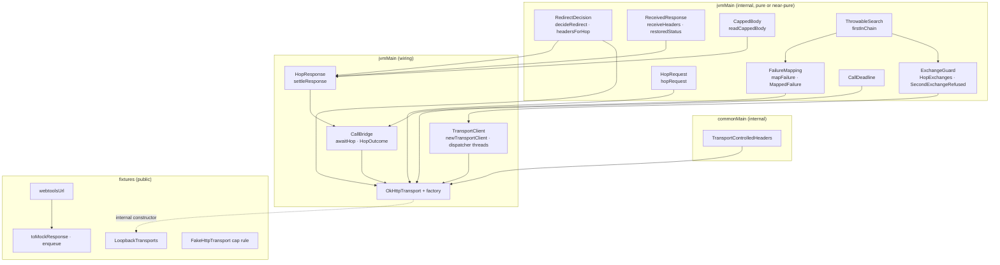
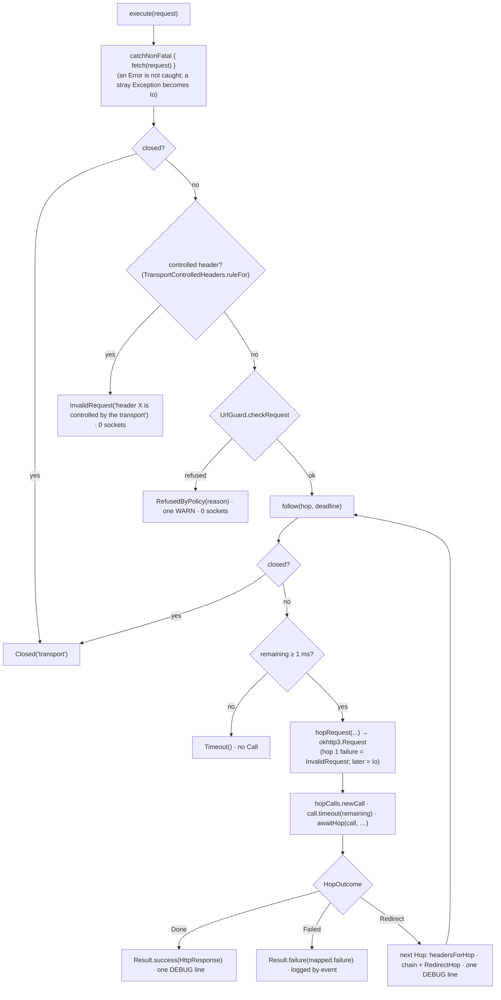

# Plan: `okhttp-transport` — `OkHttpTransport` with manual redirects, the one-exchange guard, the resolver and socket guards, and the loopback test factories

- **Covers:** `SpartanLaboratories/WebTools#65` — *"webtools-http: `OkHttpTransport` with manual redirects, the one-exchange guard, the
  resolver and socket guards, and the loopback test factories"*. Sub-issue of the tracking issue
  `SpartanLaboratories/WebTools#55` (HTTP client stack). Blocked by #63 (`test-support`) and #64 (`url-policy`), both landed. It blocks
  #68 (`call-facades`) directly, and #69 (`feeds`) through it; #67 (`call-budget`) reads one of its response rules.
- **Architecture:** [`../architecture.md`](../architecture.md), unit `okhttp-transport` (§11 unit 6 and its scope; §6.3.2 *OkHttp
  transport*; §6.2 for the failure model and the logging seam; §6.3.1 for the guards it wires; §6.6 for the logging rules; §6.7 for the
  fixtures; §7.3 and §7.4 for the guard layers and the boundary table; §9 for the tiers). Its dated "Corrected" callouts are the as-built
  truth for units 1 to 5. Systems-level consequences: [`../consequences.md`](../consequences.md) §7 and §8.
- **Research:** [`research/README.md`](research/README.md) with [`research/loopback-test-mechanics.md`](research/loopback-test-mechanics.md),
  [`research/transport-controlled-headers.md`](research/transport-controlled-headers.md),
  [`research/redirect-decision-table.md`](research/redirect-decision-table.md) and
  [`research/okhttp-failure-surface.md`](research/okhttp-failure-surface.md); the parent research is
  [`../research/http-transport.md`](../research/http-transport.md) (F1 to F10). Where a findings file differs from this plan (`Range` is
  admitted with `Accept-Encoding: identity` instead of refused; an unresolvable `Location` is a refusal, where the parent research's probe returned
  the `3xx`; the exchange guard hides the four statuses `407`, `408`, `421` and `503` instead of a `503`'s `Retry-After`), this plan is the
  specification.
- **Branch:** `feat/issue-65-okhttp-transport` (exists; cut from `master` at `53965c8`; holds the three research commits).
- **Commit:** `962bbe3`. This `plan.md` is committed **in the same commit as the first stage of the implementation** (commit 1 of §11), so
  `git log --follow` binds the two.
- **PR:** #88 (it closes #65).
- **What this plans:**
  - in `webtools-http`'s `jvmMain` (package `com.spartanlabs.webtools.http`): the public `OkHttpTransport` and its factory
    `OkHttpTransport(userAgent, policy)`; and, `internal`, the client builder, `ExchangeGuard`, the request and response conversion, the
    capped body reader, the redirect decision, the failure mapping, the suspend bridge and the call deadline;
  - in `commonMain`: the `internal` list of the twelve request headers the transport controls;
  - in the test fixtures (package `com.spartanlabs.webtools.http.testing`): `LoopbackTransports`, `MockWebServer.webtoolsUrl`,
    `Fixture.toMockResponse` and `MockWebServer.enqueue(fixture)`, and a cap rule for `FakeHttpTransport`;
  - the tests of all of it (Level 1 to Level 4c and the Level 5 manual pass), the extended ABI dump, the `README.md` delta and the new
    `CHANGELOG.md`.
- **Status:** planning only.
- **Amended:** 2026-11-02 after the test-coverage review. The deadline check that `follow` makes before a later hop had no test at any
  level; the transport's `internal` constructor gains two defaulted test parameters (the shared deadline's clock and the factory of each
  hop's `Call`), and a Level 2 test reaches the check through them. Each amended passage carries a dated note: R1, R6, Acceptance 9, §5
  (S6a), §6.2, §6.3, §6.9, §6.12, §7.3, §7.12, §7.16, §8, §9.1, §9 Level 2, §9.2 P13, §10, §11, §12 and §13. The plan before the
  amendment is [`superseded/plan-2026-11-02.md`](superseded/plan-2026-11-02.md).
- **Version moved:** none. `webtools-http` `1.0.0` stays unreleased and this landing is **not a release candidate**. No existing module
  moves a version.
- **Baseline:** `master` at `53965c8` plus the research commits (`aac2a81`). Line references are to it.

Code blocks in this plan are the intended implementation. They were written against the as-built sources of `webtools-http`, the
OkHttp 5.5.0 and `mockwebserver3` 5.5.0 sources and the research's measurements; the blocks themselves have not been compiled. The
implementer fixes a compile error mechanically and records any change to a rule (as opposed to a spelling) in `final-implementation.md` §2
at the moment it is made.

---

## 1. Requirements

### R1. The public surface and its tier

`webtools-http` gains these public declarations, all **Stable Core**, usable without the opt-in marker, each with KDoc (`@param`,
`@return`, `@throws`) that names its tier:

- `OkHttpTransport` in `com.spartanlabs.webtools.http` (`jvmMain`): a **final** class implementing `HttpTransport`, with an `internal`
  constructor `(userAgent: String, guard: UrlGuard, baseDns: okhttp3.Dns, donor: OkHttpClient?, timeSource: TimeSource =
  TimeSource.Monotonic, callFactory: Call.Factory? = null)`, the members `execute`, `close` and `toString`, and nothing else. It is covered
  by the module-wide opt-in of `jvmMain`, so it needs no `@OptIn`.
  > **Amended 2026-11-02 after the test-coverage review:** the constructor's last two parameters are test seams, `internal` with the
  > constructor: the clock of the shared deadline and the factory of each hop's `Call` (`null` is the transport's own client). Every caller
  > outside this module's Level 2 test passes four arguments; nothing public, nothing in the ABI dump and nothing in the fixtures changes
  > (§7.3).
- The top-level factory `OkHttpTransport(userAgent: String, policy: OutboundUrlPolicy): OkHttpTransport` in the same file. Both
  parameters are required: no default, no overload, no builder. Every number lives in `policy.settings`.
- In the fixtures (`com.spartanlabs.webtools.http.testing`, **Stable Core with source compatibility only**, explicit visibility and KDoc
  on every public declaration under `-Xexplicit-api=strict`, defaulted parameters allowed): `LoopbackTransports` (an `object` with
  `untrusted` and `trusted`), `MockWebServer.webtoolsUrl(path)`, `Fixture.toMockResponse(method)` and `MockWebServer.enqueue(fixture, method)`.

Nothing else becomes public. No type is added to the gate (`OkHttpTransport` is a supplied default, not a seam), no builder is added (so
`WebToolsDsl` has nothing to mark), and no OkHttp or `mockwebserver3` type appears in a public signature of `webtools-http` itself
(`LoopbackTransports` takes `java.net.InetAddress` and a Kotlin function type, and returns `OkHttpTransport`; the fixtures' own public
helpers do name `MockWebServer`, `MockResponse` and `Fixture`, which is their purpose).

### R2. Construction

The factory is `OkHttpTransport(userAgent, UrlGuard(policy), Dns.SYSTEM, null)`. The constructor refuses with `IllegalArgumentException`
and a **constant message that never echoes a value** (programmer error, thrown at construction, as the stack's other configuration is):

- `userAgent` must be non-blank, every character in U+0020..U+007E, and without a leading or trailing space;
- `policy.settings.maxResponseBytes <= Int.MAX_VALUE - 8` (the largest body a `ByteArray` can hold).

`toString()` prints the policy kind and the closed flag, nothing else (for example `OkHttpTransport(policy=Untrusted, closed=false)`).

### R3. The client

Each transport owns a **new** `Dispatcher` (with its own `ExecutorService`) and a **new** `ConnectionPool`, even when it is derived from
a donor client; it never shares a pool or a dispatcher, so `close()` cannot stop someone else's threads. The client:

- inherited interceptors and network interceptors cleared, then `ExchangeGuard` added as the one network interceptor;
- `retryOnConnectionFailure(false)`, `followRedirects(false)`, `followSslRedirects(false)`, both authenticators `Authenticator.NONE`,
  `CookieJar.NO_COOKIES`, no cache, `EventListener.NONE`, `callTimeout(0)` (each hop's `Call` gets its own limit, R6);
- connect, read and write timeouts from the settings in whole milliseconds; `Dispatcher.maxRequests` and `maxRequestsPerHost` from
  `maxConcurrentRequests` and `maxConcurrentRequestsPerHost`; `ConnectionPool(maxConcurrentRequests, idleConnectionTtl ms)`;
- `UrlGuard.enforcement(baseDns)` applied: `dns` always, `socketFactory` and `proxy` only when non-null; fast fallback left at its default;
- the dispatcher's `ExecutorService` is `ThreadPoolExecutor(0, Int.MAX_VALUE, 60 s, SynchronousQueue)` with **daemon** threads named
  `webtools-http-dispatcher-<n>` and an `UncaughtExceptionHandler` that logs the throwable's class name at `DEBUG`, so a forgotten
  `close()` costs nothing at JVM exit and a hostile status line cannot print a stack trace or kill the pool.

A donor client contributes its TLS configuration (and any property the list above does not set).

### R4. The request side of `execute`, in order

1. `HttpFailure.Closed("transport")` when the transport is closed.
2. A request carrying a header the transport controls fails with `TransportFailure.InvalidRequest("header <Name> is controlled by the
   transport")` **before anything is sent** (no socket), naming the **first** such entry in request order, in the list's canonical
   spelling. The list is exactly twelve names: `User-Agent`, `Accept-Encoding`, `Host`, `Connection`, `Content-Length`,
   `Transfer-Encoding`, `Keep-Alive`, `Proxy-Connection`, `TE`, `Trailer`, `Upgrade`, `Expect`, compared with `HttpSyntax.equalsName`. It
   lives in `commonMain` as an `internal` declaration, JVM-free, so the check module compiles it for `js` and the call facades can use it.
   `Range` is **admitted**: on any hop whose request carries `Range` the transport itself sends `Accept-Encoding: identity`, so OkHttp
   neither adds `gzip` nor decodes, and a compliant server answers without a content coding.
3. `UrlGuard.checkRequest(request)`; a refusal is `RefusedByPolicy(reason)` with one `WARN`.
4. The hop loop (R5, R6) under one deadline.

### R5. The hop

- **One `Call` per hop, one request per `Call`, no retry.** The request is built from the hop's `Url` text (`url.toString().toHttpUrl()`,
  never rebuilt from parts), the method name as is, the caller's headers in order, the transport's `User-Agent`, and a fresh
  `HopExchanges` tag. A present body is sent as `bytes.toRequestBody(null)` with its content type as a plain `Content-Type` header (OkHttp's
  `MediaType` stays `null`); a body-required method without a body gets an empty body. OkHttp's `okhttp3.internal.*` classes are never
  referenced anywhere.
- **`ExchangeGuard`** (network interceptor): a missing tag or a second exchange for one tag throws `SecondExchangeRefused`, which maps to
  `RetryRefused`; it hides a `407`, `408`, `421` or `503` status from OkHttp's follow-up logic (a placeholder status and the original in a
  private header), and the response conversion restores it, so each is delivered once, as the response it is, with every header, `Retry-After`
  included, untouched.
- **The body** is read inside `Callback.onResponse`, so cancelling the calling coroutine stops the read at once: nothing for `HEAD` or a
  `1xx`, `204`, `304` or followed redirect; an early `BodyTooLarge(cap, declared)` when the declared length is over the cap; otherwise
  decoded bytes up to the cap, and `BodyTooLarge(cap, null)` (or the declared length) past it.
- **The response**: a status outside 100..599 is `Protocol`, decided before the body is read. Headers: an entry whose name is not a
  token is dropped (one `DEBUG` line with the count), each value goes through `HttpSyntax.sanitizeReceivedValue`, order and duplicates are
  kept, and the private header is never surfaced.

### R6. Redirects, the deadline and the result

- Followed: `301 302 303 307 308`, for `GET` and `HEAD` only. The `3xx` is **returned as the response** for any other method or status
  (`300` included), and when it names no single usable `Location` (none, all blank, or several distinct values). Then the cap
  (`TooManyRedirects(maxRedirects)`, so `0` follows none), then resolution and admission (`RefusedByPolicy(Scheme)` for a foreign scheme
  `HttpUrl.resolve` cannot take, `RefusedByPolicy(HostForm)` for a `null` or throwing `resolve`, else `UrlGuard.admitRedirect`'s reason), then
  the deadline, then follow. The full table is §6.4.
- A followed hop keeps the method (`HEAD` stays `HEAD` after a `303`), has no body and no `Referer`, and carries the original headers
  minus every `isSensitive` entry once the scheme, host or effective port differs from the hop that redirected; a removal is permanent.
  The next request is built from the **admitted `Url`'s text**.
- `HttpResponse.url` is the last URL requested; `redirectChain` lists `RedirectHop(requestedUrl, status)` for each followed hop; a
  `Retry-After` on a followed `3xx` is not honoured, and on a returned `3xx` it stays in the headers.
- **One deadline** from the transport's `timeSource` (`TimeSource.Monotonic`; a test passes a manual one) at the start of `execute`
  spans every hop: before each hop the closed check, then `remaining = callTimeout - elapsed`; less than 1 ms is `Timeout` with no `Call`
  (a timeout of 0 would lift the limit); otherwise `call.timeout().timeout(remaining ms)` is set before `enqueue`. *(Amended 2026-11-02
  after the test-coverage review: the clock is the constructor's `timeSource`, so the check before a later hop is testable without a wall
  clock, §9.)*
- `InvalidRequest` is never returned after a hop was sent.

### R7. Failures

The mapping is a pure function, first match wins, by exception type and by who cancelled, never by message (§6.6). The `cause` is kept only
for `Timeout`, `DnsFailed` and `ConnectFailed`; every other leaf has none. OkHttp's messages are logged at `DEBUG` only, and only for the
kept exceptions. `Error`s are not mapped. Cancellation is thrown, never returned.

### R8. The bridge and `close()`

- `suspendCancellableCoroutine` with `invokeOnCancellation { call.cancel() }` registered **before** `enqueue`; each callback resumes the
  continuation **with a value**, exactly once, from a `finally` (never `resumeWithException` or `resumeWith(failure)`: under `-ea`
  kotlinx-coroutines 1.10.2 copies such a failure and sets the original as its `cause`); an `Error` escaping `onResponse` resumes the caller
  with `Io` and propagates to OkHttp, which hands it to the dispatcher thread's handler. The module's rule holds: `catch` appears only in
  `NonFatal.kt`, no `runCatching` wraps a suspend call.
- `close()`: `if (!closed.compareAndSet(false, true)) return`; then `dispatcher.cancelAll()`, `dispatcher.executorService.shutdown()` (not
  `shutdownNow()`), `connectionPool.evictAll()`, each inside `catchNonFatal`; `INFO` once. Idempotent, non-suspending, never throws. An
  in-flight call ends with `Closed("transport")`.

### R9. Logging

Logger `com.spartanlabs.webtools.http.OkHttpTransport` through the module's `logger(name)`. `INFO` on create (the policy kind and
`settings.toString()`, numbers only) and on close. `DEBUG`: one line per call (method, `Url.redacted()`, status, body size, hops, elapsed
ms), per redirect hop (`from.redacted()` to `to.redacted()`, status), per dropped-header count, per other failure (the leaf and the
exception's class name). `WARN` only for a policy refusal (once, with `Url.redacted()`, the reason name and the range class) and for
`RetryRefused`. Never headers, bodies, query strings, credentials, resolved addresses or any OkHttp object's `toString()`.

### R10. The fixtures

- `LoopbackTransports.untrusted(userAgent, policy = OutboundUrlPolicy.untrusted(), resolve = <system resolver>)` builds the real transport
  over `UrlGuard(policy, GuardRelaxation.LoopbackForTests)`; `trusted(userAgent, policy = OutboundUrlPolicy.trusted(), resolve = …)` forces
  `allowCleartext = true` when it is not already (every other property kept) over `GuardRelaxation.None`. The caller closes the result.
- `MockWebServer.webtoolsUrl(path = "/")` is an `http` URL on the server's bound address as an IP literal.
- `Fixture.toMockResponse(method = Get)` and `MockWebServer.enqueue(fixture, method = Get)` write a fixture as a response that cannot hang
  or corrupt the exchange (§7.14).
- `FakeHttpTransport`'s `maxResponseBytes` cap follows the transport's no-body rule: it is skipped for a `HEAD` request and for a `1xx`,
  `204` or `304` status.
- No new fixtures dependency; the fixtures-publication check's dependency list does not change.

### R11. Documentation and files

KDoc on every public declaration (tier, main-safety, never retries, the caps, the controlled headers, the redirect rules, `close()`,
thread-safety, what is logged); `README.md` line 11 and the fixtures paragraph; a new `CHANGELOG.md`; the ABI dump
`api/webtools-http.api` gains exactly the `OkHttpTransport` class lines and `OkHttpTransportKt.OkHttpTransport(String, OutboundUrlPolicy)`;
`PolicyEnforcement.kt`'s KDoc names `OkHttpTransport` instead of `(#65)`.

### R12. Tests and runs

Tests at Level 1 (gating), Level 2 (component), Level 3 (integration), Level 4a (deterministic) and Level 4c (non-functional) as §9
places them; Level 4b (end-to-end) has none in this unit; a Level 5 (user acceptance) manual pass. Hand-written fakes and stubs, no MockK
(the repository uses none). Level 3 runs on real time under `runBlocking`, never `runTest`. Runs are limited to the tasks that exercise the
change (§9.2). Java 11 API only; nothing beyond loopback.

### Acceptance

1. `:webtools-http:compileKotlinJvm` and `:webtools-http-commoncheck:compileKotlinJs` pass: the new `commonMain` file is JVM-free.
2. `:webtools-http:gatingTest :webtools-http:componentTest :webtools-http:deterministicTest :webtools-http:integrationTest
   :webtools-http:nonfunctionalTest` pass, and the result XML lists every test class of §9.
3. `:webtools-http:apiDump` writes the dump, read against §7.16 and the architecture §9 tier table; `apiCheck` then passes. The dump
   holds the `OkHttpTransport` class lines and the factory, and nothing `internal`.
4. `:webtools-http:verifyJavaFloor` passes; `:webtools-http:check :webtools-http-commoncheck:check` passes, including the
   fixtures-publication check (the fixtures' dependency list is unchanged).
5. Every mutation of P9 fails the test §9.2 names; the sources are restored and `git diff` is empty.
6. `git diff --stat` for `webtools-udp`, `webtools-scraping`, `webtools-browser`, `build-logic` and `webtools-http-commoncheck` is empty.
7. The mechanical rules of P8 hold; `README.md` and `CHANGELOG.md` read as §8 says.
8. The child-JVM test shows the JVM exits within 20 s with `close()` and without it.
9. *(Amended 2026-11-02 after the test-coverage review.)* `OkHttpTransportDeadlineComponentTest` passes: the check before a later
   hop returns `Timeout` with no `cause` and creates no `Call`, with no socket and no wall clock. The seam stays `internal`:
   `:webtools-http:apiCheck` passes against the dump as it stood before the seam, a fresh `apiDump` leaves
   `webtools-http/api/webtools-http.api` byte-identical, and the fixtures' sources and published API do not change. Mutations 14 to 16
   each fail the cases P13 names, and the sources are restored.

---

## 2. Current state

**Baseline.** `master` at `53965c8`; the branch holds only the three research commits. Units 1 to 5 (`build-logic`, `java-floor`,
`http-core`, `test-support`, `url-policy`) have landed. No production code calls an `HttpTransport` yet; its only implementations are
`FakeHttpTransport` and the recorder's decorator `RecordingHttpTransport`, both in the fixtures.

**What this unit plugs into** (`webtools-http/src/commonMain/kotlin/com/spartanlabs/webtools/http/` unless stated):

- **The port.** `HttpTransport : AutoCloseable` (`HttpTransport.kt`) with the eight-point contract: one request per hop and never a retry;
  caps reported as `BodyTooLarge`/`TooManyRedirects`/`Timeout`; a `304` is a response and any status in 100..599 is a response; unusable
  received entries are handled, not failed; cancellation is thrown; `Closed("transport")` after an idempotent, non-throwing `close()`;
  concurrent calls; `execute` main-safe. It is gated by `@SubclassOptInRequired`; `jvmMain` opts in module-wide
  (`webtools-http/build.gradle.kts:43` and `:51`), so a top-level implementer in `jvmMain` needs no `@OptIn`, while `jvmTest` stays a consumer.
- **The failure leaves** (`TransportFailure.kt`): `Timeout(cause)`, `ConnectFailed(cause)`, `DnsFailed(host, cause)`, `TlsFailed(cause)`,
  `Protocol(cause)`, `Io(cause)`, `InvalidRequest(rule, cause)`, `RefusedByPolicy(reason, cause)`, `BodyTooLarge(limit, declared, cause)`,
  `TooManyRedirects(limit, cause)`, `RetryRefused(cause)`, each with a cause-less secondary constructor; `HttpFailure.Closed(component)`
  (`HttpFailure.kt`). Messages are constant. `Timeout`, `ConnectFailed`, `TlsFailed`, `Protocol`, `Io` and `RetryRefused` have the
  `(Throwable?)` shape with no extra field, which is what kotlinx-coroutines' debug-mode exception copy rewrites (§6.8).
- **The value types.** `HttpRequest(method, url, headers, body)` (`HttpRequest.kt`; it refuses `CONNECT`, a non-sendable value, a body on
  `GET`/`HEAD`/`TRACE` and a body content type beside a `Content-Type` header, so a request that reaches the transport is well formed);
  `HttpResponse` with its `internal` constructor `(status, url, headers, redirectChain, body: ByteArray)` that copies the body and requires
  100..599 (`HttpResponse.kt:15-23`); `HttpHeaders` with its `internal` constructor `HttpHeaders(entries: List<Entry>)` and the builder
  (`add`, `addSensitive`, `addAll`), `Entry.isSensitive` (`flagged || isCredentialName`); `RedirectHop(url, status)` (status 300..399);
  `RequestBody(bytes, contentType)`; `HttpMethod` (equality on the name; `permitsBody`); `Url` (`toString()` is the full canonical URL,
  `redacted()` the loggable form).
- **The helpers.** `HttpSyntax` (`HttpSyntax.kt`): `isToken`, `equalsName`, `sanitizeReceivedValue`, `trimOws`, `isSendableValue`,
  `isCredentialName`; `catchNonFatal` (`NonFatal.kt:15-22`) — the module's one `catch`; `flatMap` (`ResultExtensions.kt:20`); `logger(name)`
  and `Log` (`Log.kt`).
- **The policy** (unit 5): `UrlGuard(policy, relaxation)` with `checkRequest(request): GuardRefusal?` (`UrlGuard.kt:82`),
  `admitRedirect(target, previous): RedirectAdmission` (`:97`, `Admitted(url)` or `Refused(refusal)`), `checkHop`, `judgeAnswer`;
  `GuardRefusal(reason, rangeClass)`; `GuardRelaxation.None` and `LoopbackForTests` (`GuardRelaxation.kt`); `OutboundUrlPolicy.settings`
  and the `internal` `OutboundUrlPolicy.withSettings(settings)` (`OutboundUrlPolicy.kt`, end of file); `TransportSettings` with the ten
  fields.
- **The JVM enforcement** (unit 5, `jvmMain`): `UrlGuard.enforcement(baseDns): PolicyEnforcement(dns, socketFactory?, proxy?)`
  (`PolicyEnforcement.kt:22`, `:32`); `PolicyRefusedUnknownHost` and `PolicyRefusedIo` (both `fillInStackTrace` overridden, constant
  messages) and `Throwable.policyRefusal(): GuardRefusal?` (`PolicyRefusals.kt:49`), a bounded (100), cycle-safe depth-first walk of the
  cause chain and the suppressed lists. The `PolicyEnforcement` KDoc (`:8`) still says "The OkHttp transport (#65) applies them".
- **The fixtures** (unit 4, `src/jvmTestFixtures/.../testing/`): `FakeHttpTransport` (its cap is `capped(response)` at
  `FakeHttpTransport.kt:159`, called from `play` at `:154`, with no access to the request), `Fixture(status, headers, body)`,
  `HttpMessageCodec.reasonPhrase(status): String?` (`HttpMessageCodec.kt:163`, `internal`), `RecordingHttpTransport`. `mockwebserver3`
  5.5.0 is already a `jvmTestFixturesApi` dependency ("for the loopback factories of a later unit",
  `webtools-http/build.gradle.kts:131`). `webtools-http`'s `jvmTest` sees the fixtures and `internal` declarations of main and the
  fixtures through the compilation association.
- **The build.** `okhttp-jvm` 5.5.0, `slf4j-api` 2.0.13 and `kotlinx-coroutines-core` 1.10.2 (`api`) are on `jvmMain`; Kotlin 2.2.0,
  `explicitApi()`; every jvm compilation, tests included, uses `jvmTarget = 11` and `-Xjdk-release=11`; the level tasks select by package
  (`com.spartanlabs.testing.<level>.*`, `WebToolsBuild.kt:25`), Gradle 9.7.1, build JDK 17 to 26. JUnit Jupiter 5.10.1 through
  `kotlin("test-junit5")` (`@Isolated` is available); logback 1.5.6 with `src/jvmTest/resources/logback-test.xml` (root `INFO`).
- **The existing OkHttp-level tests** this unit builds on: `PolicyEnforcementOkHttpIntegrationTest` (a real `OkHttpClient` with the
  enforcement bundle against a `MockWebServer`), `GuardedSocketSocksIntegrationTest` (`@Isolated`, a counting raw listener for
  `socksProxyHost`), `StubDns` and `inet(...)` (`src/jvmTest/.../support/webtools/http/StubDns.kt`), `FakeHttpTransportComponentTest`,
  `FixturesConsumerGatingTest`, `Slf4jLogComponentTest` (the logback `ListAppender` pattern).
- **No `CHANGELOG.md` exists** in the repository (`git ls-files` shows none).

**What the research measured** (details and sources in `research/`; Windows 11, JDK 23.0.2, Gradle 9.7.1, OkHttp, `mockwebserver3` and
`okhttp-tls` 5.5.0):

- OkHttp re-sends a request on a `503` with `Retry-After: 0` and on a `421` over a coalesced connection, and throws `ProtocolException` for a
  `407` through a direct route; no client flag turns these off. Its `408` re-send is turned off only by `retryOnConnectionFailure(false)`.
  `RetryAndFollowUpInterceptor.followUpRequest` decides on the response code a network interceptor hands it: a network interceptor that
  rewrites a `407` to a placeholder status (and records the original) makes the call deliver the response once (measured,
  `okhttp-failure-surface.md` F5), as hiding a `503`'s `Retry-After` did (`../research/http-transport.md` F3).
- A throw out of `Callback.onResponse` leaves a continuation unresumed; a non-`IOException` in the chain (a server-sent negative status gives
  `IllegalStateException("code < 0: -12")`) reaches `onFailure` as `IOException("canceled due to …")` and is rethrown on the dispatcher
  thread, which prints a stack trace and ends the thread unless the pool's thread factory installs a handler (`okhttp-failure-surface.md` F5).
- OkHttp's default dispatcher threads are non-daemon with a 60 s idle life; a transport that was not closed kept a probe JVM alive for 61 s,
  while with daemon threads the probe JVM exited after 0.4 s (`okhttp-failure-surface.md` F6).
- With `Range` OkHttp sends no `Accept-Encoding` and decodes nothing; with a caller `Accept-Encoding` it never rewrites it
  (`transport-controlled-headers.md` F1; claim X2 of the research verification).
- `HttpUrl.resolve` returns `null` for a foreign scheme and for a malformed authority, and throws `ArrayIndexOutOfBoundsException` for
  `//[1:2:3:4:5:6:7::8]/`; it has already rewritten backslashes, decoded `%65` and dropped TAB and LF when it prints (`redirect-decision-table.md` F4).
- The call timeout wraps the real failure in `InterruptedIOException("timeout")` with the real failure as its cause; the exchange guard's marker
  therefore needs the same bounded walk the policy markers use (`okhttp-failure-surface.md` F4).
- `MockWebServer.start()` binds `localhost`; `socketAddress`, `port` and `hostName` throw `IllegalStateException("call start() first")` before
  the start (`mockwebserver3-5.5.0-sources.jar`, `MockWebServer.kt:149`); `hostName` and `url()` reverse-resolve an address built without a
  name; `requestCount` is incremented as soon as a request is read; `MockResponse.Builder()` starts with `Content-Length: 0` and `body(...)`
  rewrites it; the `status` string is split on the first two spaces and the reason read as the third part
  (`loopback-test-mechanics.md` F1, F5, F7).

**Verified outside-world facts.**

- OkHttp 5.5.0 (`parent-5.5.0`): `Headers` has no public rename, and `Headers.Builder.add(name, value)` validates the value, so rebuilding a
  response's headers would throw on an entry OkHttp itself accepted leniently; `Headers.newBuilder()`, `removeAll` and `build` copy and edit
  without validation, and `add` accepts a token name with a digits value. The guard therefore hides a status, never a header (read from the
  sources jar, 2026-11-01).
- `okhttp-tls` 5.5.0 has class files of major version 52 (Java 8) and depends on `kotlin-stdlib` 2.1.21 and `okio-jvm` 3.18.1 at compile scope
  and `okhttp-jvm` 5.5.0 at runtime scope; it loads on the Java 11 test JVM (`loopback-test-mechanics.md` F9, claim 18).
- kotlinx-coroutines 1.10.2 under `-ea` re-creates a thrown exception through its `(Throwable)` constructor with the original as `cause`;
  a value resumed through `resume(value)` is untouched (`okhttp-failure-surface.md` F7, measured).
- `okio.BufferedSource.request(byteCount)` reads until the buffer holds `byteCount` bytes or the source is exhausted and returns whether it
  holds them; `BufferedSource.buffer` is the buffer property.

---

## 3. Assumptions

- **Level 3 runs over plain-HTTP loopback; the one HTTPS hop uses OkHttp's TLS test helper.** `okhttp-tls` 5.5.0 is added to the module's own
  `jvmTest` only, never to the published fixtures, whose dependency list the publication check asserts. If the helper were needed by a fixture,
  the fixtures' dependency list would change and the publication check's expected list with it; nothing in this plan needs that.
- **`LoopbackTransports` takes a whole defaulted policy and an optional stub resolver, not only settings.** A consumer's loopback test needs
  the policy's ports, extra ranges and mixed-answer rule (the rebinding and mixed-answer tests are written through it), and the settings live
  on the policy. `trusted` forces `allowCleartext = true` because loopback servers speak `http`. If a consumer's test needs a different kind of
  policy, it builds the transport from the public factory and its own policy.
- **Linux and macOS are not exercised.** Every measurement and every test run in this unit is on the maintainer's Windows host with a JDK between
  17 and 26. The leaves do not depend on JDK or operating-system message texts; the JVM-exit child launch (`java.home`, `java.class.path`),
  `localhost` ordering and the `Connection refused` wording are the cross-platform items. If one differs on Linux or macOS, the affected Level 3
  test (named in §9) is adjusted, not the production code.
- **A consumer's newer OkHttp 5.x keeps the hooks this unit uses** (`Dispatcher(ExecutorService)`, `ConnectionPool(Int, Long, TimeUnit)`,
  `Response.Builder.code`, `Request.tag(Class)`, `Call.timeout()`, `Dns` with the inherited `newCall`), and its follow-up logic keeps deciding
  on the response code a network interceptor returns. No `okhttp3.internal.*` class is
  referenced, so a moved internal class cannot break linkage. If a 5.x release removed one of the public hooks, the Level 2 client test
  (`TransportClientComponentTest`) is the first to fail on a build that pins it.
- **A server honouring `Accept-Encoding: identity` is a SHOULD, not a MUST** (RFC 9110 §12.5.3). A server that sends a content coding anyway
  is answered with the bytes as received, `Content-Encoding` included; the transport does not decode them. If that matters to a caller, it does
  not send `Range`.
- **JUnit runs the `@Isolated` classes sequentially.** Gradle runs a module's test task in one JVM with no JUnit parallel execution configured,
  so process-wide properties set by the proxy tests (`http.proxyHost`, `socksProxyHost`, `System.err`) cannot overlap another class; `@Isolated` states
  the intent and survives a later switch to parallel execution.
- **The exact JDK failure for a TLS hello sent to a server that closes the socket on accept is an `SSLException`** (measured:
  `SSLHandshakeException: Remote host terminated the handshake`). If a JDK in 17 to 26 raised a plain `SocketException`, that Level 3 test
  would see `Io`; the untrusted-certificate test beside it (a certain `SSLHandshakeException`) keeps the `TlsFailed` mapping covered.
- **Hop requests after the first cannot fail to build.** The next `Url` was admitted by `Url.parse`, which the differential test shows only
  narrows `HttpUrl`; a later hop's `Request.Builder` failure is therefore mapped to `Io`, not `InvalidRequest`. If a case were found, only the
  leaf of that branch changes.
- **No version moves.** `webtools-http` is unreleased at `1.0.0`; the landing adds no release candidate and the `CHANGELOG.md` entry sits under
  `## [Unreleased]`.

---

## 4. Non-goals

- **No retries, anywhere.** Not for `503`, `408`, `429`, a dropped pooled connection or a `421`; the response or the failure is returned.
- **No cache, cookie jar, authenticator, `Referer` or content-coding negotiation beyond OkHttp's transparent `gzip`.**
- **No budget, rate-signal reading or facade logic** (`call-budget`, `call-facades`). `Retry-After` is passed through, not interpreted; sizing
  the dispatcher from the budget's `maxBurst` is the facades' (they derive the policy with `OutboundUrlPolicy.withSettings` before calling the factory).
- **No streaming response and no request body larger than a `ByteArray`.**
- **No public builder, no public constructor, no donor parameter on the factory.** A donor is `internal`: it exists for the fixtures and tests.
- **No HTTP/2-specific mapping.** OkHttp's `internal` HTTP/2 exception classes are never named; every stream and connection failure is an
  `IOException` and maps to `Io`.
- **No change** to `Url`, the failure model, `UrlGuard`, `TransportSettings`, `OutboundUrlPolicy` or the guards' behaviour. The one touch of
  landed unit-5 code is the extraction of the bounded throwable walk (§7.4), behaviour-preserving and covered by its existing test.
- **No `docs/webtools-http-architecture.md`** (the final documentation unit writes it) and no release.
- **Defence against a JVM-wide `Socket.setSocketImplFactory(...)` or a replaced `ProxySelector` by other code in the same JVM**, which no
  library can guard (as unit 5 records).
- **IPv6 loopback in the default suite.** The bracket formatting is a pure test; no default test binds `::1`.

---

## 5. Approach and staging

The unit is built from the pure, portable parts outward: the header list and the pure functions of the transport first (each provable without a
network), then the client and the transport that wire them, then the fixtures, then the tests that need a server. After every stage the stage's
procedure (§9.2) runs and a result that differs from this plan is understood before anything is built on it. Every stage compiles and its
tests are green.



| Stage | Content | Verified by |
|---|---|---|
| S1 | `TransportControlledHeaders` (`commonMain`); `TransportControlledHeadersComponentTest`; the commoncheck compile | P1, P2 |
| S2 | `ThrowableSearch` (and `policyRefusal()` over it), `RedirectDecision`, `FailureMapping`, `HopRequest`, `ReceivedResponse`, `CappedBody`, `ExchangeGuard`, `CallDeadline`, and their Level 2 and Level 4a tests | P3 |
| S3 | `TransportClient`, `HopResponse`, `CallBridge`, `OkHttpTransport` with the factory and its KDoc, `PolicyEnforcement.kt` KDoc, the bridge, client and construction tests; `apiDump`; commit 2 | P4, P5 |
| S4 | The fixtures (`LoopbackTransports`, `webtoolsUrl`, `toMockResponse`, `enqueue`), the fixtures comment in `build.gradle.kts`, the `FakeHttpTransport` cap rule, and their Level 1, 2 and 4a tests | P6 |
| S5 | The `okhttp-tls` line in `build.gradle.kts`; the Level 3 support classes and the Level 3 tests | P7 |
| S6 | The Level 4c tests; `verifyJavaFloor`; the full `check`; the mechanical rules; the mutations; the unaffected-module proofs | P8, P9, P10, P11 |
| S6a | *(Amended 2026-11-02 after the test-coverage review)* The constructor's two `internal` test parameters (§7.3) and `OkHttpTransportDeadlineComponentTest`; they ride commit 2 | P13 |
| S7 | `README.md`, `CHANGELOG.md`, the dated corrections of the parent architecture, the Level 5 pass and the as-built reconciliation | P12 |

---

## 6. Design

### 6.1 Mechanism per type (architecture §9 and §6.9, for this unit's types)

| Type | Mechanism | Tier |
|---|---|---|
| `OkHttpTransport` | `final` class over an `internal` constructor; the factory is a top-level function of the same name; an implementer of the gated `HttpTransport` inside the module's opt-in | Stable Core (a supplied default, named for its technology; usable without the opt-in) |
| `LoopbackTransports` | `object` of two factory functions with defaulted parameters; returns the concrete `OkHttpTransport` | Stable Core, source compatibility only |
| `webtoolsUrl`, `toMockResponse`, `enqueue(fixture)` | extension functions on `MockWebServer` and `Fixture`, types the fixtures do not own | Stable Core, source compatibility only |
| `ExchangeGuard` | `internal object` implementing `okhttp3.Interceptor` (stateless) | internal |
| `HopExchanges`, `SecondExchangeRefused` | `internal class`es: a per-hop atomic counter, and an `IOException` marker with a constant message and no stack trace | internal |
| `RedirectOutcome`, `HopOutcome`, `MappedFailure`, `FailureEvent` | `internal sealed` hierarchies (the closed set is the contract of the internal functions that return them) | internal |
| `decideRedirect`, `headersForHop`, `mapFailure`, `readCappedBody`, `receiveHeaders`, `hopRequest` | `internal` top-level pure functions over strings, `Url`s, `HttpHeaders` and plain exceptions | internal |
| `TransportControlledHeaders` | `internal object` (a constant list and one pure function), `commonMain` | internal |
| `CallDeadline`, `TransportClient`, `HopContext` | `internal class`es, immutable after construction | internal |

No type here is an extension seam: a consumer constructs the transport and cannot subclass or configure it beyond the policy. A new setting
is a new `TransportSettings` property, an additive change owned by `url-policy`.

### 6.2 Construction and the public shape

```kotlin
public class OkHttpTransport internal constructor(
    private val userAgent: String,
    private val guard: UrlGuard,
    baseDns: Dns,
    donor: OkHttpClient?,
    private val timeSource: TimeSource = TimeSource.Monotonic,
    callFactory: Call.Factory? = null,
) : HttpTransport { … }

public fun OkHttpTransport(userAgent: String, policy: OutboundUrlPolicy): OkHttpTransport =
    OkHttpTransport(userAgent, UrlGuard(policy), Dns.SYSTEM, null)
```

The factory is a top-level function whose name equals the class; the call `OkHttpTransport(ua, guard, dns, null)` resolves to the `internal`
constructor (four arguments; the two test parameters keep their defaults) and `OkHttpTransport(ua, policy)` to the factory (two). The
module already uses this pattern (`HttpHeaders { }`,
`HttpRequest(...)`, `HttpResponse(...)`, `TransportSettings(from) { }`), so the dump line is `OkHttpTransportKt.OkHttpTransport(String,
OutboundUrlPolicy)`.

> **Amended 2026-11-02 after the test-coverage review:** the constructor's last two parameters exist for the Level 2 test of the deadline check
> (§7.3, §9). At their defaults the transport is the one this section describes; the test passes a manual `TimeSource` and a
> `Call.Factory` of fakes. Both are `internal` with the constructor, so the dump, the factory and `LoopbackTransports` do not change.

The constructor validates first (so a refusal leaves no thread or pool behind), then builds the client, then logs `INFO`. Both `require`s
use constant messages (§7.3). The policy kind is `Trusted` or `Untrusted` by a `when` on the sealed policy.

### 6.3 One call, end to end



Inside `awaitHop`, on the OkHttp dispatcher thread, `onResponse` runs `settleResponse` (§6.4, §6.7): status and `Protocol`; the redirect
decision before any body read; the capped body read; the `HttpResponse`. `onFailure` runs `mapFailure`. The calling coroutine is resumed with a
`HopOutcome` value in either case (§6.8).

> **Amended 2026-11-02 after the test-coverage review:** each hop's `Call` comes from `hopCalls`, the transport's own client unless the Level 2
> test passes a `Call.Factory` of fakes, and the deadline reads the constructor's `timeSource`. The `remaining ≥ 1 ms?` check before a
> later hop, reached when an earlier hop's exchange spent the deadline, is covered by `OkHttpTransportDeadlineComponentTest` (§9): a fake
> hop-1 `Call` moves a manual clock and answers a followable `302`, and the check before hop 2 returns `Timeout()` with no `Call` created.
> With a real clock the branch is reached only when an exchange ends inside the deadline's last millisecond, a race no test can set up
> deterministically.

```mermaid
sequenceDiagram
    participant C as caller (any dispatcher)
    participant T as OkHttpTransport.follow
    participant B as awaitHop
    participant D as OkHttp dispatcher thread
    C->>T: execute(request)
    T->>T: closed? deadline? build hop request
    T->>B: awaitHop(call, onResponse, onFailure)
    B->>B: invokeOnCancellation { call.cancel() } (before enqueue)
    B->>D: call.enqueue(callback)
    D->>D: ExchangeGuard · DNS guard · socket guard · wire exchange
    D->>D: onResponse: status · redirect decision · capped body read
    D-->>B: continuation.resume(HopOutcome) (from a finally, exactly once)
    B-->>T: HopOutcome
    T-->>C: Result<HttpResponse> or the next hop
    Note over C,D: caller cancelled: the handler cancels the Call; the read ends; the late resume is ignored
```

### 6.4 The redirect decision and what a hop carries

`decideRedirect` is a pure `internal` function; `HttpUrl.resolve` is passed in as `resolve: (String) -> String?` (it returns the printed
resolved URL or `null`, and may throw), so a Level 4a suite drives every row with no network. Rows are tried in order, the first match decides.
`n` is the number of redirects already followed (the chain's size), `cap` is `settings.maxRedirects`, `U` the hop that returned the `3xx`.

| # | Condition | Outcome |
|---|---|---|
| 1 | the request method is not `GET` or `HEAD` | `Deliver(Method)`: the `3xx` is the response |
| 2 | the status is not one of `301 302 303 307 308` (covers `300`, `304`, `305`, `306`, `309`..`399` and every non-`3xx`) | `Deliver(Status)` |
| 3 | the `Location` values, each trimmed of SP, HTAB, LF, FF and CR, are none, or all empty, or more than one distinct value | `Deliver(NoTarget)` or `Deliver(AmbiguousTarget)` |
| 4 | `n >= cap` | `TooMany` → `TooManyRedirects(cap)` (so `cap = 0` fails every row that reaches here, before any admission) |
| 5 | `resolve(value)` returns `null` or throws, and the trimmed value starts with a scheme (`[A-Za-z][A-Za-z0-9+.-]*:`) other than `http`/`https` | `Refused(GuardRefusal(Scheme))` |
| 6 | `resolve(value)` returns `null` or throws, otherwise | `Refused(GuardRefusal(HostForm))` |
| 7 | `UrlGuard.admitRedirect(printed, U)` is `Refused(g)` | `Refused(g)` → `RefusedByPolicy(g.reason)` |
| 8 | otherwise | `Follow(next)` with the admitted `Url`; the loop then checks the shared deadline (less than 1 ms left is `Timeout`) |

The deadline is not a row of the pure function (it needs a clock): the loop checks it at the top of the next hop, which is equivalent to a
"row 8" and keeps every other outcome independent of the clock (a `Follow` past the deadline is `Timeout`; a `TooMany`, `Refused` or `Deliver`
keeps its own outcome). A target equal to `U` is not special: the cap bounds a loop. `Location` is read with `Response.headers("Location")` (all
values), never `Response.header("Location")` (the last value).

**What a followed hop carries.** The method unchanged; no body; no `Referer`; the original request's header entries in order with duplicates and
spelling preserved, minus every entry removed on an earlier hop and, on a hop whose scheme, host or effective port differs from the hop that
redirected, minus every entry with `isSensitive` (flagged entries and `Authorization`, `Proxy-Authorization`, `Cookie`, `Set-Cookie`). Conditional
headers, `Range` and `Accept` go along. Removal is permanent: the stripped list is carried as the next hop's headers, so `A → B → A` does not
restore it. `User-Agent`, `Accept-Encoding` and `Host` are the transport's own on every hop (`Accept-Encoding: identity` again when `Range` is
present). A fresh `HopExchanges` tag and a fresh `Call` per hop.

**What the result holds.** `HttpResponse.url` is the hop that delivered; `redirectChain` is `[RedirectHop(U1, s1), …]` for the followed hops;
a `Retry-After` on a followed `3xx` is not honoured; a `3xx` that is returned is the response with its headers and its body read under the
normal cap.

### 6.5 `ExchangeGuard`

A network interceptor sees every wire exchange of every `Call`, including the ones OkHttp's follow-up logic starts. `Request.newBuilder()`
copies tags, so a re-sent request carries the **same** `HopExchanges` instance as the first; a counter on that tag turns every re-send path
OkHttp has, and any a later release adds, into `SecondExchangeRefused` (fail closed).

- **Entry.** `chain.request().tag(HopExchanges::class.java)`; a missing tag, or an `enter()` that returns `false` (count above 1), throws
  `SecondExchangeRefused`. The marker is an `IOException` (the chain declares `IOException`; a `RuntimeException` would be wrapped as
  `canceled due to …` and rethrown on the dispatcher thread), with a constant message and `fillInStackTrace` overridden, like `PolicyRefusedIo`.
- **Hiding, by status only.** (1) Any server-sent copy of the private header `X-Webtools-Hidden-Status` is removed, so a server cannot forge
  it. (2) A response whose status is `407`, `408`, `421` or `503` gets the placeholder status `599`, and its original status is added in
  `X-Webtools-Hidden-Status`: `RetryAndFollowUpInterceptor.followUpRequest` decides on the code it is handed and does nothing for `599`. OkHttp
  5.5.0 throws `ProtocolException` for a `407` on a direct route, re-sends a `408` unless `retryOnConnectionFailure` is `false`, re-sends a `421`
  on a coalesced connection and re-sends a `503` carrying `Retry-After: 0`; hidden, each is delivered once, and the port says any status in
  100..599 is a response. (3) Any other status is returned unchanged unless step 1 removed something. No other header is touched:
  `Retry-After` and every other entry keep their place and value.
- **Restoring** is the response conversion's job (§6.7): the status comes back from the private header, only when the response status is the
  placeholder and the header holds a number; the private header is never surfaced. A server's own `599` has no private header and stays `599`.
- **Why the status and not the header.** `Headers` has no public rename, and `Headers.Builder.add(name, value)` validates values, so moving
  `Retry-After` aside would mean rebuilding the header list and could turn a hostile `503` with an odd header into `Io`. A placeholder status
  needs one validated entry with a token name and a digits value. Between the guard and `followUpRequest` only `BridgeInterceptor` reads the
  code, through `promisesBody()`, which is `true` for `599` exactly as for the four hidden statuses.

The counter is the fail-closed **backstop**: with `retryOnConnectionFailure(false)`, `Authenticator.NONE`, no cache and the hiding above, no
re-send path remains that OkHttp 5.5.0 has. It trips on nothing in a normal run; its test is a custom application interceptor that proceeds
twice (§9, Level 3).

### 6.6 The failure mapping

`mapFailure(e: Throwable, ctx: FailureContext): MappedFailure` is pure. First match wins. `FailureContext` is `(host, https, closed,
callCanceled, phase)`: the hop URL's host and scheme, the transport's closed flag, `call.isCanceled()`, and `Phase.Exchange` (from
`onFailure`) or `Phase.Body` (from the read inside `onResponse`). A cancellation by the calling coroutine is decided before the mapper is
called (the bridge skips it), so it is not a row.

| # | Match | Leaf | `cause` | Event |
|---|---|---|---|---|
| 1 | `e.policyRefusal() != null` (cause chain and suppressed, bounded) | `RefusedByPolicy(reason)` | none | `PolicyRefusal` (WARN once) |
| 2 | a `SecondExchangeRefused` found by the same walk | `RetryRefused` | none | `ExchangeRepeat` (WARN once) |
| 3 | `ctx.closed` | `HttpFailure.Closed("transport")` | n/a | `Silent` |
| 4 | `e is UnknownHostException` | `DnsFailed(ctx.host)` | `e` when `e.cause == null` | `Other` with the kept message |
| 5 | `e is SocketTimeoutException` | `Timeout` | `e` | `Other` with the kept message |
| 6 | `e is InterruptedIOException && ctx.callCanceled` (the call timeout) | `Timeout` | `e` only when its cause is `null` or a `SocketException` with no cause of its own (a type test; the JDK's socket texts hold no address) | `Other`, class name |
| 7 | `e is SSLException && ctx.phase == Exchange` | `TlsFailed` | none | `Other`, class name |
| 8 | `e is UnknownServiceException` | `TlsFailed` when `ctx.https`, else `Io` | none | `Other`, class name |
| 9 | `e is ConnectException`, `NoRouteToHostException` or `PortUnreachableException` | `ConnectFailed` | for a `ConnectException`, its `IOException` cause (the JDK exception inside OkHttp's `Failed to connect to <address>` wrapper) and never the wrapper itself, so none when there is no such cause; for the other two, `e` itself (the JDK raises them unwrapped, with no address in the text) | `Other` with the kept message |
| 10 | `e is ProtocolException` | `Protocol` | none | `Other`, class name |
| 11 | `e.javaClass == IOException::class.java` with a non-`IOException` cause (OkHttp's `canceled due to …` wrapper) | `Protocol` when the cause is an `IllegalStateException` whose message starts `code < 0`, else `Io` | none | `Other`, class name |
| 12 | any other `IOException` | `Io` | none | `Other`, class name |
| 13 | any other `Exception` | `Io` | none | `Other`, class name |

Rows 1 and 2 run before any type test because the call timeout wraps the real failure in an `InterruptedIOException` (a marker is its `cause`);
row 3 is after them so a policy refusal that races a `close()` is still reported as the refusal it was. Row 5 precedes row 6 because
`SocketTimeoutException` is an `InterruptedIOException`. Rows 9 to 13 never read a message. The only message the mapper reads is the
`code < 0` prefix of OkHttp's own `IllegalStateException` in row 11, and a miss degrades to `Io`. `executor rejected` (an
`InterruptedIOException` from a shut-down dispatcher) is `Closed` through row 3 when the transport is closed, and `Io` through row 12 otherwise.
A status outside 100..599 is decided in `settleResponse` (§6.7), not here. `BodyTooLarge`, `TooManyRedirects` and the deadline `Timeout` are
decided by the reader and the loop, not by an exception.

The `cause` is the transport's decision (the failure model leaves it to the producer): `Protocol`, `TlsFailed`, `Io` and `InvalidRequest` messages
hold server-sent text, certificate names, the request host and port, a resolved address or a header value, so they get none. `Timeout`,
`DnsFailed` (its message is the host the failure already carries) and `ConnectFailed` (the JDK exception has no address in its text) keep theirs.
The `UnknownHostException` is kept only when it has no cause of its own.

### 6.7 Request and response conversion, the capped read

**Request** (`hopRequest`, §7.7). `HttpUrl` from `url.toString().toHttpUrl()`. The method name goes to OkHttp as is (`HttpMethod.of` checked the
token). `Request.Builder.method(name, null)` throws for a method OkHttp requires a body for, so a body-required method (`POST`, `PUT`, `PATCH`,
`PROPPATCH`, `REPORT`, `QUERY`) without a body gets `ByteArray(0).toRequestBody(null)`; a Level 4a differential test checks the list against
`Request.Builder.method(name, null)` itself. Caller headers are added in order with `addHeader`; the factory's `User-Agent` follows;
`Accept-Encoding: identity` follows when the headers contain `Range`; a body content type is a plain `Content-Type` header. The fresh
`HopExchanges` tag is attached with `Request.Builder.tag(Class, tag)`. Any exception from the builder (hop 1) is `InvalidRequest("the request
could not be built")` — a constant rule — before anything is sent; header names are tokens and values sendable (the `HttpRequest` checked), so
it is a backstop.

**Response** (`settleResponse`, §7.12). In order:

1. The status is the response code, or, when the code is the placeholder `599` and the private status header is present, that header's number
   (`restoredStatus`). A status outside 100..599 is `Failed(Protocol)` with no body read.
2. `decideRedirect(...)` (§6.4). `Follow(next)` → `HopOutcome.Redirect(status, next)` (the body is never read: the connection is not reused, the
   price of not draining untrusted bytes). `TooMany` → `Failed(TooManyRedirects(cap))`. `Refused(g)` → `Failed(RefusedByPolicy(g.reason))` with a
   `PolicyRefusal` event whose stage is the redirect target. `Deliver` continues.
3. Headers: `receiveHeaders` (§7.8) drops entries whose name is not a token (the count goes to one `DEBUG` line), passes each value through
   `HttpSyntax.sanitizeReceivedValue`, keeps order and duplicates, and removes the private header.
4. The body: not read for `HEAD` or a status in `100..199`, `204` or `304`; otherwise `readCappedBody(source, declared, cap)` with
   `declared = contentLength().takeIf { it >= 0 }` (`-1` is no declaration, which is also what a transparently decoded `gzip` body reports).
   A declared length above the cap is `BodyTooLarge(cap, declared)` **without a read**; else the source is asked for `cap + 1` bytes and
   `BodyTooLarge(cap, declared)` follows if they exist. `okio.BufferedSource.request(n)` returns whether `n` bytes are available; the buffer
   then holds at most `cap` plus one segment.
5. `HopOutcome.Done(HttpResponse(status, ctx.url, headers, ctx.chain, bytes))`.

### 6.8 The bridge, and why every callback resumes with a value

`awaitHop(call, handleResponse, handleFailure)` is `suspendCancellableCoroutine<HopOutcome>`:

- `continuation.invokeOnCancellation { call.cancel() }` is registered **before** `call.enqueue(...)`. A call enqueued on a shut-down dispatcher
  fails synchronously on the enqueuing thread, so the handler must exist first; and `execute` checks the closed flag before every hop.
- Both callbacks go through one `settle` helper: it runs the handler inside `try`, and a `finally` resumes the continuation with the outcome, or,
  when an `Error` left the handler, with an `Io` outcome (then the `Error` propagates to OkHttp, which cancels the call and rethrows it on the
  dispatcher thread, where the pool's handler logs the class name at `DEBUG`). A throw out of `onResponse` otherwise leaves the continuation
  unresumed forever (OkHttp does not call `onFailure` after `onResponse`), and an `IOException` thrown there is only logged at `INFO` by OkHttp.
- The `Response` is closed in the `finally` of `onResponse` through `catchNonFatal { response.close() }` (the module has no `catch` outside
  `NonFatal.kt`; `okhttp3.internal.closeQuietly` is internal API).
- A callback that finds the continuation already cancelled skips the handler (closing the `Response` in `onResponse`) and resumes with
  `HopOutcome.Abandoned`: the first resume after a cancellation is ignored, and the mapped result would be irrelevant anyway (the caller gets
  `CancellationException`). `Abandoned` is never observed by the loop (`HopOutcome` is `sealed`, and the loop's `when` maps it to `Io`).
- **Values, never throwables.** `HopOutcome.Failed` carries the mapped `HttpFailure` as a field. `Continuation.resumeWithException(failure)`
  or `resumeWith(Result.failure(failure))` would, under `-ea` (the Gradle test JVMs, and any consumer that runs with assertions), make
  kotlinx-coroutines 1.10.2 recreate `Timeout`, `ConnectFailed`, `TlsFailed`, `Protocol`, `Io` and `RetryRefused` (they have the `(Throwable?)`
  shape and no extra field) through that constructor with the original as the new `cause`, which would silently change the transport's
  decision about `cause`. A value is untouched (measured).

### 6.9 `close()`, the dispatcher, lifecycle and thread safety

- `closed` is an `AtomicBoolean`. `close()` sets it with `compareAndSet(false, true)` **before** anything else, so every callback's mapping
  (row 3) and every hop's check sees it. Then, each inside `catchNonFatal` with a `DEBUG` line on failure (the step's name and the exception's
  class name): `dispatcher.cancelAll()` (reaches queued calls, running calls and a body read inside `onResponse`, because a call stays in
  `runningAsyncCalls` until `AsyncCall.run` returns), `dispatcher.executorService.shutdown()` (not `shutdownNow()`, which interrupts threads
  and leaves HTTP/2 streams with a null-message `InterruptedIOException` and the interrupt flag set), `connectionPool.evictAll()` (idle
  connections only; connections in use close as their calls release). `INFO` once at the end.
- Queued calls are only marked by `cancelAll()`; with `maxRequests` exhausted they fail when promoted (`Socket closed`, or `executor rejected`
  once the pool is shut down). Every callback is invoked exactly once, and each maps to `Closed` through row 3.
- The dispatcher's `ExecutorService` has the shape of OkHttp's default (`ThreadPoolExecutor(0, Int.MAX_VALUE, 60 s, SynchronousQueue)`), so
  concurrency is bounded by `maxRequests`/`maxRequestsPerHost`; its thread factory makes daemon threads named `webtools-http-dispatcher-<n>`
  (`<n>` counts per transport from 1) with an `UncaughtExceptionHandler`. OkHttp renames the thread for the duration of a call, so the factory's
  name shows only on idle threads. `TaskRunner.INSTANCE` (connection-pool cleanup) already uses daemon threads.
- **Thread safety.** The transport has no mutable state but the `AtomicBoolean`; `execute` may be called concurrently from many coroutines and
  on any dispatcher; blocking work (DNS, connect, TLS, the body read, `HttpUrl.resolve`) runs on the dispatcher's threads, so `execute` is
  main-safe. The guard, the settings and the policy are immutable. `HopExchanges` is the only per-hop mutable object (an `AtomicInteger`).
  A donor client is read once at construction and never modified (`newBuilder()` copies).
- **The test parameters** *(Amended 2026-11-02 after the test-coverage review)*. The deadline is created in `fetch` and read at the top of every hop,
  on the calling coroutine; a `TimeSource.Monotonic` mark is an immutable value, and the Level 2 test's manual clock is set and read on one
  thread (the fake `Call` runs the test's hook inside `enqueue`, on the caller's thread). A substituted `callFactory` makes calls that are
  not this client's: they skip its resolver and socket guards, `ExchangeGuard`, its dispatcher and its pool, and `close()`'s `cancelAll()`
  does not reach them. Only `OkHttpTransportDeadlineComponentTest` substitutes one; production code, the fixtures and every other test use
  the transport's own client.

### 6.10 Error handling of the new signatures

| Signature | On failure | Expected (a `Result`) | Programmer error (thrown) | Unwrapped |
|---|---|---|---|---|
| `OkHttpTransport(userAgent, policy)` and the `internal` constructor | `IllegalArgumentException`, constant message | none | blank, non-ASCII, space-padded `userAgent`; `maxResponseBytes` above `Int.MAX_VALUE - 8` | at construction (the caller's code) |
| `suspend execute(request): Result<HttpResponse>` | `Result.failure(HttpFailure)` | every leaf of §6.6, `InvalidRequest`, `RefusedByPolicy`, `Closed`, `BodyTooLarge`, `TooManyRedirects`, `Timeout`, `RetryRefused` | none thrown; an `Error` propagates; `CancellationException` is thrown | by the caller (`fold`, `getOrElse`); never inside the transport |
| `close()` | never throws | each step's failure is logged at `DEBUG` | none | n/a |
| `TransportControlledHeaders.ruleFor(headers): String?` | `null` means allowed | the rule text | none | by `execute`, which turns it into `InvalidRequest` |
| `decideRedirect(...): RedirectOutcome` | a sealed value; never throws (a throwing `resolve` is `catchNonFatal`-wrapped) | `Deliver`, `TooMany`, `Refused`, `Follow` | none | by `settleResponse` |
| `headersForHop(headers, from, to): HttpHeaders` | total | n/a | none | n/a |
| `mapFailure(e, ctx): MappedFailure` | total over any `Throwable` that is not an `Error` | all rows | none | by the bridge's handlers |
| `readCappedBody(source, declared, limit): Result<ByteArray>` | `Result.failure(BodyTooLarge)`, or the source's own exception (`IOException`) | the cap, an I/O error | none | by `settleResponse`: `BodyTooLarge` kept, anything else mapped with `Phase.Body` |
| `receiveHeaders(pairs): ReceivedHeaders` | total (a dropped name is data, not a failure) | n/a | none | n/a |
| `hopRequest(...): Result<Request>` | `Result.failure(IllegalArgumentException from OkHttp)` | the build backstop | none | by `follow`: `InvalidRequest` on hop 1, `Io` later |
| `awaitHop(...): HopOutcome` | never throws; suspends; cancellation is thrown by `suspendCancellableCoroutine` | the outcome carries the failure | none | by `follow` |
| `CallDeadline.remainingMillis(): Long` | total, never negative | n/a | none | by `follow` (`< 1` is `Timeout`) |
| `LoopbackTransports.untrusted/trusted` | the constructor's `IllegalArgumentException` for a bad `userAgent` | none | a bad `userAgent` | by the test |
| `MockWebServer.webtoolsUrl(path)` | throws | none | `path` not starting with `/` (`IllegalArgumentException`), a server not started (`IllegalStateException` from `MockWebServer`), a non-loopback bind (`IllegalStateException`) | by the test |
| `Fixture.toMockResponse(method)`, `MockWebServer.enqueue(fixture, method)` | throws | none | a `1xx` fixture, a `204`/`205` fixture with a body (`IllegalArgumentException`); a custom dispatcher (`IllegalStateException`) | by the test |

Test-code preconditions throw, as the rest of the fixtures do; the production API uses `Result` for expected failures.

### 6.11 Logging

The logger is `com.spartanlabs.webtools.http.OkHttpTransport`, obtained once as `internal val transportLog` and used by every transport file
(the dispatcher thread factory included). One site logs each event.

| Event | Level | Where | Fields |
|---|---|---|---|
| created | `INFO` | constructor | the policy kind, `settings.toString()` (numbers only) |
| closed | `INFO` | `close()`, once | none |
| one call finished | `DEBUG` | `follow`, on `Done` | method, `Url.redacted()` of the last hop, status, body size, hop count, elapsed ms |
| one redirect followed | `DEBUG` | `follow`, on `Redirect` | `from.redacted()`, `to.redacted()`, status |
| header names dropped | `DEBUG` | `settleResponse` | the count, only when above 0 |
| a failure other than a refusal or a repeat | `DEBUG` | `report` | the leaf's name, the exception's class name, and its message only for a kept exception (rows 4, 5, 6, 9) |
| a policy refusal | `WARN`, once | `report` | `Url.redacted()` of the hop, the stage (`request`, `redirect target of`, `connection`), the reason name, the range class |
| `RetryRefused` | `WARN`, once | `report` | `Url.redacted()` of the hop |
| a close step failed | `DEBUG` | `close()` | the step, the exception's class name |
| a dispatcher thread ended by a throwable | `DEBUG` | the thread factory's handler | the throwable's class name |

`report(url, mapped)` is the one function that logs a failure: `Silent` (closed) logs nothing. For a refused redirect target there is no
`Url` of the target (it may not parse), so the log carries the hop that returned the redirect. A `WARN` is created where the failure is
created (the request check in `fetch`, the redirect decision in `settleResponse`, the mapper for resolver and socket refusals), and `report`
is called once per failed call, so there is exactly one.

### 6.12 Where this plan refines the parent architecture

None of these changes the unit's scope, a seam or its tier.

- `LoopbackTransports` takes a whole `OutboundUrlPolicy.Untrusted`/`Trusted` and a resolver function, not `settings` and `resolve`; the
  settings live on the policy, and the rebinding and mixed-answer tests need `allowedPorts` and `mixedAnswers`.
- `toMockResponse` and `enqueue` take a defaulted request method (`GET`): only a response to `HEAD` is written differently.
- `ExchangeGuard` hides a `407`, `408`, `421` or `503` by its status (a placeholder and a private header) so that each is delivered once as a
  response. The architecture has it hide a `503`'s `Retry-After` and lets the counter cover a `421`; the status hide delivers the same `503`
  untouched, turns a `421` on a coalesced connection into the response it is instead of `RetryRefused`, and also covers the `407` OkHttp throws
  for on a direct route. The counter stays the fail-closed backstop.
- The refused set is twelve names and `Range` is admitted with an `Accept-Encoding: identity` sent by the transport; the architecture is silent
  on headers a caller sets that the transport must control.
- The dispatcher has its own daemon `ExecutorService` with a handler (the architecture said a new `Dispatcher`).
- An unresolvable or foreign-scheme `Location` is `RefusedByPolicy`, not a returned `3xx`; `300` is returned, not followed.
- The published fake's cap follows the transport's no-body rule (`HEAD`, `1xx`, `204`, `304`), as the architecture's body-read rule does.
- The architecture's §6.6 rule "`RefusedByPolicy`, `InvalidRequest`, `Closed` release the permit" is exact only for `InvalidRequest` and for a
  refusal of the first hop's request check; see the interface to `call-facades` (§12).
- *(Amended 2026-11-02 after the test-coverage review.)* The `internal` constructor takes, after the architecture's guard, resolver
  and optional donor, the deadline's `TimeSource` and a `Call.Factory`, both defaulted and passed only by this module's Level 2 test.
  Neither is a seam in the tier sense: the public shape, the dump and the fixtures are unchanged.

---

## 7. File-by-file changes

Paths are relative to the repository root. `<cm>` is `webtools-http/src/commonMain/kotlin/com/spartanlabs/webtools/http/`, `<jm>` is
`webtools-http/src/jvmMain/kotlin/com/spartanlabs/webtools/http/`, `<fx>` is
`webtools-http/src/jvmTestFixtures/kotlin/com/spartanlabs/webtools/http/testing/`. Every new Kotlin file is LF (`.gitattributes`). Each file's
package equals its path; every public declaration has KDoc.

### 7.1 `webtools-http/build.gradle.kts` (changed)

Two edits and nothing else. The fixtures' dependency list is untouched, so the fixtures-publication check's expectation holds.

1. In `kotlin { sourceSets { … } }`, after `jvmMain { … }`:

   ```kotlin
   jvmTest {
       dependencies {
           // OkHttp's TLS test helper: a self-signed certificate and matching SSL contexts for the https-to-http redirect
           // test and the TLS failure test. A test-only dependency of this module; never a fixtures dependency.
           implementation("com.squareup.okhttp3:okhttp-tls:5.5.0")
       }
   }
   ```

2. The comment above the fixtures dependencies (`:131`) becomes present tense:
   `// mockwebserver3 serves the loopback factories (LoopbackTransports, webtoolsUrl, toMockResponse, enqueue); nothing else is added.`

The header note about "1.0.0 is UNRELEASED" is unchanged.

### 7.2 `<cm>TransportControlledHeaders.kt` (new, `commonMain`, JVM-free)

```kotlin
package com.spartanlabs.webtools.http

/**
 * The request headers the transport controls: a caller-supplied value would change the exchange's framing, its decoding, the host or protocol the
 * request reaches, or the transport's own identity. A request carrying one is refused before anything is sent. The names are compared with
 * [HttpSyntax.equalsName] (an ASCII-only fold) and reported in this list's spelling. `Range` is not on the list: the transport sends
 * `Accept-Encoding: identity` itself on a hop whose request carries it. Lives in `commonMain` so the check module compiles it for `js` and the call
 * facades can refuse the same names in their default headers.
 */
internal object TransportControlledHeaders {
    /** The twelve names, in the spelling the rule text uses. */
    val names: List<String> = listOf(
        "User-Agent", "Accept-Encoding", "Host", "Connection", "Content-Length", "Transfer-Encoding",
        "Keep-Alive", "Proxy-Connection", "TE", "Trailer", "Upgrade", "Expect",
    )

    /**
     * The rule text for the first entry of [headers], in request order, whose name is controlled; `null` when none is.
     *
     * @param headers the request's headers.
     * @return `header <Name> is controlled by the transport` with the list's spelling of the name, or `null`.
     */
    fun ruleFor(headers: HttpHeaders): String? =
        headers.entries().firstNotNullOfOrNull { entry -> names.firstOrNull { HttpSyntax.equalsName(it, entry.name) } }
            ?.let { "header $it is controlled by the transport" }
}
```

Failure path: none (total). Not logged. No `lowercase`, `uppercase` or `ignoreCase` (the repository rule for `commonMain`).

### 7.3 `<jm>OkHttpTransport.kt` (new)

> **Amended 2026-11-02 after the test-coverage review.** The block carries the two `internal` test parameters that let a Level 2 test reach the
> deadline check before a later hop (§6.3, §9). Against the as-built `OkHttpTransport.kt` (line numbers as of the amendment) the edit is
> exactly:
>
> 1. Imports: `import kotlin.time.TimeSource` after `import java.util.concurrent.atomic.AtomicBoolean`; `okhttp3.Call` is already
>    imported.
> 2. The class KDoc's last paragraph (`:78`–`:79`) becomes the text below.
> 3. The constructor (`:81`–`:86`) gains, after `donor: OkHttpClient?,`, the two parameters with their line comments, as in the block.
> 4. After `private val http` (`:100`): the `hopCalls` property with its comment, as in the block.
> 5. `fetch` (`:146`): `CallDeadline(settings.callTimeout)` becomes `CallDeadline(settings.callTimeout, timeSource)`.
> 6. `follow` (`:160`): `http.client.newCall(built)` becomes `hopCalls.newCall(built)`.
>
> Nothing else in the file changes. The public factory (`:224`–`:225`), `LoopbackTransports.kt` and every existing test that calls the
> constructor keep their four arguments, and `close()` keeps stopping the transport's own client, the only factory outside the Level 2
> test. The name `timeSource` and its default follow the module's `FakeHttpTransport` (`timeSource: TimeSource = TimeSource.Monotonic`).
> The defaults add a synthetic constructor to the class file; binary-compatibility-validator 0.18.2 maps it back to the constructor
> (`alternateDefaultSignature`) and takes the `internal` visibility from the Kotlin metadata, so neither reaches the dump (§7.16, P13).
>
> The class KDoc's last paragraph:
>
> ```
>  * The constructor that takes a guard, a base resolver and a donor client is not public: it exists for the test fixtures (`LoopbackTransports`)
>  * and this module's own tests. Its last two parameters, the clock of the shared deadline and the factory of each hop's `Call`, are for this
>  * module's tests only (a manual clock and fake calls); every other caller leaves them at their defaults, `TimeSource.Monotonic` and the
>  * transport's own client.
> ```

```kotlin
package com.spartanlabs.webtools.http

import okhttp3.Call
import okhttp3.Dns
import okhttp3.OkHttpClient
import java.util.concurrent.TimeUnit
import java.util.concurrent.atomic.AtomicBoolean
import kotlin.time.TimeSource

internal const val TRANSPORT_LOGGER_NAME: String = "com.spartanlabs.webtools.http.OkHttpTransport"
internal val transportLog: Log = logger(TRANSPORT_LOGGER_NAME)

/** The largest body a `ByteArray` can hold. */
internal const val MAX_BODY_BYTES: Long = Int.MAX_VALUE - 8L
internal const val USER_AGENT_MESSAGE: String =
    "userAgent must be non-blank, visible ASCII (U+0020 to U+007E) and without a leading or trailing space."
internal const val MAX_RESPONSE_BYTES_MESSAGE: String =
    "maxResponseBytes must not exceed 2147483639 bytes, the largest body a byte array can hold."
internal const val BUILD_RULE: String = "the request could not be built"

internal fun isValidUserAgent(userAgent: String): Boolean =
    userAgent.isNotBlank() && userAgent.all { it in ' '..'~' } && !userAgent.startsWith(' ') && !userAgent.endsWith(' ')

/** … full KDoc: Stable Core; main-safety (blocking I/O runs on the transport's own daemon dispatcher threads); never retries; the caps from
 *  policy.settings; the twelve controlled headers and Range → Accept-Encoding: identity; the redirect rules; close(); thread-safety (execute
 *  may be called concurrently; close is idempotent); what is logged; the donor/guard constructor is internal, and its last two parameters
 *  (the deadline's clock and each hop's call factory) are for this module's tests only. @param userAgent @param policy
 *  @throws IllegalArgumentException on the factory. */
public class OkHttpTransport internal constructor(
    private val userAgent: String,
    private val guard: UrlGuard,
    baseDns: Dns,
    donor: OkHttpClient?,
    private val timeSource: TimeSource = TimeSource.Monotonic,     // the shared deadline's clock; a test passes a manual one
    callFactory: Call.Factory? = null,                             // each hop's Call; null is this transport's own client
) : HttpTransport {
    private val settings: TransportSettings = guard.policy.settings
    private val policyKind: String = when (guard.policy) {
        is OutboundUrlPolicy.Trusted -> "Trusted"
        is OutboundUrlPolicy.Untrusted -> "Untrusted"
    }

    init {
        require(isValidUserAgent(userAgent)) { USER_AGENT_MESSAGE }
        require(settings.maxResponseBytes <= MAX_BODY_BYTES) { MAX_RESPONSE_BYTES_MESSAGE }
    }

    private val closed = AtomicBoolean(false)
    private val http: TransportClient = newTransportClient(settings, guard.enforcement(baseDns), donor)

    // A substitute's calls are not this client's: no resolver or socket guard, no ExchangeGuard, and close() cannot reach them. Tests only.
    private val hopCalls: Call.Factory = callFactory ?: http.client

    init {
        transportLog.info("created: policy={}, settings={}", policyKind, settings)
    }

    override suspend fun execute(request: HttpRequest): Result<HttpResponse> =
        catchNonFatal { fetch(request) }.fold(onSuccess = { it }, onFailure = { unexpected(it) })

    override fun close() {
        if (!closed.compareAndSet(false, true)) return
        listOf<Pair<String, () -> Unit>>(
            "cancelAll" to { http.dispatcher.cancelAll() },
            "shutdown" to { http.dispatcher.executorService.shutdown() },
            "evictAll" to { http.pool.evictAll() },
        ).forEach { (step, action) ->
            catchNonFatal(action).onFailure { transportLog.debug("close step {} failed: {}", step, it.javaClass.name) }
        }
        transportLog.info("closed")
    }

    override fun toString(): String = "OkHttpTransport(policy=$policyKind, closed=${closed.get()})"

    //region the call
    private class Hop(val url: Url, val headers: HttpHeaders, val body: RequestBody?, val chain: List<RedirectHop>)

    private suspend fun fetch(request: HttpRequest): Result<HttpResponse> {
        if (closed.get()) return closedResult()
        TransportControlledHeaders.ruleFor(request.headers)?.let { rule ->
            return failed(request.url, plainFailure(TransportFailure.InvalidRequest(rule)))
        }
        guard.checkRequest(request)?.let { refusal ->
            return failed(request.url, refusalFailure(refusal, RefusalStage.Request))
        }
        return follow(request.method, Hop(request.url, request.headers, request.body, emptyList()), CallDeadline(settings.callTimeout, timeSource))
    }

    private tailrec suspend fun follow(method: HttpMethod, hop: Hop, deadline: CallDeadline): Result<HttpResponse> {
        if (closed.get()) return closedResult()
        val remaining = deadline.remainingMillis()
        if (remaining < 1) return failed(hop.url, plainFailure(TransportFailure.Timeout()))
        val built = hopRequest(method, hop.url, hop.headers, hop.body, userAgent).getOrElse {
            // Hop 1 cannot have been sent; a later hop's build cannot fail by construction, and would be Io if it did.
            val leaf = if (hop.chain.isEmpty()) TransportFailure.InvalidRequest(BUILD_RULE) else TransportFailure.Io()
            return failed(hop.url, plainFailure(leaf))
        }
        val call = hopCalls.newCall(built)
        call.timeout().timeout(remaining, TimeUnit.MILLISECONDS)          // before enqueue; whole milliseconds, at least 1
        val context = HopContext(method, hop.url, hop.chain, settings, guard)
        val outcome = awaitHop(
            call,
            handleResponse = { response ->
                catchNonFatal { settleResponse(context, response) { e -> failureOf(context, call, Phase.Body, e) } }
                    .getOrElse { e -> HopOutcome.Failed(failureOf(context, call, Phase.Body, e)) }
            },
            handleFailure = { e -> HopOutcome.Failed(failureOf(context, call, Phase.Exchange, e)) },
        )
        if (outcome is HopOutcome.Redirect) {
            transportLog.debug("redirect {} -> {} ({})", hop.url.redacted(), outcome.next.redacted(), outcome.status)
            val next = Hop(outcome.next, headersForHop(hop.headers, hop.url, outcome.next), null, hop.chain + RedirectHop(hop.url, outcome.status))
            return follow(method, next, deadline)
        }
        return finish(method, hop, deadline, outcome)
    }

    private fun finish(method: HttpMethod, hop: Hop, deadline: CallDeadline, outcome: HopOutcome): Result<HttpResponse> = when (outcome) {
        is HopOutcome.Done -> {
            transportLog.debug(
                "{} {} -> {} ({} bytes, {} hops, {} ms)",
                method, outcome.response.url.redacted(), outcome.response.status, outcome.response.bodySize,
                hop.chain.size + 1, deadline.elapsed().inWholeMilliseconds,
            )
            Result.success(outcome.response)
        }
        is HopOutcome.Failed -> failed(hop.url, outcome.mapped)
        // Redirect is consumed by `follow` and Abandoned follows a caller cancellation, which is thrown, not returned: neither arrives here.
        is HopOutcome.Redirect, HopOutcome.Abandoned -> failed(hop.url, plainFailure(TransportFailure.Io()))
    }

    private fun failureOf(context: HopContext, call: Call, phase: Phase, e: Throwable): MappedFailure =
        mapFailure(e, FailureContext(context.url.host, context.url.scheme == "https", closed.get(), call.isCanceled(), phase))

    private fun failed(url: Url, mapped: MappedFailure): Result<HttpResponse> {
        transportLog.report(url, mapped)
        return Result.failure(mapped.failure)
    }

    private fun closedResult(): Result<HttpResponse> = Result.failure(HttpFailure.Closed("transport"))

    private fun unexpected(e: Throwable): Result<HttpResponse> {
        transportLog.debug("execute failed unexpectedly: {}", e.javaClass.name)
        return Result.failure(TransportFailure.Io())
    }
    //endregion
}

/** KDoc: Stable Core factory; @param userAgent @param policy @return a new transport; the caller closes it. @throws IllegalArgumentException … */
public fun OkHttpTransport(userAgent: String, policy: OutboundUrlPolicy): OkHttpTransport =
    OkHttpTransport(userAgent, UrlGuard(policy), Dns.SYSTEM, null)
```

Signatures and their failure paths are tabulated in §6.10. Notes for the implementer:

- `catchNonFatal` is `inline`, so `fetch`/`follow` (suspend) are called inside it, and the tail call in `follow` sits in a `return`. If the compiler
  rejects `tailrec` because of the lambda that contains the `return`, rewrite `follow` as a `while (true)` loop over a local `var hop`; nothing
  else changes. The loop's `var` is the only `var` this unit adds in `commonMain`/`jvmMain` outside the bridge's `settle`.
- The `catch` keyword appears in none of these files; `try`/`finally` appears in `CallBridge.kt` only.
- `Call` is `okhttp3.Call`; `RequestBody` is the module's (the OkHttp one is referenced only through `toRequestBody` in `HopRequest.kt`).
- Logging: `created` and `closed` at `INFO`; the call line, the redirect line, the unexpected line and the close-step lines at `DEBUG`; the
  failure lines through `transportLog.report` (§7.11).

### 7.4 `<jm>ThrowableSearch.kt` (new) and `<jm>PolicyRefusals.kt` (changed)

The bounded, cycle-safe, depth-first walk of `PolicyRefusals.kt` moves into one generic function, so the exchange guard's marker is found by the
**same** walk (cause before suppressed, suppressed in order, at most 100 throwables, identity-based cycle check).

```kotlin
package com.spartanlabs.webtools.http

import java.util.ArrayDeque
import java.util.Collections
import java.util.IdentityHashMap

private const val MAX_THROWABLES_SEARCHED: Int = 100

/**
 * Returns the first non-null result of [select] over this throwable, its cause chain and its suppressed lists, depth first (a throwable's
 * cause before its suppressed, suppressed in order). Bounded to 100 throwables and cycle-safe. Never throws unless [select] does.
 */
internal fun <T : Any> Throwable.firstInChain(select: (Throwable) -> T?): T? {
    val seen: MutableSet<Throwable> = Collections.newSetFromMap(IdentityHashMap())
    val pending = ArrayDeque<Throwable>()
    pending.push(this)
    while (pending.isNotEmpty() && seen.size < MAX_THROWABLES_SEARCHED) {
        val current = pending.pop()
        if (!seen.add(current)) continue
        select(current)?.let { return it }
        current.suppressedExceptions.asReversed().forEach { pending.push(it) }   // pushed first, popped after the cause
        current.cause?.let { pending.push(it) }
    }
    return null
}
```

`PolicyRefusals.kt`: `Throwable.policyRefusal()` becomes `= firstInChain { when (it) { is PolicyRefusedUnknownHost -> it.refusal; is PolicyRefusedIo ->
it.refusal; else -> null } }`, its KDoc unchanged, and the private constant and the four `java.util` imports move out. Behaviour is identical;
`PolicyRefusalMarkersComponentTest` (bounded to 100, cycle-safe, cause before suppressed) is the regression net and runs in P3.

### 7.5 `<jm>TransportClient.kt` (new)

```kotlin
package com.spartanlabs.webtools.http

import okhttp3.Authenticator
import okhttp3.ConnectionPool
import okhttp3.CookieJar
import okhttp3.Dispatcher
import okhttp3.EventListener
import okhttp3.OkHttpClient
import java.util.concurrent.ExecutorService
import java.util.concurrent.SynchronousQueue
import java.util.concurrent.ThreadFactory
import java.util.concurrent.ThreadPoolExecutor
import java.util.concurrent.TimeUnit
import java.util.concurrent.atomic.AtomicInteger

/** The client with the two objects `close()` must stop; both are this transport's own, never a donor's. */
internal class TransportClient(val client: OkHttpClient, val dispatcher: Dispatcher, val pool: ConnectionPool)

/**
 * Builds the client of one transport. A donor contributes its TLS configuration (and any property not set here); the dispatcher, the pool, the
 * interceptors, the redirect, retry, authentication, cookie, cache and event settings, the timeouts and the policy's resolver, socket factory and
 * proxy are the transport's, whatever the donor held.
 *
 * @param settings the policy's numbers.
 * @param enforcement `UrlGuard.enforcement(baseDns)`: `dns` always, `socketFactory` and `proxy` when non-null.
 * @param donor a client to derive from, or `null` for a default one.
 * @return the client with its dispatcher and pool.
 */
internal fun newTransportClient(settings: TransportSettings, enforcement: PolicyEnforcement, donor: OkHttpClient?): TransportClient {
    val dispatcher = Dispatcher(newDispatcherExecutor()).apply {
        maxRequests = settings.maxConcurrentRequests
        maxRequestsPerHost = settings.maxConcurrentRequestsPerHost
    }
    val pool = ConnectionPool(settings.maxConcurrentRequests, settings.idleConnectionTtl.inWholeMilliseconds, TimeUnit.MILLISECONDS)
    val builder = donor?.newBuilder() ?: OkHttpClient.Builder()
    builder.interceptors().clear()
    builder.networkInterceptors().clear()
    val client = builder
        .dispatcher(dispatcher)
        .connectionPool(pool)
        .addNetworkInterceptor(ExchangeGuard)
        .retryOnConnectionFailure(false)
        .followRedirects(false)
        .followSslRedirects(false)
        .authenticator(Authenticator.NONE)
        .proxyAuthenticator(Authenticator.NONE)
        .cookieJar(CookieJar.NO_COOKIES)
        .cache(null)
        .eventListener(EventListener.NONE)
        .callTimeout(0, TimeUnit.MILLISECONDS)            // each hop's Call gets its own limit from the shared deadline
        .connectTimeout(settings.connectTimeout.inWholeMilliseconds, TimeUnit.MILLISECONDS)
        .readTimeout(settings.readTimeout.inWholeMilliseconds, TimeUnit.MILLISECONDS)
        .writeTimeout(settings.writeTimeout.inWholeMilliseconds, TimeUnit.MILLISECONDS)
        .dns(enforcement.dns)
        .apply {
            enforcement.socketFactory?.let { socketFactory(it) }
            enforcement.proxy?.let { proxy(it) }
        }
        .build()
    return TransportClient(client, dispatcher, pool)
}

/**
 * The dispatcher's pool: the shape of OkHttp's default (`ThreadPoolExecutor(0, Int.MAX_VALUE, 60 s, SynchronousQueue)`, so concurrency stays bounded
 * by `maxRequests`), with daemon threads named `webtools-http-dispatcher-<n>` and a handler that logs the throwable's class name at `DEBUG`.
 */
internal fun newDispatcherExecutor(): ExecutorService =
    ThreadPoolExecutor(0, Int.MAX_VALUE, 60, TimeUnit.SECONDS, SynchronousQueue(), DispatcherThreads())

private class DispatcherThreads : ThreadFactory {
    private val sequence = AtomicInteger()

    override fun newThread(task: Runnable): Thread =
        Thread(task, "webtools-http-dispatcher-${sequence.incrementAndGet()}").apply {
            isDaemon = true
            setUncaughtExceptionHandler { _, throwable -> transportLog.debug("a dispatcher thread ended with {}", throwable.javaClass.name) }
        }
}
```

Failure path: the setters and constructors require values the settings already guarantee (`>= 1`, `> 0` pool TTL, timeouts between 1 ms and
`Int.MAX_VALUE` ms); nothing is caught. Nothing here references an `okhttp3.internal` class.

### 7.6 `<jm>ExchangeGuard.kt` (new)

```kotlin
package com.spartanlabs.webtools.http

import okhttp3.Interceptor
import okhttp3.Response
import java.io.IOException
import java.util.concurrent.atomic.AtomicInteger

internal const val SECOND_EXCHANGE_MESSAGE: String = "The transport refused to send the request a second time."
internal const val HIDDEN_STATUS_HEADER: String = "X-Webtools-Hidden-Status"
internal const val PLACEHOLDER_STATUS: Int = 599

/** The statuses OkHttp 5.5.0's follow-up logic re-sends on or throws for; each is hidden behind the placeholder and delivered once. */
internal val HIDDEN_STATUSES: Set<Int> = setOf(407, 408, 421, 503)

/** A per-hop counter carried as a `Request` tag; `Request.newBuilder()` copies it, so every re-send of one hop sees the same instance. */
internal class HopExchanges {
    private val entered = AtomicInteger()
    /** @return `true` for the first exchange of the hop, `false` for every later one. */
    fun enter(): Boolean = entered.incrementAndGet() == 1
}

/** Thrown for a second wire exchange of one hop. An `IOException` (the interceptor chain declares it), constant message, no stack trace. */
internal class SecondExchangeRefused : IOException(SECOND_EXCHANGE_MESSAGE) {
    override fun fillInStackTrace(): Throwable = this
}

internal fun Throwable.repeatsExchange(): Boolean = firstInChain { it as? SecondExchangeRefused } != null

/** The one network interceptor: refuses a second exchange for a hop, and hides what would make OkHttp send the request again (§6.5). */
internal object ExchangeGuard : Interceptor {
    override fun intercept(chain: Interceptor.Chain): Response {
        val request = chain.request()
        val exchanges = request.tag(HopExchanges::class.java)
        if (exchanges == null || !exchanges.enter()) throw SecondExchangeRefused()
        return hideForFollowUp(chain.proceed(request))
    }

    override fun toString(): String = "ExchangeGuard"
}

/**
 * Strips a server-sent copy of the private header, then hides a status in [HIDDEN_STATUSES] from OkHttp's follow-up logic: the placeholder
 * [PLACEHOLDER_STATUS] replaces it and the original goes into [HIDDEN_STATUS_HEADER]. No other header is touched. Total: never throws (the one
 * entry added has a token name and a digits value, which `Headers.Builder.add` accepts).
 */
internal fun hideForFollowUp(response: Response): Response {
    val cleaned = response.headers.newBuilder().removeAll(HIDDEN_STATUS_HEADER).build()
    return when (response.code) {
        in HIDDEN_STATUSES -> response.newBuilder().code(PLACEHOLDER_STATUS)
            .headers(cleaned.newBuilder().add(HIDDEN_STATUS_HEADER, response.code.toString()).build()).build()
        else -> if (cleaned == response.headers) response else response.newBuilder().headers(cleaned).build()
    }
}

/** The status a response really has: the hidden one when the code is the placeholder and the private header is a number, else the code. */
internal fun restoredStatus(code: Int, hiddenStatus: String?): Int =
    if (code == PLACEHOLDER_STATUS) hiddenStatus?.toIntOrNull() ?: code else code
```

Failure path: `hideForFollowUp` and `restoredStatus` are total. `intercept` throws only the marker (an `IOException`). `Request.tag(Class)` is the
public Java-class overload.

### 7.7 `<jm>HopRequest.kt` (new)

```kotlin
package com.spartanlabs.webtools.http

import okhttp3.HttpUrl.Companion.toHttpUrl
import okhttp3.Request
import okhttp3.RequestBody.Companion.toRequestBody

private val BODY_REQUIRED_METHODS: Set<String> = setOf("POST", "PUT", "PATCH", "PROPPATCH", "REPORT", "QUERY")

/** Whether `Request.Builder.method(name, null)` would throw for [method]. A Level 4a differential test checks the set against OkHttp itself. */
internal fun requiresRequestBody(method: String): Boolean = method in BODY_REQUIRED_METHODS

/**
 * Builds the OkHttp request of one hop. The URL is the hop's `Url` text (never rebuilt from parts); the caller's headers go in order with
 * `addHeader`, then the factory's `User-Agent`, then `Accept-Encoding: identity` when the headers carry `Range`; a body's content type is a
 * plain `Content-Type` header and the OkHttp body's `MediaType` stays `null`; a body-required method without a body gets an empty one; a fresh
 * [HopExchanges] tag is attached.
 *
 * @return the request, or a failure holding OkHttp's `IllegalArgumentException` (never expected: the inputs were validated).
 */
internal fun hopRequest(method: HttpMethod, url: Url, headers: HttpHeaders, body: RequestBody?, userAgent: String): Result<Request> =
    catchNonFatal {
        Request.Builder().apply {
            url(url.toString().toHttpUrl())
            headers.entries().forEach { addHeader(it.name, it.value) }
            addHeader("User-Agent", userAgent)
            if ("Range" in headers) addHeader("Accept-Encoding", "identity")
            body?.contentType?.let { addHeader("Content-Type", it) }
            tag(HopExchanges::class.java, HopExchanges())
            method(
                method.name,
                when {
                    body != null -> body.bytes().toRequestBody(null)
                    requiresRequestBody(method.name) -> ByteArray(0).toRequestBody(null)
                    else -> null
                },
            )
        }.build()
    }
```

`toRequestBody` is an extension in `okhttp3.RequestBody.Companion`; the module's own `RequestBody` is the name in scope, so OkHttp's is never
named. The `Content-Type` header uses `addHeader`, not the body's `MediaType`, because `toMediaType()` rejects RFC-valid forms and silently
replaces a user header.

### 7.8 `<jm>ReceivedResponse.kt` (new)

```kotlin
package com.spartanlabs.webtools.http

import okhttp3.Response

/** The headers of a received response, converted. [dropped] counts the entries whose name was not a token. */
internal class ReceivedHeaders(val headers: HttpHeaders, val dropped: Int)

/**
 * Converts received (name, value) pairs: an entry whose name is not a token is dropped and counted; the private header is removed; each value goes
 * through [HttpSyntax.sanitizeReceivedValue]; order, spelling and duplicates are kept. Total: a sanitised value always satisfies the container
 * rule, so the builder cannot throw.
 */
internal fun receiveHeaders(pairs: List<Pair<String, String>>): ReceivedHeaders {
    val (named, unnamed) = pairs.partition { (name, _) -> HttpSyntax.isToken(name) }
    val surfaced = named
        .filterNot { (name, _) -> HttpSyntax.equalsName(name, HIDDEN_STATUS_HEADER) }
        .map { (name, value) -> name to HttpSyntax.sanitizeReceivedValue(value) }
    return ReceivedHeaders(HttpHeaders { surfaced.forEach { (name, value) -> add(name, value) } }, unnamed.size)
}

internal fun Response.headerPairs(): List<Pair<String, String>> = (0 until headers.size).map { headers.name(it) to headers.value(it) }

/** The transport's no-body rule, shared with the published fake: no body is read for `HEAD`, a `1xx`, `204` or `304`. */
internal fun bodyExpected(method: HttpMethod, status: Int): Boolean =
    !(method == HttpMethod.Head || status in 100..199 || status == 204 || status == 304)
```

### 7.9 `<jm>CappedBody.kt` (new)

```kotlin
package com.spartanlabs.webtools.http

import okio.BufferedSource

/**
 * Reads the whole decoded body of [source] when it holds at most [limit] bytes. A [declared] length above [limit] fails at once, with no read;
 * otherwise `request(limit + 1)` asks whether even one byte more than the cap exists. Memory is bounded by the cap plus one okio segment.
 *
 * @param declared the server's declared length, or `null` when there is none (a chunked or transparently decoded body).
 * @param limit the cap in decoded bytes; at most `Int.MAX_VALUE - 8`, so `limit + 1` cannot overflow.
 * @return the bytes; `Result.failure(TransportFailure.BodyTooLarge(limit, declared))` past the cap; or the source's own exception (an I/O error).
 */
internal fun readCappedBody(source: BufferedSource, declared: Long?, limit: Long): Result<ByteArray> =
    if (declared != null && declared > limit) {
        Result.failure(TransportFailure.BodyTooLarge(limit, declared))
    } else {
        catchNonFatal { source.request(limit + 1) }.flatMap { exceeded ->
            if (exceeded) Result.failure(TransportFailure.BodyTooLarge(limit, declared)) else catchNonFatal { source.buffer.readByteArray() }
        }
    }
```

`flatMap` is the module's `internal inline` `Result.flatMap`. A cancelled call makes `request` throw an `IOException` (`Socket closed`/`Canceled`),
which the caller maps by phase.

### 7.10 `<jm>RedirectDecision.kt` (new)

```kotlin
package com.spartanlabs.webtools.http

internal enum class DeliverReason { Method, Status, NoTarget, AmbiguousTarget }

/** The outcome of one `3xx`. */
internal sealed class RedirectOutcome {
    class Deliver(val why: DeliverReason) : RedirectOutcome()
    object TooMany : RedirectOutcome()
    class Refused(val refusal: GuardRefusal) : RedirectOutcome()
    class Follow(val next: Url) : RedirectOutcome()
}

private val FOLLOWED_STATUSES: Set<Int> = setOf(301, 302, 303, 307, 308)

/** Trims SP, HTAB, LF, FF and CR from both ends. */
internal fun trimLocation(value: String): String = value.trim { it == ' ' || it == '\t' || it == '\n' || it == '\u000C' || it == '\r' }

/** True when [value] starts with `scheme:` (a letter, then letters, digits, `+`, `-`, `.`) and the scheme is not `http` or `https`. */
internal fun foreignScheme(value: String): Boolean {
    val colon = value.indexOf(':')
    if (colon <= 0) return false
    val scheme = value.substring(0, colon)
    val syntax = scheme[0] in 'A'..'Z' || scheme[0] in 'a'..'z'
    return syntax && scheme.all { it in 'A'..'Z' || it in 'a'..'z' || it in '0'..'9' || it == '+' || it == '-' || it == '.' } &&
        !HttpSyntax.equalsName(scheme, "http") && !HttpSyntax.equalsName(scheme, "https")
}

/**
 * Decides what to do with a response (§6.4). Pure apart from [resolve], which stands for `HttpUrl.resolve(...)?.toString()` and may throw.
 *
 * @param locations every `Location` value of the response, raw.
 * @param followed the redirects already followed on this fetch.
 * @param current the hop that returned the response.
 * @return a sealed outcome; never throws (a throwing [resolve] is a `Refused(HostForm)` or `Refused(Scheme)`).
 */
internal fun decideRedirect(
    method: HttpMethod, status: Int, locations: List<String>, followed: Int, current: Url, maxRedirects: Int,
    guard: UrlGuard, resolve: (String) -> String?,
): RedirectOutcome {
    if (method != HttpMethod.Get && method != HttpMethod.Head) return RedirectOutcome.Deliver(DeliverReason.Method)
    if (status !in FOLLOWED_STATUSES) return RedirectOutcome.Deliver(DeliverReason.Status)
    val values = locations.map(::trimLocation)
    val distinct = values.distinct()
    return when {
        values.isEmpty() || distinct == listOf("") -> RedirectOutcome.Deliver(DeliverReason.NoTarget)
        distinct.size > 1 -> RedirectOutcome.Deliver(DeliverReason.AmbiguousTarget)
        followed >= maxRedirects -> RedirectOutcome.TooMany
        else -> admit(distinct.single(), current, guard, resolve)
    }
}

private fun admit(target: String, current: Url, guard: UrlGuard, resolve: (String) -> String?): RedirectOutcome =
    catchNonFatal { resolve(target) }.fold(
        onSuccess = { printed ->
            if (printed == null) unresolvable(target)
            else when (val admission = guard.admitRedirect(printed, current)) {
                is RedirectAdmission.Admitted -> RedirectOutcome.Follow(admission.url)
                is RedirectAdmission.Refused -> RedirectOutcome.Refused(admission.refusal)
            }
        },
        onFailure = { unresolvable(target) },
    )

private fun unresolvable(target: String): RedirectOutcome =
    RedirectOutcome.Refused(GuardRefusal(if (foreignScheme(target)) RefusalReason.Scheme else RefusalReason.HostForm, null))

/**
 * The headers of the next hop: [headers] unchanged, or without every `isSensitive` entry when the scheme, host or effective port of [to] differs
 * from [from]. The result is carried forward, so a removal is permanent.
 */
internal fun headersForHop(headers: HttpHeaders, from: Url, to: Url): HttpHeaders =
    if (from.scheme == to.scheme && from.host == to.host && from.port == to.port) headers
    else HttpHeaders(headers.entries().filterNot { it.isSensitive })
```

(`distinct == listOf("")` is "every value is empty"; `values.isEmpty()` is "no `Location`".) Failure path: total. `GuardRefusal(reason, null)`
is valid for `Scheme` and `HostForm` (a range class belongs to `DeniedAddress` only).

### 7.11 `<jm>FailureMapping.kt` (new)

```kotlin
package com.spartanlabs.webtools.http

import java.io.IOException
import java.io.InterruptedIOException
import java.net.ConnectException
import java.net.NoRouteToHostException
import java.net.PortUnreachableException
import java.net.ProtocolException
import java.net.SocketException
import java.net.SocketTimeoutException
import java.net.UnknownHostException
import java.net.UnknownServiceException
import javax.net.ssl.SSLException

internal enum class Phase { Exchange, Body }
internal enum class RefusalStage(val label: String) { Request("request"), RedirectTarget("redirect target of"), Connection("connection") }

/** What the mapper needs to know besides the throwable. */
internal class FailureContext(val host: String, val https: Boolean, val closed: Boolean, val callCanceled: Boolean, val phase: Phase)

/** What `report` logs for a failure; one value per failed call. */
internal sealed interface FailureEvent {
    class PolicyRefusal(val refusal: GuardRefusal, val stage: RefusalStage) : FailureEvent
    object ExchangeRepeat : FailureEvent
    /** [exceptionClass] is `null` for a failure the transport itself decided; [keptMessage] is set only for a kept exception. */
    class Other(val exceptionClass: String?, val keptMessage: String?) : FailureEvent
    object Silent : FailureEvent
}

internal class MappedFailure(val failure: HttpFailure, val event: FailureEvent)

internal fun plainFailure(failure: HttpFailure): MappedFailure = MappedFailure(failure, FailureEvent.Other(null, null))

internal fun refusalFailure(refusal: GuardRefusal, stage: RefusalStage): MappedFailure =
    MappedFailure(TransportFailure.RefusedByPolicy(refusal.reason), FailureEvent.PolicyRefusal(refusal, stage))

/** The mapping of §6.6, first match wins. Total over any `Throwable` that is not an `Error`; never reads a message except OkHttp's own `code < 0`. */
internal fun mapFailure(e: Throwable, ctx: FailureContext): MappedFailure {
    val refusal = e.policyRefusal()
    return when {
        refusal != null -> refusalFailure(refusal, RefusalStage.Connection)
        e.repeatsExchange() -> MappedFailure(TransportFailure.RetryRefused(), FailureEvent.ExchangeRepeat)
        ctx.closed -> MappedFailure(HttpFailure.Closed("transport"), FailureEvent.Silent)
        e is UnknownHostException -> kept(TransportFailure.DnsFailed(ctx.host, e.takeIf { it.cause == null }), e)
        e is SocketTimeoutException -> kept(TransportFailure.Timeout(e), e)
        e is InterruptedIOException && ctx.callCanceled -> dropped(TransportFailure.Timeout(e.takeIf { it.hasBenignCause() }), e)
        e is SSLException && ctx.phase == Phase.Exchange -> dropped(TransportFailure.TlsFailed(), e)
        e is UnknownServiceException -> dropped(if (ctx.https) TransportFailure.TlsFailed() else TransportFailure.Io(), e)
        e is ConnectException || e is NoRouteToHostException || e is PortUnreachableException -> connectFailure(e)
        e is ProtocolException -> dropped(TransportFailure.Protocol(), e)
        e.isCanceledWrapper() -> dropped(if (e.cause.isNegativeStatus()) TransportFailure.Protocol() else TransportFailure.Io(), e)
        else -> dropped(TransportFailure.Io(), e)
    }
}

private fun kept(failure: HttpFailure, e: Throwable) = MappedFailure(failure, FailureEvent.Other(e.javaClass.name, e.message))
private fun dropped(failure: HttpFailure, e: Throwable) = MappedFailure(failure, FailureEvent.Other(e.javaClass.name, null))

// OkHttp re-wraps every ConnectException as ConnectException("Failed to connect to <address>") with the JDK exception as the cause: keep that
// cause and never the wrapper (none when there is no such cause). NoRouteToHostException and PortUnreachableException arrive unwrapped from
// the JDK, whose texts hold no address.
private fun connectFailure(e: Throwable): MappedFailure {
    val kept: Throwable? = if (e is ConnectException) e.cause as? IOException else e
    return if (kept != null) kept(TransportFailure.ConnectFailed(kept), kept) else dropped(TransportFailure.ConnectFailed(), e)
}

// The call timeout wraps the real failure; its own text is constant. Keep it only when its chain is empty or one SocketException with no cause of
// its own (a type test: the JDK's socket texts, "Socket closed" among them, hold no address).
private fun InterruptedIOException.hasBenignCause(): Boolean =
    cause == null || (cause is SocketException && cause?.cause == null)

// OkHttp's AsyncCall.run wraps every non-IOException Throwable as IOException("canceled due to …") with that Throwable as the cause.
private fun Throwable.isCanceledWrapper(): Boolean = javaClass == IOException::class.java && cause.let { it != null && it !is IOException }
private fun Throwable?.isNegativeStatus(): Boolean = this is IllegalStateException && message?.startsWith("code < 0") == true

/** Logs one failure by its event (§6.11): `WARN` for a refusal and a repeat, `DEBUG` otherwise, nothing for `Silent`. Never a header, query or address. */
internal fun Log.report(url: Url, mapped: MappedFailure) {
    when (val event = mapped.event) {
        is FailureEvent.PolicyRefusal ->
            warn("refused by the URL policy: reason={}, rangeClass={}, {} {}", event.refusal.reason.name, event.refusal.rangeClass ?: "-", event.stage.label, url.redacted())
        FailureEvent.ExchangeRepeat -> warn("the transport refused a second exchange for one hop of {}", url.redacted())
        is FailureEvent.Other ->
            debug("{} failed for {}: {} {}", mapped.failure.javaClass.simpleName, url.redacted(), event.exceptionClass ?: "-", event.keptMessage ?: "")
        FailureEvent.Silent -> Unit
    }
}
```

`mapFailure` returns a value for every input and is the only place that decides a leaf from an exception. Where `DnsFailed`'s `host` argument is the
hop URL's host, never the exception's text.

### 7.12 `<jm>CallBridge.kt`, `<jm>HopResponse.kt`, `<jm>CallDeadline.kt` (new)

```kotlin
// CallBridge.kt
package com.spartanlabs.webtools.http

import kotlinx.coroutines.CancellableContinuation
import kotlinx.coroutines.suspendCancellableCoroutine
import okhttp3.Call
import okhttp3.Callback
import okhttp3.Response
import java.io.IOException
import kotlin.coroutines.resume

/** What one hop produced. A value, never a throwable (§6.8). */
internal sealed interface HopOutcome {
    class Done(val response: HttpResponse) : HopOutcome
    class Redirect(val status: Int, val next: Url) : HopOutcome
    class Failed(val mapped: MappedFailure) : HopOutcome
    /** Resumed into a continuation that was already cancelled; ignored by it and never seen by the loop. */
    object Abandoned : HopOutcome
}

/**
 * Enqueues [call] and suspends for its outcome. The handlers run on the OkHttp dispatcher thread: [handleResponse] may read the body (so
 * cancelling the calling coroutine, which cancels the call, stops the read); both must be total for `Exception`. The continuation is resumed
 * exactly once with a value, from a `finally`, so an `Error` out of a handler resumes the caller with `Io` and still propagates to OkHttp.
 */
internal suspend fun awaitHop(
    call: Call,
    handleResponse: (Response) -> HopOutcome,
    handleFailure: (IOException) -> HopOutcome,
): HopOutcome = suspendCancellableCoroutine { continuation ->
    continuation.invokeOnCancellation { call.cancel() }                  // registered before enqueue: a rejected enqueue fails synchronously
    call.enqueue(object : Callback {
        override fun onFailure(call: Call, e: IOException) = settle(continuation) {
            if (continuation.isCancelled) HopOutcome.Abandoned else handleFailure(e)
        }

        override fun onResponse(call: Call, response: Response) = settle(continuation) {
            try {
                if (continuation.isCancelled) HopOutcome.Abandoned else handleResponse(response)
            } finally {
                catchNonFatal { response.close() }
            }
        }
    })
}

private inline fun settle(continuation: CancellableContinuation<HopOutcome>, produce: () -> HopOutcome) {
    var outcome: HopOutcome? = null
    try {
        outcome = produce()
    } finally {
        continuation.resume(outcome ?: HopOutcome.Failed(plainFailure(TransportFailure.Io())))
    }
}
```

`settle`'s `var` is the one mutable local of the bridge. `kotlin.coroutines.resume(value)` on a `CancellableContinuation` is the stable overload (the
deprecated one-argument `resume(value, onCancellation)` is not used; no `onCancellation` is needed because the value holds decoded bytes, not an open `Response`).

```kotlin
// HopResponse.kt
package com.spartanlabs.webtools.http

import okhttp3.Response

/** What `settleResponse` needs about the hop. */
internal class HopContext(val method: HttpMethod, val url: Url, val chain: List<RedirectHop>, val settings: TransportSettings, val guard: UrlGuard)

private val NO_BODY = ByteArray(0)

/**
 * Turns a received response into the hop's outcome (§6.7). Runs on the dispatcher thread inside `onResponse`. [onBodyFailure] maps an exception
 * of the body read (phase `Body`). Never throws for an `Exception`.
 */
internal fun settleResponse(context: HopContext, response: Response, onBodyFailure: (Throwable) -> MappedFailure): HopOutcome {
    val status = restoredStatus(response.code, response.header(HIDDEN_STATUS_HEADER))
    if (status !in 100..599) return HopOutcome.Failed(plainFailure(TransportFailure.Protocol()))      // decided before any body is read
    val decision = decideRedirect(
        context.method, status, response.headers("Location"), context.chain.size, context.url,
        context.settings.maxRedirects, context.guard,
    ) { location -> response.request.url.resolve(location)?.toString() }
    return when (decision) {
        is RedirectOutcome.Follow -> HopOutcome.Redirect(status, decision.next)                       // its body is never read
        RedirectOutcome.TooMany -> HopOutcome.Failed(plainFailure(TransportFailure.TooManyRedirects(context.settings.maxRedirects)))
        is RedirectOutcome.Refused -> HopOutcome.Failed(refusalFailure(decision.refusal, RefusalStage.RedirectTarget))
        is RedirectOutcome.Deliver -> deliver(context, response, status, onBodyFailure)
    }
}

private fun deliver(context: HopContext, response: Response, status: Int, onBodyFailure: (Throwable) -> MappedFailure): HopOutcome {
    val received = receiveHeaders(response.headerPairs())
    if (received.dropped > 0) transportLog.debug("dropped {} received header entries with a name that is not a token", received.dropped)
    val bytes: Result<ByteArray> =
        if (!bodyExpected(context.method, status)) Result.success(NO_BODY)
        else readCappedBody(response.body.source(), response.body.contentLength().takeIf { it >= 0 }, context.settings.maxResponseBytes)
    return bytes.fold(
        onSuccess = { HopOutcome.Done(HttpResponse(status, context.url, received.headers, context.chain, it)) },
        onFailure = { e -> HopOutcome.Failed(if (e is TransportFailure.BodyTooLarge) plainFailure(e) else onBodyFailure(e)) },
    )
}
```

```kotlin
// CallDeadline.kt
package com.spartanlabs.webtools.http

import kotlin.time.Duration
import kotlin.time.TimeMark
import kotlin.time.TimeSource

/** One deadline for every hop of a fetch, from [timeSource] at construction. */
internal class CallDeadline(private val total: Duration, timeSource: TimeSource = TimeSource.Monotonic) {
    private val mark: TimeMark = timeSource.markNow()

    /** Time since construction. */
    fun elapsed(): Duration = mark.elapsedNow()

    /** The whole milliseconds left, never negative; below 1 means the caller must fail with `Timeout` (a timeout of 0 would lift the limit). */
    fun remainingMillis(): Long = (total - mark.elapsedNow()).inWholeMilliseconds.coerceAtLeast(0)
}
```

> **Amended 2026-11-02 after the test-coverage review:** `CallDeadline.kt` does not change. `fetch` passes the transport's `timeSource` to it (§7.3),
> so the class's existing `timeSource` parameter is the clock `OkHttpTransportDeadlineComponentTest` drives as well as
> `CallDeadlineComponentTest`; its KDoc ("`TimeSource.Monotonic` in production, a manual one in tests") stays true as written.

### 7.13 `<jm>PolicyEnforcement.kt` (changed, KDoc only)

The sentence at `:8` "The OkHttp transport (#65) applies them to its `OkHttpClient.Builder`." becomes "`OkHttpTransport` applies them to its
`OkHttpClient.Builder` (`newTransportClient`)." Nothing else changes in the file.

### 7.14 Fixtures (new, `<fx>`)

**`LoopbackTransports.kt`**

```kotlin
package com.spartanlabs.webtools.http.testing

public object LoopbackTransports {
    /** KDoc: Stable Core, source compatibility only; the real transport over loopback with every Untrusted rule live except the loopback ones;
     *  a literal-IP URL never reaches [resolve]; build a stub answer with InetAddress.getByAddress(bytes), never getByName("name"); the caller
     *  closes the result. @param userAgent @param policy @param resolve @return the transport. @throws IllegalArgumentException for a bad userAgent. */
    public fun untrusted(
        userAgent: String,
        policy: OutboundUrlPolicy.Untrusted = OutboundUrlPolicy.untrusted(),
        resolve: (host: String) -> List<InetAddress> = { InetAddress.getAllByName(it).toList() },
    ): OkHttpTransport = OkHttpTransport(userAgent, UrlGuard(policy, GuardRelaxation.LoopbackForTests), FunctionDns(resolve), null)

    /** KDoc: as above, for a Trusted policy; cleartext is forced on (loopback servers speak http) and every other property of [policy] is kept. */
    public fun trusted(
        userAgent: String,
        policy: OutboundUrlPolicy.Trusted = OutboundUrlPolicy.trusted(),
        resolve: (host: String) -> List<InetAddress> = { InetAddress.getAllByName(it).toList() },
    ): OkHttpTransport {
        val effective = if (policy.allowCleartext) policy else OutboundUrlPolicy.trusted(policy) { allowCleartext = true }
        return OkHttpTransport(userAgent, UrlGuard(effective, GuardRelaxation.None), FunctionDns(resolve), null)
    }
}
```

**`FunctionDns.kt`**: `internal class FunctionDns(private val resolve: (String) -> List<InetAddress>) : Dns { override fun lookup(hostname: String): List<InetAddress> =
resolve(hostname) }`. Exceptions from `resolve` propagate unchanged (an `UnknownHostException` is a DNS failure). It overrides `lookup` only, so the
guard layered on top inherits OkHttp's record-based `newCall` as `GuardedDns` does.

**`MockWebServerUrls.kt`**

```kotlin
/**
 * KDoc: an `http` URL on the address the server is bound to, as an IP literal, so the loopback relaxation admits it on every OS and the URL never
 * reaches the resolver. Never `hostName` or `url()`: both reverse-resolve an address created without a name. An HTTPS server's URL is built by hand.
 * A server bound to another 127.0.0.0/8 address gets the address exemption but not the port exemption.
 * @throws IllegalArgumentException if [path] does not start with `/`.
 * @throws IllegalStateException if the server is not started, or is not bound to a loopback address.
 */
public fun MockWebServer.webtoolsUrl(path: String = "/"): Url {
    require(path.startsWith('/')) { "path must start with '/'" }
    val address = socketAddress.address            // throws IllegalStateException("call start() first") before start()
    check(address.isLoopbackAddress) { "webtoolsUrl needs a server bound to a loopback address" }
    return Url.parse(loopbackUrlText(address.hostAddress, port, path)).getOrThrow()
}

/** Pure, so a Level 4a test covers it without a socket: IPv6 bracketed, a zone (`%…`) removed. */
internal fun loopbackUrlText(hostAddress: String, port: Int, path: String): String {
    val host = hostAddress.substringBefore('%')
    return "http://${if (':' in host) "[$host]" else host}:$port$path"
}
```

**`FixtureMockResponses.kt`**: `Fixture.toMockResponse(method)` and `MockWebServer.enqueue(fixture, method)`. The framing rules:

```kotlin
public fun Fixture.toMockResponse(method: HttpMethod = HttpMethod.Get): MockResponse {
    require(status !in 100..199) { "A 1xx fixture cannot be the final response of an exchange." }
    require((status != 204 && status != 205) || bodySize == 0) { "A 204 or 205 fixture must have an empty body." }
    val bytes = body()
    val chunked = "Transfer-Encoding" in headers
    val declared = headers["Content-Length"]                           // the fixture's own text, kept verbatim for 304 and HEAD
    val builder = MockResponse.Builder().clearHeaders()                   // the default Content-Length: 0 must go
        .status("HTTP/1.1 $status ${HttpMessageCodec.reasonPhrase(status).orEmpty()}")   // always three parts: MockResponse.message reads the third
    headers.entries()
        .filterNot { HttpSyntax.equalsName(it.name, "Content-Length") || HttpSyntax.equalsName(it.name, "Transfer-Encoding") }
        .forEach { builder.addHeaderLenient(it.name, it.value) }          // lenient: a fixture's UTF-8 value round-trips; names are tokens
    when {
        status == 204 || status == 205 -> Unit                           // no body, no Content-Length (OkHttp rejects a non-zero one)
        status == 304 || method == HttpMethod.Head ->                    // no body; the declared length is kept, or derived from the body for HEAD
            (declared ?: bytes.size.toString().takeIf { method == HttpMethod.Head })?.let { builder.addHeaderLenient("Content-Length", it) }
        chunked -> builder.chunkedBody(Buffer().write(bytes), CHUNK_BYTES)   // a fixture that had Transfer-Encoding is framed as chunked
        else -> builder.body(Buffer().write(bytes))                       // sets Content-Length from the bytes (0 for an empty body)
    }
    return builder.build()
}

public fun MockWebServer.enqueue(fixture: Fixture, method: HttpMethod = HttpMethod.Get) {
    check(dispatcher is QueueDispatcher) { "enqueue(fixture) needs the default queue dispatcher; this server has a custom one." }
    enqueue(fixture.toMockResponse(method))
}
private const val CHUNK_BYTES: Int = 8192
```

`Content-Encoding`, `Connection`, `Keep-Alive`, `Set-Cookie` and every other header are written as given; the KDoc states that a fixture carrying
`Content-Encoding: gzip` must hold encoded bytes (a mismatch fails fast with an `IOException`, never hangs), that the status line carries the
fixture codec's reason phrase (none for an uncommon status), and that `Content-Length` is written after the other headers. Imports: `mockwebserver3.MockResponse`,
`mockwebserver3.MockWebServer`, `mockwebserver3.QueueDispatcher`, `okio.Buffer`, and the module's `HttpMethod`, `HttpSyntax`.

None of these fixtures implements a gated port, so none needs `@OptIn`. Failure paths: `toMockResponse` and `enqueue` throw on a precondition
(§6.10); nothing is logged.

### 7.15 `<fx>FakeHttpTransport.kt` (changed)

`play` passes the request to the cap: `step.produce(request).flatMap { capped(request, it) }`. `capped` gains the request and the no-body rule, reusing
the transport's own predicate so the two cannot drift:

```kotlin
private fun capped(request: HttpRequest, response: HttpResponse): Result<HttpResponse> {
    val cap = maxResponseBytes ?: return Result.success(response)
    if (!bodyExpected(request.method, response.status)) return Result.success(response)     // the transport reads no body here
    …                                                                                        // unchanged from here
}
```

with `import com.spartanlabs.webtools.http.bodyExpected`. The "Fidelity" bullet of the class KDoc gains one sentence: "The cap follows the transport's no-body
rule: it is not applied to a response to `HEAD` or to a `1xx`, `204` or `304` status." No public signature changes.

### 7.16 `webtools-http/api/webtools-http.api` (regenerated)

`./gradlew :webtools-http:apiDump` adds, in the file's alphabetical position, exactly (JVM descriptors as the existing entries print them):

```
public final class com/spartanlabs/webtools/http/OkHttpTransport : com/spartanlabs/webtools/http/HttpTransport {
	public fun close ()V
	public fun execute-gIAlu-s (Lcom/spartanlabs/webtools/http/HttpRequest;Lkotlin/coroutines/Continuation;)Ljava/lang/Object;
	public fun toString ()Ljava/lang/String;
}

public final class com/spartanlabs/webtools/http/OkHttpTransportKt {
	public static final fun OkHttpTransport (Ljava/lang/String;Lcom/spartanlabs/webtools/http/OutboundUrlPolicy;)Lcom/spartanlabs/webtools/http/OkHttpTransport;
}
```

(The inferred shape; the first `apiDump` is the check, and the dump is the as-built fact if a line differs.) The internal constructor and every `internal`
declaration are absent. No other line changes; the fixtures are not covered by a dump.

> **Amended 2026-11-02 after the test-coverage review:** the constructor's two defaulted test parameters (§7.3) leave this dump as it is: the
> constructor and the synthetic constructor that carries the defaults are both `internal`, and the validator leaves both out (P13 step 4).

### 7.17 `README.md` and `CHANGELOG.md` (changed and new)

See §8.

---

## 8. Documentation impact

**Audience-Reach rings touched.**

| Ring | What moves |
|---|---|
| 1 — in-editor navigation | `//region` blocks in `OkHttpTransport.kt` (the call, the hop loop); a line comment above every non-obvious rule: why the bridge resumes a value, why `ExchangeGuard` hides a status rather than a header, why the cap precedes admission, why `Range` gets `identity`, why the deadline is checked at the top of the next hop, why the next hop is built from the admitted `Url` text; why a substituted call factory is for tests only (the comments of the two test parameters and of `hopCalls`). No `TODO`. |
| 2 — component and API contracts | Full KDoc (`@param`, `@return`, `@throws`) on `OkHttpTransport`, the factory, `LoopbackTransports` and its two functions, `webtoolsUrl`, `toMockResponse`, `enqueue`; the tier (**Stable Core**; fixtures **Stable Core, source compatibility only**) named in each. The `OkHttpTransport` class KDoc states, in this order: what it is and that it is usable without the opt-in; **main-safety** (blocking I/O on the transport's own daemon dispatcher threads, never the caller's); **never retries** (a dropped pooled connection, `408`, `421`, `503` with `Retry-After: 0`, `429` are returned or failed once); the caps (`maxResponseBytes` decoded, `maxRedirects`, `callTimeout` across hops); the twelve controlled headers and that `Range` is sent with `Accept-Encoding: identity`; the redirect rules (`GET`/`HEAD` only, `301 302 303 307 308`, sensitive headers stripped on an origin change, the method kept, no `Referer`, a `3xx` not followed is a response); `close()` (idempotent, non-suspending, cancels in-flight calls to `Closed`, shuts the dispatcher down; a forgotten `close()` does not keep the JVM alive); thread-safety; what is logged and what never is; and that the constructor with a guard and a donor client is not public, its last two parameters (the deadline's clock and each hop's call factory) for this module's tests only. KDoc on the internal declarations is a house habit and is written too. `FakeHttpTransport`'s "Fidelity" bullet gains the no-body sentence. `PolicyEnforcement.kt`'s KDoc names `OkHttpTransport`. |
| 3 — boundary and protocol integration | The class KDoc and the README paragraph state the non-obvious side effects a consumer's infrastructure sees: the daemon threads `webtools-http-dispatcher-<n>`; that a followed redirect's body is never read, so the connection is not reused; that `Untrusted` ignores every JVM-wide proxy setting and `Trusted` uses them; that a donor client exists only for tests; that `LoopbackTransports.untrusted` is the only way to reach a loopback address with `Untrusted` rules live, and is not a production switch. |
| 4 — architectural topology | Dated corrections to [`../architecture.md`](../architecture.md), written in the as-built reconciliation: §6.3.2 (`ExchangeGuard` hides a `407`, `408`, `421` or `503` by status, so a `421` is a response rather than `RetryRefused`; the dispatcher's own daemon `ExecutorService`, so a forgotten `close()` no longer keeps the JVM alive; an unresolvable or foreign-scheme `Location` is a refusal; `300` is returned; the twelve controlled headers and the `Range` rule), §6.6 (the permit-release rule, §12 below), §6.7 (`LoopbackTransports(userAgent, policy, resolve)`, `toMockResponse`/`enqueue` with a request method, the fake's cap rule). The Mermaid diagrams of §5 and §6.3 in this plan carry the topology. `docs/webtools-http-architecture.md` is written by the final documentation unit from this unit's KDoc. |

> **Amended 2026-11-02 after the test-coverage review:** rings 1 and 2 name the constructor's two test parameters (§7.3). They are `internal`, so the
> `README.md` delta and the `CHANGELOG.md` entry below do not change.

**`README.md`.** The change adds a public class, a factory and four fixtures, so it updates the README in the same change:

- Line 11 (the `webtools-http` row), purpose cell. The sentence "…, the transport and wall-clock ports of a suspend HTTP client stack, and the
  `Trusted`/`Untrusted` outbound-URL policies with their transport settings (timeouts, size and redirect caps, concurrency); **not yet released**"
  becomes "…, the transport and wall-clock ports of a suspend HTTP client stack, `OkHttpTransport` (the supplied transport: one request per hop,
  manual redirects, a capped decoded body, never a retry), and the `Trusted`/`Untrusted` outbound-URL policies with their transport settings
  (timeouts, size and redirect caps, concurrency); **not yet released**". The dependency cell is unchanged (`okhttp-jvm` is already listed).
- The test-fixtures paragraph (lines 41 to 51): the list "`VirtualClock`, `FakeHttpTransport` with `RequestMatch`, `Step` and `Unmatched`, `Fixture` and
  `FixtureLoader` for `.http` fixture files, and `FixtureRecorder` with `RecordingGate` and `Redaction`" gains "`LoopbackTransports` (the real
  `OkHttpTransport` over a loopback `mockwebserver3` server, with the policy's rules live), `MockWebServer.webtoolsUrl`, `Fixture.toMockResponse` and
  `MockWebServer.enqueue(fixture)`". The sentence about the dependencies the variant adds (`kotlinx-coroutines-test` and `mockwebserver3`) is unchanged.

**`CHANGELOG.md` (new, repository root).** None exists. This change creates it in the Keep a Changelog layout, with this change's entry under
`## [Unreleased]`, written in the documentation pass together with the README delta (so issue #58, which planned to create the file, no longer needs to):

```markdown
# Changelog

All notable changes to this repository are documented in this file.

The format is based on [Keep a Changelog](https://keepachangelog.com/en/1.1.0/). Each module is versioned by its own build file.

## [Unreleased]

### Added

- `webtools-http` (unreleased, `1.0.0`): `OkHttpTransport`, the supplied `HttpTransport`, and its factory `OkHttpTransport(userAgent, policy)`. It
  sends one request per hop and never retries; follows `301 302 303 307 308` itself for `GET` and `HEAD` under one deadline, judging every hop with
  the outbound-URL policy and stripping sensitive headers on an origin change; reads a capped, decoded body inside the callback so cancelling the
  caller stops the read; refuses twelve request headers the transport controls; maps every OkHttp failure onto `TransportFailure`; and closes with
  `close()`.
- `webtools-http` test fixtures: `LoopbackTransports.untrusted` and `trusted`, `MockWebServer.webtoolsUrl(path)`, `Fixture.toMockResponse(method)`
  and `MockWebServer.enqueue(fixture, method)`.

### Changed

- `webtools-http` test fixtures: `FakeHttpTransport`'s `maxResponseBytes` cap is no longer applied to a response to a `HEAD` request or to a `1xx`,
  `204` or `304` status, as the real transport reads no body for them.
```

The `webtools-http` build file's header note ("1.0.0 is UNRELEASED") is unchanged. No other document changes. The state boards and the issue board are
maintained outside this change.

---

## 9. Test plan

Tests live in level-scoped, `testing`-rooted packages mirroring the production package: `com.spartanlabs.testing.<level>.webtools.http` for the module,
`….webtools.http.testing` for the fixtures. One test class per file. JUnit 5 through `kotlin("test")`; hand-written fakes and stubs, no MockK (the
repository uses none); Level 3 and Level 4c run under `runBlocking { withTimeout(30.seconds) { … } }` on real time, never `runTest` (real I/O under a
virtual clock is a trap). `<jt>` is `webtools-http/src/jvmTest/kotlin/com/spartanlabs/testing`, `<ct>` is `webtools-http/src/commonTest/kotlin/com/spartanlabs/testing`.

### 9.1 Test support (new files, not tests)

In `<jt>/support/webtools/http/` (the package `com.spartanlabs.testing.support.webtools.http`, beside `StubDns` and `inet`):

- **`LoopbackFleet.kt`**: `class LoopbackFleet : AutoCloseable` that starts `MockWebServer`s on `127.0.0.1` (`start(InetAddress.getByAddress(byteArrayOf(127, 0, 0, 1)), 0)`),
  tracks them and every transport it is handed (`fun <T : HttpTransport> track(transport: T): T`), runs a call (`fun fetch(transport, request): Result<HttpResponse>` =
  `runBlocking { withTimeout(30.seconds) { transport.execute(request) } }`), and on `close()` closes the transports first then the servers, each in reverse order and
  each inside `runCatching`, so one failure leaks nothing. Every Level 3 test class closes its fleet in `@AfterTest`.
- **`EndlessBody.kt`**: a `MockResponseBody` whose `contentLength` is `-1` and whose `writeTo` writes chunk-framed 1 KiB chunks (`400\r\n`, 1024 bytes, `\r\n`, flush) until the write
  throws, with a `CountDownLatch started` counted down after the first flush and a `CountDownLatch stopped` counted down in a `finally`; used with `removeHeader("Content-Length")` and
  `addHeader("Transfer-Encoding", "chunked")`.
- **`GzipBomb.kt`**: `fun gzipOfZeros(mebibytes: Int): ByteArray` streaming 64 KiB zero blocks through `GZIPOutputStream` (50 MiB becomes about 50 KB).
- **`ChildExitMain.kt`** and **`ChildJvm.kt`**: `object ChildExitMain { @JvmStatic fun main(args: Array<String>) }` starts a `MockWebServer`, builds `LoopbackTransports.untrusted("child")`, makes one
  call under `runBlocking`, closes the server, closes the transport only when `args[0] == "close"`, and `exitProcess(2)` only when the call failed (never on success: that would mask a lingering
  thread). `ChildJvm.run(mode)` starts `Path.of(System.getProperty("java.home"), "bin", "java")` with `-cp java.class.path`, the main class and `mode`, output to `ProcessBuilder.Redirect.DISCARD`,
  waits 20 s, and on timeout `destroyForcibly()`s and reports it.
- **`FakeCall.kt`**: a hand-written `okhttp3.Call` (every abstract member: `request`, `execute`, `enqueue`, `cancel`, `isExecuted`, `isCanceled`, `timeout`, `clone`) that records the order of
  `enqueue` and `cancel`, lets a test deliver `onResponse`/`onFailure` on demand (and run a hook inside `enqueue`), and a `fakeResponse(code, headers, body)` builder; and a hand-written
  `Interceptor.Chain` for `ExchangeGuardComponentTest`. *(Amended 2026-11-02 after the test-coverage review: `OkHttpTransportDeadlineComponentTest` also
  uses `FakeCall` and `fakeResponse`, as each hop's `Call` returned by a `Call.Factory`; the file is unchanged.)*
- **`LogCapture.kt`**: `fun <T> captureTransportLogs(level: Level = DEBUG, block: () -> T): Pair<T, List<ILoggingEvent>>` attaching a logback `ListAppender` to the logger
  `com.spartanlabs.webtools.http` (the parent of every transport logger) and restoring the level and the appender in `finally` (the `Slf4jLogComponentTest` pattern).
- **`RecordingLog.kt`**: an `internal class RecordingLog : Log` that records `(level, message, args)`, for `FailureReportComponentTest`.
- **`TlsFixtures.kt`**: builds, with `okhttp-tls`, a `HeldCertificate` for `127.0.0.1`, the server's and the client's `HandshakeCertificates`, and a donor `OkHttpClient` trusting the certificate.
- **`ManualTimeSource.kt`**: a `TimeSource` whose marks read a settable `Duration`, for `CallDeadlineComponentTest` and *(Amended 2026-11-02 after the test-coverage review)*
  `OkHttpTransportDeadlineComponentTest`, which sets it on the test's own thread; the file is unchanged.

The existing `StubDns` is adapted to the fixtures' function type as `{ stub.lookup(it) }`.

### Level 1 — gating (`gatingTest`)

Compiled **without any opt-in** (the `jvmTest` source set is a consumer), they prove the supplied default is usable by a consumer:

| Class | Path | Locks down |
|---|---|---|
| `OkHttpTransportConsumerGatingTest` | `<jt>/gating/webtools/http/` | `val t: HttpTransport = OkHttpTransport("agent", OutboundUrlPolicy.untrusted())` compiles without `@OptIn`; `execute` of a request to a denied address (`http://10.0.0.5/`) returns `RefusedByPolicy` within a short `withTimeout` (no socket); `close()` twice; `execute` after `close()` is `Closed("transport")`; `toString()` contains `Untrusted` |
| `LoopbackTransportsConsumerGatingTest` | `<jt>/gating/webtools/http/testing/` | `LoopbackTransports.untrusted("agent")`, `trusted("agent") { listOf(address) }` (trailing lambda is the resolver), `MockWebServer.webtoolsUrl()`, `Fixture.toMockResponse()` and `MockWebServer.enqueue(fixture)` compile without `@OptIn` and run against a started server |

### Level 2 — component (`componentTest`)

| Class | Path | Locks down |
|---|---|---|
| `TransportControlledHeadersComponentTest` | `<ct>/component/webtools/http/` | all twelve names refused in every case mix (`user-agent`, `ACCEPT-ENCODING`, `host`, `cOnNeCtIoN`, `content-length`, `transfer-encoding`, `keep-alive`, `proxy-connection`, `te`, `TRAILER`, `upgrade`, `expect`); the rule text uses the list's spelling, never the caller's; the **first** controlled entry in request order is named; near-misses are admitted (`Hosts`, `X-Host`, `Content-Encoding`, `Via`, `Range`, `Authorization`, `X-Content-Length`, `Accept`, `Referer`, `Origin`); an empty header set is `null`; the list has exactly twelve distinct names |
| `ExchangeGuardComponentTest` | `<jt>/component/webtools/http/` | `HopExchanges.enter()` is `true` once and `false` after (exactly one `true` over 8 concurrent threads); the interceptor throws `SecondExchangeRefused` for a missing tag and for a second intercept with the same tag, and passes a fresh tag; the marker is an `IOException` with the constant message and an empty stack trace; `hideForFollowUp`: a `407`, `408`, `421` and `503` (the last with and without `Retry-After: 0`) each get status `599` and the original in the private header, with every other header (`Retry-After` included) untouched in value and position; a `200`, `301`, `401`, `429` and `599` are unchanged; a server-sent `X-Webtools-Hidden-Status: 407` on a `200`, and on a `503`, is stripped before the guard adds its own; a `503` that also carries a non-token entry name and a non-ASCII value does not throw and keeps both entries; `restoredStatus`: placeholder plus a number restores, placeholder plus nothing or a non-number stays `599`, any other code is unchanged |
| `HopRequestComponentTest` | `<jt>/component/webtools/http/` | the URL is the `Url` text (query and port kept); the method name goes as is; the caller's headers in order with duplicates; `User-Agent` is the factory's value and appears once; `Range` adds `Accept-Encoding: identity`, no `Range` adds none; a body is `application/json` as a plain `Content-Type` header while `body.contentType` is `null`; no body content type adds no `Content-Type`; a `POST`, `PUT`, `PATCH`, `PROPPATCH`, `REPORT`, `QUERY` without a body gets an empty body (`Content-Length: 0` semantics), `GET`, `HEAD`, `DELETE`, `OPTIONS` get `null`; two calls carry different `HopExchanges` instances; a request built from a copy (`newBuilder()`) shares the tag; never builds a `MediaType` |
| `ReceivedResponseComponentTest` | `<jt>/component/webtools/http/` | `receiveHeaders`: a name that is empty, has a space, starts with `:` or is non-ASCII is dropped and counted; values pass `sanitizeReceivedValue` (CR, LF, NUL become SP, then trimmed); order, spelling and duplicates kept; `Retry-After` passes through like any other entry; the private header never surfaces, in any case spelling; `bodyExpected` over `HEAD`/`GET`/`POST` × statuses `100`, `101`, `199`, `200`, `204`, `205`, `304`, `404`; `headerPairs` preserves order and duplicates |
| `CappedBodyComponentTest` | `<jt>/component/webtools/http/` | over an `okio.Buffer`: declared above the cap fails with `BodyTooLarge(cap, declared)` and the source is **not read** (a recording source shows zero reads); exactly the cap succeeds with the cap's bytes; cap + 1 bytes fails with `BodyTooLarge(cap, null)`; cap + 1 bytes with a declared length at or below the cap fails with the declared length; an empty body succeeds; a source that throws `IOException` returns that exception, not `BodyTooLarge`; a source that throws after the cap was already exceeded still returns `BodyTooLarge`; memory: a 64 MiB source with a 1 KiB cap reads at most cap plus one segment |
| `FailureReportComponentTest` | `<jt>/component/webtools/http/` | with a `RecordingLog`: `PolicyRefusal` logs exactly one `WARN` holding the reason name, the range class and `Url.redacted()` (no query), nothing else; `ExchangeRepeat` one `WARN`; `Other` one `DEBUG` with the leaf name and the exception's class name and the kept message only when set; `Silent` logs nothing; a refusal with no range class prints `-` |
| `TransportClientComponentTest` | `<jt>/component/webtools/http/` | built from `UrlGuard(policy).enforcement(StubDns)`: `retryOnConnectionFailure` false; `followRedirects` and `followSslRedirects` false; both authenticators `Authenticator.NONE`; `cookieJar` is `CookieJar.NO_COOKIES`; `cache` null; `callTimeoutMillis == 0`; connect, read, write timeouts equal the settings in ms; `dispatcher.maxRequests`/`maxRequestsPerHost` equal the settings; the pool is a new one and the dispatcher a new one even from a donor; the only network interceptor is `ExchangeGuard` and there are no application interceptors, **even when the donor had both**; the donor's TLS configuration (`sslSocketFactory`, `x509TrustManager`) is kept; the donor's own dispatcher and pool are untouched; `Untrusted` has `GuardedDns`, a `GuardedSocketFactory` and `Proxy.NO_PROXY`, `Trusted` has the base resolver, the default socket factory and no proxy; `fastFallback` stays true |
| `DispatcherExecutorComponentTest` | `<jt>/component/webtools/http/` | a task run on `newDispatcherExecutor()` sees a daemon thread named `webtools-http-dispatcher-1`, the next `…-2`; a runnable that throws ends its thread and the handler logs only the throwable's class name at `DEBUG` (no message); after `shutdown()` a new task is rejected; idle threads exit |
| `OkHttpTransportConstructionComponentTest` | `<jt>/component/webtools/http/` | `isValidUserAgent`: accepted `a`, `webtools/1.0 (+https://x.test)`; refused empty, blank, `" a"`, `"a "`, a tab, a newline, `é`, U+007F; each refusal is `IllegalArgumentException` with the constant message that never contains the offered text; `maxResponseBytes` at `Int.MAX_VALUE - 8` accepted and one above refused with the constant message (built through `OutboundUrlPolicy.untrusted { settings { maxResponseBytes = … } }`); the factory is the two-argument form; `toString()` is `OkHttpTransport(policy=Untrusted, closed=false)` and shows `closed=true` after `close()` and never the user agent; the `INFO` create line holds the policy kind and the settings numbers, no user agent |
| `OkHttpTransportPreflightComponentTest` | `<jt>/component/webtools/http/` | nothing is sent in any of these (each runs in a short `withTimeout`): a request with `Host` returns `InvalidRequest` whose `rule` is exactly `header Host is controlled by the transport`; `accept-encoding` is reported as `Accept-Encoding`; with `X-A`, then `te`, then `Host` the first is named (`TE`); under `Trusted` the same; a controlled header on a closed transport is `Closed`, not `InvalidRequest`; a denied address is `RefusedByPolicy(DeniedAddress)` with exactly one `WARN` (reason name, range class, no query); an `Untrusted` request with `addSensitive` is `RefusedByPolicy(SensitiveHeader)`; the controlled-header check precedes the policy check |
| `OkHttpTransportCloseComponentTest` | `<jt>/component/webtools/http/` | `close()` twice: one `INFO` "closed" line and no exception; `execute` after `close()` is `HttpFailure.Closed("transport")` (`component == "transport"`); a close step that throws is caught (a transport whose dispatcher is already shut down closes without throwing); `close()` never blocks |
| `OkHttpTransportDeadlineComponentTest` (amended 2026-11-02 after the test-coverage review) | `<jt>/component/webtools/http/` | the deadline check before a later hop, with no socket and no wall clock: the transport is built through the `internal` constructor with `UrlGuard(OutboundUrlPolicy.untrusted())`, a `StubDns` that must never be asked, no donor, a `ManualTimeSource` and a `Call.Factory` that records each request and returns a `FakeCall` whose `enqueue` hook answers hop 1 (`GET https://example.com/start`) with `302 Location: /next` after setting the clock, and hop 2 with an empty `200` (the script below the table); (1) the clock set to the whole `callTimeout` during hop 1: the result is `TransportFailure.Timeout` with `cause == null`, the factory was asked once (for `/start`: hop 2 created no `Call`), hop 1's call recorded `enqueue` and no `cancel`, and the lines logged during `execute` are one `DEBUG` `redirect https://example.com/start -> https://example.com/next (302)` and one `DEBUG` starting `Timeout failed for https://example.com/next`, with no `WARN`; (2) the clock at `callTimeout - 999.microseconds` (no whole millisecond left): `Timeout` with `cause == null`, one `Call`; (3) the clock at `callTimeout - 1.milliseconds`: hop 2's `Call` is created with `timeout().timeoutNanos() == 1_000_000` and the result is the `200` with `url == https://example.com/next` and `redirectChain == [RedirectHop(https://example.com/start, 302)]`, two `Call`s, hop 1's limit the whole `callTimeout` in milliseconds; after every case the resolver was never asked |
| `CallBridgeComponentTest` | `<jt>/component/webtools/http/` | against `FakeCall`: a delivered response resumes with `handleResponse`'s outcome and the response is closed; a delivered failure resumes with `handleFailure`'s outcome; `invokeOnCancellation` is registered **before** `enqueue` (a fake that cancels the coroutine inside `enqueue` sees exactly one `cancel()` call); cancelling the caller calls `call.cancel()` once, a later `onResponse` closes the response, does not run the handler and resumes harmlessly; a handler that throws an `Error` resumes the caller with an `Io` outcome, closes the response, and the `Error` still reaches the code that delivered the callback; `handleResponse` is not invoked after cancellation; a returned `Timeout` outcome has `cause == null` and is the same instance the mapper created (a `-ea` guard: the test first asserts `desiredAssertionStatus()` is true, which Gradle test JVMs set) |
| `CallDeadlineComponentTest` | `<jt>/component/webtools/http/` | with a `ManualTimeSource`: at start `remainingMillis()` is the total in whole ms; after 999 µs short of the total it is `0`; at exactly 1 ms left it is `1`; 1.9 ms left is `1`; past the deadline it is `0`, never negative; `elapsed()` follows the source |
| `FunctionDnsComponentTest` | `<jt>/component/webtools/http/testing/` | `lookup` returns the function's list; an exception from the function (an `UnknownHostException`) propagates unchanged; the host passed is the one asked |
| `LoopbackTransportsComponentTest` | `<jt>/component/webtools/http/testing/` | with no server: `untrusted` refuses `http://10.0.0.5/` (`DeniedAddress`) and a sensitive header (`SensitiveHeader`); `untrusted` with `allowedPorts = setOf(1)` refuses `http://example.test:9/` (`Port`); `trusted` with a policy that has `pinnedHosts = setOf("a.test")` refuses `http://b.test/` with `HostNotPinned` (not `Scheme`), which proves cleartext was forced on; `trusted` with `allowCleartext = true` already keeps every property; a bad `userAgent` throws `IllegalArgumentException`; the transport is a `OkHttpTransport` the caller closes |
| `ToMockResponseComponentTest` | `<jt>/component/webtools/http/testing/` | the status table: `200` with a body (headers in order, then `Content-Length` = the body size; a fixture `Content-Length: 3` over six bytes is written as `6`); an empty `200` body writes `Content-Length: 0`; `204` and `205`: no `Content-Length`, no body; `304`: no body, the fixture's declared length kept, none when absent; `HEAD`: no body, the declared length kept or the body size derived, also for a `Transfer-Encoding` fixture; a fixture with `Transfer-Encoding` on `GET` is `chunkedBody` (no `Content-Length`); a UTF-8 header value (`café`) is written lenient and round-trips; `Content-Encoding`, `Connection`, `Keep-Alive` and duplicate `Set-Cookie` are written as given; a `1xx` fixture and a `204`/`205` fixture with a body are refused with `IllegalArgumentException`; the status line is `HTTP/1.1 <code> <reason>` with the codec's reason, and an uncommon status (`418`) has three parts so `MockResponse.message` does not throw; the default `Content-Length: 0` of `MockResponse.Builder` never survives |
| `MockWebServerEnqueueComponentTest` | `<jt>/component/webtools/http/testing/` | `enqueue(fixture)` queues `fixture.toMockResponse(method)` on the default dispatcher (seen through `QueueDispatcher.peek()`); the method is passed through; on a server whose `dispatcher` was replaced it throws `IllegalStateException` whose message says it needs the default queue dispatcher |
| `FakeHttpTransportComponentTest` (changed) | `<jt>/component/webtools/http/testing/` | one new test: with `maxResponseBytes` set, a `HEAD` request whose response declares `Content-Length` above the cap passes, as do a `1xx`, a `204` and a `304` with a declared length or a body above the cap, while a `GET` `200` over the cap still fails with `BodyTooLarge` and a `GET` `404` over the cap still fails |

> **Amended 2026-11-02 after the test-coverage review:** `OkHttpTransportDeadlineComponentTest` is the one test that reaches the deadline check
> before a later hop. It needs both test parameters of the constructor (§7.3): the manual clock alone would leave hop 1 to a real
> exchange, which at Level 2 has no server to answer it, and fake calls alone would leave the deadline on the monotonic clock. Everything
> runs on the test's thread: `runBlocking { withTimeout(5.seconds) { … } }` (the hang guard of `OkHttpTransportPreflightComponentTest`)
> enqueues each fake on that thread, and the hook delivers the response inside `enqueue`, so the hop resumes without suspending. Case 1
> builds its transport before `captureTransportLogs`, so the `INFO` creation line is not among the captured lines. The script, in the test
> class (beside the preflight test's imports it uses `okhttp3.Call`, `okhttp3.Request`, `okhttp3.Headers.Companion.headersOf`,
> `kotlin.time.Duration` with `microseconds` and `milliseconds`, `kotlin.test.assertNull`, `RedirectHop`, and the support's `FakeCall`,
> `fakeResponse` and `ManualTimeSource`):
>
> ```kotlin
> private val policy = OutboundUrlPolicy.untrusted()
> private val total: Duration = policy.settings.callTimeout
> private val clock = ManualTimeSource()
> private val resolver = StubDns { error("every hop is a fake Call; the resolver must not be asked") }
> private val requests = mutableListOf<Request>()          // one per Call the transport created, in order
> private val calls = mutableListOf<FakeCall>()
> private val transports = mutableListOf<OkHttpTransport>()
>
> // Hop 1 sets the clock to clockDuringHop1 (when given), then answers 302 Location: /next; every later hop answers an empty 200.
> private fun transport(clockDuringHop1: Duration?): OkHttpTransport {
>     val factory = Call.Factory { request ->
>         requests += request
>         val hop = requests.size
>         FakeCall(request) { call ->
>             if (hop == 1) {
>                 clockDuringHop1?.let { clock.now = it }
>                 call.deliverResponse(fakeResponse(302, headersOf("Location", "/next"), request = call.request()))
>             } else {
>                 call.deliverResponse(fakeResponse(200, request = call.request()))
>             }
>         }.also { calls += it }
>     }
>     return OkHttpTransport("agent", UrlGuard(policy), resolver, null, clock, factory).also { transports += it }
> }
>
> private fun fetch(transport: OkHttpTransport): Result<HttpResponse> =
>     runBlocking { withTimeout(5.seconds) { transport.execute(HttpRequest(HttpMethod.Get, url("https://example.com/start"))) } }
>
> @AfterTest
> fun close() {
>     transports.forEach { it.close() }
>     assertEquals(0, resolver.calls.get(), "the resolver was asked")
> }
> ```
>
> Case 1 is `transport(clockDuringHop1 = total)`, case 2 `transport(total - 999.microseconds)`, case 3
> `transport(total - 1.milliseconds)`. The redirect target is admitted by the default `Untrusted` rules (`https`, port 443, a two-label
> name; the address rules apply only at the resolver and the socket, which a fake `Call` never reaches). The class KDoc opens with
> `Level 2 -` and names the three cases, as the other transport component tests do.

### Level 3 — integration (`integrationTest`)

Each class builds a `LoopbackFleet`, starts servers on `127.0.0.1`, builds the transport through `LoopbackTransports` (or, for the one HTTPS test, the internal constructor with a donor), and
closes in `@AfterTest`. `requestCount` is read after the call returns (the server counts a request as soon as it has read it, so the count is final); header checks use
`takeRequest(1, SECONDS)` and a null result fails the test; an untimed `takeRequest()` is never used. Where an unscripted extra request must be visible, the queue dispatcher is put on
`setFailFast(true)`. `<jt>/integration/webtools/http/`:

| Class | Script and assertion |
|---|---|
| `ExchangeCountIntegrationTest` | `503` + `Retry-After: 0` then a `200`: the `503` is returned with its body and `Retry-After` `"0"` under that name, `requestCount == 1` (control, recorded in the class KDoc: with the hiding removed the same script gives 2); `408` (with `Connection: Close`) then `200`: the `408` returned, 1; `429` + `Retry-After: 0` then `200`: returned, 1; **dropped pooled connection**: seed `200`, then `onResponseStart(CloseSocket())`, then an unreachable `200`; two sequential calls on one transport: call 1 succeeds, call 2 fails (`Io`), `requestCount == 2`, both recorded requests share a `connectionIndex` with `exchangeIndex` 0 and 1; each redirect hop is one request (`302 /b`, `302 /c`, `200`: paths `/a`, `/b`, `/c`, `requestCount == 3`); a hop whose own response is a `503` + `Retry-After: 0` stays at one request |
| `ExchangeGuardWireIntegrationTest` | a client built by `newTransportClient` plus a test **application** interceptor that calls `chain.proceed(request)` twice: the second exchange is refused, the call fails with the marker (mapped `RetryRefused` through `mapFailure`), and the server saw exactly one request (`requestCount == 1`); with a 15-line variant that proceeds once the call succeeds |
| `ExchangeGuardStatusIntegrationTest` | a `407` (with `Proxy-Authenticate`), a `408`, a `421` and a `503` with `Retry-After: 0`, each from a direct origin, are **delivered as responses** with their real status, their headers (the `503`'s `Retry-After` value and position unchanged) and body, no private header in `HttpResponse.headers`, `requestCount == 1` for each; a server that itself sends `X-Webtools-Hidden-Status: 407` on a `200` gets a `200` with no such header; a genuine `599` from the server is a `599` response |
| `RedirectFollowingIntegrationTest` | `301 302 303 307 308` each followed for `GET` and `HEAD` (a `HEAD` stays `HEAD` after a `303`: the second recorded request's method is `HEAD`); `redirectChain == [(U1, s1), (U2, s2)]` with `url == U3`; a followed hop sends no body and no `Referer`; a `POST` with a `302` is returned as the `302` (one request); a `300` with a `Location` is returned; a `304` is returned; a `302` with no `Location`, with an empty one, with whitespace, and with `/a` and `/b` (both headers readable on the returned response) is returned; two equal `Location` lines are followed; a followed `302` with `Retry-After: 3600` does not delay the next hop (the call ends well under the call timeout) and the returned `3xx`'s `Retry-After` stays; `ftp://h/x` and `file:///etc/passwd` and `javascript:alert(1)` are `RefusedByPolicy(Scheme)` and the second server is never contacted; `http://h:0/` is `RefusedByPolicy(HostForm)`; `maxRedirects = 0` makes a `302` `TooManyRedirects(0)` after 1 request; a user-info target is `RefusedByPolicy(UserInfo)` |
| `RedirectRefusalIntegrationTest` | hop 2 refused: server 1 answers `302 Location: http://second.test:<server2.port>/`, the stub resolver answers `127.0.0.1` for `second.test`; `untrusted` refuses with the **port** reason (the relaxation exempts the port rule only for `localhost`, `127.0.0.1`, `::1`), `server2.requestCount == 0` and the stub's call count is 0 (refused before DNS); positive control: `OutboundUrlPolicy.untrusted { allowedPorts = null }` reaches server 2 exactly once with `Host: second.test:<port>`; a redirect to a denied literal (`http://169.254.169.254/`) is `RefusedByPolicy(DeniedAddress)` with zero connects |
| `CrossOriginStripIntegrationTest` | `trusted` transport; server 1 `302 Location: server2.webtoolsUrl("/x")` (the origin differs by port); a request with `Authorization`, `Cookie`, a header added with `addSensitive("X-Api-Key", …)` and an ordinary `X-Trace`: server 1 records all four, server 2 records none of the first three and still has `X-Trace`; control: `302 Location: /b` on the same server keeps all four; `A → B → A` (`302` to server 2, `302` back to server 1) leaves the sensitive headers off the third request; conditional headers (`If-None-Match`) and `Range` go along; `Accept-Encoding: identity` is present on a `Range` hop |
| `ControlledHeadersIntegrationTest` | each of the twelve names (and a mixed case) gives `InvalidRequest` with `requestCount == 0`; `Range: bytes=0-9` sends `Accept-Encoding: identity` on the wire (`takeRequest().headers`), a request without `Range` sends `Accept-Encoding: gzip`; the request carries exactly one `User-Agent`, the factory's value; a `POST` with `RequestBody(bytes, "application/json")` arrives with that `Content-Type` and the right `Content-Length`; a `POST` without a body arrives with `Content-Length: 0`; a `DELETE` with a body arrives with it |
| `BodyCapIntegrationTest` | a declared length above the cap (`body("tiny")` then `Content-Length: 5000000`, set after `body`) returns `BodyTooLarge(cap, 5000000)` in about one round trip (promptness is the proof nothing was read); no declared length (`chunkedBody` of 5 MB) returns `BodyTooLarge(cap, null)`; a body of exactly the cap succeeds; cap + 1 fails; a gzip bomb (`Content-Encoding: gzip`, 50 MiB decoded) returns `BodyTooLarge` with `takeRequest().headers["Accept-Encoding"] == "gzip"` and `requestCount == 1`; a `304` with `Content-Length: 5000000` and no body returns promptly (well under the read timeout) with its `ETag`; a `HEAD` answered with a declared length returns promptly with an empty body; a `204`; a followed `302` whose body is huge is never read |
| `CancellationIntegrationTest` | `async { execute }` against the endless chunked body, wait off the `runBlocking` thread (`withContext(Dispatchers.IO) { started.await(5, SECONDS) }`), then `cancel()`: `join()` returns within 1 s, `isCancelled`, `stopped.await(5, SECONDS)` is true (the client closed the socket), and `server.close()` takes under 1 s; `close()` during an in-flight call (a slow drip) ends it with `Closed("transport")`, and every later call is `Closed`; `close()` with two queued calls (`maxConcurrentRequests = 1`) ends all of them with `Closed` and each coroutine is resumed once; a call cancelled before `execute` runs throws `CancellationException` |
| `MainSafetyIntegrationTest` | two calls to a server with a 500 ms `headersDelay` started together from one single-threaded `runBlocking` complete in about 500 ms (not 1 s): the caller's thread is never blocked; a `launch` ticking every 50 ms on the same thread keeps ticking while the calls are in flight |
| `PolicyEnforcementTransportIntegrationTest` | the **public** factory `OkHttpTransport(ua, OutboundUrlPolicy.untrusted())` (no relaxation) refuses `server.webtoolsUrl("/")` and `http://localhost:<port>/` with `RefusedByPolicy`, `requestCount == 0` for both, the literal never reaching the resolver; **rebinding**: URL `http://rebind.test:<port>/`, `untrusted { allowedPorts = null }`, response 1 `Connection: close`, a resolver that answers `[127.0.0.1]` then `[10.0.0.5]`: call 1 succeeds, call 2 is `RefusedByPolicy(DeniedAddress)`, the resolver was called twice, `requestCount == 1`; **mixed answer** `[127.0.0.1, 10.0.0.5]`: `MixedAnswers.Reject` is `RefusedByPolicy` with `requestCount == 0` and one lookup, `DropDenied` succeeds with `requestCount == 1`; a pinned `Trusted` policy refuses a redirect to another host with `HostNotPinned` and the second server at 0 |
| `ProxySettingsIntegrationTest` (`@Isolated`) | sets `http.proxyHost`, `http.proxyPort` (a second `MockWebServer` as the HTTP proxy) and `http.nonProxyHosts=""` in `try/finally`, restoring or clearing each; the identical URL `target.webtoolsUrl("/p")`: `trusted` gives proxy 1 request (the recorded target starts with `http://`) and target 0; `untrusted` gives proxy 0 and target 1 |
| `SocksProxySettingsIntegrationTest` (`@Isolated`) | a counting raw `ServerSocket` listener (the `GuardedSocketSocksIntegrationTest` technique) with `socksProxyHost`, `socksProxyPort`, `socksNonProxyHosts=""` restored in `finally`: `untrusted` hits the listener 0 times and reaches the target; `trusted` hits it at least once (the control that the path is reachable on this JDK) |
| `HttpsRedirectIntegrationTest` | an `okhttp-tls` HTTPS server pinned to HTTP/1.1 (`protocols = listOf(Protocol.HTTP_1_1)`) on `127.0.0.1` answers `302 Location: http://127.0.0.1:<plain port>/down`; the transport is built through the **internal constructor** with `UrlGuard(policy, GuardRelaxation.LoopbackForTests)`, a stub `Dns` and a donor client carrying the client trust; default settings: `RefusedByPolicy(InsecureRedirect)` and the plain server at 0 requests; `allowHttpsToHttp = true`: followed, the plain server at 1, `redirectChain` has the `https` hop |
| `TlsFailureIntegrationTest` | the HTTPS server of `HttpsRedirectIntegrationTest` with a transport that does **not** trust its certificate (`LoopbackTransports.untrusted`, system trust): `TlsFailed` with `cause == null`, the server saw 0 requests; a plain server that closes the socket on accept (`onRequestStart(CloseSocket())`) hit by an `https` URL: `TlsFailed` (the JDK's `SSLHandshakeException: Remote host terminated the handshake`; recorded as an assumption); never a plain-HTTP server that stays silent (a TLS hello to it hangs until the timeout) |
| `FailureLeafIntegrationTest` | `UnknownHostException` from the stub resolver (`nonexistent.test`) → `DnsFailed("nonexistent.test")` whose `cause` is the stub's exception; a closed port (bind and close a `ServerSocket(0)`) → `ConnectFailed` whose `cause` is not OkHttp's `Failed to connect to` wrapper and whose message holds no address; a `readTimeout` of 300 ms against a `headersDelay` of 3 s → `Timeout` with a `SocketTimeoutException` cause; a truncated chunked body → `Io` with `cause == null`; a garbage status line → `Protocol` with `cause == null`; `HTTP/1.1 600 X`, `HTTP/1.1 099 X` → `Protocol` with the body never read; a `101` is a response |
| `ReceivedHeadersIntegrationTest` | `addHeaderLenient("X-Nul", "a\u0000b")` arrives as `a b`; a UTF-8 value (`café`) is delivered; duplicate `Set-Cookie` lines keep order; `Content-Length` and `Content-Type` are readable; a header with an obs-fold continuation (an empty-name entry) is dropped while its neighbours stay |
| `FixtureRoundTripIntegrationTest` | `enqueue(fixture)` of a `200`, a `204`, a `304` with a declared length, a `HEAD` (`method = Head`), a gzip-encoded fixture and a `Transfer-Encoding: chunked` fixture, each fetched through the real transport: status, headers, body and no hang; a `1xx` fixture is refused before it is queued |
| `JvmExitIntegrationTest` | `ChildJvm.run("close")` exits with code 0 within 20 s; `ChildJvm.run("noclose")` also exits with code 0 within 20 s (the daemon-thread guarantee); a timeout fails the test with a message that the transport kept the JVM alive |
| `TransportLoggingIntegrationTest` | with `captureTransportLogs`: creating the transport logs one `INFO` with the policy kind and the settings; one successful call logs one `DEBUG` line with method, redacted URL, status, size, hop count and elapsed ms; a followed redirect logs one `DEBUG` line per hop; a policy refusal logs one `WARN` and no more; `close()` twice logs one `INFO`; no line at any level holds a query string, a header value, a resolved address or `okhttp3`-object text |

### Level 4a — deterministic (`deterministicTest`)

| Class | Path | Locks down |
|---|---|---|
| `RedirectDecisionDeterministicTest` | `<jt>/deterministic/webtools/http/` | the 13 case groups of `research/redirect-decision-table.md` §6.5 against the real `HttpUrl.resolve` on `https://example.com/dir/page?q=1` unless noted: (1) `GET`/`HEAD` × the five statuses with `/x` → `Follow(https://example.com/x)`, the method is the input method; (2) `POST PUT PATCH DELETE OPTIONS` and an unknown method × the five → `Deliver(Method)`; (3) `300` (with `Location`), `304`, `305`, `306`, `309`, `399`, `200`, `404` → `Deliver(Status)`; (4) none, `""`, `"   "`, TAB, two differing values → `Deliver`; two equal values → `Follow`; `["", "/x"]` → `Deliver(AmbiguousTarget)`; (5) resolution of `x`, `../x`, `?y=2`, `?`, `//other.example/x`, `///x`, `\\host\x`, `/\host`, `HTTP://H.EXAMPLE/X`, `%2e%2e/x`, `https:x` to the `Url` text of the table, and `#frag` and `https://example.com:443/dir/page?q=1` → `Follow(U)`; (6) foreign scheme → `Refused(Scheme)`: `ftp://h/x`, `gopher://h/`, `file:///etc/passwd`, `javascript:alert(1)`, `data:text/plain,hi`, `mailto:a@b`, `ws://h/x`, `wss://h/x`, `localhost:8080/x`; (7) unresolvable → `Refused(HostForm)`: `http://h:0/`, `http://h:99999/`, `http://[::1`, `http://a b/`, `////`, `//[fe80::1%25eth0]/`, a 300-character host, `http:`, `http://`, and **the throw** `//[1:2:3:4:5:6:7::8]/` with the real resolver plus stubs throwing `ArrayIndexOutOfBoundsException`, `IllegalArgumentException`, `IllegalStateException`; (8) `Url.parse` refusals: `http://user:pw@h/`, `//u:p@h/`, `http://example.com` + U+FF0F + `@127.0.0.1/` → `Refused(UserInfo)`; `http://xn--bcher-kva.example/`, `http://bücher.example/` → `Refused(HostForm)`; (9) policy refusals under `Untrusted` and `Trusted`: `http://127.0.0.1/`, `//2130706433/`, `//0x7f.1/`, `http://169.254.169.254/latest/`, `//[::ffff:127.0.0.1]/`, `http://localhost/`, a pinned-host mismatch → `HostNotPinned`, `https` to `http` → `InsecureRedirect` with `allowHttpsToHttp = false` and `Follow` with `true`, `http` to `https` → `Follow`; (10) the cap: `followed = cap` → `TooMany`; `cap - 1` → `Follow`; `cap = 0` → `TooMany` for a valid target, for `ftp://h/` and for `http://127.0.0.1/`; `followed >= cap` with no `Location`, a `300` or a `POST` → `Deliver`; (11)–(13) are `HeadersForHopDeterministicTest` and the deadline cases of `CallDeadlineComponentTest`/`RedirectFollowingIntegrationTest`; plus `foreignScheme` over the scheme grammar (`a:`, `a+b-c.d:`, `1a:`, `:x`, `a b:`, `HTTP:` and `Https:` are not foreign, `x` has no colon) |
| `HeadersForHopDeterministicTest` | `<jt>/deterministic/webtools/http/` | group 11: a different host, a different scheme on one host, a different port (443 to 8443), a subdomain → every `isSensitive` entry removed; the same host with the default port spelled out → kept; removed: flagged `X-Api-Key`, `authorization` in any case, `Proxy-Authorization`, `Cookie`, `Set-Cookie`; kept and in order: `If-None-Match`, `If-Modified-Since`, `If-Range`, `Range`, `Accept`, a duplicated custom header; `A → B → A` applied twice keeps them removed; an unchanged origin returns the same instance |
| `FailureMappingDeterministicTest` | `<jt>/deterministic/webtools/http/` | every row of §6.6 over synthetic exceptions and flags: the policy markers (`PolicyRefusedUnknownHost` and `PolicyRefusedIo`, on top, in the cause chain, in `suppressed`, and under the call timeout's `InterruptedIOException` wrapper) → `RefusedByPolicy` with the reason and the range class in the event; `SecondExchangeRefused` in the same places, **including under the call timeout's wrapper** → `RetryRefused`; the order cases (a policy marker beats `closed`; `closed` beats a timeout; `SocketTimeoutException` is a `Timeout` that is not the call-timeout row); `UnknownHostException` → `DnsFailed(host)` with the cause kept only when it has no cause; `SocketTimeoutException` → `Timeout(cause = e)`; a call-timeout `InterruptedIOException("timeout")` with `callCanceled` and no cause, or a `SocketException` cause with no cause of its own → `Timeout(cause = e)`, with any other cause (a `ConnectException`, a marker-free `IOException` chain) → `Timeout(cause = null)`, without `callCanceled` → `Io`; OkHttp's `ConnectException` wrapper without a cause → `ConnectFailed(cause = null)`, never the wrapper; `SSLHandshakeException`/`SSLPeerUnverifiedException` in `Exchange` → `TlsFailed` with no cause, in `Body` → `Io`; `UnknownServiceException` → `TlsFailed` for `https`, `Io` for `http`; OkHttp's `ConnectException("Failed to connect to …")` with a JDK cause → `ConnectFailed(cause = the JDK exception)` and never the wrapper; a bare `NoRouteToHostException` and `PortUnreachableException` → `ConnectFailed(cause = e)`; `ProtocolException` → `Protocol`; `IOException("canceled due to …")` caused by `IllegalStateException("code < 0: -12")` → `Protocol`, by any other non-`IOException` → `Io`, an `IOException` subclass or one with an `IOException` cause → `Io`; `EOFException`, `SocketException`, an HTTP/2-style `IOException`, `InterruptedIOException("executor rejected")` while open → `Io`; a `RuntimeException` → `Io`; the leaf's message is constant for every row and the cause is `null` for every leaf other than `Timeout`, `DnsFailed`, `ConnectFailed`; a message in the exception never reaches the failure's message |
| `BodyRequiredMethodDifferentialDeterministicTest` | `<jt>/deterministic/webtools/http/` | for a list of methods (`GET HEAD POST PUT PATCH DELETE OPTIONS TRACE PROPFIND PROPPATCH REPORT QUERY MKCOL COPY MOVE LOCK UNLOCK SEARCH LINK PURGE`): `requiresRequestBody(name)` equals "`Request.Builder().url(…).method(name, null)` throws `IllegalArgumentException`" |
| `UserAgentDeterministicTest` | `<jt>/deterministic/webtools/http/` | the table of `isValidUserAgent`: every ASCII character U+0020..U+007E inside a name is accepted, every other BMP code point at index 1 is refused, leading and trailing space refused, one character accepted |
| `LoopbackUrlTextDeterministicTest` | `<jt>/deterministic/webtools/http/testing/` | `loopbackUrlText`: IPv4 `127.0.0.1`; IPv6 expanded `0:0:0:0:0:0:0:1` → `http://[0:0:0:0:0:0:0:1]:80/…`; compressed `::1`; a zone (`fe80::1%eth0`, `%25`-free) removed; the path (with a query) appended verbatim; and `Url.parse` of the result has host `::1` for the expanded form (the form the relaxation holds) |

### Level 4c — non-functional (`nonfunctionalTest`)

`<jt>/nonfunctional/webtools/http/`:

| Class | Locks down |
|---|---|
| `SlowDripNonFunctionalTest` | `body("x".repeat(100_000)).throttleBody(10, 100, MILLISECONDS)` with `callTimeout = 1.seconds` and `readTimeout = 10.seconds` (the read timeout must exceed the drip interval): `Timeout` in at least 0.9 s and under 3 s; `server.close()` afterwards returns promptly; a `headersDelay(3, SECONDS)` with a 700 ms call timeout ends in about 700 ms |
| `EndlessBodyNonFunctionalTest` | the endless chunked body with `maxResponseBytes = 1_000_000`: `BodyTooLarge(1_000_000, null)`, `stopped.await(5, SECONDS)` true (never a byte bound: the server may have written megabytes before it noticed); the same with `throttleBody(65536, 10, MILLISECONDS)` ends within a bounded overshoot |
| `RedirectChainCapNonFunctionalTest` | a custom `mockwebserver3.Dispatcher` (written in full to avoid the clash with `okhttp3.Dispatcher`) answers `302 Location: server.webtoolsUrl("/<n+1>")`: with `maxRedirects = 3` the result is `TooManyRedirects(3)` after exactly `requestCount == 4`; the dispatcher is why this works while `enqueue(fixture)` would refuse it |
| `HostileStatusLineNonFunctionalTest` (`@Isolated`) | `status("HTTP/1.1 -12 X")`: the result is `Protocol`, nothing is written to `System.err` (the test swaps `System.err` for a capture stream, restoring it in `finally`), no `Exception in thread` appears, and the dispatcher still serves the **next** call (a second request to a `200` succeeds on the same transport) |
| `TransportSecrecyNonFunctionalTest` | (1) a refused redirect: a `trusted` transport pinned to `127.0.0.1`, a request with `Authorization: Bearer SECRET-HEADER`, server 1 answering `302 Location: http://other.test:<port>/p?token=SECRET-QUERY`: `RefusedByPolicy(HostNotPinned)`; (2) a rebinding refusal with a stub resolver answering `10.0.0.5`: `RefusedByPolicy(DeniedAddress)`; in both, neither the failure's `message`, `toString()` or `cause` chain, nor any captured log line at any level (messages and rendered throwables), contains `SECRET-QUERY`, `SECRET-HEADER`, `10.0.0.5` or `token=`; the `WARN` carries `Url.redacted()` (`?...`); a `Protocol`/`Io` failure's text holds no server-sent byte (a garbage status line `GARBAGE-SECRET`) |

### Level 4b and Level 5

- **Level 4b (end-to-end):** none in this unit; the end-to-end call (facade, cache, budget, transport) is `call-facades`'.
- **Level 5 (user acceptance), manual, procedure P12:** (1) read `api/webtools-http.api` against the architecture §9 tier table: `OkHttpTransport` and its factory only, `final`,
  nothing `internal`; (2) open Quick Documentation (the IDE's) on `OkHttpTransport`, `OkHttpTransport(userAgent, policy)`, `LoopbackTransports.untrusted` and `webtoolsUrl` and read that the
  tier, main-safety, never-retries, the caps, the controlled headers and `close()` are all there (the maintainer's, at the next IntelliJ session, with the open IDE items of the
  units before); (3) optional exploratory fetch of
  two real public endpoints (one redirecting from `http` to `https`, one `404`) with `OkHttpTransport("webtools-http-uat/1.0", OutboundUrlPolicy.untrusted())` from a scratch script,
  recording status, redirect chain and elapsed time; (4) read the INFO/DEBUG output of that fetch for secrets.

### What cannot be tested automatically

- **Linux and macOS.** Only the maintainer's Windows host runs the suite. The portable-by-source items are named in §3.
- **HTTP/2.** The TLS tests pin HTTP/1.1; the `407`/`421` hiding over HTTP/2, a coalesced-connection `421` and HTTP/2 stream resets (mapped to `Io`) are source-read, not run. The
  exchange guard's re-send backstop is run through the application-interceptor test instead.
- **Real DNS answers and real networks.** Every resolver answer is a stub; the optional Level 5 fetch is the only real-network contact.
- **IDE rendering** of the KDoc (Level 5).
- **A proxy that tunnels `CONNECT`** to an HTTPS origin and the SOCKS handshake itself (the SOCKS listener only counts connections).
- **The JDK 17 and 26 ends of the build range** for the child-JVM launch are exercised only on the JDK the maintainer builds with.

---

### 9.2 Procedures

Every command is run from the repository root. None runs a `webtools-udp`, `webtools-scraping`, `webtools-browser` or `build-logic` suite on its own, none runs
the root `build` or `test`, and none runs a `publish*` task. The one nested-build run, `:build-logic:fixturesPublicationCheck`, is a dependency of
`:webtools-http:check` and runs because its inputs include `webtools-http`'s `commonMain`, `jvmMain` and the fixtures, which this unit changes: it exercises
the change. Record each command's result in `final-implementation.md` §4 (Measurements), in the order they ran.

**P1 — baseline and branch (before any edit).**
1. `git branch --show-current` is `feat/issue-65-okhttp-transport`; `git log --oneline` shows the three research commits on top of `53965c8`; `git status --short`
   shows nothing but plan-board files (`dashboard.html`, `plan.js`, `plan.json`, `board.*`, `index.html` under `docs/plans/`) and this issue's own untracked documents.
2. The build JDK is recorded (`./gradlew -version`). `./gradlew :webtools-http:apiCheck :webtools-http:gatingTest :webtools-http:componentTest :webtools-http:deterministicTest
   :webtools-http:nonfunctionalTest :webtools-http:integrationTest :webtools-http-commoncheck:compileKotlinJs` is `BUILD SUCCESSFUL`. Record the class and test counts per level
   from `webtools-http/build/test-results/<level>Test/*.xml` (the baseline for the counts after S5).

**P2 — S1: the header list.**
1. `./gradlew :webtools-http:compileKotlinJvm :webtools-http-commoncheck:compileKotlinJs` — `BUILD SUCCESSFUL`. Expected warnings: the Gradle-10 `archives` deprecation and `JS Environment Not Selected`;
   no compiler `w:`.
2. `./gradlew :webtools-http:componentTest --tests "*TransportControlledHeadersComponentTest*"` passes.
3. *The `js` canary.* Add a throwaway `Canary.kt` in `commonMain` containing `internal val canary = java.io.File("x")`: `compileKotlinJvm` succeeds and `compileKotlinJs` fails with `Unresolved
   reference`; delete the file; both succeed again. (This is the unit-5 canary: it proves the check still guards the new common file.)

**P3 — S2: the pure parts.**
1. `./gradlew :webtools-http:compileKotlinJvm` — no compiler `w:`, no opt-in diagnostic.
2. `./gradlew :webtools-http:componentTest :webtools-http:deterministicTest` — all pass; the result XML lists `ExchangeGuardComponentTest`, `HopRequestComponentTest`,
   `ReceivedResponseComponentTest`, `CappedBodyComponentTest`, `FailureReportComponentTest`, `CallDeadlineComponentTest`, `TransportControlledHeadersComponentTest`,
   `RedirectDecisionDeterministicTest`, `HeadersForHopDeterministicTest`, `FailureMappingDeterministicTest`, `BodyRequiredMethodDifferentialDeterministicTest` and `UserAgentDeterministicTest`.
   `PolicyRefusalMarkersComponentTest` and `GuardedDnsComponentTest` (the callers of the extracted walk) still pass unchanged.
3. Record the `BodyRequiredMethodDifferentialDeterministicTest` outcome: if OkHttp 5.5.0 requires a body for a method outside the six (or not for one inside), the list in `HopRequest.kt` is
   the as-built fact and the difference is a deviation.
4. Commit 1 (§11).

**P4 — S3: the transport.**
1. `./gradlew :webtools-http:compileKotlinJvm :webtools-http-commoncheck:compileKotlinJs` — `BUILD SUCCESSFUL`. If `tailrec` is rejected, apply the loop rewrite of §7.3 and record it.
2. `./gradlew :webtools-http:gatingTest :webtools-http:componentTest` — pass; the XML adds `OkHttpTransportConsumerGatingTest`, `TransportClientComponentTest`, `DispatcherExecutorComponentTest`,
   `OkHttpTransportConstructionComponentTest`, `OkHttpTransportPreflightComponentTest`, `OkHttpTransportCloseComponentTest` and `CallBridgeComponentTest`. In `CallBridgeComponentTest` the `-ea`
   guard held (record `desiredAssertionStatus()`).

**P5 — the dump and commit 2.**
1. `./gradlew :webtools-http:apiDump`, then read `git diff webtools-http/api/webtools-http.api` against §7.16 and the architecture §9 tier table: only additions, exactly the `OkHttpTransport`
   class and `OkHttpTransportKt`. `./gradlew :webtools-http:apiCheck` passes.
2. `grep -nE "ExchangeGuard|HopExchanges|SecondExchange|TransportClient|HopOutcome|RedirectOutcome|FailureMapping|CallDeadline|CallBridge|TransportControlledHeaders|decideRedirect|mapFailure|awaitHop" webtools-http/api/webtools-http.api`
   prints nothing.
3. Commit 2 (§11).

**P6 — S4: the fixtures.**
1. `./gradlew :webtools-http:compileTestFixturesKotlinJvm :webtools-http:gatingTest :webtools-http:componentTest :webtools-http:deterministicTest` — pass; the XML adds
   `LoopbackTransportsConsumerGatingTest`, `LoopbackTransportsComponentTest`, `FunctionDnsComponentTest`, `ToMockResponseComponentTest`, `MockWebServerEnqueueComponentTest`,
   `LoopbackUrlTextDeterministicTest`, and the new test in `FakeHttpTransportComponentTest`. The fixtures compile with `-Xexplicit-api=strict` and no warning.
2. *Fixtures stay as published.* `git diff webtools-http/build.gradle.kts` shows no change to the `"jvmTestFixtures…"` dependency lines (only the comment).

**P7 — S5: Level 3.**
1. `./gradlew :webtools-http:integrationTest` — passes; the XML lists every Level 3 class of §9 (the new ones add 20). Run the whole task twice: no test depends on order and a second run
   starts no lingering process (`tasklist`/`ps` shows no stray `java` child).
2. Record for `final-implementation.md` §4 the measurements the tests settle: **(i)** the control counts of `ExchangeCountIntegrationTest` (the `503`, the dropped connection, the `408`); **(ii)** the
   proxy A/B (proxy and target counts for `trusted` and `untrusted`), and whether the SOCKS control held on this JDK; **(iii)** the child JVM's exit times with and without `close()`; **(iv)** the `TlsFailed`
   JDK exception types seen; **(v)** the drip, cancel and chain timings. A result that differs from this plan is a deviation (§2 of the record), not a quiet fix.
3. Run `ProxySettingsIntegrationTest` and `HostileStatusLineNonFunctionalTest` alone once (`--tests`): they restore `http.proxyHost`, `System.err` and the rest in `finally`.

**P8 — mechanical rules.** Each command prints nothing unless it says otherwise. A comment may name a forbidden API, so the first commands drop comment lines with
`| grep -vE ':[0-9]+:[[:space:]]*(//|\*|/\*)'` (append it to each).
- `grep -rn "okhttp3\.internal" webtools-http/src` (comments dropped) prints nothing.
- `grep -rnw "catch" webtools-http/src/commonMain webtools-http/src/jvmMain webtools-http/src/jvmTestFixtures` (comments dropped) prints only the two lines of `NonFatal.kt`.
- `grep -rnE "runCatching|resumeWithException|resumeWith\(" webtools-http/src/commonMain webtools-http/src/jvmMain webtools-http/src/jvmTestFixtures` (comments dropped) prints nothing.
- `grep -rnE "\.lowercase\(|\.uppercase\(|ignoreCase|toLowerCase|toUpperCase" webtools-http/src/commonMain webtools-http/src/jvmMain` (comments dropped) prints nothing.
- `grep -rnE "java\.|javax\.|@Jvm" webtools-http/src/commonMain/kotlin/com/spartanlabs/webtools/http/TransportControlledHeaders.kt` prints nothing.
- `grep -rn "data class\|TODO" webtools-http/src/commonMain webtools-http/src/jvmMain webtools-http/src/jvmTestFixtures` (comments dropped) prints nothing.
- `grep -rn "shutdownNow\|Thread.sleep" webtools-http/src/jvmMain` prints nothing; `grep -rn "Thread.sleep" webtools-http/src/jvmTest` prints nothing in the new files.
- `grep -rn "logger(" webtools-http/src/jvmMain` prints `Log.jvm.kt`, `GuardedDns.kt` and `OkHttpTransport.kt` only.
- `grep -rn "OptIn" webtools-http/src/jvmTest webtools-http/src/commonTest` (comments dropped) prints nothing (tests stay consumers); the fixtures added here carry none.
- KDoc coverage: `awk 'FNR==1{prev=""} /^[ \t]*(public|internal)[ \t]/ && prev !~ /\*\/[ \t]*$/ && prev !~ /^[ \t]*@/ {print FILENAME ":" FNR ": " $0} $0 !~ /^[ \t]*$/ {prev=$0}' <the new files of
  commonMain, jvmMain and the fixtures>` lists nothing for a `public` line and, for an `internal` line, only one-line constants whose KDoc is a trailing line comment.
- Package and path agree for every new test and support file: `for f in $(git ls-files -o --exclude-standard webtools-http/src | grep '\.kt$'); do p=$(grep -m1 '^package ' "$f" | sed 's/package //');
  d=$(dirname "$f" | sed 's#.*/kotlin/##; s#/#.#g'); [ "$p" = "$d" ] || echo "$f: $p != $d"; done`.
- One class per test file: each new file under a level folder (not `support/`) has exactly one top-level `class`.
- New files are LF: `git ls-files --eol -o --exclude-standard | grep -v 'w/lf'` prints nothing for the new `.kt`/`.kts` files.

**P9 — mutation sensitivity (once; not committed).** For each mutation: copy the file to a scratch directory outside the repository, apply the edit, run the named task, expect the named class to
fail, copy the file back, `diff` against the copy prints nothing, and re-run the class green.
1. `ExchangeGuard.kt`: remove `503` from `HIDDEN_STATUSES` → `ExchangeCountIntegrationTest` (the `503` + `Retry-After: 0` test sees `requestCount == 2` and a `200`) and `ExchangeGuardComponentTest` fail.
2. `TransportClient.kt`: `.retryOnConnectionFailure(false)` → `true` → `ExchangeCountIntegrationTest` (the dropped-connection test sees `requestCount == 3`) and `TransportClientComponentTest` fail.
3. `CallBridge.kt`: delete `continuation.invokeOnCancellation { call.cancel() }` → `CancellationIntegrationTest` fails (`stopped.await` times out: the server's writer never stops) and `CallBridgeComponentTest` fails.
4. `OkHttpTransport.kt`: make `handleResponse` return an `HopOutcome.Done` whose body is read after the await (move the read out of `settleResponse`) → `CancellationIntegrationTest` is slow or fails (the read is
   not cancelled promptly). Record the observed duration.
5. `RedirectDecision.kt`: `headersForHop` returns `headers` always → `CrossOriginStripIntegrationTest` and `HeadersForHopDeterministicTest` fail.
6. `OkHttpTransport.kt`: delete the `TransportControlledHeaders.ruleFor` check → `ControlledHeadersIntegrationTest` (`requestCount == 1`, not 0) and `OkHttpTransportPreflightComponentTest` fail.
7. `TransportClient.kt`: `isDaemon = true` → `false` → `JvmExitIntegrationTest` (the `noclose` run lingers past 20 s) fails.
8. `FailureMapping.kt`: give every leaf `cause = e` (e.g. `Protocol(e)`, `Io(e)`) → `FailureMappingDeterministicTest` and `TransportSecrecyNonFunctionalTest` fail.
9. `CallBridge.kt`: replace the `finally` in `settle` with a plain statement after `produce()` → the `Error` case of `CallBridgeComponentTest` fails (the caller is never resumed; the test's
   `withTimeout` ends it).
10. `RedirectDecision.kt`: swap rows 4 and 7 (admit before the cap) → `RedirectDecisionDeterministicTest` group 10 fails (`cap = 0` with a denied target).
11. `HopRequest.kt`: drop the `Range` → `identity` line → `ControlledHeadersIntegrationTest` fails.
12. `ExchangeGuard.kt`: make `enter()` always `true` → `ExchangeGuardWireIntegrationTest` fails (`requestCount == 2`) and `ExchangeGuardComponentTest` fails.
13. `ExchangeGuard.kt`: remove `407` from `HIDDEN_STATUSES` → `ExchangeGuardStatusIntegrationTest` fails (OkHttp throws `ProtocolException` for the `407`; the call is `Protocol`, not a response) and `ExchangeGuardComponentTest` fails.

**P10 — the floor and the full check.**
1. `./gradlew :webtools-http:verifyJavaFloor` passes; `webtools-http/build/reports/java-floor/verifyJavaFloor.txt` is read (the new classes are major 55; `okhttp-tls` is test-scope and outside the scan).
2. `./gradlew :webtools-http:check :webtools-http-commoncheck:check` — `BUILD SUCCESSFUL` (`:build-logic:fixturesPublicationCheck` runs, about 45 to 52 s once). Record the durations and every level's count
   against P1's.

**P11 — the unaffected modules and the diff.** `git diff --stat -- webtools-udp webtools-scraping webtools-browser build-logic webtools-http-commoncheck` is empty. `git diff --stat webtools-http/build.gradle.kts`
shows the two edits of §7.1 only. `git status --short` shows no `Canary.kt`, no scratch copy, no `build/` directory. No other module's suite is run: those modules are proven unaffected by the empty
diff (and, for the three legacy modules, need no compile: nothing they depend on changed).

**P12 — S7: documentation and the Level 5 (user acceptance) pass.** (1) `README.md` line 11 and the fixtures paragraph read as §8 says (`git diff --stat README.md` shows the two edits);
`CHANGELOG.md` exists with the entry of §8 under `## [Unreleased]`. (2) The Level 5 steps of §9, recorded in `final-implementation.md` §5: the dump against the tier table; Quick Documentation of
`OkHttpTransport`, the factory, `LoopbackTransports.untrusted` and `webtoolsUrl` (the maintainer's); the optional real-endpoint fetch and its log read. (3) The dated corrections of §8 ring 4 are made in
`../architecture.md`; `final-implementation.md` is reconciled.

**P13 — S6a: the deadline seam and its Level 2 test** *(Amended 2026-11-02 after the test-coverage review; it runs after P11 and before P12)*.
1. Before the edit, record `git hash-object webtools-http/api/webtools-http.api` and
   `git hash-object webtools-http/src/jvmTestFixtures/kotlin/com/spartanlabs/webtools/http/testing/LoopbackTransports.kt`.
2. After the edit of §7.3 and the new test class: `./gradlew :webtools-http:compileKotlinJvm :webtools-http:compileTestFixturesKotlinJvm` —
   `BUILD SUCCESSFUL`, no compiler `w:`; the fixtures compile unchanged under `-Xexplicit-api=strict`.
3. `./gradlew :webtools-http:componentTest --tests "*OkHttpTransportDeadlineComponentTest*"` — its three tests pass.
4. *The dump does not move.* `./gradlew :webtools-http:apiCheck`, run before any `apiDump`, passes against the dump of step 1. Then
   `./gradlew :webtools-http:apiDump`: `git hash-object` of the dump equals step 1's, and
   `grep -nE 'Lkotlin/time/TimeSource;|Lokhttp3/Call\$Factory;' webtools-http/api/webtools-http.api` prints nothing.
5. *The fixtures do not move.* `git hash-object` of `LoopbackTransports.kt` equals step 1's, its two `OkHttpTransport(` calls still pass
   four arguments, and `grep -rnE 'callFactory|hopCalls' webtools-http/src/jvmTestFixtures` prints nothing.
6. *P8 for the changed and new files.* The KDoc-coverage `awk` of P8 over `OkHttpTransport.kt` lists nothing new; the package and path,
   one-class, LF, `Thread.sleep` and `OptIn` rules hold for `OkHttpTransportDeadlineComponentTest.kt`; `grep -n "http.client.newCall"
   webtools-http/src/jvmMain/kotlin/com/spartanlabs/webtools/http/OkHttpTransport.kt` prints nothing (every hop's `Call` comes from
   `hopCalls`).
7. *Mutation sensitivity*, by P9's method (a scratch copy outside the repository, the edit, the named class run with `--tests`, the
   original restored and `diff`ed): (14) delete the line `if (remaining < 1) return failed(hop.url, plainFailure(TransportFailure.Timeout()))`
   → cases 1 and 2 fail (the factory is asked twice and the result is the `200`); (15) `remaining < 1` → `remaining <= 1` → case 3 fails
   (a `Timeout` with one millisecond left); (16) `CallDeadline(settings.callTimeout, timeSource)` → `CallDeadline(settings.callTimeout)` →
   cases 1 to 3 fail (the manual clock no longer reaches the deadline).
8. `./gradlew :webtools-http:check` — `BUILD SUCCESSFUL`, `:build-logic:fixturesPublicationCheck` included. Every level runs again: every
   real hop now takes its `Call` from `hopCalls` (the transport's own client by default), so the Level 3 and Level 4c suites exercise the
   change. Record the `jvmTest` class and test counts against P10's. `webtools-http-commoncheck` is not run: `commonMain` does not change.

Record each result in `final-implementation.md` §4 under P13.

---

## 10. Risks and edge cases

- **Stable Core from the first release.** `OkHttpTransport` and its factory are Stable Core in an unreleased `1.0.0`: after the release a changed signature is a major bump. The surface is deliberately the
  least it can be: one class with three members, one two-parameter factory, no builder, no defaulted parameter on a public signature (the
  `internal` constructor's two test parameters, §7.3, are not public surface), every number on the policy. The fixtures are Stable Core with
  source compatibility only.
- **OkHttp is `implementation`, a consumer's newer 5.x may win.** Every OkHttp call here is public API (`Dispatcher(ExecutorService)`, `ConnectionPool(Int, Long, TimeUnit)`, `Request.tag(Class)`,
  `Response.Builder.code`, `Call.timeout()`, `Callback`); no `okhttp3.internal.*` class is referenced, so a moved internal class cannot cause `NoClassDefFoundError`. The two
  OkHttp-internal *texts* the code relies on are `code < 0` (a miss degrades to `Io`) and the `Failed to connect to` wrapper (a miss keeps the wrapper-free `e`). `TransportClientComponentTest` is the
  first to fail if a 5.x release changes a hook.
- **The placeholder status.** While a hidden response travels from the guard to the response conversion its code is `599`; nothing between them acts on it but `BridgeInterceptor`'s
  `promisesBody()`, which answers as it does for the hidden statuses. A future OkHttp that acted on `599` would show in `ExchangeGuardStatusIntegrationTest`.
- **A hostile server controls these inputs:** the status line (`-12`, `99`, `600`, `999`, garbage), `Location` (several, foreign, malformed, user-info, IDN, backslashes), `Content-Length` (above the cap,
  lying, absent), `Content-Encoding: gzip` (a bomb), header names and values (non-token, NUL, CR, LF, non-ASCII), `Retry-After` on a `503`/`3xx`, a forged private header, a slow drip and an endless
  body, a body on a `HEAD`/`204`/`304`. Each has a test (§9); none can print a stack trace, kill a dispatcher thread, open a socket the policy has not admitted, or leave a call unresumed.
- **`Error`s.** An `Error` (including `OutOfMemoryError` while reading a body near the cap) is not mapped: the caller is resumed with `Io` and OkHttp rethrows it to the dispatcher thread's handler,
  which logs the class name. The cap bounds the read; a 2 GiB cap on a small heap is the consumer's configuration.
- **Daemon threads end an in-flight call at JVM exit.** A caller that awaits its result never sees it; a caller that fires and forgets and lets `main` return loses the call. `close()` is still the
  supported stop.
- **The queue before the call timeout.** OkHttp's dispatcher queue is invisible to the call timeout (the timeout starts when a call runs); with `maxConcurrentRequests` exhausted a hop waits before its
  timeout starts. The deadline is computed immediately before each `Call` is created, not when it runs. The facade raises `maxConcurrentRequests` to the budget's `maxBurst`.
- **A followed redirect's body is never read**, so its connection is not reused; a long chain costs a connection per hop, the price of not draining untrusted bytes.
- **Credentials dropped on a benign `http` to `https` upgrade of one host** (the scheme differs): a `Trusted` caller with an `http://` URL and `Authorization` sees a `401` after the upgrade; the remedy
  is an `https://` request URL. Subdomains do not keep credentials either.
- **Two copies of the body.** `HttpResponse` copies its bytes in; `readByteArray()` is the first copy. For a cap of 5 MiB that is 10 MiB transient; acceptable and bounded.
- **Test timing.** Every timing assertion is a floor and a generous ceiling (the 1 s drip asserts `>= 0.9 s` and `< 3 s`), never equality; a loaded machine moves the ceiling, not the floor. The
  child JVM's 20 s budget is 50 times its measured 0.4 s.
- **JVM-wide state in tests.** `http.proxyHost`, `socksProxyHost` and `System.err` are set only in `@Isolated` classes, in `try/finally`. A hung test that never reaches the `finally` leaves them set
  for the rest of the JVM: each such class's first statement records the previous values.
- **`MockWebServer` threads are non-daemon.** A test that skips `LoopbackFleet.close()` keeps the Gradle test JVM alive; every Level 3 class closes its fleet in `@AfterTest`, transports before
  servers.
- **The constructor's test parameters** *(Amended 2026-11-02 after the test-coverage review)*. A `jvmMain` caller that passed `callFactory` would
  send calls outside the transport's client (no resolver or socket guard, no `ExchangeGuard`, not reached by `close()`), and one that
  passed `timeSource` would move the deadline. Only `OkHttpTransportDeadlineComponentTest` passes them; the factory, `LoopbackTransports`,
  every other test and the facades (§12) pass four arguments, and the KDoc and the line comments say the parameters are for tests.
  `internal` keeps them from a Kotlin consumer; a Java caller can reach the constructor, as it already could with a relaxed guard or a
  donor.
- **No cross-repository change.** Nothing outside this repository is touched.

---

## 11. Version control

- **Branch:** `feat/issue-65-okhttp-transport`. It exists and holds the three research commits; the implementer confirms it (P1) rather than cutting it again.
- **Commits.** Each leaves the build green. The type and the split are the final call at commit time; subject lines end with `(Issue #65)`; **no attribution trailers**.
  1. `feat: add the OkHttp transport's controlled-header list and its pure parts (Issue #65)` — **this `plan.md`** with its pre-amendment copy
     `superseded/plan-2026-11-02.md` (amended 2026-11-02 after the test-coverage review) and the planned `consequences.md` beside it;
     `<cm>TransportControlledHeaders.kt`; `<jm>ThrowableSearch.kt`, the changed
     `PolicyRefusals.kt`, `RedirectDecision.kt`, `FailureMapping.kt`, `HopRequest.kt`, `ReceivedResponse.kt`, `CappedBody.kt`, `ExchangeGuard.kt`, `CallDeadline.kt`; their Level 2 and Level 4a tests
     and the support they need (`RecordingLog.kt`, `ManualTimeSource.kt`, the chain fake of `FakeCall.kt`). It builds on its own: nothing refers to the client or the transport.
  2. `feat: add OkHttpTransport with its client, bridge and dispatcher (Issue #65)` — `<jm>TransportClient.kt`, `HopResponse.kt`, `CallBridge.kt`, `OkHttpTransport.kt`, the KDoc edit of
     `PolicyEnforcement.kt`; the Level 1 and Level 2 tests of §9 for them, `OkHttpTransportDeadlineComponentTest` included (amended 2026-11-02
     after the test-coverage review: the two test parameters of §7.3 are part of `OkHttpTransport.kt` in this commit, and the dump stays as §7.16
     gives it); the regenerated `webtools-http/api/webtools-http.api`.
  3. `feat: add the loopback test factories and the fake's no-body cap rule (Issue #65)` — `<fx>LoopbackTransports.kt`, `FunctionDns.kt`, `MockWebServerUrls.kt`, `FixtureMockResponses.kt`, the changed
     `FakeHttpTransport.kt`; their Level 1, Level 2 and Level 4a tests; the comment edit of `webtools-http/build.gradle.kts` (§7.1, edit 2).
  4. `test: add the OkHttp transport's integration and non-functional suites (Issue #65)` — the Level 3 and Level 4c classes and the remaining support classes of §9.1; the `okhttp-tls` line of
     `webtools-http/build.gradle.kts` (§7.1, edit 1).
  5. `docs: add the OkHttp transport and the loopback factories to the README and start the CHANGELOG (Issue #65)` — `README.md`, `CHANGELOG.md`.
  6. `docs: record the okhttp-transport as-built results and consequences (Issue #65)` — the reconciled `final-implementation.md`, this issue's reconciled `consequences.md`, one line for this
     unit in the parent's `consequences.md` linking to this issue's sibling-units section (never restating it), and the dated corrections of `../architecture.md`.
- **Never carried into these commits:** any plan-board file (`dashboard.html`, `plan.js`, `plan.json` under `docs/plans/`, `docs/plans/board.*`, `docs/plans/index.html`), whether modified
  (`55-http-client-stack/`, `64-url-policy/`) or untracked (`65-okhttp-transport/`); also never `docs/plans/.live/`, IDE files, `build/` directories, a `Canary.kt`, or a scratch copy of the P9 mutations.
  The research files under `research/` are already committed. These pre-existing working-tree changes are flagged for the landing, not for the implementation commits.
- **No version bump.** `webtools-http` `1.0.0` is unreleased and **not a release candidate**; no existing module moves.
- **The PR** is based on `master`; its body states that `webtools-http` `1.0.0` is not a release candidate and stays unpublished until #55's stack is complete, that the landing adds
  `OkHttpTransport` (two new lines in its ABI dump) and the loopback fixtures, and `Closes #65`. After the merge the branch is deleted, locally and on the remote.

---

## 12. Interfaces with sibling units

**Names this unit takes** (a sibling must not reuse them).

- *public, `jvmMain`* (`com.spartanlabs.webtools.http`) — `OkHttpTransport` and the top-level function `OkHttpTransport(userAgent, policy)` (the dump's `OkHttpTransportKt`).
- *public, fixtures* (`com.spartanlabs.webtools.http.testing`) — `LoopbackTransports` (`untrusted`, `trusted`), `MockWebServer.webtoolsUrl`, `Fixture.toMockResponse`, `MockWebServer.enqueue(fixture, method)`. These
  are the names `../63-test-support/plan.md` §12 reserved for this unit; `RecordingBudgetObserver` and `FakeBudgetStore` stay reserved for #67.
- *internal, `commonMain`* — `TransportControlledHeaders`.
- *internal, `jvmMain`* — `transportLog`, `TRANSPORT_LOGGER_NAME`, `MAX_BODY_BYTES`, `USER_AGENT_MESSAGE`, `MAX_RESPONSE_BYTES_MESSAGE`, `BUILD_RULE`, `isValidUserAgent`, `firstInChain`, `TransportClient`,
  `newTransportClient`, `newDispatcherExecutor`, `ExchangeGuard`, `HopExchanges`, `SecondExchangeRefused`, `SECOND_EXCHANGE_MESSAGE`, `HIDDEN_STATUS_HEADER`, `HIDDEN_STATUSES`, `PLACEHOLDER_STATUS`,
  `hideForFollowUp`, `restoredStatus`, `repeatsExchange`, `hopRequest`, `requiresRequestBody`, `ReceivedHeaders`, `receiveHeaders`, `headerPairs`, `bodyExpected`, `readCappedBody`, `DeliverReason`,
  `RedirectOutcome`, `trimLocation`, `foreignScheme`, `decideRedirect`, `headersForHop`, `Phase`, `RefusalStage`, `FailureContext`, `FailureEvent`, `MappedFailure`, `plainFailure`, `refusalFailure`,
  `mapFailure`, `Log.report`, `HopOutcome`, `awaitHop`, `HopContext`, `settleResponse`, `CallDeadline`.
- *internal, fixtures* — `FunctionDns`, `loopbackUrlText`.
- *test support* (`com.spartanlabs.testing.support.webtools.http`) — `LoopbackFleet`, `EndlessBody`, `gzipOfZeros`, `ChildExitMain`, `ChildJvm`, `FakeCall`, `captureTransportLogs`, `RecordingLog`, `TlsFixtures`,
  `ManualTimeSource`.

**What this unit takes from `http-core` (#62, landed).**
- `HttpTransport` (`suspend fun execute(request: HttpRequest): Result<HttpResponse>`, `override fun close()`) and its eight-point contract; the gate is covered by the module-wide opt-in of `jvmMain`.
- `HttpRequest.method/url/headers/body`, `HttpResponse`'s `internal` constructor `(status: Int, url: Url, headers: HttpHeaders, redirectChain: List<RedirectHop>, body: ByteArray)` (requires 100..599,
  copies the body), `HttpResponse.bodySize/url/status`, `HttpHeaders` (`entries()`, `contains`, `get`, the `internal` constructor `HttpHeaders(entries: List<Entry>)`, the builder `add`), `HttpHeaders.Entry.name/value/isSensitive`,
  `RedirectHop(url, status in 300..399)`, `RequestBody.bytes()/contentType`, `HttpMethod.Get/Head` and `.name`, `Url.toString()/redacted()/scheme/host/port`, `Url.parse`.
- Every `TransportFailure` leaf constructor: `Timeout()`/`(cause)`, `ConnectFailed(cause)`, `DnsFailed(host, cause)`, `TlsFailed()`, `Protocol()`, `Io()`, `InvalidRequest(rule)`,
  `RefusedByPolicy(reason)`, `BodyTooLarge(limit, declared)`, `TooManyRedirects(limit)`, `RetryRefused()`; `HttpFailure.Closed("transport")`. `RefusalReason.Scheme/HostForm/…`.
- `HttpSyntax.isToken`, `equalsName`, `sanitizeReceivedValue`; `catchNonFatal`; `flatMap`; `logger(name)` and `Log` (`debug`/`info`/`warn`).

**What this unit takes from `url-policy` (#64, landed).**
- `UrlGuard(policy, relaxation = GuardRelaxation.None)` with `policy`, `checkRequest(request): GuardRefusal?`, `admitRedirect(target: String, previous: Url): RedirectAdmission` (`Admitted(url)` / `Refused(refusal)`);
  `GuardRefusal(reason, rangeClass)`; `GuardRelaxation.None` and `LoopbackForTests`.
- `UrlGuard.enforcement(baseDns): PolicyEnforcement(dns, socketFactory?, proxy?)`; `Throwable.policyRefusal(): GuardRefusal?`; `PolicyRefusedUnknownHost`, `PolicyRefusedIo`.
- `OutboundUrlPolicy` (`Trusted`, `Untrusted`, `.settings`, the public `trusted(from) { }` and `untrusted { }`, the `internal` `withSettings`) and `TransportSettings` (`callTimeout`, `connectTimeout`, `readTimeout`,
  `writeTimeout`, `maxResponseBytes`, `maxRedirects`, `allowHttpsToHttp` (read by the policy), `maxConcurrentRequests`, `maxConcurrentRequestsPerHost`, `idleConnectionTtl`).
- Its test support: `StubDns`, `inet`, `untrustedGuard`, `trustedGuard`, `url`, `addr` (under `com.spartanlabs.testing.support.webtools.http`).

**What this unit takes from `test-support` (#63, landed).** `Fixture.status/headers/body()/bodySize`, `HttpMessageCodec.reasonPhrase(status): String?` (internal), `FakeHttpTransport` (its `maxResponseBytes` cap),
`mockwebserver3` 5.5.0 as a fixtures dependency (and no other), the fixtures' association with main (so `internal` is reachable), the `-Xexplicit-api=strict` rule, and the fixtures-publication check.

**Provides to `call-facades` (#68, unlanded).**
- *The factory and the constructor.* `OkHttpTransport(userAgent, policy)` (public). The facades' owning factories (`UpstreamClient(baseUrl, userAgent) { }`, `UrlFetcher(userAgent) { }`) call it; `jvmMain`
  code in the same module may also call the `internal` constructor `OkHttpTransport(userAgent, guard, baseDns, donor)`. Its two further,
  defaulted parameters (`timeSource`, `callFactory`) are for this module's tests; the facades never pass them. *(Amended 2026-11-02 after the test-coverage review.)*
- *Concurrency sizing.* The facade derives the policy with `OutboundUrlPolicy.withSettings(settings)` (raising `maxConcurrentRequests` to the budget's `maxBurst`) **before** calling the factory; the transport reads
  `policy.settings` once at construction.
- *Construction failures.* The factory throws `IllegalArgumentException` (constant message) for a `userAgent` that is blank, has a character outside U+0020..U+007E, or has a leading or trailing space, and for
  `policy.settings.maxResponseBytes > Int.MAX_VALUE - 8`.
- *`TransportControlledHeaders`* (`internal`, `commonMain`, `webtools-http` only): `names` and `ruleFor(headers): String?`, for refusing default headers when a client is built.
- *What each failure implies about whether anything was sent.* The architecture's §6.6 rule "`RefusedByPolicy`, `InvalidRequest`, `Closed` release the permit" is exact only for `InvalidRequest`:

  | Failure | Was a request written to a server? |
  |---|---|
  | `InvalidRequest` | never (a controlled header or an unbuildable hop 1) |
  | `Closed` | before sending, when the transport was closed at entry or before a hop; **possibly**, for a call in flight when `close()` ran |
  | `RefusedByPolicy` | not for the request check at `execute` entry, nor for a resolver or socket refusal at hop 1 (no request bytes); **yes, at least one earlier hop was sent**, for a refused redirect target or a later hop's refusal |
  | `DnsFailed`, `ConnectFailed` | no byte of that hop's request was written (earlier hops, if any, were sent) |
  | `TlsFailed`, `Protocol`, `Io` | unknown; the request may have reached the server |
  | `Timeout` | possibly; a deadline `Timeout` before a later hop's `Call` means the earlier hops were sent |
  | `RetryRefused`, `TooManyRedirects`, `BodyTooLarge` | yes |

- *A `3xx` not followed is a response* (`GET`/`HEAD` with no usable `Location`, any other method, `300`, `304`, …), with its headers and body.
- *Test support.* `LoopbackTransports.untrusted`/`trusted` and `webtoolsUrl` for its Level 3 end-to-end call (the loopback relaxation lives only there).

**Provides to `call-budget` (#67, unlanded).** A `503`'s `Retry-After` reaches `HttpResponse.headers` with its value, under the name `Retry-After`, in its original position (values trimmed of SP and HTAB and
sanitised); a `429`'s headers are untouched; a returned `3xx` keeps its `Retry-After`; a followed `3xx`'s is dropped (never honoured, never kept).

**Provides to `feeds` (#69, unlanded).** `HttpResponse.redirectChain` hops with their statuses (`301`/`308` for a permanent move) and `url` as the last URL requested; a `304` returned with its headers and no body
read; `LoopbackTransports.untrusted` with `webtoolsUrl` and a custom `mockwebserver3.Dispatcher` for a conditional-GET script (`enqueue(fixture)` refuses a custom dispatcher by design); `toMockResponse` for its
fixtures (with `method = HttpMethod.Head` for a `HEAD`).

**`response-cache` (#66).** Nothing. **`http-docs` (#70).** The KDoc of `OkHttpTransport` and the fixtures is the source of truth for tiers and contracts; the README row and the fixtures paragraph of §8 are the
starting text.

---

## 13. Sequencing and follow-ups

**Order of operations.** P1; S1 and P2; S2 and P3, then commit 1 (it carries this plan); S3 and P4, P5, then commit 2; S4 and P6, then commit 3; S5 and P7, S6 and P8–P11, then commit 4; S7 and
P12, then commits 5 and 6. *(Amended 2026-11-02 after the test-coverage review: S6a and P13 run after P11 and before S7; their source and test edits
belong to commit 2, and the amended plan with its pre-amendment copy to commit 1.)* The implementer appends each deviation from this plan, with its
reasoning, to `final-implementation.md` §2 the moment it is made, and records the procedures' results in its §4 and the
Level 5 pass in its §5. A stage that fails its procedure stops the next one.

**Follow-ups deliberately left.**
- **An HTTP/2 Level 3 test** with an `okhttp-tls` server that negotiates `h2`: the `407`/`421` hiding over HTTP/2, a server-sent `PROTOCOL_ERROR` reset (mapped to `Io`) and header-name rules on the wire; additive.
- **An assumption-guarded IPv6 loopback test** (`webtoolsUrl` on `::1`); the formatting is already a pure test.
- **A Linux and macOS run** of the Level 3 suite (the CI of issue #58); until then the cross-platform items of §3 are source-read.
- **A public streaming or larger-than-array body**: a new API, not a substitution.
- **Reading `Retry-After` from a followed `3xx`** for the rate-signal reader, if the facades want it from a chain (it is dropped today).
- **A `HostnameVerifier` or certificate-pinning setting** on the factory; additive on `OutboundUrlPolicy.Trusted`.

---

## 14. Considerations

None. Every call this unit needs is settled by the requirements, the design and the assumptions above; nothing here is left for a human to choose, so nothing blocks execution.
