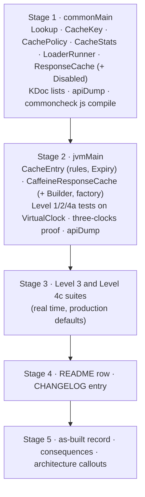
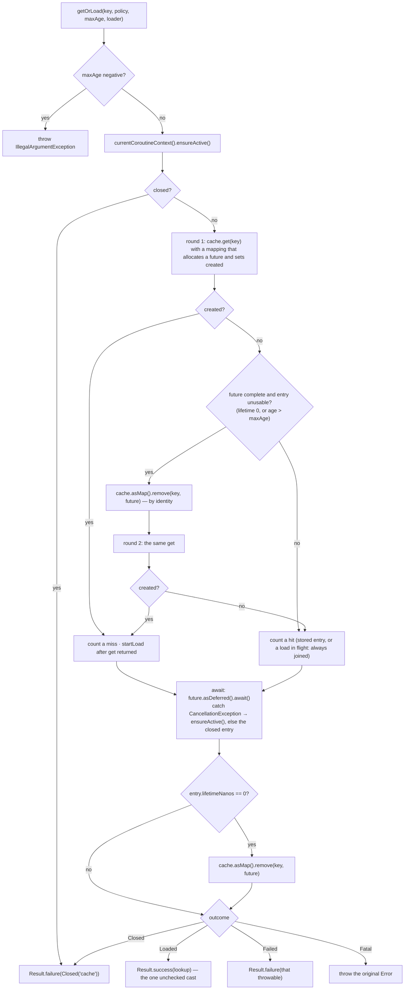
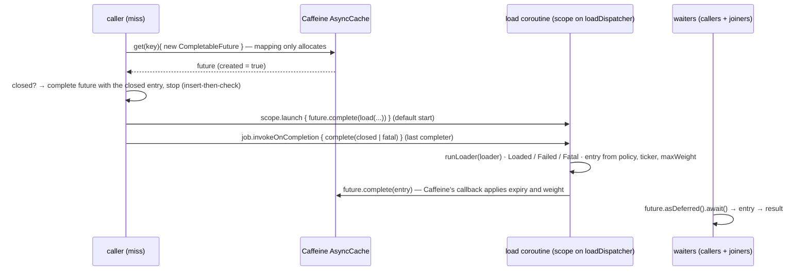

# Plan: `response-cache` — the `ResponseCache` port and the `CaffeineResponseCache` default

- **Covers:** `SpartanLaboratories/WebTools#66` — *"webtools-http: `ResponseCache` port and `CaffeineResponseCache` default"*. Sub-issue of the tracking
  issue `SpartanLaboratories/WebTools#55` (HTTP client stack). Blocked by #62 (`http-core`) and #63 (`test-support`), both landed (#64 and #65 have landed
  too). It blocks #68 (`call-facades`); #67 (`call-budget`) and #69 (`feeds`) take nothing from it.
- **Architecture:** [`../architecture.md`](../architecture.md), unit `response-cache` (§11 unit 7 and its scope; §6.4 *Response cache*; §6.2 for the failure
  model, the logging seam and the helpers; §6.6 for the call pipeline, `cacheStats()`, the logging rules and the closing order; §6.7 for `VirtualClock`;
  §6.9 and §9 for the mechanism and tier of each type; §7.2 and §7.4 for the call path and the boundary table; §12 for the shared-load risk). Its dated
  "Corrected" callouts are the as-built truth for units 1 to 6. Systems-level consequences: [`../consequences.md`](../consequences.md) §7 and §8.
- **Research:** [`research/README.md`](research/README.md) (read its Summary) with [`research/caffeine-mechanics.md`](research/caffeine-mechanics.md) and
  [`research/load-lifecycle.md`](research/load-lifecycle.md); the stack-level [`../research/response-cache.md`](../research/response-cache.md) (F1 to F14).
  Where the stack-level `startLoad` sketch (an `invokeOnCompletion` that maps every cancellation to `Closed` and completes exceptionally on an `Error`)
  and its weight lower bound (0) differ from this issue's research summary, this plan follows the summary; §6.11 lists every refinement of the
  architecture.
- **Branch:** `feat/issue-66-response-cache` (exists; cut from `master` at `e8f0a88`; holds the four research commits `c19db19`, `97beb79`, `879abff`
  and `826200e`). The implementer confirms it and never re-cuts it.
- **Commit:** TBD. This `plan.md` is committed **in the same commit as the first stage of the implementation** (commit 1 of §11), so `git log --follow`
  binds the two.
- **PR:** TBD (the PR closes #66).
- **What this plans:**
  - in `webtools-http`'s `commonMain` (package `com.spartanlabs.webtools.http`): the port `ResponseCache` with its nested `ResponseCache.Disabled`; the
    values `CacheKey`, `CachePolicy` (with its builder), `Lookup` (`Found`, `Missing`) and `CacheStats`; and, `internal`, the loader runner both
    implementations share;
  - in `jvmMain`: `CaffeineResponseCache` with its factory and builder, and, `internal`, the entry, the lifetime and weight rule, the usability rule and
    the `Expiry`;
  - the KDoc lists of `ExperimentalForInheritanceWebToolsApi` and `WebToolsDsl`, the builder list of `WebToolsDslComponentTest`, the KDoc of
    `VirtualClockThreeClocksComponentTest`, the regenerated ABI dump, the `README.md` row and the `CHANGELOG.md` entry;
  - the tests of all of it (Level 1 to Level 4c and a Level 5 manual pass).
- **Status:** built; the as-built record, with every deviation from this plan, is [`final-implementation.md`](final-implementation.md).
- **Version moved:** none. `webtools-http` `1.0.0` stays unreleased and this landing is **not a release candidate**. No existing module moves a version and
  no build line changes (`caffeine` 3.3.1 is already a `jvmMain` `implementation` dependency of `webtools-http`).
- **Baseline:** `master` at `e8f0a88` plus the research commits. Line references are to it.

The code blocks in this plan are the intended implementation. They were written against the as-built sources of `webtools-http`, the Caffeine 3.3.1 and
kotlinx-coroutines 1.10.2 sources as the research reads them, and the research's findings; the blocks themselves have not been compiled. The implementer
fixes a compile error mechanically and records any change to a rule (as opposed to a spelling) in `final-implementation.md` at the moment it is made.

---

## 1. Requirements

### R1. The public surface and its tier

`webtools-http` gains these public declarations in `com.spartanlabs.webtools.http`, each with KDoc (`@param`, `@return`, `@throws`) that names its tier.
**Implementing `ResponseCache` is Experimental** (behind `ExperimentalForInheritanceWebToolsApi`); **everything else is Stable Core and usable without the
opt-in**: calling the port, passing it, naming it in a signature, `ResponseCache.Disabled`, `CaffeineResponseCache`, and every value type.

- `commonMain`:
  - `ResponseCache : AutoCloseable`, `@SubclassOptInRequired(ExperimentalForInheritanceWebToolsApi::class)`, with `getOrLoad` (two overloads), `invalidate`,
    `invalidateAll`, `stats` and `close` (R2);
  - `ResponseCache.Disabled`, a nested `public object` (R3);
  - `CacheKey<V : Any>` (R4), `CachePolicy` with `CachePolicy.Builder` and the factory `CachePolicy(ttl) { }` (R5), `Lookup<out V : Any>` with `Lookup.Found` and
    `Lookup.Missing` (R6), `CacheStats` (R7).
- `jvmMain`: `CaffeineResponseCache` — a final class with an `internal` constructor, its factory `CaffeineResponseCache { }`, `CaffeineResponseCache.Builder`
  and a companion holding `DEFAULT_MAX_WEIGHT` (R8 to R12).
- `internal`: the loader runner (`commonMain`), and the entry, the lifetime and weight rule, the usability rule and the `Expiry` (`jvmMain`).

Nothing else becomes public. No Caffeine, `CompletableFuture` or coroutine-internal type appears in a public signature; the only library types are
`CoroutineDispatcher`, `kotlin.time.TimeSource`, `kotlin.time.Duration` and `java.util.concurrent.Executor` (in `CaffeineResponseCache.Builder`).

### R2. The port and its contract

```kotlin
public suspend fun <V : Any> getOrLoad(key: CacheKey<V>, policy: CachePolicy, maxAge: Duration, loader: suspend () -> Result<Lookup<V>>): Result<Lookup<V>>   // abstract
public suspend fun <V : Any> getOrLoad(key: CacheKey<V>, policy: CachePolicy, loader: suspend () -> Result<Lookup<V>>): Result<Lookup<V>>                      // body: maxAge = Duration.INFINITE
public fun invalidate(key: CacheKey<*>)                                                                                                                      // abstract
public fun invalidateAll()                                                                                                                                    // abstract
public fun stats(): CacheStats                                                                                                                                // abstract
override fun close() {}                                                                                                                                       // default empty body, as HttpTransport.close()
```

No defaulted parameters. The contract, numbered in the KDoc as `HttpTransport`'s is:

1. **One load per key at a time.** Concurrent calls for an equal key while a load is in flight join it and receive its outcome. A hitting or joining call's
   `policy` and `loader` are not used, so a shared load carries the first caller's loader.
2. **Lifetimes.** A `Found` is stored for `policy.ttl` and a `Missing` for `policy.missTtl`, measured from the load's completion. A zero TTL coalesces loads
   in flight and stores nothing. A failure is never stored.
3. **`maxAge`.** A stored entry whose age exceeds `maxAge` is not served (age **at most** `maxAge` is served, as RFC 9111's `max-age` request directive
   reads). The call loads, or joins a load already in flight, which counts as fresh. At most one reload per call.
4. **The loader's outcomes.** A loader's `Exception` becomes the call's failure, the same instance for every waiter. An `Error` is rethrown to every waiter.
   A cancellation the loader throws (or returns inside `Result.failure`) while its caller is still active becomes
   `Result.failure(IllegalStateException(<constant message>, cause = that exception))`; a `CancellationException` is never put inside a `Result`.
5. **Cancellation.** A caller's own cancellation is thrown as `CancellationException` and cancels only that caller. A caller that is already cancelled gets
   it even on a hit.
6. **Closing.** After `close()`, `getOrLoad` returns `Result.failure(HttpFailure.Closed("cache"))` without running the loader, and a call waiting on a load
   when `close()` runs returns the same. `close()` is idempotent, non-suspending and never throws. `ResponseCache.Disabled`, which stores nothing and is
   shared, ignores `close()`.
7. **Invalidation.** After `invalidate(key)` the next call for `key` loads anew; a load in flight still completes for the calls already waiting, and its
   result is not stored. `invalidateAll()` is the same for every key. Both never throw and are no-ops after `close()`.
8. **Statistics.** `stats()` is a snapshot of four counts (R7).
9. **Concurrency.** Every member may be called concurrently from any thread.
10. **Keys.** The key's type parameter is not part of its equality: one endpoint id serves one value type, and a second type under the same id is a programming
    error.
11. **`maxAge` validity.** A negative `maxAge` is a programmer error: `IllegalArgumentException`, message `maxAge must not be negative`.

### R3. `ResponseCache.Disabled`

A nested `public object`, as `WallClock.System` is. `getOrLoad` checks `maxAge` (R2 point 11), calls `currentCoroutineContext().ensureActive()`, then runs the
loader **on the caller's coroutine** through the shared internal loader runner: no storage and no sharing, so every call runs its own loader and the loader
sees the caller's context. `invalidate` and `invalidateAll` do nothing; `stats()` is always `CacheStats.Empty`; `close()` does nothing (the default);
`toString()` is `ResponseCache.Disabled`. Its KDoc says it forfeits "N concurrent callers cost one load". It is the only implementation constructible in
common code.

### R4. `CacheKey<V : Any>`

Public constructors `CacheKey(endpointId: String, params: List<Pair<String, String>>)` and `CacheKey(endpointId: String)` (no defaults).

- `endpointId` must not be blank (`IllegalArgumentException`, message `endpointId must not be blank`).
- `params` is the caller's list sorted by name with a **stable** sort (`sortedBy { it.first }`: repeated names keep the caller's order), held as a read-only
  copy. Names, values and the id are case-sensitive and compared as UTF-16 code units (`String.compareTo` and `equals`); there is no Unicode normalisation and
  no URL text involved.
- `equals` and `hashCode` are explicit over `endpointId` and `params`, the hash computed once at construction. `V` is not part of equality.
- `toString()` is `CacheKey(endpointId=<id>, params=[<name>, <name>, …])`: parameter **names only, never a value**.
- KDoc: never put a tenant, a header, a credential or the decoder in a key.

### R5. `CachePolicy`

`internal constructor(ttl: Duration, missTtl: Duration)` with public `val ttl` and `val missTtl`; the factory
`public fun CachePolicy(ttl: Duration, configure: CachePolicy.Builder.() -> Unit = {}): CachePolicy` (the trailing builder lambda with a `{}` default is this
module's established factory shape: `HttpHeaders`, `HttpRequest`, `OutboundUrlPolicy.trusted`); `@WebToolsDsl public class Builder internal constructor()` with
`var missTtl: Duration` defaulting to `CachePolicy.DEFAULT_MISS_TTL` (60 seconds, a public companion value). `ttl` and `missTtl` must not be negative
(`IllegalArgumentException`, message names the property: `ttl must not be negative`, `missTtl must not be negative`); `Duration.INFINITE` is allowed. Explicit
`equals`, `hashCode` and `toString` (numbers only). The builder is where a later `staleFor` goes.

### R6. `Lookup<out V : Any>`

A `sealed interface` (the closed pair is the contract; `when` over it needs no `else`).

- `class Found<out V : Any>(val value: V, val weight: Int)` with a second public constructor `Found(value: V)` (weight 1). `weight` must be at least 1
  (`IllegalArgumentException`, message `weight must be at least 1`), because Caffeine never size-evicts an entry of weight 0. `equals` and `hashCode` over value
  and weight; `toString()` is `Found(weight=<w>)` and never prints the value.
- `object Missing : Lookup<Nothing>` with `toString()` `Missing`.
- No `data` classes.

### R7. `CacheStats`

Public constructor `CacheStats(hits: Long, misses: Long, evictions: Long, failedLoads: Long)` (an implementer of the port must be able to build one), each
non-negative (`IllegalArgumentException`, message `<property> must not be negative`); explicit `equals`, `hashCode`, `toString`; `CacheStats.Empty` (all
zero) on its companion. The KDoc defines each count:

- **hits** — calls answered without starting a load: a stored entry, or a load already in flight that the call joined.
- **misses** — calls that started a load.
- **evictions** — stored entries the size bound removed. Not expiry and not invalidation: the KDoc says this is narrower than Caffeine's, Guava's and
  Micrometer's `evictions`.
- **failedLoads** — loads that ended in a failure or an `Error`, counted once per load, not once per waiter.

The four are read separately, not as one atomic snapshot.

### R8. `CaffeineResponseCache` — construction

A final class `CaffeineResponseCache internal constructor(timeSource: TimeSource, maxWeight: Long, loadDispatcher: CoroutineDispatcher, maintenanceExecutor:
java.util.concurrent.Executor) : ResponseCache`; the factory `public fun CaffeineResponseCache(configure: CaffeineResponseCache.Builder.() -> Unit = {}):
CaffeineResponseCache`; `@WebToolsDsl public class Builder internal constructor()` with

| Property | Type | Default |
|---|---|---|
| `timeSource` | `TimeSource` | `TimeSource.Monotonic` |
| `maxWeight` | `Long` | `DEFAULT_MAX_WEIGHT`, a public `const val` of `1_000` on the companion |
| `loadDispatcher` | `CoroutineDispatcher` | `Dispatchers.Default` |
| `maintenanceExecutor` | `java.util.concurrent.Executor` | `ForkJoinPool.commonPool()` |

`maxWeight` must be at least 1 (`IllegalArgumentException`, message `maxWeight must be at least 1`; a zero TTL is the way to coalesce without storing). The KDoc
states: the cache never shuts the `maintenanceExecutor` down and it must outlive the cache's last write; `loadDispatcher` should dispatch (an unconfined
dispatcher runs a load's first segment on the calling thread); a `TimeSource` that is not monotonic can lengthen lifetimes and its ages are clamped at zero.
`toString()` is `CaffeineResponseCache(maxWeight=<n>, closed=<b>)`. `VirtualClock.timeSource`, `.dispatcher` and `.maintenanceExecutor` are exactly what a test
passes.

### R9. `CaffeineResponseCache` — storage and expiry

An `AsyncCache<CacheKey<*>, CacheEntry>` from `Caffeine.newBuilder().ticker { origin.elapsedNow().inWholeNanoseconds }` (one `markNow()` on the injected
`TimeSource` at construction) `.executor(maintenanceExecutor).maximumWeight(maxWeight).weigher { _, e -> e.weight }.expireAfter(<Expiry>)
.evictionListener { _, _, cause -> if (cause == RemovalCause.SIZE) evictions.increment() }.buildAsync()`. **No `recordStats()`, no `Scheduler`, no
`removalListener`.** The four counters are `LongAdder`s the cache owns.

The entry is built once when a load ends and carries an outcome (loaded, failed, fatal, closed), `storedAt` (ticker nanoseconds at completion),
`lifetimeNanos` and `weight`. A `Found` lives `ttl` and weighs its weight; a `Missing` lives `missTtl` and weighs 1; a failed, fatal or closed outcome, a zero
TTL, and a `Found` whose weight exceeds `maxWeight` live 0 and weigh 0 (an oversized value is delivered to its waiters and never stored, so the bound holds at
every instant). The rule and the usability rule (a stored entry is served to a call when its lifetime is positive and its age, clamped at zero, is at most
the call's `maxAge`) are pure functions, so Level 4a tables them.

### R10. `CaffeineResponseCache` — a call

`getOrLoad` follows §6.3: validate `maxAge`, `ensureActive()`, the closed check, then at most two rounds of `cache.get(key) { allocate a future }`; the call whose
mapping function ran starts the load **after** `get` returns; every waiter awaits `future.asDeferred().await()`; a completed zero-lifetime entry is treated as
absent and removed by identity; the outcome maps to `Result.success`, `Result.failure`, a rethrown `Error` or `Closed("cache")`.

### R11. `CaffeineResponseCache` — a load, `invalidate`, `close`

A load is `scope.launch` (default start) in a cache-owned `CoroutineScope(SupervisorJob() + loadDispatcher + CoroutineName(…) + <handler>)` with no parent,
where `<handler>` is a `CoroutineExceptionHandler` that logs a load coroutine's failure once at `WARN` (§6.4). Its body is total: it never throws except to end
cancelled when `close()` cancelled the scope, and completes the shared future **normally** with one of four outcomes. `invalidate(key)` is `cache.asMap().remove(key)` and `invalidateAll()` is `cache.asMap().clear()` on the async view.
`close()` sets the closed flag, cancels the scope, completes every future still in the map with the closed outcome and clears the map. §6.4 and §6.5 hold the
details and the reasons.

### R12. Logging

Through `logger(CACHE_LOGGER_NAME)`, `CACHE_LOGGER_NAME = "com.spartanlabs.webtools.http.CaffeineResponseCache"`: `INFO` once on creation (`maxWeight`, numbers
only) and once on `close()`; `DEBUG` once per load end — the key's `toString()` (id and parameter names), the outcome kind (found, missing, failed with the
failure's class name, error with the class name, closed) and whether it was stored or why not (zero TTL, over `maxWeight`, not a result); `WARN` once for a
load coroutine that failed outside its total body (a `loadDispatcher` that rejects the dispatch), with the exception's class name only. **Nothing per hit or
join; never a value, a parameter value, a header, a credential or a message text.** `commonMain` code (`Disabled`, the runner) logs nothing.

### R13. Documentation and files

KDoc on every public declaration; the two KDoc lists extended; `README.md` and `CHANGELOG.md` updated in the same change (§8); the ABI dump regenerated
(§7.16); the architecture's dated callouts and this unit's `final-implementation.md` and `consequences.md` written at the end (§11).

### R14. Tests and runs

Every new or changed test is placed at a level and a path (§9). Runs are only `webtools-http`'s own level tasks, `apiCheck` after `apiDump`,
`verifyJavaFloor`, its `check` (which includes the fixtures-publication check), and the check module's `js` compile `:webtools-http-commoncheck:build`. No
other module's suite is run, before or after.

### Acceptance

1. A consumer module without the opt-in compiles code that names `ResponseCache` in signatures, takes `ResponseCache.Disabled` as a default, builds every
   value type, matches a `Lookup` exhaustively, and uses `CaffeineResponseCache { … }` as a `ResponseCache` (Level 1).
2. A one-off procedure shows that a top-level implementer of `ResponseCache` fails to compile without `@OptIn(ExperimentalForInheritanceWebToolsApi::class)`
   with the marker's message, and compiles with it (§9.2 P1).
3. On `VirtualClock`, every contract point of R2 holds for `CaffeineResponseCache` (Level 2), and `Disabled` runs one loader per call.
4. N concurrent callers of one key cost one real HTTP request against a loopback server on the production defaults, and a later call is a hit (Level 3).
5. The size bound holds on real threads, no retry ever receives the failure it just received, and no log line or `toString` carries a value (Level 4c).
6. `:webtools-http:check` and `:webtools-http-commoncheck:build` are green; `apiCheck` passes against the regenerated dump; nothing in another module changes.

---

## 2. Current state

- **No caller exists.** Nothing in the repository caches HTTP responses or calls a cache (`grep` for `ResponseCache`, `CacheKey`, `CachePolicy`, `Lookup` and
  `CaffeineResponseCache` over the repository finds only planning documents and a generated graph report). The call facades (#68) are the first users.
- **The module.** `webtools-http` is Kotlin Multiplatform with a `jvm()` target and `explicitApi()`. `commonMain` and `jvmMain` opt in to
  `ExperimentalForInheritanceWebToolsApi` (`webtools-http/build.gradle.kts:43` and `:51`), so the module's own implementers need no `@OptIn`; `commonTest` and
  `jvmTest` do not, so they are consumers. `jvmMain` already declares `com.github.ben-manes.caffeine:caffeine:3.3.1` as `implementation`
  (`webtools-http/build.gradle.kts:55`); `commonMain` has `kotlinx-coroutines-core` 1.10.2 as `api`.
- **What this unit takes, as built.**
  - `HttpFailure.Closed(component: String)` — a public final leaf, message `The <component> is closed`, blank component refused
    (`HttpFailure.kt:43`).
  - `internal inline fun <T> catchNonFatal(block: () -> T): Result<T>` (`NonFatal.kt`): an `Exception` other than `CancellationException` becomes
    `Result.failure`, a `CancellationException` is rethrown, an `Error` is not caught; inline, so `block` may suspend.
  - `internal inline fun <T, R> Result<T>.flatMap(transform: (T) -> Result<R>): Result<R>` (`ResultExtensions.kt`).
  - `internal interface Log { debug; info; warn }` (message with `{}` placeholders, `vararg args`) and `internal expect fun logger(name: String): Log`
    (`Log.kt`; slf4j actual in `Log.jvm.kt`; a no-op `js` actual in the check module's `JsActuals.kt`).
  - The gated-port precedent: `HttpTransport` (`HttpTransport.kt`) is `@SubclassOptInRequired(ExperimentalForInheritanceWebToolsApi::class)`, has a numbered
    contract in its KDoc, `override fun close() {}` with a body (its dump shows a `DefaultImpls` class), and `WallClock` nests `public object System : WallClock`
    with a `toString()` equal to its qualified name.
  - The factory-plus-builder precedent: `OutboundUrlPolicy.kt` / `TransportSettings.kt` / `HttpRequest.kt` (an `internal` constructor, a `@WebToolsDsl public class
    Builder internal constructor`, a top-level factory with a trailing `configure` lambda, `require` messages that name the property and never a value).
  - A `jvmMain` supplied default with a factory and a logger constant: `OkHttpTransport.kt` (`TRANSPORT_LOGGER_NAME`, `transportLog`, `close()` steps run inside
    `catchNonFatal`).
  - `VirtualClock` (`jvmTestFixtures/.../testing/VirtualClock.kt`): `timeSource: TimeSource.WithComparableMarks`, `dispatcher: CoroutineDispatcher` (a
    `StandardTestDispatcher` on the scheduler), `maintenanceExecutor: Executor` (runs each task inline), `advanceBy(Duration)`, `elapsed`, `wallClock`, and
    `TestScope.virtualClock(startEpochMillis)`.
  - Test support in `jvmTest`: `captureTransportLogs(level) { }` (a logback `ListAppender` on `com.spartanlabs.webtools.http`), `RecordingLog`,
    `ManualTimeSource`, `LoopbackFleet`; `LoopbackTransports.untrusted(userAgent, policy, resolve)` and `MockWebServer.webtoolsUrl(path)` in the fixtures.
- **The proof this unit closes.** `VirtualClockThreeClocksComponentTest` proves the cache ticker, a `delay` and a wall-clock minute index move together, with a
  plain Caffeine cache standing in for "the cache a later unit builds"; its KDoc says so. This unit re-runs the proof with the real cache and the KDoc
  sentence becomes true again (§7.14).
- **The ABI dump** `webtools-http/api/webtools-http.api` (434 lines) has no cache type. It grows by the classes of §7.16.
- **Test layout.** Level tasks `gatingTest` … `uatTest` select by package `com.spartanlabs.testing.<level>.*` (`build-logic/.../WebToolsBuild.kt:51`); tests live
  under `src/commonTest/kotlin/com/spartanlabs/testing/<level>/webtools/http/` and `src/jvmTest/kotlin/com/spartanlabs/testing/<level>/webtools/http/`. The
  repository uses no MockK; fakes are hand-written. `commonTest` has `kotlin("test")` only; `jvmTest` has `kotlin("test-junit5")`, logback and, through the
  fixtures, `kotlinx-coroutines-test` and `mockwebserver3`.
- **Outside-world facts this unit rests on** (each re-opened at its source in the research's Verification):
  - Caffeine 3.3.1 is the latest release. `AsyncCache.get(key, BiFunction)` runs the mapping function under the key's bin lock, and for a fresh future the
    executor argument is unused; on completion the cache's own `expireAfterCreate` runs once with the ticker's reading; an `Expiry` result of 0 expires the entry at
    once; a weight of 0 is never selected for size eviction; `Cache.asMap().remove(key)` and `.clear()` on the async view remove an in-flight future and
    never touch it; `evictionCount` counts expiry and failure removals, so the cache keeps its own count
    ([`research/caffeine-mechanics.md`](research/caffeine-mechanics.md) F1 to F8).
  - kotlinx-coroutines 1.10.2: `launch` in a `SupervisorJob` scope with no parent; `CompletionStage.asDeferred().await()` does not cancel the shared future when
    the awaiting coroutine is cancelled; `withTimeout` is a scoped coroutine, so a timeout expiring inside a loader leaves the load's own coroutine active;
    `runTest` drains the whole shared scheduler before it collects unhandled exceptions
    ([`research/load-lifecycle.md`](research/load-lifecycle.md) F1 to F7). The areas the design rests on are unchanged in 1.11.0.
  - The module's tests run Caffeine's `System.Logger` output through `java.util.logging` (no `LoggerFinder` provider or JUL bridge is on the classpath).

## 3. Assumptions

Each of these could not be established without a run; the plan states what changes if it is false.

1. **A zero `Expiry` result expires a just-completed entry at once.** Read from `BoundedLocalCache.hasExpired` and measured for failed entries in the stack-level
   probe; a `Found` with a zero TTL was not separately measured. The design does not rely on it for correctness: every waiter removes a lifetime-0 entry by
   identity, and a later call treats a completed lifetime-0 entry as absent. If false the only change is that Caffeine's own removal does less work.
2. **Caffeine never cancels a future it holds** (on eviction, `invalidate` or `remove`). Assumed, not sourced. A waiter's `catch (CancellationException)` then
   `ensureActive()` makes a cancelled future read as the closed outcome, which would be wrong for a still-open cache; if a Level 2 or 4c run ever shows that
   path taken while the cache is open, the waiter must reload (one extra round) instead.
3. **The insert-then-check closes the close/start race** — `close()` sets the flag and then iterates the map; a starter inserts and then reads the flag, so at
   least one sees the other. This rests on `ConcurrentHashMap`'s weakly consistent iteration reflecting entries present when the iterator was created. Only the
   probabilistic Level 4c close-race test probes the window. If a hang is ever observed, `close()` repeats the sweep after clearing.
4. **`runTest` 1.10.2 and 1.11.0 behave alike** for the drain and the exception collector; the tests rely on the drain only to finish loads a test leaves
   behind, and close every cache with `use`.
5. **The Level 4c failure-identity race can fire on the test host.** It needs at least two cores. On one core the test passes without having exercised the
   window; the procedure P3 (§9.2) checks that the test detects the removal being left out on a multi-core host.
6. **No JUnit parallel execution is configured** (no `junit-platform.properties` in the module), so a fatal `Error` that reached `runTest`'s exception collector
   could not fail a neighbouring test. The design keeps every `Error` out of the collector anyway (the load body is total).
7. **`kotlin.AutoCloseable.use`** is available in the pinned stdlib (2.2.x) for common and JVM code, as the existing tests already use it on `HttpTransport`.
8. **A rejecting `loadDispatcher`** takes the path kotlinx-coroutines 1.10.2's `dispatcherFailure` shows in source ([`research/load-lifecycle.md`](research/load-lifecycle.md) F6 and claim 20): the coroutine is failed with the rejection and `launch` rethrows it. The coroutine's failure reaches the scope's `CoroutineExceptionHandler` (one `WARN`), never the global handlers, and the starter's `catch` completes the future by value. This was read, not run; `CaffeineResponseCacheRejectedLoadComponentTest` pins the outcome that matters (a failure value, one `WARN`, no hang, nothing reaching `runTest`). If a run shows `launch` returning without rethrowing, the job's completion handler delivers the failure instead, and nothing else changes.

## 4. Non-goals

- Stale-while-revalidate (`staleFor`): the `CachePolicy` builder is where it goes later, additively.
- A cache default for non-JVM targets beyond `ResponseCache.Disabled`.
- A separate count of joined calls, or size and weight gauges, in `CacheStats` (each additive later through a new constructor of the class).
- A typed failure leaf for a loader's own cancellation (the failure model belongs to #62; adding a leaf is additive in a feature release). Until then the
  failure is an `IllegalStateException` with the original as its `cause`.
- Invalidating every key of one endpoint.
- A cache fake in the published fixtures (`CaffeineResponseCache` on `VirtualClock` is the test double).
- Reading Caffeine's own statistics (`recordStats()` stays off).
- The facade's use of the cache: key assembly, the loader, classification of misses and the use of `stats()` as `cacheStats()` are #68's.
- Anything in `webtools-feeds`, the budget or the transport.

---

## 5. Approach and staging

The port and its values are plain common code with no platform content; `Disabled` and the loader runner are common too. The Caffeine default is the only
`jvmMain` part. The unit lands in two code stages, then tests, then documentation; each leaves the build green (§11).



Stage 1 compiles for `js` through the check module (`commonMain` is shared), so the common types cannot touch a JVM API. Stage 2 adds the one class that needs
Caffeine and kotlinx's `future` bridge.

---

## 6. Design

### 6.1 Mechanism per type (architecture §6.9 and §9, for this unit's types)

| Type | Mechanism | Tier | Reason |
|---|---|---|---|
| `ResponseCache` | `commonMain` interface, `@SubclassOptInRequired(ExperimentalForInheritanceWebToolsApi::class)`; grows only by methods with bodies | Experimental (implement); calling and passing it are Stable Core | A seam a consumer or a fake substitutes; an interface is a narrower contract than an overridable class. Graduation to `@SupportedExtension` waits for BotTools' adapter to build against it (architecture §9). |
| `ResponseCache.Disabled` | nested `public object` | Stable Core | Stateless and shared; usable without the opt-in. |
| `CacheKey`, `CachePolicy`, `CacheStats` | final common classes; no public `data class`; `CachePolicy` by factory + builder over an `internal` constructor | Stable Core | Vocabulary with no platform content; explicit `equals`/`hashCode`/`toString` keep the ABI independent of generated members. |
| `Lookup` (`Found`, `Missing`) | `sealed interface` with a final class and an object | Stable Core | The closed pair is the contract. |
| `CaffeineResponseCache` | final `jvmMain` class, `internal` constructor, factory + `@WebToolsDsl` builder | Stable Core | A supplied default named for its technology; every policy number is a builder property. |
| the runner, the entry, the rules, the `Expiry` | `internal` | — | Hidden by `internal`; the rules are pure functions so Level 4a can table them. |

### 6.2 The shared loader runner (`commonMain`, `internal`)

`Disabled` and the Caffeine default run a loader the same way, so one function does it:

- `catchNonFatal { loader() }.flatMap { it }` turns a thrown non-cancellation `Exception` into `Result.failure` and flattens the loader's own `Result`.
- A `CancellationException` that the loader **throws** (it propagates out of `catchNonFatal`) or **returns** inside `Result.failure` is followed by
  `currentCoroutineContext().ensureActive()`. If the runner's own coroutine is cancelled that rethrows (the cancellation is the caller's or the cache's, not the
  loader's). Otherwise the cancellation came from inside the loader (a `withTimeout` expiring is a scoped coroutine and leaves its parent active) and becomes
  `Result.failure(IllegalStateException(LOADER_CANCELLED_MESSAGE, thatException))`. A `CancellationException` is never put inside a `Result` the cache returns,
  because a consumer's `getOrThrow()` would throw it into a caller that is still active, where it reads as that caller's own cancellation.
- An `Error` propagates (`catchNonFatal` does not catch it).

`IllegalStateException` is the failure because the failure model has no leaf for this case and the model belongs to #62; a JDK type with the original as its
`cause` keeps every caller safe without a new public type, and a typed leaf stays an additive follow-up (§13).

### 6.3 One call: `CaffeineResponseCache.getOrLoad`



Rules the diagram fixes:

- **The mapping function only allocates** a `CompletableFuture` and sets a local flag. It runs under the key's bin lock, so it must not start a coroutine, run the
  loader or touch the cache. The call whose mapping ran starts the load after `get` returns.
- **A call counts one hit or one miss, at its final round**, so a `maxAge` retry or a lost race is one event, not two (Caffeine's own counts would see every
  `get`).
- **A completed entry with lifetime 0 is treated as absent** (a failure, a zero-TTL value, an oversized value): it is removed by identity and the call looks
  again, so none of them is served to a call that did not wait for it, whatever order Caffeine's completion callbacks run in. A future still in flight is always
  joined and counts as fresh. The retry happens in the first round only, so a call reloads at most once.
- **Removal is always `asMap().remove(key, future)`** (by identity); its return value is never trusted, because another call may already have replaced the entry.
- **Delivery.** Every waiter, hit or joiner, maps the same immutable entry to its own result; a `Failed` hands every waiter the same `Throwable` instance; a `Fatal`
  is rethrown as the same `Error` instance.

### 6.4 One load: start, body, safety nets



The shared future is the only result channel, and it is **completed normally with a value in every case**:

| Outcome (`CacheOutcome`) | Produced by | Lifetime / weight |
|---|---|---|
| `Loaded(lookup)` | the loader returned `Found` or `Missing` | by the rule of §6.6 |
| `Failed(throwable)` | the loader returned `Result.failure(t)`, threw a non-fatal `Exception`, or escaped by cancellation (the runner's `IllegalStateException`); or the dispatch was rejected with an `Exception` | 0 / 0 |
| `Fatal(error)` | the loader threw an `Error` (kept by identity); or a safety net saw a job fail with an `Error` | 0 / 0 |
| `Closed` | `close()`, or the closed flag seen before the start, or the job cancelled | 0 / 0 |

Because nothing escapes the body, `launch`'s uncaught-exception path is never used by a load, Caffeine never sees an exceptional completion (so it logs no
`WARNING` and holds no joinable failed future), and kotlinx's stack-trace recovery never re-creates the `Error`: each waiter rethrows the original instance from a
field. One path lies outside the body: a `loadDispatcher` that rejects the dispatch. kotlinx-coroutines 1.10.2 then fails the coroutine with the rejection and
`launch` rethrows it; the starter catches it and completes the future, so the waiters receive it **by value**, as a failed outcome for an `Exception` and a fatal
one for an `Error`.

**The scope's `CoroutineExceptionHandler`.** A coroutine that fails outside its body is reported through `handleCoroutineException`, which uses a
`CoroutineExceptionHandler` from the coroutine's context when there is one. Without one, the report goes to the global handlers: the thread's uncaught-exception
handler in production, and, in a test JVM, `kotlinx-coroutines-test`'s exception collector, which fails the running `runTest` or, between tests, stores the
exception and fails the **next** `runTest` in the same JVM with `UncaughtExceptionsBeforeTest` ([`research/load-lifecycle.md`](research/load-lifecycle.md) F5).
So the scope carries a handler that logs the failure once at `WARN` through the cache's logger, with the exception's class name only. It never sees a
cancellation (handlers are not called for one) and never sees a loader's outcome (the body is total); it sees only a rejected dispatch, or a defect in the body,
both of which an operator should see in the log rather than on `System.err`.

**The load body is total.** It runs `runLoader(loader)`; a `CancellationException` that reaches the body (only when `close()` cancelled the load, since the runner
converted the loader's own) is rethrown, so the job ends cancelled; any other `Throwable` becomes the fatal outcome; `failedLoads` is incremented once for a failed
or fatal outcome; the entry is built from the policy, the ticker and `maxWeight`; the load's end is logged.

**Three independent completers keep a waiter from hanging**, none of which depends on the loader cooperating. `CompletableFuture.complete` is first-wins, so the extras
are harmless:

1. the body (the normal path);
2. `close()`'s sweep over the map, together with the starter's insert-then-check: the starter re-reads the closed flag after `get` returned and completes its own
   future if the cache closed in between;
3. `job.invokeOnCompletion`, as the last completer: `null` or a `CancellationException` → closed; any other cause → a failed entry for an `Exception` and a fatal one for an `Error`
   (only a rejecting dispatcher can fail the job with an `Exception`, since the body is total). If `launch` itself throws, the starter completes the future the same way and counts the failed load.

`async` is not used (under a supervisor it holds an unawaited failure silently, and the future already is the result channel); `CoroutineStart.ATOMIC` is not used
(it would run a loader after `close()`); `UNDISPATCHED` is not used (it runs the first segment on the caller's thread); the internal
`invokeOnCompletion(onCancelling = true)` is not used.

A waiter's cancellation leaves the load and the other waiters intact: `asDeferred().await()` cancels only the awaiting coroutine. A load nobody waits for any
more still completes and is stored. A cancelled waiter leaves one callback and one `CompletableDeferred` on the shared future until the load ends.

### 6.5 Invalidation and `close()`

- **`invalidate(key)`** is `cache.asMap().remove(key)` and **`invalidateAll()`** is `cache.asMap().clear()`, **on the async view**. Both remove a stored or in-flight
  entry and never touch its future: the calls already waiting still receive that load's outcome, the late completion is never re-inserted (Caffeine's completion
  step is a `replace` guarded by the future's identity), and the next call starts a new load. `synchronous().asMap()` is never used outside tests: it joins a
  pending future and can block.
- **`close()`:** `closed.compareAndSet(false, true)` or return; cancel the scope; complete every future in `cache.asMap().values` with the closed entry (this releases
  the waiters without waiting for the loaders to unwind); `cache.asMap().clear()` (the stored values are released even while the closed object stays reachable);
  each step inside `catchNonFatal`, as `OkHttpTransport.close()` does; log `INFO`. No `cleanUp()`, no shutdown of the `maintenanceExecutor`, no `Scheduler` to stop: with no `Scheduler` there
  is no thread, timer or shutdown hook, and Caffeine's maintenance task holds the cache only weakly.
- **After `close()`** `getOrLoad` returns `Closed("cache")` without running the loader; `invalidate`, `invalidateAll` and `stats()` keep working on the empty map.

### 6.6 The entry, the lifetime and weight rule, and the usability rule

`CacheEntry(outcome, storedAt, lifetimeNanos, weight)` is immutable and built once when a load ends. Two pure functions carry the rules:

| Outcome | Lifetime | Weight | Stored? |
|---|---|---|---|
| `Found`, `ttl` > 0, `weight` ≤ `maxWeight` | `ttl.inWholeNanoseconds` (`Duration.INFINITE` → `Long.MAX_VALUE`; Caffeine caps it at about 150 years) | the `Found`'s weight | yes |
| `Found`, `ttl` = 0 | 0 | 0 | no — coalesces loads in flight only (`ZeroTtl`) |
| `Found`, `weight` > `maxWeight` | 0 | 0 | no — delivered to its waiters only (`OverMaxWeight`) |
| `Missing`, `missTtl` > 0 | `missTtl.inWholeNanoseconds` | 1 | yes |
| `Missing`, `missTtl` = 0 | 0 | 0 | no (`ZeroTtl`) |
| `Failed`, `Fatal`, `Closed` | 0 | 0 | no (`NoResult`) |

An oversized value is never stored, rather than stored and evicted: a stored-then-evicted oversized entry would be readable until the next drain, would be counted as
a size eviction, and would let the bound be exceeded at an instant. Clamping the weight down to `maxWeight` is not done: one entry would empty the cache.

**Usability.** A completed entry may be served to a call with `maxAge` at tick `nowNanos` when `lifetimeNanos > 0` and `(nowNanos - storedAt).coerceAtLeast(0) <=
maxAge.inWholeNanoseconds`. The clamp makes a non-monotonic `TimeSource` unable to produce a negative age. `Duration.ZERO` serves only an entry stored at the same
tick; in practice it reloads. Caffeine itself evicts an expired entry on the next access, in the same `get`.

**The `Expiry`** is an `object` (it has three abstract methods, so it is not a SAM): `expireAfterCreate` and `expireAfterUpdate` return `lifetimeNanos`;
`expireAfterRead` returns `currentDuration`. Caffeine calls `expireAfterCreate` once, when the future completes, with the ticker's reading, so a TTL runs from the
load's completion. `Duration.INFINITE` needs no special case.

**The weigher** returns `entry.weight`. For an `AsyncCache` Caffeine wraps it so an in-flight future weighs 0 (it is never size-evicted) and a completed one weighs
`entry.weight`.

### 6.7 Statistics

`recordStats()` is off. Caffeine's `evictionCount` counts every automatic removal (`SIZE`, `EXPIRED`, `COLLECTED`), so each failed or zero-lifetime entry would count as
an eviction, and whether it does depends on callback order; its hit and miss counts see every `get`, so a `maxAge` re-read would count one call twice; its
`loadFailureCount` stays 0 because failures complete the future normally; and it reads `System.nanoTime` around every load. The cache keeps four `LongAdder`s:

| Count | Incremented | By |
|---|---|---|
| `hits` | once per call whose final `get` took an existing future | `getOrLoad` |
| `misses` | once per call whose final `get` ran the mapping function | `getOrLoad` |
| `failedLoads` | once per load that ended `Failed` or `Fatal` | the load body (and a safety net that wins the completion with a failed or fatal entry) |
| `evictions` | once per entry the size bound removed (`RemovalCause.SIZE`) | the `evictionListener` |

The listener runs synchronously inside Caffeine's atomic removal on whichever thread does the maintenance, receives the unwrapped entry and is called only for completed
futures; it never touches the cache.

### 6.8 Error handling of every new or changed signature

| Signature | Failure it returns | Expected failures (→ `Result`) | Programmer errors (→ throw) | Where a `Result` is unwrapped |
|---|---|---|---|---|
| `ResponseCache.getOrLoad` (both) | `Result.failure(<the loader's failure>)`; `IllegalStateException(LOADER_CANCELLED_MESSAGE, cause)` for a loader's own cancellation; `HttpFailure.Closed("cache")` after `close()` | a loader's `Result.failure` or thrown non-fatal `Exception`; a loader's own cancellation; a closed cache | negative `maxAge` → `IllegalArgumentException`; a second value type under one endpoint id (a `ClassCastException` at the consumer's use); a loader's `Error` is rethrown | by the caller (#68's facade) |
| `ResponseCache.Disabled.getOrLoad` | as above, except it never returns `Closed` | as above | as above | by the caller |
| `ResponseCache.invalidate`, `invalidateAll`, `stats`, `close` | none | — | — (never throw; no-ops after `close()`) | — |
| `CacheKey(…)`, `CachePolicy(…)`, `Lookup.Found(…)`, `CacheStats(…)`, `CaffeineResponseCache { }` | none | — | `IllegalArgumentException`, message names the property and never a value | — |
| `runLoader` (`internal`) | as `getOrLoad` | as above | `Error` propagates; a cancelled runner coroutine rethrows `CancellationException` | its two callers (`Disabled.getOrLoad`, the load body) |
| `CaffeineResponseCache.load` (`private`) | never throws except to end cancelled | — | — | the waiters, through the future |
| `residencyOf`, `isUsable`, `outcomeKind` (`internal`, pure) | none | — | — | — |

The four `try`/`catch` sites (`runLoader`, `awaitEntry`, the `launch` in `startLoad`, and the body of `load`) are the places where a `CancellationException` must be told from other throwables, or a `Throwable` converted to a value; `catchNonFatal` cannot express them because it rethrows cancellation. Everything else uses `fold`, `flatMap` and `catchNonFatal`.

Cancellation is always thrown, never returned: the caller's own (from `ensureActive()` at the top, or from `await()` when the caller is cancelled while waiting) is a
`CancellationException`; the cache's own (from `close()`) never reaches a caller as one.

### 6.9 Logging

The events, all through `logger(CACHE_LOGGER_NAME)`:

| Level | Event | Fields |
|---|---|---|
| `INFO` | creation | `maxWeight` |
| `INFO` | `close()` (once; the idempotent second call logs nothing) | none |
| `DEBUG` | a load ended — logged by whoever completes the shared future | the key's `toString()` (id and parameter names), the outcome kind (`found`, `missing`, `failed (<class name>)`, `error (<class name>)`, `closed`), and the storage note (`stored`, `not stored: zero TTL`, `not stored: over maxWeight`, `not stored: not a result`) |
| `DEBUG` | a `close()` step failed (`cancelScope`, `completeWaiters`, `clear`) | the step name and the exception's class name |
| `WARN` | a load coroutine failed outside its body (the scope's `CoroutineExceptionHandler`, §6.4): a rejected dispatch, or a defect | the exception's class name |

Never a value, a parameter value, a header, a credential or any message text. No loader outcome is logged above `DEBUG`: every expected failure is the caller's
result. The one `WARN` is an operator's condition (a `loadDispatcher` that rejects work, typically an executor shut down while the cache is still in use).
`commonMain` code (`Disabled`, the runner) logs nothing: a cache with nothing to store has no lifecycle event of its own.

### 6.10 Thread safety, ownership and resources

- All mutable state is an atomic or Caffeine's own: `closed: AtomicBoolean`, four `LongAdder`s, the `AsyncCache`. The entry and the key are immutable. `Disabled` is
  stateless. Every member may be called from any thread and from many coroutines.
- **Three execution contexts:** the callers' coroutines (they only await), the cache's load coroutines on `loadDispatcher`, and Caffeine's maintenance tasks on
  `maintenanceExecutor`. A loader runs in the cache's scope, not in a caller's: the caller's dispatcher, `CoroutineName` and context elements do not reach it.
  `Disabled` is the exception: it runs the loader on the caller's coroutine.
- **Resources to close:** the cache owns a `SupervisorJob` scope (cancelled by `close()`); it owns no thread, no timer and no thread pool. A facade that builds its
  default cache closes it; a cache a consumer passes in stays the consumer's to close.
- **A loader must not wait for a load of its own key** (it would wait for itself); a loader may call `getOrLoad` for another key, because the mapping function runs
  nothing of the loader.

### 6.11 Where this plan refines the parent architecture

None changes the unit's scope, a seam or a tier.

| Architecture §6.4 / §6.6 text | This plan | Reason |
|---|---|---|
| "`recordStats()` … no listeners" | no `recordStats()`; one size-only `evictionListener` | Caffeine's `evictionCount` counts expiry and failure removals and varies with callback order (§6.7). |
| failures complete the future normally; waiters remove by identity | a fatal `Error` is carried as a value too, never as an exceptional completion | An exceptional completion makes Caffeine log a `WARNING`, makes `launch` report it a second time, and lets stack-trace recovery re-create the `Error` under assertions. |
| "failures … removed by each waiter" | a loader's own cancellation becomes an `IllegalStateException` failure | A `withTimeout` expiring inside a loader would otherwise tell every waiter `Closed` while the cache stays open, or throw a `CancellationException` into an active caller. |
| "`close()` cancels the scope and completes every waiter with `Closed`" | `close()` also completes every future itself, then clears the map | Release must not wait for a loader to unwind, a loader may ignore cancellation, and the stored values should be released at `close()`. |
| (silent) | a completed zero-lifetime entry is treated as absent | Closes the window in which a just-completed failure is joined as live whatever order the completion callbacks run in. |
| `Found(value, weight)` | `weight` is at least 1; an oversized value is never stored | Caffeine never size-evicts weight 0; the bound must hold at every instant. |
| (silent) | `getOrLoad` calls `ensureActive()` first | A hit never suspends, so a cancelled caller would otherwise receive a value. |
| (silent) | a job that fails with an `Exception` (only a rejecting dispatcher can) is a failed outcome, not a fatal one | An `Exception` is never rethrown to a caller; only an `Error` is. |
| (silent) | the load scope carries a `CoroutineExceptionHandler` that logs a load coroutine's failure once at `WARN` | A failure outside the total body (a rejected dispatch) would otherwise reach the thread's handler in production and, in a test JVM, the coroutine test library's global collector, which fails an unrelated later `runTest`. |
| `ResponseCache.Disabled.close()` | a no-op | A client may close a cache it was handed; `Disabled` is a shared object. |
| "an overload without it" | `getOrLoad(key, policy, loader)` has a body calling the four-argument one with `Duration.INFINITE` | No defaulted parameter on a Stable Core function; a default body costs implementers one method less. |

---

## 7. File-by-file changes

Abbreviations: `<cm>` is `webtools-http/src/commonMain/kotlin/com/spartanlabs/webtools/http/`, `<jm>` is `webtools-http/src/jvmMain/kotlin/com/spartanlabs/webtools/http/`.
All declarations are in package `com.spartanlabs.webtools.http` unless stated. KDoc is shown in the form to write, abridged only where it repeats §1.

### 7.1 `<cm>Lookup.kt` (new)

```kotlin
package com.spartanlabs.webtools.http

private const val WEIGHT_MESSAGE = "weight must be at least 1"

/**
 * What a load found: a value ([Found]) or a confirmed miss ([Missing]). A confirmed miss is a value, never `null` and never a failure.
 *
 * **Stable Core.** `sealed` because the closed pair is the contract; a `when` over a [Lookup] needs no `else`.
 *
 * @param V the type of the stored value.
 */
public sealed interface Lookup<out V : Any> {

    /**
     * A value the endpoint returned, stored for the policy's `ttl`.
     *
     * **Stable Core.** Equality is on [value] and [weight]. `toString()` prints the weight and never the value.
     *
     * @param value the decoded value.
     * @param weight how much of the cache's `maxWeight` the value uses: at least 1.
     * @throws IllegalArgumentException if [weight] is below 1 (Caffeine never size-evicts an entry of weight 0).
     */
    public class Found<out V : Any>(
        /** The decoded value. */
        public val value: V,
        /** The value's weight against the cache's `maxWeight`; at least 1. */
        public val weight: Int,
    ) : Lookup<V> {
        /**
         * A value of weight 1.
         *
         * @param value the decoded value.
         */
        public constructor(value: V) : this(value, 1)

        init {
            require(weight >= 1) { WEIGHT_MESSAGE }
        }

        override fun equals(other: Any?): Boolean = other is Found<*> && other.value == value && other.weight == weight
        override fun hashCode(): Int = 31 * value.hashCode() + weight
        override fun toString(): String = "Found(weight=$weight)"
    }

    /**
     * A confirmed miss (the endpoint declared that this answer means "nothing there"), stored for the policy's `missTtl`.
     *
     * **Stable Core.** `toString()` is `Missing`.
     */
    public object Missing : Lookup<Nothing> {
        override fun toString(): String = "Missing"
    }
}
```

Failure: none returned; the only throw is the `weight` check (programmer error, constant message).

### 7.2 `<cm>CacheKey.kt` (new)

```kotlin
package com.spartanlabs.webtools.http

/**
 * Identifies one cached answer: an endpoint id and the endpoint's parameters, and nothing else.
 *
 * **Stable Core.** Equality is on [endpointId] and [params] only; the type parameter [V] is a phantom, so one endpoint id serves one value type and a second type
 * under the same id is a programming error (the consumer's use of the value fails with a `ClassCastException`). Names, values and the id are case-sensitive and
 * compared as UTF-16 code units; there is no Unicode normalisation. **Never put a tenant, a header, a credential or the decoder in a key**: the key is an
 * equality key and is printed (names only) in logs. `toString()` prints the id and the parameter **names**, never a value.
 *
 * @param V the value type this key's endpoint returns (not part of equality).
 * @param endpointId the endpoint's stable id; not blank.
 * @param params the endpoint's parameters as name/value pairs, in any order; copied and sorted by name with a stable sort, so repeated names keep the caller's order.
 * @throws IllegalArgumentException if [endpointId] is blank.
 */
public class CacheKey<V : Any>(
    /** The endpoint's stable id. */
    public val endpointId: String,
    params: List<Pair<String, String>>,
) {
    /**
     * A key with no parameters.
     *
     * @param endpointId the endpoint's stable id; not blank.
     * @throws IllegalArgumentException if [endpointId] is blank.
     */
    public constructor(endpointId: String) : this(endpointId, emptyList())

    /** The parameters, sorted by name (stable: repeated names keep the caller's order). A read-only copy. */
    public val params: List<Pair<String, String>> = params.sortedBy { it.first }

    private val hash: Int

    init {
        require(endpointId.isNotBlank()) { "endpointId must not be blank" }
        hash = 31 * endpointId.hashCode() + this.params.hashCode()
    }

    override fun equals(other: Any?): Boolean =
        this === other || (other is CacheKey<*> && other.hash == hash && other.endpointId == endpointId && other.params == params)

    override fun hashCode(): Int = hash

    // Names only, never a value: the key is logged.
    override fun toString(): String = "CacheKey(endpointId=$endpointId, params=[${params.joinToString(", ") { it.first }}])"
}
```

Failure: the `endpointId` check only. `sortedBy` on a list returns a new list, so the key never aliases the caller's list.

### 7.3 `<cm>CachePolicy.kt` (new)

```kotlin
package com.spartanlabs.webtools.http

import kotlin.time.Duration
import kotlin.time.Duration.Companion.seconds

/**
 * How long a load's outcome is stored. [ttl] is for a value ([Lookup.Found]), [missTtl] for a confirmed miss ([Lookup.Missing]); both are measured from the
 * load's completion. A failure is never stored. Build one with the factory `CachePolicy(ttl) { missTtl = … }`.
 *
 * **Stable Core.** A [ttl] of [Duration.ZERO] coalesces loads in flight and stores nothing; [Duration.INFINITE] is allowed. Equality is on both durations;
 * `toString()` prints both.
 */
public class CachePolicy internal constructor(
    /** How long a [Lookup.Found] is stored; zero stores nothing (loads in flight still coalesce). Not negative. */
    public val ttl: Duration,
    /** How long a [Lookup.Missing] is stored; zero stores nothing. Not negative. */
    public val missTtl: Duration,
) {
    init {
        require(!ttl.isNegative()) { "ttl must not be negative" }
        require(!missTtl.isNegative()) { "missTtl must not be negative" }
    }

    override fun equals(other: Any?): Boolean = other is CachePolicy && other.ttl == ttl && other.missTtl == missTtl
    override fun hashCode(): Int = 31 * ttl.hashCode() + missTtl.hashCode()
    override fun toString(): String = "CachePolicy(ttl=$ttl, missTtl=$missTtl)"

    /**
     * Collects the optional properties of a [CachePolicy]. Not thread-safe; use it only inside the factory's lambda. **Stable Core.** A later `staleFor` is added here.
     */
    @WebToolsDsl
    public class Builder internal constructor() {
        /** How long a confirmed miss is stored; [DEFAULT_MISS_TTL] by default. Not negative. */
        public var missTtl: Duration = DEFAULT_MISS_TTL
    }

    /** The default of [Builder.missTtl]. */
    public companion object {
        /** 60 seconds. */
        public val DEFAULT_MISS_TTL: Duration = 60.seconds
    }
}

/**
 * Builds a [CachePolicy].
 *
 * **Stable Core.** `CachePolicy(10.minutes) { missTtl = 30.seconds }`; without the lambda, `missTtl` is [CachePolicy.DEFAULT_MISS_TTL].
 *
 * @param ttl how long a value is stored; not negative; zero stores nothing.
 * @param configure assigns the optional properties.
 * @return the policy.
 * @throws IllegalArgumentException if [ttl] or the configured `missTtl` is negative; the message names the property and never a value.
 */
public fun CachePolicy(ttl: Duration, configure: CachePolicy.Builder.() -> Unit = {}): CachePolicy =
    CachePolicy(ttl, CachePolicy.Builder().apply(configure).missTtl)
```

The two-`Duration` call in the factory resolves to the `internal` constructor (the other overload takes a lambda second).

### 7.4 `<cm>CacheStats.kt` (new)

```kotlin
package com.spartanlabs.webtools.http

/**
 * A reading of a cache's four counts. **Stable Core.**
 *
 * The four are read separately, not as one atomic snapshot. A cache that cannot count something reports zero.
 *
 * @param hits calls answered without starting a load: a stored entry, or a load already in flight that the call joined.
 * @param misses calls that started a load.
 * @param evictions stored entries the size bound removed. This is narrower than the `evictions` of Caffeine, Guava and Micrometer: expiry and invalidation are not counted.
 * @param failedLoads loads that ended in a failure or an `Error`, counted once per load, not once per waiter.
 * @throws IllegalArgumentException if a count is negative; the message names the property.
 */
public class CacheStats(
    public val hits: Long,
    public val misses: Long,
    public val evictions: Long,
    public val failedLoads: Long,
) {
    init {
        require(hits >= 0) { "hits must not be negative" }
        require(misses >= 0) { "misses must not be negative" }
        require(evictions >= 0) { "evictions must not be negative" }
        require(failedLoads >= 0) { "failedLoads must not be negative" }
    }

    override fun equals(other: Any?): Boolean =
        other is CacheStats && other.hits == hits && other.misses == misses && other.evictions == evictions && other.failedLoads == failedLoads

    override fun hashCode(): Int = listOf(hits, misses, evictions, failedLoads).fold(0) { acc, n -> 31 * acc + n.hashCode() }
    override fun toString(): String = "CacheStats(hits=$hits, misses=$misses, evictions=$evictions, failedLoads=$failedLoads)"

    /** The value of an empty cache. */
    public companion object {
        /** All four counts zero; what [ResponseCache.Disabled] reports. */
        public val Empty: CacheStats = CacheStats(0L, 0L, 0L, 0L)
    }
}
```

(The KDoc of each property repeats the `@param` text in a one-line `/** */`; the class KDoc carries the definitions.)

### 7.5 `<cm>LoaderRunner.kt` (new, `internal`)

```kotlin
package com.spartanlabs.webtools.http

import kotlinx.coroutines.currentCoroutineContext
import kotlinx.coroutines.ensureActive
import kotlin.coroutines.cancellation.CancellationException

/** The constant message of the failure a loader's own cancellation becomes; it never echoes a value. */
internal const val LOADER_CANCELLED_MESSAGE: String = "A cancellation escaped the cache loader"

/** The constant message of the programmer error for a negative `maxAge`. */
internal const val NEGATIVE_MAX_AGE_MESSAGE: String = "maxAge must not be negative"

/**
 * Runs [loader] for a cache: the one place that decides what a loader's exception, error and cancellation mean.
 *
 * A non-cancellation `Exception` the loader throws becomes `Result.failure`; the loader's own `Result` is flattened. A [CancellationException] the loader throws, or
 * returns inside `Result.failure`, is checked against the runner's own coroutine: if that is cancelled the cancellation is rethrown (it is the caller's or the
 * cache's); otherwise it came from inside the loader (a `withTimeout` expiring) and becomes `Result.failure(IllegalStateException(LOADER_CANCELLED_MESSAGE, it))`.
 * An `Error` propagates.
 *
 * @param loader the loader the caller supplied.
 * @return the loader's outcome as a `Result`; never a `CancellationException` inside it.
 * @throws CancellationException if the coroutine running this function is cancelled.
 * @throws Error if the loader throws one.
 */
internal suspend fun <V : Any> runLoader(loader: suspend () -> Result<Lookup<V>>): Result<Lookup<V>> {
    val ran: Result<Lookup<V>> = try {
        catchNonFatal { loader() }.flatMap { it }
    } catch (escaped: CancellationException) {
        // catchNonFatal rethrows a cancellation; this is the one place that tells the runner's own from the loader's.
        return failureOfEscapedCancellation(escaped)
    }
    val failure = ran.exceptionOrNull()
    return if (failure is CancellationException) failureOfEscapedCancellation(failure) else ran
}

private suspend fun <V : Any> failureOfEscapedCancellation(escaped: Throwable): Result<Lookup<V>> {
    currentCoroutineContext().ensureActive()   // rethrows when this coroutine itself is cancelled
    return Result.failure(IllegalStateException(LOADER_CANCELLED_MESSAGE, escaped))
}
```

### 7.6 `<cm>ResponseCache.kt` (new)

```kotlin
package com.spartanlabs.webtools.http

import kotlinx.coroutines.currentCoroutineContext
import kotlinx.coroutines.ensureActive
import kotlin.time.Duration

/**
 * Stores the decoded answer of a load for a bounded time and serves it to any number of concurrent callers from one load; failures are never stored.
 *
 * The contract an implementation (the supplied JVM `CaffeineResponseCache`, [ResponseCache.Disabled], a consumer's own cache or a fake) meets:
 * 1. One load per key at a time. Concurrent calls for an equal [CacheKey] while a load is in flight join it and receive its outcome. A joining or hitting call's
 *    `policy` and `loader` are not used, so a shared load carries the first caller's loader.
 * 2. A [Lookup.Found] is stored for [CachePolicy.ttl] and a [Lookup.Missing] for [CachePolicy.missTtl], measured from the load's completion. A zero TTL
 *    coalesces loads in flight and stores nothing. A failure is never stored.
 * 3. `maxAge`: a stored entry whose age exceeds it is not served (an age at most `maxAge` is served, as RFC 9111's `max-age` request directive reads). The call loads,
 *    or joins a load already in flight, which counts as fresh. At most one reload per call.
 * 4. A loader's `Exception` becomes the call's failure, the same instance for every waiter. An `Error` is rethrown to every waiter. A cancellation the loader throws, or
 *    returns inside `Result.failure`, while its caller is still active becomes `Result.failure(IllegalStateException(…, cause))`; a `CancellationException` is never put
 *    inside a `Result`.
 * 5. A caller's own cancellation is thrown as `CancellationException` and cancels only that caller. A caller that is already cancelled gets it even on a hit.
 * 6. After [close], [getOrLoad] returns `Result.failure(HttpFailure.Closed("cache"))` without running the loader, and a call waiting on a load when [close] runs returns
 *    the same. [close] is idempotent, non-suspending and never throws. [Disabled], which stores nothing and is shared, ignores [close].
 * 7. After [invalidate], the next call for the key loads anew; a load in flight still completes for the calls already waiting and its result is not stored.
 *    [invalidateAll] is the same for every key. Both never throw and are no-ops after [close].
 * 8. [stats] is a snapshot of four counts.
 * 9. Every member may be called concurrently from any thread.
 * 10. The key's type parameter is not part of its equality: one endpoint id serves one value type; a second type under the same id is a programming error.
 * 11. A negative `maxAge` is a programmer error: `IllegalArgumentException("maxAge must not be negative")`.
 *
 * A loader must not wait for a load of its own key. A supplied loader runs in the cache's own scope, not in the caller's; [Disabled] runs it on the caller's coroutine.
 *
 * **Experimental (implement).** Implementing or delegating to this interface needs `@OptIn(ExperimentalForInheritanceWebToolsApi::class)`; calling it and passing it are
 * Stable Core, and the supplied [Disabled] and the JVM's `CaffeineResponseCache` need no opt-in. (`commonMain` cannot link a `jvmMain` type, so
 * `CaffeineResponseCache` is named in code font, not as a link.)
 */
@SubclassOptInRequired(ExperimentalForInheritanceWebToolsApi::class)
public interface ResponseCache : AutoCloseable {
    /**
     * Returns the stored answer for [key] if one is live and no older than [maxAge]; otherwise joins the load in flight for [key], or starts one with [loader].
     *
     * @param key the answer's identity.
     * @param policy how long the load's outcome is stored (used only by the call that starts the load).
     * @param maxAge the oldest stored answer this call accepts; [Duration.INFINITE] accepts any live entry; not negative.
     * @param loader produces the outcome: `Found`/`Missing` are stored, a failure is not.
     * @return the outcome, or the loader's failure, or `Closed("cache")` after [close].
     * @throws IllegalArgumentException if [maxAge] is negative.
     * @throws kotlinx.coroutines.CancellationException if the caller is cancelled.
     * @throws Error if the loader threw one (the same instance for every waiter).
     */
    public suspend fun <V : Any> getOrLoad(
        key: CacheKey<V>,
        policy: CachePolicy,
        maxAge: Duration,
        loader: suspend () -> Result<Lookup<V>>,
    ): Result<Lookup<V>>

    /**
     * [getOrLoad] accepting any live entry (`maxAge` is [Duration.INFINITE]).
     *
     * @param key the answer's identity.
     * @param policy how long the load's outcome is stored.
     * @param loader produces the outcome.
     * @return as the four-argument overload.
     * @throws kotlinx.coroutines.CancellationException if the caller is cancelled.
     * @throws Error if the loader threw one.
     */
    public suspend fun <V : Any> getOrLoad(
        key: CacheKey<V>,
        policy: CachePolicy,
        loader: suspend () -> Result<Lookup<V>>,
    ): Result<Lookup<V>> = getOrLoad(key, policy, Duration.INFINITE, loader)

    /** Drops [key]'s stored or in-flight entry (contract point 7). Never throws. @param key the key to drop. */
    public fun invalidate(key: CacheKey<*>)

    /** Drops every stored or in-flight entry (contract point 7). Never throws. */
    public fun invalidateAll()

    /** @return a snapshot of the four counts (contract point 8). */
    public fun stats(): CacheStats

    /** Releases the cache's resources. Idempotent, non-suspending, does not throw. The default does nothing. */
    override fun close() {}

    /**
     * The cache that stores nothing and shares nothing: every call runs its own loader on the caller's coroutine.
     *
     * **Stable Core.** It forfeits "N concurrent callers cost one load". Final, stateless and shared; usable without the opt-in. [stats] is always [CacheStats.Empty],
     * [invalidate] and [invalidateAll] do nothing, and [close] does nothing, so a client may close it safely. `toString()` is `ResponseCache.Disabled`.
     */
    public object Disabled : ResponseCache {
        override suspend fun <V : Any> getOrLoad(
            key: CacheKey<V>,
            policy: CachePolicy,
            maxAge: Duration,
            loader: suspend () -> Result<Lookup<V>>,
        ): Result<Lookup<V>> {
            require(!maxAge.isNegative()) { NEGATIVE_MAX_AGE_MESSAGE }
            currentCoroutineContext().ensureActive()
            return runLoader(loader)
        }

        override fun invalidate(key: CacheKey<*>) {}
        override fun invalidateAll() {}
        override fun stats(): CacheStats = CacheStats.Empty
        override fun toString(): String = "ResponseCache.Disabled"
    }
}
```

The KDoc of `invalidate`, `invalidateAll` and `stats` is written as full multi-line blocks with `@param`/`@return`, not the one-liners above.

### 7.7 `<cm>ExperimentalForInheritanceWebToolsApi.kt` and `<cm>WebToolsDsl.kt` (changed, KDoc only)

- `ExperimentalForInheritanceWebToolsApi`: the sentence "…on the gated ports and failure groups ([HttpTransport], [WallClock], [HttpFailure], [TransportFailure] and
  [UpstreamFailure])" becomes "…([HttpTransport], [WallClock], [ResponseCache], [HttpFailure], [TransportFailure] and [UpstreamFailure])", and the "supplied implementations"
  example sentence gains `ResponseCache.Disabled`.
- `WebToolsDsl`: the builder list gains `[CachePolicy.Builder]` and `CaffeineResponseCache.Builder` — the second in code font **without a link**, because
  `commonMain` cannot link a `jvmMain` type. The `jvmMain` half of the list is added in stage 2 (§11), when the type exists.

### 7.8 `<jm>CacheEntry.kt` (new, `internal`)

```kotlin
package com.spartanlabs.webtools.http

import com.github.benmanes.caffeine.cache.Expiry
import kotlin.time.Duration

/** What a finished load produced. Only [Loaded] can be stored. */
internal sealed interface CacheOutcome {
    class Loaded(val lookup: Lookup<*>) : CacheOutcome
    class Failed(val failure: Throwable) : CacheOutcome        // never a CancellationException
    class Fatal(val error: Throwable) : CacheOutcome           // an Error (or any non-Exception), kept by identity
    object Closed : CacheOutcome
}

/** The value of the shared future: immutable, built once when the load ends. */
internal class CacheEntry(val outcome: CacheOutcome, val storedAt: Long, val lifetimeNanos: Long, val weight: Int) {
    val isFailure: Boolean get() = outcome is CacheOutcome.Failed || outcome is CacheOutcome.Fatal

    companion object {
        fun closed(): CacheEntry = CacheEntry(CacheOutcome.Closed, 0L, 0L, 0)
        fun failed(failure: Throwable, storedAt: Long): CacheEntry = CacheEntry(CacheOutcome.Failed(failure), storedAt, 0L, 0)
        fun fatal(error: Throwable, storedAt: Long): CacheEntry = CacheEntry(CacheOutcome.Fatal(error), storedAt, 0L, 0)
    }
}

/** Why a finished load was or was not stored; `note` is the DEBUG log's storage text. */
internal enum class Storage(val note: String) {
    Stored("stored"),
    ZeroTtl("not stored: zero TTL"),
    OverMaxWeight("not stored: over maxWeight"),
    NoResult("not stored: not a result"),
}

internal class Residency(val lifetimeNanos: Long, val weight: Int, val storage: Storage)

/**
 * The lifetime and weight a finished load is stored with (§6.6 of the plan): pure.
 *
 * @param outcome the load's outcome.
 * @param policy the policy of the call that started the load.
 * @param maxWeight the cache's bound.
 * @return the residency; lifetime 0 and weight 0 mean "not stored".
 */
internal fun residencyOf(outcome: CacheOutcome, policy: CachePolicy, maxWeight: Long): Residency = when (outcome) {
    is CacheOutcome.Loaded -> when (val lookup = outcome.lookup) {
        is Lookup.Found<*> -> residencyFor(policy.ttl, lookup.weight, maxWeight)
        Lookup.Missing -> residencyFor(policy.missTtl, 1, maxWeight)
    }
    is CacheOutcome.Failed, is CacheOutcome.Fatal, CacheOutcome.Closed -> Residency(0L, 0, Storage.NoResult)
}

private fun residencyFor(ttl: Duration, weight: Int, maxWeight: Long): Residency {
    val lifetimeNanos = ttl.inWholeNanoseconds        // Duration.INFINITE → Long.MAX_VALUE
    return when {
        lifetimeNanos <= 0L -> Residency(0L, 0, Storage.ZeroTtl)
        weight > maxWeight -> Residency(0L, 0, Storage.OverMaxWeight)
        else -> Residency(lifetimeNanos, weight, Storage.Stored)
    }
}

/**
 * Whether a completed [entry] may be served to a call with [maxAge] at tick [nowNanos] (§6.6): pure.
 *
 * @return `true` when its lifetime is positive and its age, clamped at zero, is at most [maxAge].
 */
internal fun isUsable(entry: CacheEntry, nowNanos: Long, maxAge: Duration): Boolean =
    entry.lifetimeNanos > 0L && (nowNanos - entry.storedAt).coerceAtLeast(0L) <= maxAge.inWholeNanoseconds

/** The outcome's kind for the DEBUG log: a class name for a failure or an error, never a message. */
internal fun outcomeKind(outcome: CacheOutcome): String = when (outcome) {
    is CacheOutcome.Loaded -> if (outcome.lookup is Lookup.Found<*>) "found" else "missing"
    is CacheOutcome.Failed -> "failed (${outcome.failure.javaClass.name})"
    is CacheOutcome.Fatal -> "error (${outcome.error.javaClass.name})"
    CacheOutcome.Closed -> "closed"
}

/** Reads each entry's precomputed lifetime; an object, because `Expiry` has three abstract methods and is not a SAM. */
internal object CacheExpiry : Expiry<CacheKey<*>, CacheEntry> {
    override fun expireAfterCreate(key: CacheKey<*>, value: CacheEntry, currentTime: Long): Long = value.lifetimeNanos
    override fun expireAfterUpdate(key: CacheKey<*>, value: CacheEntry, currentTime: Long, currentDuration: Long): Long = value.lifetimeNanos
    override fun expireAfterRead(key: CacheKey<*>, value: CacheEntry, currentTime: Long, currentDuration: Long): Long = currentDuration
}
```

Failure handling: all pure and total; nothing throws. `Fatal`'s `error` is typed `Throwable` because the body's safety net can hold any non-`Exception`.

### 7.9 `<jm>CaffeineResponseCache.kt` (new)

```kotlin
package com.spartanlabs.webtools.http

// imports: com.github.benmanes.caffeine.cache.{AsyncCache, Caffeine, RemovalCause, RemovalListener, Ticker, Weigher};
// kotlinx.coroutines.{CoroutineDispatcher, CoroutineExceptionHandler, CoroutineName, CoroutineScope, Dispatchers, Job, SupervisorJob, cancel, currentCoroutineContext, ensureActive, launch};
// kotlinx.coroutines.future.asDeferred; java.util.concurrent.{CompletableFuture, Executor, ForkJoinPool}; java.util.concurrent.atomic.{AtomicBoolean, LongAdder};
// kotlin.coroutines.cancellation.CancellationException; kotlin.time.{Duration, TimeSource}

/** The name of the cache's logger. */
internal const val CACHE_LOGGER_NAME: String = "com.spartanlabs.webtools.http.CaffeineResponseCache"

private val cacheLog: Log = logger(CACHE_LOGGER_NAME)

private const val LOAD_SCOPE_NAME = "webtools-http-cache-load"
private const val CACHE_COMPONENT = "cache"
private const val MAX_WEIGHT_MESSAGE = "maxWeight must be at least 1"

/**
 * The supplied [ResponseCache]: Caffeine 3.3.1 …  (class KDoc: what it is and that it is usable without the opt-in; one load per key at a time; the lifetimes;
 * the weight bound and that a `Found` heavier than `maxWeight` is delivered and not stored; `maxAge`; failures never stored and the three outcomes of a loader;
 * the three execution contexts; `close()`; thread safety; what is logged and what never is; the builder's properties.)
 *
 * **Stable Core.**
 */
public class CaffeineResponseCache internal constructor(
    timeSource: TimeSource,
    private val maxWeight: Long,
    loadDispatcher: CoroutineDispatcher,
    maintenanceExecutor: Executor,
) : ResponseCache {
    init {
        require(maxWeight >= 1) { MAX_WEIGHT_MESSAGE }
    }

    private val origin = timeSource.markNow()
    private val ticker = Ticker { origin.elapsedNow().inWholeNanoseconds }
    private val closed = AtomicBoolean(false)
    private val hits = LongAdder()
    private val misses = LongAdder()
    private val evictions = LongAdder()
    private val failedLoads = LongAdder()

    // No parent. The load body is total, so the handler sees only a coroutine that failed outside it (a rejected dispatch, or a defect): it reports that once,
    // through the cache's logger, instead of the global handlers (the thread's handler, or a test library's collector that would fail a later test).
    private val loadFailureHandler = CoroutineExceptionHandler { _, failure ->
        cacheLog.warn("a load coroutine failed outside its body: {}", failure.javaClass.name)
    }
    private val scope = CoroutineScope(SupervisorJob() + loadDispatcher + CoroutineName(LOAD_SCOPE_NAME) + loadFailureHandler)

    private val cache: AsyncCache<CacheKey<*>, CacheEntry> = Caffeine.newBuilder()
        .ticker(ticker)
        .executor(maintenanceExecutor)
        .maximumWeight(maxWeight)
        .weigher(Weigher<CacheKey<*>, CacheEntry> { _, entry -> entry.weight })
        .expireAfter(CacheExpiry)
        // Size removals only; runs inside Caffeine's atomic removal and must not touch the cache.
        .evictionListener(RemovalListener<CacheKey<*>, CacheEntry> { _, _, cause -> if (cause == RemovalCause.SIZE) evictions.increment() })
        .buildAsync()

    init {
        cacheLog.info("created: maxWeight={}", maxWeight)
    }

    //region the call
    override suspend fun <V : Any> getOrLoad(
        key: CacheKey<V>,
        policy: CachePolicy,
        maxAge: Duration,
        loader: suspend () -> Result<Lookup<V>>,
    ): Result<Lookup<V>> {
        require(!maxAge.isNegative()) { NEGATIVE_MAX_AGE_MESSAGE }
        currentCoroutineContext().ensureActive()
        if (closed.get()) return closedFailure()
        val claim = claim(key, maxAge)
        if (claim.startsLoad) {
            misses.increment()
            startLoad(claim.future, key, policy, loader)
        } else {
            hits.increment()
        }
        val entry = awaitEntry(claim.future)
        if (entry.lifetimeNanos == 0L) cache.asMap().remove(key, claim.future)   // by identity; the return value is not trusted
        return deliver(entry)
    }

    private class Claim(val future: CompletableFuture<CacheEntry>, val startsLoad: Boolean)

    // At most two rounds. A completed entry this call may not be served is removed by identity and looked up again, once; an in-flight future is always joined.
    private fun claim(key: CacheKey<*>, maxAge: Duration): Claim {
        val first = claimOnce(key)
        if (first.startsLoad || !isRefused(first.future, maxAge)) return first
        cache.asMap().remove(key, first.future)
        return claimOnce(key)
    }

    // The mapping function runs under the key's bin lock: it only allocates and sets a flag.
    private fun claimOnce(key: CacheKey<*>): Claim {
        var created = false
        val future: CompletableFuture<CacheEntry> = cache.get(key) { _, _ ->
            created = true
            CompletableFuture<CacheEntry>()
        }
        return Claim(future, created)
    }

    private fun isRefused(future: CompletableFuture<CacheEntry>, maxAge: Duration): Boolean {
        val entry = if (future.isDone && !future.isCompletedExceptionally) future.getNow(null) else null
        return entry != null && !isUsable(entry, ticker.read(), maxAge)
    }

    // A waiter's own cancellation cancels only the waiter (asDeferred().await() does not cancel the shared future). Any other CancellationException is not the
    // caller's: after ensureActive() it reads as the closed outcome. This try/catch is the one place the cache tells the two apart.
    private suspend fun awaitEntry(future: CompletableFuture<CacheEntry>): CacheEntry =
        try {
            future.asDeferred().await()
        } catch (cancelled: CancellationException) {
            currentCoroutineContext().ensureActive()
            CacheEntry.closed()
        }

    // The one unchecked cast: the key's phantom type says the stored Lookup is a Lookup<V> (contract point 10).
    @Suppress("UNCHECKED_CAST")
    private fun <V : Any> deliver(entry: CacheEntry): Result<Lookup<V>> = when (val outcome = entry.outcome) {
        is CacheOutcome.Loaded -> Result.success(outcome.lookup as Lookup<V>)
        is CacheOutcome.Failed -> Result.failure(outcome.failure)
        is CacheOutcome.Fatal -> throw outcome.error
        CacheOutcome.Closed -> closedFailure()
    }

    private fun <V : Any> closedFailure(): Result<Lookup<V>> = Result.failure(HttpFailure.Closed(CACHE_COMPONENT))
    //endregion

    //region the load
    private fun <V : Any> startLoad(
        future: CompletableFuture<CacheEntry>,
        key: CacheKey<V>,
        policy: CachePolicy,
        loader: suspend () -> Result<Lookup<V>>,
    ) {
        // Insert-then-check: close() sets the flag and then sweeps the map; this call inserted and now reads the flag, so one of the two sees the other.
        if (closed.get()) return settle(key, future, CacheEntry.closed())
        val job: Job = try {
            scope.launch { future.complete(load(key, policy, loader)) }
        } catch (refused: Throwable) {
            // launch itself threw (a dispatcher that rejects): the body will never run, so complete the future here, by value.
            return settle(key, future, entryOfThrowable(refused))
        }
        // The last completer. complete() is first-wins, so this is a no-op after the body or close() has completed the future.
        job.invokeOnCompletion { cause ->
            settle(key, future, if (cause == null || cause is CancellationException) CacheEntry.closed() else entryOfThrowable(cause))
        }
    }

    // An Exception is a failed outcome (a Result.failure for every waiter); anything else is fatal and rethrown. Used only by the safety nets: the body never reaches it.
    private fun entryOfThrowable(t: Throwable): CacheEntry =
        if (t is Exception) CacheEntry.failed(t, ticker.read()) else CacheEntry.fatal(t, ticker.read())

    // The body never throws except to end cancelled (close() cancelled the scope). Everything else is a value.
    private suspend fun <V : Any> load(key: CacheKey<V>, policy: CachePolicy, loader: suspend () -> Result<Lookup<V>>): CacheEntry {
        val outcome: CacheOutcome = try {
            runLoader(loader).fold(onSuccess = { CacheOutcome.Loaded(it) }, onFailure = { CacheOutcome.Failed(it) })
        } catch (cancelled: CancellationException) {
            throw cancelled
        } catch (fatal: Throwable) {
            CacheOutcome.Fatal(fatal)
        }
        val residency = residencyOf(outcome, policy, maxWeight)
        val entry = CacheEntry(outcome, ticker.read(), residency.lifetimeNanos, residency.weight)
        if (entry.isFailure) failedLoads.increment()
        cacheLog.debug("load ended: key={}, outcome={}, storage={}", key, outcomeKind(outcome), residency.storage.note)
        return entry
    }

    // A safety net completes the future; the winner counts a failed or fatal entry and logs the load's end.
    private fun settle(key: CacheKey<*>, future: CompletableFuture<CacheEntry>, entry: CacheEntry) {
        if (!future.complete(entry)) return
        if (entry.isFailure) failedLoads.increment()
        cacheLog.debug("load ended: key={}, outcome={}, storage={}", key, outcomeKind(entry.outcome), Storage.NoResult.note)
    }
    //endregion

    override fun invalidate(key: CacheKey<*>) {
        cache.asMap().remove(key)          // the async view: never synchronous().asMap(), which joins a pending future
    }

    override fun invalidateAll() {
        cache.asMap().clear()
    }

    override fun stats(): CacheStats = CacheStats(hits.sum(), misses.sum(), evictions.sum(), failedLoads.sum())

    override fun close() {
        if (!closed.compareAndSet(false, true)) return
        listOf<Pair<String, () -> Unit>>(
            "cancelScope" to { scope.cancel() },
            "completeWaiters" to { cache.asMap().forEach { (key, future) -> settle(key, future, CacheEntry.closed()) } },
            "clear" to { cache.asMap().clear() },
        ).forEach { (step, action) ->
            catchNonFatal(action).onFailure { cacheLog.debug("close step {} failed: {}", step, it.javaClass.name) }
        }
        cacheLog.info("closed")
    }

    override fun toString(): String = "CaffeineResponseCache(maxWeight=$maxWeight, closed=${closed.get()})"

    //region internal test seams
    /** Runs Caffeine's pending maintenance now (Level 2 and 4c: makes the size bound and the eviction count exact). */
    internal fun cleanUp() = cache.synchronous().cleanUp()

    /** The policy's weighted size of the stored entries, for the bound tests. */
    internal fun weightedSize(): Long = cache.synchronous().policy().eviction().map { it.weightedSize().orElse(0L) }.orElse(0L)

    /** The future currently held for [key], or `null` (Level 2: whether an entry is stored, in flight or never completed exceptionally). */
    internal fun futureOf(key: CacheKey<*>): CompletableFuture<CacheEntry>? = cache.asMap()[key]
    //endregion

    /** The builder's default. */
    public companion object {
        /** The default of [Builder.maxWeight]: 1,000, which is 1,000 entries when every weight is 1. */
        public const val DEFAULT_MAX_WEIGHT: Long = 1_000L
    }

    /**
     * Collects the properties of a [CaffeineResponseCache]. Not thread-safe; use it only inside the factory's lambda. **Stable Core.**
     */
    @WebToolsDsl
    public class Builder internal constructor() {
        /** The clock of every age and lifetime; one mark is taken at construction. [TimeSource.Monotonic] by default. A source that is not monotonic can lengthen lifetimes; ages are clamped at zero. */
        public var timeSource: TimeSource = TimeSource.Monotonic

        /** The bound on the total weight of stored entries: each `Found` weighs what it reports (1 by default), each `Missing` weighs 1. At least 1. [DEFAULT_MAX_WEIGHT] by default. */
        public var maxWeight: Long = DEFAULT_MAX_WEIGHT

        /** Where loads run. [Dispatchers.Default] by default. It should dispatch: an unconfined dispatcher runs a load's first segment on the calling thread. */
        public var loadDispatcher: CoroutineDispatcher = Dispatchers.Default

        /** Where Caffeine's maintenance runs. [ForkJoinPool.commonPool] by default. The cache never shuts it down, and it must outlive the cache's last write. */
        public var maintenanceExecutor: Executor = ForkJoinPool.commonPool()
    }
}

/**
 * Builds a [CaffeineResponseCache]. **Stable Core.** `CaffeineResponseCache { maxWeight = 5_000 }`; without the lambda every property has its default.
 *
 * @param configure assigns the properties to change.
 * @return the cache; the caller closes it.
 * @throws IllegalArgumentException if `maxWeight` is below 1; the message names the property and never a value.
 */
public fun CaffeineResponseCache(configure: CaffeineResponseCache.Builder.() -> Unit = {}): CaffeineResponseCache {
    val builder = CaffeineResponseCache.Builder().apply(configure)
    return CaffeineResponseCache(builder.timeSource, builder.maxWeight, builder.loadDispatcher, builder.maintenanceExecutor)
}
```

Notes the implementer needs and the code does not show:

- **Type inference on the Caffeine builder** is the most likely compile error: `Caffeine.newBuilder()` is a `Caffeine<Any, Any>`; the typed `Weigher<…>` / `RemovalListener<…>` objects fix `K1`/`V1`, and `buildAsync()` takes the property's declared type. Fix mechanically; do not weaken the types.
- `Caffeine`'s `Expiry`, `Weigher` and `RemovalListener` are JSpecify `@NullMarked`, which Kotlin applies strictly: parameters are non-null (the `RemovalListener` parameters are `@Nullable`, ignored by the lambda).
- A `CompletableFuture` is never completed exceptionally by this class. Caffeine's `handleCompletion` would log a `WARNING` for it.
- **`deliver` throws an `Error` from a field**, so the instance is the one the loader threw. A test that wants to compare instances catches inside the waiter coroutine and returns the throwable as a value (a rethrow through `Deferred.await()` may be re-created by stack-trace recovery under assertions).
- `settle` is used for the starter's safety nets and `close()`; the body does not use it, because it builds the real entry and logs the real storage reason.

### 7.10 `<jm>` — nothing else

No other production file changes. `Log.jvm.kt`, `JsActuals.kt` and every `expect` are untouched: the cache adds no `expect` declaration, so the check module needs no new `js` actual.

### 7.11 `webtools-http/build.gradle.kts` (unchanged)

No build line changes. The Caffeine dependency is declared; `kotlinx.coroutines.future.asDeferred` is in `kotlinx-coroutines-core` 1.10.2; `slf4j-api` is declared. The header note "1.0.0 is UNRELEASED" stays.

### 7.12 Test support (new files under `webtools-http/src/jvmTest/kotlin/com/spartanlabs/testing/support/webtools/http/`)

Not tests; one declaration per file where it is a class.

- `CacheTestSupport.kt` — `internal fun cacheOn(clock: VirtualClock, configure: CaffeineResponseCache.Builder.() -> Unit = {}): CaffeineResponseCache` (a cache whose
  `timeSource`, `loadDispatcher` and `maintenanceExecutor` are the clock's, then `configure`); `internal fun key(id: String = "endpoint", vararg params: Pair<String, String>):
  CacheKey<String>`; `internal class LoadLog` — an `AtomicInteger` of loader starts and a list of events, with `fun loader(value: String, after: Duration = Duration.ZERO):
  suspend () -> Result<Lookup<String>>` that counts, delays and returns `Found(value)`, plus `failing(...)`, `missing(...)` and `throwing(...)` variants.
- `ParkingDispatcher.kt` — `internal class ParkingDispatcher : CoroutineDispatcher()` whose `dispatch` appends the `Runnable` to a list, with `runParked()`; not a `Delay`,
  so a loader dispatched on it must not `delay`.
- `JulCapture.kt` — `internal fun <T> captureCaffeineLogs(block: () -> T): Pair<T, List<java.util.logging.LogRecord>>`: a `Handler` on the root JUL logger
  (`Logger.getLogger("")`, always strongly held) collecting records whose `loggerName` starts with `com.github.benmanes.caffeine`, removed in `finally`.
- `Boom.kt` — `internal class Boom : Error()`.

### 7.13 `webtools-http/src/jvmTest/.../component/webtools/http/WebToolsDslComponentTest.kt` (changed)

The `builders` list gains `CachePolicy.Builder::class.java` (stage 1) and `CaffeineResponseCache.Builder::class.java` (stage 2); the class KDoc is unchanged.

### 7.14 `webtools-http/src/jvmTest/.../component/webtools/http/testing/VirtualClockThreeClocksComponentTest.kt` (changed, KDoc only)

The sentence "Caffeine stands in for the cache a later unit builds." becomes: "A plain Caffeine cache keeps the proof of the clock apart from the response cache;
`CaffeineResponseCacheThreeClocksComponentTest` proves the same with the real `CaffeineResponseCache`." The test bodies are unchanged.

### 7.15 Logging events this change adds

Listed in §6.9; `Disabled` and the runner log nothing; `CACHE_LOGGER_NAME` is the one logger.

### 7.16 `webtools-http/api/webtools-http.api` (regenerated)

Run `:webtools-http:apiDump` once per code stage and commit the result with it; review the diff by eye. The dump gains exactly these classes and members (the inline-class
`Result` return and the `Duration` parameters mangle some names with a hash suffix; take the generated spelling):

- `CacheKey` — constructors `(String, List)` and `(String)`, `getEndpointId`, `getParams`, `equals`, `hashCode`, `toString`.
- `CachePolicy` — `getTtl`, `getMissTtl` (mangled), `equals`, `hashCode`, `toString`, `Companion`; `CachePolicy$Builder` — `getMissTtl`/`setMissTtl` (mangled); `CachePolicy$Companion` —
  `getDEFAULT_MISS_TTL` (mangled); `CachePolicyKt` — `CachePolicy` (mangled) and its `$default`.
- `CacheStats` — the four getters, `equals`, `hashCode`, `toString`, `Companion`; `CacheStats$Companion` — `getEmpty`.
- `Lookup` (interface), `Lookup$Found` (constructors `(Object, int)` and `(Object)`, `getValue`, `getWeight`, `equals`, `hashCode`, `toString`), `Lookup$Missing` (`INSTANCE`, `toString`).
- `ResponseCache` — abstract `getOrLoad` (four-argument), `invalidate`, `invalidateAll`, `stats`; concrete `getOrLoad` (three-argument) and `close`; `ResponseCache$DefaultImpls`
  (static `close` and the three-argument `getOrLoad`); `ResponseCache$Disabled` (`INSTANCE`, `getOrLoad`, `invalidate`, `invalidateAll`, `stats`, `toString`).
- `CaffeineResponseCache` — `Companion`, `getOrLoad`, `invalidate`, `invalidateAll`, `stats`, `close`, `toString`; `CaffeineResponseCache$Builder` (the four properties' getters and setters);
  `CaffeineResponseCache$Companion` (`DEFAULT_MAX_WEIGHT` as a `public static final field` on the outer class); `CaffeineResponseCacheKt` — `CaffeineResponseCache` and its `$default`.

No `internal` member, no `CacheEntry`/`CacheOutcome`/`CacheExpiry`, and no Caffeine, `CompletableFuture` or coroutine-internal type appears. Dumps do not record `@SubclassOptInRequired`;
the gate is checked by P1 (§9.2) and by review.

### 7.17 `README.md` and `CHANGELOG.md` (changed)

See §8.

---

## 8. Documentation impact

**Audience-Reach rings touched.**

| Ring | What moves |
|---|---|
| 1 — in-editor navigation | `//region` blocks in `CaffeineResponseCache.kt` (the call, the load, the test seams); a line comment above every non-obvious rule: why the mapping function only allocates, why a future is completed with a value and never exceptionally, why a waiter removes a lifetime-0 entry by identity and never trusts the return value, why the starter re-reads the closed flag (insert-then-check), why `launch` is wrapped in a `catch (Throwable)`, why `invalidate` uses the async view, why there is no `Scheduler` and no `recordStats()`, why the one `try`/`catch` in `awaitEntry` exists, why the one unchecked cast is safe. No `TODO`. |
| 2 — component and API contracts | Full KDoc (`@param`, `@return`, `@throws`) on `ResponseCache` (the eleven-point contract, the loader-runs-in-the-cache's-scope note and the self-wait warning), `ResponseCache.Disabled`, `CacheKey`, `CachePolicy` (+ builder, companion, factory), `Lookup` (+ `Found`, `Missing`), `CacheStats` (each count defined, and `evictions` stated to be narrower than Caffeine's, Guava's and Micrometer's), `CaffeineResponseCache` (+ builder, companion, factory), each naming its tier. The `CaffeineResponseCache` class KDoc states, in this order: what it is and that it needs no opt-in; one load per key and what joins; the lifetimes and where they start; the weight bound and that a `Found` heavier than `maxWeight` is delivered and not stored; `maxAge`; failures never stored and the three loader outcomes (failure, error, own cancellation); the three execution contexts and that the loader does not see the caller's context; `close()`; thread safety; what is logged and what never is. The two lists (`ExperimentalForInheritanceWebToolsApi`, `WebToolsDsl`) are extended (§7.7). KDoc on the `internal` declarations is a house habit and is written too. |
| 3 — boundary and protocol integration | The class KDoc and the README row state the non-obvious side effects a consumer's infrastructure sees: the cache starts no thread of its own (loads run on `loadDispatcher`, Caffeine's maintenance on `maintenanceExecutor`, which the cache never shuts down); a joined call's loader and policy are ignored; `Disabled` forfeits coalescing; a key must never carry a tenant, a header, a credential or the decoder; a stored `Missing` is the endpoint's declared miss, never a failure. |
| 4 — architectural topology | Dated corrections to [`../architecture.md`](../architecture.md), written in the as-built reconciliation (§11, last commit): §6.4 (the refinements of §6.11 of this plan, including the size-only `evictionListener`, the value-carried `Error`, the `IllegalStateException` for a loader's own cancellation, the sweep in `close()`, weight at least 1 and the never-stored oversized value, the three-argument overload with a body) and §7.4's boundary-table row for the facade → `ResponseCache` call (one line: `Closed("cache")` after `close()`, a negative `maxAge` throws). The Mermaid diagrams of §6.3 and §6.4 in this plan carry the topology. `docs/webtools-http-architecture.md` is written by the final documentation unit from this unit's KDoc. |

**`README.md`.** The change adds a public port, a default and four value types, so it updates the README in the same change (commit 4 of §11). Line 11 (the `webtools-http` row),
purpose cell: the sentence "…, `OkHttpTransport` (the supplied transport: one request per hop, manual redirects, a capped decoded body, never a retry), and the `Trusted`/`Untrusted`
outbound-URL policies with their transport settings (timeouts, size and redirect caps, concurrency); **not yet released**" becomes

> "…, `OkHttpTransport` (the supplied transport: one request per hop, manual redirects, a capped decoded body, never a retry), the `ResponseCache` port with `CaffeineResponseCache` (the
> supplied cache: one load per key at a time, per-entry lifetimes, a weight bound, a per-call `maxAge`, failures never stored) and the pass-through `ResponseCache.Disabled`, and the
> `Trusted`/`Untrusted` outbound-URL policies with their transport settings (timeouts, size and redirect caps, concurrency); **not yet released**"

The dependency cell is unchanged (`caffeine` is already listed). Nothing else in the README changes: the test-fixtures paragraph is untouched (no fixture changes), and the how-to is
the call facades' (#68) and the documentation unit's (#70).

**`CHANGELOG.md`.** One `### Added` bullet under `## [Unreleased]`, in the style of #65's, written in commit 4:

```markdown
- `webtools-http` (unreleased, `1.0.0`): the response cache. The port `ResponseCache` (`getOrLoad` with and without a per-call `maxAge`, `invalidate`, `invalidateAll`, `stats`,
  `close`; implementing it needs the opt-in) with its values `CacheKey`, `CachePolicy`, `Lookup` (`Found`, `Missing`) and `CacheStats`; `ResponseCache.Disabled`, the pass-through that
  stores and shares nothing; and `CaffeineResponseCache`, the supplied JVM cache, built with `CaffeineResponseCache { }`: N concurrent callers of one key cost one load, a value and a
  confirmed miss are stored for their own lifetimes, a weight bound limits what is stored, failures are never stored, a loader's `Error` reaches every waiter, and `close()` ends every
  waiting call with `Closed`. Its `timeSource`, `loadDispatcher` and `maintenanceExecutor` are builder properties, so one virtual clock drives it under test.
```

No `### Changed` entry: nothing existing changes behaviour. The `webtools-http` build file's header note is unchanged. State boards and the issue board are maintained outside this change.

---

## 9. Test plan

Conventions that bind every class below:

- Packages `com.spartanlabs.testing.<level>.webtools.http`; paths `webtools-http/src/<set>/kotlin/com/spartanlabs/testing/<level>/webtools/http/<Class>.kt`, where `<set>` is `commonTest` or
  `jvmTest`. One test class per file. `kotlin.test` assertions, JUnit 5 underneath. **Hand-written fakes; the repository uses no MockK.**
- Anything that calls a suspend function lives in `jvmTest` (`commonTest` has no coroutine test library; `jvmTest` gets `kotlinx-coroutines-test` through the fixtures). `commonTest`
  holds the value types and the key's canonical form.
- **A `@Test` method returns `Unit`.** JUnit silently skips one that returns a value, so `= runBlocking { … }` ending in an expression such as `assertIs(…)` is written `: Unit =
  runBlocking { … }`, or a block body; `= runTest { … }` returns `Unit` on the JVM.
- Level 2 template: `runTest { val clock = virtualClock(); cacheOn(clock) { … }.use { cache -> … } }`. Drive each interleaving with `clock.advanceBy(…)` and assert with
  `isCompleted`, `isCancelled` and the recorded result, **never `join()`**: a hang then fails an assertion at once instead of timing out. `advanceBy(Duration.ZERO)` runs everything
  due now (waiters start, the load starts, a loader suspends in its `delay`). Close every cache with `use`: `runTest` drains the shared scheduler at its end, which would
  otherwise run any load a test left behind.
- A caller that needs the **instance** a waiter received (a shared failure, a fatal `Error`) catches inside the waiter coroutine and returns the throwable as a value; a rethrow
  through `Deferred.await()` may be re-created by stack-trace recovery under assertions and would break `assertSame`.
- Level 3 and 4c use real time under `runBlocking` with a `withTimeout` bound, never `runTest` (real I/O under `runTest` turns `withTimeout` into a spurious timeout).

### 9.1 Test support (new files, not tests)

Under `jvmTest/.../support/webtools/http/`: `CacheTestSupport.kt` (`cacheOn`, `key`, `LoadLog`), `ParkingDispatcher.kt`, `JulCapture.kt`, `Boom.kt` — §7.12. Existing support reused:
`captureTransportLogs`, `LoopbackFleet`, `ManualTimeSource`; fixtures reused: `VirtualClock`, `virtualClock()`, `LoopbackTransports.untrusted`, `MockWebServer.webtoolsUrl`.

### Level 1 — gating (`gatingTest`)

| Class | Path | Locks down |
|---|---|---|
| `ResponseCacheConsumerGatingTest` | `commonTest/.../gating/webtools/http/ResponseCacheConsumerGatingTest.kt` | A source set with **no opt-in** compiles: `ResponseCache` named in a function, a class and a constructor signature; `ResponseCache.Disabled` as a default parameter (the `GatedTypesConsumerGatingTest` pattern); `CacheKey` (both constructors), `CachePolicy` with and without the builder lambda, `Lookup.Found(value)` / `Found(value, weight)` / `Missing`, `CacheStats` and `CacheStats.Empty` built; a `when` over `Lookup` with **no `else`**; `Disabled.stats()`, `invalidate`, `invalidateAll` and `close()` (all non-suspending) called; `Disabled.toString()`. It cannot implement `ResponseCache`, which is the point. |
| `CaffeineResponseCacheConsumerGatingTest` | `jvmTest/.../gating/webtools/http/CaffeineResponseCacheConsumerGatingTest.kt` | `CaffeineResponseCache { maxWeight = 10 }` used as a `ResponseCache` without an opt-in, on production defaults: one `getOrLoad` round trip under `runBlocking` and `withTimeout(5.seconds)`, a second call served as a hit (the loader ran once); `close()` twice; `getOrLoad` after `close()` is `Closed` with `component == "cache"` and does not run the loader; `toString()` names `maxWeight` and `closed`. `: Unit = runBlocking`. |

### Level 2 — component (`componentTest`)

`commonTest` — the value types:

| Class | Path | Locks down |
|---|---|---|
| `CacheKeyComponentTest` | `commonTest/.../component/webtools/http/CacheKeyComponentTest.kt` | A blank id (`""`, `"  "`) refused with message `endpointId must not be blank`; the one-argument constructor has empty `params`; the key never aliases the caller's list (mutating a `MutableList` after construction changes nothing); `params` is read-only; `toString()` has the shape `CacheKey(endpointId=…, params=[…])`, prints names, repeats a repeated name, and never contains a value; `equals` with `null` and a non-key is `false`. |
| `CachePolicyComponentTest` | `commonTest/.../component/webtools/http/CachePolicyComponentTest.kt` | `CachePolicy(1.minutes)` has `missTtl == DEFAULT_MISS_TTL == 60.seconds`; the builder overrides it and reads its own default; zero and `Duration.INFINITE` accepted for both; negative `ttl` and negative `missTtl` (and `-INFINITE`) refused, the message naming the property and no value; equality, `hashCode` and `toString` (numbers only) over both; the factory result equals a policy built with the other values. |
| `LookupComponentTest` | `commonTest/.../component/webtools/http/LookupComponentTest.kt` | `Found(v)` has weight 1; `Found(v, 0)` and `Found(v, -1)` refused with `weight must be at least 1`; `Found(v, 1)` and `Found(v, Int.MAX_VALUE)` accepted; equality and hash over value and weight; `toString()` is `Found(weight=<w>)` and never contains the value; `Missing.toString()` is `Missing`; covariance (`Lookup<String>` assignable to `Lookup<Any>`) compiles. |
| `CacheStatsComponentTest` | `commonTest/.../component/webtools/http/CacheStatsComponentTest.kt` | Each negative count refused with `<property> must not be negative`; `Empty` is four zeros and equals `CacheStats(0,0,0,0)`; equality, `hashCode`, `toString`; distinct counts are unequal. |

`jvmTest` — runner and `Disabled`:

| Class | Path | Locks down |
|---|---|---|
| `LoaderRunnerComponentTest` | `jvmTest/.../component/webtools/http/LoaderRunnerComponentTest.kt` | `runLoader`: a returned `Found` / `Missing` / failure passes through (same instances); a thrown `IllegalStateException` becomes that failure; a thrown `CancellationException` while active (a `withTimeout` expiring, a `throw CancellationException("x")`) and a returned `Result.failure(CancellationException())` each become `IllegalStateException` with message `LOADER_CANCELLED_MESSAGE` and the original as `cause`; when the runner's own coroutine is cancelled (the loader cancels its own `Job`, then throws or returns a cancellation) the `CancellationException` is rethrown and nothing is returned; an `Error` (`Boom`) propagates as the same instance. |
| `DisabledResponseCacheComponentTest` | `jvmTest/.../component/webtools/http/DisabledResponseCacheComponentTest.kt` | Every call runs its own loader (two sequential calls, and 10 concurrent callers, run 2 and 10 loaders); the loader runs on the caller's coroutine (it sees a `CoroutineName` the caller set); no sharing between equal keys; `stats()` is `CacheStats.Empty` after loads; `invalidate`, `invalidateAll`, `close()` do nothing and the object still works after `close()`; `toString()` is `ResponseCache.Disabled`; a negative `maxAge` throws `IllegalArgumentException("maxAge must not be negative")` even for a loader that would not run; an already-cancelled caller gets `CancellationException` and its loader does not run; the three-argument overload equals `maxAge = INFINITE`; a loader's own cancellation (`withTimeout`, thrown, returned) is an `IllegalStateException` failure with the original as `cause` and the caller's job is untouched; a loader's `Exception` is the failure; a loader's `Error` is rethrown (caught inside the coroutine, `assertSame`). |

`jvmTest` — `CaffeineResponseCache` on `VirtualClock` (path `jvmTest/.../component/webtools/http/<Class>.kt`; `K` is a key, `loads` the loader's start count):

| Class | Locks down |
|---|---|
| `CaffeineResponseCacheHitsComponentTest` | The first call loads (`loads == 1`; stats hits 0, misses 1); a second call at `ttl - 1.seconds` is a hit returning the same `Found` instance without running its loader; at `ttl + 1.seconds` the entry has expired and the loader runs again; **the TTL runs from the load's completion** (a loader that `delay(5.minutes)`s then returns, with a 10-minute TTL: a hit 9 minutes 50 seconds after completion, a reload 10 minutes 10 seconds after); keys equal after reordering parameters share an entry; different keys load separately; `Duration.INFINITE` ttl survives `advanceBy(365.days)`; the three-argument overload serves any live entry. |
| `CaffeineResponseCacheMissTtlComponentTest` | A `Missing` is stored for `missTtl` (default 60 s: hit at 59 s, reload at 61 s; configured `missTtl = 5.seconds`); `Missing` ignores `ttl` and `Found` ignores `missTtl`; `Lookup.Missing` is delivered as the object (`assertSame`); a `missTtl` of zero stores nothing but coalesces; a `Missing` is subject to `maxAge` like a `Found`. |
| `CaffeineResponseCacheZeroTtlComponentTest` | `ttl = ZERO`: two sequential calls run two loads; 20 concurrent callers (loader `delay(1.seconds)`) share one load and all receive the value; a call after completion at the same virtual instant starts a new load (the completed lifetime-0 entry is treated as absent); `futureOf(K)` is `null` once the waiters have returned; `weightedSize()` is 0 and `evictions` 0. |
| `CaffeineResponseCacheMaxAgeComponentTest` | **One load for N stale callers:** store at t0, `advanceBy(5.minutes)`, then 50 callers with `maxAge = 1.minutes` and a `delay(1.seconds)` loader: `loads == 2` in total, all 50 receive the new value, stats hits 49 and misses 2; the age edge (`maxAge = 5.minutes` at age exactly 5 minutes is served; at age 5 minutes + 1 ns it reloads); `Duration.ZERO` at the same virtual instant is served and one nanosecond later reloads; an in-flight load is joined as fresh even with `maxAge = ZERO` (`loads == 1`); a reload replaces the entry (the next `INFINITE` call hits the new value); a failed reload returns the failure and leaves no entry (the next call loads again, the old value is not resurrected); a negative `maxAge` throws `IllegalArgumentException("maxAge must not be negative")` on a miss, on a hit and after `close()` (the check comes first); `maxAge` larger than the entry's age is a hit. |
| `CaffeineResponseCacheCoalescingComponentTest` | 20 callers of one key share one load and one `Found` instance (stats hits 19, misses 1); a joiner's loader never runs (its counter stays 0); the shared load carries the **first** caller's loader (the value is the first's) and the first caller's `policy` (the first's TTL governs); different keys load independently; a caller joining after the load completed and was stored is a hit. |
| `CaffeineResponseCacheWaiterCancellationComponentTest` | One waiter cancels while the load runs: `w1.isCancelled`, `w2` completes with the value, the loader ran once, a later call is a hit; **every** waiter cancels: after `advanceBy` the loader finished and the value is stored (a later call is a hit, `loads == 1`); the caller that started the load cancels: the load continues for the others; a caller already cancelled (`cancel()` then `getOrLoad`) gets `CancellationException` on a miss and on a hit and its loader does not run; a waiter's cancellation never produces a `Closed` for another. |
| `CaffeineResponseCacheFailureComponentTest` | A returned `Result.failure(x)` and a thrown `IllegalStateException(x)` reach every waiter as the **same instance** (`assertSame`); an `HttpFailure` leaf (`TransportFailure.Timeout()`) keeps its instance; a failure is never stored: the next call reloads, `futureOf(K)` is `null` after the waiters return, and a later success is stored; `failedLoads` is 1 for a failure shared by N waiters and `evictions` is unchanged; a failure after a stored entry expired leaves nothing; a failure under a zero `ttl` behaves alike. |
| `CaffeineResponseCacheFatalErrorComponentTest` | A loader that throws `Boom` (an `Error`): two waiters each catch the thrown instance inside their coroutine and return it, and the two are `assertSame` to one `Boom`; `runTest` completes normally (nothing reached the exception collector); the entry is gone and a third call reloads; `failedLoads` counts once per load; `UnmatchedRequestError` (an `Error` from the fake transport) behaves as `Boom`; the cache stays open. |
| `CaffeineResponseCacheLoaderCancellationComponentTest` | A loader `{ withTimeout(1.seconds) { awaitCancellation() } }`, one that `throw CancellationException("x")` and one that returns `Result.failure(CancellationException())`: the waiter's result is a failure that is an `IllegalStateException` with message `LOADER_CANCELLED_MESSAGE` and a `CancellationException` `cause`, **not** `Closed`, not a `CancellationException`; the waiter's job is neither cancelled nor failed; a second call for the same key runs the loader again; a call for another key still works (the cache is open: `toString()` says `closed=false`); `failedLoads` counts each once. |
| `CaffeineResponseCacheCloseComponentTest` | **Load in flight at `close()`:** two waiters, `advanceBy(ZERO)`, `close()`, `advanceBy(ZERO)`: both `isCompleted` with `Closed("cache")`, neither cancelled; the loader observed its cancellation (flag set in `finally`); **a loader that ignores cancellation** (`withContext(NonCancellable) { delay(10.seconds) }`): the waiters are already `Closed` while the loader is still in its delay, and `advanceBy(10.seconds)` leaves them unchanged and throws nothing into `runTest`; **close before the load starts:** a `ParkingDispatcher` as `loadDispatcher`, a waiter via `launch`, `advanceBy(ZERO)` (the waiter is suspended, the load parked), `close()`, `runParked()`: the waiter is `Closed`, the loader's first line (a flag) never ran, and nothing reaches `runTest`; `close()` twice does not throw and logs once; every later `getOrLoad` (both overloads) returns `Closed("cache")` without running its loader; `invalidate`, `invalidateAll` and `stats()` still work after `close()`; a stored entry is gone after `close()` (`weightedSize() == 0` after `cleanUp()`); a call that was already cancelled gets `CancellationException` even after `close()`. |
| `CaffeineResponseCacheInvalidationComponentTest` | `invalidate(K)` on a stored entry: the next call reloads, another key is untouched; `invalidateAll()` drops every key; **in flight:** `w1` waits on a `delay(1.seconds)` loader returning `"a"`, `invalidate(K)`, a second call starts a **second** load returning `"b"`; after `advanceBy(1.seconds)` `w1` has `"a"`, `w2` has `"b"`, a later call is a hit on `"b"` and `loads == 2` (the first result was not stored); `invalidateAll()` during two loads: both complete for their waiters, neither is stored (later calls reload); invalidating an absent key is a no-op; no `evictions` are counted. |
| `CaffeineResponseCacheWeightComponentTest` | With `maxWeight = 10` and the clock's same-thread `maintenanceExecutor`: ten weight-1 entries fill it (`cleanUp()`, `weightedSize() == 10`, `evictions == 0`); an eleventh leaves `weightedSize() <= 10` and `evictions == inserted - weightedSize()` (1); a `Found(v, 10)` is stored (`weightedSize() == 10`) and a later call hits it; a `Found(v, 11)` is **delivered but never stored** (`futureOf` is `null`, `weightedSize()` unchanged, `evictions` unchanged, the next call reloads); a heavy entry among light ones keeps `weightedSize() <= maxWeight` after `cleanUp()`; the bound holds after **each** of 200 inserts of mixed weights 1 to 5 (`cleanUp()` then `weightedSize() <= maxWeight`); `evictions` counts size removals only — TTL expiry, invalidation, failed loads and zero-TTL entries add nothing; a `Missing` weighs 1. |
| `CaffeineResponseCacheStatsComponentTest` | The counts after a miss, a hit and a join (hits 2, misses 1 for three callers); a `maxAge` reload counts **one** miss for the call, not a hit and a miss; `failedLoads` once per failed or fatal load; `evictions` as above; `stats()` returns an immutable snapshot (an earlier reading does not change); readable after `close()`; `Disabled` is covered by its own class. |
| `CaffeineResponseCacheRejectedLoadComponentTest` | A `loadDispatcher` whose `dispatch` throws `RejectedExecutionException`, under `runTest` (the scope's `CoroutineExceptionHandler` keeps the coroutine's failure away from the test library's collector, so `runTest` completing normally is itself an assertion): the call returns a failure value whose exception is the rejection (an `Exception`, or kotlinx's wrapper of it) and does not hang or throw; `captureTransportLogs` sees exactly one `WARN` from `com.spartanlabs.webtools.http.CaffeineResponseCache` naming the exception's class and no message text; `failedLoads == 1`; the entry is gone; the cache is open and a second call fails the same way (a second `WARN`). |
| `CaffeineResponseCacheConstructionComponentTest` | `maxWeight = 0` and `-1` refused with `maxWeight must be at least 1` (no value echoed); `maxWeight = 1` accepted; `CaffeineResponseCache()` with all production defaults constructs and closes; `DEFAULT_MAX_WEIGHT == 1_000L` and is the default; `toString()` is `CaffeineResponseCache(maxWeight=<n>, closed=<b>)` before and after `close()`; a custom `maintenanceExecutor` receives Caffeine's maintenance tasks after a load (a counting executor); a custom `loadDispatcher` runs the loads (a `ParkingDispatcher` holds exactly one parked task after one miss, and a second equal-key call parks nothing); the builder reads its own defaults. |
| `CaffeineResponseCacheLoggingComponentTest` | With `captureTransportLogs(Level.DEBUG) { runTest { … } }`: exactly one `INFO` line on creation (contains `maxWeight`); one `DEBUG` line per load end (not per hit or join: 20 callers, 1 line) whose rendered text contains the key's id and parameter names, the outcome kind (`found`, `missing`, `failed (java.lang.IllegalStateException)`, `error (…Boom)`, `closed`) and the storage note (`stored`, `not stored: zero TTL`, `not stored: over maxWeight`); exactly one `INFO` on `close()` even when called twice; **never** a value, a parameter value or a failure's message text (sentinel strings in a `Found` value, in a parameter value and in a thrown exception's message appear in no event's formatted message or arguments); the logger is `com.spartanlabs.webtools.http.CaffeineResponseCache`; no `WARN` for any loader outcome (the one `WARN`, a rejected dispatch, is `CaffeineResponseCacheRejectedLoadComponentTest`'s). |
| `CaffeineResponseCacheCaffeineLogComponentTest` | Caffeine logs nothing for an expected failure: with `captureCaffeineLogs`, first a **positive control** (a throw-away `Caffeine.newBuilder().buildAsync<String, String>()` whose `get` mapping returns a future completed exceptionally makes the handler see `"Exception thrown during asynchronous load"`), then a failed load, a fatal `Error` and a loader's own cancellation on the real cache leave the handler with **no** Caffeine record; and the structural assertion: the future held for a key is never `isCompletedExceptionally` after any of those. |
| `CaffeineResponseCacheThreeClocksComponentTest` | The real cache's expiry, a `delay` on `clock.dispatcher` and a `clock.wallClock` minute index move together under one `advanceBy` (the pattern of `VirtualClockThreeClocksComponentTest` with the cache in place of the plain Caffeine one): an entry stored with a 10-minute TTL is a hit after `advanceBy(9.minutes + 50.seconds)` and a miss after another 20 seconds, the 5-minute `delay` resumed at exactly 5 virtual minutes, and the minute index advanced by 9 then 10; **control:** a cache on `TimeSource.Monotonic` beside the same virtual clock does not expire. |
| `WebToolsDslComponentTest` (changed) | `jvmTest/.../component/webtools/http/WebToolsDslComponentTest.kt`: the list gains `CachePolicy.Builder` and `CaffeineResponseCache.Builder`. |

### Level 3 — integration (`integrationTest`)

| Class | Path | Locks down |
|---|---|---|
| `CaffeineResponseCacheLoopbackIntegrationTest` | `jvmTest/.../integration/webtools/http/CaffeineResponseCacheLoopbackIntegrationTest.kt` | The production defaults (`TimeSource.Monotonic`, `Dispatchers.Default`, the common pool) over a real loopback exchange; `LoopbackFleet` for the server and `LoopbackTransports.untrusted(…)` for the transport; real time under `runBlocking` with `withTimeout(30.seconds)`. (1) 16 concurrent callers (`async(Dispatchers.Default)`) of one key whose loader is `transport.execute(request).map { Lookup.Found(it.body().decodeToString()) }` against one server response with `headersDelay(500, MILLISECONDS)`: **`server.requestCount == 1`**, all 16 receive the same body, stats hits 15 and misses 1. (2) A later call is a hit: `requestCount` stays 1. (3) **Control:** 8 concurrent callers on `ResponseCache.Disabled` against 8 enqueued responses cost `requestCount == 8` (one request per caller). (4) A `500` response mapped by the loader to `Result.failure(UpstreamFailure.UpstreamError(…))` is not stored: the next call reaches the server again (`requestCount == 2`) and a following `200` is stored; `failedLoads == 1`. (5) `close()` while a delayed response is in flight: the waiting callers return `Closed("cache")` within the bound and the transport call was cancelled (the server saw the request; the test then closes the transport). |

### Level 4a — deterministic (`deterministicTest`)

| Class | Path | Locks down |
|---|---|---|
| `CacheKeyCanonicalFormDeterministicTest` | `commonTest/.../deterministic/webtools/http/CacheKeyCanonicalFormDeterministicTest.kt` | A table: reordered names are equal and `params` is sorted by name; **repeated names keep the caller's order** (`[a=2, a=1]` ≠ `[a=1, a=2]`, and `params` equals the caller's order) — checked against a hand-written stable reference over 200 seeded random lists; `("T", [a=1, b=2])` is never equal to `("T", [ab=12])` and `[a=bc]` is never equal to `[ab=c]`; case sensitivity of id, name and value (`"Dota"` ≠ `"dota"`, `"B"` sorts before `"a"`); no Unicode normalisation (`"é"` ≠ `"é"`); the one-argument key equals the two-argument key with an empty list; equal keys have equal hashes and a key's hash is stable across calls; `toString()` is names only (no value, even when a value looks like a name); `CacheKey<String>("x")` equals `CacheKey<Int>("x")` (the type is outside equality). |
| `CacheEntryRulesDeterministicTest` | `jvmTest/.../deterministic/webtools/http/CacheEntryRulesDeterministicTest.kt` | The lifetime and weight table of §6.6 over `residencyOf`: `Found` w1 with a 10-minute ttl → (10 minutes in ns, 1, `Stored`); weight = `maxWeight` → stored; weight = `maxWeight + 1` → (0, 0, `OverMaxWeight`); ttl `ZERO` → (0, 0, `ZeroTtl`); ttl `INFINITE` → `Long.MAX_VALUE`; `Missing` → `missTtl` in ns and weight 1; `Missing` with a zero `missTtl` → `ZeroTtl`; `Failed`, `Fatal`, `Closed` → (0, 0, `NoResult`). The usability rule over `isUsable`: lifetime 0 → `false`; age 0 with `maxAge = ZERO` → `true`; age 1 ns with `ZERO` → `false`; age = `maxAge` → `true`; age = `maxAge + 1 ns` → `false`; `nowNanos < storedAt` (a clock that stepped back) with `ZERO` → `true` (clamped); `maxAge = INFINITE` → any age `true`. `outcomeKind`: `found`, `missing`, `failed (<class>)`, `error (<class>)`, `closed`, and no message text. |

### Level 4c — non-functional (`nonfunctionalTest`)

| Class | Path | Locks down |
|---|---|---|
| `CaffeineResponseCacheSizeBoundNonFunctionalTest` | `jvmTest/.../nonfunctional/webtools/http/CaffeineResponseCacheSizeBoundNonFunctionalTest.kt` | The size bound on real threads with the common pool (the cache's defaults but `maxWeight = 100`): 8 workers on `Dispatchers.Default` insert 20,000 distinct keys of weights 1 to 5 (seeded); afterwards loop `cleanUp()` until `weightedSize()` is stable (two equal readings, bounded attempts, a short sleep between), then **assert it is at most `maxWeight`**; `evictions > 0`; no stored entry exceeds `maxWeight`. Real time, `runBlocking`, a 60-second bound. |
| `CaffeineResponseCacheFailureIdentityNonFunctionalTest` | `jvmTest/.../nonfunctional/webtools/http/CaffeineResponseCacheFailureIdentityNonFunctionalTest.kt` | The failure-identity check: until at least 2,000 retries have run on `Dispatchers.Default`, per round a **fresh key**, 8 to 32 joiners (seeded) all calling a loader that fails fast with a **new** exception instance per load; each joiner, on its failure, **retries immediately** and asserts the retry's failure is not the instance it just received (`!==`). **No retry ever receives a previous failure.** Records the core count in the failure message (the race needs at least two cores). |
| `CaffeineResponseCacheSecrecyNonFunctionalTest` | `jvmTest/.../nonfunctional/webtools/http/CaffeineResponseCacheSecrecyNonFunctionalTest.kt` | Secrecy at `DEBUG`: a key whose parameter values, a `Found` value and a failure message all carry unmistakable sentinel strings goes through a found, a missing, a failed, a fatal and a closed load; across **every** log event (formatted message, arguments, throwable) and across `toString()` of the key, policy, `Found`, `CacheStats`, the cache and `Disabled`, no sentinel appears; the key's id and parameter **names** do appear in the load line. |
| `CaffeineResponseCacheCloseRaceNonFunctionalTest` | `jvmTest/.../nonfunctional/webtools/http/CaffeineResponseCacheCloseRaceNonFunctionalTest.kt` | No waiter hangs when `close()` races `getOrLoad`: over many repetitions, 16 threads call `getOrLoad` (loaders that finish quickly or suspend) while another thread closes the cache; every call returns within a bound with a value or `Closed("cache")`, never hangs and never throws a `CancellationException`. Probabilistic (it exercises the insert-then-check window, which no deterministic seam reaches). |

### Level 4b and Level 5

- **Level 4b:** none. No end-to-end flow exists until the facades (#68); Level 3 above covers the cache over a real transport.
- **Level 5:** a short manual pass (§9.2 P5): what a consumer reads — the KDoc of the new types and the regenerated dump. The IDE checks (completion of `CaffeineResponseCache { }`, the opt-in error on an implementer, the `@WebToolsDsl` scoping of `CachePolicy { }`) are left to the maintainer's next IntelliJ session, as for units 3 to 6.

### What cannot be tested automatically

- **The compile-fail gate.** Neither the dump nor a test can show that an implementer of `ResponseCache` needs the opt-in; P1 shows it once, by hand. Dropping `@SubclassOptInRequired` passes `apiCheck` (architecture §13); a review item until a compile-fail check exists.
- **The close-versus-start window and the failure-identity race** depend on thread timing. The Level 4c classes assert the absence of a bad outcome over many repetitions; they cannot prove it. P3 and P4 check that the tests would notice the defect.
- **Single-core hosts.** The failure-identity race cannot open on one core; the test passes without having exercised it.
- **The residue of a cancelled waiter** on the shared future (one callback and one `CompletableDeferred`) is not measured.
- **IDE behaviour** (completion, quick-fix for the opt-in): the maintainer's IntelliJ session.

### 9.2 Procedures (not committed tests)

**Runs** (from the repository root; on Windows `gradlew.bat`). Only `webtools-http`'s own tasks and the check module's `js` compile; **no other module's suite, before or after**:

```
./gradlew :webtools-http:gatingTest :webtools-http:componentTest :webtools-http:deterministicTest          # stages 1 and 2
./gradlew :webtools-http:integrationTest :webtools-http:nonfunctionalTest                                  # stage 3
./gradlew :webtools-http:apiDump                                                                           # after each code stage; commit the dump
./gradlew :webtools-http:apiCheck :webtools-http:verifyJavaFloor
./gradlew :webtools-http-commoncheck:build                                                                  # commonMain still compiles for js
./gradlew :webtools-http:check                                                                             # once, at the end: includes the fixtures-publication check
```

The fixtures-publication check runs because `jvmMain` is among its inputs; the other three modules (`webtools-udp`, `webtools-scraping`, `webtools-browser`) are untouched and are proven unaffected by
the absence of any change to their source, build file or dependencies (`git diff --stat master` shows only `webtools-http`, `docs/` and the two root documents), not by running their suites.

**P1 — the gate, once, by hand (stage 1).** Add a scratch file `ScratchCache.kt` under `webtools-http/src/jvmTest/kotlin/` (and the same under `commonTest/kotlin/`) holding a top-level `class ScratchCache : ResponseCache`
with every abstract member overridden and **no** `@OptIn`. `:webtools-http:compileTestKotlinJvm` must fail with the marker's message (`Implementing or substituting this WebTools seam is Experimental …`), once per source set.
Add `@OptIn(ExperimentalForInheritanceWebToolsApi::class)` to the class: it must compile. Delete both scratch files before committing; record the two outcomes in `final-implementation.md`.

**P2 — the `js` compile and the dump (each stage).** `:webtools-http-commoncheck:build` passes after stage 1 (no JVM API in `commonMain`); `apiDump` then `apiCheck` pass, and the dump diff is exactly the list of §7.16.

**P3 — the failure-identity mutation (stage 3, scratch).** Temporarily comment out **both** removals of a lifetime-0 entry (the one after the await and the first-round stale removal in `claim`, either of which closes the window alone), run
`CaffeineResponseCacheFailureIdentityNonFunctionalTest` up to five times on a multi-core host: it should fail at least once. Restore the lines. Record how many of the runs failed; if none did,
record that the test did not detect the defect on this host (the `consequences.md` known gap).

**P4 — the insert-then-check mutation (stage 3, scratch).** Temporarily remove the closed-flag re-check in `startLoad`, run `CaffeineResponseCacheCloseRaceNonFunctionalTest` up to five times; record
whether it detects the hang (a hang fails by the bound). Restore the line.

**P5 — Level 5, manual.** Read the KDoc of each new type as a consumer sees it (hover text and the dump); check that the opt-in tier, the contract points and the "never a value" statements read correctly;
note the IDE checks left to the maintainer.

---

## 10. Risks and edge cases

- **Public surface frozen at 1.0.0.** All of §7's public declarations are Stable Core except the gate on implementers. Names, the four-argument `getOrLoad`'s parameter order, the `CacheStats` constructor
  and `Lookup.Found`'s weight rule are hard to change after release; each is exactly what #68 consumes (§12).
- **`Result` in a public suspend interface method.** The dump shows a mangled name (`getOrLoad-<hash>`) and a `DefaultImpls` class for the default overload and `close`, as `HttpTransport` does. A consumer's
  implementer on the JVM compiles against that; a Java caller sees a `Continuation`-style signature. Nothing new in kind.
- **`maxAge = Duration.ZERO` is not "always reload".** It serves an entry stored at the same tick. A facade that wants "never serve a stored entry" for an endpoint gives it a zero `ttl`; the KDoc says what `ZERO` does.
- **A shared load carries the first caller's loader, `policy` and lane** (architecture §12). A joiner with a tighter deadline wraps its own `getOrLoad` in `withTimeoutOrNull`, which cancels only that waiter. Different
  `policy` values under one key are a programmer's inconsistency; the first caller's governs. The KDoc says so.
- **`Dispatchers.Default` as the load dispatcher** runs a blocking loader on a compute thread. The loaders the facades supply suspend on the transport (main-safe); a consumer with a blocking loader sets
  `loadDispatcher`. Documented on the builder property.
- **Memory.** `maxWeight` bounds stored entries by their reported weights, not by bytes; a loader that under-reports weight defeats the bound. A cancelled waiter leaves a small residue on a shared future until it
  ends. A load nobody waits for still completes and is stored (bounded by one load per key).
- **An `Error` with no waiter left** is counted in `failedLoads` and reported nowhere else; the entry is not stored. This is the accepted cost of keeping `launch`'s uncaught-exception path unused.
- **Caffeine behaviours read from source, not run:** a zero expiry on a just-completed future (Assumption 1); that Caffeine never cancels a future it holds (Assumption 2). Level 2 pins the first; the waiter's
  `catch` covers the second.
- **Time.** A `TimeSource` that is not monotonic can lengthen lifetimes (Caffeine reads the ticker); ages are clamped at zero. `Duration.INFINITE` ttl is capped by Caffeine at about 150 years.
- **Concurrency.** The mapping function runs under the key's bin lock and only allocates; a loader never runs under it, so a loader may call `getOrLoad` for another key. A loader that waits for its own key waits
  for itself: documented, not guarded.
- **Performance.** The hit path is one `ConcurrentHashMap` lookup, one `getNow` and an age comparison; a miss allocates a future and a coroutine. `recordStats()` is off, so no `System.nanoTime` reads around loads. No
  throughput measurement is made (the default `maxWeight` 1,000 is a judgement default, recorded in architecture §13).
- **kotlinx-coroutines 1.11.0.** A consumer's graph may resolve it; the areas relied on (`asDeferred`, `launch`, `SupervisorJob`, `runTest`'s drain and collector) are unchanged between 1.10.2 and 1.11.0 in the research's comparison.
- **Java 11 floor.** Only JDK 11 APIs are used (`CompletableFuture`, `LongAdder`, `Optional.map`); `verifyJavaFloor` and `-Xjdk-release` catch a slip.
- **Cross-repo impact.** None in this commit sequence; `SpartanLaboratories/KotlinBottools` consumes the stack only after it is released.

---

## 11. Version control

- **Branch:** `feat/issue-66-response-cache`. It exists and holds the four research commits; the implementer confirms it rather than cutting it again.
- **Commits.** Each leaves the build green (`apiCheck` included). The type and the split are the final call at commit time; subject lines end with `(Issue #66)`; **no attribution trailers**.
  1. `feat: add the response cache port, its value types and ResponseCache.Disabled (Issue #66)` — **this `plan.md`** and the planned `consequences.md` of this folder; `Lookup.kt`, `CacheKey.kt`, `CachePolicy.kt`, `CacheStats.kt`,
     `LoaderRunner.kt`, `ResponseCache.kt`; the KDoc edits of `ExperimentalForInheritanceWebToolsApi.kt` and `WebToolsDsl.kt` (the `CachePolicy.Builder` half); the changed `WebToolsDslComponentTest`
     (`CachePolicy.Builder`); the stage-1 tests (`ResponseCacheConsumerGatingTest`, the four value-type Level 2 classes, `LoaderRunnerComponentTest`, `DisabledResponseCacheComponentTest`,
     `CacheKeyCanonicalFormDeterministicTest`) and the support they need (`Boom.kt`); the regenerated `webtools-http/api/webtools-http.api`. It builds on its own: nothing refers to the Caffeine class.
  2. `feat: add CaffeineResponseCache with its builder (Issue #66)` — `CacheEntry.kt`, `CaffeineResponseCache.kt`; the `CaffeineResponseCache.Builder` half of the `WebToolsDsl` KDoc and of `WebToolsDslComponentTest`; the KDoc edit of
     `VirtualClockThreeClocksComponentTest`; the Level 1 and Level 2 classes of §9 for the cache, `CacheEntryRulesDeterministicTest`, `CaffeineResponseCacheThreeClocksComponentTest`, and the support they need
     (`CacheTestSupport.kt`, `ParkingDispatcher.kt`, `JulCapture.kt`); the regenerated dump.
  3. `test: add the response cache's integration and non-functional suites (Issue #66)` — `CaffeineResponseCacheLoopbackIntegrationTest` and the four Level 4c classes.
  4. `docs: add the response cache to the README and the CHANGELOG (Issue #66)` — `README.md`, `CHANGELOG.md`.
  5. `docs: record the response-cache as-built results and consequences (Issue #66)` — the reconciled `final-implementation.md`, this issue's reconciled `consequences.md`, one line for this unit in the parent's
     `consequences.md` linking to this issue's sibling-units section (never restating it), and the dated corrections of `../architecture.md` (§6.4 and the §7.4 row).
- **Never carried into these commits:** any plan-board file (`dashboard.html`, `plan.js`, `plan.json` under `docs/plans/`, `docs/plans/board.*`, `docs/plans/index.html`), whether modified
  (`55-http-client-stack/`, `65-okhttp-transport/`) or untracked (`66-response-cache/`); also never `docs/plans/.live/`, IDE files, `build/` directories, or a scratch file of P1, P3 or P4. The research files under
  `research/` are already committed. These pre-existing working-tree changes are flagged for the landing, not for the implementation commits.
- **No version bump.** `webtools-http` `1.0.0` is unreleased and **not a release candidate**; no existing module moves.
- **The PR** is based on `master`; its body states that `webtools-http` `1.0.0` stays unpublished until #55's stack is complete, that the landing adds the response cache (its new classes in the ABI dump) and no fixtures
  change, and `Closes #66`. After the merge the branch is deleted, locally and on the remote.

---

## 12. Interfaces with sibling units

**Names this unit takes** (a sibling must not reuse them).

- *public, `commonMain`* (`com.spartanlabs.webtools.http`) — `ResponseCache` (with `ResponseCache.Disabled`), `CacheKey`, `CachePolicy` (with `CachePolicy.Builder`, `CachePolicy.DEFAULT_MISS_TTL` and the top-level
  function `CachePolicy(ttl, configure)`, the dump's `CachePolicyKt`), `Lookup` (`Lookup.Found`, `Lookup.Missing`), `CacheStats` (`CacheStats.Empty`).
- *public, `jvmMain`* — `CaffeineResponseCache` (with `CaffeineResponseCache.Builder`, `CaffeineResponseCache.DEFAULT_MAX_WEIGHT` and the top-level function `CaffeineResponseCache(configure)`, the dump's `CaffeineResponseCacheKt`).
- *internal, `commonMain`* — `runLoader`, `LOADER_CANCELLED_MESSAGE`, `NEGATIVE_MAX_AGE_MESSAGE`.
- *internal, `jvmMain`* — `CACHE_LOGGER_NAME`, `CacheOutcome`, `CacheEntry`, `Storage`, `Residency`, `residencyOf`, `isUsable`, `outcomeKind`, `CacheExpiry`, and the members `cleanUp`, `weightedSize`, `futureOf` of `CaffeineResponseCache`.
- *test support* (`com.spartanlabs.testing.support.webtools.http`) — `cacheOn`, `key`, `LoadLog`, `ParkingDispatcher`, `captureCaffeineLogs`, `Boom`.
- *no fixtures change*: the published test-fixtures variant is untouched (`CaffeineResponseCache` on `VirtualClock` is the test double).

**What this unit takes from `http-core` (#62, landed).**
- `HttpFailure.Closed(component: String)` (public final leaf; message `The <component> is closed`; blank component refused) — used as `HttpFailure.Closed("cache")`.
- `internal inline fun <T> catchNonFatal(block: () -> T): Result<T>` and `internal inline fun <T, R> Result<T>.flatMap(transform: (T) -> Result<R>): Result<R>`.
- `internal interface Log { debug(message, vararg args); info(...); warn(...) }` and `internal expect fun logger(name: String): Log` (no new `expect`/`actual` is added; the check module's `js` actual is unchanged).
- The gate: `@SubclassOptInRequired(ExperimentalForInheritanceWebToolsApi::class)` and the module-wide opt-in of `commonMain`/`jvmMain` (so `Disabled` and `CaffeineResponseCache` need no `@OptIn`); `HttpTransport` and `WallClock` as the gated-port
  and nested-object precedents.

**What this unit takes from `test-support` (#63, landed).** `VirtualClock` — `timeSource: TimeSource.WithComparableMarks`, `dispatcher: CoroutineDispatcher`, `maintenanceExecutor: java.util.concurrent.Executor` (same thread), `advanceBy(Duration)`,
`elapsed`, `wallClock: WallClock` — and `TestScope.virtualClock(startEpochMillis)`; `UnmatchedRequestError` is an `Error` and passes through a cache loader as the fatal outcome; the fixtures' association with `main` (so a test reaches the cache's
`internal` seams).

**What this unit takes from `url-policy` (#64, landed).** `WebToolsDsl` (`@DslMarker`, `@Target(CLASS)`, runtime retention): `CachePolicy.Builder` and `CaffeineResponseCache.Builder` carry it, join `WebToolsDslComponentTest`, and join the marker's KDoc list. Nothing
from the policy itself.

**What this unit takes from `okhttp-transport` (#65, landed).** For Level 3 only: `LoopbackTransports.untrusted(userAgent: String, policy: OutboundUrlPolicy.Untrusted = …, resolve: (String) -> List<InetAddress> = …): OkHttpTransport`,
`MockWebServer.webtoolsUrl(path: String = "/"): Url`, and the test support `LoopbackFleet` (`server`, `track`, `get`, `close`). Nothing in production code.

**Provides to `call-facades` (#68, unlanded).**
- *The two `getOrLoad` signatures and the contract.* `suspend fun <V : Any> getOrLoad(key: CacheKey<V>, policy: CachePolicy, maxAge: Duration, loader: suspend () -> Result<Lookup<V>>): Result<Lookup<V>>` and the
  three-argument overload (any live entry), with the eleven contract points of R2.
- *Keys.* `CacheKey(endpointId, params)` sorts its parameters itself with a stable sort; the facade passes the canonical encoded path and query pairs (repeated names keep their order) and must **never** carry a tenant, a header or a
  credential in a key. `toString()` prints names only, so a key may be logged.
- *Policies and lookups.* `CachePolicy(ttl) { missTtl = … }` (`missTtl` defaults to 60 s; zero stores nothing); `Lookup.Found(value)` / `Lookup.Found(value, weight)` (weight at least 1) and `Lookup.Missing`.
- *`maxAge` validation.* A negative `maxAge` **throws** `IllegalArgumentException`, so the facade validates `CallSpec.maxAge` before calling and returns `InvalidRequest` before anything is spent.
- *`Disabled`.* `ResponseCache.Disabled` is the common factory's default; its `close()` is a no-op, so a client may close it safely; it forfeits coalescing.
- *The owning JVM factory.* `CaffeineResponseCache { timeSource = …; loadDispatcher = …; maintenanceExecutor = … }`: the client passes its own `timeSource` and `dispatcher` and **closes the cache first** (cache, budget, transport); a cache the consumer passes in
  is never closed by the client. `maintenanceExecutor` defaults to the common pool, which the cache never shuts down.
- *Statistics.* `stats()` is what `cacheStats()` returns: `CacheStats(hits, misses, evictions, failedLoads)`, where a call that joins a load counts as a hit and `evictions` counts the size bound's removals only.
- *Deadlines.* A coalesced caller with a tighter deadline wraps its own `getOrLoad` in `withTimeoutOrNull`, which cancels only that caller.
- *The loader.* A loader's thrown `Exception` becomes its failure and an `Error` is rethrown to every waiter, so the facade's loader **returns failures as values** (the budget's and the transport's `Result.failure`), and a loader's own cancellation (a
  `withTimeout` inside it) surfaces as an `IllegalStateException` failure, not as a `CancellationException`. The loader runs in the cache's scope on `loadDispatcher`, not in the caller's context, and must not wait for a load of its own key.

**`call-budget` (#67).** Nothing from this unit. **`feeds` (#69).** Nothing (`UrlFetcher` has no cache). **`http-docs` (#70).** This unit's KDoc, README row and CHANGELOG entry are its starting text.

---

## 13. Sequencing and follow-ups

**Order.** Stage 1 (commit 1) → stage 2 (commit 2) → stage 3 (commit 3) → documentation (commit 4) → as-built reconciliation (commit 5). Stage 2 depends on stage 1 only; stage 3 on stage 2; commit 4 can be written any time after stage 2 but lands after the code.
This unit is independent of #67 and #69 and may land before or after #67; #68 needs it.

**Follow-ups this unit leaves** (recorded in `consequences.md` when the unit lands):

- **`cache-stale-while-revalidate`:** `CachePolicy.Builder.staleFor`, additive.
- **`cache-non-jvm-default`:** a cache default for non-JVM targets beyond `Disabled`.
- **`cache-joined-and-gauges`:** a joined-call count, and size and weight gauges, in `CacheStats`, each additive through a new constructor.
- **`cancelled-loader-failure-leaf`:** a typed `HttpFailure` leaf for a loader's own cancellation (the failure model is #62's; additive in a feature release); the `IllegalStateException` becomes that leaf's cause or is replaced.
- **`cache-invalidate-endpoint`:** invalidating every key of one endpoint.
- **`cache-fake-in-fixtures`:** a cache fake in the published fixtures, if a consumer needs one beyond `CaffeineResponseCache` on `VirtualClock`.
- **Seam graduation:** `ResponseCache` moves from Experimental to `@SupportedExtension` in a feature release once BotTools' adapter has built against it; the promotion is recorded in the CHANGELOG.
- **`consequences.md` known gaps** to fill from the build: whether P3 and P4 detected their mutations; any Caffeine behaviour (Assumptions 1 and 2) the Level 2 runs showed differently.

---

## 14. Considerations

None. Every call this unit needs is settled by the requirements, the design and the assumptions above; nothing here is left for a human to choose, so nothing blocks execution.
