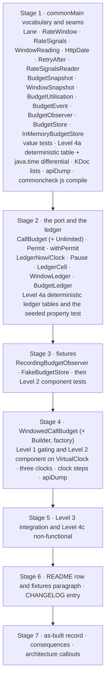
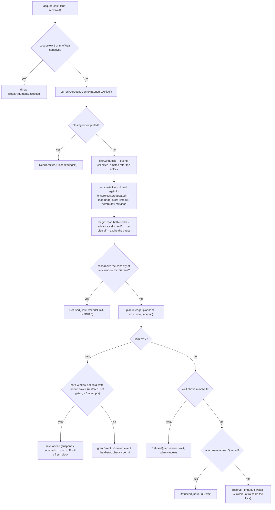
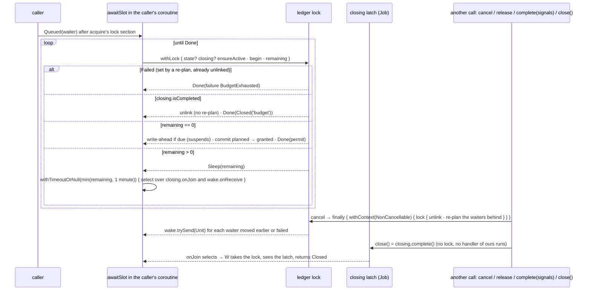

# Plan: `call-budget` — the `CallBudget` port and the `WindowedCallBudget` default

- **Covers:** `SpartanLaboratories/WebTools#67` — *"webtools-http: `CallBudget` port, `WindowedCallBudget`, rate signals, the persistence and observer seams and their fakes"*.
  Sub-issue of `SpartanLaboratories/WebTools#55` (HTTP client stack). Blocked by #62 (`http-core`) and #63 (`test-support`), both landed (#64, #65 and #66 have
  landed too). It blocks #68 (`call-facades`); #69 (`feeds`) and #70 (`http-docs`) take nothing from it directly.
- **Architecture:** [`../architecture.md`](../architecture.md), unit `call-budget` (§11 unit 8 and its scope; §6.5 *Call budget*; §6.2 for the failure model, the logging seam and the helpers;
  §6.6 for how the call facades use the budget, the closing order and the logging rules; §6.7 for the fixtures; §6.9 and §9 for the mechanism and tier of each type; §7.2 and §7.4 for the
  call path and the boundary table; §10 for the alternatives; §13 for the open points this unit settles). Its dated "Corrected" callouts are the as-built truth for units 1 to 7.
  Systems-level consequences: [`../consequences.md`](../consequences.md) §7 and §8.
- **Research:** [`research/README.md`](research/README.md) (its Summary is the settled design) with [`research/waits-and-close.md`](research/waits-and-close.md),
  [`research/retry-after-parsing.md`](research/retry-after-parsing.md) and [`research/ledger-time.md`](research/ledger-time.md); the stack-level
  [`../research/call-budget.md`](../research/call-budget.md) (F1 to F11) and [`../research/api-shape-and-failures.md`](../research/api-shape-and-failures.md). Where a findings file and the README's
  Summary differ, this plan follows the Summary; §6.11 lists every refinement of the architecture.
- **Branch:** `feat/issue-67-call-budget` (exists; cut from `master` at `8122af7`; holds the research commits). The implementer confirms it and never re-cuts it.
- **Commit:** TBD. This `plan.md` is committed **in the same commit as the first stage of the implementation** (commit 1 of §11), so `git log --follow` binds the two.
- **PR:** TBD (the PR closes #67).
- **What this plans:**
  - in `webtools-http`'s `commonMain` (package `com.spartanlabs.webtools.http`): the port `CallBudget` with `CallBudget.Unlimited`, `Permit` and `withPermit`; the vocabulary `Lane`,
    `RateWindow`, `RateSignals`, `WindowReading`, `BudgetUtilisation` and `WindowUtilisation`; `RetryAfter` and the `internal` HTTP-date parser; the seams `RateSignalsReader` (with `Standard`),
    `BudgetStore` (with `InMemoryBudgetStore`), `BudgetSnapshot`, `WindowSnapshot`, `BudgetObserver` and `BudgetEvent` with seven leaves; the default `WindowedCallBudget` with its builder and
    factory; and, `internal`, the ledger it is built on (the clock reading, the pause, the cells, the slot search, the restore and the snapshots);
  - in the published fixtures: `RecordingBudgetObserver` and `FakeBudgetStore`;
  - the KDoc lists of `ExperimentalForInheritanceWebToolsApi` and `WebToolsDsl`, the builder list of `WebToolsDslComponentTest`, the KDoc of `VirtualClockThreeClocksComponentTest`, the regenerated
    ABI dump, the `README.md` row and fixtures paragraph, and the `CHANGELOG.md` entry;
  - the tests of all of it (Level 1 gating to Level 4c non-functional and a Level 5 UAT manual pass).
- **Status:** built; the as-built record is [`final-implementation.md`](final-implementation.md).
- **Version moved:** none. `webtools-http` `1.0.0` stays unreleased and this landing is **not a release candidate**. No existing module moves a version and no build line changes
  (`kotlinx-coroutines-core` 1.10.2 is already the `commonMain` `api` dependency).
- **Baseline:** `master` at `8122af7` plus the research commits. Line references are to `8122af7` (the code on the branch is identical).

The code blocks in this plan are the intended implementation. They were written against the as-built sources of `webtools-http`, the kotlinx-coroutines 1.10.2 and Kotlin 2.2.0 standard-library
sources as the research reads them, and the research's findings; the blocks themselves have not been compiled. The implementer fixes a compile error mechanically and records any change to a
rule (as opposed to a spelling) in `final-implementation.md` at the moment it is made.

---

## 1. Requirements

### R1. The public surface and its tier

`webtools-http` gains these public declarations in `com.spartanlabs.webtools.http`, each with KDoc (`@param`, `@return`, `@throws`) that names its tier. **Implementing or subclassing
`CallBudget`, `Permit`, `RateSignalsReader`, `BudgetStore`, `BudgetObserver` or `BudgetEvent` is Experimental** (behind `ExperimentalForInheritanceWebToolsApi`); **everything else is Stable Core
and usable without the opt-in**: calling the ports, passing them, naming them in a signature, `CallBudget.Unlimited`, `WindowedCallBudget`, `InMemoryBudgetStore`, `RateSignalsReader.Standard`,
`BudgetObserver.None`, `withPermit`, every value type, and every `BudgetEvent` leaf. The fixtures are Stable Core with source compatibility only.

- `CallBudget : AutoCloseable` (R2) and `CallBudget.Unlimited` (R3); `Permit` (R3); the plain suspend function `withPermit` (R3).
- `Lane` (R4), `RateWindow` with `RateWindow.Builder` and the factory `RateWindow(name, published, period) { }` (R4), `RateSignals` with `RateSignals.Builder` and the factory `RateSignals { }`
  (R4), `WindowReading` (R4), `BudgetUtilisation` and `WindowUtilisation` (R4).
- `RetryAfter` (R5); `RateSignalsReader` with `RateSignalsReader.Standard` (R6).
- `BudgetStore`, `InMemoryBudgetStore`, `BudgetSnapshot`, `WindowSnapshot` (R7); `BudgetObserver` with `BudgetObserver.None`, `BudgetEvent` and its leaves `Granted`, `Refused`, `Paused`,
  `HardStop`, `Reconciled`, `StoreFailed` and `Restored` (R7), and the two vocabularies their fields use, `PauseSource` and `StoreOperation` (R7).
- `WindowedCallBudget` with `WindowedCallBudget.Builder` and the factory `WindowedCallBudget(windows) { }` (R8 to R14).
- `internal`, `commonMain`: `HttpDate` (with `HttpDateProblem`, `HttpDateParseException`, `httpDateFailure`), `LedgerNow`, `LedgerClock`, `Pause`, `ceilToMillis`, `LedgerCell`, `Charge`,
  `WindowLedger`, `BudgetLedger`, `Plan`, `RestoreOutcome`, `reservedUnits`, `BudgetStoreFailure` and the message and limit constants.
- Fixtures (`jvmTestFixtures`, package `com.spartanlabs.webtools.http.testing`): `RecordingBudgetObserver` and `FakeBudgetStore` (R16).

Nothing else becomes public. No `java.*`, atomicfu, `kotlin.concurrent.atomics`, `kotlin.time.Clock`/`Instant`, experimental API or new dependency appears in `commonMain`: the code uses
kotlinx-coroutines-core 1.10.2 and the Kotlin 2.2.0 common standard library only, because `webtools-http-commoncheck` compiles it for `js`. The only library types in a public signature are
`kotlin.time.Duration`, `kotlin.time.TimeSource`, `kotlin.Result` and `AutoCloseable`.

### R2. The `CallBudget` port and its contract

```kotlin
public suspend fun acquire(cost: Int, lane: Lane, maxWait: Duration): Result<Permit>   // abstract
public suspend fun utilisation(): BudgetUtilisation                                    // abstract
public suspend fun flush(): Result<Unit> = Result.success(Unit)                        // body: the default succeeds
override fun close() {}                                                                // body, as HttpTransport.close() and ResponseCache.close()
```

No defaulted parameters. The contract, numbered in the KDoc as `HttpTransport`'s and `ResponseCache`'s are:

1. **Charged at the grant.** A granted permit has been charged to the budget's counts; the budget holds no lock, semaphore or lease for it. A permit never completed is simply spent.
2. **Fail fast.** `acquire` returns `Result.failure(HttpFailure.BudgetExhausted(wait, reason, window))` when the wait the call would need exceeds `maxWait` (`Duration.INFINITE` waits as
   long as the plan needs; zero fails unless the call fits now), charging nothing. `wait` is the wait the call would have had; `Duration.INFINITE` for `CostExceedsLimit`.
3. **First come first served** within a lane. A call that would wait is queued behind the lane's earlier waiters.
4. **Cancellation.** The caller's own cancellation is thrown as `CancellationException`; a cancelled wait is refunded and the waiters behind it are re-planned. A caller that is already
   cancelled gets its `CancellationException` even after `close()`, and never receives a permit.
5. **Closing.** After `close()`, `acquire` and every call waiting return `Result.failure(HttpFailure.Closed("budget"))` as a value, never as a thrown cancellation. `close()` is idempotent,
   non-suspending, never throws and may be called from any thread. After it, `flush()`, `utilisation()` and `complete()`/`release()` on permits granted before the close keep working.
6. **Permits.** `Permit.complete()`, `complete(signals)` and `release()` are idempotent and run under `NonCancellable`, so they take effect from a cancelled coroutine.
7. **Utilisation.** `utilisation()` is a snapshot of the current window of each rate window, the pause remaining and the number of waiting calls.
8. **Flush.** `flush()` writes the exact counts to the budget's store and returns the failure instead of a success when it could not. The default body succeeds.
9. **Programmer errors.** A `cost` below 1 and a negative `maxWait` throw `IllegalArgumentException`.
10. **Concurrency.** Every member may be called concurrently from any thread and any number of coroutines.

### R3. `Permit`, `withPermit` and `CallBudget.Unlimited`

- `Permit` is a `@SubclassOptInRequired` interface, not `AutoCloseable` (its completion is suspend): `val cost: Int`, `val lane: Lane`, `suspend fun complete()` (a body that calls
  `complete(RateSignals.None)`), `suspend fun complete(signals: RateSignals)` and `suspend fun release()`. `complete` means the request was sent; `release` means it never was (the units are
  refunded, and a `complete` after a `release`, or the reverse, is ignored).
- `withPermit(cost, lane, maxWait, block)` is a plain (not `inline`) suspend extension on `CallBudget`: it acquires, runs `block(permit)` and completes the permit as spent (no signals) in a
  `finally` unless the block completed or released it; an exception from the block propagates; a refused or closed acquire is returned as the failure, and `block` does not run.
- `CallBudget.Unlimited` is a nested `public object`: it grants at once, ignores signals and `close()`, `flush()` succeeds, `utilisation()` is empty (no windows, no pause, nothing
  waiting), and it checks its arguments as the real budget does (`cost` at least 1, `maxWait` not negative, a cancelled caller gets its `CancellationException`). `toString()` is
  `CallBudget.Unlimited`.

### R4. The vocabulary

- `Lane(name)`: a plain final class, equality on the name, a non-blank name (`IllegalArgumentException`, message `name must not be blank`), `toString()` `Lane(<name>)`, constants
  `Lane.Interactive` and `Lane.Tracker`.
- `RateWindow`: `internal constructor(name, published, period, margin, hard)` with public `val`s and `val limit = published - margin` (the enforced limit); the factory
  `RateWindow(name: String, published: Int, period: Duration, configure: RateWindow.Builder.() -> Unit = {})` and `@WebToolsDsl public class Builder internal constructor()` with
  `var margin: Int = 0` and `var hard: Boolean = false`. The window is aligned: its fixed windows start at multiples of `period` since the Unix epoch (UTC). Explicit `equals`, `hashCode`,
  `toString`. Programmer errors are R15.
- `RateSignals`: `internal constructor(throttled: Boolean, retryAfter: Duration?, readings: Map<String, WindowReading>)` with public `val`s, the factory
  `RateSignals(configure: RateSignals.Builder.() -> Unit = {})` and `@WebToolsDsl public class Builder internal constructor()` with `var throttled: Boolean = false`,
  `var retryAfter: Duration? = null` and `fun reading(window: String, reading: WindowReading)`; `RateSignals.None` on the companion. `readings` is a read-only copy keyed by `RateWindow.name`.
  `retryAfter` is not negative; a reading's window name is not blank. A signal that is not `throttled` never pauses the budget; its readings still reconcile counts. Explicit `equals`,
  `hashCode`, `toString`.
- `WindowReading`: public constructors `WindowReading(remaining: Int, resetIn: Duration?)` and `WindowReading(remaining: Int)`; `remaining` is what the server says is left after it counted the
  call (it may be negative); `resetIn`, when present, is not negative. Explicit `equals`, `hashCode`, `toString`.
- `BudgetUtilisation(windows: List<WindowUtilisation>, pausedFor: Duration, waiting: Int)` and `WindowUtilisation(name, used, queued, limit, published, windowStartEpochMillis,
  resetsAtEpochMillis, hard, elapsedFraction)` with `val remaining` and `val fraction` (R8 defines the fields). Public constructors (an implementer of the port must be able to build them).
  The KDoc gives the worked example of `fraction / elapsedFraction` as the projected end-of-window usage; the type does not derive it.

### R5. `RetryAfter`

`public object RetryAfter` with `parse(value: String, nowEpochMillis: Long): Result<Duration>` and `parse(value: String, nowEpochMillis: Long, serverDateEpochMillis: Long):
Result<Duration>`. The grammar and every number are in §6.8; in short: RFC 9110's `delay-seconds` and its three HTTP-date forms, with three liberties (ASCII-case-insensitive names and `GMT`;
SP/HTAB trimmed around the value; a weekday that disagrees with the date is ignored). The result is never negative (a date in the past is `Duration.ZERO`) and always finite (`delay-seconds`
saturates at 253,402,300,799 s). A failure is an `internal` `IllegalArgumentException` subclass whose message is constant and never echoes the value.

### R6. `RateSignalsReader` and `Standard`

`RateSignalsReader` is a `@SubclassOptInRequired` plain interface (not a `fun interface`, which cannot carry the gate): `fun read(response: HttpResponse, nowEpochMillis: Long): RateSignals`,
which never throws for bad input. `RateSignalsReader.Standard` (a nested `public object`):

- a `429` is throttled, with or without `Retry-After`; a `503` is throttled only when a `Retry-After` parses; every other status is `RateSignals.None`;
- it parses every line of `headers.getAll("Retry-After")` and takes the longest wait among those that parse;
- it reads the response's `Date` with `headers["Date"]` (the last line) and, when that parses as an HTTP-date, uses the three-argument `RetryAfter.parse` with it as the server's date, else the
  two-argument one;
- it reports no window readings.

### R7. The seams: store, snapshots, observer, events

- `BudgetStore`: `@SubclassOptInRequired` interface; `suspend fun load(): Result<BudgetSnapshot>` (returns `BudgetSnapshot.Empty` when nothing is stored, never a nullable) and `suspend fun
  save(snapshot: BudgetSnapshot): Result<Unit>`. The KDoc requires a **cancellable** implementation (the budget bounds each call with `withTimeoutOrNull`, which cannot interrupt blocking
  code) and states that a save replaces the stored snapshot.
- `InMemoryBudgetStore`: a final class with a public no-argument constructor; thread-safe (one `Mutex`); `load()` returns the last saved snapshot or `BudgetSnapshot.Empty`; `save` stores it.
  `toString()` is `InMemoryBudgetStore`. It is the default `store` and the worked example of the seam.
- `BudgetSnapshot(version: Int, takenAtEpochMillis: Long, windows: List<WindowSnapshot>, pausedUntilEpochMillis: Long)` and `BudgetSnapshot(takenAtEpochMillis, windows,
  pausedUntilEpochMillis)` (version `BudgetSnapshot.CURRENT_VERSION` = 1); `BudgetSnapshot.Empty`. `WindowSnapshot(window: String, windowStartEpochMillis: Long, used: Int)`. Plain values
  with public constructors and no serializer; several snapshots of one window (different starts) are allowed. A `pausedUntilEpochMillis` of 0 means no pause.
- `BudgetObserver`: `@SubclassOptInRequired` plain interface; `fun onEvent(event: BudgetEvent)`; `BudgetObserver.None` (a nested `public object`). The KDoc says: events of one call arrive in
  order and those of concurrent calls may interleave; each event describes itself; the callback runs after the budget's lock is released, so it may call back into the budget; it must not
  block for long (it runs on the thread of the call that produced the event); an exception it throws is caught and logged.
- `BudgetEvent`: an open `abstract class` with a `protected constructor()`, `@SubclassOptInRequired`, never `sealed` (library-produced sets grow; the KDoc says match the leaves you care about
  and keep an `else`). Seven final leaves with public constructors, each with explicit `toString()` (R14 lists what a `toString` never prints):
  `Granted(lane, cost, waited)`, `Refused(lane, cost, wait, reason, window)`, `Paused(untilEpochMillis, length, source)`, `HardStop(window, resetsAtEpochMillis)`,
  `Reconciled(window, serverUsed, raisedBy)`, `StoreFailed(operation, cause)` and `Restored(windowsRestored, windowsDropped, ignoredForSkew)` (§7.9 has every field and rule).
- `PauseSource` (`RetryAfter`, `ResetIn`, `Boundary`, `Snapshot`: which hint set a pause, the type of `Paused.source`) and `StoreOperation` (`Load`, `Save`: the type of
  `StoreFailed.operation`): open constants classes like `ExhaustedReason` (a private constructor, the constants on the companion the only instances, equality by name, `toString()` the
  name), because they are library-produced vocabularies that may grow in a feature release; a `when` over them keeps an `else`.

### R8. `WindowedCallBudget` — construction

A final class with an `internal` constructor; the factory `public fun WindowedCallBudget(windows: List<RateWindow>, configure: WindowedCallBudget.Builder.() -> Unit = {}):
WindowedCallBudget`; `@WebToolsDsl public class Builder internal constructor()` with

| Property | Type | Default | Rule (a violation is `IllegalArgumentException`; the message names the property and never a value) |
|---|---|---|---|
| `laneShares` | `Map<Lane, Double>` | `mapOf(Lane.Interactive to 0.2)` | each share finite, above 0 and at most 1; the reserved units of all lanes fit every window |
| `boundaryGuard` | `Duration` | `1.seconds` | not negative and at most a quarter of the shortest period; truncated to whole milliseconds |
| `maxPause` | `Duration` | `24.hours` | positive and finite |
| `maxQueued` | `Int` | `1_000` | not negative; applied to each lane |
| `persistAhead` | `Int` | `10` | at least 1 |
| `maxRestoreSkew` | `Duration` | `5.minutes` | not negative |
| `storeTimeout` | `Duration` | `2.seconds` | positive |
| `storeRetryInterval` | `Duration` | `30.seconds` | not negative |
| `timeSource` | `TimeSource` | `TimeSource.Monotonic` | — |
| `wallClock` | `WallClock` | `WallClock.System` | — |
| `store` | `BudgetStore` | `InMemoryBudgetStore()` | — |
| `observer` | `BudgetObserver` | `BudgetObserver.None` | — |

`windows` is the factory's first parameter (required): non-empty, with distinct non-blank names. The public property `maxBurst: Int` is the smallest window's enforced limit (the most permits
that can be granted at one instant, for the facades' dispatcher sizing). `toString()` is `WindowedCallBudget(windows=[<names>], closed=<b>)`. The budget never reads the system clock,
`epochMillisNow()` or `TimeSource.Monotonic` by itself: it reads `timeSource` and `wallClock` only.

### R9. `WindowedCallBudget` — the ledger

An integer ledger of epoch-aligned fixed windows (§6.3 has the arithmetic):

- **Cells.** Each window keeps its counts in cells keyed by window index (`wall.floorDiv(periodMillis)`); a cell holds granted units, planned units (reserved for waiters), units restored from
  a store, a floor a server reading raised, and the units per lane.
- **Boundary guard.** A grant within the guard of a boundary is charged to both adjacent windows: to the previous window when `wall - start < guard`, to the next when `end - wall <= guard`.
- **Lane shares.** A lane's share is converted to reserved units per window (`ceil(share * limit)`, at least 1 for a positive share). The reserve is a **held-back floor, never lent**: a call
  on lane `L` fits a window cell when `used + cost + (the unused reserve of every other lane) <= limit`; `L` itself may use the whole window. A call whose cost exceeds
  `limit - (the reserves of the other lanes)` can never fit and is refused with `CostExceedsLimit` and `Duration.INFINITE`.
- **Reservations.** A call that would wait is planned ahead under one coroutine `Mutex`: first come first served within its lane (its slot is never earlier than the lane's last waiter's),
  charged to the cells of its slot as planned units, awaited outside the lock. Only calls that would wait count towards `maxQueued`, which is applied to each lane; a full lane refuses with
  `QueueFull` carrying the wait the call would have had.
- **Hard windows.** A `hard` window is persisted write-ahead and raises `BudgetEvent.HardStop` once per window and index (R13).

### R10. `WindowedCallBudget` — waiting, refunds and `close()`

- A waiter owns a conflated `Channel<Unit>` wake signal and waits in `withTimeoutOrNull(min(remaining, 1 minute)) { select { closing.onJoin { }; wake.onReceive { } } }`. After every wake or
  timeout it re-reads its plan under the lock. A re-plan signals only waiters moved earlier or failed. A waiter grants itself under the lock, after `currentCoroutineContext().ensureActive()`
  and before any mutation.
- A cancellation refunds the waiter's reservation and re-plans the waiters behind it, in `finally { withContext(NonCancellable) { lock { if still waiting: unlink, re-plan } } }`. A waiter whose
  new wait exceeds its cap after a re-plan fails at once with `BudgetExhausted`.
- `close()` is `closing.complete()` on a budget-owned `Job()` latch (completed, never cancelled): idempotent, thread-safe, never throws, never suspends; the winning call logs once. Waiters,
  calls parked on the lock and later `acquire` calls return `Result.failure(HttpFailure.Closed("budget"))` as a value. The budget owns no scope, ticker or dispatcher.
- `complete()` and `release()` run in the same `NonCancellable` shell, with their idempotency kept under the lock.

### R11. `WindowedCallBudget` — signals and pauses

- A reading's `remaining` only raises local usage: for the window cell the permit was charged to, usage becomes `max(local, published - remaining)`; a reading for a window that has since
  rolled is ignored; a larger `remaining` never lowers usage. A reading for an unknown window name is ignored.
- A throttled signal pauses the budget until the **maximum** of every hint: `Retry-After`; every reading with `remaining <= 0` and a `resetIn`; and, when there is no such hint, the next
  boundary of the exhausted windows (those a reading names with `remaining <= 0` or whose current cell is full), or of the shortest window when none is identified, plus the guard. Each hint is
  capped by `maxPause`; a later hint never shortens a pause; the pause covers every lane. Waiters are re-planned behind it and fail at once if their new wait exceeds their cap.

### R12. `WindowedCallBudget` — time

The wall clock decides where in the provider's calendar now is: window indices, starts and ends, the guard test, the snapshot's stamp, the `maxRestoreSkew` check and elapsed fractions. It is
read fresh at every lock section and used as read (no anchor, no clamp). The monotonic `TimeSource` measures every duration: each `delay`, the `maxWait` deadline, a grant's measured wait, the
in-process end of a pause, `storeTimeout` and `storeRetryInterval`; it is read through one mark taken at construction and made non-decreasing. Both are read together into one `internal` value,
and again when a store call returns inside a section. Cells are keyed by window index, kept, never reset by a reading, pruned only below the previous index as the clock moves forward, and capped
in number. **A backward wall-clock step across a window boundary copies**: the current cell gains the sum of the cells above it, capped at the window's limit, and the higher cells stay (once per
decrease). Pauses carry an elapsed deadline and an epoch deadline and end when either passes. A forward jump is trusted, and **a reservation whose own period the wall clock has
already left behind** (after a forward jump, or a waiter that ran late across a boundary) is never granted against that period: every waiter is re-planned from the current reading first,
in arrival order, so the waiters a jump released are spread over the current and later windows and never charged to a window that has ended. Each wait is sliced to at most one minute.

### R13. `WindowedCallBudget` — persistence

- **Write-ahead.** Before a grant that would pass a hard window's persisted mark, the budget saves `used + cost + persistAhead - 1` (capped at the limit) for the cell, under the lock and before
  the grant's mutation, bounded by `storeTimeout`. A failed or timed-out save is logged and ignored, never advances the persisted mark, and defers the next save attempt by
  `storeRetryInterval`; the in-process stop holds meanwhile. No save is made before a restore has succeeded.
- **Restore.** Runs once, under the lock, at the first of `acquire`, `utilisation()` and `flush()`. A snapshot window below the current index is dropped; at the current index the merge is
  `max(saved + grantsSinceStart, reconciled)`; counts at future indices are kept as cells at their own indices; a snapshot stamped further ahead than `maxRestoreSkew` has its stamp and pause
  ignored but its counts kept, and `Restored` reports it as ignored for skew; a restored pause converts once to the monotonic axis, capped by `maxPause`.
- **A store that fails.** A `load()` that fails raises `StoreFailed`; the budget then grants from its in-process count (fail open) and retries the restore from a later `acquire` only once
  `storeRetryInterval` has passed since the last attempt (single-flight under the lock); `flush()` retries unconditionally and returns the failure without saving while no restore has
  succeeded.
- **Store calls** run under the lock, before any mutation of their section, each bounded by `withTimeoutOrNull(storeTimeout)`; a timed-out call is a failure; a cancellation a store leaks while
  the caller is active becomes a store failure; failure messages are constant.

### R14. Events and logging

One emission point logs through the module's logging seam (`logger(BUDGET_LOGGER_NAME)`, `BUDGET_LOGGER_NAME = "com.spartanlabs.webtools.http.WindowedCallBudget"`) and forwards to the
observer; events are collected under the lock and emitted after the unlock; the observer call catches `Exception` (a `CancellationException` included, since `onEvent` is not suspend) and
logs it, and lets an `Error` through. Levels: `INFO` on creation and `close()` (settings numbers only) and on a restore; `WARN` on a pause (until, length, source), a hard stop (once per window
and index) and a store failure; `DEBUG` per refusal and per reconciliation. **Never** a header value, a body, a credential, a URL query, a store exception's message, or a per-call line
for a grant.

### R15. Programmer errors (`IllegalArgumentException`, message names the property, never a value)

`RateWindow`: published below 1; margin outside `0 until published`; a period that is not positive, not finite or not a whole number of milliseconds; a blank name. `WindowedCallBudget`: no
windows; duplicated window names; a lane share outside `(0, 1]` or not finite; shares whose reserved units do not fit every window; a guard above a quarter of the shortest period (or
negative); and the other numbers of R8's table. `acquire`: a `cost` below 1; a negative `maxWait`. The value types check their own fields (R4, R7). The exact messages are in §7.

### R16. Fixtures

`RecordingBudgetObserver` and `FakeBudgetStore`: each `final`, thread-safe, with its own `@OptIn(ExperimentalForInheritanceWebToolsApi::class)`, explicit visibility, KDoc, defaulted
parameters allowed, no new dependency. `FakeBudgetStore` offers failure injection for load and save (returned or thrown), a virtual-time delay for each, a preloaded snapshot, the recorded
saves and the load count. They are the worked examples of the two gated seams.

### R17. Documentation and files

KDoc on every public declaration naming its tier; the two KDoc lists extended; `README.md` and `CHANGELOG.md` updated in the same change (§8); the ABI dump regenerated (§7.23).

### R18. Tests and runs

Every new or changed test is placed at a level and a path (§9). Runs are only `webtools-http`'s own level tasks, `apiCheck` after `apiDump`, `verifyJavaFloor`, its `check` (which includes the
fixtures-publication check) and the check module's `js` compile `:webtools-http-commoncheck:build`. No other module's suite is run, before or after.

### Acceptance

1. A consumer module without the opt-in compiles code that names `CallBudget`, `Permit`, `RateSignalsReader`, `BudgetStore` and `BudgetObserver` in signatures, takes `CallBudget.Unlimited`,
   `RateSignalsReader.Standard`, `InMemoryBudgetStore()` and `BudgetObserver.None` as defaults, builds every value type, reads a `BudgetEvent` with a `when` that keeps an `else`, and uses
   `WindowedCallBudget(windows) { }` as a `CallBudget` (Level 1 gating).
2. A one-off procedure shows that a top-level implementer of each gated type fails to compile without `@OptIn(ExperimentalForInheritanceWebToolsApi::class)` and compiles with it (§9.2 P1).
3. On `VirtualClock`, every point of R2 and R9 to R14 holds for `WindowedCallBudget` (Level 2 component), including the exact grant instants after a cancellation, the pauses from each hint, the hard
   stop, the restore rules, the write-ahead after a simulated crash, `complete` from a cancelled coroutine, the clock-step cases and the three clocks together.
4. The HTTP-date table and the `java.time` differential agree, the window arithmetic, the guard's two-cell charge, the share rounding and the fold hold, and a seeded property test finds no
   provider-side overspend (Level 4a deterministic).
5. `RateSignalsReader.Standard` reads a real `503` with `Retry-After` and a `429` from the real transport over loopback (Level 3 integration). Real threads racing `close()` against cancels end every
   call with a value or its own cancellation, and a re-plan at `maxQueued` scale stays inside its bound (Level 4c non-functional).
6. `:webtools-http:check` and `:webtools-http-commoncheck:build` are green; `apiCheck` passes against the regenerated dump; nothing in another module changes.

---

## 2. Current state

- **No caller exists.** Nothing in the repository acquires a permit, parses a `Retry-After` or reads rate signals: `grep` for `CallBudget`, `Permit`, `WindowedCallBudget`, `RateWindow`,
  `RetryAfter` and `BudgetStore` over `webtools-http`, its fixtures and its tests finds nothing, and the ABI dump `webtools-http/api/webtools-http.api` (557 lines) has no budget type. The only
  budget-shaped code is `HttpFailure.BudgetExhausted` (`HttpFailure.kt:63`) and `ExhaustedReason` (`ExhaustedReason.kt`), which this unit produces. The call facades (#68) are the first user.
- **The module.** `webtools-http` is Kotlin Multiplatform with a `jvm()` target and `explicitApi()`. `commonMain` and `jvmMain` opt in to `ExperimentalForInheritanceWebToolsApi`
  (`webtools-http/build.gradle.kts:43` and `:51`), so the module's own implementers need no `@OptIn`; `commonTest` and `jvmTest` do not, so they are consumers. `commonMain` has
  `kotlinx-coroutines-core` 1.10.2 as `api`; `webtools-http-commoncheck` compiles `commonMain` for `js` (`webtools-http-commoncheck/build.gradle.kts`), with a `js` actual for every `expect`
  (`Log`, `epochMillisNow`); this unit adds no `expect` declaration.
- **What this unit takes, as built.**
  - `HttpFailure.Closed(component: String)` — a public final leaf, message `The <component> is closed`, a blank component refused (`HttpFailure.kt:43`).
  - `HttpFailure.BudgetExhausted(wait: Duration, reason: ExhaustedReason, window: String?)` — public, `wait` not negative (`wait must not be negative`), `window` null or not blank
    (`window must be null or not blank`) (`HttpFailure.kt:63`); `ExhaustedReason` with the constants `Window`, `Paused`, `CostExceedsLimit`, `QueueFull` (open constants class, equality by name).
  - `WallClock` (`@SubclassOptInRequired` interface, `nowEpochMillis(): Long`, `WallClock.System`; its reading may step backwards) and the `internal expect fun epochMillisNow()` behind it.
  - `internal inline fun <T> catchNonFatal(block: () -> T): Result<T>` (`NonFatal.kt`), `internal inline fun <T, R> Result<T>.flatMap(transform: (T) -> Result<R>): Result<R>`
    (`ResultExtensions.kt`), `internal interface Log { debug; info; warn }` with `internal expect fun logger(name: String): Log` (`Log.kt`; slf4j actual in `Log.jvm.kt`).
  - `HttpResponse.status: Int` and `HttpResponse.headers: HttpHeaders`; `HttpHeaders.get(name): String?` (the **last** line of that name), `getAll(name): List<String>`;
    `HttpSyntax.trimOws(value: String): String` and `HttpSyntax.asciiLower(c: Char): Char` (`HttpSyntax.kt:23`, `:36`).
  - `UrlProblem.kt` is the precedent for an `internal` problem enum with constant messages inside an `internal` `IllegalArgumentException` subclass and a `urlFailure` helper;
    `CachePolicy.kt` and `CaffeineResponseCache.kt` are the precedents for the factory-plus-builder shape (`internal` constructor, `@WebToolsDsl public class Builder internal constructor()`,
    a top-level factory with a trailing `configure` lambda defaulting to `{}`), and `ResponseCache.kt` for a gated port with a numbered contract, a nested `public object` and a default body
    on `close()`. `LoaderRunner.kt:26-38` is the idiom that tells a coroutine's own cancellation from one raised inside it (`currentCoroutineContext().ensureActive()`).
  - `VirtualClock` (`jvmTestFixtures/.../testing/VirtualClock.kt`): `timeSource: TimeSource.WithComparableMarks`, `elapsed`, `wallClock` (start plus virtual elapsed, so it can never step),
    `dispatcher`, `advanceBy(Duration)`, `DEFAULT_START_EPOCH_MILLIS` (2026-01-01T00:00:00Z, a UTC midnight) and `TestScope.virtualClock(startEpochMillis)`.
  - Test support in `jvmTest`: `captureTransportLogs(level) { }` (a logback `ListAppender` on `com.spartanlabs.webtools.http`), `RecordingLog`, `ManualTimeSource`, `Waiter.kt` (typed to the
    cache's `getOrLoad`, so the budget needs its own), `LoopbackFleet`; fixtures `LoopbackTransports.untrusted(userAgent, policy, resolve)` and `MockWebServer.webtoolsUrl(path)`.
- **The three-clocks proof this unit extends.** `VirtualClockThreeClocksComponentTest` and `CaffeineResponseCacheThreeClocksComponentTest` prove a cache ticker, a `delay` and a wall-clock
  index move together under one `advanceBy`. This unit re-runs the proof with the real budget (§9).
- **How `Retry-After` reaches a response (#65).** A `503`'s `Retry-After` reaches the response under its own name and value (the transport's `ExchangeGuard` hides the `503` and restores it); a
  `429`'s headers are untouched; a returned `3xx` keeps its `Retry-After`, a followed one's is dropped ([`../65-okhttp-transport/consequences.md`](../65-okhttp-transport/consequences.md) §4).
- **Where the budget runs (#66).** The facade takes its permit inside the cache's loader, which runs in the cache's own load coroutine on `loadDispatcher`: a cache's `close()` cancels a wait in
  progress (the waiter's own cancellation), a refusal and `Closed` must be values, and a cancellation the budget throws on its own while that coroutine is active reaches every caller as an
  `IllegalStateException` failure ([`../66-response-cache/consequences.md`](../66-response-cache/consequences.md) §4).
- **Outside-world facts this unit rests on** (each re-opened at its source in the research's Verification, 75 of 76 claims holding; the failing claim is a citation path, not a fact):
  - kotlinx-coroutines 1.10.2: `Mutex.lock` is fair, non-reentrant, cancellable, and does not check cancellation when uncontended; `Job().complete()` has one winner and `isCompleted` is
    the flag; `Job.onJoin` "never fails"; a conflated `Channel` never suspends the sender; `withTimeoutOrNull` returns `null` at once for a non-positive timeout, and rounds a sub-millisecond
    duration up; `SelectBuilder.onTimeout` is experimental and unused; `TestDispatcher` is a `Delay`, so `withTimeoutOrNull` is virtual under `runTest`
    ([`research/waits-and-close.md`](research/waits-and-close.md) F1 to F3, claims 1 to 10).
  - Kotlin 2.2.0: `kotlin.concurrent.atomics` needs an error-level opt-in and is not used; `kotlin.time.Clock` and `Instant` are experimental and are not used; `Long.floorDiv`, `Long.mod`,
    `Duration` and `TimeSource` are stable common API.
  - RFC 9110 §5.6.7 (three date forms, the two-digit-year rule), §6.6.1 (`Date`), §10.2.3 (`Retry-After`); `java.time`'s `appendValueReduced` is usable only for a base of at least 1
    ([`research/retry-after-parsing.md`](research/retry-after-parsing.md) F1, F7, F10).
  - The wall clock can step by any amount, forward or back; the monotonic source does not step, but is slewed and on Linux and macOS does not count a suspend
    ([`research/ledger-time.md`](research/ledger-time.md) F1 to F5).

## 3. Assumptions

Each of these could not be established without a run; the plan states what changes if it is false.

1. **`select` with `Job.onJoin` and `ReceiveChannel.onReceive` compiles for `js`.** Every type is declared in kotlinx-coroutines' `common` sources, but the combination was not compiled for `js`.
   The first run of `:webtools-http-commoncheck:build` settles it. If it fails, the wait falls back to a budget-wide `MutableStateFlow<Long>` version bumped by every re-plan and by `close()`,
   awaited under the same `withTimeoutOrNull`; nothing else in the design changes (a re-plan then wakes every waiter, each re-reading its plan).
2. **The re-plan stays cheap at `maxQueued` scale.** The stack-level probe measured 1.2 to 1.7 ms for one cancel with 3,000 waiters; this design adds one lock section per woken waiter and was not
   benchmarked. `WindowedCallBudgetReplanCostNonFunctionalTest` bounds it. If a run exceeds the bound, the re-plan restricts itself to the lane's waiters first and the other lanes' only when a
   cell they share changed (an optimisation with the same results).
3. **`runTest` 1.10.2 drains the shared scheduler at its end**, so a waiter a test leaves behind would run to completion at the end of the test. The tests close every budget with `use` and cancel
   their calls; the drain only finishes work they started.
4. **The close race has a window that no deterministic seam reaches** (a call between its lock section and its wait while `close()` runs). It rests on `Job.onJoin` selecting at once for a
   completed job (read from the API contract and measured on a one-window stand-in, not run on this code). `WindowedCallBudgetCloseRaceNonFunctionalTest` probes it; procedure P3 checks that
   it would notice the guard being removed. If a hang is ever observed, the waiter's wait gains a periodic `closing.isCompleted` check (the one-minute slice already bounds it to a minute).
5. **The 1-minute wait slice is a judgement.** It is long enough to cost one cheap wake per minute per parked waiter and short enough that a clock step, a jump or a suspend takes effect within
   a minute. If a consumer needs it tuned, a builder property is additive.
6. **`java.time`'s reduced-year window is identical on the build JDK.** It was measured on JDK 23.0.2; the differential runs on the build JDK, which is where the oracle has to hold. If the
   build JDK differs, the differential names the first mismatch and the oracle base is adjusted, not the parser.
7. **The Kotlin code of `HttpDate` was not compiled**; its Java mirror was measured (0 mismatches over about 2 million checks per seed). The Level 4a deterministic table and the differential establish the
   Kotlin parser itself.
8. **No JUnit parallel execution is configured** (no `junit-platform.properties` in the module), so a test that reads `System.getenv` or the logging appender is not raced by a neighbour.
9. **The budget's behaviour across a real suspend and a real clock step is not testable here.** The model (§6.2) is argued from documentation and a throwaway model; the tests step a virtual
   wall clock. A host that resumes from sleep or is stepped is the one thing only a field run shows (consequences).

## 4. Non-goals

- Retries (never), the transport's dispatcher sizing (the budget publishes `maxBurst`; #68 sizes), multi-process counting (a snapshot store is last-writer-wins; an atomic shared counter would
  be a second `CallBudget` implementation).
- Comparing the server's `Date` with the wall clock to detect a wrong forward clock (a follow-up, §13).
- A file-backed or shared-counter `BudgetStore`; a serializer for `BudgetSnapshot`.
- Calendar-month windows, per-window costs and fractional costs; dynamic header-declared rules (readings for unknown window names are ignored); the IETF `RateLimit` headers.
- Logging a detected clock step; lending a lane's unused reserve; a per-call deadline other than `maxWait`.
- Seam graduation (`CallBudget`, `Permit`, `RateSignalsReader`, `BudgetStore` and `BudgetObserver` stay Experimental until a consumer has built against them).
- A budget fake in the published fixtures (`WindowedCallBudget` on `VirtualClock` is the test double).
- The facades' use of the budget: acquiring inside the loader, releasing or completing by failure kind, `RateLimited.retryAfter` and `pausedFor` are #68's (§12 states what is provided).
- Anything in `webtools-feeds`, the response cache or the transport.

---

## 5. Approach and staging

The port, the vocabulary, the parser, the seams and the default are plain common code with no platform content: the whole unit is `commonMain` except the two fixtures. The default is split
into a pure, synchronous ledger (cells, the slot search, the pause, the restore, the snapshots; no coroutine, so Level 4a deterministic tables it on the JVM-free `commonTest`) and a concurrency shell
(`WindowedCallBudget`: the lock, the waiters, the latch, the store calls, the events). The unit lands in stages, each leaving the build green (§11).



Stage 1 and stage 2 compile for `js` through the check module (`commonMain` is shared), so the common types cannot touch a JVM API. Stage 3 changes `jvmTestFixtures`, so it re-runs the
fixtures-publication check (44 to 52 s) in `check`.

## 6. Design

### 6.1 Mechanism per type (architecture §6.9 and §9, for this unit's types)

| Type | Mechanism | Tier | Reason |
|---|---|---|---|
| `CallBudget`, `Permit`, `RateSignalsReader`, `BudgetStore`, `BudgetObserver` | `commonMain` interfaces, `@SubclassOptInRequired(ExperimentalForInheritanceWebToolsApi::class)`; grow only by methods with bodies | Experimental (implement); calling and passing them are Stable Core | Seams a consumer or a fake substitutes; an interface is a narrower contract than an overridable class. `RateSignalsReader` and `BudgetObserver` are plain interfaces because a `fun interface` cannot carry the gate. Graduation to `@SupportedExtension` waits for a real consumer to build against them (architecture §9). |
| `BudgetEvent` | open `abstract class`, `protected constructor()`, `@SubclassOptInRequired`; seven final leaves with public constructors | Experimental (subclass); every leaf Stable Core | The set of library-produced events grows (as `HttpFailure`'s leaves do), so it is never `sealed`; a consumer's `when` keeps an `else`. |
| `CallBudget.Unlimited`, `RateSignalsReader.Standard`, `BudgetObserver.None` | nested `public object`s | Stable Core | Stateless and shared; usable without the opt-in. |
| `WindowedCallBudget`, `InMemoryBudgetStore` | final classes; the budget by factory + builder over an `internal` constructor | Stable Core | Supplied defaults, named for their technique; every policy number is a builder property with today's default. |
| `Lane`, `RateWindow`, `RateSignals`, `WindowReading`, `BudgetSnapshot`, `WindowSnapshot`, `BudgetUtilisation`, `WindowUtilisation`, `RetryAfter`, the `BudgetEvent` leaves | final classes (`RetryAfter` an `object`); no public `data class`; configurable ones (`RateWindow`, `RateSignals`) by factory + builder; frozen-shape ones keep public constructors with explicit overloads | Stable Core | Vocabulary with no platform content; explicit `equals`/`hashCode`/`toString` keep the ABI independent of generated members. They are unmarked: marking a value type would force the opt-in on every `complete`. |
| `PauseSource`, `StoreOperation` | open constants classes (`private constructor`, constants on the companion, equality by name), as `ExhaustedReason` is | Stable Core | Library-produced vocabularies that may grow: an enum would make every added constant a compile error in a consumer's exhaustive `when`, and a plain `String` would let a misspelt comparison compile. |
| `withPermit` | top-level suspend extension on `CallBudget`, not `inline` | Stable Core | A public `inline` function would put its body in every caller; the cost of a call through `withPermit` is one lambda. |
| the ledger (`BudgetLedger`, `WindowLedger`, `LedgerCell`, `Charge`, `Plan`, `RestoreOutcome`, `LedgerNow`, `LedgerClock`, `Pause`), `HttpDate`, `BudgetStoreFailure` | `internal`, pure and synchronous where possible | — | Hidden by `internal`; the ledger has no coroutine in it, so Level 4a deterministic tables its arithmetic with plain calls and Level 2 component drives it only through the shell. |

### 6.2 The time model

The ledger reads both clocks together, once per lock section, into one `internal` value (`LedgerNow(wallMillis, elapsed)`), and again when a store call returns inside a section (a store call
may take `storeTimeout`, which is longer than the default guard). It owns one mark on the injected `TimeSource`, taken at construction as the cache's ticker does, and makes the elapsed
reading non-decreasing (`max(previous, reading)`, under the lock), because an injected `TimeSource` need not be monotonic. It never reads `epochMillisNow()`, `WallClock.System` or
`TimeSource.Monotonic` by itself. There is no anchor (it would drift at the oscillator's error, 4.3 s a day at 50 ppm, and stop across a suspend on Linux and macOS) and no clamp (it would
freeze the ledger for as long as the clock was stepped back).

| Quantity | Reading | How |
|---|---|---|
| Window index, start, end (`resetsAtEpochMillis`) | wall | `wall.floorDiv(periodMillis)`, `index * periodMillis`, `(index + 1) * periodMillis` |
| Boundary guard test | wall | `wall - start < guard` (also charge the previous cell); `end - wall <= guard` (also charge the next) |
| A reservation's slot | wall, a calendar instant | `targetWall`: a boundary, a boundary plus the guard, the lane's previous slot, or the pause's wall end; the cells it charged are named by index. It never holds a reading of the elapsed axis |
| The wait before a slot (a `delay` argument) | monotonic duration | `max(targetWall - wall, pause.remaining)` at each wake, at most the one-minute slice (an `internal` constant, not a builder property) |
| `maxWait` cap and the "new wait exceeds the cap" test | monotonic | a deadline `arrivalElapsed + maxWait` compared with `elapsed + newWait` |
| `BudgetExhausted.wait` | the plan | a `Duration`; for a hard window the time to the wall boundary |
| `Granted.waited` | monotonic | `elapsed - arrivalElapsed`, never negative |
| Window elapsed fraction | wall | `(wall - start) / periodMillis`, in `[0, 1)` because the index came from the same reading |
| In-process pause end | both axes, over when **either** has passed | `untilElapsed: Duration` and `untilEpochMillis: Long` |
| Persisted pause end, snapshot stamp, `maxRestoreSkew` check | wall | `untilEpochMillis`; the reading taken for the save; `snapshot.takenAt - wall > maxRestoreSkew` |
| A restored pause | wall to monotonic, once | `remaining = (savedEpoch - wall).coerceIn(0, maxPause)`; `untilElapsed = elapsed + remaining` |
| Restore retry rate, write-ahead retry rate, `storeTimeout`, `pausedFor`, queue ages | monotonic | `elapsed` marks and `withTimeoutOrNull` (virtual under `runTest`) |

What a fault does:

| Event | Cells | Pauses | Waiters |
|---|---|---|---|
| Backward step inside one window | unchanged | unchanged | a reservation for a later window is honoured later by the size of the step at most; every wake re-reads the wall |
| Backward step across a boundary (the wall index falls below the highest index the ledger has charged) | **copy, once per decrease**: the current cell gains the sum of the cells above it, capped at the limit; the higher cells stay for when the wall reaches them. A hard window cannot be charged again from zero. The bounded cost: when the step corrected a clock that ran ahead, the cell the early roll consumed stays consumed, so at most one period of calls the provider would have allowed is refused | unchanged (never lengthened) | a full re-plan follows the copy; a waiter whose recomputed wait exceeds its cap fails at once |
| Forward jump (a resume from sleep, a correction of a slow clock) | windows roll by the wall; cells below the previous index are pruned (never one holding planned units); a hard window opens fresh for the new day: the wall is trusted | ends when the wall passes `untilEpochMillis` | a waiter whose reserved period the wall has left behind is stale: the first lock section that reads the new wall re-plans every waiter from it, in arrival order, so the released waiters fill the current and later windows within their limits instead of all being granted at once against periods that have ended; each is woken within the one-minute slice |
| Slew | indistinguishable from the wall clock running fast or slow | unchanged | a wake that reads the wall a few ms before its slot waits the remainder; a grant is never made before the wall reaches the slot |

A forward jump is trusted because the wall clock is the only reading that tracks the provider's boundary, and common code cannot tell a resume from sleep from a clock set forward by mistake.
A clock set forward by mistake and left uncorrected, or a clock behind at start and stepped forward after grants were charged, can under-count the provider's day; comparing the server's `Date`
with the wall reading would detect it and is a follow-up (§13). Cells are copied rather than moved because a window that guards a bill must never under-count, whichever reading was wrong.

### 6.3 The ledger: cells, the slot search, shares, the fold

**Window arithmetic** (`WindowLedger`, `periodMillis` the window's period, `guardMillis` the budget's guard): `indexAt(wall) = wall.floorDiv(periodMillis)`, `startOf(index) = index *
periodMillis`. `chargeIndices(wall)` is `[k]` plus `k - 1` when `wall - startOf(k) < guardMillis` plus `k + 1` when `startOf(k + 1) - wall <= guardMillis` (with a guard of 0 neither
applies; the guard is at most a quarter of the shortest period, so the two bands never meet). `nextCritical(wall)` is `startOf(k) + guardMillis` when `guardMillis > 0` and `wall - startOf(k)
< guardMillis` (the end of the after-boundary band), else `startOf(k + 1)`: no cell content changes between two critical instants except by entering a before-boundary band, which only adds
charges, so a window that does not fit at `wall` cannot fit before `nextCritical(wall)`.

**A cell** (`LedgerCell`) is mutable state under the budget's lock: `base` (units restored from a store, unattributed), `granted` (units granted in this process), `floor` (the highest count a
server reading raised), `planned` (units reserved for waiters), `persisted` (the count believed to be in the store, hard windows), `grantedByLane` and `plannedByLane`. Derived:
`effective = max(base + granted, floor)` (the count the provider has seen or will have seen), `used = effective + planned` (what the slot search compares with the limit),
`laneUsed(lane) = grantedByLane[lane] + plannedByLane[lane]`. A reading only ever sets `floor` (so usage only rises); a refund lowers `granted` but never below `floor`.

**Does a call fit a window at `wall`?** For every index in `chargeIndices(wall)`: `used(cell) + cost + otherUnusedReserve(lane, cell) <= limit`, where `otherUnusedReserve` is the sum over
every other lane `M` of `max(0, reservedUnits(M) - laneUsed(M))` (a cell that does not exist is empty). `capacityFor(lane) = limit - (the sum of the other lanes' reserved units)`; a call with
`cost > capacityFor(lane)` for any window can never fit.

**The slot search** (`BudgetLedger.plan(lane, cost, now, tail)`; `tail` is the plan of the lane's last waiter, if any), pure over the ledger's state:

```
t      = now.wall
reason = Window; window = null
if tail != null and tail.targetWall > t:     t = tail.targetWall; reason = tail.reason; window = tail.window      // first come first served
if pause remaining (ceiled to ms) > 0 and now.wall + pauseMs > t:   t = now.wall + pauseMs; reason = Paused; window = null
loop:
    next = t; blocker = none
    for each window w in declaration order:
        if not fits(w, lane, cost, t):  c = w.nextCritical(t);  if c > next:  next = c; blocker = w.name
    if next == t: break
    t = next; reason = Window; window = blocker
return Plan(targetWall = t, reason, window, charges = chargesAt(t))
```

The step is the maximum over the blocking windows because each blocker is infeasible throughout `[t, its next critical instant)`, so no feasible instant is skipped. The loop ends because the
cells are finite and a call whose cost is within capacity fits an empty cell. A waiter's slot at least equals its lane's last slot, so the slot search jumps straight to the tail and a queue of a
thousand costs a few steps per waiter. `chargesAt(t)` lists, per window, the cell indices of `chargeIndices(t)` with the one equal to `indexAt(t)` marked primary.

**Share rounding.** `reservedUnits(share, limit) = max(1, ceil(share * limit - 1e-9).toInt())`: `ceil`, at least 1 for a positive share, the epsilon keeping `0.2 * 50` from rounding to 11.
At construction every window requires `sum over lanes of reservedUnits(share, limit) <= limit`. The default `Interactive` 0.2 on a window of limit 1 reserves its only unit, so every other
lane's capacity there is 0 and its calls are `CostExceedsLimit`; the builder's KDoc says a window that small wants `laneShares = emptyMap()`.

**Reserve, commit, refund.** `reserve(charges, lane, cost)` adds `cost` to `planned` and `plannedByLane` of each charged cell (creating it); `unreserve` takes it back; `commit` moves
`planned` to `granted` (and the lane maps) in each cell; `grantDirect` adds to `granted` without a reservation (the immediate grant); `refundGranted` lowers `granted` and `grantedByLane`
(skipping a cell that was pruned). A cell holding planned units is never pruned or dropped by the cap.

**The fold and pruning** (`WindowLedger.advance(wall)`, called once per lock section): with `k = indexAt(wall)` and `last` the highest index the ledger has been advanced to, if `k < last`
the wall went backwards across a boundary: the cell at `k` (created if needed) gains `min(sum of effective of the cells above k, limit - effective(k))` as `base` (never negative), and
`last = k` (so a repeated reading at `k` copies nothing, and a further decrease copies again); otherwise `last = max(last, k)`. Then cells with index `< k - 1` and no planned units are removed,
and while the window holds more than `MAX_CELLS_PER_WINDOW` (16) cells, the highest-indexed cell above `k` with no planned units is removed. `advance` returns whether it folded, and the shell
then re-plans every waiter.

**Stale reservations** (`BudgetLedger.isStale(plan, now)`): a plan is stale when its primary charge (the cell of the slot's own period) in any window is below that window's current index, that
is, when the wall clock has left the reserved period behind. In normal running a waiter is granted at its slot, inside its period; a plan goes stale only after a forward jump of the wall clock
or when a waiter runs its section late across a boundary. Granting it would charge a period that has ended and leave the current one unprotected: after a two-hour jump, a queue planned
over the next minutes would otherwise be granted all at once. So every lock section that reads the clock (`begin` in the shell) re-plans every waiter when the clock copied cells **or**
any waiting plan is stale; the re-plan takes the stale reservations back and plans each waiter again from the current reading, in arrival order.

**Restore, snapshots, utilisation** are in §6.7 and §7.

### 6.4 One call: `acquire`



Rules the diagram fixes:

- **Nothing is mutated before the last suspension of the section.** The restore's `load()` and the write-ahead `save()` come first; after the last one the section re-reads the clock, plans,
  and mutates with no suspension point in between. A cancellation that lands at a store call leaves the ledger as it was.
- **A grant re-decides after a save.** A save may take up to `storeTimeout`, longer than the guard, so the section loops back to a fresh clock reading (and, for a waiter, a re-plan if its
  period went stale) rather than charging cells chosen before the save. The immediate grant of `acquire` and the waiter's own grant in `awaitSlot` follow the same loop, and each iteration
  checks the caller's cancellation before it mutates anything. At most 3 attempts; the third grants without a further save (the in-process stop holds, and the failure to persist is the
  fail-open the design accepts).
- **A call that fits now is granted at once only when its lane has no waiter.** Behind a waiter that is due but has not yet run its section, the call is queued (with a wait of zero) and takes
  its turn through `awaitSlot`, so first come first served holds to the instant.
- **A refusal charges nothing.** `Refused` carries the wait the call would have had; `QueueFull` and a wait above `maxWait` both do.
- **Only calls that would wait count towards `maxQueued`.** `maxQueued` is checked per lane, after the wait cap.
- **A cancelled caller never receives a permit from the immediate path:** `acquire` and the section both call `ensureActive()` first; a cancellation after the last suspension point leaves the
  caller holding a permit it must complete or release, which `withPermit`'s `finally` does.

### 6.5 Waiting, re-planning, refunds and `close()`



- **The plan lives under the lock** and every wake, timeout or spurious signal re-reads it, so a lost, stale or double wake costs one extra lock section and nothing else. A waiter moved
  later wakes at its old time, re-reads and sleeps again; only a waiter moved earlier or failed is signalled. A newly planned waiter is created with its plan and is never signalled by it.
- **Re-planning.** `replan(fromSeq)` takes back the reservations of every waiting waiter with `seq >= fromSeq` and plans them again in arrival order, each from the ledger as it then stands
  and from its lane's previous slot; a waiter whose new wait plus the elapsed time exceeds its deadline by more than 1 ms (the wall clock has millisecond granularity) is failed at once
  with `BudgetExhausted(newWait, reason, window)`, unlinked and signalled, and its `Refused` event is emitted. A cancellation or a withdrawal re-plans from the waiter behind the removed
  one (earlier arrivals never depended on it); `release`, a `complete` that changed something, a fold, a restore and a pause re-plan from the first waiter (`fromSeq = 0`). A `complete` that
  changed nothing (no signals) re-plans nothing. Reading the clock re-plans everyone too when a waiting plan has gone stale (§6.3: its reserved period is behind the wall).
- **A waiter grants itself.** At its slot it takes the lock, calls `ensureActive()` before anything, re-reads, performs a due write-ahead save and then re-reads again (a fresh clock, a re-plan
  if its period went stale, the wait recomputed), and converts its reservation to a grant with no suspension between the last check and the mutation. Nothing runs on behalf of a waiter, which is what lets the budget own no scope. A cancelled waiter parked on the lock gets its
  `CancellationException` before its section starts and is still `Waiting` for the cleanup.
- **Cleanup from a cancelled coroutine** is `withContext(NonCancellable) { lock { … } }`: a contended `Mutex.lock` inside `NonCancellable` waits for the holder rather than throwing, and every
  holder is bounded by `storeTimeout`. It must never be called while the same coroutine holds the lock (the mutex is not reentrant); the wait loop's sections end before its `finally` runs.
- **`close()`** is `if (closing.complete()) log.info("closed")`. `Job` is thread-safe and `complete()` has one winner; `isCompleted` is the closed flag; no atomic or `@Volatile` is needed. The
  latch is completed, never cancelled, so a waiter that returns `Closed` is not involved in a `CancellationException` at all: nothing reaches the response cache's loader as an
  `IllegalStateException`. A call parked on the lock sees the latch in its first check; a waiter between its section and its wait selects `onJoin` at once because the job is already
  complete; a waiter's own `unlink` on close does not re-plan (everyone is leaving).
- **After `close()`** the lock still works: `flush()`, `utilisation()`, `complete()` and `release()` run as before, and `release()`'s re-plan finds no waiters.
- **A slow or blocking store** holds the lock for up to `storeTimeout` (a cancellable store is cut off; a blocking one cannot be, which `BudgetStore`'s KDoc states). Every `complete`, `release`,
  cancellation cleanup and later `acquire` queues behind it. That is the price of keeping every store call before the mutation of its section.

### 6.6 Signals, reconciliation and pauses

`complete(signals)` (under the lock, once per permit): for each reading whose window the budget knows and whose primary cell (the cell of the permit's own index) is still the window's
current cell, `serverUsed = published - remaining` clamped to `0..published`; if it exceeds `effective(cell)`, `floor` is raised to it and `Reconciled(window, serverUsed, raisedBy)` is
emitted. Then, if `signals.throttled`, the pause hints are computed:

| Hint | `PauseSource` | Length |
|---|---|---|
| `signals.retryAfter` (when present, zero included) | `RetryAfter` | `retryAfter` rounded up to a millisecond |
| each reading of a known window with `remaining <= 0` and a `resetIn` | `ResetIn` | `resetIn` rounded up |
| none of the above (and only then): the next boundary of the exhausted windows — those a reading names with `remaining <= 0` or whose current cell is full — or of the shortest window when none is identified | `Boundary` | `max over the windows of (next boundary - wall) + guard` |

Each length is capped by `maxPause`; lengths of 0 are ignored; the pause is the **maximum** of the hints and of the pause already in force (per axis), so it is never shortened, and it covers
every lane because the slot search reads it for every call. `Paused(until, length, source)` is emitted when the pause was extended, with the source of the winning hint. If usage was raised or the
pause extended, every waiter is re-planned. `RateSignals.None` changes nothing and re-plans nothing.

`release()` (once): `refundGranted` on every cell the permit charged, then a full re-plan.

### 6.7 Persistence: write-ahead, restore, flush

**What is persisted.** The `BudgetSnapshot` holds, for every **hard** window, a `WindowSnapshot(window, windowStartEpochMillis, used)` per cell at or above the current index that has a count,
plus `takenAtEpochMillis` (the wall reading of the save) and `pausedUntilEpochMillis` (the pause's epoch end, 0 for none). Non-hard windows are never persisted: a minute window is over
before a restart matters. A budget with no hard window still saves its pause on `flush()` and restores it.

**Write-ahead** (`BudgetLedger.walNeeded` / `writeAheadSnapshot`): a grant charges cells; for each charge on a hard window whose index is at or above the window's current index,
`effective(cell) + cost > cell.persisted` means a save is due. The save then writes, for each hard window cell at or above the current index, `min(limit, effective + cost + persistAhead - 1)`
for the cells the grant charges that need it and `max(persisted, effective)` for the others, plus the stamp and the pause. After a successful save each written cell's `persisted` is set to
what was written; a failed or timed-out save advances nothing and defers the next save attempt until `storeRetryInterval` has passed (the gate). A save is due only when the restore has
succeeded and the gate is open. So the persisted number is at least the true usage at every grant that made a save, and a crash restores to at most `persistAhead - 1` above the truth.

**Restore** (`BudgetLedger.restore`), run once, merges the snapshot into the ledger as it stands after the clock was advanced:

| Snapshot content | Result |
|---|---|
| a window name the budget does not have; a start that is not a multiple of the window's period; an index below the window's current index; any window of an unknown snapshot version | dropped (`windowsDropped`) |
| a window at the current index | `cell.base = saved` (clamped to `0..limit`), so `effective = max(saved + grantsSinceStart, floor)`: the grants made since the start are added to the stored count and a count a server reading raised stays a floor. A restore before any grant is `max(local, saved)` |
| a window at a future index | kept as a cell at its own index (read once the wall reaches it) |
| `takenAt - wall > maxRestoreSkew` | the stamp and the pause are ignored; the counts are still kept (the clock at start may be the one that is behind); `Restored.ignoredForSkew = true` |
| `pausedUntil > wall` and not skewed | a pause of `(pausedUntil - wall)` capped by `maxPause`, converted once to the monotonic axis, merged with any pause in force; `Paused(.., PauseSource.Snapshot)` |

A restore that merges something re-plans every waiter. **A store that fails:** a `load()` that fails or times out records `Failed(at = elapsed)` and raises `StoreFailed(StoreOperation.Load, cause)`; grants
continue from the in-process count; a later `acquire` retries only once `elapsed - at >= storeRetryInterval` (the retry is single-flight because it runs under the lock); `utilisation()`
makes the first attempt only; `flush()` retries unconditionally.

**`flush()`** (under the lock): restore (forced), then write the exact snapshot (`effective` of every hard window cell at or above the current index, the stamp, the pause) bounded by
`storeTimeout`; success sets each cell's `persisted` to what was written; failure raises `StoreFailed(StoreOperation.Save, cause)` and is returned. If no restore has succeeded it returns the restore's failure
without saving: writing the in-process counts over a larger stored count would under-count the next restart. A client that owns its budget calls `flush()` before `close()` to get the exact final
write; `close()` itself writes nothing.

**Store calls** (`storeCall`): `withTimeoutOrNull(storeTimeout) { block() }`; `null` means timed out, or the result was dropped by the timeout's asynchronous cancellation, and is a failure
(`BudgetStoreFailure.TIMEOUT`); a `CancellationException` out of the block (thrown, or returned inside the store's `Result`) is followed by `currentCoroutineContext().ensureActive()`, which
rethrows the caller's own cancellation and otherwise becomes a failure (`BudgetStoreFailure.CANCELLED`); any other `Exception` is the failure; an `Error` propagates. The result is never
trusted when it may have been dropped: a timed-out save is treated as not persisted.

### 6.8 `RetryAfter` and the HTTP-date parser

One `internal` `HttpDate` parser serves `RetryAfter.parse` and the `Date` reading of `Standard`. Input is trimmed of leading and trailing SP and HTAB (`HttpSyntax.trimOws`) and of nothing
else; digits are ASCII `0-9` (compared as `c in '0'..'9'`, never a character-class predicate); letters compare through `HttpSyntax.asciiLower`.

| Form | Shape (after trimming) | Accepted | Rejected |
|---|---|---|---|
| `delay-seconds` | `1*DIGIT` (first character a digit) | any run of ASCII digits, leading zeros and `0` included; saturates at 253,402,300,799 s | empty; a sign; a fraction or exponent; a unit; a list (`120, 60`); embedded space; any non-ASCII digit; CR, LF, NUL |
| IMF-fixdate | `Day, DD Mon YYYY HH:MM:SS GMT` (29 characters) | day name `Mon`..`Sun`, `GMT`, month name in any ASCII case; `DD` two digits `01`..`31` valid for the month and year; `YYYY` four digits `0000`..`9999`; `00..23 : 00..59 : 00..60` | long names, `Sept`, `November`; one-digit fields; `UTC`, `+0000`, no zone, text after `GMT`; two spaces, tabs, NBSP; a two- or five-digit year |
| RFC 850 | `Weekday, DD-Mon-YY HH:MM:SS GMT` | long day name (`Monday`..`Sunday`), `-` separators, a two-digit year resolved below | a four-digit year; a short day name; a one- or three-digit year |
| asctime | `Dow Mon D HH:MM:SS YYYY` (24 characters) | short day name; the day as `06` or ` 6` (two spaces after the month); no zone | `Nov 6` (one space, one digit), `Nov  06`, a zone, a two-digit year, text after the year |

A shape that matches none is `Format`; a matching shape whose day, hour, minute or second is out of range, or whose day its month does not have (`31 Feb`, `29 Feb 1900`), is `Range`; an
empty text is `Empty`. Dispatch needs no backtracking: the leading run of ASCII letters followed by `,` with 3 letters is IMF-fixdate, with 6 to 9 letters RFC 850, followed by SP with 3 letters
asctime; for `Retry-After` only, a first character in `0-9` selects `delay-seconds` (all date forms start with a letter). Three liberties, each a conscious step beyond RFC 9110's
case-sensitive text: names and `GMT` match in any ASCII case (RFC 9111 §4.2 tells a cache to, and every mature parser does); SP and HTAB around the value are trimmed; a weekday that disagrees
with the date is ignored (the instant never depends on it). Second 60 is accepted at any minute and read linearly as the next minute's `:00`.

- **Numbers.** `delay-seconds` accumulates as `acc = min(acc * 10 + digit, 253_402_300_799)` and every remaining character is still validated, so `99999999999999999999999x` is `Format` and
  `99999999999999999999999` is the cap. A huge value is a very long wait, not a missing hint. A date's delay is `max(0, date - reference)` in whole milliseconds, capped at the same bound and
  guarded against overflow, so every result is finite and `now + delay` cannot overflow; `maxPause` still caps the pause.
- **Reference.** `parse(value, now)` is `parse(value, now, now)`; with a server date the reference is that date, so a skewed local clock cancels out of a pair of server readings, and `now` is
  not read. `Standard` passes the response's `Date` when it parses and otherwise calls the two-argument overload (RFC 9110 §6.6.1: use the time received).
- **Two-digit years (RFC 850 only).** `year = limit - (limit - yy).mod(100)` with `limit = clamp(yearOf(reference), 50, 9949) + 50`: the greatest year with those last two digits that is
  not after `referenceYear + 50`; the clamp keeps every result in `1..9999` for any reference. The rule is year-granular (at most one year from the RFC's wording at the single boundary year).
- **Failures** are an `internal` enum `HttpDateProblem` (`Empty`, `Format`, `Range`) with constant messages that never echo the value, returned inside an `internal`
  `IllegalArgumentException` subclass `HttpDateParseException`, as `UrlProblem.kt` does. A programmer error does not exist here: every `Long` clock reading is accepted.

### 6.9 Error handling of every new signature, thread safety and resources

| Signature | Failure it returns | Expected failures (→ `Result`) | Programmer errors (→ throw) | Where a `Result` is unwrapped |
|---|---|---|---|---|
| `CallBudget.acquire` (port; `WindowedCallBudget`, `Unlimited`) | `HttpFailure.BudgetExhausted(wait, reason, window)`; `HttpFailure.Closed("budget")` | a refusal (window, pause, cost, queue); a closed budget | `cost < 1`, negative `maxWait` → `IllegalArgumentException`; the caller's cancellation is thrown | by the caller (#68's loader) |
| `CallBudget.utilisation`, `flush` | `flush`: the store's failure (a load/save failure, a timeout, a store cancellation) | an unavailable store | — (`utilisation` never fails) | `flush`: by the caller; nowhere else |
| `CallBudget.close` | none | — | — (never throws; idempotent) | — |
| `Permit.complete`, `complete(signals)`, `release` | none (run under `NonCancellable`; idempotent; work after `close()`) | — | — | — |
| `withPermit` | the acquire's failure; the block's `Result`; an exception from the block propagates | a refused or closed acquire | — | by the caller |
| `RetryAfter.parse` (both) | `Result.failure(HttpDateParseException)` (an `IllegalArgumentException` whose `problem` is `Empty`, `Format` or `Range`) | text from outside the process | none | `RateSignalsReader.Standard` (`getOrNull`: a header that does not parse is ignored) |
| `RateSignalsReader.read` (port and `Standard`) | none — returns `RateSignals.None` for anything it cannot use | bad headers | — | — |
| `BudgetStore.load`, `save` (port) | `Result.failure(<cause>)` | an unavailable store | — (a thrown `Exception` is converted by the budget; the caller's cancellation propagates) | the budget (`storeCall`) |
| `InMemoryBudgetStore.load`, `save` | none | — | — | — |
| `Lane(…)`, `RateWindow(…)`, `RateSignals{}`, `WindowReading(…)`, `BudgetSnapshot(…)`, `WindowSnapshot(…)`, `BudgetUtilisation(…)`, `WindowUtilisation(…)`, the event leaves, `WindowedCallBudget(…) { }` | none | — | `IllegalArgumentException`, message names the property and never a value | — |
| `BudgetLedger` methods (`internal`) | none | — | none (callers validate) | — |
| `WindowedCallBudget` private suspend functions | never throw except the caller's `CancellationException`, an `Error`, or an `IllegalArgumentException` from `acquire`'s checks | — | — | the public function that called them |

The `try`/`catch` sites where a `CancellationException` must be told from other throwables, or a `Throwable` converted to a value, are `storeCall` and the observer call (`catch (e: Exception)`,
since `onEvent` is not suspend and a `CancellationException` out of it cannot be the caller's cancellation). Everything else uses `fold`, `flatMap`, `onSuccess`/`onFailure` and
`catchNonFatal`. **Cancellation is always thrown, never returned:** the caller's own (from `ensureActive()` at the top of `acquire`, from a contended `lock`, from `withTimeoutOrNull` or
`select` while waiting, or from a store call) is a `CancellationException`; the budget's own (from `close()`) never reaches a caller as one.

**Thread safety.** Every mutable ledger field — the cells, the waiters list, the pause, the restore state, the write-ahead gate, the next sequence number, the permits' states — is read and
written only inside `lock.withLock`, which on the JVM gives the `synchronized`-style happens-before ("an unlock happens-before every subsequent successful lock"). The only cross-thread datum is
the `closing` latch (`Job`). `LedgerClock` is under the lock. The permit's `state` is a plain field under the lock (idempotency without an atomic). A `Waiter`'s `wake` channel is the one object
touched from outside the lock (`trySend`), and it is thread-safe.

**Resources and ownership.** The budget owns no thread, scope, timer or dispatcher: a wait runs in the caller's coroutine, a grant is made by the waiter itself. It never closes the `store`,
the `observer`, the `timeSource` or the `wallClock` it was handed. `close()` does not write; `flush()` does.

**Execution contexts.** Everything runs in the caller's coroutine (or, from the facade, in the cache's load coroutine). Store calls run on whatever dispatcher the caller is on, under the lock.
The observer is called on the thread of the call that produced the event, after the unlock.

### 6.10 Events and logging

The events, emitted by one function: the lock section collects them into a list, the caller emits the list in a `finally` after the unlock. For each event, `logEvent` writes the line below (if
any) through `logger(BUDGET_LOGGER_NAME)`, then `observer.onEvent(event)` runs inside `try { … } catch (e: Exception) { log.warn("observer failed: {}", e::class.simpleName) }`; an `Error` is not
caught. The remaining events of the list are skipped only when an `Error` propagates.

| Level | Event | Fields |
|---|---|---|
| `INFO` | creation | window count, `maxBurst`, `maxQueued`, `persistAhead` |
| `INFO` | `close()` (the winning call only) | none |
| `INFO` | `Restored` | `windowsRestored`, `windowsDropped`, `ignoredForSkew` |
| `WARN` | `Paused` | `source`, `length`, `untilEpochMillis` |
| `WARN` | `HardStop` (once per window and index) | `window`, `resetsAtEpochMillis` |
| `WARN` | `StoreFailed` | `operation` and the cause's class simple name — never its message |
| `WARN` | an observer that threw | the exception's class simple name |
| `DEBUG` | `Refused` | lane name, reason, window name, wait |
| `DEBUG` | `Reconciled` | window name, `serverUsed`, `raisedBy` |
| none | `Granted` | one line per call is noise; the observer has it |

Never a header value, a body, a credential, a URL, a store exception's message or a `Retry-After` text: the budget sees none of them (it receives `RateSignals`, not a response), and the
reader that does logs nothing.

### 6.11 Where this plan refines the parent architecture

None changes the unit's scope, a seam or a tier.

| Architecture §6.5 / §6.6 / §13 text | This plan | Reason |
|---|---|---|
| (silent) a backward wall-clock step | **copy**: on a decrease of the wall index across a boundary, the current cell gains the sum of the cells above it, capped at the limit, once per decrease | New behaviour. Resetting a cell on an index change turns every backward step into a fresh budget (overspend of one to two limits in the research's model); moving the counts down under-counts when the step itself was the error; copying is the only variant with no overspend after a one-hour and a one-year step. The bounded false refusal (at most one period) is the cost of a window that guards a bill |
| "ignores a snapshot stamped further ahead than `maxRestoreSkew` (logged)" | such a snapshot has its stamp and pause ignored, its window counts kept as cells at their own indices, and `Restored` reports it as ignored for skew. **`architecture.md` §6.5 gets a dated callout when the unit is reconciled after the build** | Ignoring the counts would lose the stored day when the clock at start is behind (a host that starts from its hardware clock before it synchronises), reopening the billing hole |
| "restore runs once at the first `acquire`" | at the first of `acquire`, `utilisation()` and `flush()` | A `utilisation()` or `flush()` before any `acquire` would otherwise read or write counts that ignore the store |
| "keeps `max(local, saved)`" | the stored count and the grants made since the start are added: `max(saved + grantsSinceStart, reconciled)` | Equal to `max(local, saved)` when nothing was granted before the restore; a late restore after a store outage must not under-count |
| (silent) a store that fails | the restore fails open (grants from the in-process count), is retried by a later `acquire` only after `storeRetryInterval`, makes no write-ahead save before it succeeds, and `flush()` retries unconditionally and returns the failure without saving; a failed write-ahead save defers the next attempt by `storeRetryInterval` | A down store would otherwise cost one `storeTimeout` per grant under the lock; writing in-process counts before a restore could overwrite a larger stored count |
| the builder's list of numbers | `storeTimeout` (2 s) and `storeRetryInterval` (30 s) are builder properties | Every policy number of a supplied default is one |
| "`maxQueued` (1,000)" | applied to each lane; only calls that would wait count | A shared bound would let one lane's backlog refuse another lane's calls |
| six `BudgetEvent` leaves | a seventh, `Restored` | The restore's outcome (restored, dropped, ignored for skew) has no other carrier; the log line and the observer both need it |
| `utilisation(): BudgetUtilisation` | `suspend` | A reading takes the lock (and may make the first restore attempt) |
| "`close()` … writes the exact hard-window counts" (stack research F7) | `close()` writes nothing; `flush()` does, and works after `close()` | `close()` is non-suspending and takes no lock; the exact final write is a suspend call |
| `BudgetEvent` leaves | `BudgetEvent` is an open abstract class gated like `HttpFailure`, never `sealed` | Library-produced sets grow; a consumer's `when` keeps an `else` |
| (silent) event delivery | events are collected under the lock and emitted after the unlock | `Mutex` is not reentrant: an observer that called back into the budget would deadlock if events were delivered under the lock |
| "`RateSignalsReader.Standard`: `429`, or `503` with `Retry-After`, no counts" | parses every `Retry-After` line and takes the longest; reads `Date` with `get`; uses it as the reference when it parses | `Retry-After` is not a list field, but a budget pauses until the maximum of every hint; RFC 9110 §6.6.1 says a recipient uses the time received when `Date` is missing or invalid |
| "`RetryAfter.parse` … in common Kotlin, differential-tested" | one `internal` `HttpDate` parser, RFC 9110's grammar with three liberties, a `delay-seconds` saturated at 253,402,300,799 s, a reference-relative two-digit-year rule | One grammar keeps the differential meaningful; the liberties are policy, not arithmetic, and are table rows |
| (silent) waits | each wait is sliced to at most one minute (an `internal` constant) | A step, a jump or a suspend takes effect within a minute instead of after a remaining wait of hours |
| (silent) the clock model | the wall clock decides, the monotonic source measures, both read once per section; no anchor, no clamp | §6.2 |
| (silent) a reservation whose period has passed | a waiting plan whose reserved period the wall clock has left behind is stale, and reading the clock then re-plans every waiter from the current reading | After a forward jump (a resume from sleep) the queue would otherwise be granted at once against periods that have ended, overspending the current window |
| `BudgetEvent` leaves `Paused(until, source)` and `StoreFailed(cause)` | `Paused.source` is a `PauseSource` and `StoreFailed.operation` a `StoreOperation`, two open constants classes | The module's library-produced vocabularies are open constants classes (`RefusalReason`, `ExhaustedReason`, architecture §6.2) |
| §13 "the budget's non-suspend `close()` is not designed" | a completed `Job()` latch raced against each waiter's wake signal; waiters return `Closed` as values | §6.5 |
| §13 "whether `RateLimited.retryAfter = max(signals.retryAfter, pausedFor)` is redundant is unchecked" | it is not redundant: after `complete(signals)`, `utilisation().pausedFor` is at least `min(retryAfter, maxPause)` minus the time elapsed, and more when another hint or an earlier pause is longer; it is less than `retryAfter` when `retryAfter > maxPause` | §12 states what #68 gets |

---

## 7. File-by-file changes

Abbreviations: `<cm>` is `webtools-http/src/commonMain/kotlin/com/spartanlabs/webtools/http/`, `<fx>` is `webtools-http/src/jvmTestFixtures/kotlin/com/spartanlabs/webtools/http/testing/`.
All declarations are in package `com.spartanlabs.webtools.http` (fixtures: `….testing`) unless stated. KDoc is shown in the form to write, abridged only where it repeats §1; every public
declaration gets the full `@param`/`@return`/`@throws` form and names its tier. A one-line `/** */` on each property repeats the class KDoc's definition. Each file is one stage's work (§11).

### 7.1 `<cm>Lane.kt` (new, stage 1)

```kotlin
package com.spartanlabs.webtools.http

/**
 * A class of callers that shares a budget's windows. Calls on one lane are served first come first served; a lane's share (`WindowedCallBudget.Builder.laneShares`) is a floor held
 * back for it and never lent.
 *
 * **Stable Core.** Equality is on [name], case-sensitively; [Interactive] and [Tracker] are ordinary lanes, not a closed set.
 *
 * @param name the lane's name; not blank.
 * @throws IllegalArgumentException if [name] is blank.
 */
public class Lane(public val name: String) {
    init {
        require(name.isNotBlank()) { "name must not be blank" }
    }

    override fun equals(other: Any?): Boolean = other is Lane && other.name == name
    override fun hashCode(): Int = name.hashCode()
    override fun toString(): String = "Lane($name)"

    /** The two lanes the stack names. */
    public companion object {
        /** Calls a person is waiting on; it holds a 20 % share by default. */
        public val Interactive: Lane = Lane("Interactive")

        /** Background tracking calls. */
        public val Tracker: Lane = Lane("Tracker")
    }
}
```

### 7.2 `<cm>RateWindow.kt` (new, stage 1)

```kotlin
package com.spartanlabs.webtools.http

import kotlin.time.Duration
import kotlin.time.Duration.Companion.milliseconds

/**
 * One provider rate window: [published] calls per [period], counted in fixed windows that start at multiples of [period] since the Unix epoch (UTC), so they meet the provider's own
 * wall-clock boundaries. The budget enforces [limit] = [published] − [margin]. A [hard] window refuses until its boundary with no overdraft and is persisted write-ahead when the
 * budget has a store (it guards a provider that bills per period). Build one with the factory `RateWindow(name, published, period) { margin = …; hard = … }`.
 *
 * **Stable Core.** Equality is on every property; `toString()` prints them.
 */
public class RateWindow internal constructor(
    /** The window's name; readings are matched to it. Not blank; distinct within a budget. */
    public val name: String,
    /** The calls per period the provider documents. At least 1. */
    public val published: Int,
    /** The window's length: positive, finite, a whole number of milliseconds. */
    public val period: Duration,
    /** Calls held back below [published]. In `0 until published`. */
    public val margin: Int,
    /** Whether the window refuses until its boundary and is persisted write-ahead. */
    public val hard: Boolean,
) {
    init {
        require(name.isNotBlank()) { "name must not be blank" }
        require(published >= 1) { "published must be at least 1" }
        require(margin in 0 until published) { "margin must be at least 0 and below published" }
        require(period.isFinite() && period.isPositive() && period.inWholeMilliseconds.milliseconds == period) {
            "period must be a positive whole number of milliseconds"
        }
    }

    /** The enforced limit: [published] minus [margin]. */
    public val limit: Int get() = published - margin

    override fun equals(other: Any?): Boolean =
        other is RateWindow && other.name == name && other.published == published && other.period == period && other.margin == margin && other.hard == hard

    override fun hashCode(): Int = listOf(name, published, period, margin, hard).fold(0) { acc, v -> 31 * acc + v.hashCode() }
    override fun toString(): String = "RateWindow(name=$name, published=$published, period=$period, margin=$margin, hard=$hard)"

    /** Collects the optional properties of a [RateWindow]. Not thread-safe; use it only inside the factory's lambda. **Stable Core.** */
    @WebToolsDsl
    public class Builder internal constructor() {
        /** Calls held back below the published limit; 0 by default. In `0 until published`. */
        public var margin: Int = 0

        /** Whether the window is hard; `false` by default. */
        public var hard: Boolean = false
    }
}

/**
 * Builds a [RateWindow]. **Stable Core.** `RateWindow("day", 3_000, 1.days) { margin = 100; hard = true }`.
 *
 * @param name the window's name; not blank.
 * @param published the provider's documented calls per [period]; at least 1.
 * @param period the window's length; positive, finite, a whole number of milliseconds.
 * @param configure assigns `margin` and `hard`.
 * @return the window.
 * @throws IllegalArgumentException if a value is outside its range; the message names the property and never a value.
 */
public fun RateWindow(name: String, published: Int, period: Duration, configure: RateWindow.Builder.() -> Unit = {}): RateWindow {
    val builder = RateWindow.Builder().apply(configure)
    return RateWindow(name, published, period, builder.margin, builder.hard)
}
```

### 7.3 `<cm>WindowReading.kt` and `<cm>RateSignals.kt` (new, stage 1)

```kotlin
/**
 * What a server said about one window after it counted a call: [remaining] calls left (may be negative once the server is over its limit) and, when it said, [resetIn] until the window
 * resets. **Stable Core.**
 *
 * @throws IllegalArgumentException if [resetIn] is negative.
 */
public class WindowReading(public val remaining: Int, public val resetIn: Duration?) {
    /** A reading without a reset time. */
    public constructor(remaining: Int) : this(remaining, null)

    init {
        require(resetIn == null || !resetIn.isNegative()) { "resetIn must not be negative" }
    }

    override fun equals(other: Any?): Boolean = other is WindowReading && other.remaining == remaining && other.resetIn == resetIn
    override fun hashCode(): Int = 31 * remaining + (resetIn?.hashCode() ?: 0)
    override fun toString(): String = "WindowReading(remaining=$remaining, resetIn=$resetIn)"
}
```

```kotlin
/**
 * What a response told the budget, passed to [Permit.complete]: whether the server [throttled] the call, how long it asked the caller to wait ([retryAfter]), and its [readings] by
 * [RateWindow.name]. Build one with `RateSignals { throttled = true; retryAfter = 30.seconds; reading("minute", WindowReading(0)) }`.
 *
 * **Stable Core.** A signal that is not [throttled] never pauses the budget (its readings still raise local counts); a reading for a window the budget does not have is ignored.
 * [RateSignals.None] changes nothing. Equality is on the three properties; `toString()` prints the window names only.
 */
public class RateSignals internal constructor(
    /** Whether the server throttled the call (a `429`, or a `503` that asks for a pause). */
    public val throttled: Boolean,
    /** The wait the server asked for, or `null`. Not negative. */
    public val retryAfter: Duration?,
    readings: Map<String, WindowReading>,
) {
    /** The readings by window name, a read-only copy. */
    public val readings: Map<String, WindowReading> = readings.toMap()

    init {
        require(retryAfter == null || !retryAfter.isNegative()) { "retryAfter must not be negative" }
        require(readings.keys.none { it.isBlank() }) { "a reading's window name must not be blank" }
    }

    override fun equals(other: Any?): Boolean =
        other is RateSignals && other.throttled == throttled && other.retryAfter == retryAfter && other.readings == readings

    override fun hashCode(): Int = (throttled.hashCode() * 31 + (retryAfter?.hashCode() ?: 0)) * 31 + readings.hashCode()
    override fun toString(): String = "RateSignals(throttled=$throttled, retryAfter=$retryAfter, windows=${readings.keys})"

    /** Collects the properties of a [RateSignals]. Not thread-safe; use it only inside the factory's lambda. **Stable Core.** */
    @WebToolsDsl
    public class Builder internal constructor() {
        /** Whether the server throttled the call; `false` by default. */
        public var throttled: Boolean = false

        /** The wait the server asked for; `null` by default. Not negative. */
        public var retryAfter: Duration? = null
        internal val readings: MutableMap<String, WindowReading> = LinkedHashMap()

        /** Records what the server said about [window]; a second call for the same name replaces the first. */
        public fun reading(window: String, reading: WindowReading) {
            readings[window] = reading
        }
    }

    /** The empty signal. */
    public companion object {
        /** No throttle, no wait, no readings; completing a permit with it changes nothing. */
        public val None: RateSignals = RateSignals(false, null, emptyMap())
    }
}

/** Builds a [RateSignals]. **Stable Core.** @param configure assigns the properties. @return the signals. @throws IllegalArgumentException if `retryAfter` is negative or a window name is blank. */
public fun RateSignals(configure: RateSignals.Builder.() -> Unit = {}): RateSignals {
    val builder = RateSignals.Builder().apply(configure)
    return RateSignals(builder.throttled, builder.retryAfter, builder.readings)
}
```

### 7.4 `<cm>HttpDate.kt` (new, `internal`, stage 1)

```kotlin
package com.spartanlabs.webtools.http

/** The kinds of failure the HTTP-date and `Retry-After` parsers report, each with its constant message. */
internal enum class HttpDateProblem(val message: String) {
    Empty("The value is empty."),
    Format("The value is neither a whole number of seconds nor an HTTP-date."),
    Range("The HTTP-date has a field outside its range or a day its month does not have."),
}

/** The failure `HttpDate.parse` and `RetryAfter.parse` return; its [problem] is what tests assert on. A message never carries input. */
internal class HttpDateParseException(val problem: HttpDateProblem) : IllegalArgumentException(problem.message)

internal fun <T> httpDateFailure(problem: HttpDateProblem): Result<T> = Result.failure(HttpDateParseException(problem))

/**
 * The HTTP-date parser of RFC 9110 §5.6.7 in common Kotlin: IMF-fixdate, the obsolete RFC 850 form and asctime, with three liberties (names and `GMT` in any ASCII case, SP/HTAB
 * trimmed around the value, a weekday that disagrees with the date ignored). Pure; no `java.*`, no regex.
 */
internal object HttpDate {
    private val SHORT_DAYS = listOf("Mon", "Tue", "Wed", "Thu", "Fri", "Sat", "Sun")
    private val LONG_DAYS = listOf("Monday", "Tuesday", "Wednesday", "Thursday", "Friday", "Saturday", "Sunday")
    private val MONTHS = listOf("Jan", "Feb", "Mar", "Apr", "May", "Jun", "Jul", "Aug", "Sep", "Oct", "Nov", "Dec")

    private class Hms(val h: Int, val m: Int, val s: Int)

    /**
     * Parses [text] as an HTTP-date.
     *
     * @param text the value; surrounding SP and HTAB are ignored.
     * @param referenceEpochMillis the instant a two-digit RFC 850 year is read against (any `Long` is accepted).
     * @return the instant in epoch milliseconds, or a [HttpDateParseException] (`Empty`, `Format`, `Range`).
     */
    fun parse(text: String, referenceEpochMillis: Long): Result<Long> {
        val s = HttpSyntax.trimOws(text)
        if (s.isEmpty()) return httpDateFailure(HttpDateProblem.Empty)
        var letters = 0
        while (letters < s.length && isAsciiLetter(s[letters])) letters++
        val after = if (letters < s.length) s[letters] else '\u0000'
        return when {
            letters == 3 && after == ',' -> imfFixdate(s)
            letters in 6..9 && after == ',' -> rfc850(s, letters, referenceEpochMillis)
            letters == 3 && after == ' ' -> asctime(s)
            else -> httpDateFailure(HttpDateProblem.Format)
        }
    }

    // Day, DD Mon YYYY HH:MM:SS GMT — 29 characters. The weekday only has to be a day name.
    private fun imfFixdate(s: String): Result<Long> {
        val shape = s.length == 29 && dayNameIndex(s, 0, SHORT_DAYS) >= 0 && s[4] == ' ' && s[7] == ' ' && s[11] == ' ' && s[16] == ' ' &&
            s[25] == ' ' && matches(s, 26, "GMT")
        val day = digits(s, 5, 2)
        val month = month(s, 8)
        val year = digits(s, 12, 4)
        val time = time(s, 17)
        if (!shape || day < 0 || month < 0 || year < 0 || time == null) return httpDateFailure(HttpDateProblem.Format)
        return finish(year.toLong(), month, day, time)
    }

    // Weekday, DD-Mon-YY HH:MM:SS GMT — the name is L letters, then 24 more characters.
    private fun rfc850(s: String, nameLength: Int, reference: Long): Result<Long> {
        val l = nameLength
        val shape = s.length == l + 24 && LONG_DAYS.any { it.length == l && matches(s, 0, it) } && s[l + 1] == ' ' && s[l + 4] == '-' && s[l + 8] == '-' &&
            s[l + 11] == ' ' && s[l + 20] == ' ' && matches(s, l + 21, "GMT")
        val day = digits(s, l + 2, 2)
        val month = month(s, l + 5)
        val yy = digits(s, l + 9, 2)
        val time = time(s, l + 12)
        if (!shape || day < 0 || month < 0 || yy < 0 || time == null) return httpDateFailure(HttpDateProblem.Format)
        return finish(resolveTwoDigitYear(yy, reference), month, day, time)
    }

    // Dow Mon D HH:MM:SS YYYY — 24 characters; the day is `06` or ` 6`.
    private fun asctime(s: String): Result<Long> {
        val shape = s.length == 24 && dayNameIndex(s, 0, SHORT_DAYS) >= 0 && s[3] == ' ' && s[7] == ' ' && s[10] == ' ' && s[19] == ' '
        val month = month(s, 4)
        val day = if (s.length > 9 && s[8] == ' ') digits(s, 9, 1) else digits(s, 8, 2)   // `Nov  6` (SP, one digit) or `Nov 06`; bounds-safe for a short text
        val year = digits(s, 20, 4)
        val time = time(s, 11)
        if (!shape || day < 0 || month < 0 || year < 0 || time == null) return httpDateFailure(HttpDateProblem.Format)
        return finish(year.toLong(), month, day, time)
    }
```

`shape` is a short-circuit `&&` chain that reads a separator only behind `s.length == …`; `digits`, `month`, `time` and `matches` bounds-check themselves and return -1 / `null` /
`false`, so no text, however short, indexes out of range.

```kotlin
    private fun finish(year: Long, month: Int, day: Int, t: Hms): Result<Long> {
        if (day < 1 || day > daysInMonth(year, month) || t.h > 23 || t.m > 59 || t.s > 60) return httpDateFailure(HttpDateProblem.Range)
        // Second 60 is read linearly: hh:mm:60 lands on the next minute's :00, so a leap second never shortens a wait.
        val seconds = daysFromCivil(year, month, day) * 86_400L + t.h * 3_600L + t.m * 60L + t.s
        return Result.success(seconds * 1_000L)
    }

    private fun isAsciiLetter(c: Char): Boolean = c in 'A'..'Z' || c in 'a'..'z'

    // ASCII-only, allocation-free match of [name] at [from]; false when the text is too short.
    private fun matches(s: String, from: Int, name: String): Boolean =
        from >= 0 && from + name.length <= s.length && name.indices.all { HttpSyntax.asciiLower(s[from + it]) == HttpSyntax.asciiLower(name[it]) }

    private fun dayNameIndex(s: String, from: Int, names: List<String>): Int = names.indexOfFirst { matches(s, from, it) }

    // The month number 1..12 at [from], or -1.
    private fun month(s: String, from: Int): Int = MONTHS.indexOfFirst { matches(s, from, it) }.let { if (it < 0) -1 else it + 1 }

    // Exactly [n] ASCII digits at [from] as a number, or -1.
    private fun digits(s: String, from: Int, n: Int): Int {
        if (from < 0 || from + n > s.length) return -1
        var value = 0
        for (i in from until from + n) {
            val c = s[i]
            if (c !in '0'..'9') return -1
            value = value * 10 + (c - '0')
        }
        return value
    }

    // HH:MM:SS at [at], two digits each; null when the shape is wrong (the ranges are checked by finish).
    private fun time(s: String, at: Int): Hms? {
        if (at < 0 || at + 8 > s.length || s[at + 2] != ':' || s[at + 5] != ':') return null
        val h = digits(s, at, 2)
        val m = digits(s, at + 3, 2)
        val sec = digits(s, at + 6, 2)
        return if (h < 0 || m < 0 || sec < 0) null else Hms(h, m, sec)
    }

    fun isLeap(y: Long): Boolean = (y % 4 == 0L && y % 100 != 0L) || y % 400 == 0L
    fun daysInMonth(y: Long, m: Int): Int = when (m) { 2 -> if (isLeap(y)) 29 else 28; 4, 6, 9, 11 -> 30; else -> 31 }

    /** Hinnant's `days_from_civil`: days since 1970-01-01 of the proleptic Gregorian date; no validation. */
    fun daysFromCivil(year: Long, month: Int, day: Int): Long {
        val y = if (month <= 2) year - 1 else year
        val era = y.floorDiv(400L)                                 // floor, so a negative year needs no branch
        val yoe = y - era * 400                                    // [0, 399]
        val doy = (153 * ((month + 9) % 12) + 2) / 5 + day - 1     // [0, 365]; March is month 0
        val doe = yoe * 365 + yoe / 4 - yoe / 100 + doy            // [0, 146096]
        return era * 146_097 + doe - 719_468
    }

    /** Hinnant's `civil_from_days`, the year only. */
    fun yearFromDays(days: Long): Long {
        val z = days + 719_468
        val era = z.floorDiv(146_097L)
        val doe = z - era * 146_097
        val yoe = (doe - doe / 1_460 + doe / 36_524 - doe / 146_096) / 365
        val doy = doe - (365 * yoe + yoe / 4 - yoe / 100)
        val mp = (5 * doy + 2) / 153
        return yoe + era * 400 + (if (mp >= 10) 1 else 0)
    }

    /** RFC 9110 §5.6.7's two-digit-year rule against [referenceEpochMillis]: the greatest year with these last two digits not after `referenceYear + 50`. */
    fun resolveTwoDigitYear(yy: Int, referenceEpochMillis: Long): Long {
        val referenceYear = yearFromDays(referenceEpochMillis.floorDiv(86_400_000L)).coerceIn(50L, 9949L)   // keeps every result in 1..9999
        val limit = referenceYear + 50
        return limit - (limit - yy).mod(100L)
    }
}
```

### 7.5 `<cm>RetryAfter.kt` (new, stage 1)

```kotlin
package com.spartanlabs.webtools.http

import kotlin.time.Duration
import kotlin.time.Duration.Companion.milliseconds
import kotlin.time.Duration.Companion.seconds

/**
 * Reads a `Retry-After` header value: a number of seconds (`delay-seconds`) or an HTTP-date in any of RFC 9110's three forms.
 *
 * **Stable Core.** The grammar is RFC 9110's with three liberties: day and month names and `GMT` in any ASCII case; SP and HTAB around the value trimmed; a weekday that
 * disagrees with the date ignored. Other zones (`UTC`, `+0000`), unpadded days, a four-digit RFC 850 year, signs, fractions, units and non-ASCII digits are rejected. A number
 * saturates at 253,402,300,799 seconds (the instant 9999-12-31T23:59:59Z, the largest delay a date can express), so a huge value is a very long wait and `now + delay` cannot overflow.
 * A date in the past is [Duration.ZERO]; the result is never negative. The pause a value causes is capped elsewhere, by `maxPause`. A failure's message is constant and never echoes the
 * value.
 */
public object RetryAfter {
    private const val CAP_SECONDS: Long = 253_402_300_799L
    private const val CAP_MILLIS: Long = CAP_SECONDS * 1_000L

    /**
     * Reads [value] against the local clock: a date's delay is the date minus [nowEpochMillis].
     *
     * @param value the header value.
     * @param nowEpochMillis the local clock, in epoch milliseconds.
     * @return the delay, or an `IllegalArgumentException` (`Empty`, `Format` or `Range`) for text that is not a `Retry-After` value.
     */
    public fun parse(value: String, nowEpochMillis: Long): Result<Duration> = parse(value, nowEpochMillis, nowEpochMillis)

    /**
     * Reads [value] against the server's own clock: a date's delay is the date minus [serverDateEpochMillis] (the response's `Date`), so a skewed local clock cancels out of a pair of
     * server readings. [nowEpochMillis] is not read; the parameter keeps the signature the stack specifies.
     *
     * @param value the header value.
     * @param nowEpochMillis the local clock, in epoch milliseconds (unused here).
     * @param serverDateEpochMillis the response's `Date`, in epoch milliseconds.
     * @return the delay, or an `IllegalArgumentException` for text that is not a `Retry-After` value.
     */
    @Suppress("UNUSED_PARAMETER")
    public fun parse(value: String, nowEpochMillis: Long, serverDateEpochMillis: Long): Result<Duration> {
        val text = HttpSyntax.trimOws(value)
        if (text.isEmpty()) return httpDateFailure(HttpDateProblem.Empty)
        if (text[0] in '0'..'9') return seconds(text)
        return HttpDate.parse(text, serverDateEpochMillis).map { dateMillis -> delayUntil(dateMillis, serverDateEpochMillis) }
    }

    // delay-seconds: every character is validated even after the cap is reached.
    private fun seconds(text: String): Result<Duration> {
        var acc = 0L
        for (c in text) {
            if (c !in '0'..'9') return httpDateFailure(HttpDateProblem.Format)
            acc = minOf(acc * 10 + (c - '0'), CAP_SECONDS)
        }
        return Result.success(acc.seconds)
    }

    private fun delayUntil(dateMillis: Long, referenceMillis: Long): Duration {
        if (dateMillis <= referenceMillis) return Duration.ZERO
        val d = dateMillis - referenceMillis                     // a wrap to negative means the true difference exceeds Long
        return (if (d < 0) CAP_MILLIS else minOf(d, CAP_MILLIS)).milliseconds
    }
}
```

### 7.6 `<cm>RateSignalsReader.kt` (new, stage 1)

```kotlin
package com.spartanlabs.webtools.http

import kotlin.time.Duration

/**
 * Turns a response into the [RateSignals] the budget acts on. A consumer supplies a per-provider reader for the headers and counts its provider sends.
 *
 * **Experimental (implement).** Implementing needs `@OptIn(ExperimentalForInheritanceWebToolsApi::class)`; calling it and passing it are Stable Core, and [Standard] needs no opt-in.
 * An implementation never throws for bad input: it returns [RateSignals.None] (or the part it could read). It must be safe for concurrent calls.
 */
@SubclassOptInRequired(ExperimentalForInheritanceWebToolsApi::class)
public interface RateSignalsReader {
    /**
     * Reads one response.
     *
     * @param response the response the call produced.
     * @param nowEpochMillis the wall clock at receipt, in epoch milliseconds; resolves a date.
     * @return the signals; never throws for bad input.
     */
    public fun read(response: HttpResponse, nowEpochMillis: Long): RateSignals

    /**
     * The reader for providers that follow RFC 9110: a `429` is throttled (with or without `Retry-After`); a `503` is throttled only when a `Retry-After` parses; every other status is
     * [RateSignals.None]. It parses every line of the `Retry-After` header and takes the longest wait among those that parse; it reads the response's `Date` and, when that parses as an
     * HTTP-date, measures a date-valued `Retry-After` against it, else against `nowEpochMillis`. It reports no window readings.
     *
     * **Stable Core.** Final and stateless; usable without the opt-in; `toString()` is `RateSignalsReader.Standard`. It is the worked example of the seam.
     */
    public object Standard : RateSignalsReader {
        private const val RETRY_AFTER: String = "Retry-After"
        private const val DATE: String = "Date"

        override fun read(response: HttpResponse, nowEpochMillis: Long): RateSignals {
            val status = response.status
            if (status != 429 && status != 503) return RateSignals.None
            val serverDate: Long? = response.headers[DATE]?.let { HttpDate.parse(it, nowEpochMillis).getOrNull() }
            val longest: Duration? = response.headers.getAll(RETRY_AFTER)
                .mapNotNull { line -> parseLine(line, nowEpochMillis, serverDate).getOrNull() }
                .maxOrNull()
            return if (status == 429 || longest != null) RateSignals { throttled = true; retryAfter = longest } else RateSignals.None
        }

        private fun parseLine(line: String, nowEpochMillis: Long, serverDate: Long?): Result<Duration> =
            if (serverDate != null) RetryAfter.parse(line, nowEpochMillis, serverDate) else RetryAfter.parse(line, nowEpochMillis)

        override fun toString(): String = "RateSignalsReader.Standard"
    }
}
```

### 7.7 `<cm>BudgetSnapshot.kt` and `<cm>WindowSnapshot.kt` (new, stage 1)

```kotlin
/**
 * What a [BudgetStore] keeps between runs: the counts of the budget's hard windows, the instant they were taken and the pause in force. A plain value with a public constructor and no
 * serializer: a store chooses its own encoding. **Stable Core.**
 *
 * @param version the layout; [CURRENT_VERSION] today. The budget ignores (and counts as dropped) the windows of a version it does not know. At least 1.
 * @param takenAtEpochMillis the wall clock when the snapshot was taken.
 * @param windows the counts, one [WindowSnapshot] per window start; several starts of one window are allowed.
 * @param pausedUntilEpochMillis the epoch millisecond the pause ends, or 0 for none. Not negative.
 * @throws IllegalArgumentException if [version] is below 1 or [pausedUntilEpochMillis] is negative.
 */
public class BudgetSnapshot(
    public val version: Int,
    public val takenAtEpochMillis: Long,
    windows: List<WindowSnapshot>,
    public val pausedUntilEpochMillis: Long,
) {
    /** The snapshot of [CURRENT_VERSION]. */
    public constructor(takenAtEpochMillis: Long, windows: List<WindowSnapshot>, pausedUntilEpochMillis: Long) :
        this(CURRENT_VERSION, takenAtEpochMillis, windows, pausedUntilEpochMillis)

    /** The counts, a read-only copy. */
    public val windows: List<WindowSnapshot> = windows.toList()

    init {
        require(version >= 1) { "version must be at least 1" }
        require(pausedUntilEpochMillis >= 0) { "pausedUntilEpochMillis must not be negative" }
    }

    override fun equals(other: Any?): Boolean =
        other is BudgetSnapshot && other.version == version && other.takenAtEpochMillis == takenAtEpochMillis && other.windows == windows &&
            other.pausedUntilEpochMillis == pausedUntilEpochMillis

    override fun hashCode(): Int = listOf(version, takenAtEpochMillis, windows, pausedUntilEpochMillis).fold(0) { acc, v -> 31 * acc + v.hashCode() }
    override fun toString(): String = "BudgetSnapshot(version=$version, takenAt=$takenAtEpochMillis, windows=${windows.size}, pausedUntil=$pausedUntilEpochMillis)"

    /** The layout version and the empty snapshot. */
    public companion object {
        /** The layout this library writes and reads: 1. */
        public const val CURRENT_VERSION: Int = 1

        /** What a store returns when it holds nothing: no windows, no pause. */
        public val Empty: BudgetSnapshot = BudgetSnapshot(CURRENT_VERSION, 0L, emptyList(), 0L)
    }
}

/**
 * The count of one hard window in one period: [used] calls in the period that started at [windowStartEpochMillis] (a multiple of the window's period since the epoch).
 * **Stable Core.** @throws IllegalArgumentException if [window] is blank or [used] is negative.
 */
public class WindowSnapshot(public val window: String, public val windowStartEpochMillis: Long, public val used: Int) {
    init {
        require(window.isNotBlank()) { "window must not be blank" }
        require(used >= 0) { "used must not be negative" }
    }
    // equals / hashCode / toString over the three properties (the name and numbers only)
}
```

### 7.8 `<cm>BudgetStore.kt` and `<cm>InMemoryBudgetStore.kt` (new, stage 1)

```kotlin
/**
 * Keeps a [BudgetSnapshot] across runs so a hard window survives a restart. The budget calls [load] once, lazily, and [save] write-ahead and on `flush()`, each under its own lock and
 * bounded by `storeTimeout`.
 *
 * **Experimental (implement).** Implementing needs `@OptIn(ExperimentalForInheritanceWebToolsApi::class)`; [InMemoryBudgetStore] needs none. An implementation **must be cancellable**: the
 * budget bounds each call with `withTimeoutOrNull`, which cannot interrupt a thread that blocks, so a blocking store (JDBC, a file write) moves its blocking call to a dispatcher built
 * for it and suspends on it. A store is last-writer-wins: it must not be shared between processes that count the same windows. [save] replaces what [load] returns.
 */
@SubclassOptInRequired(ExperimentalForInheritanceWebToolsApi::class)
public interface BudgetStore {
    /** @return what is stored, or [BudgetSnapshot.Empty] when nothing is; a failure when the store cannot be read. */
    public suspend fun load(): Result<BudgetSnapshot>

    /** @param snapshot what to keep, replacing the previous. @return success, or the failure that left the old snapshot in place (or unknown). */
    public suspend fun save(snapshot: BudgetSnapshot): Result<Unit>
}
```

```kotlin
/** The supplied [BudgetStore]: keeps the last snapshot in memory. **Stable Core.** Thread-safe; it survives nothing, so it is the default and the worked example of the seam. */
public class InMemoryBudgetStore : BudgetStore {
    private val lock = Mutex()
    private var stored: BudgetSnapshot = BudgetSnapshot.Empty            // guarded by lock

    override suspend fun load(): Result<BudgetSnapshot> = lock.withLock { Result.success(stored) }
    override suspend fun save(snapshot: BudgetSnapshot): Result<Unit> = lock.withLock { stored = snapshot; Result.success(Unit) }
    override fun toString(): String = "InMemoryBudgetStore"
}
```

### 7.9 `<cm>BudgetEvent.kt` and `<cm>BudgetObserver.kt` (new, stage 1)

```kotlin
/**
 * Something the budget did, delivered to a [BudgetObserver] and logged. Every event describes itself, so an observer need not rely on order.
 *
 * **Experimental (subclass).** Subclassing needs `@OptIn(ExperimentalForInheritanceWebToolsApi::class)`; reading and matching an event are Stable Core, and the seven leaves are final.
 * The set grows in feature releases: match the leaves you care about and keep an `else`. No leaf prints a header value, a body, a credential or a store exception's message.
 */
@SubclassOptInRequired(ExperimentalForInheritanceWebToolsApi::class)
public abstract class BudgetEvent protected constructor() {

    /** A call was granted after waiting [waited] (zero for an immediate grant). @throws IllegalArgumentException if [cost] is below 1 or [waited] is negative. */
    public class Granted(public val lane: Lane, public val cost: Int, public val waited: Duration) : BudgetEvent() { /* require; toString */ }

    /** A call was refused (or a waiter failed after a re-plan): [wait] is what it would have waited, `Duration.INFINITE` for `CostExceedsLimit`. */
    public class Refused(public val lane: Lane, public val cost: Int, public val wait: Duration, public val reason: ExhaustedReason, public val window: String?) : BudgetEvent()

    /**
     * The budget is paused until [untilEpochMillis], [length] from now, because of the hint [source] ([PauseSource.RetryAfter], [PauseSource.ResetIn], [PauseSource.Boundary], or
     * [PauseSource.Snapshot] for a restored pause). Emitted when a pause begins or is extended, never when a hint is shorter than the pause in force.
     */
    public class Paused(public val untilEpochMillis: Long, public val length: Duration, public val source: PauseSource) : BudgetEvent()

    /** A hard window is full for its current period; it refuses until [resetsAtEpochMillis]. Raised once per window and period. */
    public class HardStop(public val window: String, public val resetsAtEpochMillis: Long) : BudgetEvent()

    /** A server reading raised the local count of [window] to [serverUsed], by [raisedBy] (at least 1). */
    public class Reconciled(public val window: String, public val serverUsed: Int, public val raisedBy: Int) : BudgetEvent()

    /** A store call failed: [operation] is [StoreOperation.Load] or [StoreOperation.Save]; [cause] is for diagnostics (the log prints its class name only). */
    public class StoreFailed(public val operation: StoreOperation, public val cause: Throwable) : BudgetEvent()

    /** The restore ran: [windowsRestored] snapshot windows were merged, [windowsDropped] were stale or unknown, and [ignoredForSkew] says the snapshot was stamped further ahead than `maxRestoreSkew` (its stamp and pause ignored, its counts kept). */
    public class Restored(public val windowsRestored: Int, public val windowsDropped: Int, public val ignoredForSkew: Boolean) : BudgetEvent()
}
```

Each leaf checks its fields with `require` and these exact messages: `cost must be at least 1` (`Granted`, `Refused`), `waited must not be negative`, `wait must not be negative`, `length must not be
negative`, `window must not be blank` (`HardStop`, `Reconciled`), `window must be null or not blank` (`Refused`), `serverUsed must not be negative`,
`raisedBy must be at least 1`, `windowsRestored must not be negative`, `windowsDropped must not be negative`. Each has an explicit `toString()` that prints its fields (the lane by name; `StoreFailed` its
operation and its cause's simple class name only; a window by name; a source or an operation by its name). Equality is identity.

`<cm>PauseSource.kt` and `<cm>StoreOperation.kt` (new, stage 1) are open constants classes written exactly as `ExhaustedReason.kt` is (a `private constructor(public val name: String)`, `equals` and
`hashCode` on the name, `toString()` the name, the constants on the companion the only instances):

```kotlin
/**
 * Which hint set a pause of the call budget; the `source` of [BudgetEvent.Paused].
 *
 * **Stable Core.** An open constants class: the constants in the companion are the only instances, two sources are equal when their [name]s are equal, and `toString()` is the name. This set
 * may gain constants in a feature release; a `when` over it keeps an `else`.
 *
 * @param name the source's name, as its constant is spelled.
 */
public class PauseSource private constructor(
    /** The source's name, as its constant is spelled. */
    public val name: String,
) {
    override fun equals(other: Any?): Boolean = other is PauseSource && other.name == name
    override fun hashCode(): Int = name.hashCode()
    override fun toString(): String = name

    /** The sources. */
    public companion object {
        /** The server's `Retry-After`, carried in `RateSignals.retryAfter`. */
        public val RetryAfter: PauseSource = PauseSource("RetryAfter")

        /** A window reading with nothing remaining and a `resetIn`. */
        public val ResetIn: PauseSource = PauseSource("ResetIn")

        /** No timing hint: the next boundary of the exhausted windows (or of the shortest window), plus the guard. */
        public val Boundary: PauseSource = PauseSource("Boundary")

        /** A pause restored from the store's snapshot. */
        public val Snapshot: PauseSource = PauseSource("Snapshot")
    }
}

/**
 * Which store call failed; the `operation` of [BudgetEvent.StoreFailed].
 *
 * **Stable Core.** An open constants class, as [PauseSource] is: equality by [name], `toString()` the name; it may gain constants in a feature release, so a `when` over it keeps an `else`.
 *
 * @param name the operation's name, as its constant is spelled.
 */
public class StoreOperation private constructor(
    /** The operation's name, as its constant is spelled. */
    public val name: String,
) {
    override fun equals(other: Any?): Boolean = other is StoreOperation && other.name == name
    override fun hashCode(): Int = name.hashCode()
    override fun toString(): String = name

    /** The operations. */
    public companion object {
        /** `BudgetStore.load`, at the restore. */
        public val Load: StoreOperation = StoreOperation("Load")

        /** `BudgetStore.save`, write-ahead or in `flush()`. */
        public val Save: StoreOperation = StoreOperation("Save")
    }
}
```

```kotlin
/**
 * Receives every [BudgetEvent]. **Experimental (implement).** Events of one call arrive in order; events of concurrent calls may interleave, and each describes itself. The callback runs
 * after the budget's lock is released, on the thread of the call that produced the event, so it may call back into the budget (through `runBlocking` or a launch, as `onEvent` is not
 * suspend); it should return quickly. An exception it throws, a `CancellationException` included, is caught and logged and never fails a grant; an `Error` propagates.
 */
@SubclassOptInRequired(ExperimentalForInheritanceWebToolsApi::class)
public interface BudgetObserver {
    /** @param event what happened. */
    public fun onEvent(event: BudgetEvent)

    /** The observer that ignores everything. **Stable Core.** `toString()` is `BudgetObserver.None`. */
    public object None : BudgetObserver {
        override fun onEvent(event: BudgetEvent) {}
        override fun toString(): String = "BudgetObserver.None"
    }
}
```

### 7.10 `<cm>BudgetUtilisation.kt` and `<cm>WindowUtilisation.kt` (new, stage 1)

```kotlin
/**
 * A reading of the budget: each rate window's current period ([windows], in declaration order), how long the budget is paused ([pausedFor], zero for none) and how many calls wait
 * ([waiting]). **Stable Core.** Public constructor so an implementer of the port can build one. @throws IllegalArgumentException if [pausedFor] is negative or [waiting] is below 0.
 */
public class BudgetUtilisation(windows: List<WindowUtilisation>, public val pausedFor: Duration, public val waiting: Int) {
    /** The windows in declaration order, a read-only copy. */
    public val windows: List<WindowUtilisation> = windows.toList()

    init {
        require(!pausedFor.isNegative()) { "pausedFor must not be negative" }
        require(waiting >= 0) { "waiting must not be negative" }
    }
    // equals/hashCode/toString over the three properties
}

/**
 * One window's current period. [used] is the count granted plus restored plus server-raised; [queued] is the count reserved for waiters; [remaining] = `max(0, limit - used - queued)`;
 * [fraction] = `used / limit`. A consumer that wants to stretch polling intervals needs the burn ratio, not the raw fraction: **worked example** — 40 of 50 at second 55 of a minute
 * (`fraction` 0.8, `elapsedFraction` 0.92) is slack, 40 of 50 at second 10 (0.8 over 0.17) is not; `fraction / elapsedFraction` is the projected end-of-period usage, and the threshold
 * is the consumer's policy.
 *
 * **Stable Core.** @throws IllegalArgumentException if `used` or `queued` is negative, `limit` is below 1, `published` is below `limit`, or `elapsedFraction` is outside `[0, 1]`.
 */
public class WindowUtilisation(
    public val name: String, public val used: Int, public val queued: Int, public val limit: Int, public val published: Int,
    public val windowStartEpochMillis: Long, public val resetsAtEpochMillis: Long, public val hard: Boolean, public val elapsedFraction: Double,
) {
    public val remaining: Int get() = (limit - used - queued).coerceAtLeast(0)
    public val fraction: Double get() = used.toDouble() / limit
    // init: require(name.isNotBlank()) { "name must not be blank" }, "used must not be negative", "queued must not be negative", "limit must be at least 1",
    //       "published must be at least limit", "elapsedFraction must be between 0 and 1" (NaN refused); equals/hashCode/toString over every property
}
```

### 7.11 `<cm>Permit.kt`, `<cm>CallBudget.kt`, `<cm>WithPermit.kt` (new, stage 2)

```kotlin
/**
 * A granted unit of budget. Charged at the grant, so a permit never completed is simply spent: the budget holds no lock or lease for it. Not `AutoCloseable`: its completion is suspend.
 *
 * **Experimental (implement).** Calling `complete` and `release` is Stable Core. `complete` means the request was sent; `release` means it never was and refunds the units. Both are
 * idempotent, run under `NonCancellable` (so they take effect from a cancelled coroutine), and a `complete` after a `release`, or the reverse, is ignored.
 */
@SubclassOptInRequired(ExperimentalForInheritanceWebToolsApi::class)
public interface Permit {
    /** The units this permit charged. */
    public val cost: Int

    /** The lane it was granted on. */
    public val lane: Lane

    /** [complete] with [RateSignals.None]: the request was sent and nothing is known about the answer. */
    public suspend fun complete() { complete(RateSignals.None) }

    /** The request was sent and [signals] were read from its answer: reconcile counts and pause on a throttle. */
    public suspend fun complete(signals: RateSignals)

    /** The request was never sent: refund the units and re-plan the waiters. */
    public suspend fun release()
}
```

```kotlin
internal const val COST_MESSAGE: String = "cost must be at least 1"
internal const val MAX_WAIT_MESSAGE: String = "maxWait must not be negative"

/** The checks `acquire` makes of its arguments, shared by every implementation the module supplies. */
internal fun requireValidAcquire(cost: Int, maxWait: Duration) {
    require(cost >= 1) { COST_MESSAGE }
    require(!maxWait.isNegative()) { MAX_WAIT_MESSAGE }
}

/**
 * Grants permits under a provider's rate windows and lane shares, pauses on server signals and, when a store is supplied, holds a hard daily stop across a restart.
 *
 * The contract an implementation (the supplied [WindowedCallBudget], [CallBudget.Unlimited], a consumer's own budget or a fake) meets:
 * 1. … (the ten points of R2, verbatim)
 *
 * **Experimental (implement).** Implementing needs `@OptIn(ExperimentalForInheritanceWebToolsApi::class)`; calling the port, passing it, and the supplied [WindowedCallBudget] and
 * [Unlimited] are Stable Core.
 */
@SubclassOptInRequired(ExperimentalForInheritanceWebToolsApi::class)
public interface CallBudget : AutoCloseable {
    /** … @return a permit, `BudgetExhausted`, or `Closed("budget")` @throws IllegalArgumentException if [cost] is below 1 or [maxWait] is negative @throws CancellationException if the caller is cancelled */
    public suspend fun acquire(cost: Int, lane: Lane, maxWait: Duration): Result<Permit>

    /** @return a snapshot of the current period of each window, the pause remaining and the number of waiting calls. */
    public suspend fun utilisation(): BudgetUtilisation

    /** Writes the exact counts to the store. The default succeeds, as a budget without a store has nothing to write. @return success, or why the write failed. */
    public suspend fun flush(): Result<Unit> = Result.success(Unit)

    /** Marks the budget closed (contract point 5). Idempotent, non-suspending, does not throw. The default does nothing. */
    override fun close() {}

    /** The budget that grants everything at once. **Stable Core.** Ignores signals and [close]; [utilisation] is empty; `toString()` is `CallBudget.Unlimited`. */
    public object Unlimited : CallBudget {
        override suspend fun acquire(cost: Int, lane: Lane, maxWait: Duration): Result<Permit> {
            requireValidAcquire(cost, maxWait)
            currentCoroutineContext().ensureActive()
            return Result.success(UnlimitedPermit(cost, lane))
        }

        override suspend fun utilisation(): BudgetUtilisation = BudgetUtilisation(emptyList(), Duration.ZERO, 0)
        override fun toString(): String = "CallBudget.Unlimited"
    }
}

private class UnlimitedPermit(override val cost: Int, override val lane: Lane) : Permit {
    override suspend fun complete(signals: RateSignals) {}
    override suspend fun release() {}
    override fun toString(): String = "Permit(lane=${lane.name}, cost=$cost)"
}
```

```kotlin
/**
 * Acquires a permit, runs [block] with it and completes the permit as spent (no signals) in a `finally` unless the block completed or released it. An exception the block throws
 * propagates after the permit is completed; a refused or closed acquire is returned as the failure and [block] does not run. **Stable Core.** Not `inline`: a public inline function
 * would put its body in every caller.
 *
 * @param cost the units to charge; at least 1.
 * @param lane the lane to charge.
 * @param maxWait the longest the call may wait for its slot.
 * @param block the work; it decides `complete(signals)` or `release()` for the permit.
 * @return the block's result, or the acquire's failure.
 * @throws IllegalArgumentException if [cost] is below 1 or [maxWait] is negative.
 * @throws CancellationException if the caller is cancelled.
 */
public suspend fun <T> CallBudget.withPermit(cost: Int, lane: Lane, maxWait: Duration, block: suspend (Permit) -> Result<T>): Result<T> =
    acquire(cost, lane, maxWait).flatMap { permit ->
        try {
            block(permit)
        } finally {
            withContext(NonCancellable) { permit.complete() }      // idempotent: a no-op when the block completed or released it
        }
    }
```

### 7.12 `<cm>LedgerTime.kt` (new, `internal`, stage 2)

```kotlin
package com.spartanlabs.webtools.http

import kotlin.time.Duration
import kotlin.time.Duration.Companion.milliseconds
import kotlin.time.TimeMark
import kotlin.time.TimeSource

/** One consistent reading of both clocks, taken under the ledger's lock: the wall clock decides where in the calendar now is, the elapsed `Duration` measures how long things take. */
internal class LedgerNow(val wallMillis: Long, val elapsed: Duration)

/** Reads both clocks. One mark on [timeSource] is taken at construction; the elapsed reading never goes back. Every call is made under the budget's lock. */
internal class LedgerClock(timeSource: TimeSource, private val wallClock: WallClock) {
    private val origin: TimeMark = timeSource.markNow()
    private var previous: Duration = Duration.ZERO

    fun read(): LedgerNow {
        val wall = wallClock.nowEpochMillis()
        val elapsed = maxOf(previous, origin.elapsedNow())      // an injected TimeSource need not be monotonic
        previous = elapsed
        return LedgerNow(wall, elapsed)
    }
}

/** [this] rounded up to a whole millisecond; `Long.MAX_VALUE` for an infinite duration. Not for a negative duration. */
internal fun Duration.ceilToMillis(): Long {
    if (isInfinite()) return Long.MAX_VALUE
    val floor = inWholeMilliseconds
    return if (this > floor.milliseconds) floor + 1 else floor
}

/** A pause: a duration, so monotonic in process and epoch-stamped for the snapshot; it is over when **either** axis says so (a backward step never lengthens it, a resume from sleep ends it). */
internal class Pause(val untilElapsed: Duration, val untilEpochMillis: Long) {
    fun isOver(now: LedgerNow): Boolean = now.elapsed >= untilElapsed || now.wallMillis >= untilEpochMillis

    fun remaining(now: LedgerNow): Duration =
        if (isOver(now)) Duration.ZERO else minOf(untilElapsed - now.elapsed, (untilEpochMillis - now.wallMillis).milliseconds)

    /** The longer of the two, axis by axis: a later hint never shortens a pause. */
    fun extendedTo(other: Pause): Pause = Pause(maxOf(untilElapsed, other.untilElapsed), maxOf(untilEpochMillis, other.untilEpochMillis))

    companion object {
        /** A pause of [lengthMillis] (already capped by `maxPause`) starting at [now]. */
        fun of(now: LedgerNow, lengthMillis: Long): Pause = Pause(now.elapsed + lengthMillis.milliseconds, now.wallMillis + lengthMillis)

        /** A saved pause converted once to the monotonic axis: its remaining length, capped by [maxPauseMillis]. */
        fun restored(now: LedgerNow, savedEpochMillis: Long, maxPauseMillis: Long): Pause =
            of(now, (savedEpochMillis - now.wallMillis).coerceIn(0L, maxPauseMillis))
    }
}
```

### 7.13 `<cm>LedgerCell.kt` and `<cm>WindowLedger.kt` (new, `internal`, stage 2)

```kotlin
package com.spartanlabs.webtools.http

/** The counts of one window in one period (§6.3). Mutable state under the budget's lock; no method suspends. */
internal class LedgerCell {
    var base: Int = 0          // units restored from a store (or copied by the fold), attributed to no lane
    var granted: Int = 0       // units granted in this process
    var floor: Int = 0         // the highest count a server reading raised
    var planned: Int = 0       // units reserved for waiters
    var persisted: Int = 0     // the count believed to be in the store (hard windows)
    val grantedByLane: MutableMap<Lane, Int> = HashMap()
    val plannedByLane: MutableMap<Lane, Int> = HashMap()

    /** The count the provider has seen or will have seen: a server reading only ever raises it. */
    val effective: Int get() = maxOf((base.toLong() + granted).coerceAtMost(Int.MAX_VALUE.toLong()).toInt(), floor)

    /** What the slot search compares with the limit. */
    val used: Long get() = effective.toLong() + planned

    fun laneUsed(lane: Lane): Int = (grantedByLane[lane] ?: 0) + (plannedByLane[lane] ?: 0)
}

/** Adds [delta] to the lane's count, removing the entry at zero. */
internal fun MutableMap<Lane, Int>.addUnits(lane: Lane, delta: Int) {
    val next = (this[lane] ?: 0) + delta
    if (next <= 0) remove(lane) else this[lane] = next
}

/** One cell a grant charges: window position in the ledger, cell index, and whether it is the grant's own period (as opposed to a guard neighbour). */
internal class Charge(val window: Int, val index: Long, val primary: Boolean)
```

```kotlin
package com.spartanlabs.webtools.http

internal const val MAX_CELLS_PER_WINDOW: Int = 16

/** One window's cells and its arithmetic. [reserves] is each lane's reserved units in this window. */
internal class WindowLedger(val spec: RateWindow, val guardMillis: Long, private val reserves: Map<Lane, Int>) {
    val name: String get() = spec.name
    val limit: Int = spec.limit
    val published: Int = spec.published
    val hard: Boolean = spec.hard
    val periodMillis: Long = spec.period.inWholeMilliseconds
    var stopRaisedFor: Long? = null                              // the index a HardStop was last raised for

    private val cells = HashMap<Long, LedgerCell>()
    private var last: Long? = null                               // the highest wall index the ledger has been advanced to

    fun indexAt(wall: Long): Long = wall.floorDiv(periodMillis)
    fun startOf(index: Long): Long = index * periodMillis
    fun cell(index: Long): LedgerCell? = cells[index]
    fun cellOrCreate(index: Long): LedgerCell = cells.getOrPut(index) { LedgerCell() }
    fun cellIndices(): List<Long> = cells.keys.sorted()

    /** The cells a grant at [wall] charges: its own, the previous when within the guard after a boundary, the next when within the guard before one. */
    fun chargeIndices(wall: Long): List<Long> {
        val k = indexAt(wall)
        val start = startOf(k)
        val indices = ArrayList<Long>(3)
        indices += k
        if (wall - start < guardMillis) indices += k - 1
        if (start + periodMillis - wall <= guardMillis) indices += k + 1
        return indices
    }

    /** The first instant after [wall] at which a cell this window charges could have changed for the better. */
    fun nextCritical(wall: Long): Long {
        val start = startOf(indexAt(wall))
        return if (guardMillis > 0 && wall - start < guardMillis) start + guardMillis else start + periodMillis
    }

    /** The most [lane] can ever have in one period: the limit less every other lane's reserve. */
    fun capacityFor(lane: Lane): Int = limit - reserves.entries.sumOf { (m, r) -> if (m == lane) 0 else r }

    fun fits(lane: Lane, cost: Int, wall: Long): Boolean = chargeIndices(wall).all { index ->
        val cell = cells[index]
        (cell?.used ?: 0L) + cost + otherUnusedReserve(lane, cell) <= limit
    }

    private fun otherUnusedReserve(lane: Lane, cell: LedgerCell?): Long =
        reserves.entries.sumOf { (m, r) -> if (m == lane) 0L else maxOf(0, r - (cell?.laneUsed(m) ?: 0)).toLong() }

    /**
     * Moves the ledger to [wall]: copies on a backward step across a boundary, prunes cells below the previous index (never one holding planned units) and caps the cell count.
     *
     * @return whether the cells were copied (the shell then re-plans every waiter).
     */
    fun advance(wall: Long): Boolean {
        val k = indexAt(wall)
        val before = last
        var folded = false
        if (before != null && k < before) {
            val above = cells.entries.filter { it.key > k }.sumOf { it.value.effective.toLong() }
            if (above > 0) {
                val cell = cellOrCreate(k)
                val room = (limit.toLong() - cell.effective).coerceAtLeast(0L)
                val target = cell.effective.toLong() + minOf(above, room)
                cell.base = (target - cell.granted).coerceIn(0L, Int.MAX_VALUE.toLong()).toInt()   // copy, not move: the higher cells stay
                folded = above > 0 && room > 0
            }
            last = k                                                                                  // once per decrease
        } else if (before == null || k > before) {
            last = k
        }
        cells.entries.removeAll { it.key < k - 1 && it.value.planned == 0 }
        while (cells.size > MAX_CELLS_PER_WINDOW) {
            val farthest = cells.entries.filter { it.key > k && it.value.planned == 0 }.maxByOrNull { it.key } ?: break
            cells.remove(farthest.key)
        }
        return folded
    }
}
```

### 7.14 `<cm>BudgetLedger.kt` (new, `internal`, stage 2)

```kotlin
package com.spartanlabs.webtools.http

import kotlin.math.ceil
import kotlin.time.Duration

internal const val SHARE_EPSILON: Double = 1e-9

/** A share as reserved units of a window: `ceil`, at least 1 for a positive share; the epsilon keeps `0.2 * 50` from rounding to 11. */
internal fun reservedUnits(share: Double, limit: Int): Int = maxOf(1, ceil(share * limit - SHARE_EPSILON).toInt())

/** Where and when a call is planned to be granted, and the cells it charges. [reason] and [window] say what set the slot. */
internal class Plan(val targetWall: Long, val reason: ExhaustedReason, val window: String?, val charges: List<Charge>)

internal class Raised(val window: String, val serverUsed: Int, val by: Int)
internal class PauseHint(val lengthMillis: Long, val source: PauseSource)
internal class RestoreOutcome(val restored: Int, val dropped: Int, val ignoredForSkew: Boolean, val pause: Pause?)

/**
 * The budget's counts and arithmetic: cells per window, the slot search, reservations, reconciliation, the pause, the snapshots and the restore. Pure and synchronous (no coroutine, no
 * clock read of its own: every method takes the [LedgerNow] it works at); the shell serialises all access under its lock.
 */
internal class BudgetLedger(windows: List<RateWindow>, laneShares: Map<Lane, Double>, val guardMillis: Long, private val maxPauseMillis: Long) {
    val windows: List<WindowLedger> = windows.map { w -> WindowLedger(w, guardMillis, laneShares.mapValues { (_, share) -> reservedUnits(share, w.limit) }) }
    var pause: Pause? = null
    val maxBurst: Int get() = windows.minOf { it.limit }

    /** Moves every window to [now]; expires the pause. @return whether any window copied its cells. */
    fun advance(now: LedgerNow): Boolean {
        val folded = windows.fold(false) { acc, w -> w.advance(now.wallMillis) || acc }      // every window is advanced: no short-circuit
        pause = pause?.takeUnless { it.isOver(now) }
        return folded
    }

    /** The first window in which [cost] on [lane] can never fit, or `null`. */
    fun capacityProblem(lane: Lane, cost: Int): WindowLedger? = windows.firstOrNull { cost > it.capacityFor(lane) }

    /** The earliest slot for [cost] on [lane], never before [tail] (the lane's last waiter), the pause or [now]. Pure over the ledger's state. */
    fun plan(lane: Lane, cost: Int, now: LedgerNow, tail: Plan?): Plan {
        var t = now.wallMillis
        var reason = ExhaustedReason.Window
        var window: String? = null
        if (tail != null && tail.targetWall > t) { t = tail.targetWall; reason = tail.reason; window = tail.window }
        val pausedMillis = pause?.remaining(now)?.ceilToMillis() ?: 0L
        if (pausedMillis > 0 && now.wallMillis + pausedMillis > t) { t = now.wallMillis + pausedMillis; reason = ExhaustedReason.Paused; window = null }
        while (true) {
            var next = t
            var blocker: String? = null
            for (w in windows) {
                if (!w.fits(lane, cost, t)) {
                    val critical = w.nextCritical(t)
                    if (critical > next) { next = critical; blocker = w.name }
                }
            }
            if (next == t) break
            t = next; reason = ExhaustedReason.Window; window = blocker
        }
        return Plan(t, reason, window, chargesAt(t))
    }

    fun waitMillis(plan: Plan, now: LedgerNow): Long = (plan.targetWall - now.wallMillis).coerceAtLeast(0L)

    /**
     * Whether [plan] reserves a period the wall clock has left behind: its primary charge in some window is below that window's current index (§6.3). Granting it would charge a period that
     * has ended, so the shell re-plans every waiter instead.
     */
    fun isStale(plan: Plan, now: LedgerNow): Boolean =
        plan.charges.any { c -> c.primary && c.index < windows[c.window].indexAt(now.wallMillis) }

    private fun chargesAt(wall: Long): List<Charge> = windows.flatMapIndexed { position, w ->
        val own = w.indexAt(wall)
        w.chargeIndices(wall).map { Charge(position, it, it == own) }
    }

    //region reservations and grants
    fun reserve(charges: List<Charge>, lane: Lane, cost: Int) = charges.forEach { c ->
        windows[c.window].cellOrCreate(c.index).let { it.planned += cost; it.plannedByLane.addUnits(lane, cost) }
    }

    fun unreserve(charges: List<Charge>, lane: Lane, cost: Int) = charges.forEach { c ->
        windows[c.window].cell(c.index)?.let { it.planned = (it.planned - cost).coerceAtLeast(0); it.plannedByLane.addUnits(lane, -cost) }
    }

    fun commit(charges: List<Charge>, lane: Lane, cost: Int) = charges.forEach { c ->
        windows[c.window].cellOrCreate(c.index).let {
            it.planned = (it.planned - cost).coerceAtLeast(0); it.plannedByLane.addUnits(lane, -cost)
            it.granted += cost; it.grantedByLane.addUnits(lane, cost)
        }
    }

    fun grantDirect(charges: List<Charge>, lane: Lane, cost: Int) = charges.forEach { c ->
        windows[c.window].cellOrCreate(c.index).let { it.granted += cost; it.grantedByLane.addUnits(lane, cost) }
    }

    fun refundGranted(charges: List<Charge>, lane: Lane, cost: Int) = charges.forEach { c ->
        windows[c.window].cell(c.index)?.let { it.granted = (it.granted - cost).coerceAtLeast(0); it.grantedByLane.addUnits(lane, -cost) }
    }
    //endregion

    //region signals
    /** Raises the permit's own cell to what the server counted; `null` when the window is unknown, has rolled, or the reading raises nothing. */
    fun reconcile(charges: List<Charge>, windowName: String, remaining: Int, now: LedgerNow): Raised? {
        val position = windows.indexOfFirst { it.name == windowName }
        if (position < 0) return null
        val w = windows[position]
        val own = charges.firstOrNull { it.window == position && it.primary } ?: return null
        if (own.index != w.indexAt(now.wallMillis)) return null                                     // a reading for a rolled window is ignored
        val cell = w.cell(own.index) ?: return null
        val serverUsed = (w.published.toLong() - remaining).coerceIn(0L, w.published.toLong()).toInt()
        val before = cell.effective
        if (serverUsed <= before) return null                                                       // a reading only raises
        cell.floor = serverUsed
        return Raised(w.name, serverUsed, cell.effective - before)
    }

    /** The longest pause the signals ask for (§6.6), capped by `maxPause`; `null` when not throttled or the hint is zero. */
    fun pauseHint(signals: RateSignals, now: LedgerNow): PauseHint? {
        if (!signals.throttled) return null
        val offers = ArrayList<PauseHint>()
        fun offer(lengthMillis: Long, source: PauseSource) {
            val capped = minOf(lengthMillis, maxPauseMillis)
            if (capped > 0) offers += PauseHint(capped, source)
        }
        val retryAfter = signals.retryAfter
        if (retryAfter != null) offer(retryAfter.ceilToMillis(), PauseSource.RetryAfter)
        val resets = signals.readings.entries.mapNotNull { (name, r) -> r.resetIn?.takeIf { r.remaining <= 0 && windows.any { it.name == name } } }
        resets.forEach { offer(it.ceilToMillis(), PauseSource.ResetIn) }
        if (retryAfter == null && resets.isEmpty()) {                                                // no timing hint: the next boundary of the exhausted windows
            val exhausted = windows.filter { w ->
                (signals.readings[w.name]?.remaining ?: 1) <= 0 || (w.cell(w.indexAt(now.wallMillis))?.used ?: 0L) >= w.limit
            }
            val targets = exhausted.ifEmpty { listOf(windows.minBy { it.periodMillis }) }
            offer(targets.maxOf { w -> w.startOf(w.indexAt(now.wallMillis) + 1) - now.wallMillis + guardMillis }, PauseSource.Boundary)
        }
        return offers.maxByOrNull { it.lengthMillis }                                                // the first of equal lengths wins
    }

    /** Merges [hint] into the pause in force; @return the pause now in force if it was extended, else `null`. */
    fun extendPause(hint: PauseHint, now: LedgerNow): Pause? {
        val candidate = Pause.of(now, hint.lengthMillis)
        val current = pause
        val merged = current?.extendedTo(candidate) ?: candidate
        if (current != null && merged.untilElapsed <= current.untilElapsed && merged.untilEpochMillis <= current.untilEpochMillis) return null
        pause = merged
        return merged
    }

    /** A [BudgetEvent.HardStop] for each hard window whose current cell is full and has not raised one for this period yet. */
    fun raiseHardStops(now: LedgerNow): List<BudgetEvent> = windows.filter { it.hard }.mapNotNull { w ->
        val k = w.indexAt(now.wallMillis)
        val cell = w.cell(k)
        if (cell != null && cell.used >= w.limit && w.stopRaisedFor != k) {
            w.stopRaisedFor = k
            BudgetEvent.HardStop(w.name, w.startOf(k + 1))
        } else null
    }
    //endregion

    //region persistence
    /** Whether a grant of [cost] over [charges] would pass a hard window's persisted mark (cells below the current index are never persisted). */
    fun walNeeded(charges: List<Charge>, cost: Int, now: LedgerNow): Boolean = charges.any { c ->
        val w = windows[c.window]
        w.hard && c.index >= w.indexAt(now.wallMillis) && (w.cell(c.index)?.effective ?: 0).toLong() + cost > (w.cell(c.index)?.persisted ?: 0)
    }

    /** The snapshot a write-ahead save writes: `min(limit, effective + cost + persistAhead - 1)` for the charged cells that need it, `max(persisted, effective)` for the rest. */
    fun writeAheadSnapshot(charges: List<Charge>, cost: Int, persistAhead: Int, now: LedgerNow): BudgetSnapshot {
        val entries = windows.filter { it.hard }.flatMap { w ->
            val current = w.indexAt(now.wallMillis)
            val charged = charges.filter { windows[it.window] === w }.map { it.index }.toSet()
            (w.cellIndices() + charged).filter { it >= current }.distinct().mapNotNull { index ->
                val effective = w.cell(index)?.effective ?: 0
                val persisted = w.cell(index)?.persisted ?: 0
                val target =
                    if (index in charged && effective.toLong() + cost > persisted) {
                        maxOf(effective.toLong(), minOf(w.limit.toLong(), effective.toLong() + cost + persistAhead - 1)).toInt()
                    } else maxOf(persisted, effective)
                if (target > 0) WindowSnapshot(w.name, w.startOf(index), target) else null
            }
        }
        return BudgetSnapshot(now.wallMillis, entries, pause?.untilEpochMillis ?: 0L)
    }

    /** The snapshot `flush()` writes: the exact effective count of every hard window cell at or above the current index. */
    fun exactSnapshot(now: LedgerNow): BudgetSnapshot {
        val entries = windows.filter { it.hard }.flatMap { w ->
            val current = w.indexAt(now.wallMillis)
            w.cellIndices().filter { it >= current }.mapNotNull { index ->
                val effective = w.cell(index)?.effective ?: 0
                if (effective > 0) WindowSnapshot(w.name, w.startOf(index), effective) else null
            }
        }
        return BudgetSnapshot(now.wallMillis, entries, pause?.untilEpochMillis ?: 0L)
    }

    /** After a successful save: each written cell's persisted mark is exactly what was written (creating the cell if the save came before the grant). */
    fun markPersisted(snapshot: BudgetSnapshot) = snapshot.windows.forEach { ws ->
        val w = windows.firstOrNull { it.name == ws.window } ?: return@forEach
        w.cellOrCreate(w.indexAt(ws.windowStartEpochMillis)).persisted = ws.used      // a charged cell may not exist yet (a first grant saves before it is made)
    }

    /** Merges [snapshot] into the ledger (the table of §6.7). Call after [advance]. */
    fun restore(snapshot: BudgetSnapshot, now: LedgerNow, maxRestoreSkewMillis: Long): RestoreOutcome {
        val ignored = snapshot.takenAtEpochMillis > now.wallMillis && snapshot.takenAtEpochMillis - now.wallMillis > maxRestoreSkewMillis
        if (snapshot.version != BudgetSnapshot.CURRENT_VERSION) return RestoreOutcome(0, snapshot.windows.size, ignored, null)
        var restored = 0
        var dropped = 0
        for (ws in snapshot.windows) {
            val w = windows.firstOrNull { it.name == ws.window }
            if (w == null || ws.windowStartEpochMillis.mod(w.periodMillis) != 0L || ws.windowStartEpochMillis / w.periodMillis < w.indexAt(now.wallMillis)) {
                dropped++
                continue
            }
            val cell = w.cellOrCreate(ws.windowStartEpochMillis / w.periodMillis)
            val saved = ws.used.coerceIn(0, w.limit)
            cell.base = maxOf(cell.base, saved)           // effective = max(saved + grants since start, floor)
            cell.persisted = maxOf(cell.persisted, saved)
            restored++
        }
        val restoredPause = if (!ignored && snapshot.pausedUntilEpochMillis > now.wallMillis) Pause.restored(now, snapshot.pausedUntilEpochMillis, maxPauseMillis) else null
        if (restoredPause != null) pause = pause?.extendedTo(restoredPause) ?: restoredPause
        return RestoreOutcome(restored, dropped, ignored, restoredPause)
    }
    //endregion

    fun utilisation(now: LedgerNow, waiting: Int): BudgetUtilisation = BudgetUtilisation(
        windows.map { w ->
            val k = w.indexAt(now.wallMillis)
            val cell = w.cell(k)
            val start = w.startOf(k)
            WindowUtilisation(
                w.name, cell?.effective ?: 0, cell?.planned ?: 0, w.limit, w.published, start, start + w.periodMillis, w.hard,
                (now.wallMillis - start).toDouble() / w.periodMillis,
            )
        },
        pause?.remaining(now) ?: Duration.ZERO,
        waiting,
    )
}
```

(Observations the implementer keeps: a `val` function body that returns `Unit` from `forEach` is written with an explicit `: Unit` where it is a public-looking member; `restore`'s `ws.windowStartEpochMillis /
w.periodMillis` is exact because the `mod` check passed; `reconcile`'s cell lookup uses the permit's own index, so a cell the cap or pruning removed reads as "rolled".)

### 7.15 `<cm>BudgetStoreFailure.kt` (new, `internal`, stage 4)

```kotlin
package com.spartanlabs.webtools.http

/** The failures the budget itself reports about a store call, with constant messages (a store's own exception keeps its own message, which is never logged). */
internal class BudgetStoreFailure(message: String, cause: Throwable? = null) : Exception(message, cause) {
    companion object {
        const val TIMEOUT_MESSAGE: String = "The budget store did not answer in time"
        const val CANCELLED_MESSAGE: String = "The budget store call was cancelled"
    }
}
```

### 7.16 `<cm>WindowedCallBudget.kt` (new, stage 4)

The class KDoc states, in this order: what it is and that it needs no opt-in; the windows and the guard; lanes and the floor; first come first served and the fail-fast cap; refunds and re-plans;
signals and the pause; hard windows and persistence (write-ahead, restore, what a failing store does, `flush()` before `close()`); the clock model and the known limit (a forward jump is
trusted; a clock set forward by mistake can under-count); `close()`; thread safety; what is logged and what never is; the builder's properties with their defaults and the `laneShares`
warning for a window of limit 1.

```kotlin
package com.spartanlabs.webtools.http

import kotlinx.coroutines.CompletableJob
import kotlinx.coroutines.Job
import kotlinx.coroutines.NonCancellable
import kotlinx.coroutines.channels.Channel
import kotlinx.coroutines.currentCoroutineContext
import kotlinx.coroutines.ensureActive
import kotlinx.coroutines.selects.select
import kotlinx.coroutines.sync.Mutex
import kotlinx.coroutines.sync.withLock
import kotlinx.coroutines.withContext
import kotlinx.coroutines.withTimeoutOrNull
import kotlin.coroutines.cancellation.CancellationException
import kotlin.time.Duration
import kotlin.time.Duration.Companion.hours
import kotlin.time.Duration.Companion.milliseconds
import kotlin.time.Duration.Companion.minutes
import kotlin.time.Duration.Companion.seconds
import kotlin.time.TimeSource

/** The name of the budget's logger. */
internal const val BUDGET_LOGGER_NAME: String = "com.spartanlabs.webtools.http.WindowedCallBudget"

/** The longest one wait lasts before the waiter re-reads both clocks (§6.2). Not a builder property. */
internal val MAX_WAIT_SLICE: Duration = 1.minutes

private val budgetLog: Log = logger(BUDGET_LOGGER_NAME)
private val CAP_TOLERANCE: Duration = 1.milliseconds      // the wall clock has millisecond granularity
private const val MAX_WRITE_AHEAD_ATTEMPTS = 3
private const val BUDGET_COMPONENT = "budget"
private const val DEFAULT_INTERACTIVE_SHARE = 0.2

public class WindowedCallBudget internal constructor(
    windows: List<RateWindow>,
    laneShares: Map<Lane, Double>,
    boundaryGuard: Duration,
    maxPause: Duration,
    private val maxQueued: Int,
    private val persistAhead: Int,
    maxRestoreSkew: Duration,
    private val storeTimeout: Duration,
    private val storeRetryInterval: Duration,
    timeSource: TimeSource,
    wallClock: WallClock,
    private val store: BudgetStore,
    private val observer: BudgetObserver,
) : CallBudget {
    init {
        validateSettings(windows, laneShares, boundaryGuard, maxPause, maxQueued, persistAhead, maxRestoreSkew, storeTimeout, storeRetryInterval)
    }

    //region state — every field below is read and written only inside lock.withLock, except closing
    private val ledger = BudgetLedger(windows, laneShares, boundaryGuard.inWholeMilliseconds, maxPause.inWholeMilliseconds)
    private val maxRestoreSkewMillis: Long = maxRestoreSkew.inWholeMilliseconds
    private val clock = LedgerClock(timeSource, wallClock)
    private val lock = Mutex()
    private val closing: CompletableJob = Job()           // the close latch: completed normally, never cancelled; isCompleted is the closed flag
    private val waiting = ArrayList<Waiter>()             // arrival order
    private var nextSeq = 0L
    private var restore: RestoreState = RestoreState.NotAttempted
    private var saveGateUntil: Duration? = null           // elapsed instant before which no write-ahead save is attempted
    //endregion

    /** The smallest window's enforced limit: the most permits that can be granted at one instant. The facades size the transport's concurrency from it. */
    public val maxBurst: Int = ledger.maxBurst

    init {
        budgetLog.info("created: windows={}, maxBurst={}, maxQueued={}, persistAhead={}", windows.size, maxBurst, maxQueued, persistAhead)
    }

    //region records
    private enum class WaiterState { Waiting, Granted, Failed, Gone }
    private enum class PermitState { Open, Completed, Released }
    private enum class RestoreMode { FirstAttemptOnly, Gated, Forced }

    private sealed interface RestoreState {
        object NotAttempted : RestoreState
        object Restored : RestoreState
        class Failed(val at: Duration, val failure: Throwable) : RestoreState
    }

    private class Waiter(val seq: Long, val cost: Int, val lane: Lane, val arrivalElapsed: Duration, val deadlineElapsed: Duration?, var plan: Plan) {
        val wake: Channel<Unit> = Channel(Channel.CONFLATED)      // "re-read your plan": sticky, lossless, value-free
        var state: WaiterState = WaiterState.Waiting
        var failure: HttpFailure? = null                          // set with state = Failed by a re-plan
    }

    private sealed interface Admission {
        class Settled(val result: Result<Permit>) : Admission
        class Queued(val waiter: Waiter) : Admission
    }

    private sealed interface Step {
        class Done(val result: Result<Permit>) : Step
        class Sleep(val wait: Duration) : Step                     // strictly positive
    }
    //endregion

    //region acquire
    override suspend fun acquire(cost: Int, lane: Lane, maxWait: Duration): Result<Permit> {
        requireValidAcquire(cost, maxWait)
        currentCoroutineContext().ensureActive()                   // a cancelled caller gets CancellationException, even after close()
        if (closing.isCompleted) return closedFailure()
        val events = ArrayList<BudgetEvent>(3)
        val admission = try {
            lock.withLock { admitLocked(cost, lane, maxWait, events) }
        } finally {
            emit(events)
        }
        return when (admission) {
            is Admission.Settled -> admission.result
            is Admission.Queued -> awaitSlot(admission.waiter)
        }
    }

    // Under the lock. Suspends (restore, write-ahead) only before the mutation that ends the section.
    private suspend fun admitLocked(cost: Int, lane: Lane, maxWait: Duration, events: MutableList<BudgetEvent>): Admission {
        currentCoroutineContext().ensureActive()
        if (closing.isCompleted) return Admission.Settled(closedFailure())
        ensureRestored(RestoreMode.Gated, events)                  // a failure is a StoreFailed event and a fail-open: the call goes on
        var attempts = 0
        while (true) {
            currentCoroutineContext().ensureActive()               // again after a save: a cancelled caller is never granted
            val now = begin(events)
            val tooBig = ledger.capacityProblem(lane, cost)
            if (tooBig != null) return refuse(lane, cost, Duration.INFINITE, ExhaustedReason.CostExceedsLimit, tooBig.name, events)
            val queued = waiting.filter { it.lane == lane }
            val plan = ledger.plan(lane, cost, now, queued.lastOrNull()?.plan)
            val waitMillis = ledger.waitMillis(plan, now)
            if (waitMillis == 0L && queued.isEmpty()) {             // behind a waiter that is due but has not run yet, a call queues: first come first served
                if (attempts < MAX_WRITE_AHEAD_ATTEMPTS && writeAheadDue(plan.charges, cost, now)) {
                    attempts++
                    saveAhead(plan.charges, cost, events)          // suspends; then decide again with a fresh clock
                    continue
                }
                return Admission.Settled(Result.success(grantNow(lane, cost, plan, now, events)))
            }
            val wait = waitMillis.milliseconds
            if (wait > maxWait) return refuse(lane, cost, wait, plan.reason, plan.window, events)
            if (queued.size >= maxQueued) return refuse(lane, cost, wait, ExhaustedReason.QueueFull, plan.window, events)
            val deadline = if (maxWait.isInfinite()) null else now.elapsed + maxWait
            val waiter = Waiter(nextSeq++, cost, lane, now.elapsed, deadline, plan)
            ledger.reserve(plan.charges, lane, cost)
            waiting += waiter
            events += ledger.raiseHardStops(now)
            return Admission.Queued(waiter)
        }
    }

    private fun refuse(lane: Lane, cost: Int, wait: Duration, reason: ExhaustedReason, window: String?, events: MutableList<BudgetEvent>): Admission {
        events += BudgetEvent.Refused(lane, cost, wait, reason, window)
        return Admission.Settled(Result.failure(HttpFailure.BudgetExhausted(wait, reason, window)))
    }

    private fun grantNow(lane: Lane, cost: Int, plan: Plan, now: LedgerNow, events: MutableList<BudgetEvent>): Permit {
        ledger.grantDirect(plan.charges, lane, cost)
        events += BudgetEvent.Granted(lane, cost, Duration.ZERO)
        events += ledger.raiseHardStops(now)
        return WindowedPermit(cost, lane, plan.charges)
    }
    //endregion

    //region waiting
    private suspend fun awaitSlot(waiter: Waiter): Result<Permit> {
        var settled = false
        try {
            while (true) {
                val events = ArrayList<BudgetEvent>(3)
                val step = try {
                    lock.withLock { stepLocked(waiter, events) }
                } finally {
                    emit(events)
                }
                when (step) {
                    is Step.Done -> { settled = true; return step.result }
                    is Step.Sleep -> withTimeoutOrNull(minOf(step.wait, MAX_WAIT_SLICE)) {
                        // Close is listed first: it wins a tie. The result is ignored: every wake re-reads the plan under the lock.
                        select<Unit> { closing.onJoin { }; waiter.wake.onReceive { } }
                    }
                }
            }
        } finally {
            if (!settled) withdraw(waiter)                         // CancellationException or any throwable: refund and re-plan
        }
    }

    private suspend fun stepLocked(w: Waiter, events: MutableList<BudgetEvent>): Step {
        if (w.state == WaiterState.Failed) return Step.Done(Result.failure(checkNotNull(w.failure)))
        if (closing.isCompleted) { if (w.state == WaiterState.Waiting) unlink(w); return Step.Done(closedFailure()) }     // no re-plan: everyone is leaving
        var attempts = 0
        while (true) {
            currentCoroutineContext().ensureActive()               // before any mutation, and again after a save: a cancelled caller is not granted
            val now = begin(events)                                // may re-plan (a copy, a stale period) and may fail this very waiter
            if (w.state == WaiterState.Failed) return Step.Done(Result.failure(checkNotNull(w.failure)))
            val remaining = maxOf(ledger.waitMillis(w.plan, now).milliseconds, ledger.pause?.remaining(now) ?: Duration.ZERO)
            if (remaining.isPositive()) return Step.Sleep(remaining)
            if (attempts < MAX_WRITE_AHEAD_ATTEMPTS && writeAheadDue(w.plan.charges, w.cost, now)) {
                attempts++
                saveAhead(w.plan.charges, w.cost, events)         // suspends; the caller's cancellation leaves the ledger as it was
                if (closing.isCompleted) { unlink(w); return Step.Done(closedFailure()) }
                continue                                           // decide again with a fresh clock: the save may have crossed a boundary
            }
            return grantReserved(w, now, events)
        }
    }

    // Under the lock; never suspends: the plan was re-read after the last suspension of the section.
    private fun grantReserved(w: Waiter, now: LedgerNow, events: MutableList<BudgetEvent>): Step {
        ledger.commit(w.plan.charges, w.lane, w.cost)
        waiting.remove(w)
        w.state = WaiterState.Granted
        events += BudgetEvent.Granted(w.lane, w.cost, (now.elapsed - w.arrivalElapsed).coerceAtLeast(Duration.ZERO))
        events += ledger.raiseHardStops(now)
        return Step.Done(Result.success(WindowedPermit(w.cost, w.lane, w.plan.charges)))
    }

    private fun unlink(w: Waiter) {
        ledger.unreserve(w.plan.charges, w.lane, w.cost)
        waiting.remove(w)
        w.state = WaiterState.Gone
    }

    // The waiter's own cancellation (or any throwable): refund its reservation and re-plan the waiters behind it. Never called while this coroutine holds the lock.
    private suspend fun withdraw(w: Waiter) {
        withContext(NonCancellable) {
            val events = ArrayList<BudgetEvent>(2)
            try {
                lock.withLock {
                    if (w.state == WaiterState.Waiting) {
                        val now = begin(events)                    // may re-plan, and may fail this very waiter
                        if (w.state == WaiterState.Waiting) {
                            unlink(w)
                            if (!closing.isCompleted) replan(w.seq + 1, now, events)
                        }
                    }
                }
            } finally {
                emit(events)
            }
        }
    }

    // Under the lock; never suspends. Takes back the reservations of every waiting waiter with seq >= fromSeq and plans them again in arrival order.
    private fun replan(fromSeq: Long, now: LedgerNow, events: MutableList<BudgetEvent>) {
        if (waiting.none { it.seq >= fromSeq }) return
        waiting.filter { it.seq >= fromSeq }.forEach { ledger.unreserve(it.plan.charges, it.lane, it.cost) }
        val tails = HashMap<Lane, Plan>()
        val survivors = ArrayList<Waiter>(waiting.size)
        for (w in waiting) {
            if (w.seq < fromSeq) { tails[w.lane] = w.plan; survivors += w; continue }
            val fresh = ledger.plan(w.lane, w.cost, now, tails[w.lane])
            val wait = ledger.waitMillis(fresh, now).milliseconds
            val deadline = w.deadlineElapsed
            if (deadline != null && now.elapsed + wait > deadline + CAP_TOLERANCE) {
                w.state = WaiterState.Failed
                w.failure = HttpFailure.BudgetExhausted(wait, fresh.reason, fresh.window)
                w.wake.trySend(Unit)
                events += BudgetEvent.Refused(w.lane, w.cost, wait, fresh.reason, fresh.window)
                continue
            }
            ledger.reserve(fresh.charges, w.lane, w.cost)
            if (fresh.targetWall < w.plan.targetWall) w.wake.trySend(Unit)      // only a move earlier needs a signal
            w.plan = fresh
            tails[w.lane] = fresh
            survivors += w
        }
        waiting.clear()
        waiting.addAll(survivors)
    }

    // Reads both clocks, advances the cells and expires the pause. A copy of the cells re-plans everyone, and so does a waiting plan whose reserved period the wall has left
    // behind (a forward jump, or a waiter late across a boundary): granting it would charge a period that has ended and leave the current one unprotected.
    private fun begin(events: MutableList<BudgetEvent>): LedgerNow {
        val now = clock.read()
        val folded = ledger.advance(now)                           // advance first: it must run on every reading
        if (folded || waiting.any { ledger.isStale(it.plan, now) }) replan(0L, now, events)
        return now
    }
    //endregion

    //region permits
    private inner class WindowedPermit(override val cost: Int, override val lane: Lane, private val charges: List<Charge>) : Permit {
        private var state: PermitState = PermitState.Open         // guarded by lock: idempotency without an atomic

        override suspend fun complete(signals: RateSignals) = settle { now, events ->
            if (state == PermitState.Open) {
                state = PermitState.Completed
                applySignals(charges, signals, now, events)
            }
        }

        override suspend fun release() = settle { now, events ->
            if (state == PermitState.Open) {
                state = PermitState.Released
                ledger.refundGranted(charges, lane, cost)
                replan(0L, now, events)
            }
        }

        override fun toString(): String = "Permit(lane=${lane.name}, cost=$cost)"
    }

    // The shell of complete and release: NonCancellable, so it takes effect from a cancelled coroutine; the lock wait is bounded by storeTimeout.
    private suspend fun settle(body: (LedgerNow, MutableList<BudgetEvent>) -> Unit) {
        withContext(NonCancellable) {
            val events = ArrayList<BudgetEvent>(2)
            try {
                lock.withLock { body(begin(events), events) }
            } finally {
                emit(events)
            }
        }
    }

    private fun applySignals(charges: List<Charge>, signals: RateSignals, now: LedgerNow, events: MutableList<BudgetEvent>) {
        var changed = false
        for ((name, reading) in signals.readings) {
            ledger.reconcile(charges, name, reading.remaining, now)?.let { raised ->
                events += BudgetEvent.Reconciled(raised.window, raised.serverUsed, raised.by)
                changed = true
            }
        }
        ledger.pauseHint(signals, now)?.let { hint ->
            ledger.extendPause(hint, now)?.let { pause ->
                events += BudgetEvent.Paused(pause.untilEpochMillis, pause.remaining(now), hint.source)
                changed = true
            }
        }
        if (changed) {
            replan(0L, now, events)
            events += ledger.raiseHardStops(now)
        }
    }
    //endregion

    //region the rest of the port
    override suspend fun utilisation(): BudgetUtilisation {
        val events = ArrayList<BudgetEvent>(3)
        return try {
            lock.withLock {
                ensureRestored(RestoreMode.FirstAttemptOnly, events)
                ledger.utilisation(begin(events), waiting.size)
            }
        } finally {
            emit(events)
        }
    }

    override suspend fun flush(): Result<Unit> {
        val events = ArrayList<BudgetEvent>(3)
        return try {
            lock.withLock { ensureRestored(RestoreMode.Forced, events).flatMap { writeExact(events) } }
        } finally {
            emit(events)
        }
    }

    // Under the lock, after a successful restore.
    private suspend fun writeExact(events: MutableList<BudgetEvent>): Result<Unit> {
        val snapshot = ledger.exactSnapshot(begin(events))
        return storeCall { store.save(snapshot) }
            .onSuccess { ledger.markPersisted(snapshot) }
            .onFailure { events += BudgetEvent.StoreFailed(StoreOperation.Save, it) }
    }

    override fun close() {
        if (closing.complete()) budgetLog.info("closed")           // thread-safe, idempotent, never suspends; no lock; no handler of ours runs
    }

    override fun toString(): String = "WindowedCallBudget(windows=${ledger.windows.map { it.name }}, closed=${closing.isCompleted})"
    //endregion

    //region the store
    // Under the lock. Suspends in load(); everything it changes happens after the load returned.
    private suspend fun ensureRestored(mode: RestoreMode, events: MutableList<BudgetEvent>): Result<Unit> {
        when (val state = restore) {
            RestoreState.Restored -> return Result.success(Unit)
            is RestoreState.Failed -> {
                val retry = when (mode) {
                    RestoreMode.Forced -> true
                    RestoreMode.Gated -> clock.read().elapsed - state.at >= storeRetryInterval
                    RestoreMode.FirstAttemptOnly -> false
                }
                if (!retry) return Result.failure(state.failure)
            }
            RestoreState.NotAttempted -> {}
        }
        return storeCall { store.load() }.fold(
            onSuccess = { snapshot -> applySnapshot(snapshot, events); Result.success(Unit) },
            onFailure = { failure ->
                restore = RestoreState.Failed(clock.read().elapsed, failure)
                events += BudgetEvent.StoreFailed(StoreOperation.Load, failure)
                Result.failure(failure)
            },
        )
    }

    private fun applySnapshot(snapshot: BudgetSnapshot, events: MutableList<BudgetEvent>) {
        val now = begin(events)                                    // a fresh reading: the load may have taken storeTimeout
        val outcome = ledger.restore(snapshot, now, maxRestoreSkewMillis)
        restore = RestoreState.Restored
        events += BudgetEvent.Restored(outcome.restored, outcome.dropped, outcome.ignoredForSkew)
        outcome.pause?.let { events += BudgetEvent.Paused(it.untilEpochMillis, it.remaining(now), PauseSource.Snapshot) }
        replan(0L, now, events)
        events += ledger.raiseHardStops(now)
    }

    private fun writeAheadDue(charges: List<Charge>, cost: Int, now: LedgerNow): Boolean =
        restore is RestoreState.Restored && (saveGateUntil?.let { now.elapsed >= it } ?: true) && ledger.walNeeded(charges, cost, now)

    // Under the lock. A failure is logged and ignored: it defers the next attempt and the in-process stop holds.
    private suspend fun saveAhead(charges: List<Charge>, cost: Int, events: MutableList<BudgetEvent>) {
        val snapshot = ledger.writeAheadSnapshot(charges, cost, persistAhead, clock.read())
        storeCall { store.save(snapshot) }
            .onSuccess { ledger.markPersisted(snapshot) }
            .onFailure {
                saveGateUntil = clock.read().elapsed + storeRetryInterval
                events += BudgetEvent.StoreFailed(StoreOperation.Save, it)
            }
    }

    // One store call: bounded by storeTimeout; a timeout, a dropped result and a cancellation the store leaked are failures; the caller's own cancellation propagates.
    private suspend fun <T> storeCall(block: suspend () -> Result<T>): Result<T> {
        val outcome: Result<T> = try {
            withTimeoutOrNull(storeTimeout) { block() } ?: Result.failure(BudgetStoreFailure(BudgetStoreFailure.TIMEOUT_MESSAGE))
        } catch (e: CancellationException) {
            currentCoroutineContext().ensureActive()               // rethrows when the caller itself is cancelled
            Result.failure(BudgetStoreFailure(BudgetStoreFailure.CANCELLED_MESSAGE, e))
        } catch (e: Exception) {
            Result.failure(e)
        }
        val failure = outcome.exceptionOrNull()
        if (failure is CancellationException) {                    // a cancellation returned inside the store's own Result
            currentCoroutineContext().ensureActive()
            return Result.failure(BudgetStoreFailure(BudgetStoreFailure.CANCELLED_MESSAGE, failure))
        }
        return outcome
    }
    //endregion

    //region events
    private fun emit(events: List<BudgetEvent>) {
        for (event in events) {
            logEvent(event)
            try {
                observer.onEvent(event)
            } catch (e: Exception) {                               // includes CancellationException: onEvent is not suspend; an Error propagates
                budgetLog.warn("observer failed: {}", e::class.simpleName)
            }
        }
    }

    private fun logEvent(event: BudgetEvent) {
        when (event) {
            is BudgetEvent.Refused -> budgetLog.debug("refused: lane={}, reason={}, window={}, wait={}", event.lane.name, event.reason, event.window, event.wait)
            is BudgetEvent.Reconciled -> budgetLog.debug("reconciled: window={}, serverUsed={}, raisedBy={}", event.window, event.serverUsed, event.raisedBy)
            is BudgetEvent.Paused -> budgetLog.warn("paused: source={}, length={}, untilEpochMillis={}", event.source, event.length, event.untilEpochMillis)
            is BudgetEvent.HardStop -> budgetLog.warn("hard stop: window={}, resetsAtEpochMillis={}", event.window, event.resetsAtEpochMillis)
            is BudgetEvent.StoreFailed -> budgetLog.warn("store {} failed: {}", event.operation, event.cause::class.simpleName)
            is BudgetEvent.Restored -> budgetLog.info("restored: windows={}, dropped={}, ignoredForSkew={}", event.windowsRestored, event.windowsDropped, event.ignoredForSkew)
            is BudgetEvent.Granted -> {}                           // one line per call is noise; the observer has it
            else -> {}                                             // a leaf added later
        }
    }
    //endregion

    private fun <T> closedFailure(): Result<T> = Result.failure(HttpFailure.Closed(BUDGET_COMPONENT))

    /** Collects the properties of a [WindowedCallBudget]. Not thread-safe; use it only inside the factory's lambda. **Stable Core.** */
    @WebToolsDsl
    public class Builder internal constructor() {
        /** Each lane's share of every window as a held-back floor (never lent), `ceil` to units, at least 1 per positive share. Each in `(0, 1]`; the reserved units must fit every window. `Interactive` 0.2 by default — set `emptyMap()` for a window of limit 1. */
        public var laneShares: Map<Lane, Double> = mapOf(Lane.Interactive to DEFAULT_INTERACTIVE_SHARE)

        /** A grant within this of a boundary is charged to both adjacent windows. 1 s by default; not negative; at most a quarter of the shortest period; truncated to whole milliseconds. */
        public var boundaryGuard: Duration = 1.seconds

        /** The cap on any pause. 24 h by default; positive and finite. */
        public var maxPause: Duration = 24.hours

        /** The most calls that may wait on each lane; a lane at the cap refuses with `QueueFull`. 1,000 by default; not negative. */
        public var maxQueued: Int = 1_000

        /** A hard window is saved write-ahead in blocks of this many grants. 10 by default; at least 1 (1 saves every grant). A crash over-counts by at most `persistAhead - 1`. */
        public var persistAhead: Int = 10

        /** A snapshot stamped further ahead than this has its stamp and pause ignored (its counts are kept). 5 minutes by default; not negative. */
        public var maxRestoreSkew: Duration = 5.minutes

        /** Bounds each store call. 2 s by default; positive. A blocking store cannot be interrupted: see [BudgetStore]. */
        public var storeTimeout: Duration = 2.seconds

        /** After a failed restore or a failed write-ahead save, the next attempt waits this long. 30 s by default; not negative. */
        public var storeRetryInterval: Duration = 30.seconds

        /** The clock of every wait and duration; one mark is taken at construction. [TimeSource.Monotonic] by default. */
        public var timeSource: TimeSource = TimeSource.Monotonic

        /** The clock that decides window indices and boundaries. [WallClock.System] by default; its reading may step. */
        public var wallClock: WallClock = WallClock.System

        /** Where hard windows and the pause survive a restart. An [InMemoryBudgetStore] by default (survives nothing). */
        public var store: BudgetStore = InMemoryBudgetStore()

        /** Receives every event. [BudgetObserver.None] by default. */
        public var observer: BudgetObserver = BudgetObserver.None
    }
}

private fun validateSettings(
    windows: List<RateWindow>, laneShares: Map<Lane, Double>, boundaryGuard: Duration, maxPause: Duration, maxQueued: Int,
    persistAhead: Int, maxRestoreSkew: Duration, storeTimeout: Duration, storeRetryInterval: Duration,
) {
    require(windows.isNotEmpty()) { "windows must not be empty" }
    require(windows.map { it.name }.toSet().size == windows.size) { "window names must be distinct" }
    require(laneShares.values.all { it.isFinite() && it > 0.0 && it <= 1.0 }) { "laneShares must each be above 0 and at most 1" }
    require(windows.all { w -> laneShares.values.sumOf { reservedUnits(it, w.limit) } <= w.limit }) { "laneShares reserve more units than a window holds" }
    require(!boundaryGuard.isNegative() && boundaryGuard <= windows.minOf { it.period } / 4) {
        "boundaryGuard must be between zero and a quarter of the shortest period"
    }
    require(maxPause.isPositive() && maxPause.isFinite()) { "maxPause must be positive and finite" }
    require(maxQueued >= 0) { "maxQueued must not be negative" }
    require(persistAhead >= 1) { "persistAhead must be at least 1" }
    require(!maxRestoreSkew.isNegative()) { "maxRestoreSkew must not be negative" }
    require(storeTimeout.isPositive()) { "storeTimeout must be positive" }
    require(!storeRetryInterval.isNegative()) { "storeRetryInterval must not be negative" }
}

/**
 * Builds a [WindowedCallBudget]. **Stable Core.** `WindowedCallBudget(listOf(RateWindow("minute", 60, 1.minutes) { margin = 10 })) { maxQueued = 200 }`; without the lambda every property has
 * its default. The caller closes the budget; the budget never closes its `store` or `observer`.
 *
 * @param windows the provider's windows: not empty, distinct names.
 * @param configure assigns the properties to change.
 * @return the budget.
 * @throws IllegalArgumentException if a window list or a number is outside its range; the message names the property and never a value.
 */
public fun WindowedCallBudget(windows: List<RateWindow>, configure: WindowedCallBudget.Builder.() -> Unit = {}): WindowedCallBudget {
    val b = WindowedCallBudget.Builder().apply(configure)
    return WindowedCallBudget(
        windows.toList(), b.laneShares.toMap(), b.boundaryGuard, b.maxPause, b.maxQueued, b.persistAhead, b.maxRestoreSkew, b.storeTimeout, b.storeRetryInterval,
        b.timeSource, b.wallClock, b.store, b.observer,
    )
}
```

Notes the implementer keeps:

- **Order of the lock sections' work.** In every section the first suspension points are the store calls (`ensureRestored`, `saveAhead`); the mutation that ends the section follows the last one with
  no suspension point between. `begin` is called again after a store call because the clock moved.
- **`emit` is called in a `finally`** by the function that opened the lock section, never inside it.
- **`settle`'s lambda is not suspend**: `complete` and `release` mutate and re-plan only; the events they produce are emitted by `settle` after the unlock.
- **`Result` and `fold`.** `storeCall(...).fold(...)` and `.onSuccess`/`.onFailure` are `inline`, so their lambdas may call non-suspend functions freely; no lambda in them suspends.
- **`withTimeoutOrNull(storeTimeout) { block() }`** returns `null` for a timeout, and `block()`'s own `Result` otherwise. A `null` is also what a result dropped by the timeout's asynchronous
  cancellation looks like, so it is a failure either way.
- A first `acquire`'s restore on the default `InMemoryBudgetStore` costs one lock-held `load()` that returns `BudgetSnapshot.Empty` at once and logs one `INFO` `restored` line.

### 7.17 Fixtures: `<fx>RecordingBudgetObserver.kt` and `<fx>FakeBudgetStore.kt` (new, stage 3)

Names reserved for this unit by [`../63-test-support/plan.md`](../63-test-support/plan.md) §12. Each implementer carries its own `@OptIn(ExperimentalForInheritanceWebToolsApi::class)`, every public
declaration has explicit visibility and a return type (the fixtures compile with `-Xexplicit-api=strict`), and KDoc is a review item. No new fixtures dependency.

```kotlin
package com.spartanlabs.webtools.http.testing

/**
 * A [BudgetObserver] that records every event, the worked example of the seam (the `@OptIn` on this class is exactly the line a consumer's own implementation needs).
 *
 * **Stable Core, source compatibility only.** Thread-safe: events from concurrent calls are appended to a copy-on-write list. [onEach], when given, runs for every event after it is
 * recorded, on the thread of the call that produced it, so a test can make the observer call back into the budget. `toString()` prints the event count.
 *
 * @param onEach an extra callback per event; does nothing by default. An exception it throws propagates to the budget, which logs it.
 */
@OptIn(ExperimentalForInheritanceWebToolsApi::class)
public class RecordingBudgetObserver(private val onEach: (BudgetEvent) -> Unit = {}) : BudgetObserver {
    private val recorded = CopyOnWriteArrayList<BudgetEvent>()

    /** Every event so far, in the order they arrived; a snapshot. */
    public val events: List<BudgetEvent> get() = recorded.toList()

    /** The recorded events of type [E], in order. */
    public inline fun <reified E : BudgetEvent> eventsOf(): List<E> = events.filterIsInstance<E>()

    /** Forgets every recorded event. */
    public fun clear() { recorded.clear() }

    override fun onEvent(event: BudgetEvent) {
        recorded += event
        onEach(event)
    }

    override fun toString(): String = "RecordingBudgetObserver(events=${recorded.size})"
}
```

```kotlin
/**
 * A scripted [BudgetStore] for tests, the worked example of the seam. Holds one snapshot ([snapshot], preloaded through the constructor), counts calls, records every successful
 * save, injects failures and delays.
 *
 * **Stable Core, source compatibility only.** Thread-safe: one lock guards the state and is never held across a suspension. A delay is `kotlinx.coroutines.delay` in the caller's context,
 * so it is virtual when the budget runs on the test scheduler, and a call the budget abandons at `storeTimeout` is cancelled in its delay and changes nothing (the store is cancellable,
 * as the port requires).
 *
 * @param initial what the first [load] returns; [BudgetSnapshot.Empty] by default.
 */
@OptIn(ExperimentalForInheritanceWebToolsApi::class)
public class FakeBudgetStore(initial: BudgetSnapshot = BudgetSnapshot.Empty) : BudgetStore {
    private val lock = Any()
    private var stored: BudgetSnapshot = initial
    private val savedList = ArrayList<BudgetSnapshot>()
    private var loads = 0
    private var saveAttempts = 0
    private var loadFailure: Failure? = null
    private var saveFailure: Failure? = null

    private class Failure(val cause: Throwable, val thrown: Boolean, var remaining: Int) {
        fun <T> deliver(): Result<T> = if (thrown) throw cause else Result.failure(cause)
    }

    /** How long [load] takes before it answers (virtual under a test scheduler). Zero by default. */
    @Volatile public var loadDelay: Duration = Duration.ZERO

    /** How long [save] takes before it answers. Zero by default. */
    @Volatile public var saveDelay: Duration = Duration.ZERO

    /** The snapshot the next [load] returns: the preloaded one, or the last one saved. */
    public val snapshot: BudgetSnapshot get() = synchronized(lock) { stored }

    /** Every snapshot saved successfully, in order. */
    public val saves: List<BudgetSnapshot> get() = synchronized(lock) { savedList.toList() }

    /** How many times [load] was called, whatever it returned. */
    public val loadCount: Int get() = synchronized(lock) { loads }

    /** How many times [save] was called, whatever it returned. */
    public val saveAttemptCount: Int get() = synchronized(lock) { saveAttempts }

    /**
     * Makes the next [times] loads fail with [cause]: returned inside `Result.failure`, or thrown when [thrown] is true (a store that leaks `TimeoutCancellationException` throws it).
     */
    public fun failLoads(cause: Throwable, thrown: Boolean = false, times: Int = Int.MAX_VALUE) { synchronized(lock) { loadFailure = Failure(cause, thrown, times) } }

    /** As [failLoads], for [save]. A failed save stores nothing. */
    public fun failSaves(cause: Throwable, thrown: Boolean = false, times: Int = Int.MAX_VALUE) { synchronized(lock) { saveFailure = Failure(cause, thrown, times) } }

    /** Stops failing loads and saves. */
    public fun heal() { synchronized(lock) { loadFailure = null; saveFailure = null } }

    override suspend fun load(): Result<BudgetSnapshot> {
        val failure = synchronized(lock) { loads++; consume(loadFailure) { loadFailure = null } }      // armed use chosen now, delivered after the delay
        delay(loadDelay)
        return failure?.deliver() ?: Result.success(snapshot)
    }

    override suspend fun save(snapshot: BudgetSnapshot): Result<Unit> {
        val failure = synchronized(lock) { saveAttempts++; consume(saveFailure) { saveFailure = null } }
        delay(saveDelay)                                           // a save cancelled here (the budget's timeout) stores nothing
        if (failure != null) return failure.deliver()
        synchronized(lock) { stored = snapshot; savedList += snapshot }
        return Result.success(Unit)
    }

    // Counts one use of an armed failure and disarms it when its uses are spent. Called under the lock.
    private fun consume(failure: Failure?, disarm: () -> Unit): Failure? {
        if (failure != null && failure.remaining != Int.MAX_VALUE && --failure.remaining <= 0) disarm()
        return failure
    }

    override fun toString(): String = "FakeBudgetStore(loads=$loadCount, saves=${saves.size})"
}
```

### 7.18 `<cm>ExperimentalForInheritanceWebToolsApi.kt` and `<cm>WebToolsDsl.kt` (changed, KDoc only, stage 1 and 4)

- `ExperimentalForInheritanceWebToolsApi`: the sentence listing the gated ports and failure groups "([HttpTransport], [WallClock], [ResponseCache], [HttpFailure], [TransportFailure] and
  [UpstreamFailure])" gains "[CallBudget], [Permit], [RateSignalsReader], [BudgetStore], [BudgetObserver] and [BudgetEvent]", and the sentence about supplied implementations gains
  "[CallBudget.Unlimited], [WindowedCallBudget]". A KDoc link to a type that does not exist yet would fail the
  documentation build, so each stage names only the types it adds: stage 1 `RateSignalsReader`, `BudgetStore`, `BudgetObserver` and `BudgetEvent`; stage 2 `CallBudget` and `Permit`; stage 4
  `WindowedCallBudget`.
- `WebToolsDsl`: the builder list "[HttpHeaders.Builder], … [CachePolicy.Builder] and the JVM's `CaffeineResponseCache.Builder`" gains "[RateWindow.Builder], [RateSignals.Builder] and
  [WindowedCallBudget.Builder]" (the first two in stage 1, the third in stage 4).

### 7.19 Changed tests (stage 1 and stage 4)

- `webtools-http/src/jvmTest/kotlin/com/spartanlabs/testing/component/webtools/http/WebToolsDslComponentTest.kt`: the `builders` list gains `RateWindow.Builder::class.java` and
  `RateSignals.Builder::class.java` (stage 1) and `WindowedCallBudget.Builder::class.java` (stage 4).
- `webtools-http/src/jvmTest/kotlin/com/spartanlabs/testing/component/webtools/http/testing/VirtualClockThreeClocksComponentTest.kt` (KDoc only, stage 4): the sentence "A plain Caffeine cache keeps the proof
  of the clock apart from the response cache; `CaffeineResponseCacheThreeClocksComponentTest` proves the same with the real `CaffeineResponseCache`." gains "…and
  `WindowedCallBudgetThreeClocksComponentTest` proves the budget's windows, waits and pauses move with the same clock." The test bodies are unchanged.

### 7.20 Test support (new files, not tests; stages 2 to 5)

`webtools-http/src/jvmTest/kotlin/com/spartanlabs/testing/support/webtools/http/` (JVM, may use coroutines-test) and `…/commonTest/kotlin/com/spartanlabs/testing/support/webtools/http/` (pure):

- `commonTest` `LedgerTestSupport.kt` — `internal fun ledgerOf(vararg windows: RateWindow, shares: Map<Lane, Double> = emptyMap(), guardMillis: Long = 0L, maxPauseMillis: Long = 86_400_000L):
  BudgetLedger`; `internal fun nowAt(wallMillis: Long, elapsedMillis: Long = 0L): LedgerNow`; `internal fun minute(limit: Int, name: String = "minute", margin: Int = 0, hard: Boolean = false):
  RateWindow` and `internal fun day(limit: Int, name: String = "day", hard: Boolean = true): RateWindow`; `internal const val MINUTE_MS = 60_000L`, `DAY_MS = 86_400_000L`.
- `jvmTest` `BudgetTestSupport.kt` — `internal fun budgetOn(clock: VirtualClock, vararg windows: RateWindow, configure: WindowedCallBudget.Builder.() -> Unit = {}): WindowedCallBudget` (the clock's
  `timeSource` and `wallClock`, `laneShares = emptyMap()` and `boundaryGuard = Duration.ZERO` first, then `configure`, so the arithmetic of a test is the plain one unless it asks for lanes or a
  guard); `minuteWindow`/`dayWindow` as above for `jvmTest`.
- `jvmTest` `BudgetCall.kt` — `internal class BudgetCall` (a launched `acquire`: `job`, `result: Result<Permit>?`, `thrown: Throwable?`, `completedAt: Duration?` (the clock's `elapsed` when it returned),
  `isCompleted`, `isCancelled`, `permit`, `failure`, `cancel()`) and `internal fun CoroutineScope.callAcquire(budget: CallBudget, clock: VirtualClock, cost: Int = 1, lane: Lane = Lane.Tracker,
  maxWait: Duration = Duration.INFINITE, cancelledFirst: Boolean = false): BudgetCall`: the budget's sibling of `Waiter.kt`, recording a thrown `Throwable` by instance and never joined.
- `jvmTest` `SteppableWallClock.kt` — the virtual wall clock plus a step offset and a constant slew, the only thing the published `VirtualClock.wallClock` cannot do:

```kotlin
package com.spartanlabs.testing.support.webtools.http

@OptIn(ExperimentalForInheritanceWebToolsApi::class)
internal class SteppableWallClock(private val base: WallClock) : WallClock {
    private val stepMillis = AtomicLong(0)
    private val slewPpm = AtomicLong(0)                       // parts per million of the time elapsed since construction
    private val origin = base.nowEpochMillis()
    fun stepBy(delta: Duration) { stepMillis.addAndGet(delta.inWholeMilliseconds) }       // negative steps back; a host that sleeps is stepBy(+d) with no scheduler advance
    fun slewAt(ppm: Long) { slewPpm.set(ppm) }
    override fun nowEpochMillis(): Long {
        val b = base.nowEpochMillis()
        return b + stepMillis.get() + (b - origin) * slewPpm.get() / 1_000_000
    }
    override fun toString(): String = "SteppableWallClock"
}
```

- `jvmTest` `PermitRecordingBudget.kt` — an `@OptIn` `CallBudget` that wraps a delegate and records, per permit, the ordered calls (`complete()`, `complete(signals)`, `release()`), so
  `withPermit`'s `finally` is observable; with its own `@OptIn(ExperimentalForInheritanceWebToolsApi::class)`.
- `jvmTest` `HttpDateOracle.kt` — the `java.time` formatters of the differential (§9, Level 4a deterministic).

### 7.21 Files that do not change

`webtools-http/build.gradle.kts` (`kotlinx-coroutines-core` 1.10.2 is the `commonMain` `api` dependency, and the POM description already names a call budget); `webtools-http-commoncheck`
(no new `expect`, so no new `js` actual; it compiles the new common code); `Log.kt`, `Log.jvm.kt`, `EpochMillis.kt`, `WallClock.kt`, `HttpFailure.kt`, `ExhaustedReason.kt`; the other modules and
`build-logic`.

### 7.22 Logging events this change adds

Listed in §6.10; `RateSignalsReader`, `RetryAfter`, `HttpDate`, the ledger and `InMemoryBudgetStore` log nothing; `BUDGET_LOGGER_NAME` is the one logger.

### 7.23 `webtools-http/api/webtools-http.api` (regenerated)

Run `:webtools-http:apiDump` once per code stage and commit the result with it; review the diff by eye (the inline-class `Result` return and the `Duration` parameters mangle some names with a hash
suffix; take the generated spelling). The dump gains exactly these classes (members: constructors, getters, `equals`/`hashCode`/`toString` where defined):

`BudgetEvent` with `BudgetEvent$Granted`, `$Refused`, `$Paused`, `$HardStop`, `$Reconciled`, `$StoreFailed`, `$Restored`; `BudgetObserver` and `BudgetObserver$None`; `BudgetSnapshot` and
`BudgetSnapshot$Companion` (`getEmpty`; `CURRENT_VERSION` as a `public static final field`); `BudgetStore`; `BudgetUtilisation`; `CallBudget`, `CallBudget$DefaultImpls` (the `flush` and `close`
defaults) and `CallBudget$Unlimited`; `InMemoryBudgetStore`; `Lane` and `Lane$Companion`; `Permit` and `Permit$DefaultImpls` (`complete()`); `RateSignals`, `RateSignals$Builder`,
`RateSignals$Companion` and `RateSignalsKt`; `RateSignalsReader` and `RateSignalsReader$Standard`; `RateWindow`, `RateWindow$Builder` and `RateWindowKt`; `RetryAfter`; `WindowReading`;
`WindowSnapshot`; `WindowUtilisation`; `WindowedCallBudget`, `WindowedCallBudget$Builder` and `WindowedCallBudgetKt`; `WithPermitKt`; `PauseSource` and `PauseSource$Companion`; `StoreOperation` and
`StoreOperation$Companion`.

No `internal` member, no ledger type, no `HttpDate`, and nothing of `kotlinx.coroutines` beyond what a signature already names (`Continuation`, `Function1/2`, `Duration` as `long`). Dumps do not
record `@SubclassOptInRequired`; the gate is checked by P1 (§9.2) and by review.

### 7.24 `README.md` and `CHANGELOG.md` (changed)

See §8.

---

## 8. Documentation impact

**Audience-Reach rings touched.**

| Ring | What moves |
|---|---|
| 1 — in-editor navigation | `//region` blocks in `WindowedCallBudget.kt` (state, records, acquire, waiting, permits, the rest of the port, the store, events) and `BudgetLedger.kt` (reservations and grants, signals, persistence). A line comment above every non-obvious rule: why the latch is a completed `Job` and not a cancelled one; why the waiter's plan is re-read after every wake; why the wake signal is conflated; why a store call comes before the mutation of its section and the clock is re-read after it; why `emit` runs after the unlock; why `observer` exceptions are caught as `Exception`; why `catch (CancellationException)` in `storeCall` is followed by `ensureActive()`; why the fold copies and does not move; why the slot search steps by the maximum over the blockers; why the cell cap spares planned cells; why `restore` adds `saved` to the grants since the start; why `Date` is read with `get` and `Retry-After` with `getAll`; the date arithmetic of `HttpDate` (Hinnant's two functions, the linear second 60, the clamp of the reference year). No `TODO`. |
| 2 — component and API contracts | Full KDoc (`@param`, `@return`, `@throws`) on `CallBudget` (the ten-point contract), `CallBudget.Unlimited`, `Permit`, `withPermit`, `Lane`, `RateWindow` (+ builder, factory), `RateSignals` (+ builder, factory, `None`), `WindowReading`, `RetryAfter` (the grammar, the liberties, the cap, the reference rule), `RateSignalsReader` and `Standard`, `BudgetStore` (the cancellable-implementation requirement, last-writer-wins), `InMemoryBudgetStore`, `BudgetSnapshot`, `WindowSnapshot`, `BudgetObserver` (the ordering and re-entry rules), `BudgetEvent` and its seven leaves (the `Paused.source` values, "keep an `else`"), `BudgetUtilisation`, `WindowUtilisation` (with the worked burn-ratio example), `WindowedCallBudget` (+ builder, factory) and the two fixtures, each naming its tier. The `WindowedCallBudget` class KDoc states, in this order: what it is and that it needs no opt-in; the windows and the guard; lanes and the floor (and the `laneShares = emptyMap()` advice for a window of limit 1); first come first served and the fail-fast cap; refunds and re-plans; signals and the pause; hard windows and persistence (write-ahead, restore, what a failing store does, `flush()` before `close()`); the clock model and its known limit; `close()`; thread safety; what is logged and what never is; the builder's properties with their defaults. The two lists (`ExperimentalForInheritanceWebToolsApi`, `WebToolsDsl`) are extended (§7.18). KDoc on the `internal` declarations is a house habit and is written too. |
| 3 — boundary and protocol integration | The class KDoc and the README row state the side effects a consumer's infrastructure sees: the budget starts no thread and owns no scope (a wait runs in the caller's coroutine); it holds its lock during a store call, up to `storeTimeout`, and a blocking store cannot be timed out; events are delivered on the thread of the call that produced them, after the unlock; a snapshot store is last-writer-wins and unsuitable for several processes counting one provider; the budget trusts the wall clock (a clock set forward by mistake can under-count a hard window); `Retry-After` is read from the headers the transport returns, with its own grammar; the observer never sees a header value. |
| 4 — architectural topology | Dated corrections to [`../architecture.md`](../architecture.md), written in the as-built reconciliation (§11, last commit): §6.5 (the refinements of §6.11 of this plan — the copy fold, the skewed snapshot keeping its counts, the restore at the first of three calls, the additive late merge, the fail-open restore and its gate, the two new builder properties, `maxQueued` per lane, the seventh leaf, the suspending `utilisation()`, `flush()` after `close()`, the open gated `BudgetEvent`, events after the unlock, `Standard`'s multi-line rule, the `HttpDate` parser, the one-minute slice, the clock model) and §13 (the two points this unit settles: how `close()` ends waiters, and that `max(signals.retryAfter, pausedFor)` is not redundant); §7.4's boundary-table row for the loader → `CallBudget` call (one line: `Closed("budget")` as a value; `BudgetExhausted` as a value). The Mermaid diagrams of §6.4 and §6.5 in this plan carry the topology. `docs/webtools-http-architecture.md` is written by the final documentation unit from this unit's KDoc. |

**`README.md`.** The change adds public ports, a default, a parser and fixtures, so it updates the README in the same change (commit 6 of §11). Line 11 (the `webtools-http` row), purpose cell: the
sentence "…, the `ResponseCache` port with `CaffeineResponseCache` (…) and the pass-through `ResponseCache.Disabled`, and the `Trusted`/`Untrusted` outbound-URL policies with their transport
settings (…); **not yet released**" gains, after the cache clause:

> "…, the `CallBudget` port with `WindowedCallBudget` (the supplied budget: epoch-aligned rate windows with a boundary guard, per-lane floors, first-come-first-served waits that fail fast or
> are refunded and re-planned, pauses from `Retry-After` and server counts, and a hard daily stop that survives a restart through a `BudgetStore`), `CallBudget.Unlimited`,
> `RateSignalsReader.Standard` and `RetryAfter.parse`, …"

The dependency cell is unchanged (no new dependency). The test-fixtures paragraph (the sentence beginning "holds the package `com.spartanlabs.webtools.http.testing`:") gains "`RecordingBudgetObserver` and
`FakeBudgetStore` (a scripted budget store with failure injection and virtual-time delays)" after `LoopbackTransports`/`enqueue(fixture)`. Nothing else in the README changes: there is no new
command, build step or module, and the how-to is the call facades' (#68) and the documentation unit's (#70).

**`CHANGELOG.md`.** Two `### Added` bullets under `## [Unreleased]`, in the style of the cache's, written in commit 6:

```markdown
- `webtools-http` (unreleased, `1.0.0`): the call budget. The port `CallBudget` (`acquire` with a fail-fast `maxWait`, `utilisation`, `flush`, `close`; implementing it needs the opt-in) with
  `Permit` (`complete`, `complete(signals)`, `release`), `withPermit`, `CallBudget.Unlimited`, and the vocabulary `Lane`, `RateWindow`, `RateSignals`, `WindowReading`, `BudgetUtilisation` and
  `WindowUtilisation`; `RetryAfter.parse` (seconds or any of RFC 9110's three HTTP-date forms) and `RateSignalsReader` with `Standard` (`429`, or `503` with a parseable `Retry-After`); the
  seams `BudgetStore` with `InMemoryBudgetStore`, `BudgetSnapshot`, `WindowSnapshot`, and `BudgetObserver` with `BudgetEvent` (`Granted`, `Refused`, `Paused`, `HardStop`, `Reconciled`,
  `StoreFailed`, `Restored`) and its vocabularies `PauseSource` and `StoreOperation`; and `WindowedCallBudget`, built with `WindowedCallBudget(windows) { }`: epoch-aligned windows with a boundary guard, per-lane held-back floors, first come first
  served within a lane, waits that are refunded and re-planned when a caller is cancelled, pauses from `Retry-After`, `resetIn` or the next boundary, server counts that only raise local usage,
  a hard window persisted write-ahead that survives a restart (`flush()` writes the exact counts), a non-suspending `close()` that ends every waiting call with `Closed`, and a `timeSource` and
  `wallClock` that make it run on one virtual clock under test.
- `webtools-http` test fixtures: `RecordingBudgetObserver` and `FakeBudgetStore`.
```

No `### Changed` entry: nothing existing changes behaviour. The `webtools-http` build file's header note is unchanged. State boards and the issue board are maintained outside this change.

---

## 9. Test plan

Conventions that bind every class below:

- Packages `com.spartanlabs.testing.<level>.webtools.http` (fixture tests in `…webtools.http.testing`); paths `webtools-http/src/<set>/kotlin/com/spartanlabs/testing/<level>/webtools/http/<Class>.kt`, where `<set>`
  is `commonTest` or `jvmTest`. One test class per file. `kotlin.test` assertions, JUnit 5 underneath. **Hand-written fakes; the repository uses no MockK.**
- Anything that suspends, uses `VirtualClock` or coroutines-test lives in `jvmTest` (`commonTest` has `kotlin("test")` only and no coroutine test library); pure value and arithmetic tests
  (everything on the ledger, the parser, the value types, the reader) live in `commonTest`, which also runs on the JVM.
- **A `@Test` method returns `Unit`.** JUnit silently skips one that returns a value, so `= runBlocking { … }` ending in an expression such as `assertIs(…)` is written `: Unit = runBlocking { … }`, or a
  block body; `= runTest { … }` returns `Unit` on the JVM.
- Level 2 component template: `runTest { val clock = virtualClock(); budgetOn(clock, minuteWindow(2)).use { budget -> … } }`. `budgetOn` zeroes the guard and the lane shares, so the arithmetic is the plain
  one unless a test asks for lanes or a guard. Drive each interleaving with `clock.advanceBy(…)` and assert with `isCompleted`, `isCancelled`, `completedAt` and the recorded result, **never `join()`**: a
  hang then fails an assertion at once instead of timing out. `advanceBy(Duration.ZERO)` runs everything due now. The default start is a UTC midnight (`VirtualClock.DEFAULT_START_EPOCH_MILLIS`); a test
  that needs the middle of a window passes `virtualClock(DEFAULT_START_EPOCH_MILLIS + 10_000)`. Close every budget with `use` and cancel the calls a test leaves behind: `runTest` drains the
  shared scheduler at its end.
- A test that needs the **instance** a call threw or received compares what the recording call kept (`BudgetCall.thrown`, `.failure`); it never relies on a rethrow through `Deferred.await()`.
- A test that needs the lock held uses `FakeBudgetStore` with a `saveDelay` on a hard window (the write-ahead save holds the lock), so no test hook is added to the budget.
- Level 3 integration and Level 4c non-functional use real time under `runBlocking` with a `withTimeout` bound, never `runTest`.

### 9.1 Test support (new files, not tests)

§7.20: `LedgerTestSupport.kt` (`commonTest`); `BudgetTestSupport.kt`, `BudgetCall.kt`, `SteppableWallClock.kt`, `PermitRecordingBudget.kt`, `HttpDateOracle.kt` (`jvmTest`). Existing support reused:
`captureTransportLogs`, `LoopbackFleet`, `ManualTimeSource`; fixtures reused: `VirtualClock`, `virtualClock()`, `LoopbackTransports.untrusted`, `MockWebServer.webtoolsUrl`, `FakeBudgetStore` and
`RecordingBudgetObserver` (new).

### Level 1 — gating (`gatingTest`)

| Class | Path | Locks down |
|---|---|---|
| `CallBudgetConsumerGatingTest` | `commonTest/.../gating/webtools/http/CallBudgetConsumerGatingTest.kt` | A source set with **no opt-in** compiles: `CallBudget`, `Permit`, `RateSignalsReader`, `BudgetStore` and `BudgetObserver` named in a function, a class and a constructor signature; `CallBudget.Unlimited`, `RateSignalsReader.Standard`, `InMemoryBudgetStore()` and `BudgetObserver.None` as default parameters (the `GatedTypesConsumerGatingTest` pattern); every value type built (`Lane`, `RateWindow` with and without the lambda, `RateSignals { }` and `RateSignals.None`, both `WindowReading` constructors, both `BudgetSnapshot` constructors and `Empty`, `WindowSnapshot`, `BudgetUtilisation`, `WindowUtilisation`, every `BudgetEvent` leaf, the four `PauseSource` and the two `StoreOperation` constants); `WindowedCallBudget(windows) { }` built and used as a `CallBudget` (`maxBurst`, `close()` non-suspending, `toString()`); a `when` over `BudgetEvent` with an `else`; `RetryAfter.parse` called. It cannot implement or subclass any gated type, which is the point. |
| `WindowedCallBudgetConsumerGatingTest` | `jvmTest/.../gating/webtools/http/WindowedCallBudgetConsumerGatingTest.kt` | `WindowedCallBudget(windows) { }` on **production defaults** (`TimeSource.Monotonic`, `WallClock.System`, `InMemoryBudgetStore`) used as a `CallBudget` without an opt-in: one `acquire` round trip under `runBlocking` and `withTimeout(5.seconds)`, a `withPermit` call, `complete(RateSignals.None)`, `utilisation()` showing the grant, `flush()` success, `close()` twice, `acquire` after `close()` is `Closed` with `component == "budget"`; `CallBudget.Unlimited` through the same calls. `: Unit = runBlocking`. |

### Level 2 — component (`componentTest`)

`commonTest` — the value types and the reader (`…/component/webtools/http/<Class>.kt`):

| Class | Locks down |
|---|---|
| `LaneComponentTest` | A blank name (`""`, `"  "`) refused with `name must not be blank`; equality and hash on the name, case-sensitive; `Interactive` and `Tracker` are equal to a lane built with the same name; `toString()` is `Lane(<name>)`. |
| `RateWindowComponentTest` | The factory with and without the lambda (`margin` 0 and `hard` false by default); `limit == published − margin`; each rule refused with its message and no value: published 0 and −1, margin −1 and `== published`, a period of zero, negative, `Duration.INFINITE`, `1500.microseconds` (not whole ms) and `1.milliseconds` accepted, a blank name; equality over every property; `toString()`; the builder reads its own defaults. |
| `RateSignalsComponentTest` | `RateSignals.None` is not throttled, has no `retryAfter` and no readings; the builder collects `throttled`, `retryAfter` and `reading(...)` (a second reading of one name replaces the first); `readings` is a read-only copy (mutating the builder's map afterwards changes nothing); a negative `retryAfter` and a blank reading name refused; equality, `hashCode`; `toString()` prints window names and never a count's source; `WindowReading` with and without `resetIn`, a negative `resetIn` refused, a negative `remaining` accepted. |
| `BudgetSnapshotComponentTest` | `Empty` is version 1, stamp 0, no windows, no pause; both constructors; `windows` is a read-only copy; version 0 and a negative pause refused with the property in the message; `WindowSnapshot` refuses a blank name and a negative `used`; equality and `toString()` (counts only, never an encoding). |
| `BudgetUtilisationComponentTest` | `WindowUtilisation.remaining` is `max(0, limit − used − queued)` and `fraction` is `used / limit` (above 1.0 allowed); each rule refused (`elapsedFraction` outside `[0, 1]`, `published < limit`, `limit < 1`); `BudgetUtilisation` refuses a negative `pausedFor` and `waiting`; equality and `toString()`. |
| `BudgetEventComponentTest` | Each of the seven leaves builds and refuses what §7.9 says (cost 0, a negative wait, a blank window, `raisedBy` 0, a negative count) with the property in the message; `toString()` of each prints its fields and `StoreFailed` prints its cause's simple class name only (a sentinel in the cause's message never appears); `Refused.window` may be `null`; a `when` over the events with an `else` compiles. |
| `BudgetVocabularyComponentTest` | `PauseSource` has its four constants (`RetryAfter`, `ResetIn`, `Boundary`, `Snapshot`) and `StoreOperation` its two (`Load`, `Save`), each named as spelled; equality is by name, a constant is `===` to itself, the hash agrees with the name's and `toString()` is the name; neither vocabulary equals the other, `ExhaustedReason` or a `String`; a `when` over each keeps an `else` (the pattern of `ReasonConstantsComponentTest`). |
| `RateSignalsReaderStandardComponentTest` | `429` with and without `Retry-After` is throttled (the latter with `retryAfter == null`); `503` with `Retry-After: 30` is throttled with 30 s, without it or with `Retry-After: soon` is `None`; every other status (`200`, `302`, `500`, `403`) is `None` even with `Retry-After`; **several lines**: `Retry-After: 60` and `Retry-After: 120` give 120 s, `Retry-After: 60` and `Retry-After: garbage` give 60 s, only garbage on a `429` gives throttled with `null`; a folded `120, 60` is ignored; a date-valued `Retry-After` is measured against the response's `Date` when it parses (the local `now` far off changes nothing), and against `now` when `Date` is missing, malformed or has a bad zone; the last `Date` line is the one used; no readings ever; `toString()` is `RateSignalsReader.Standard`; the reader never throws for an empty value, a 10,000-character value or control characters. |

`jvmTest` — the port, the permit helpers and the default (`…/component/webtools/http/<Class>.kt`; `K` is a `BudgetCall`):

| Class | Locks down |
|---|---|
| `InMemoryBudgetStoreComponentTest` | `load()` on a new store is `Empty`; `save` then `load` returns the same snapshot instance; a later save replaces it; 50 concurrent saves and loads under `Dispatchers.Default` end with one of the saved snapshots (no torn state); `toString()`. |
| `CallBudgetUnlimitedComponentTest` | Grants at once on any lane, with the cost and lane on the permit; cost 0 and −1 refused with `cost must be at least 1`; a negative `maxWait` refused with `maxWait must not be negative`, `ZERO` and `INFINITE` accepted; an already-cancelled caller gets `CancellationException`; `complete()`, `complete(throttled signals)` and `release()` do nothing and repeat safely; `utilisation()` is empty; `flush()` succeeds; `close()` changes nothing (a later `acquire` still grants); `toString()` is `CallBudget.Unlimited`. |
| `WithPermitComponentTest` | On a real budget: a block that returns normally leaves the permit spent (used 1); a block that calls `release()` refunds it and the `finally` does not charge again (used 0); a block that calls `complete(throttled, retryAfter 30 s)` pauses once and the `finally` adds nothing; a block that throws `IllegalStateException` propagates it with the permit completed as spent; a block cancelled mid-way still completes the permit (the `finally` is `NonCancellable`; `pausedFor` zero, used 1); a refused acquire (`maxWait = ZERO` on a full window) returns `BudgetExhausted` and the block never runs; a closed budget returns `Closed("budget")`; the block's own `Result.failure` is returned unchanged; `cost 0` and a negative `maxWait` throw `IllegalArgumentException`; with `PermitRecordingBudget`, the `finally` calls `complete()` exactly once when the block did nothing and the recorded order is `[complete(signals), complete()]` when the block completed first. |
| `WindowedCallBudgetConstructionComponentTest` | Every rule of R8/R15 refused with its message naming the property and no value (no windows, duplicate names; a share of 0, −0.1, 1.5, `NaN`, `∞`; shares that do not fit; a guard negative and one millisecond above a quarter of the shortest period, exactly a quarter accepted; `maxPause` zero, negative, `INFINITE`; `maxQueued` −1 and 0 accepted; `persistAhead` 0; `maxRestoreSkew` negative; `storeTimeout` zero; `storeRetryInterval` negative and zero accepted); the builder reads its own defaults (shares `{Interactive: 0.2}`, 1 s, 24 h, 1,000, 10, 5 min, 2 s, 30 s, `TimeSource.Monotonic`, `WallClock.System`, an `InMemoryBudgetStore`, `BudgetObserver.None`); `maxBurst` is the smallest window's enforced limit (60 − 10 and 3,000 → 50); a window of limit 1 with the default shares makes a `Tracker` call `CostExceedsLimit` and works with `laneShares = emptyMap()`; `toString()` shape before and after `close()`; the production-default budget constructs and closes; the factory copies the list and the map it was given. |
| `WindowedCallBudgetFifoComponentTest` | **Exact grant instants:** window 2/min at 10 s into a minute, A and B granted at once, C and D at exactly 50 s, E at exactly 110 s, none a millisecond earlier; 25 callers on a window of 10/min are granted in arrival order, 10/10/5 per minute; **`maxWait`**: a call whose wait exceeds it fails at once with `BudgetExhausted(wait = the exact wait, reason = Window, window = "minute")`, charging nothing (`utilisation()` unchanged); `maxWait = ZERO` fails unless the call fits now; `INFINITE` waits; a wait exactly equal to `maxWait` is granted; **`CostExceedsLimit`**: cost 51 on a limit of 50 gives `INFINITE` with the window's name, immediately, and a cost above `limit − other lanes' reserve` does too; **strict FIFO**: a cost-5 head with 8 of 10 used and a cost-1 follower on one lane are both granted at the boundary, while a cost-1 call on another lane is granted now; **`QueueFull`**: `maxQueued = 3` leaves the fourth waiting call on a lane refused with `QueueFull` and the wait it would have had, while the other lane still queues and a call that fits now is not counted; `maxQueued = 0` refuses every call that would wait; `Granted.waited` is the measured virtual wait. |
| `WindowedCallBudgetRefundComponentTest` | **Re-plan earlier:** window 2/min, A and B granted, C and D planned at the next boundary, E and F at the one after, G after that; cancel C: E moves up to the first boundary at exactly its new instant, F and G to the second, D unchanged, none a millisecond early, a newcomer H lands after G's old slot; a cancelled waiter's reservation is refunded (`utilisation().queued` back to what it was); **re-plan failure:** a pause longer than a waiter's cap fails it at once with `BudgetExhausted(..., Paused)` at unchanged virtual time; `release()` of a granted permit refunds the units and moves a waiter earlier; `complete()` with no signals re-plans nothing (no waiter's instant changes); idempotency: a second `complete` or `release`, `complete` after `release` and `release` after `complete` change nothing; **a cancelled caller never receives a permit:** an already-cancelled call, and a call cancelled while parked on the lock when its slot arrives, end with `CancellationException` and an unchanged ledger. |
| `WindowedCallBudgetLaneFloorComponentTest` | Window 10/min with `Interactive` 0.2 (2 units): the `Tracker` lane is granted 8 and its ninth waits for the boundary, while two `Interactive` calls are still granted at once and a third waits; the floor is held back, never lent (an idle `Interactive` lane leaves `Tracker` 8 of 10 every minute); an interactive call bypasses a 30-call tracker backlog at 0 ms up to its reserve and is then refused with the exact wait to the boundary; a lane that has a share is not starved by a saturated lane (1,000 queued each: both lanes with shares are served); rounding visible through the budget (a 3-unit window reserves 1 unit for 0.2, a 7-unit window 2); an unknown lane has no floor and capacity `limit − reserves`. |
| `WindowedCallBudgetPauseComponentTest` | **`Retry-After`:** `complete(throttled, retryAfter = 30 s)` gives `pausedFor == 30 s`; a following call with `maxWait = 10 s` is refused with `BudgetExhausted(30 s, Paused, null)`; with `INFINITE` it is granted at exactly +30 s; **`resetIn`:** a reading with `remaining = 0` and `resetIn = 37 s` pauses 37 s, not the boundary 55 s away; **boundary:** a throttle with no hint at 10 s into a minute pauses 50 s plus the guard; **day exhausted:** `readings = { "day": WindowReading(0) }` pauses until the next midnight plus the guard (below `maxPause`) and fails waiters whose cap is shorter at once; **maximum and never shortens:** a later `retryAfter = 10 s` after one of 30 s changes nothing (no second `Paused` event), a longer one extends; **every lane** is paused; **cap:** `retryAfter = 48.hours` pauses `maxPause`; `retryAfter = ZERO` throttled pauses nothing and does not fall back to the boundary; a non-throttled signal never pauses; a reading for an unknown window is ignored; the pause ends by the clock (`pausedFor` zero after it); **a pause moves a waiter later:** planned at +20 s, a 60 s pause begins at +5 s, the waiter is granted at the pause's end and not at +20 s, with no signal sent; `Paused` carries the winning hint's source (`PauseSource.RetryAfter`, `ResetIn`, `Boundary`). |
| `WindowedCallBudgetReconcileComponentTest` | Window published 60, margin 10: a permit completed with `remaining = 40` raises usage to 20 (`utilisation().windows[0].used == 20`) and emits `Reconciled(window, 20, 19)`; a later `remaining = 59` leaves 20; a reading for a window that rolled since the grant is ignored; a reading never lowers the count after a `release`; a negative `remaining` clamps to `published`; the raised count makes the next call wait for the boundary; a hard window raised to its limit by a reading raises `HardStop`. |
| `WindowedCallBudgetGuardComponentTest` | The guard's two-cell charge through the budget: window 2/min with a 1 s guard, two grants at 0.5 s before a boundary charge both periods, so a third call waits for the **second** boundary (while a budget with a zero guard grants it at the first); a call blocked in a full period is planned at the boundary **plus the guard**; a grant 0.5 s after a boundary charges the previous period too; a grant in the middle of a period charges one cell; the planned instant of a waiter blocked by two windows is the later of the two. |
| `WindowedCallBudgetHardWindowComponentTest` | Day window 5, hard, `persistAhead = 3`, `FakeBudgetStore`: the first acquire loads (`loadCount == 1`); the saves are exactly `[3, 5]` (grants 1 and 4), none for grants 2, 3 and 5; the sixth call is refused with the exact wait to the next midnight; `HardStop` is raised once, at the fifth grant, with `resetsAtEpochMillis` the next midnight; after midnight the window opens and a second `HardStop` follows the next day's fifth grant; `persistAhead = 1` saves every grant; a non-hard window is never saved; each save carries the wall stamp and the pause in force; **write-ahead with a down store:** see `WindowedCallBudgetStoreFailureComponentTest`. |
| `WindowedCallBudgetRestoreComponentTest` | **The merge:** a stale window (previous day) dropped (`Restored(0, 1, false)`); the current window merged additively (a day of limit 5: saved 3, then 2 grants made while the first load had failed, give 5 and the next call is refused); a future window kept as a cell at its own index and read once the clock reaches it; an unknown window name, a start that is not a multiple of the period and an unknown snapshot version dropped; **skew:** a stamp 4 minutes ahead (limit 5 minutes) keeps counts and pause, 6 minutes ahead ignores the stamp and pause but keeps the counts and reports `ignoredForSkew`; a restored pause is converted once and capped by `maxPause` and emits `Paused(…, PauseSource.Snapshot)`; **when:** the restore runs at the first of `acquire`, `utilisation()` and `flush()` (each alone makes one `load`); concurrent first calls (`acquire`, `acquire`, `utilisation()` with a `loadDelay`) make one `load` and all complete; **the gate:** a failing `load` raises `StoreFailed(StoreOperation.Load, …)`, grants continue from the in-process count, no `save` is made; a second `acquire` inside `storeRetryInterval` makes no `load`; after `advanceBy(interval)` the next `acquire` loads again, and a success merges additively and resumes the write-ahead; `utilisation()` makes no retry after a failure; `flush()` retries unconditionally, returns the failure and saves nothing while the store is down (`saveAttemptCount == 0`), then writes the exact counts once healed; `flush()` after a restore writes the exact effective counts (`persisted == effective`), and works after `close()` including permits completed or released after the close. |
| `WindowedCallBudgetCrashComponentTest` | **Write-ahead after a simulated crash:** for `persistAhead` ∈ {1, 3, 10} and n = 1..25 grants on a hard day window of 30: the budget is dropped without `flush()` (the crash), a second budget over the same `FakeBudgetStore` restores, and the restored count is at least n, at most `n + persistAhead − 1` and at most the limit; the second budget then refuses once exactly `limit − restored` more grants were made; a clean `flush()` before the second budget restores exactly n; a crash between `flush()` and further grants never under-counts. |
| `WindowedCallBudgetStoreFailureComponentTest` | **Timeouts are virtual:** `saveDelay = 5 s`, `storeTimeout = 2 s`: the write-ahead grant proceeds at exactly 2 s with `StoreFailed(StoreOperation.Save, …)`; `saves` is empty (a timed-out save is never recorded or marked persisted); a grant within `storeRetryInterval` makes no save attempt (`saveAttemptCount` unchanged), the next one after the interval does; the in-process stop holds meanwhile (the limit is still enforced); a store that **throws** a `CancellationException` (or returns one in `Result.failure`) while the caller is active yields `StoreFailed` and a normal grant, never a `CancellationException` to the caller; the caller's **own** cancellation during a store delay propagates, leaves `utilisation()` unchanged and no waiter behind; `loadDelay` beyond `storeTimeout` fails the restore the same way; a failing store's exception message (a sentinel) appears in no log line, only its class name. |
| `WindowedCallBudgetCloseComponentTest` | Several waiters, `close()` twice, `advanceBy(ZERO)`: every call `isCompleted`, none `isCancelled`, each failure a `HttpFailure.Closed` with `component == "budget"`, `utilisation().waiting == 0`; a later `acquire` is `Closed`; a call cancelled before it started still throws `CancellationException` after `close()`; **a call parked on the lock** (a `saveDelay` holds it) when `close()` runs returns `Closed` once the lock frees; **a waiter between its section and its wait** also; **after `close()`:** `flush()` writes the exact counts (including permits completed or released after the close), `utilisation()` reads, `complete(signals)` applies its signals and `release()` refunds; `close()` logs once at `INFO`; `close()` from another thread (a plain `Thread`) while calls wait ends them all. |
| `WindowedCallBudgetCancellationComponentTest` | **Cancel while parked on the lock:** the waiter's slot arrives while a save holds the lock; cancel it: it is not complete until the lock frees, then `isCancelled`, and the waiter behind it is granted at the re-planned instant; **`complete`/`release` from a cancelled coroutine:** `launch { try { delay(…) } finally { permit.complete(signals) } }` cancelled while the lock is held: after the lock frees the signals are applied (usage and pause as the server said) and no exception reached the coroutine; the same for `release()`; both idempotent and working after `close()`; a cancellation at the grant instant (the caller's cancel lands in the same `advanceBy` as the slot) ends with `CancellationException` and no charge. |
| `WindowedCallBudgetObserverComponentTest` | With `RecordingBudgetObserver`: the events of one call arrive in order (`Restored`, then `Granted`; a refusal gives `Refused`); the leaf fields (lane, cost, waited, wait, reason, window, `Paused.until` and source, `HardStop`, `Reconciled`, `StoreFailed.operation`); **an observer that calls back into the budget** (`onEach = { runBlocking { budget.utilisation() } }`, run on real threads under `async(Dispatchers.Default)` with `withTimeoutOrNull(5.seconds)`) does not deadlock, which fails if events were emitted under the lock; an observer that throws a `RuntimeException`, and one that throws a `CancellationException`, does not fail the grant and is logged once at `WARN` with the class name; an `Error` from the observer propagates; the observer is not called under the lock and not for a call that threw `IllegalArgumentException`. |
| `WindowedCallBudgetLoggingComponentTest` | With `captureTransportLogs(Level.DEBUG) { runTest { … } }`: exactly one `INFO` on creation (contains the counts) and one on `close()` even when called twice; one `INFO` for `Restored`; one `WARN` per `Paused` with source, length and until; one `WARN` per `HardStop` (once per window and period, not per refused call); one `WARN` per store failure with the operation and the cause's class name; one `DEBUG` per `Refused` (lane, reason, window, wait) and per `Reconciled`; **no line for a grant**; the logger is `com.spartanlabs.webtools.http.WindowedCallBudget`; at `INFO` no `DEBUG` line appears; sentinel strings in a store exception's message, a lane name that looks like a credential are the only caller-supplied text and appear only where listed (the lane name in `Refused`), never a header value, since the budget never receives one. |
| `WindowedCallBudgetThreeClocksComponentTest` | The real budget's window index, a wait and a `CaffeineResponseCache` on the same `VirtualClock` move together under one `advanceBy` (the pattern of `VirtualClockThreeClocksComponentTest` with the budget in place of the plain cache): a minute window of 2 with both permits taken and a third caller waiting is granted at exactly the boundary, the wall-clock minute index has advanced by one, a cache entry stored with a 10-minute TTL is still a hit at 9 minutes 50 seconds and expired after 20 more seconds, and a 5-minute `delay` resumed at exactly 5 virtual minutes; **control:** a budget on `TimeSource.Monotonic` beside the same virtual wall clock measures a 60-second virtual wait as (near) zero in `Granted.waited`, so one clock of three would pass for the wrong reason. |
| `WindowedCallBudgetClockStepComponentTest` | On `SteppableWallClock` over `virtualClock()` (hard day window, guard 0 unless stated): **no fault:** a call on a full window waits exactly to the wall boundary in virtual time and `Granted.waited` carries it; **backward step across a boundary:** the wall stepped 1 h ahead so a day rolls early, grants charged to the new index, stepped back 1 h: the lower cell holds its own count plus the early cell's, grants stop at the limit and `BudgetExhausted.wait` equals the wall time to the next midnight; **a step back of one year:** after the copy no grant exceeds the day's limit and a call with `INFINITE` completes within one period of virtual time (no hang); **a step back within one window:** counts unchanged, a waiter for the next window is granted at the wall boundary, the step later than planned at most, never before the wall index reaches its window; **a forward jump while a waiter is parked:** `stepBy(+8.hours)` with no scheduler advance, the waiter is granted within the one-minute slice of virtual time, not after its original wait, and a hard window opens fresh for the new day; **slew:** with `slewAt(500)` over a one-hour wait the grant happens at the first wake where the wall reaches the slot, at most 0.05 % of the wait after the monotonic target and never before the wall boundary; a re-plan follows each copy (a waiter planned into the copied cell is moved or failed); **a forward jump with a queue:** a 2-per-minute window with 30 waiters planned over the next 15 minutes, then `stepBy(+2.hours)` with no scheduler advance: within the one-minute slice the waiters are re-planned from the new wall, in arrival order, so at most 2 are granted in the new current minute and the rest at the following boundaries, and none is charged to a period that has ended (`utilisation()` of each new minute never exceeds its limit; a fresh call after the jump queues behind them); **a waiter late across a boundary:** a waiter whose section runs after its reserved minute has ended (its slot passed while a delayed save held the lock past the next boundary) is re-planned into the current minute and charged there, not to the minute that ended. |
| `WindowedCallBudgetClockPauseComponentTest` | **Pause and steps:** a 60 s pause then `stepBy(−1.hours)` ends at 60 s of virtual time (`pausedFor` zero, a fresh call granted at once), the same pause then `stepBy(+1.hours)` ends at once (either axis), `pausedFor` follows both; **measured wait:** a 30 s wait with `stepBy(+2.hours)` during it reports 30 s in `Granted.waited`, never 2 h; **snapshot and skew:** the saved stamp equals the wall reading, a restore with the stamp 4 minutes ahead of a stepped wall keeps the counts and pause, 6 minutes ahead sets `ignoredForSkew`, and a pause restores as its remaining duration capped by `maxPause`; **a non-monotonic `TimeSource`** (a `ManualTimeSource` that steps back once) leaves every wait and every measured wait non-negative and the elapsed reading non-decreasing; a wake that reads the wall a millisecond before its slot waits the remainder. |
| `RecordingBudgetObserverComponentTest` | `…/component/webtools/http/testing/RecordingBudgetObserverComponentTest.kt`: records in order; `eventsOf<E>()` filters by type; `clear()`; thread-safe (1,000 events from 8 threads all recorded); `onEach` runs after the event is recorded and its exception propagates; `toString()`; usable as `observer` of a budget. |
| `FakeBudgetStoreComponentTest` | `…/component/webtools/http/testing/FakeBudgetStoreComponentTest.kt`: preloaded `initial` returned by `load`; `save` replaces it and appears in `saves`; `loadCount` and `saveAttemptCount` count every call, whatever it returned; `failLoads`/`failSaves` return the cause (or throw it with `thrown = true`) for the next `times` calls and then heal, `heal()` clears them; a failed save stores nothing; `loadDelay` and `saveDelay` are virtual under `runTest`, and a call cancelled in its delay changes nothing; thread-safe under concurrent use. |
| `WebToolsDslComponentTest` (changed) | `…/component/webtools/http/WebToolsDslComponentTest.kt`: the list gains `RateWindow.Builder`, `RateSignals.Builder` and `WindowedCallBudget.Builder`. |

### Level 3 — integration (`integrationTest`)

The unit has no external interface of its own: it makes no network call, and reading signals from a real response in a pipeline is #68's. One boundary is genuine, because a regression there
silently disables every pause on a `503`: the reader against responses the real transport produces.

| Class | Path | Locks down |
|---|---|---|
| `RateSignalsReaderLoopbackIntegrationTest` | `jvmTest/.../integration/webtools/http/RateSignalsReaderLoopbackIntegrationTest.kt` | Real time under `runBlocking` within 30 s; `LoopbackFleet` for the server and `LoopbackTransports.untrusted(…)` for the transport; each response read with `RateSignalsReader.Standard.read(response, 0)`. A `503` with `Retry-After: 30` (the header the transport's `ExchangeGuard` hides and restores) is throttled with 30 s; a `429` with `Retry-After: 7` is throttled with 7 s and a `429` without the header is throttled with `null`; a `503` without it is `None`; a `300` (returned, not followed) with `Retry-After: 120` is `None` (status not read); a `503` with `Retry-After: <an IMF-fixdate 90 s after the response's own Date>` and a `Date` header is throttled with exactly 90 s whatever `now` is passed; two `Retry-After` lines survive the transport and give the longer. |

### Level 4a — deterministic (`deterministicTest`)

`commonTest` (`…/deterministic/webtools/http/<Class>.kt`), in the style of `HttpHeaderValueDeterministicTest`:

| Class | Locks down |
|---|---|
| `HttpDateDeterministicTest` | The table of §6.8 over `HttpDate.parse(text, reference)` with the fixed references `NOW = 946_681_200_000` (1999-12-31T23:00:00Z) and `REF26 = 1_793_707_200_000` (2026-11-03T12:00:00Z): the three RFC 9110 examples (`Sun, 06 Nov 1994 08:49:37 GMT`, `Sunday, 06-Nov-94 08:49:37 GMT`, `Sun Nov  6 08:49:37 1994`, all 784_111_777_000), the epoch, `Wed, 21 Oct 2015 07:28:00 GMT`, the boundaries `0000` and `9999`, `29 Feb 2000` / `2024` accepted and `1900` `Range`, a leap second `23:59:60` equal to the next midnight and `08:49:60` equal to `08:50:00`, lower-case and upper-case names, HTAB/SP padding, a disagreeing weekday ignored, the two-digit years (`76`/`77` at `REF26` → 2076/1977; `00`, `26`, `99`; `49`/`50` at `NOW` → 2049/1950; `Thursday, 31-Dec-76 23:59:59` → 2076, the year-granular edge; `29-Feb-00`), `Long.MIN_VALUE`/`Long.MAX_VALUE` references (years 0094/9994, no overflow), every rejection as `Format` or `Range` or `Empty` (zones, one-digit days, NBSP, two spaces, `Sept`, `November`, a four-digit RFC 850 year, `Nov 6`, `Nov  06`, a zone on asctime, `31 Feb`, hour 24, minute 60, second 61, `""`, `"   "`, `Sun`, `Sun,`). Every failure's `message` equals `problem.message` and contains none of the input (the longest input of the table); a sweep over `0..0xFFFF` in `"1" + c + "2"` through `RetryAfter` accepts only `c` in `'0'..'9'`. |
| `RetryAfterDeterministicTest` | The `Retry-After` table over both overloads at `NOW`: `120` → 120 s; `0`, `000` → zero; `007` → 7 s; padded with HTAB; `253402300799`, `253402300800`, `99999999999999999999999`, `9223372036854775807`, `9223372036854775808` → the cap; a date one hour ahead → 3,600 s, 3,599 s for `23:59:59`, 1 s, equal to now → zero, in the past → zero; the three forms for `Sat, 01 Jan 2000 00:00:00` → 3,600 s; a leap second; `Fri, 31 Dec 9999 23:59:59 GMT` at `now = 0` → the cap; with a server date: `Sat, 01 Jan 2000 00:00:00 GMT` against `1999-12-31T23:10:00Z` → 3,000 s (the local clock alone would say 3,600), a date before the server's reading → zero, `120` ignores the server date, `Fri, 31 Dec 9999 23:59:59 GMT` against 1999-12-31T23:10:00Z → 252,455,618,999 s; rejections `""`, `"  "` (`Empty`), `-1`, `+1`, `1.5`, `1e3`, `12 s`, `0x10`, `120, 60`, `120\n`, U+0663, full-width `１２`, a UTC-zoned date, `tomorrow`, two dates joined by a comma, `99999999999999999999999x` (`Format`: the tail is still validated); a success is never negative. |
| `WindowArithmeticDeterministicTest` | `indexAt`, `startOf` and the elapsed fraction at −1, 0 and +1 ms around a boundary; a period of 7 s that does not divide a day; a pre-epoch (negative) wall time with `floorDiv`; `Long` extremes for `LedgerNow`/`ceilToMillis` (`Duration.INFINITE` → `Long.MAX_VALUE`, 1 ns → 1 ms, exactly 1 ms → 1); `nextCritical` with and without a guard; **`chargeIndices` — the guard's two-cell charge:** a 60 s window with a 1 s guard: 0.5 s after the start charges `[k, k−1]`, exactly 1 s after charges `[k]`, 1.001 s before the end charges `[k]`, exactly 1 s before the end charges `[k, k+1]`, 1 ms before the end charges `[k, k+1]`, and a zero guard charges one cell everywhere; the two bands never meet at the largest allowed guard (a quarter). |
| `ShareRoundingDeterministicTest` | `reservedUnits`: (3, 0.2) → 1, (7, 0.2) → 2, (50, 0.2) → 10, (60, 0.2) → 12, (10, 0.01) → 1, (10, 1.0) → 10, (5, 0.5) → 3, (1, 0.2) → 1, (100, 0.07) → 7, (10, 0.3) → 3 (the epsilon); properties over a seeded grid of shares and limits: at least 1, at most `limit` for a share at most 1, non-decreasing in the share; `capacityFor` for one, two and three lanes. |
| `CellFoldDeterministicTest` | `WindowLedger.advance`: forward moves prune cells below the previous index but never one holding planned units; a backward step across a boundary copies the sum of the cells above into the current cell, capped at the limit, **once per decrease** (a repeated reading at the same index copies nothing; a further decrease copies again), leaves the higher cells in place, and returns `true` only when something was copied; copy semantics (not move); a backward step within one index copies nothing; a step back of a year; the cap of 16 cells drops the farthest above the current index first and spares planned cells; the guard's neighbour cell (charged by the band) enters the sum as ordinary content; the fold with a floor above the limit adds nothing. |
| `PauseDeterministicTest` | `Pause.of`, `isOver` (either axis), `remaining` (the smaller of the two), `extendedTo` (axis by axis, never shorter), `restored` (remaining capped by `maxPause`, zero when past); `LedgerClock` keeps the elapsed reading non-decreasing over a `ManualTimeSource` that steps back. |
| `BudgetLedgerPlanDeterministicTest` | Tables over `BudgetLedger`: an empty ledger grants now; a full cell plans at the next boundary (guard 0) and at boundary + guard (guard 1 s); lane tails (a follower's slot is at least the tail's); a pause lower bound; reason and window attribution (`Window` with the blocking window's name, `Paused` with `null`, a follower inheriting the tail's); the maximum rule for two blocking windows; lane floors (`otherUnusedReserve` shrinks as another lane uses its reserve); `capacityProblem` (cost above `limit − reserves`); `isStale` (a plan whose primary charge is below its window's current index is stale; one at or above it is not; a guard neighbour below the current index alone does not make a plan stale); `reserve`/`unreserve`/`commit`/`grantDirect`/`refundGranted` bookkeeping (planned and granted counts, per-lane maps, entries removed at zero); `reconcile` (raises only, ignores a rolled window and an unknown name, clamps to `0..published`, refund never goes below the floor); `pauseHint` (`Retry-After`, `resetIn`, the boundary of the exhausted windows or the shortest window plus the guard, the maximum, the cap, `retryAfter = ZERO` suppresses the boundary, not throttled gives `null`) and `extendPause` (returns `null` for a shorter hint); `raiseHardStops` once per window and period; `utilisation` fields. |
| `BudgetLedgerSnapshotDeterministicTest` | `walNeeded` (hard windows only, cells at or above the current index only, `effective + cost > persisted`); `writeAheadSnapshot` (`min(limit, effective + cost + persistAhead − 1)` for the charged cells that need it, `max(persisted, effective)` for the rest, the stamp and the pause); `exactSnapshot`; `markPersisted` (assigns exactly what was written, including a lower value after a flush); `restore`: every row of the §6.7 table (dropped stale, unknown name, unaligned start, unknown version; current index additive with grants since the start and a floor; future index kept; skew ignored keeps counts; pause restored, capped, merged with a pause in force; takenAt exactly `maxRestoreSkew` ahead is not ignored, one millisecond more is). |
| `BudgetLedgerPropertyDeterministicTest` | A **seeded property test** (`Random(7)`; 3,000 steps per property; `WEBTOOLS_PROPERTY_STEPS` raises the count): a 12-per-minute window (published 15, margin 3) with a 2 s guard and a hard day window of 100, lanes `Interactive` 0.25, `Tracker` and `Batch`; time advances to the next arrival or the earliest pending target; arrivals of random lane and cost 1 to 3 are granted now or reserved, due reservations are committed at their target, 10 % of pending ones are cancelled, 20 % of permits are released. Invariants after every step: **no cell's `used` exceeds its limit**; **within a lane, planned targets never decrease in arrival order**; **provider-side overspend never happens**: each grant is counted in the cell of `grantInstant + skew` for a random skew in `[−guard, +guard]`, and no provider cell exceeds the limit; at the end, after cancelling every pending reservation and releasing every permit, every cell has no granted or planned units. A second property: **write-ahead never under-counts** — a hard window with a simulated store written through `writeAheadSnapshot`/`markPersisted`, crashed at a random step and restored into a fresh ledger: the restored current-cell count is at least the true granted count and at most `true + persistAhead − 1` (and at most the limit). |

`jvmTest`:

| Class | Path | Locks down |
|---|---|---|
| `HttpDateJavaTimeDifferentialDeterministicTest` | `jvmTest/.../deterministic/webtools/http/HttpDateJavaTimeDifferentialDeterministicTest.kt` | The `java.time` differential, in the style of `UrlOkHttpDifferentialDeterministicTest` (fixed seed 7, `WEBTOOLS_DIFFERENTIAL_INPUTS` raising the count, coverage floors scaled with it, labels and the visible input in every failure message; the parser is called unwrapped, a throw is a failure). **Principle: the oracle referees calendar arithmetic and year windows; it is never asked to referee a policy.** Oracle: one strict, locale-free `DateTimeFormatterBuilder` per form (`ResolverStyle.STRICT`, `parseCaseInsensitive()`, `toFormatter(Locale.ROOT).withZone(ZoneOffset.UTC)`, explicit `Map<Long, String>` name tables, `appendValue(YEAR, 4)`, `padNext(2).appendValue(DAY_OF_MONTH)` for the asctime day, the RFC 850 year as `appendValueReduced(YEAR, 2, 2, base)` with `base = clamp(referenceYear, 50, 9949) − 49`, at least 1), used both as printer and as strict parser; never `RFC_1123_DATE_TIME`, `yyyy`, `uuuu` or locale-dependent names. Four parts, 200,000 iterations each: (1) **accept side** — a random second in `[−62_167_219_200, 253_402_300_799]` printed by the oracle for IMF and asctime, and for RFC 850 an instant within the reference's window; the parser returns the instant and the oracle's strict parse agrees; (2) **field-random** valid and invalid fields (day 0..32, month, year biased to 1900, 2000, 2100, 0, 9999, 2024, 1999 and to Feb 28 to 31, hour 0..25, minute 0..61, second 0..62, a random weekday right or wrong, random ASCII case, optional SP/HTAB padding), with the oracle's input normalised (weekday stripped, padding trimmed, second 60 replaced by 59 and a second added to the oracle's result) so that the liberties are normalised out of the comparison and not excepted in it: both accept and agree, or both reject; (3) **mutants** — one edit (delete, insert `x`, replace by TAB, `~`, U+00E9, U+0660, U+0663, NUL, U+FF11, `z`, or truncate) of a printed valid text: the parser rejects every one, and the strict oracle too (a replacement by a letter is excluded: it can spell another valid name); (4) **coverage floors** — accepted and rejected counts per form in part 2 above 20 %, leap-second texts above 5 % of IMF, mutants run above 90 % of attempted. |

### Level 4c — non-functional (`nonfunctionalTest`)

| Class | Path | Locks down |
|---|---|---|
| `WindowedCallBudgetCloseRaceNonFunctionalTest` | `jvmTest/.../nonfunctional/webtools/http/WindowedCallBudgetCloseRaceNonFunctionalTest.kt` | No waiter hangs when `close()` races `acquire` and cancellation: real threads, production clock, 20 rounds of 300 calls on `Dispatchers.Default` against a window of 1 per minute (all but one wait, `maxWait = INFINITE`), `close()` called from a plain `Thread` while 60 of them are cancelled from a third thread at randomised offsets; every call ends within a 30-second bound with `Closed("budget")` or its own `CancellationException`, never anything else, never a hang; afterwards `utilisation().waiting == 0` and the ledger holds no planned units. Probabilistic: it exercises the window between a call's section and its wait, which no deterministic seam reaches. |
| `WindowedCallBudgetReplanCostNonFunctionalTest` | `jvmTest/.../nonfunctional/webtools/http/WindowedCallBudgetReplanCostNonFunctionalTest.kt` | The cost of a re-plan at `maxQueued` scale: 1,000 waiters on each of two lanes (a 10-per-minute window, `maxWait = INFINITE`), then 20 rounds of cancelling the head waiter and waiting until `utilisation().waiting` falls by one, timing each round: every round inside 2 s and the mean inside 250 ms (generous bounds; the numbers go into the failure message and into `consequences.md`); after the rounds the queue's instants are still in lane order and no waiter is lost. |
| `WindowedCallBudgetContentionNonFunctionalTest` | `jvmTest/.../nonfunctional/webtools/http/WindowedCallBudgetContentionNonFunctionalTest.kt` | 400 coroutines on `Dispatchers.Default` against a 20-per-second window (guard 100 ms), 30 % cancelled at random: over the run the grants never exceed `limit × (whole seconds spanned + 1)`, every uncancelled call is eventually granted, the ledger and queue are empty afterwards, no deadlock (a 60-second bound). |

### Level 4b and Level 5 UAT

- **Level 4b end-to-end:** none. No end-to-end flow exists until the facades (#68); Level 3 integration above covers the reader over a real transport.
- **Level 5 UAT:** a short manual pass (§9.2 P5): what a consumer reads — the KDoc of the new types and the regenerated dump. The IDE checks (completion of `WindowedCallBudget(windows) { }`, the opt-in
  error on an implementer of each gated type, the `@WebToolsDsl` scoping of `RateWindow(…) { }`) are left to the maintainer's next IntelliJ session, as for units 3 to 7.

### What cannot be tested automatically

- **The compile-fail gate.** Neither the dump nor a test can show that an implementer of `CallBudget`, `Permit`, `RateSignalsReader`, `BudgetStore` or `BudgetObserver`, or a subclass of `BudgetEvent`, needs
  the opt-in; P1 shows it once, by hand. Dropping `@SubclassOptInRequired` passes `apiCheck` (architecture §13); a review item until a compile-fail check exists.
- **The close race and the contention numbers** depend on thread timing; the Level 4c non-functional classes assert the absence of a bad outcome over many repetitions and cannot prove it. P3 checks that the close-race test would
  notice the defect.
- **A real clock step, a real suspend and a resume.** The model is argued from documentation and tested with a virtual stepping clock; how the host's clocks behave across a real resume is the one thing only a
  field run shows.
- **The `js` runtime.** The check module compiles `commonMain` for `js` and runs nothing there.
- **IDE behaviour** (completion, quick-fix for the opt-in): the maintainer's IntelliJ session.

### 9.2 Procedures (not committed tests)

**Runs** (from the repository root; on Windows `gradlew.bat`). Only `webtools-http`'s own tasks and the check module's `js` compile; **no other module's suite, before or after**:

```
./gradlew :webtools-http:gatingTest :webtools-http:componentTest :webtools-http:deterministicTest          # stages 1 to 4
./gradlew :webtools-http:integrationTest :webtools-http:nonfunctionalTest                                  # stage 5
./gradlew :webtools-http:apiDump                                                                           # after each code stage; commit the dump
./gradlew :webtools-http:apiCheck :webtools-http:verifyJavaFloor
./gradlew :webtools-http-commoncheck:build                                                                  # commonMain still compiles for js
./gradlew :webtools-http:check                                                                             # once, at the end: includes the fixtures-publication check
```

The fixtures-publication check runs because `jvmTestFixtures` and `commonMain` are among its inputs; the other three modules (`webtools-udp`, `webtools-scraping`, `webtools-browser`) are untouched and are proven
unaffected by the absence of any change to their source, build file or dependencies (`git diff --stat master` shows only `webtools-http`, `docs/` and the two root documents), not by running their suites.

**P1 — the gate, once, by hand (stages 2 and 4).** Add a scratch file under `webtools-http/src/jvmTest/kotlin/` (and the same under `commonTest/kotlin/`) holding a top-level class implementing each of `CallBudget`,
`Permit`, `RateSignalsReader`, `BudgetStore` and `BudgetObserver`, and one subclassing `BudgetEvent`, each with every abstract member overridden and **no** `@OptIn`. `:webtools-http:compileTestKotlinJvm` must fail with
the marker's message (`Implementing or substituting this WebTools seam is Experimental …`), once per declaration per source set. Add `@OptIn(ExperimentalForInheritanceWebToolsApi::class)` to each: it must compile.
Delete the scratch files before committing; record the outcomes in `final-implementation.md`.

**P2 — the `js` compile and the dump (each stage).** `:webtools-http-commoncheck:build` passes after stage 1 and stage 4 (no JVM API in `commonMain`; in particular `select` with `onJoin` and `onReceive` compiles, which
settles Assumption 1); `apiDump` then `apiCheck` pass, and the dump diff is exactly the list of §7.23.

**P3 — the close-race mutation (stage 5, scratch).** Temporarily remove the `if (closing.isCompleted) return Admission.Settled(closedFailure())` re-check at the top of `admitLocked` (the call parked on the lock), run
`WindowedCallBudgetCloseRaceNonFunctionalTest` up to five times on a multi-core host and record whether it detects the missing `Closed` (a call that is granted or waits after `close()` fails the invariant or the
bound). Restore the line. If none of the runs detects it, record that in `consequences.md`.

**P4 — the re-plan numbers (stage 5).** Run `WindowedCallBudgetReplanCostNonFunctionalTest` three times; record the per-round time at 1,000 waiters per lane in `final-implementation.md` (Assumption 2).

**P5 — Level 5 UAT, manual.** Read the KDoc of each new type as a consumer sees it (hover text and the dump); check that the opt-in tier, the contract points, the "never a header value" statements and the clock-model
limit read correctly; note the IDE checks left to the maintainer.

---

## 10. Risks and edge cases

- **Public surface frozen at 1.0.0.** All of §7's public declarations are Stable Core except the gate on implementers. Names, `acquire`'s parameter order, `withPermit`'s shape, the `WindowedCallBudget`
  builder's property names, the event leaves' fields and the constants of `PauseSource` and `StoreOperation` are hard to change after release; each is exactly what #68 consumes (§12).
- **`Result` in a public suspend interface method.** The dump shows a mangled name (`acquire-<hash>`, `flush-<hash>`) and a `DefaultImpls` class for the default `flush`, `close` and `Permit.complete()`, as
  `HttpTransport` and `ResponseCache` do. Nothing new in kind.
- **The lock is held across a store call.** A `load()` or `save()` that takes `storeTimeout` (2 s by default) delays every other `acquire`, `complete`, `release`, cancellation cleanup and `utilisation()` by
  up to that long, and a **blocking** store cannot be timed out at all. This is the price of keeping every store call before the mutation of its section; the failure gates (`storeRetryInterval`) keep a
  down-but-responsive store to one such wait per interval. `BudgetStore`'s KDoc requires a cancellable implementation.
- **The write-ahead is not exact while the store is down.** A failed save defers the next attempt by `storeRetryInterval`, and grants in that window are not persisted ahead; a crash in it restores a count
  below the truth. The in-process stop still holds, and the loss is bounded by the grants made in one interval; the alternative (refusing grants while the store is down) would turn a store outage into a
  provider outage.
- **A clock set forward by mistake and left uncorrected, or a clock behind at start and stepped forward after grants were charged, can under-count the provider's day.** No reading in common code tells it from a
  resume from sleep. The copy fold covers a backward step; the forward case is a known gap with a follow-up (§13). Tests step a virtual wall clock; a host's real behaviour is only shown by a field run.
- **The copy fold can refuse up to one period of calls the provider would have allowed** after a step that corrected a clock that ran ahead (the cell the early roll consumed stays consumed for its index). Bounded
  and on the safe side, for a window that guards a bill.
- **A wake lost to the timeout's asynchronous cancellation, a stale wake and a double wake** each cost one lock section; the plan is re-read every time.
- **Cost per wake.** Each parked waiter wakes at least once a minute (one lock section, one `TimeoutCoroutine`, one `select`); a re-plan is O(waiters) slot-search calls with a few iterations each (the tail rule keeps
  a single lane's queue to a few steps per waiter). At `maxQueued` 1,000 on two lanes the Level 4c non-functional test bounds one round; if it exceeds its bound, Assumption 2's optimisation applies.
- **`maxQueued` bounds each lane, not the budget.** A consumer with many lanes can queue many calls; lanes are meant to be few.
- **`maxWait` tolerance.** A re-plan fails a waiter only when its new wait exceeds its cap by more than 1 ms, because the wall clock has millisecond granularity; `acquire`'s own check is exact.
- **`Lane` shares and a window of limit 1.** The default `Interactive` 0.2 reserves the only unit, so any other lane's call there is `CostExceedsLimit`; the builder KDoc and the construction test say so.
- **`Duration` arithmetic.** `now.elapsed + maxWait` saturates to `INFINITE` for a huge finite `maxWait` (a call that never fails on its cap); pause lengths are capped by `maxPause` (finite, validated) so
  `wall + length` cannot overflow for any real clock.
- **`Date` sanity.** `Standard` uses a parseable `Date` as the reference whatever its distance from `now`: the delay is a difference of two server readings and `maxPause` bounds the effect of a broken pair.
- **Memory.** Cells per window are capped (16, sparing planned ones); waiters are bounded by `maxQueued` per lane; a lane map entry is removed at zero; nothing outlives `close()` but the cells, which `flush()` and
  `utilisation()` still read.
- **The observer runs on the call's thread.** A slow observer slows the call that produced the event (after the unlock, so it stalls no other caller). Documented.
- **Java 11 floor and `js`.** Only common stdlib and kotlinx-coroutines-core are used; `verifyJavaFloor` and the `js` compile catch a slip. `RetryAfter` has no `java.*`; the differential's `java.time` is in `jvmTest`.
- **kotlinx-coroutines 1.11.0.** A consumer's graph may resolve it (released 2026-05-08, KDoc rewrites only in the areas relied on); `Mutex`, `Job`, `Channel`, `select`, `withTimeoutOrNull` and
  `NonCancellable` are used as documented at 1.10.2.
- **Cross-repo impact.** None in this commit sequence; `SpartanLaboratories/KotlinBottools` consumes the stack only after it is released.

---

## 11. Version control

- **Branch:** `feat/issue-67-call-budget`. It exists and holds the research commits; the implementer confirms it rather than cutting it again.
- **Commits.** Each leaves the build green (`apiCheck` included). The type and the split are the final call at commit time; subject lines end with `(Issue #67)`; **no attribution trailers**.
  1. `feat: add the call budget's vocabulary, Retry-After parser and seams (Issue #67)` — **this `plan.md`** and the planned `consequences.md` of this folder; `Lane.kt`, `RateWindow.kt`, `WindowReading.kt`, `RateSignals.kt`, `HttpDate.kt`, `RetryAfter.kt`,
     `RateSignalsReader.kt`, `BudgetSnapshot.kt`, `WindowSnapshot.kt`, `BudgetStore.kt`, `InMemoryBudgetStore.kt`, `BudgetEvent.kt`, `PauseSource.kt`, `StoreOperation.kt`, `BudgetObserver.kt`, `BudgetUtilisation.kt`, `WindowUtilisation.kt`; the stage-1
     KDoc edits of `ExperimentalForInheritanceWebToolsApi.kt` and `WebToolsDsl.kt`; `WebToolsDslComponentTest` (`RateWindow.Builder`, `RateSignals.Builder`); the stage-1 tests (`LaneComponentTest`,
     `RateWindowComponentTest`, `RateSignalsComponentTest`, `BudgetSnapshotComponentTest`, `BudgetUtilisationComponentTest`, `BudgetEventComponentTest`, `BudgetVocabularyComponentTest`, `RateSignalsReaderStandardComponentTest`,
     `InMemoryBudgetStoreComponentTest`, `HttpDateDeterministicTest`, `RetryAfterDeterministicTest`, `HttpDateJavaTimeDifferentialDeterministicTest`) and the support they need (`HttpDateOracle.kt`); the regenerated
     `webtools-http/api/webtools-http.api`. It builds on its own: nothing refers to the port or the default.
  2. `feat: add the CallBudget port, Permit, withPermit and the ledger (Issue #67)` — `Permit.kt`, `CallBudget.kt` (with `Unlimited`), `WithPermit.kt`, `LedgerTime.kt`, `LedgerCell.kt`, `WindowLedger.kt`,
     `BudgetLedger.kt`; the stage-2 KDoc edit of `ExperimentalForInheritanceWebToolsApi.kt`; `CallBudgetUnlimitedComponentTest`, the seven Level 4a deterministic ledger classes (`WindowArithmeticDeterministicTest`,
     `ShareRoundingDeterministicTest`, `CellFoldDeterministicTest`, `PauseDeterministicTest`, `BudgetLedgerPlanDeterministicTest`, `BudgetLedgerSnapshotDeterministicTest`,
     `BudgetLedgerPropertyDeterministicTest`) and `LedgerTestSupport.kt`; the regenerated dump.
  3. `feat: add RecordingBudgetObserver and FakeBudgetStore to the test fixtures (Issue #67)` — `RecordingBudgetObserver.kt`, `FakeBudgetStore.kt` and their two Level 2 component classes. Re-runs the fixtures-publication check.
  4. `feat: add WindowedCallBudget (Issue #67)` — `BudgetStoreFailure.kt`, `WindowedCallBudget.kt`; the `WindowedCallBudget.Builder` half of the `WebToolsDsl` KDoc and of `WebToolsDslComponentTest`; the KDoc
     edit of `VirtualClockThreeClocksComponentTest`; `CallBudgetConsumerGatingTest`, `WindowedCallBudgetConsumerGatingTest`, `WithPermitComponentTest` and every `WindowedCallBudget…ComponentTest` of §9; the support they
     need (`BudgetTestSupport.kt`, `BudgetCall.kt`, `SteppableWallClock.kt`, `PermitRecordingBudget.kt`); the regenerated dump.
  5. `test: add the call budget's integration and non-functional suites (Issue #67)` — `RateSignalsReaderLoopbackIntegrationTest` and the three Level 4c non-functional classes.
  6. `docs: add the call budget to the README and the CHANGELOG (Issue #67)` — `README.md`, `CHANGELOG.md`.
  7. `docs: record the call-budget as-built results and consequences (Issue #67)` — the as-built `final-implementation.md` and the unit's `consequences.md`, written when implementation ends; one line for this unit
     in the parent's `consequences.md` linking to this issue's sibling-units section (never restating it); and the dated corrections of `../architecture.md` (§6.5, §7.4's row and §13's two points).
- **Never carried into these commits:** any plan-board file (`dashboard.html`, `plan.js`, `plan.json` under `docs/plans/`, `docs/plans/board.*`, `docs/plans/index.html`), whether modified
  (`55-http-client-stack/`, `66-response-cache/`) or untracked (`67-call-budget/`); also never `docs/plans/.live/`, IDE files, `build/` directories, or a scratch file of P1 or P3. The research files under
  `research/` are already committed. These pre-existing working-tree changes are flagged for the landing, not for the implementation commits.
- **No version bump.** `webtools-http` `1.0.0` is unreleased and **not a release candidate**; no existing module moves.
- **The PR** is based on `master`; its body states that `webtools-http` `1.0.0` stays unpublished until #55's stack is complete, that the landing adds the call budget (its new classes in the ABI dump) and two
  fixtures, and `Closes #67`. After the merge the branch is deleted, locally and on the remote.

---

## 12. Interfaces with sibling units

**Names this unit takes** (a sibling must not reuse them).

- *public, `commonMain`* (`com.spartanlabs.webtools.http`) — `CallBudget` (with `CallBudget.Unlimited`), `Permit`, the top-level function `withPermit` (the dump's `WithPermitKt`), `Lane` (`Lane.Interactive`,
  `Lane.Tracker`), `RateWindow` (with `RateWindow.Builder` and the top-level function `RateWindow(name, published, period, configure)`, the dump's `RateWindowKt`), `RateSignals` (with `RateSignals.Builder`,
  `RateSignals.None` and the top-level function `RateSignals(configure)`, the dump's `RateSignalsKt`), `WindowReading`, `RetryAfter`, `RateSignalsReader` (with `RateSignalsReader.Standard`), `BudgetStore`,
  `InMemoryBudgetStore`, `BudgetSnapshot` (`BudgetSnapshot.Empty`, `BudgetSnapshot.CURRENT_VERSION`), `WindowSnapshot`, `BudgetObserver` (with `BudgetObserver.None`), `BudgetEvent` (`Granted`, `Refused`, `Paused`,
  `HardStop`, `Reconciled`, `StoreFailed`, `Restored`), `PauseSource`, `StoreOperation`, `BudgetUtilisation`, `WindowUtilisation`, `WindowedCallBudget` (with `WindowedCallBudget.Builder`, `maxBurst` and the top-level function
  `WindowedCallBudget(windows, configure)`, the dump's `WindowedCallBudgetKt`).
- *internal, `commonMain`* — `HttpDate`, `HttpDateProblem`, `HttpDateParseException`, `httpDateFailure`, `LedgerNow`, `LedgerClock`, `Pause`, `ceilToMillis`, `LedgerCell`, `Charge`, `addUnits`, `WindowLedger`,
  `MAX_CELLS_PER_WINDOW`, `BudgetLedger`, `Plan`, `Raised`, `PauseHint`, `RestoreOutcome`, `reservedUnits`, `SHARE_EPSILON`,
  `BudgetStoreFailure`, `BUDGET_LOGGER_NAME`, `MAX_WAIT_SLICE`, `COST_MESSAGE`, `MAX_WAIT_MESSAGE`, `requireValidAcquire`.
- *fixtures* (`com.spartanlabs.webtools.http.testing`) — `RecordingBudgetObserver`, `FakeBudgetStore` (the two names [`../63-test-support/plan.md`](../63-test-support/plan.md) §12 reserved).
- *test support* (`com.spartanlabs.testing.support.webtools.http`) — `ledgerOf`, `nowAt`, `minute`, `day`, `MINUTE_MS`, `DAY_MS` (`commonTest`); `budgetOn`, `minuteWindow`, `dayWindow`, `BudgetCall`,
  `callAcquire`, `SteppableWallClock`, `PermitRecordingBudget`, `HttpDateOracle` (`jvmTest`).

**What this unit takes from `http-core` (#62, landed).**
- `HttpFailure.Closed(component: String)` — public final leaf, message `The <component> is closed`, a blank component refused (`component must not be blank`); used as `HttpFailure.Closed("budget")`.
- `HttpFailure.BudgetExhausted(wait: Duration, reason: ExhaustedReason, window: String?)` — public; `require(!wait.isNegative())` (`wait must not be negative`) and `require(window == null || window.isNotBlank())`
  (`window must be null or not blank`); message `The call budget is exhausted: <reason>, wait <wait>` plus `, window <window>`. Used with `wait` finite for `Window`, `Paused` and `QueueFull`, and
  `Duration.INFINITE` for `CostExceedsLimit`.
- `ExhaustedReason` with the constants `Window`, `Paused`, `CostExceedsLimit`, `QueueFull` (open constants class, equality by name; the four this unit produces).
- `WallClock` (`@SubclassOptInRequired` interface, `fun nowEpochMillis(): Long`) and `WallClock.System`; read only through the injected instance.
- `internal inline fun <T, R> Result<T>.flatMap(transform: (T) -> Result<R>): Result<R>` — used by `withPermit` and `flush`. `internal inline fun <T> catchNonFatal(block: () -> T): Result<T>` is **not** used: the
  only try/catch sites of the unit (`storeCall` and the observer call) must tell a cancellation from other throwables or catch it on purpose, which `catchNonFatal` (it rethrows cancellation) cannot express.
- `internal interface Log { fun debug(message: String, vararg args: Any?); fun info(…); fun warn(…) }` and `internal expect fun logger(name: String): Log` (no new `expect`/`actual` is added; the check module's `js`
  actual is unchanged).
- `HttpResponse.status: Int` and `HttpResponse.headers: HttpHeaders`; `HttpHeaders.get(name: String): String?` (the last line of that name) and `HttpHeaders.getAll(name: String): List<String>`;
  `HttpSyntax.trimOws(value: String): String` and `HttpSyntax.asciiLower(c: Char): Char`.
- The gate: `@SubclassOptInRequired(ExperimentalForInheritanceWebToolsApi::class)` on each port and on `BudgetEvent`, and the module-wide opt-in of `commonMain`/`jvmMain` (so `WindowedCallBudget`, its inner permit and `UnlimitedPermit`
  need no `@OptIn`); `UrlProblem.kt` as the precedent for `HttpDateProblem`.

**What this unit takes from `test-support` (#63, landed).** `VirtualClock(scheduler: TestCoroutineScheduler, startEpochMillis: Long = DEFAULT_START_EPOCH_MILLIS)` — `timeSource: TimeSource.WithComparableMarks`,
`elapsed: Duration`, `wallClock: WallClock` (`startEpochMillis` plus the virtual elapsed time, so it never steps), `dispatcher: CoroutineDispatcher`, `maintenanceExecutor`, `advanceBy(duration: Duration)`,
`const val DEFAULT_START_EPOCH_MILLIS = 1_767_225_600_000L` (2026-01-01T00:00:00Z, a UTC midnight) — and `fun TestScope.virtualClock(startEpochMillis: Long = DEFAULT_START_EPOCH_MILLIS): VirtualClock`. The
fixture rules it honours: the two names reserved for this unit; each implementer of a gated port carries its own `@OptIn(ExperimentalForInheritanceWebToolsApi::class)`; explicit visibility and KDoc on every public
declaration (`-Xexplicit-api=strict`); **no new fixtures dependency** (the publication check asserts the exact list); no module script reassigns `runtimeDependencyFiles`; the fixtures-publication check re-runs
because `jvmTestFixtures` changes. The published `VirtualClock.wallClock` cannot step, which is why `SteppableWallClock` lives in `jvmTest` and is not published.

**What this unit takes from `url-policy` (#64, landed).** `WebToolsDsl` (`@DslMarker`, `@Target(AnnotationTarget.CLASS)`, runtime retention): `RateWindow.Builder`, `RateSignals.Builder` and
`WindowedCallBudget.Builder` carry it, join `WebToolsDslComponentTest`, and join the marker's KDoc list. Nothing from the policy itself.

**What this unit takes from `okhttp-transport` (#65, landed).** How `Retry-After` reaches a response, for the reader: a `503`'s value arrives under its own name (`Retry-After`), in value and position (the
transport's `ExchangeGuard` hides the `503` and restores it); a `429`'s headers are untouched; a returned `3xx` keeps its `Retry-After`, a followed one's is dropped. For Level 3 integration only:
`LoopbackTransports.untrusted(userAgent: String, policy: OutboundUrlPolicy.Untrusted = …, resolve: (String) -> List<InetAddress> = …): OkHttpTransport`, `MockWebServer.webtoolsUrl(path: String = "/"): Url` and the
test support `LoopbackFleet` (`server()`, `track`, `get`, `close`). Nothing in production code.

**What this unit takes from `response-cache` (#66, landed).** The loader rules the budget is written against: the facade takes its permit inside the cache's loader, which runs in the cache's own load coroutine on
`loadDispatcher`, so (1) a cache's `close()` cancels a wait in progress — the waiter's own cancellation, which the budget handles by refunding and re-planning; (2) a refusal and `Closed` are **values**, returned
inside `Result`, never thrown; (3) a cancellation the budget throws on its own while that coroutine is active reaches every caller as an `IllegalStateException` failure, so the only `CancellationException` the budget
ever throws is its caller's own (the latch, not a cancellation, ends the waiters on `close()`). `ResponseCache.Disabled` and `runLoader` are not used by the budget.

**Provides to `call-facades` (#68, unlanded).**
- *The port.* `suspend fun acquire(cost: Int, lane: Lane, maxWait: Duration): Result<Permit>` and the nine other points of R2. A refusal is `Result.failure(HttpFailure.BudgetExhausted(wait, reason, window))`,
  `Closed("budget")` after `close()`; both are values. `cost` below 1 and a negative `maxWait` throw, so the facade validates a `CallSpec` before spending anything.
- *The permit.* `Permit.cost`, `.lane`, `suspend fun complete()`, `suspend fun complete(signals: RateSignals)`, `suspend fun release()`; all idempotent and `NonCancellable`, so the loader's `finally` may call them from
  a cancelled coroutine. **`release()` for a request never sent; `complete(signals)` otherwise** (a permit never completed is simply spent). `withPermit(cost, lane, maxWait, block)` completes as spent in a
  `finally` unless the block completed or released.
- *Signals.* `RateSignalsReader.Standard.read(response, wallClock.nowEpochMillis())` returns `RateSignals` (throttled on `429`, and on a `503` with a parseable `Retry-After`; no readings); a consumer's per-provider
  reader replaces it. `RateSignals { throttled = …; retryAfter = …; reading(window, WindowReading(remaining, resetIn)) }` builds one by hand.
- *`pausedFor` versus `retryAfter` (architecture §13).* After `permit.complete(signals)` returns, `utilisation().pausedFor` is the pause in force: at least `min(signals.retryAfter, maxPause)` minus the time elapsed
  since the call, and more when another hint (`resetIn`, the boundary) or an earlier pause is longer. It is **less** than `signals.retryAfter` when `retryAfter > maxPause`, and **more** when an earlier or other hint is
  longer. So `RateLimited.retryAfter = max(signals.retryAfter, pausedFor)` is not redundant in either direction; whether to report the server's ask or the pause actually in force is #68's to settle.
- *Sizing.* `WindowedCallBudget.maxBurst` is the smallest window's enforced limit: the most permits that can be granted at one instant, for sizing the transport's concurrency (`OutboundUrlPolicy.withSettings`).
- *The owning factory.* `WindowedCallBudget(windows) { timeSource = …; wallClock = …; store = …; observer = … }`: the client passes its own `timeSource` and `wallClock`; `CallBudget.Unlimited` is the default of both
  facades (it ignores signals and `close()`); a budget the consumer passes in is never closed by the client.
- *Closing.* `close()` is non-suspending, idempotent and never throws, in the client's closing order **cache, then budget, then transport**; it writes nothing, so a client-owned budget's exact final write needs
  `budget.flush()` (a suspend call; log its failure) **before** `close()`; `flush()` also works after `close()`.
- *Events.* A facade that wants the budget's events passes a `BudgetObserver`; the budget also logs on its own logger, `com.spartanlabs.webtools.http.WindowedCallBudget` (levels in §6.10), and the facade's own
  per-call `DEBUG` line is in addition and never carries a header, a query or a credential.

**`feeds` (#69).** Nothing directly (`UrlFetcher` takes a `CallBudget`, default `Unlimited`; `FeedFetcher` sits on it). **`http-docs` (#70).** This unit's KDoc, README row and CHANGELOG entry are its starting text.

---

## 13. Sequencing and follow-ups

**Order.** Stage 1 (commit 1) → stage 2 (commit 2) → stage 3 (commit 3) → stage 4 (commit 4) → stage 5 (commit 5) → documentation (commit 6) → as-built reconciliation (commit 7). Stage 2 depends on stage 1 only;
stage 3 on stage 1; stage 4 on stages 2 and 3; stage 5 on stage 4; commit 6 can be written any time after stage 4 but lands after the code. #66 has landed; this unit is independent of #69 and may land before or after it;
#68 needs it.

**Follow-ups this unit leaves** (recorded in `consequences.md` when the unit lands):

- **`budget-server-date-check`:** compare the server's `Date` (which `Standard` already reads) with the wall reading to detect a standing skew larger than the guard (a wrong forward clock), and log or react.
- **`budget-shared-store`:** a file-backed `BudgetStore`, and a store with an atomic shared counter so several processes can count one provider (a second `CallBudget` implementation or a store with atomic increment).
- **`budget-calendar-windows`:** calendar-month windows (a boundary function per window generalises the ledger additively).
- **`budget-per-window-cost`:** per-window and fractional costs (OpenDota's rate cost 10 against billing cost 1; Open-Meteo's weights).
- **`budget-clock-step-log`:** log (no new event leaf) when `wall − elapsed` between two readings differs by more than a tolerance.
- **`budget-wake-slice-property`:** make the one-minute wake slice a builder property, if a consumer needs it.
- **`budget-seam-graduation`:** `CallBudget`, `Permit`, `RateSignalsReader`, `BudgetStore` and `BudgetObserver` move from Experimental to `@SupportedExtension` in a feature release once BotTools' adapter has built
  against them; the promotion is recorded in the CHANGELOG.
- **`budget-fake-in-fixtures`:** a budget fake in the published fixtures, if a consumer needs one beyond `WindowedCallBudget` on `VirtualClock`.
- **`consequences.md` known gaps** to fill from the build: whether P3 detected its mutation; the P4 re-plan numbers; the outcome of Assumptions 1 (the `js` compile of `select` with `onJoin`), 2 (cost at scale) and 4
  (the close race); whether any `java.time` mismatch needed an oracle base change; the field behaviour of a real clock step, which only a run on a host shows.

---

## 14. Considerations

None. Every call this unit needs is settled by the requirements, the design and the assumptions above; nothing here is left for a human to choose, so nothing blocks execution.
