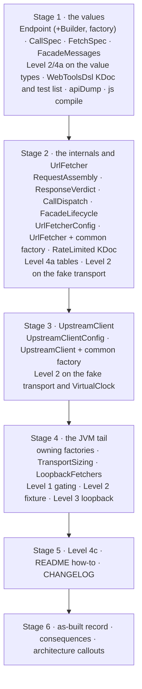
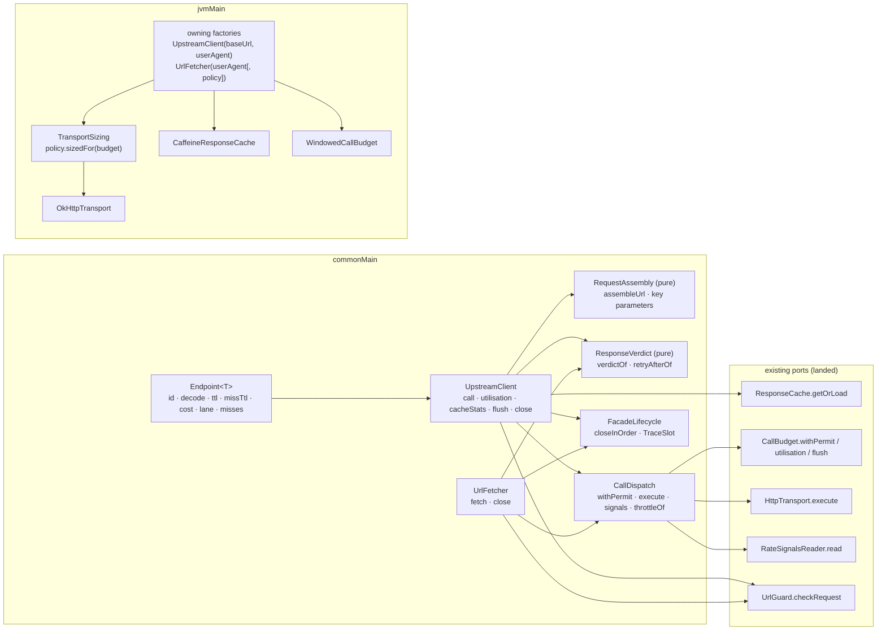

# Plan: `call-facades` — `UpstreamClient` and `UrlFetcher` composing cache, budget and transport

- **Covers:** `SpartanLaboratories/WebTools#68` — *"webtools-http: `UpstreamClient` and `UrlFetcher` composing cache, budget and transport"*.
  Sub-issue of `SpartanLaboratories/WebTools#55` (HTTP client stack). Blocked by #65 (`okhttp-transport`), #66 (`response-cache`) and #67 (`call-budget`), all landed. It blocks #69 (`feeds`), which builds
  `FeedFetcher` on `UrlFetcher`, and #70 (`http-docs`).
- **Architecture:** [`../architecture.md`](../architecture.md), unit `call-facades` (§11 unit 9 and its scope; §6.6 *Call facades*; §7.2 *The call path*; §7.4 *Time, dispatchers and ownership*;
  §9 *Extension & stability*; §12 *Risks*; §13 *Known gaps*). Its dated "Corrected … as built" callouts are the as-built truth for units 1 to 8. Systems-level consequences:
  [`../consequences.md`](../consequences.md) §7 (row 9) and §8 (every "Unit 9 (#68)" paragraph).
- **Research:** [`research/README.md`](research/README.md) (questions, verification and the summary, which states the design for the three open points) with
  [`research/endpoint-factory-resolution.md`](research/endpoint-factory-resolution.md), [`research/rate-limited-retry-after.md`](research/rate-limited-retry-after.md) and
  [`research/default-wait-cap.md`](research/default-wait-cap.md); the stack-level [`../research/api-shape-and-failures.md`](../research/api-shape-and-failures.md) and
  [`../research/http-transport.md`](../research/http-transport.md) (F7, F9). Where a findings file and the README's Summary differ, this plan follows the Summary; §6.11 lists every refinement of the
  architecture.
- **Landed contracts this unit consumes:** [`../65-okhttp-transport/consequences.md`](../65-okhttp-transport/consequences.md) §4 and [`plan.md`](../65-okhttp-transport/plan.md) §12 (including the table of what each
  transport failure implies about what was sent); [`../66-response-cache/consequences.md`](../66-response-cache/consequences.md) §4 and [`plan.md`](../66-response-cache/plan.md) §12;
  [`../67-call-budget/consequences.md`](../67-call-budget/consequences.md) §4 and [`plan.md`](../67-call-budget/plan.md) §12; [`../62-http-core/plan.md`](../62-http-core/plan.md) §12 ("Unit 9");
  [`../63-test-support/plan.md`](../63-test-support/plan.md) §12; [`../64-url-policy/plan.md`](../64-url-policy/plan.md) §12 and
  [`../64-url-policy/research/bypass-vectors.md`](../64-url-policy/research/bypass-vectors.md) (vector T09).
- **Branch:** `feat/issue-68-call-facades` (exists; cut from `master` at `5f221ce`; holds the research commits `98f7eb7` and `3d9d9ff`). The implementer confirms it and never re-cuts it.
- **Commit:** TBD. This `plan.md` is committed **in the same commit as the first stage of the implementation** (commit 1 of §11), so `git log --follow` binds the two.
- **PR:** TBD (the PR closes #68).
- **What this plans:**
  - in `webtools-http`'s `commonMain` (package `com.spartanlabs.webtools.http`): `Endpoint` with its builder and factory; `CallSpec` and `FetchSpec`; `UpstreamClient` with `UpstreamClientConfig` and the common
    factory; `UrlFetcher` with `UrlFetcherConfig` and the common factory; and, `internal`, the request assembly, the permit-and-signal dispatch, the response verdicts, the closing helper and the
    constant texts they share;
  - in `jvmMain`: the owning factories `UpstreamClient(baseUrl, userAgent) { }`, `UrlFetcher(userAgent) { }` and `UrlFetcher(userAgent, policy) { }`, and the `internal` transport sizing from the budget's burst;
  - in the published fixtures: `LoopbackFetchers`;
  - the reworded KDoc of `UpstreamFailure.RateLimited`, the KDoc list of `WebToolsDsl` and the builder list of `WebToolsDslComponentTest`, the regenerated ABI dump, the `README.md` how-to and
    the `CHANGELOG.md` entries;
  - the tests of all of it (Level 1 gating to Level 4c non-functional, and a Level 5 manual pass).
- **Status:** planning only.
- **Version moved:** none. `webtools-http` `1.0.0` stays unreleased and this landing is **not a release candidate**. No other module moves a version, no build file changes and no dependency is added.
- **Baseline:** `master` at `5f221ce` (the merge of #67; the module's code is that of `327164f`, whose `:webtools-http:check` passed with `jvmTest` at 1,215 tests in 227 classes —
  [`../67-call-budget/final-implementation.md`](../67-call-budget/final-implementation.md) §4). Line references are to `5f221ce`.

The code blocks in this plan are the intended implementation. They were written against the as-built sources of `webtools-http` and the research's findings; they have not been compiled. The implementer
fixes a compile error mechanically and records any change to a rule (as opposed to a spelling) in `final-implementation.md` at the moment it is made.

---

## 1. Requirements

Each requirement is testable; §9 names the test that locks it down.

### R1. The public surface and its tier

`webtools-http` gains these public declarations in `com.spartanlabs.webtools.http`, every one **final, Stable Core and usable without any opt-in**. No new type is gated by
`ExperimentalForInheritanceWebToolsApi` and no new seam is added: the facades *call* the existing ports and never expose one to implement.

- `Endpoint<T : Any>` with the nested `Endpoint.Builder`, and the top-level factory `Endpoint(id, decode, configure)` (R2).
- `CallSpec` and `FetchSpec` (R3).
- `UpstreamClientConfig` (with its `Companion.DEFAULT_MAX_WAIT`), `UpstreamClient`, and the common factory `UpstreamClient(transport, baseUrl, configure)`; the JVM owning factory
  `UpstreamClient(baseUrl, userAgent, configure)` (R4, R5).
- `UrlFetcherConfig` (with its `Companion.DEFAULT_MAX_WAIT`), `UrlFetcher`, the common factory `UrlFetcher(transport, policy, configure)`; the JVM owning factories `UrlFetcher(userAgent, configure)` and
  `UrlFetcher(userAgent, policy, configure)` (R6).
- In the fixtures (`com.spartanlabs.webtools.http.testing`, Stable Core with source compatibility only): `LoopbackFetchers` (R19).

Every builder or spec passed to a consumer's lambda carries `@WebToolsDsl`: `Endpoint.Builder`, `CallSpec`, `FetchSpec`, `UpstreamClientConfig`, `UrlFetcherConfig`. The five join the marker's KDoc list and
`WebToolsDslComponentTest`'s list. No `data class` is public. The only defaulted parameter on public API is the trailing `configure = {}` of a factory or of `UpstreamClient.call` / `UrlFetcher.fetch`.

`commonMain` uses no JVM API, no `kotlin.concurrent.atomics`, no atomicfu and no experimental API; it is compiled for `js` by `:webtools-http-commoncheck`. The only library types in a public signature are
`kotlin.Result`, `kotlin.time.Duration`, `kotlin.time.TimeSource`, `kotlinx.coroutines.CoroutineDispatcher`, `kotlin.AutoCloseable` and the module's own types.

### R2. `Endpoint`

1. `Endpoint<T : Any>` is a final class with an `internal` constructor `(id, decode, name, ttl, missTtl, cost, lane, misses)` and public read-only properties `id`, `name`, `ttl`, `missTtl`, `cost`,
   `lane` and `misses: Set<Int>`. The decoder is an `internal val decode: (HttpResponse) -> Result<T>`. Equality is identity. `toString()` prints the id, name, ttl, missTtl, cost, the lane's name and the
   misses, never the decoder.
2. It is built only by `fun <T : Any> Endpoint(id: String, decode: (HttpResponse) -> Result<T>, configure: Endpoint.Builder.() -> Unit = {}): Endpoint<T>`. Every consumer form compiles and binds the
   factory: `Endpoint("id", decode)`, `Endpoint("id", ::decodeHero) { ttl = 10.minutes }`, an untyped lambda, `Endpoint<Hero>("id", decode)`, an expected type. `T` is inferred from the decoder; a decoder of
   `Result<Hero?>` is refused by the bound. `T` is invariant in 1.0.0.
3. `Endpoint.Builder` is non-generic: `name` (default the id), `ttl` (default `Duration.ZERO`), `missTtl` (default: the smaller of `ttl` and `CachePolicy.DEFAULT_MISS_TTL`, **read live**: a read inside the
   lambda gives the effective value, and a value set wins), `cost` (default 1), `lane` (default `Lane.Interactive`), `fun misses(vararg statuses: Int)` (none by default; repeated calls accumulate).
4. Building validates, with `IllegalArgumentException` and a constant message that names the property and never a value: `id` not blank; `name` not blank; `ttl` and `missTtl` not negative
   (`Duration.INFINITE` allowed); `cost` at least 1; every miss status in 100..599 and not `429`.

### R3. `CallSpec` and `FetchSpec`

1. `CallSpec` is the receiver of `UpstreamClient.call`'s lambda, **seeded** so that reading a property inside the lambda gives the effective value: `var method = HttpMethod.Get`, `var body: RequestBody? = null`,
   `var lane` = the endpoint's lane, `var maxWait` = the client's `defaultMaxWait`, `var maxAge = Duration.INFINITE`. `path(vararg segments)` appends raw segments, `query(name, value)` appends one raw pair
   (repeated names allowed, order kept), `headers { }` edits the request's headers through an `HttpHeaders.Builder` seeded with the client's default headers (several blocks edit the same builder).
   There is no `cost`: it is the endpoint's.
2. `FetchSpec` is the receiver of `UrlFetcher.fetch`'s lambda: `var cost = 1`, `var lane = Lane.Interactive`, `var maxWait` = the fetcher's `defaultMaxWait`.
3. A spec is validated at call time, **never by throwing out of the facade** (R8, R13).

### R4. `UpstreamClientConfig`

`var policy` (default `OutboundUrlPolicy.trusted { pinnedHosts = setOf(baseUrl.host) }`), `var timeSource = TimeSource.Monotonic`, `var wallClock = WallClock.System`,
`var dispatcher: CoroutineDispatcher = Dispatchers.Default`, `var rateSignals = RateSignalsReader.Standard`, `var defaultMaxWait = DEFAULT_MAX_WAIT` (5 seconds,
`UpstreamClientConfig.DEFAULT_MAX_WAIT`), `var headers = HttpHeaders()`; `fun cache(cache: ResponseCache)` (caller-owned); `fun budget(budget: CallBudget)` (caller-owned);
`fun budget(windows: List<RateWindow>, configure: WindowedCallBudget.Builder.() -> Unit = {})` (built and owned by the client, seeded with the client's final `timeSource` and `wallClock`, then the
consumer's block, so an explicit assignment wins). The last of the `budget(...)` calls wins; a budget from `windows` is built when the factory runs, after the whole configuration lambda.

### R5. `UpstreamClient`

1. `public class UpstreamClient internal constructor(...) : AutoCloseable` with `val baseUrl: Url`, `suspend fun <T : Any> call(endpoint, configure = {}): Result<Lookup<T>>`,
   `suspend fun utilisation(): BudgetUtilisation`, `fun cacheStats(): CacheStats`, `suspend fun flush(): Result<Unit>`, `override fun close()` and `toString()`.
2. The common factory `UpstreamClient(transport: HttpTransport, baseUrl: Url, configure: UpstreamClientConfig.() -> Unit = {})` never closes the transport; without `cache(...)` it uses
   `ResponseCache.Disabled`, without a budget `CallBudget.Unlimited`; a `budget(windows)` is built and owned.
3. The JVM owning factory `UpstreamClient(baseUrl: Url, userAgent: String, configure: UpstreamClientConfig.() -> Unit = {})` builds and owns an `OkHttpTransport(userAgent, policy′)`, a
   `CaffeineResponseCache { timeSource = …; loadDispatcher = … }` unless `cache(...)` was called, and the `WindowedCallBudget` of `budget(windows)` when called (R16).

### R6. `UrlFetcherConfig` and `UrlFetcher`

1. `UrlFetcherConfig`: `var budget: CallBudget = CallBudget.Unlimited` (caller-owned; the fetcher owns no budget), `var rateSignals`, `var wallClock`, `var timeSource`, `var defaultMaxWait =
   DEFAULT_MAX_WAIT` (`UrlFetcherConfig.DEFAULT_MAX_WAIT`, equal to the client's 5 seconds).
2. `public class UrlFetcher internal constructor(...) : AutoCloseable` with `suspend fun fetch(request: HttpRequest, configure: FetchSpec.() -> Unit = {}): Result<HttpResponse>`, `override fun close()` and
   `toString()`.
3. Common factory `UrlFetcher(transport, policy, configure)` (the transport is the caller's; `policy` is the pre-check's). JVM owning factories `UrlFetcher(userAgent, configure)` (= the next with
   `OutboundUrlPolicy.untrusted()`) and `UrlFetcher(userAgent, policy, configure)`, which build and own `OkHttpTransport(userAgent, policy)` with the policy's settings as they are and pre-check with the
   same policy.

### R7. Construction checks

Both client factories refuse, with `IllegalArgumentException` and a constant message that never echoes a URL, a header value or a value: a negative `defaultMaxWait`; a `baseUrl` with a query (a bare `?`
included); a `baseUrl` that `UrlGuard(policy).checkHop(baseUrl, null)` refuses (the message names the `RefusalReason`); a default header named by `TransportControlledHeaders`; under an `Untrusted` policy a
default header that is sensitive; and what a budget built from `budget(windows)` refuses. Both fetcher factories refuse a negative `defaultMaxWait`. A refused construction leaves nothing built and
nothing open (R16).

### R8. The call pipeline of `UpstreamClient.call`

In this order, and **nothing is spent (no permit, no transport call, no cache entry) before step 8**:

1. a closed client returns `Result.failure(HttpFailure.Closed("client"))`;
2. the spec is seeded and `configure` applied inside `catchNonFatal`; a non-fatal exception thrown there returns `TransportFailure.InvalidRequest(<constant rule>, cause)`;
3. a negative `maxWait` or `maxAge` returns `InvalidRequest`;
4. the URL is assembled as text and parsed again (R9); every failure returns `InvalidRequest` with a constant rule;
5. the headers are the seeded and edited builder; a name in `TransportControlledHeaders` returns `InvalidRequest` (`TransportControlledHeaders.ruleFor`);
6. `HttpRequest(method, url) { … }` is built inside `catchNonFatal`; an exception (a body on `GET`, `CONNECT`, …) returns `InvalidRequest`;
7. `UrlGuard(policy).checkRequest(request)` refuses → `TransportFailure.RefusedByPolicy(reason)`, logged once at `WARN`, with no permit, no call and nothing cached;
8. a `GET` goes to `cache.getOrLoad(key, CachePolicy(endpoint.ttl) { missTtl = endpoint.missTtl }, maxAge) { loader }`; any other method runs the loader directly on the caller's coroutine.

### R9. Request assembly

The URL is `base text` + `/` + the encoded segments joined by `/` + `?` + the encoded pairs joined by `&`, then `Url.parse`; never `HttpUrl.Builder`. The base text is `baseUrl.toString()` (it has no
query), with one trailing `/` dropped when segments follow. Each segment goes through `encodePathSegment` (`.`, `..` and an unpaired surrogate fail) and an empty segment is refused; each query name and value
through `encodeQueryComponent`. An absolute URL or a `//host` passed as a segment is encoded into one segment on the base host (vector T09).

### R10. The cache key

`CacheKey<T>(endpoint.id, listOf("/" to url.encodedPath) + encodedQueryPairs)`: the full request path (base path included) under the reserved name `/` (an encoded query name never contains `/`), then the
encoded query pairs in call order (`CacheKey` sorts by name, stably). Never a header, the body, the lane, `maxAge`, the method or a credential.

### R11. The loader and the permit rules

`budget.withPermit(endpoint.cost, lane, maxWait) { permit -> … }`; `BudgetExhausted` and `Closed("budget")` come back as values and nothing is sent. Inside, `transport.execute(request)`:
- **`InvalidRequest`** → `permit.release()` (the only failure that proves nothing was sent);
- **every other failure** (`RefusedByPolicy`, `Closed`, `DnsFailed`, `ConnectFailed`, `Timeout`, `Io`, `TlsFailed`, `Protocol`, `BodyTooLarge`, `TooManyRedirects`, `RetryRefused`, any other `HttpFailure`) leaves
  the permit spent with no signals (`withPermit`'s `finally`);
- **a response** → `signals = rateSignals.read(response, wallClock.nowEpochMillis())` inside `catchNonFatal` (a reader that throws → `RateSignals.None` and one `WARN` with the exception's class name), then
  `permit.complete(signals)`, then classification;
- a cancellation or an `Error` leaves the permit spent (`withPermit`'s `finally`) and propagates.

### R12. Classification in `UpstreamClient`, in this order

1. a throttle (`signals.throttled` or status `429`) → `UpstreamFailure.RateLimited(status, retryAfter)` (R14), logged once at `WARN`, no retry;
2. a status in `endpoint.misses` → `Lookup.Missing` (stored for `missTtl`);
3. a `2xx` → `endpoint.decode(response)` inside `catchNonFatal`, flattened: success → `Lookup.Found(value)` (weight 1); a returned or thrown `HttpFailure` passes through unchanged; any other returned or thrown
   non-fatal exception → `HttpFailure.DecodeFailure(cause)`; an `Error` propagates;
4. anything else (a `1xx`, a `3xx` the transport returned, a `4xx` or `5xx` not throttled) → `UpstreamFailure.UpstreamError(status, headers, body)`.

Failures are never stored (the cache's rule); `Missing` is stored for `missTtl`; `Found` for `ttl`.

### R13. `UrlFetcher.fetch`, in order

Closed → `Closed("fetcher")`; `FetchSpec` applied inside `catchNonFatal` → `InvalidRequest`; `cost` below 1 or a negative `maxWait` → `InvalidRequest`; a controlled header in `request.headers` →
`InvalidRequest`; the pre-check `guard.checkRequest(request)` → `RefusedByPolicy` (logged once at `WARN`; no permit, no call); the loader of R11; a throttle → `RateLimited` exactly as R14;
**every other status, a `304` and a returned `3xx` included, is the response.**

### R14. `RateLimited.retryAfter`

`retryAfter = maxOf(signals.retryAfter ?: Duration.ZERO, budget.utilisation().pausedFor)`, the utilisation read **once**, after `permit.complete(signals)`, inside the loader that creates the failure (so every
coalesced waiter receives the same instance). A `utilisation()` that throws a non-fatal exception falls back to the server's value (or zero) with one `WARN`. The KDoc of `RateLimited` says so (R20).

### R15. Lifecycle

`close()` on either facade is non-suspending, idempotent, never throws and safe from any thread: a compare-and-set closed flag; then the facade closes what it built, in the order cache, budget, transport,
each inside `catchNonFatal` (a failure logged at `DEBUG` with its class name), and logs `closed` at `INFO`. A call in flight when `close()` runs ends with whichever component's `Closed` it meets; a call after
it returns the facade's own `Closed`. `utilisation()`, `cacheStats()` and `flush()` keep working after `close()`.

### R16. Owning factories and sizing

1. Construction order of `UpstreamClient(baseUrl, userAgent)`: the pure checks of R7, then the budget (when built from windows), then the transport, then the cache; if a step throws, what was already built is
   closed (cache, budget, transport order) before the exception propagates. A `userAgent` the transport refuses builds nothing that stays open.
2. When the client's budget is a `WindowedCallBudget` (built or supplied), the transport's policy is `policy.withSettings(TransportSettings(policy.settings) { maxConcurrentRequests = maxOf(maxConcurrentRequests,
   burst); maxConcurrentRequestsPerHost = maxOf(maxConcurrentRequestsPerHost, burst) })` with `burst = maxBurst`: both limits raised, never lowered, no ceiling. Otherwise the policy is passed as it is.
   `UrlFetcher`'s owning factories apply no sizing.

### R17. Logging

Loggers `com.spartanlabs.webtools.http.UpstreamClient` and `com.spartanlabs.webtools.http.UrlFetcher`: `INFO` on creation and on `close()`; one `DEBUG` line per call; `WARN` for a pre-check refusal, a throttle
and a throwing reader or `utilisation()`; `DEBUG` for an `InvalidRequest` the facade creates and a `DecodeFailure`. Never a header value, a body, a query string, a credential, a cache-key value or a decoded
value. The site that creates a failure logs it once; a failure passed through is not logged again. Exact texts: §6.8.

### R18. Error handling

No expected failure is thrown. Every failure of a call is a `Result.failure` holding an `HttpFailure`. A construction refusal is `IllegalArgumentException` (a programmer error). The only exceptions a call throws are
the caller's `CancellationException` and an `Error` (the decoder's, the budget store's, the transport's, the reader's). §6.9 lists each signature.

### R19. The fixture `LoopbackFetchers`

`LoopbackFetchers.untrusted(userAgent, policy, resolve, configure)` and `LoopbackFetchers.trusted(userAgent, policy, resolve, configure)` return a `UrlFetcher` that owns the matching
`LoopbackTransports` transport and pre-checks with the same policy and `GuardRelaxation.LoopbackForTests` (untrusted) or cleartext forced on (trusted). It adds no dependency.

### R20. Changes to landed files

`UpstreamFailure.RateLimited`'s KDoc (no code change); `WebToolsDsl.kt`'s KDoc list; `WebToolsDslComponentTest`'s list; `api/webtools-http.api` (the new classes only); `README.md`; `CHANGELOG.md` (§7, §8).

### R21. Tests and runs

Every requirement above has a test (§9). Only `webtools-http`'s own level tasks and the check module's `js` compile run; no other module's suite runs before or after.

### Acceptance

1. The issue's scope is met: the five types and their configs; the common and owning factories with the `maxBurst` sizing and the cache → budget → transport closing order; Level 2 on the fake transport
   (a refusal costs nothing: zero calls, no permit, nothing cached; a `429` with `Retry-After` pauses the budget and the next call fails fast; a decode failure is never stored; a miss status is stored; a
   non-`GET` bypasses the cache); Level 3 for a real call over loopback; the README how-to.
2. The two open points are settled as built: the `Endpoint<T>` factory-over-class resolution (R2, with `EndpointComponentTest` and the ABI dump, procedure P1) and `RateLimited.retryAfter` (R14).
3. `:webtools-http:gatingTest`, `componentTest`, `integrationTest`, `deterministicTest` and `nonfunctionalTest` pass; `:webtools-http:apiCheck` and `:webtools-http:verifyJavaFloor` pass;
   `:webtools-http-commoncheck:build` passes; `:webtools-http:check` passes once at the end (it includes the fixtures-publication check).
4. `git diff --stat master` shows only `webtools-http`, `docs/` and the two root documents.

---

## 2. Current state

Facts verified at `5f221ce`.

**Nothing composes the stack yet.** No class in the repository calls `ResponseCache.getOrLoad`, `CallBudget.acquire` or `HttpTransport.execute`; none of `Endpoint`, `CallSpec`, `FetchSpec`,
`UpstreamClient`, `UpstreamClientConfig`, `UrlFetcher`, `UrlFetcherConfig`, `LoopbackFetchers` exists in the module or its fixtures, and no earlier unit reserved the names
([`research/README.md`](research/README.md), "Codebase blast radius"). The exact-name search of `webtools-http/src` for each returns nothing.

**The parts, as built** (all in `webtools-http/src/commonMain/kotlin/com/spartanlabs/webtools/http/` unless a path is given):
- `CallBudget.acquire(cost, lane, maxWait): Result<Permit>` (`CallBudget.kt:62`) returns a refusal as `Result.failure(HttpFailure.BudgetExhausted(wait, reason, window))` and a closed budget as
  `Result.failure(HttpFailure.Closed("budget"))`; it throws `IllegalArgumentException` for a `cost` below 1 and a negative `maxWait` (`CallBudget.kt:14-17`). `utilisation()` suspends (`:69`), `flush()` has a
  succeeding default body (`:77`), `CallBudget.Unlimited` builds an empty reading with a zero pause on each call (`:89-98`).
- `withPermit(cost, lane, maxWait, block)` (`WithPermit.kt:23-30`) completes the permit as spent in a `finally` unless the block completed or released it. A permit's `complete(signals)` and `release()` are
  idempotent and `NonCancellable` (`Permit.kt:12-32`).
- `ResponseCache.getOrLoad(key, policy, maxAge, loader)` (`ResponseCache.kt:50`; the three-argument overload at `:67`) runs one load per key, returns a loader's failure as a value, rethrows an `Error` to every
  waiter, throws `IllegalArgumentException` for a negative `maxAge` (`:109`), and returns `Closed("cache")` after `close()`. `ResponseCache.Disabled` (`:102-118`) runs each loader on the caller's coroutine
  through `runLoader` (`LoaderRunner.kt:26`) and ignores `close()`.
- `CacheKey(endpointId, params)` sorts its parameters by name with a stable sort (`CacheKey.kt:30`); `CachePolicy(ttl) { missTtl = … }` (`CachePolicy.kt:55`), `DEFAULT_MISS_TTL` is 60 s (`:41`).
- `UpstreamFailure.RateLimited` has an `internal` constructor `(status, retryAfter)` and a KDoc that says "how long the server asked the caller to wait" (`UpstreamFailure.kt:28-42`); `UpstreamError(status,
  headers, body)` is public (`:60`). `HttpFailure.Closed(component)` (`HttpFailure.kt:43`), `BudgetExhausted` (`:63`), `DecodeFailure(cause)` (`:86`). Every `TransportFailure` leaf has a public
  constructor with and without a cause (`TransportFailure.kt:38-241`); `InvalidRequest(rule, cause)` requires a non-blank rule (`:128-143`).
- `encodePathSegment` and `encodeQueryComponent` (`UrlEncoding.kt:94`, `:101`) are `internal` and return `Result<String>`; `.`/`..` fail with `UrlProblem.DotSegment` and an unpaired surrogate with
  `UrlProblem.NotUnicode` (both as `UrlParseException`, `UrlProblem.kt`). `Url.parse(text): Result<Url>` (`Url.kt:66`); `Url.host` is canonical; `Url.toString()` is the full canonical URL,
  `redacted()` hides the query (`Url.kt:48-51`).
- `UrlGuard(policy, relaxation = GuardRelaxation.None)` is `internal` (`UrlGuard.kt:61`): `checkHop(url, previous)` (`:71`), `checkRequest(request)` (`:82`, the hop check and, for `Untrusted`, the refusal of any
  `isSensitive` header as `SensitiveHeader`), returning a `GuardRefusal(reason, rangeClass)`. `GuardRelaxation.LoopbackForTests` is `internal` and reachable from the fixtures through the association.
- `OutboundUrlPolicy.withSettings(settings)` is `internal` (`OutboundUrlPolicy.kt:274`); `TransportSettings(from) { … }` is public (`TransportSettings.kt:162`), its builder seeded from `from`, and its
  validation requires `maxConcurrentRequestsPerHost in 1..maxConcurrentRequests` (`:109-124`). The `Trusted` defaults are 16 and 5, the `Untrusted` defaults 8 and 2 (`:131-136`).
- `TransportControlledHeaders.ruleFor(headers): String?` (`TransportControlledHeaders.kt:23`), `internal`, in `commonMain`.
- `HttpRequest(method, url) { headers = …; body = … }` (`HttpRequest.kt:68`) throws `IllegalArgumentException` for `CONNECT`, a header value that is not sendable, a body on `GET`/`HEAD`/`TRACE`, and a body
  content type beside a `Content-Type` header (`:25-35`). `HttpHeaders.Builder` has an `internal` constructor, `addAll(headers)` (`HttpHeaders.kt:157`) and `internal fun build()` (`:161`); its adding calls
  throw `IllegalArgumentException` for a bad name or value (`:170-177`). `HttpResponse.body()` copies on each call (`HttpResponse.kt:40`).
- `WindowedCallBudget.maxBurst` is the smallest window's enforced limit (`WindowedCallBudget.kt:136`, `BudgetLedger.kt:31`); the factory is `WindowedCallBudget(windows) { … }` (`:616`) and its builder has
  `timeSource` and `wallClock` (`:575-578`); `flush()` is the exact final write (`:422`), `close()` completes a latch (`:439`) and logs `closed` at `INFO` (`:442`).
- `catchNonFatal` (`NonFatal.kt:15`) rethrows `CancellationException` and does not catch `Error`; `flatMap` (`ResultExtensions.kt:20`); `logger(name)` and `Log` (`Log.kt`).
- `RateSignalsReader.Standard.read(response, nowEpochMillis)` (`RateSignalsReader.kt:22`, `:33-53`): a `429` is throttled; a `503` only with a parseable `Retry-After`; no readings.
- `BudgetLedger.pauseHint` (`BudgetLedger.kt:125-144`): a throttled signal offers `Retry-After`, every exhausted reading's `resetIn` and, only when neither is present, the next boundary of the full windows (else
  the shortest) plus the guard, each capped by `maxPause`; a zero hint starts no pause. `extendPause` (`:147-154`) never shortens a pause.

**The JVM parts.** `OkHttpTransport(userAgent, policy)` (`jvmMain/…/OkHttpTransport.kt:232`) validates `userAgent` and `maxResponseBytes` in its `init` before it builds the client (`:96-100`) and reads
`policy.settings` once. Its failures follow the table of [`../65-okhttp-transport/plan.md`](../65-okhttp-transport/plan.md) §12 (reproduced in §6.5). `CaffeineResponseCache(configure)`
(`jvmMain/…/CaffeineResponseCache.kt:316`) has `timeSource`, `maxWeight`, `loadDispatcher`, `maintenanceExecutor` (`:294-305`). Each of the three components logs `created` and `closed` at `INFO` on its own
logger (`OkHttpTransport.kt:111`, `:137`; `CaffeineResponseCache.kt:112`, `:268`; `WindowedCallBudget.kt:139`, `:442`).

**The fixtures.** `LoopbackTransports.untrusted` (`jvmTestFixtures/…/LoopbackTransports.kt:32`) and `trusted` (`:49`) build the real transport with `UrlGuard(policy, GuardRelaxation.LoopbackForTests)` /
cleartext forced on, through the `internal` constructor `OkHttpTransport(userAgent, guard, baseDns, donor)`. `FakeHttpTransport` records `calls`, mirrors a `maxResponseBytes` cap and `Closed("transport")`;
`Step.respond(status, headers, body, delay)` and `Step.fail(failure)`; `VirtualClock` carries `timeSource`, `wallClock`, `dispatcher` and `maintenanceExecutor`. The module's own test support has
`PermitRecordingBudget` (records `complete()`, `complete(signals)`, `release()` per permit; after a block that released: `["release()", "complete()"]`, `WithPermitComponentTest.kt:171`), `captureTransportLogs`,
`LoopbackFleet`, `budgetOn`, `cacheOn`.

**The API surface.** `api/webtools-http.api` records a configurable pair as the class (without `<init>` when the constructor is `internal`) plus a `…Kt` facade class holding the factory and its `$default`
(`CachePolicy` at `:114-135`). It records erased descriptors only; it does not pin a type parameter's bound or variance.

**The README and CHANGELOG.** The `webtools-http` row of the artifacts table (`README.md:11`) names the transport, cache, budget and policies and ends with `**not yet released**`; the test-fixtures paragraph
lists the fixtures. There is no `### webtools-http` Components table yet (#70 writes the final pass). `CHANGELOG.md` has `## [Unreleased]` with `### Added` and `### Changed`.

**Recent related work.** `git log` on the area: #65, #66 and #67 each landed their unit's code, docs and dashboards in separate commits on their own branches; their plans carry the same section order as this one.

---

## 3. Assumptions

Each says what would change if it turned out false.

1. **A `RateSignals`/`utilisation()` read after `complete(signals)` reflects the signals.** `WindowedCallBudget.complete` applies the pause under its lock before it returns
   ([`../67-call-budget/consequences.md`](../67-call-budget/consequences.md) §4: after `complete(signals)`, `pausedFor` is at least `min(retryAfter, maxPause)` less the time elapsed). If a consumer's own
   budget applies signals later, `retryAfter` degrades to the server's value (the formula's `maxOf` already makes that safe); nothing else changes.
2. **`OkHttpTransport`'s dispatcher limits are the only place a granted permit can queue.** Sizing raises `maxConcurrentRequests` and `maxConcurrentRequestsPerHost`
   ([`../research/http-transport.md`](../research/http-transport.md) F7, F9, both re-checked in [`research/README.md`](research/README.md)). If a later OkHttp queues elsewhere, the Level 3 sizing test
   (`UpstreamClientBurstSizingIntegrationTest`) fails first and the sizing is revisited; no other test depends on it.
3. **`TimeSource.markNow()` and `elapsedNow()` are enough for the per-call figures.** The facades call nothing else on a mark. If a consumer's `TimeSource` is not monotonic the logged figures
   can be off; no behaviour depends on them.
4. **A `Channel(Channel.CONFLATED)` hand-off carries the loader's trace to the call.** The loader runs on the cache's dispatcher; the trace only feeds the `DEBUG` line (`loaded`, `waited`, `status`, `bytes`).
   If the hand-off is ever lost the line prints `-` for those fields; no behaviour changes.
5. **`Job().complete()` is an adequate compare-and-set for the closed flag in `commonMain`.** `WindowedCallBudget` already uses it (`WindowedCallBudget.kt:128`, `:442`); it returns `true` for exactly one caller.
   If it were not, `close()` would run twice and the second run would be harmless (every component's `close()` is idempotent) but log `closed` twice; `UpstreamClientLifecycleComponentTest` pins the single line.
6. **A constructed-but-failed owning factory can be told apart from an `Error`.** The factory cleans up on a non-fatal exception only (`catchNonFatal`); an `Error` while building (out of memory) is not
   cleaned up. Acceptable: nothing recovers from it.
7. **`mockwebserver3` 5.5.0 serves each connection on its own thread**, so a `Dispatcher` that holds each request until N have arrived can observe N in flight (the sizing test). If it serialised requests, the
   control test (`an unsized transport …`) would pass trivially and the sizing test would fail for the wrong reason; procedure P3 (the sizing mutation) exposes that.
8. **The `README.md` row text fits the table's existing style.** The row is already long; the edit inserts one clause. If #70's final pass restructures it, this clause moves with it.
9. **The two measurements of the research hold in this module:** that `Endpoint`'s factory binds from another module (research F1, measured on Kotlin 2.2.0 with a separate consumer module) and that the
   module's own test compilation sees the `internal` constructor (F3). The Level 2 test and procedure P1 re-measure both in this module; if either fails, the constructor's parameter list is changed (it must
   not be callable the way a consumer calls the factory) before anything else is built on it.

---

## 4. Non-goals

- **A cache-configuration hook on the owning factory.** `maxWeight` and the rest come by passing a `CaffeineResponseCache` to `cache(...)` (caller-owned); `cache(ResponseCache.Disabled)` turns caching off.
- **A weigher on `Endpoint`.** Every `Found` weighs 1, so the owned cache's bound is an entry count.
- **`invalidate` on the client.** The cache port has it; the client does not expose the cache.
- **A per-call deadline.** A caller wraps `call` in `withTimeoutOrNull`, which cancels only the waiter.
- **A `missWhen` predicate.** Misses are declared by status only; a "200 with an empty object" miss is not expressible (additive later).
- **A budget owned by `UrlFetcher`**, and **sizing `UrlFetcher`'s transport**: an `Untrusted` policy's concurrency caps are part of what makes it untrusted.
- **Covariance `Endpoint<out T>`.** Declaring `out` later is source- and binary-compatible; removing it would not be, so 1.0.0 stays invariant.
- **Any retry.** A throttle, a transport failure and a `5xx` are each returned once; the caller backs off by `RateLimited.retryAfter` or its own schedule.
- **A conditional-GET layer.** `FeedFetcher` (#69) adds validators on top of `UrlFetcher`; the facades add none.
- **A `HEAD`-aware cache.** Only `GET` is cached.
- **The evergreen `docs/webtools-http-architecture.md`, the `### webtools-http` Components table of the README and the final README pass** (#70).
- **Any change to the transport, the cache, the budget or the policies.**

---

## 5. Approach and staging

The facades are plain common code with one JVM-specific tail: the owning factories, which choose OkHttp and Caffeine, and the transport sizing. Everything that can be pure is pure and sits in `commonMain`
(request assembly, response verdicts, the `retryAfter` rule), so Level 4a tables it on the JVM-free `commonTest`; the effects (permit rules, the cache call, the lifecycle) are a thin shell around those
functions. The unit lands in stages, each leaving the build green (§11).



Stages 1 to 3 compile for `js` through the check module (`commonMain` is shared), so the common types cannot touch a JVM API. Stage 4 changes `jvmTestFixtures`, so it re-runs the fixtures-publication
check in `check`.

**Procedures** (not committed tests; §9.3 gives the commands): **P1** the `Endpoint` ABI and resolution measurement (stage 1); **P2** the `js` compile and dump after each code stage; **P3** the sizing mutation
(stage 4); **P4** the Level 5 manual pass (stage 5).

---

## 6. Design

### 6.1 Mechanism per type, tier and openness (architecture §6.9 and §9, for this unit's types)

Every type here is a **configurable value or a facade**, so each is a final class built by a factory over an `internal` constructor, as every configurable type in the module. None is an extension point: a
consumer *uses* the facades and *supplies* the ports they call.

| Type | Mechanism | Parameterised policy | Tier |
|---|---|---|---|
| `Endpoint<T : Any>`, `Endpoint.Builder` | final class + `internal` constructor + top-level generic factory `Endpoint(id, decode, configure)`; non-generic nested builder | `name`, `ttl`, `missTtl`, `cost`, `lane`, `misses` | Stable Core |
| `CallSpec`, `FetchSpec` | final `@WebToolsDsl` classes with an `internal` constructor, handed to the call's lambda | method, body, lane, `maxWait`, `maxAge`, path, query, headers; cost, lane, `maxWait` | Stable Core |
| `UpstreamClientConfig`, `UrlFetcherConfig` | final `@WebToolsDsl` classes with an `internal` constructor, handed to the factory's lambda | policy, clocks, dispatcher, reader, `defaultMaxWait`, default headers, cache and budget | Stable Core |
| `UpstreamClient`, `UrlFetcher` | final classes + `internal` constructor + factories (common and JVM owning) | everything above | Stable Core |
| `LoopbackFetchers` | final `object` in the fixtures | the policy, the resolver, the fetcher's configuration | Stable Core, source compatibility only |

No new gated seam: `ExperimentalForInheritanceWebToolsApi` gates implementing a port, and nothing here is a port. A consumer who wants a different budget, cache, transport or signal reader passes one in
through the existing, already-gated ports (`cache(…)`, `budget(…)`, the `transport` parameter, `rateSignals`). The worked example of "pass your own" for the budget and the cache is the factory itself:
`cache(CaffeineResponseCache { maxWeight = 5_000 })`.

### 6.2 Shape and the seams it uses



The facades are a **composition**: they decide the order (guard, then cache, then budget inside the cache's loader, then transport), translate between the ports' vocabularies, and own what they built. Nothing
here re-implements a port's rule: the cache coalesces and stores, the budget plans and pauses, the transport sends and caps, the policy refuses. The facade adds exactly four things: the request assembly, the
permit rules, the classification, and the closing order.

### 6.3 Request assembly and the cache key

`assembleUrl(base, segments, query)` is pure (`RequestAssembly.kt`), returns `Result<AssembledUrl>` and never throws:

1. every segment: empty → `InvalidRequest(RULE_EMPTY_SEGMENT)`; `encodePathSegment` failure → `RULE_DOT_SEGMENT` when the problem is `DotSegment`, else `RULE_SEGMENT_UNICODE`;
2. every query name and value through `encodeQueryComponent`; a failure → `RULE_QUERY_UNICODE`;
3. text: `baseText = base.toString()`; with segments, `baseText.removeSuffix("/") + "/" + encodedSegments.joinToString("/")`, else `baseText`; with pairs, `+ "?" + pairs.joinToString("&") { "$n=$v" }`;
4. `Url.parse(text)`; a failure (not expected: the parts are canonical) → `InvalidRequest(RULE_URL, cause)`.

The cache-key parameters are `listOf("/" to url.encodedPath) + encodedPairs`, taken from the **parsed** URL's canonical path and the encoded pairs as built. `"/"` cannot collide with a pair name because an
encoded name never contains `/` (`encodeQueryComponent` encodes it). The full path includes the base path, so two clients on different base paths never share a key even through a shared cache; the endpoint id
separates endpoints on one base.

Why text, not `HttpUrl.Builder`: one parser and one canonical form decide the result (`../62-http-core/plan.md` §6.5); the module's `Url` is the type the policy judges, so the URL the facade pre-checks is
exactly the URL the transport receives. Why an empty segment is refused: text assembly would produce `x//y` where `HttpUrl.Builder` produces `x/y`; refusing it keeps one meaning.

**Vector T09** (an absolute URL in a path argument): `path("https://evil.test/x")` encodes to `https:%2F%2Fevil.test%2Fx`, one segment on the base host; `path("//evil.test")` to `%2F%2Fevil.test`. The
pinned policy would also refuse a request to another host, but the assembly never produces one.

### 6.4 The call pipeline of `UpstreamClient.call`

```mermaid
sequenceDiagram
    participant C as caller
    participant UC as UpstreamClient
    participant G as UrlGuard
    participant RC as ResponseCache
    participant D as CallDispatch (loader)
    participant CB as CallBudget
    participant T as HttpTransport
    C->>UC: call(endpoint) { path · query · headers · lane · maxWait · maxAge }
    UC->>UC: closed? · spec · limits · URL · headers · HttpRequest (InvalidRequest, nothing spent)
    UC->>G: checkRequest(request)
    alt refused
        G-->>UC: RefusedByPolicy (WARN once) — no permit, no call, nothing cached
    else allowed, GET
        UC->>RC: getOrLoad(CacheKey, CachePolicy(ttl, missTtl), maxAge) { loader }
        alt live entry or a load in flight
            RC-->>UC: Found / Missing / the shared failure (no permit, no call)
        else this call starts the load
            RC->>D: loader
            D->>CB: withPermit(cost, lane, maxWait)
            CB-->>D: BudgetExhausted / Closed("budget") as values — nothing sent
            D->>T: execute(request)
            T-->>D: response → read signals → permit.complete(signals)
            T-->>D: InvalidRequest → permit.release() · any other failure → permit spent
            D->>D: classify: throttle · miss · decode · UpstreamError
            D-->>RC: Result<Lookup<T>> (failure never stored; Missing for missTtl)
        end
        RC-->>UC: Result<Lookup<T>>
    else allowed, not GET
        UC->>D: loader directly, on the caller's coroutine
    end
    UC-->>C: Result<Lookup<T>>
```

The guard runs **before** the cache: a refusal must cost nothing and cache nothing, and it depends on the request (the headers), which the key does not see. A coalesced caller therefore passes its own
pre-check, then joins a load whose request is the first caller's.

**What a shared load carries.** The cache's first caller's loader runs, so the shared result carries that caller's request (its per-call headers), lane, `maxWait` and the endpoint's cost. This is the cache's
contract (`ResponseCache` point 1) and architecture §12; the facade states it in `call`'s KDoc: per-call headers must not change the answer for a cached endpoint (use a query parameter or another
endpoint), and a caller with a tighter deadline wraps its own `call` in `withTimeoutOrNull`.

### 6.5 The loader and the permit rules

`CallDispatch.send(request, cost, lane, maxWait): Result<Sent>` is the one place that touches a permit, shared by both facades:

```kotlin
budget.withPermit(cost, lane, maxWait) { permit ->
    val waited = requested.elapsedNow()
    executeCatching(request).fold(
        onSuccess = { response ->
            val signals = readSignals(response)
            permit.complete(signals)
            Result.success(Sent(response, signals, waited))
        },
        onFailure = { failure ->
            if (failure is TransportFailure.InvalidRequest) permit.release()
            Result.failure(failure)
        },
    )
}
```

**Which failures settle the permit how.** The transport's own table says, failure by failure, whether a request was written
([`../65-okhttp-transport/plan.md`](../65-okhttp-transport/plan.md) §12):

| Failure | Was a request written to a server? | Permit |
|---|---|---|
| `InvalidRequest` | never (a controlled header or an unbuildable hop 1) | **released** |
| `Closed` | before sending, when closed at entry or before a hop; **possibly** for a call in flight when `close()` ran | spent |
| `RefusedByPolicy` | not for the request check at entry, nor a resolver or socket refusal at hop 1; **yes, an earlier hop was sent**, for a refused redirect target or a later hop's refusal | spent |
| `DnsFailed`, `ConnectFailed` | no byte of that hop's request (earlier hops, if any, were sent) | spent |
| `TlsFailed`, `Protocol`, `Io` | unknown | spent |
| `Timeout` | possibly | spent |
| `RetryRefused`, `TooManyRedirects`, `BodyTooLarge` | yes | spent |

A failure carries no hop number, so the facade cannot tell a first-hop `RefusedByPolicy` from a later one; and a window that guards a bill is **never under-counted** (providers count refused requests,
[`../research/call-budget.md`](../research/call-budget.md) F1). So only `InvalidRequest`, which is only ever returned before anything is sent, releases the permit; every other failure leaves it spent, with
no signals, through `withPermit`'s `finally`. The over-count is one permit per such failure, on the safe side. The common refusals cost nothing anyway, because the facades' own checks run before the permit.
(This refines architecture §6.6, which released `RefusedByPolicy`, `InvalidRequest` and `Closed`; its dated correction of 2026-11-02 already says only `InvalidRequest` is exact.)

`executeCatching(request)` is `catchNonFatal { transport.execute(request) }.flatMap { it }` with a thrown non-fatal exception turned into `TransportFailure.Io(cause)` (a transport that throws instead of
returning a `Result` has broken its contract; the facade still returns a value). A cancellation propagates; an `Error` propagates.

`readSignals(response)` is `catchNonFatal { rateSignals.read(response, wallClock.nowEpochMillis()) }` with a failure → `RateSignals.None` and one `WARN` (`rate signal reader failed: {}` with the exception's
class name).

`throttleOf(sent, subject)` is the only reader of `utilisation()`:

```kotlin
val pausedFor = catchNonFatal { budget.utilisation().pausedFor }.getOrElse { failure ->
    log.warn("budget utilisation failed: {}", failure::class.simpleName)
    Duration.ZERO
}
val failure = UpstreamFailure.RateLimited(sent.response.status, retryAfterOf(sent.signals, pausedFor))
log.warn("throttled: subject={}, status={}, retryAfter={}", subject, failure.status, failure.retryAfter)
```

### 6.6 Classification and `retryAfter`

`verdictOf(status, throttled, misses)` is pure and total (`ResponseVerdict.kt`):

| Order | Condition | Verdict | Result |
|---|---|---|---|
| 1 | `throttled` or `status == 429` | `Throttled` | `RateLimited(status, retryAfter)` |
| 2 | `status in misses` | `Missing` | `Lookup.Missing` |
| 3 | `status in 200..299` | `Decode` | `Found` / a failure |
| 4 | otherwise | `Rejected` | `UpstreamError(status, headers, body)` |

A miss status cannot be `429` (validated), so step 1 never hides a declared miss. A `2xx` declared a miss (a `204`) is a miss: it is checked before the decode, so the decoder never sees an empty body it was not
written for. The decoder sees **only the responses classified for decoding** and runs in the cache's load coroutine (on the caller's coroutine with `ResponseCache.Disabled` and for a non-`GET`).

`retryAfterOf(signals, pausedFor) = maxOf(signals.retryAfter ?: Duration.ZERO, pausedFor)`. Why the longer of the two: it is the only value for which "wait this long, then call" is neither refused by the
budget's pause nor sent back to a server that asked for more time ([`research/rate-limited-retry-after.md`](research/rate-limited-retry-after.md), edge-case table). The server's value alone sends a caller
into `BudgetExhausted(Paused)` when a longer pause is in force and reports zero for a `429` without `Retry-After` under a windowed budget; the pause alone drops a `Retry-After` above `maxPause` and is empty
for any budget that does not pause. Zero reads "no wait known" (no `Retry-After`, no pause), exactly as "the server said zero". The value is taken once, in the loader, so every coalesced waiter receives the
same instance and none recomputes it.

### 6.7 `UrlFetcher.fetch`

The same loader (`CallDispatch.send`), the same throttle (`throttleOf`), no cache, no decode, and the verdict `fetchVerdictOf(status, throttled)`: `Throttled` for `throttled || status == 429`, otherwise
`Delivered`. A `304`, a `404`, a `5xx` and a returned `3xx` (a redirect the transport did not follow: no usable `Location`, a non-`GET`, a `300`) are all the response; the caller decides. The pre-check is the
fetcher's own `UrlGuard`, so the fixture below can relax it for loopback exactly as `LoopbackTransports` relaxes the transport; every production path uses `GuardRelaxation.None`.

### 6.8 Logging

Loggers `com.spartanlabs.webtools.http.UpstreamClient` (constant `UPSTREAM_CLIENT_LOGGER_NAME`) and `com.spartanlabs.webtools.http.UrlFetcher` (`URL_FETCHER_LOGGER_NAME`), through `logger(name)`. Placeholders
are slf4j `{}`; `-` stands for an unknown figure.

| Level | Logger | Event | Text (placeholders) |
|---|---|---|---|
| `INFO` | client | creation | `created: baseUrl={}, policy={}, cache={}, budget={}, owned={}, defaultMaxWait={}` — base URL `redacted()`; policy `Trusted`/`Untrusted`; cache and budget the class's simple name (`Disabled`, `Unlimited`, `CaffeineResponseCache`, `WindowedCallBudget`, `custom` for an anonymous one); `owned` the list of owned parts, for example `[cache, budget, transport]` or `[]`; the wait as a `Duration` |
| `INFO` | client | close | `closed` |
| `DEBUG` | client | one per call that reached the cache step | `call: endpoint={}, method={}, loaded={}, lane={}, cost={}, waitedMs={}, status={}, bytes={}, elapsedMs={}, outcome={}` — `loaded` true when this call's loader ran to the end (the cache port cannot tell a hit from a join; only the loader running tells the facade that the call started the load); `waitedMs`, `status`, `bytes` are `-` when the loader did not run or sent nothing; `outcome` is `Found`, `Missing` or the failure's simple class name |
| `WARN` | client | pre-check refusal | `refused by policy: endpoint={}, reason={}, rangeClass={}, url={}` — reason name, range class or `-`, `Url.redacted()` |
| `WARN` | client | throttle | `throttled: subject={}, status={}, retryAfter={}` — subject the endpoint id |
| `WARN` | client | throwing reader | `rate signal reader failed: {}` — the exception's simple class name |
| `WARN` | client | throwing `utilisation()` | `budget utilisation failed: {}` — the exception's simple class name |
| `DEBUG` | client | an `InvalidRequest` the facade creates | `invalid request: endpoint={}, rule={}` |
| `DEBUG` | client | a `DecodeFailure` | `decode failed: endpoint={}, cause={}` — the cause's simple class name |
| `DEBUG` | client | a close step that threw | `close step {} failed: {}` — step name, class name |
| `INFO` | fetcher | creation | `created: policy={}, budget={}, ownsTransport={}, defaultMaxWait={}` |
| `INFO` | fetcher | close | `closed` |
| `DEBUG` | fetcher | one per fetch that reached the loader | `fetch: method={}, url={}, lane={}, cost={}, waitedMs={}, status={}, bytes={}, elapsedMs={}` — `Url.redacted()` |
| `WARN` | fetcher | pre-check refusal | `refused by policy: reason={}, rangeClass={}, url={}` |
| `WARN` | fetcher | throttle | `throttled: subject={}, status={}, retryAfter={}` — subject `Url.redacted()` |
| `WARN` | fetcher | throwing reader / `utilisation()` | the two texts above |
| `DEBUG` | fetcher | an `InvalidRequest` | `invalid request: rule={}` |
| `DEBUG` | fetcher | a close step that threw | `close step {} failed: {}` |

**Never** a header value, a body, a query string, a credential, a cache-key value or a decoded value. The cache, the budget and the transport log on their own loggers; the facade's lines are in addition and
never repeat theirs. The site that creates a failure logs it once: the facade logs the `RefusedByPolicy`, `RateLimited`, `InvalidRequest` and `DecodeFailure` it creates; a `RefusedByPolicy` the transport
creates is logged by the transport, a `BudgetExhausted` by the budget, and a failure the decoder returns is not logged again. A `Closed` is logged nowhere (the `closed` line is the event). The existing
modules' habit of logging full URLs is not followed.

### 6.9 Error handling, thread safety and resources

**Error handling per entry point** (R18). A "programmer error" is thrown; everything else is a value.

| Signature | Failure it returns | Expected failures (→ `Result`) | Programmer errors (→ throw) | Unwrapped where |
|---|---|---|---|---|
| `Endpoint(id, decode, configure)` | — | — | `IllegalArgumentException` for a blank id or name, a negative duration, a `cost` below 1, a bad miss status | the caller's construction site |
| `CallSpec` / `FetchSpec` members | — | — | `IllegalArgumentException` from `headers { }` for a bad header name or value (inside the call's lambda: becomes `InvalidRequest`) | `call` / `fetch` |
| `UpstreamClient(transport, baseUrl, configure)`, `UpstreamClient(baseUrl, userAgent, configure)`, `UrlFetcher(…)` factories | — | — | `IllegalArgumentException` for a refusal of R7, a refused `userAgent`, a settings number the transport refuses, an invalid window list | the caller's construction site |
| `UpstreamClient.call` | `Result<Lookup<T>>` failing with: `Closed("client")`, `InvalidRequest`, `RefusedByPolicy`, `BudgetExhausted`, `Closed("budget"/"cache"/"transport")`, any `TransportFailure`, `RateLimited`, `UpstreamError`, `DecodeFailure` or the decoder's own `HttpFailure`, `IllegalStateException` (a loader's own cancellation, the cache's rule) | all of these | none | the caller; a `when` over the groups with an `else` |
| `UrlFetcher.fetch` | `Result<HttpResponse>` failing with: `Closed("fetcher")`, `InvalidRequest`, `RefusedByPolicy`, `BudgetExhausted`, `Closed("budget"/"transport")`, any `TransportFailure`, `RateLimited` | all of these | none | the caller |
| `UpstreamClient.utilisation()`, `cacheStats()` | the budget's / cache's reading | — | whatever the supplied component throws | the caller |
| `UpstreamClient.flush()` | `Result<Unit>` from the budget: a store failure | the store's failure | an `Error` the store throws propagates (the budget's rule) | the caller |
| `close()` (both) | `Unit` | — | never throws: each component's close is inside `catchNonFatal` | — |

Thrown out of `call`/`fetch`/`utilisation`/`flush` besides the above: the caller's `CancellationException` and an `Error` (the decoder's, the reader's, the transport's or the budget's store's).
`UnmatchedRequestError` from the fake is such an `Error`, which is how a stray request fails a test.

**Thread safety.** Both facades are immutable after construction except the closed flag; every member may be called concurrently from any thread and any number of coroutines. The closed flag is a
`CompletableJob` completed with `complete()`, which returns `true` for exactly one caller (`commonMain` has no atomics). The per-call `TraceSlot` is a `Channel<LoadTrace>(CONFLATED)` written once by the
loader (possibly on the cache's dispatcher) and read once by the call after `getOrLoad` returns. A `CallSpec` or `FetchSpec` is used by one call on one thread (documented not thread-safe).

**Resources.** The facades hold no thread and no file. `close()` releases what the facade built: the owned cache, budget and transport; a component passed in is never closed.

### 6.10 Lifecycle, ownership, construction and sizing

**Ownership** is recorded in `Owned(cache, budget, transport)` flags. The common client factory owns only a budget it built from `budget(windows)`; the JVM client factory owns the transport it built, the
cache it built (unless `cache(...)` was called) and the budget it built; the fetcher owns its transport when a JVM owning factory (or `LoopbackFetchers`) built it, and never a budget.

**`close()`**: `if (!closing.complete()) return`; then `closeInOrder(listOf("cache" to cache.takeIf { owned.cache }, "budget" to …, "transport" to …), log)`; then `log.info("closed")`. A component's
`close()` that throws a non-fatal exception is logged at `DEBUG` and the next still runs. A `call` already past step 1 continues; it ends with whichever component's `Closed` it meets (the cache's, when the
cache closes first and the call is waiting on a load; the budget's, when the load is waiting for a permit; the transport's, when it is sending).

**Construction, JVM client.** In order: the pure checks (`resolve()`, R7); the budget when built from windows (this is first among the owned parts because the transport's sizing needs its `maxBurst`); the
transport, whose factory validates `userAgent` and `maxResponseBytes` before it builds anything; the cache. Each built part is recorded; if a later step throws a non-fatal exception, the recorded parts are
closed in the closing order and the exception is rethrown. The check module compiles none of this (it is `jvmMain`).

**Sizing** (`TransportSizing.kt`): `OutboundUrlPolicy.sizedFor(budget: CallBudget): OutboundUrlPolicy` returns the receiver when `budget` is not a `WindowedCallBudget`; otherwise
`withSettings(TransportSettings(settings) { maxConcurrentRequests = maxOf(maxConcurrentRequests, burst); maxConcurrentRequestsPerHost = maxOf(maxConcurrentRequestsPerHost, burst) })` with
`burst = budget.maxBurst`. Both limits are raised because a client talks to one host, where OkHttp's per-host limit binds, and OkHttp's call timeout starts only when a dispatcher thread runs a queued call
([`../research/http-transport.md`](../research/http-transport.md) F7 and F9): a permit granted and then queued in OkHttp would wait outside both the call timeout and the wait cap. Raising the total
alone would leave a single-host client at its per-host default of 5. Neither is lowered, and there is no ceiling: a ceiling would recreate the queue the sizing removes. Validity holds because both are
raised to at least `burst` (`perHost' = max(perHost, burst) ≤ max(total, burst) = total'` when `perHost ≤ total`). A consumer who needs a smaller transport passes their own through the common factory.

**Defaults and why.** `defaultMaxWait` is 5 seconds: it rides out a burst over a window of a few seconds (a one-second window plus its one-second guard clears with room) and fails a wait for a minute or
daily window, or for a server pause, at once; worst-case latency of a call is this plus the transport's call timeout; `ZERO` never waits; `INFINITE` waits as long as the plan needs and removes the bound that an
abandoned shared load and the budget's re-plan rely on ([`research/default-wait-cap.md`](research/default-wait-cap.md) §7). The endpoint lane defaults to `Interactive`: with the budget's default lane
shares (`Interactive` holds a 20 % floor), a lane-unaware consumer on `Interactive` can use the whole window, where on `Tracker` the 20 % floor held back for `Interactive` would go unused. `ttl` defaults to
zero: in-flight loads coalesce and nothing is stored until a consumer sets a lifetime. `missTtl` follows `ttl` (never stored longer than a value unless the consumer says so).

### 6.11 Where this plan refines the parent architecture

None of these changes the unit's scope, a seam or its tier; each makes [`../architecture.md`](../architecture.md) §6.6 concrete against the code as built. Each becomes a dated correction there when the
unit lands (commit 7 of §11).

1. **Permit handling.** Only `InvalidRequest` releases; every other failure leaves the permit spent (§6.6 had `RefusedByPolicy`, `InvalidRequest`, `Closed`; the 2026-11-02 callout already narrows it to
   `InvalidRequest` and leaves the other two to this unit). Reason: §6.5.
2. **`RateLimited.retryAfter`** is `max(Retry-After, pausedFor)`, read once after `complete(signals)` (settles the §13 point; the #67 callout showed it is not redundant). Reason: §6.6.
3. **Classification order**: a declared miss status is checked before the `2xx` decode (§6.6 listed the `2xx` first), so a `204` declared a miss is a miss.
4. **The client pre-checks too**: §6.6 gave the pre-check to `UrlFetcher` only. The client runs `UrlGuard(policy).checkRequest` before the cache, so a per-call sensitive header under an `Untrusted`
   policy is `RefusedByPolicy` at no cost and caches nothing.
5. **The cache key** carries the full request path under the reserved name `/` plus the encoded query pairs (§6.6 said "the encoded path then the query pairs sorted by name"): the path is a `CacheKey`
   parameter like the others, and `CacheKey` does the sorting.
6. **The per-call `DEBUG` line** reports `loaded` instead of "hit/miss/joined": the cache port cannot tell a hit from a join ([`../66-response-cache/consequences.md`](../66-response-cache/consequences.md) §4).
7. **The client exposes `flush()`** (§6.6 listed `call`, `utilisation`, `cacheStats`, `close`): the exact final write of a budget with a persistent store is a `flush()` before `close()`, and the facade
   owns the budget.
8. **Construction order in the JVM client** is budget, transport, cache (§6.6 implied the transport first): the transport's sizing needs the budget's `maxBurst`.
9. **A second `UrlFetcher` owning overload** `UrlFetcher(userAgent, policy, configure)`, so a deployment can add its own denied ranges or ports (`OutboundUrlPolicy.Untrusted`'s KDoc names the deployment's
   own NAT64 prefix) without leaving the owning factory.
10. **`defaultMaxWait`** (5 s) and the endpoint defaults (lane `Interactive`, zero `ttl`, `missTtl` following `ttl`) are stated; §6.6 left them open.
11. **`LoopbackFetchers`** joins the published fixtures (§6.7 listed none for the facades), so a consumer's Level 3 test can run `UrlFetcher` over a loopback server with `Untrusted` rules live.
12. **`Endpoint<T>` is invariant**, built by a generic top-level factory over an `internal` eight-parameter constructor; its resolution from another module is measured
    ([`research/endpoint-factory-resolution.md`](research/endpoint-factory-resolution.md)).

---

## 7. File-by-file changes

Shorthand: `<cm>` = `webtools-http/src/commonMain/kotlin/com/spartanlabs/webtools/http/`, `<jm>` = `webtools-http/src/jvmMain/kotlin/com/spartanlabs/webtools/http/`,
`<fx>` = `webtools-http/src/jvmTestFixtures/kotlin/com/spartanlabs/webtools/http/testing/`. All new files are LF. Every public declaration carries KDoc with `@param`, `@return` and `@throws` and names its
tier ("**Stable Core.**"). The code is the intended implementation (not compiled).

### 7.1 `<cm>FacadeMessages.kt` (new, `internal`, stage 1)

The constant texts the facades share. A test asserts on them; none holds a URL, a header value, a body or a value.

```kotlin
package com.spartanlabs.webtools.http

// The component names the facades report in `HttpFailure.Closed`.
internal const val CLIENT_COMPONENT: String = "client"
internal const val FETCHER_COMPONENT: String = "fetcher"

// The logger names (the cache, the budget and the transport log on their own).
internal const val UPSTREAM_CLIENT_LOGGER_NAME: String = "com.spartanlabs.webtools.http.UpstreamClient"
internal const val URL_FETCHER_LOGGER_NAME: String = "com.spartanlabs.webtools.http.UrlFetcher"

// The rules of the `TransportFailure.InvalidRequest` the facades create. Each is constant and written by the library.
internal const val RULE_SETTINGS: String = "the call settings could not be applied"
internal const val RULE_MAX_WAIT: String = "maxWait must not be negative"
internal const val RULE_MAX_AGE: String = "maxAge must not be negative"
internal const val RULE_COST: String = "cost must be at least 1"
internal const val RULE_EMPTY_SEGMENT: String = "a path segment must not be empty"
internal const val RULE_DOT_SEGMENT: String = "a path segment must not be . or .."
internal const val RULE_SEGMENT_UNICODE: String = "a path segment must be valid Unicode"
internal const val RULE_QUERY_UNICODE: String = "a query name and value must be valid Unicode"
internal const val RULE_URL: String = "the request URL could not be built"
internal const val RULE_REQUEST: String = "the request could not be built"

// The messages of the `IllegalArgumentException` a construction refusal throws. A prefix is followed by a constant (a reason name or a rule), never by a value.
internal const val MSG_ENDPOINT_ID: String = "id must not be blank"
internal const val MSG_ENDPOINT_NAME: String = "name must not be blank"
internal const val MSG_ENDPOINT_TTL: String = "ttl must not be negative"
internal const val MSG_ENDPOINT_MISS_TTL: String = "missTtl must not be negative"
internal const val MSG_ENDPOINT_COST: String = "cost must be at least 1"
internal const val MSG_ENDPOINT_MISSES: String = "misses must be statuses in 100..599 other than 429"
internal const val MSG_DEFAULT_MAX_WAIT: String = "defaultMaxWait must not be negative"
internal const val MSG_BASE_URL_QUERY: String = "baseUrl must not have a query"
internal const val MSG_BASE_URL_REFUSED: String = "baseUrl is refused by the outbound-URL policy: "          // + RefusalReason.name
internal const val MSG_DEFAULT_HEADER: String = "a default header is invalid: "                              // + TransportControlledHeaders.ruleFor(...)
internal const val MSG_DEFAULT_HEADER_SENSITIVE: String = "an Untrusted policy refuses a sensitive default header"
```

### 7.2 `<cm>Endpoint.kt` (new, stage 1)

```kotlin
package com.spartanlabs.webtools.http

import kotlin.time.Duration

/**
 * One call an upstream offers: a stable [id], the function that decodes its answer, and how the answer is cached, charged and classified.
 * Build one with `Endpoint("heroes", ::decodeHeroes) { ttl = 10.minutes; misses(404) }`, once, and reuse it.
 *
 * **Stable Core.** The decoder is the **second argument**, never the trailing lambda (that is the configuration); [T] is inferred from it, and
 * `Endpoint<Hero>("id", decode)` also works. A miscall from another module (the decoder missing, or written as the trailing lambda) is reported as
 * "Cannot access … it is internal" against the constructor: the class has no public constructor. [T] is invariant.
 *
 * The [id] names the endpoint in the cache key and in logs. Two endpoints that share a cache must not share an id: the key's type parameter is a
 * phantom, so one id serves one value type. The decoder sees only the responses classified for decoding (a `2xx` that is not a declared miss and not a
 * throttle) and runs in the cache's load coroutine (on the caller's coroutine with `ResponseCache.Disabled` and for a non-`GET`), so it is CPU-bound work with no
 * blocking I/O; it must not capture per-call data, because a shared load runs the first caller's. It returns a `Result`: a failure that is an [HttpFailure] passes through, any other becomes
 * [HttpFailure.DecodeFailure]; a decoder that throws is treated the same, except an `Error`, which propagates.
 *
 * Equality is identity. `toString()` prints the id, name, ttl, missTtl, cost, the lane's name and the misses, never the decoder.
 *
 * @param T the type of the decoded value.
 * @throws IllegalArgumentException from the constructor (reached through the factory): see [Endpoint].
 */
public class Endpoint<T : Any> internal constructor(
    /** The endpoint's stable id: the cache key's first part and the name in logs. Not blank. */
    public val id: String,
    internal val decode: (HttpResponse) -> Result<T>,
    /** A display name for logs and messages; the [id] by default. Not blank. */
    public val name: String,
    /** How long a decoded value is stored; zero stores nothing (loads in flight still coalesce). Not negative; [Duration.INFINITE] is allowed. */
    public val ttl: Duration,
    /** How long a confirmed miss is stored. Not negative. */
    public val missTtl: Duration,
    /** The budget units one call of this endpoint charges. At least 1. */
    public val cost: Int,
    /** The lane the endpoint's calls are charged to by default. */
    public val lane: Lane,
    misses: Set<Int>,
) {
    /** The statuses that mean "nothing there" and become [Lookup.Missing]; a read-only copy. Each in 100..599 and none `429`. */
    public val misses: Set<Int> = misses.toSet()

    init {
        require(id.isNotBlank()) { MSG_ENDPOINT_ID }
        require(name.isNotBlank()) { MSG_ENDPOINT_NAME }
        require(!ttl.isNegative()) { MSG_ENDPOINT_TTL }
        require(!missTtl.isNegative()) { MSG_ENDPOINT_MISS_TTL }
        require(cost >= 1) { MSG_ENDPOINT_COST }
        require(this.misses.all { it in 100..599 && it != 429 }) { MSG_ENDPOINT_MISSES }
    }

    override fun toString(): String =
        "Endpoint(id=$id, name=$name, ttl=$ttl, missTtl=$missTtl, cost=$cost, lane=${lane.name}, misses=${this.misses.sorted()})"

    /**
     * Collects the settings of an [Endpoint]. Not thread-safe; use it only inside the factory's lambda. **Stable Core.** Further optional settings, when
     * they exist, are added here rather than to the factory's parameter list.
     */
    @WebToolsDsl
    public class Builder internal constructor(id: String) {
        /** A display name for logs; the endpoint's id by default. Not blank. */
        public var name: String = id

        /** How long a decoded value is stored; [Duration.ZERO] by default (in-flight loads coalesce, nothing is stored). Not negative. */
        public var ttl: Duration = Duration.ZERO

        private var explicitMissTtl: Duration? = null

        /**
         * How long a confirmed miss is stored. Unless a value is set, it is the smaller of [ttl] and [CachePolicy.DEFAULT_MISS_TTL] (60 s), read at the
         * moment of the read, so a miss is never stored longer than a value would be unless the consumer says so. Not negative.
         */
        public var missTtl: Duration
            get() = explicitMissTtl ?: minOf(ttl, CachePolicy.DEFAULT_MISS_TTL)
            set(value) { explicitMissTtl = value }

        /** The budget units one call charges; 1 by default. At least 1. */
        public var cost: Int = 1

        /** The lane calls are charged to by default; [Lane.Interactive] by default. */
        public var lane: Lane = Lane.Interactive

        private val missStatuses: MutableSet<Int> = LinkedHashSet()

        /**
         * Declares statuses that mean "nothing there": the call returns [Lookup.Missing], stored for `missTtl`. Repeated calls accumulate; none by default.
         * A status is in 100..599 and never `429` (a `429` is always a throttle).
         *
         * @param statuses the statuses to add.
         */
        public fun misses(vararg statuses: Int) {
            missStatuses.addAll(statuses.toList())
        }

        internal fun missSet(): Set<Int> = missStatuses.toSet()
    }
}

/**
 * Builds an [Endpoint]. **Stable Core.** `Endpoint("heroes", ::decodeHeroes) { ttl = 10.minutes; cost = 2; misses(404) }`.
 *
 * @param T the decoded value's type, inferred from [decode].
 * @param id the stable id: the cache key's first part and the name in logs; not blank.
 * @param decode turns a response classified for decoding into a value or a failure; see [Endpoint].
 * @param configure assigns the optional settings; empty by default.
 * @return the endpoint.
 * @throws IllegalArgumentException if the id or name is blank, a duration is negative, `cost` is below 1, or a miss status is outside 100..599 or is `429`;
 *   the message names the property and never a value.
 */
public fun <T : Any> Endpoint(id: String, decode: (HttpResponse) -> Result<T>, configure: Endpoint.Builder.() -> Unit = {}): Endpoint<T> {
    val builder = Endpoint.Builder(id).apply(configure)
    return Endpoint(id, decode, builder.name, builder.ttl, builder.missTtl, builder.cost, builder.lane, builder.missSet())
}
```

The internal constructor takes the id, the decoder and **every resolved setting** (eight parameters), never a list a consumer's call could also satisfy: inside the module, which sees both the constructor and the
factory, a same-shaped constructor would win over the factory
([`research/endpoint-factory-resolution.md`](research/endpoint-factory-resolution.md) F3). The factory's last line is the eight-argument call and binds the constructor.

**Failure paths.** The constructor's `init` throws `IllegalArgumentException` (programmer error, constant messages of §7.1, checked in the order id, name, ttl, missTtl, cost, misses); the builder never
throws. Nothing is logged.

### 7.3 `<cm>CallSpec.kt` and `<cm>FetchSpec.kt` (new, stage 1)

```kotlin
/**
 * The per-call settings of [UpstreamClient.call]: the receiver of its lambda. **Stable Core.** Every property is seeded, so reading it inside the lambda gives the
 * effective value (`maxWait = maxWait * 2` doubles the client's default). Not thread-safe; use it only inside the lambda.
 */
@WebToolsDsl
public class CallSpec internal constructor(lane: Lane, maxWait: Duration, defaultHeaders: HttpHeaders) {
    /** The request method; `GET` by default. Only `GET` goes through the cache. */
    public var method: HttpMethod = HttpMethod.Get

    /** The request body; `null` (none) by default. A body on `GET` is an `InvalidRequest`. */
    public var body: RequestBody? = null

    /** The lane this call is charged to; the endpoint's lane by default. */
    public var lane: Lane = lane

    /** The longest the call waits for a budget permit before failing with `BudgetExhausted`; the client's `defaultMaxWait` by default. Not negative. */
    public var maxWait: Duration = maxWait

    /** The oldest cached answer this call accepts; [Duration.INFINITE] (any live entry) by default. Not negative. */
    public var maxAge: Duration = Duration.INFINITE

    private val segments: MutableList<String> = ArrayList()
    private val pairs: MutableList<Pair<String, String>> = ArrayList()
    private val headerBuilder: HttpHeaders.Builder = HttpHeaders.Builder().also { it.addAll(defaultHeaders) }

    /**
     * Appends raw path segments, each encoded when the request is built (a `/`, `?` or `%` inside one is encoded, never interpreted).
     * A `.`, `..` or empty segment, or one with an unpaired surrogate, makes the call an `InvalidRequest`.
     *
     * @param segments the raw segments, in order.
     */
    public fun path(vararg segments: String) { this.segments.addAll(segments) }

    /**
     * Appends one raw query pair, name and value each encoded when the request is built. A repeated name is allowed; the order is kept.
     *
     * @param name the raw name.
     * @param value the raw value.
     */
    public fun query(name: String, value: String) { pairs.add(name to value) }

    /**
     * Edits this call's request headers, which start as the client's default headers: `add` appends, `set` and `setSensitive` replace, `remove` drops.
     * Several blocks edit the same builder. Per-call headers are **not** part of the cache key: do not use one that changes the answer on a cached endpoint.
     *
     * @param configure the edits; a bad name or value throws `IllegalArgumentException`, which the call turns into an `InvalidRequest`.
     */
    public fun headers(configure: HttpHeaders.Builder.() -> Unit) { headerBuilder.configure() }

    internal fun pathSegments(): List<String> = segments.toList()
    internal fun queryPairs(): List<Pair<String, String>> = pairs.toList()
    internal fun requestHeaders(): HttpHeaders = headerBuilder.build()
}

/** The per-call settings of [UrlFetcher.fetch]: the receiver of its lambda. **Stable Core.** Seeded; not thread-safe. */
@WebToolsDsl
public class FetchSpec internal constructor(maxWait: Duration) {
    /** The budget units this fetch charges; 1 by default. At least 1. */
    public var cost: Int = 1

    /** The lane this fetch is charged to; [Lane.Interactive] by default. */
    public var lane: Lane = Lane.Interactive

    /** The longest the fetch waits for a budget permit; the fetcher's `defaultMaxWait` by default. Not negative. */
    public var maxWait: Duration = maxWait
}
```

**Failure paths.** Neither class validates a number (the facade does, at call time, so a bad value is an `InvalidRequest` and not a throw out of a property setter). `headers { }` lets the builder's
`IllegalArgumentException` propagate to the call's `applySettings`. No logging.

### 7.4 `<cm>RequestAssembly.kt` (new, `internal`, stage 2)

Pure functions; each returns a `Result` and never throws.

```kotlin
/** A call's URL and the cache-key parameters that describe it. */
internal class AssembledUrl(val url: Url, val keyParams: List<Pair<String, String>>)

/** A call ready to run: the request, its settings and its key parameters. */
internal class Prepared(val request: HttpRequest, val lane: Lane, val maxWait: Duration, val maxAge: Duration, val keyParams: List<Pair<String, String>>)

/** The reserved key-parameter name that carries the request path. An encoded query name never contains `/`. */
internal const val PATH_KEY_NAME: String = "/"

private fun <R> invalid(rule: String, cause: Throwable? = null): Result<R> = Result.failure(TransportFailure.InvalidRequest(rule, cause))

/** Applies the consumer's [configure] to [spec]; a non-fatal exception becomes `InvalidRequest(RULE_SETTINGS)` with that exception as its cause. */
internal fun <S> applySettings(spec: S, configure: S.() -> Unit): Result<S> =
    catchNonFatal { spec.configure() }.fold(onSuccess = { Result.success(spec) }, onFailure = { invalid(RULE_SETTINGS, it) })

/** `maxWait` first, then `maxAge`; `null` when both are fine. */
internal fun callLimitFailure(maxWait: Duration, maxAge: Duration): TransportFailure.InvalidRequest? = when {
    maxWait.isNegative() -> TransportFailure.InvalidRequest(RULE_MAX_WAIT)
    maxAge.isNegative() -> TransportFailure.InvalidRequest(RULE_MAX_AGE)
    else -> null
}

/** `cost` first, then `maxWait`; `null` when both are fine. */
internal fun fetchLimitFailure(cost: Int, maxWait: Duration): TransportFailure.InvalidRequest? = when {
    cost < 1 -> TransportFailure.InvalidRequest(RULE_COST)
    maxWait.isNegative() -> TransportFailure.InvalidRequest(RULE_MAX_WAIT)
    else -> null
}

/** `InvalidRequest` naming the first header the transport controls, or `null`. */
internal fun controlledHeaderFailure(headers: HttpHeaders): TransportFailure.InvalidRequest? =
    TransportControlledHeaders.ruleFor(headers)?.let { TransportFailure.InvalidRequest(it) }

/** `Result.success(this)` when [failure] is `null`, else `Result.failure(failure)`. */
internal fun <S> S.unless(failure: TransportFailure?): Result<S> = failure?.let { Result.failure<S>(it) } ?: Result.success(this)

/** Builds the request; an `IllegalArgumentException` from `HttpRequest(...)` becomes `InvalidRequest(RULE_REQUEST)` with that exception as its cause. */
internal fun buildRequest(method: HttpMethod, url: Url, requestHeaders: HttpHeaders, requestBody: RequestBody?): Result<HttpRequest> =
    catchNonFatal { HttpRequest(method, url) { headers = requestHeaders; body = requestBody } }
        .fold(onSuccess = { Result.success(it) }, onFailure = { invalid(RULE_REQUEST, it) })

/** Assembles the URL as text and parses it again (§6.3); see the rules there. */
internal fun assembleUrl(base: Url, segments: List<String>, query: List<Pair<String, String>>): Result<AssembledUrl> =
    segments.traverse(::encodeSegment).flatMap { encodedSegments ->
        query.traverse(::encodePair).flatMap { encodedPairs ->
            val baseText = base.toString()
            val withPath = if (encodedSegments.isEmpty()) baseText else baseText.removeSuffix("/") + "/" + encodedSegments.joinToString("/")
            val text = if (encodedPairs.isEmpty()) withPath else withPath + "?" + encodedPairs.joinToString("&") { (name, value) -> "$name=$value" }
            Url.parse(text).fold(
                onSuccess = { url -> Result.success(AssembledUrl(url, listOf(PATH_KEY_NAME to url.encodedPath) + encodedPairs)) },
                onFailure = { invalid(RULE_URL, it) },
            )
        }
    }

private fun encodeSegment(segment: String): Result<String> =
    if (segment.isEmpty()) invalid(RULE_EMPTY_SEGMENT)
    else encodePathSegment(segment).fold(
        onSuccess = { Result.success(it) },
        onFailure = { invalid(if ((it as? UrlParseException)?.problem == UrlProblem.DotSegment) RULE_DOT_SEGMENT else RULE_SEGMENT_UNICODE, it) },
    )

private fun encodePair(pair: Pair<String, String>): Result<Pair<String, String>> =
    encodeQueryComponent(pair.first).flatMap { name -> encodeQueryComponent(pair.second).map { value -> name to value } }
        .fold(onSuccess = { Result.success(it) }, onFailure = { invalid(RULE_QUERY_UNICODE, it) })

// Maps every element through [transform], stopping at the first failure; small lists only.
private fun <A, B> List<A>.traverse(transform: (A) -> Result<B>): Result<List<B>> =
    fold(Result.success(emptyList<B>())) { done, item -> done.flatMap { list -> transform(item).map { list + it } } }
```

`buildRequest`'s lambda names its parameters `requestHeaders` and `requestBody` because inside `HttpRequest.Builder`'s lambda `headers` and `body` are the builder's properties. Dropping the unused cause
for a bare `InvalidRequest(rule)` is allowed (`TransportFailure.InvalidRequest(rule)` has no cause). No logging here: the facade logs an `InvalidRequest` once where it surfaces.

### 7.5 `<cm>ResponseVerdict.kt` (new, `internal`, stage 2)

```kotlin
/** What the client does with a response, decided in this order. */
internal enum class Verdict { Throttled, Missing, Decode, Rejected }

/** The client's classification (R12): pure and total. */
internal fun verdictOf(status: Int, throttled: Boolean, misses: Set<Int>): Verdict = when {
    throttled || status == 429 -> Verdict.Throttled
    status in misses -> Verdict.Missing
    status in 200..299 -> Verdict.Decode
    else -> Verdict.Rejected
}

/** What the fetcher does with a response. */
internal enum class FetchVerdict { Throttled, Delivered }

/** The fetcher's classification (R13): only a throttle is not the response. */
internal fun fetchVerdictOf(status: Int, throttled: Boolean): FetchVerdict =
    if (throttled || status == 429) FetchVerdict.Throttled else FetchVerdict.Delivered

/** `RateLimited.retryAfter` (R14): the longer of the server's `Retry-After` and the budget's pause in force; zero when neither named a wait. */
internal fun retryAfterOf(signals: RateSignals, pausedFor: Duration): Duration = maxOf(signals.retryAfter ?: Duration.ZERO, pausedFor)
```

### 7.6 `<cm>FacadeLifecycle.kt` (new, `internal`, stage 2)

```kotlin
/** Which of the three components a facade built and must close. The facade never closes a component it was handed. */
internal class Owned(val cache: Boolean, val budget: Boolean, val transport: Boolean) {
    /** The owned parts, in the closing order, for the `created` log line. */
    fun names(): List<String> = listOfNotNull("cache".takeIf { cache }, "budget".takeIf { budget }, "transport".takeIf { transport })
    companion object { val None: Owned = Owned(cache = false, budget = false, transport = false) }
}

/**
 * Closes each present component in order, each inside [catchNonFatal]; a failure is logged at `DEBUG` with the step name and the exception's class name and the
 * next component still closes. Never throws (an `Error` aside).
 */
internal fun closeInOrder(steps: List<Pair<String, AutoCloseable?>>, log: Log?) {
    steps.forEach { (name, component) ->
        if (component != null) catchNonFatal { component.close() }.onFailure { log?.debug("close step {} failed: {}", name, it::class.simpleName) }
    }
}

/** What a loader that ran reports to the call's `DEBUG` line. */
internal class LoadTrace(val waited: Duration?, val status: Int?, val bytes: Int?)

/** A one-value hand-off from the loader (possibly on the cache's dispatcher) to the call; `Channel(CONFLATED)` is thread-safe and stable API in `commonMain`. */
internal class TraceSlot {
    private val channel = Channel<LoadTrace>(Channel.CONFLATED)
    fun put(trace: LoadTrace) { channel.trySend(trace) }
    fun take(): LoadTrace? = channel.tryReceive().getOrNull()
}

/** The kind name a log line prints for a component: its simple class name, or `custom` for an anonymous one. */
internal fun kindOf(component: Any): String = component::class.simpleName ?: "custom"

/** `Trusted` or `Untrusted`, for a log line and `toString()`. */
internal fun policyKind(policy: OutboundUrlPolicy): String = when (policy) {
    is OutboundUrlPolicy.Trusted -> "Trusted"
    is OutboundUrlPolicy.Untrusted -> "Untrusted"
}

/** A duration in whole milliseconds for a log line, or `-` when unknown. */
internal fun Duration?.millisOrDash(): String = this?.inWholeMilliseconds?.toString() ?: "-"
```

### 7.7 `<cm>CallDispatch.kt` (new, `internal`, stage 2)

```kotlin
/** A response that was sent, the signals read from it and how long the call waited for its permit. */
internal class Sent(val response: HttpResponse, val signals: RateSignals, val waited: Duration)

/**
 * The one place that touches a permit (§6.5), shared by the client and the fetcher.
 */
internal class CallDispatch(
    private val transport: HttpTransport,
    private val budget: CallBudget,
    private val rateSignals: RateSignalsReader,
    private val wallClock: WallClock,
    private val timeSource: TimeSource,
    private val log: Log,
) {
    /**
     * Takes a permit, sends [request] and settles the permit by the rules of §6.5.
     *
     * @return the response with its signals, or the budget's refusal (`BudgetExhausted`, `Closed("budget")`) or the transport's failure, all as values.
     * @throws IllegalArgumentException if [cost] is below 1 or [maxWait] is negative (the facade has already refused both).
     * @throws kotlinx.coroutines.CancellationException if the caller is cancelled (the permit stays spent).
     * @throws Error if the transport, the reader or the budget's store throws one (the permit stays spent).
     */
    suspend fun send(request: HttpRequest, cost: Int, lane: Lane, maxWait: Duration): Result<Sent> {
        val requested = timeSource.markNow()
        return budget.withPermit(cost, lane, maxWait) { permit ->
            val waited = requested.elapsedNow()
            executeCatching(request).fold(
                onSuccess = { response ->
                    val signals = readSignals(response)
                    permit.complete(signals)
                    Result.success(Sent(response, signals, waited))
                },
                onFailure = { failure ->
                    if (failure is TransportFailure.InvalidRequest) permit.release()
                    Result.failure(failure)
                },
            )
        }
    }

    /**
     * Builds the throttle failure for [sent]: the utilisation is read once, now (after `complete`), and a throwing `utilisation()` falls back to zero with one `WARN`.
     * Logs the throttle once at `WARN`.
     */
    suspend fun throttleOf(sent: Sent, subject: String): UpstreamFailure.RateLimited {
        val pausedFor = catchNonFatal { budget.utilisation().pausedFor }.getOrElse { failure ->
            log.warn("budget utilisation failed: {}", failure::class.simpleName)
            Duration.ZERO
        }
        val failure = UpstreamFailure.RateLimited(sent.response.status, retryAfterOf(sent.signals, pausedFor))
        log.warn("throttled: subject={}, status={}, retryAfter={}", subject, failure.status, failure.retryAfter)
        return failure
    }

    // A transport that throws instead of returning a Result has broken its contract; the facade still returns a value.
    private suspend fun executeCatching(request: HttpRequest): Result<HttpResponse> =
        catchNonFatal { transport.execute(request) }.fold(onSuccess = { it }, onFailure = { Result.failure(TransportFailure.Io(it)) })

    private fun readSignals(response: HttpResponse): RateSignals =
        catchNonFatal { rateSignals.read(response, wallClock.nowEpochMillis()) }.getOrElse { failure ->
            log.warn("rate signal reader failed: {}", failure::class.simpleName)
            RateSignals.None
        }
}
```

A `RateLimited` for a response with `signals.throttled` but a status outside 100..599 cannot occur (`HttpResponse` requires 100..599).

### 7.8 `<cm>UrlFetcherConfig.kt` and `<cm>UrlFetcher.kt` (new, stage 2)

```kotlin
/**
 * The configuration of a [UrlFetcher]: the receiver of the factory's lambda. **Stable Core.** Not thread-safe; use it only inside the lambda.
 */
@WebToolsDsl
public class UrlFetcherConfig internal constructor() {
    /** The call budget fetches are charged to; [CallBudget.Unlimited] by default. Caller-owned: the fetcher never closes it, and owns none. */
    public var budget: CallBudget = CallBudget.Unlimited

    /** Reads rate signals from each response; [RateSignalsReader.Standard] by default. */
    public var rateSignals: RateSignalsReader = RateSignalsReader.Standard

    /** The wall clock read for each response's signals; [WallClock.System] by default. */
    public var wallClock: WallClock = WallClock.System

    /** Measures the per-fetch waited and elapsed figures in the log; [TimeSource.Monotonic] by default. */
    public var timeSource: TimeSource = TimeSource.Monotonic

    /** (the same KDoc as [UpstreamClientConfig.defaultMaxWait], §7.10) The longest a fetch waits for a permit; [DEFAULT_MAX_WAIT] by default. Not negative. */
    public var defaultMaxWait: Duration = DEFAULT_MAX_WAIT

    /** The default of [defaultMaxWait]. */
    public companion object {
        /** 5 seconds (the same value as [UpstreamClientConfig.DEFAULT_MAX_WAIT]). */
        public val DEFAULT_MAX_WAIT: Duration = UpstreamClientConfig.DEFAULT_MAX_WAIT
    }

    /** @throws IllegalArgumentException if [defaultMaxWait] is negative. */
    internal fun resolve(): ResolvedFetcher {
        require(!defaultMaxWait.isNegative()) { MSG_DEFAULT_MAX_WAIT }
        return ResolvedFetcher(budget, rateSignals, wallClock, timeSource, defaultMaxWait)
    }
}

internal class ResolvedFetcher(val budget: CallBudget, val rateSignals: RateSignalsReader, val wallClock: WallClock, val timeSource: TimeSource, val defaultMaxWait: Duration)

/** What a fetcher is made of; the factories (and the fixtures) build one, so no consumer-shaped constructor exists. */
internal class FetcherParts(val transport: HttpTransport, val guard: UrlGuard, val resolved: ResolvedFetcher, val ownsTransport: Boolean)
```

`UrlFetcherConfig.DEFAULT_MAX_WAIT` reads `UpstreamClientConfig.DEFAULT_MAX_WAIT`, so the two facades share one number; each companion initialises on first access, so the order is harmless.

```kotlin
/**
 * Fetches administrator-supplied URLs: checks the URL against the outbound-URL policy first, then charges the call budget, sends the request through the
 * transport and returns the response. **Stable Core.** No endpoint, no decode and no cache: an administrator-supplied URL population is an unbounded key space and a conditional
 * GET is its cache.
 *
 * **Every status is the response**, a `304` and a returned `3xx` included, except a throttle (a `429`, or what the configured reader reports as throttled), which is
 * [UpstreamFailure.RateLimited] because the budget has already paused. [RateLimited.retryAfter][UpstreamFailure.RateLimited.retryAfter] is the longer of the server's `Retry-After` and the
 * budget's pause. A refusal by the policy costs nothing: no permit and no call. Nothing is retried.
 *
 * The fetcher closes the transport only when a JVM owning factory (or `LoopbackFetchers`) built it, and never a budget. [close] is non-suspending, idempotent, never throws and safe from any thread;
 * a fetch after it returns `Closed("fetcher")`. Every member may be called concurrently.
 */
public class UrlFetcher internal constructor(parts: FetcherParts) : AutoCloseable {
    private val transport: HttpTransport = parts.transport
    private val guard: UrlGuard = parts.guard
    private val budget: CallBudget = parts.resolved.budget
    private val timeSource: TimeSource = parts.resolved.timeSource
    private val defaultMaxWait: Duration = parts.resolved.defaultMaxWait
    private val ownsTransport: Boolean = parts.ownsTransport
    private val log: Log = logger(URL_FETCHER_LOGGER_NAME)
    private val dispatch = CallDispatch(transport, budget, parts.resolved.rateSignals, parts.resolved.wallClock, timeSource, log)
    private val closing: CompletableJob = Job()

    init {
        log.info("created: policy={}, budget={}, ownsTransport={}, defaultMaxWait={}", policyKind(guard.policy), kindOf(budget), ownsTransport, defaultMaxWait)
    }

    /**
     * Fetches [request].
     *
     * @param request the request; its headers must not hold a header the transport controls.
     * @param configure sets the cost, lane and `maxWait` of this fetch; the defaults when omitted.
     * @return the response for any status but a throttle; otherwise a failure: [HttpFailure.Closed] (`"fetcher"`), [TransportFailure.InvalidRequest] (a bad spec or a controlled header),
     *   [TransportFailure.RefusedByPolicy], [HttpFailure.BudgetExhausted], [HttpFailure.Closed] (`"budget"` or `"transport"`), any [TransportFailure], or [UpstreamFailure.RateLimited].
     * @throws kotlinx.coroutines.CancellationException if the caller is cancelled.
     * @throws Error if a component throws one.
     */
    public suspend fun fetch(request: HttpRequest, configure: FetchSpec.() -> Unit = {}): Result<HttpResponse> {
        if (closing.isCompleted) return Result.failure(HttpFailure.Closed(FETCHER_COMPONENT))
        val started = timeSource.markNow()
        return applySettings(FetchSpec(defaultMaxWait), configure)
            .flatMap { spec -> spec.unless(fetchLimitFailure(spec.cost, spec.maxWait)) }
            .flatMap { spec -> spec.unless(controlledHeaderFailure(request.headers)) }
            .onFailure { failure -> if (failure is TransportFailure.InvalidRequest) log.debug("invalid request: rule={}", failure.rule) }
            .flatMap { spec -> spec.unless(refusalOf(request)) }
            .fold(onSuccess = { spec -> load(request, spec, started) }, onFailure = { Result.failure(it) })
    }

    // The pre-check (R13): a refusal costs nothing and is logged once, here, where the failure is created.
    private fun refusalOf(request: HttpRequest): TransportFailure.RefusedByPolicy? = guard.checkRequest(request)?.let { refusal ->
        log.warn("refused by policy: reason={}, rangeClass={}, url={}", refusal.reason.name, refusal.rangeClass ?: "-", request.url.redacted())
        TransportFailure.RefusedByPolicy(refusal.reason)
    }
    ...
}
```

`unless` (§7.4) takes a `TransportFailure?`, so it serves the `InvalidRequest` checks and the `RefusedByPolicy` pre-check alike.

```kotlin
    private suspend fun load(request: HttpRequest, spec: FetchSpec, started: TimeMark): Result<HttpResponse> {
        val sent = dispatch.send(request, spec.cost, spec.lane, spec.maxWait)
        val result: Result<HttpResponse> = sent.flatMap { s ->
            when (fetchVerdictOf(s.response.status, s.signals.throttled)) {
                FetchVerdict.Throttled -> Result.failure(dispatch.throttleOf(s, request.url.redacted()))
                FetchVerdict.Delivered -> Result.success(s.response)
            }
        }
        val s = sent.getOrNull()
        log.debug(
            "fetch: method={}, url={}, lane={}, cost={}, waitedMs={}, status={}, bytes={}, elapsedMs={}",
            request.method, request.url.redacted(), spec.lane.name, spec.cost, s?.waited.millisOrDash(), s?.response?.status ?: "-", s?.response?.bodySize ?: "-", started.elapsedNow().inWholeMilliseconds,
        )
        return result
    }

    /** Closes the transport when this fetcher built it; idempotent, non-suspending, never throws. */
    override fun close() {
        if (!closing.complete()) return
        closeInOrder(listOf("transport" to transport.takeIf { ownsTransport }), log)
        log.info("closed")
    }

    override fun toString(): String =
        "UrlFetcher(policy=${policyKind(guard.policy)}, budget=${kindOf(budget)}, ownsTransport=$ownsTransport, closed=${closing.isCompleted})"
}

/**
 * Builds a [UrlFetcher] over a transport the caller owns. **Stable Core.** (KDoc: the transport is never closed by the fetcher; `policy` is the pre-check's, and the transport enforces its own;
 * pass the same policy to both.)
 *
 * @param transport the transport; the caller closes it.
 * @param policy the outbound-URL policy the pre-check applies.
 * @param configure sets the budget, reader, clocks and `defaultMaxWait`; the defaults when omitted.
 * @return the fetcher.
 * @throws IllegalArgumentException if `defaultMaxWait` is negative.
 */
public fun UrlFetcher(transport: HttpTransport, policy: OutboundUrlPolicy, configure: UrlFetcherConfig.() -> Unit = {}): UrlFetcher =
    UrlFetcher(FetcherParts(transport, UrlGuard(policy), UrlFetcherConfig().apply(configure).resolve(), ownsTransport = false))
```

`policyKind(policy)` (internal, in `FacadeLifecycle.kt`): `when (policy) { is Trusted -> "Trusted"; is Untrusted -> "Untrusted" }`. The `fetch` DEBUG line's `status`/`bytes` print `-` when the permit was
refused or the transport failed. **Logging:** the lines of §6.8, the fetcher rows. **Error handling:** §6.9. **Thread safety:** immutable but for `closing`.

### 7.9 `<cm>UpstreamFailure.kt` (changed, KDoc only, stage 2)

Replace the KDoc of `RateLimited` (class comment, `@param retryAfter` and the property comment) and the class-level one-liner of `UpstreamFailure`:

```kotlin
    /**
     * The server throttled the call.
     *
     * **Stable Core.** Created by the call facades only. Message:
     * `The server rate-limited the call (status <status>); retry in <retryAfter>`.
     *
     * @param status the response status, in 100..599.
     * @param retryAfter how long to wait before calling again: the longer of the server's `Retry-After` and the time the call budget stays paused because of this and
     *   earlier throttles, measured when the failure was created. A call made after waiting this long is not refused by the budget's pause, and does not go back to a server
     *   that asked for more time. Zero when neither the server nor the budget named a wait; the server may still throttle again. Not negative; may exceed the budget's longest pause.
     * @throws IllegalArgumentException if [status] is outside 100..599 or [retryAfter] is negative.
     */
    public class RateLimited internal constructor(
        status: Int,
        /** How long to wait before calling again; see the constructor's description. */
        public val retryAfter: Duration,
    )
```

The first line of the old KDoc, "The server throttled the call and said when to retry.", loses "and said when to retry": a `429` may carry no `Retry-After`. The class-level text of `UpstreamFailure`
is unchanged. No code line changes; the constructor stays `internal`.

### 7.10 `<cm>UpstreamClientConfig.kt` (new, stage 3)

```kotlin
/**
 * The configuration of an [UpstreamClient]: the receiver of the factory's lambda (Ktor's `HttpClientConfig` is the precedent). **Stable Core.** Not thread-safe; use it only inside the lambda.
 */
@WebToolsDsl
public class UpstreamClientConfig internal constructor(private val baseUrl: Url) {
    /**
     * The outbound-URL policy the client pre-checks every request with and the owning factory's transport enforces. Default: `OutboundUrlPolicy.trusted { pinnedHosts = setOf(baseUrl.host) }`, which
     * allows only `https` on the base URL's host. Under an `Untrusted` policy a sensitive default header is refused when the client is built.
     */
    public var policy: OutboundUrlPolicy = OutboundUrlPolicy.trusted { pinnedHosts = setOf(baseUrl.host) }

    /** Measures every wait and duration: the owned cache's lifetimes, the owned budget and the per-call log figures. [TimeSource.Monotonic] by default; a test passes `VirtualClock.timeSource`. */
    public var timeSource: TimeSource = TimeSource.Monotonic

    /** The wall clock the owned budget indexes its windows with and the signal reader resolves dates with. [WallClock.System] by default. */
    public var wallClock: WallClock = WallClock.System

    /** Where the owned cache's loads run. [Dispatchers.Default] by default. Unused by the common factory, which owns no cache, and when `cache(...)` was called. */
    public var dispatcher: CoroutineDispatcher = Dispatchers.Default

    /** Reads rate signals from each response. [RateSignalsReader.Standard] by default; a per-provider reader implements the (opt-in) port. */
    public var rateSignals: RateSignalsReader = RateSignalsReader.Standard

    /**
     * The longest a call waits for a budget permit before it fails with `HttpFailure.BudgetExhausted`, which carries the wait the call would have needed. Defaults to
     * 5 seconds ([DEFAULT_MAX_WAIT]), long enough to ride out a burst over a window of a few seconds and short enough that a person waiting on the call sees the failure before the
     * transport's call timeout is added to it: a call's worst-case latency is this value plus the call timeout. A wait for a window of a minute or longer, or for a server-requested pause,
     * is normally longer and fails at once. Use `Duration.ZERO` to never wait and `Duration.INFINITE` to wait as long as the plan needs (up to the budget's pause cap). A response-cache load shared by
     * several callers waits with the cap of the caller that started it. Meaningful only with a budget that waits; `CallBudget.Unlimited` grants at once. A per-call `CallSpec.maxWait`
     * overrides it. Not negative.
     */
    public var defaultMaxWait: Duration = DEFAULT_MAX_WAIT

    /**
     * The default request headers, copied into every call's headers (`CallSpec.headers { }` edits them). Put credentials here with `addSensitive`: they are never printed, an `Untrusted` policy refuses
     * them, and the transport strips them on a cross-origin redirect. A header the transport controls (`User-Agent`, `Host`, …) is refused when the client is built. Empty by default.
     */
    public var headers: HttpHeaders = HttpHeaders()

    private var chosenCache: ResponseCache? = null
    private var chosenBudget: BudgetChoice = BudgetChoice.Unset

    /**
     * Uses [cache], which the caller owns: the client never closes it. Without this call the common factory uses `ResponseCache.Disabled` and the JVM owning factory builds and owns a
     * `CaffeineResponseCache`. A later call replaces an earlier one.
     *
     * @param cache the cache to store answers in.
     */
    public fun cache(cache: ResponseCache) { chosenCache = cache }

    /**
     * Uses [budget], which the caller owns: the client never closes it. A later `budget(...)` call replaces an earlier one. Without any, the client uses `CallBudget.Unlimited`.
     *
     * @param budget the budget calls are charged to.
     */
    public fun budget(budget: CallBudget) { chosenBudget = BudgetChoice.Supplied(budget) }

    /**
     * Builds a [WindowedCallBudget] over [windows] when the factory runs, after this whole lambda, and owns it: the client closes it. Its builder is seeded with this configuration's final
     * [timeSource] and [wallClock]; then [configure] runs, so an explicit assignment there wins. A later `budget(...)` call replaces an earlier one.
     *
     * @param windows the provider's rate windows; see [WindowedCallBudget].
     * @param configure assigns the budget's optional properties; empty by default.
     */
    public fun budget(windows: List<RateWindow>, configure: WindowedCallBudget.Builder.() -> Unit = {}) {
        chosenBudget = BudgetChoice.Windows(windows.toList(), configure)
    }

    /** The default of [defaultMaxWait]. */
    public companion object {
        /** 5 seconds. */
        public val DEFAULT_MAX_WAIT: Duration = 5.seconds
    }

    /** The pure checks of R7, in the order of §6.10. @throws IllegalArgumentException for a refusal; the message is constant and never echoes a value. */
    internal fun resolve(): ResolvedClient {
        require(!defaultMaxWait.isNegative()) { MSG_DEFAULT_MAX_WAIT }
        require(baseUrl.encodedQuery == null) { MSG_BASE_URL_QUERY }
        val refusal = UrlGuard(policy).checkHop(baseUrl, null)
        require(refusal == null) { MSG_BASE_URL_REFUSED + refusal?.reason?.name }
        val controlled = TransportControlledHeaders.ruleFor(headers)
        require(controlled == null) { MSG_DEFAULT_HEADER + controlled }
        require(policy !is OutboundUrlPolicy.Untrusted || headers.entries().none { it.isSensitive }) { MSG_DEFAULT_HEADER_SENSITIVE }
        return ResolvedClient(baseUrl, policy, timeSource, wallClock, dispatcher, rateSignals, defaultMaxWait, headers, chosenCache, chosenBudget)
    }
}

/** How the client's budget is chosen. */
internal sealed interface BudgetChoice {
    object Unset : BudgetChoice
    class Supplied(val budget: CallBudget) : BudgetChoice
    class Windows(val windows: List<RateWindow>, val configure: WindowedCallBudget.Builder.() -> Unit) : BudgetChoice
}

/** A budget the client will use and whether it built (and so owns) it. */
internal class BuiltBudget(val budget: CallBudget, val owned: Boolean)

/** The validated configuration of a client; everything the factories and the constructor need. */
internal class ResolvedClient(
    val baseUrl: Url, val policy: OutboundUrlPolicy, val timeSource: TimeSource, val wallClock: WallClock, val dispatcher: CoroutineDispatcher,
    val rateSignals: RateSignalsReader, val defaultMaxWait: Duration, val headers: HttpHeaders, val cache: ResponseCache?, private val budgetChoice: BudgetChoice,
) {
    /**
     * The client's budget: `Unlimited`, the supplied one, or a `WindowedCallBudget` built now from the windows with the client's clocks, then the consumer's block.
     *
     * @throws IllegalArgumentException if the windows or a number in the block are refused by `WindowedCallBudget`.
     */
    fun buildBudget(): BuiltBudget = when (val choice = budgetChoice) {
        BudgetChoice.Unset -> BuiltBudget(CallBudget.Unlimited, owned = false)
        is BudgetChoice.Supplied -> BuiltBudget(choice.budget, owned = false)
        is BudgetChoice.Windows -> {
            val clock = timeSource
            val wall = wallClock
            BuiltBudget(WindowedCallBudget(choice.windows) { timeSource = clock; wallClock = wall; choice.configure(this) }, owned = true)
        }
    }
}

/** What an `UpstreamClient` is made of: the factories build one, so no consumer-shaped constructor exists. */
internal class ClientParts(val resolved: ResolvedClient, val transport: HttpTransport, val cache: ResponseCache, val budget: CallBudget, val owned: Owned)
```

**Failure paths.** `resolve()` and `buildBudget()` throw `IllegalArgumentException` (programmer errors, thrown to the factory's caller); the configuration setters never throw. Nothing is logged here.

**The `@WebToolsDsl` scope in this file.** `UpstreamClientConfig` carries the marker, so inside the `trusted { }` lambda of `policy`'s initializer a member of the configuration cannot be reached through
the implicit receiver. The initializer reads the primary-constructor parameter `baseUrl`, which a property initializer sees directly; should the compiler resolve the property instead, the host is read into a
local before the call (`val pinned = baseUrl.host`). `buildBudget` passes the clocks through locals because inside the budget builder's lambda `timeSource` and `wallClock` name the builder's own
properties.

### 7.11 `<cm>UpstreamClient.kt` (new, stage 3)

```kotlin
/**
 * Calls the endpoints of one upstream API from a base URL, composing a response cache, a call budget and a transport in one fixed order: the policy's pre-check, then the cache, then the
 * budget **inside the cache's loader**, then the transport. A hit costs nothing and N coalesced callers cost one permit and one request. **Stable Core.**
 *
 * - **Per call** (`call`): path segments, query pairs, headers, method, body, lane, `maxWait` and `maxAge` (a `CallSpec`); only a `GET` is cached. The key is the endpoint id, the full request path
 *   and the query pairs; never a header, the body, the lane, `maxAge` or a credential. A shared load runs the first caller's request: per-call headers must not change the answer for a cached
 *   endpoint, and a caller with a tighter deadline wraps its own `call` in `withTimeoutOrNull`.
 * - **Outcome**: `Found(value)` (stored for `ttl`), `Missing` (a declared miss status, stored for `missTtl`), or a failure, never stored: a throttle is `RateLimited` (no retry), a
 *   `2xx` the decoder rejects is `DecodeFailure`, any other status is `UpstreamError`, and the transport's, budget's and cache's failures pass through. Match the groups you care about and keep an `else`.
 * - **A refusal costs nothing**: an `InvalidRequest` or a policy refusal reaches neither the budget nor the transport and is never cached.
 * - **Ownership**: the common factory owns only a budget built from `budget(windows)`; the JVM owning factory owns the transport, the cache (unless `cache(...)` was called) and the budget it built.
 *   `close()` closes what the client built, in the order cache, budget, transport, never what it was handed; it is non-suspending, idempotent, never throws and safe from any thread.
 *   Call [flush] before `close()` for the exact final write of a budget with a persistent store; [utilisation], [cacheStats] and [flush] keep working after `close()`.
 *
 * Every member may be called concurrently from any thread and coroutine.
 */
public class UpstreamClient internal constructor(parts: ClientParts) : AutoCloseable {
    /** The base URL every call is made against; it has no query. */
    public val baseUrl: Url = parts.resolved.baseUrl

    private val policy: OutboundUrlPolicy = parts.resolved.policy
    private val guard = UrlGuard(policy)
    private val cache: ResponseCache = parts.cache
    private val budget: CallBudget = parts.budget
    private val transport: HttpTransport = parts.transport
    private val owned: Owned = parts.owned
    private val timeSource: TimeSource = parts.resolved.timeSource
    private val defaultMaxWait: Duration = parts.resolved.defaultMaxWait
    private val defaultHeaders: HttpHeaders = parts.resolved.headers
    private val log: Log = logger(UPSTREAM_CLIENT_LOGGER_NAME)
    private val dispatch = CallDispatch(transport, budget, parts.resolved.rateSignals, parts.resolved.wallClock, timeSource, log)
    private val closing: CompletableJob = Job()

    init {
        log.info("created: baseUrl={}, policy={}, cache={}, budget={}, owned={}, defaultMaxWait={}", baseUrl.redacted(), policyKind(policy), kindOf(cache), kindOf(budget), owned.names(), defaultMaxWait)
    }

    /**
     * Calls [endpoint].
     *
     * @param T the endpoint's value type.
     * @param endpoint the endpoint to call.
     * @param configure sets this call's path, query, headers, method, body, lane, `maxWait` and `maxAge`; the defaults when omitted.
     * @return `Found` or `Missing`; otherwise a failure: [HttpFailure.Closed] (`"client"`, or a component's), [TransportFailure.InvalidRequest], [TransportFailure.RefusedByPolicy],
     *   [HttpFailure.BudgetExhausted], any [TransportFailure], [UpstreamFailure.RateLimited], [UpstreamFailure.UpstreamError], [HttpFailure.DecodeFailure] or the decoder's own [HttpFailure].
     * @throws kotlinx.coroutines.CancellationException if the caller is cancelled (only that caller; a shared load continues for the others).
     * @throws Error if the decoder, the reader, the transport or the budget's store throws one.
     */
    public suspend fun <T : Any> call(endpoint: Endpoint<T>, configure: CallSpec.() -> Unit = {}): Result<Lookup<T>> {
        if (closing.isCompleted) return Result.failure(HttpFailure.Closed(CLIENT_COMPONENT))
        val started = timeSource.markNow()
        return prepare(endpoint, configure)
            .onFailure { failure -> if (failure is TransportFailure.InvalidRequest) log.debug("invalid request: endpoint={}, rule={}", endpoint.id, failure.rule) }
            .flatMap { prepared -> prepared.unless(refusalOf(endpoint, prepared)) }
            .fold(onSuccess = { prepared -> load(endpoint, prepared, started) }, onFailure = { Result.failure(it) })
    }

    /**
     * Reads the budget.
     *
     * @return the budget's reading: each window's current period, the pause remaining and the number of waiting calls.
     */
    public suspend fun utilisation(): BudgetUtilisation = budget.utilisation()

    /**
     * Reads the cache's counts.
     *
     * @return the cache's four counts (`CacheStats.Empty` for `ResponseCache.Disabled`).
     */
    public fun cacheStats(): CacheStats = cache.stats()

    /**
     * Writes the budget's exact counts to its store. Call it before [close] for the exact final write of a budget with a persistent store; it also works after [close].
     *
     * @return success, or why the write failed; `CallBudget.Unlimited` succeeds.
     * @throws kotlinx.coroutines.CancellationException if the caller is cancelled.
     */
    public suspend fun flush(): Result<Unit> = budget.flush()

    /** Closes what the client built, in the order cache, budget, transport; idempotent, non-suspending, never throws. */
    override fun close() {
        if (!closing.complete()) return
        closeInOrder(
            listOf("cache" to cache.takeIf { owned.cache }, "budget" to budget.takeIf { owned.budget }, "transport" to transport.takeIf { owned.transport }),
            log,
        )
        log.info("closed")
    }

    override fun toString(): String =
        "UpstreamClient(baseUrl=${baseUrl.redacted()}, policy=${policyKind(policy)}, cache=${kindOf(cache)}, budget=${kindOf(budget)}, owned=${owned.names()}, closed=${closing.isCompleted})"

    // R8 steps 2 to 6: nothing is spent. Every failure is an InvalidRequest.
    private fun <T : Any> prepare(endpoint: Endpoint<T>, configure: CallSpec.() -> Unit): Result<Prepared> =
        applySettings(CallSpec(endpoint.lane, defaultMaxWait, defaultHeaders), configure)
            .flatMap { spec -> spec.unless(callLimitFailure(spec.maxWait, spec.maxAge)) }
            .flatMap { spec ->
                assembleUrl(baseUrl, spec.pathSegments(), spec.queryPairs()).flatMap { assembled ->
                    val headers = spec.requestHeaders()
                    headers.unless(controlledHeaderFailure(headers))
                        .flatMap { buildRequest(spec.method, assembled.url, it, spec.body) }
                        .map { request -> Prepared(request, spec.lane, spec.maxWait, spec.maxAge, assembled.keyParams) }
                }
            }

    // R8 step 7: the refusal is created, and logged once, here.
    private fun refusalOf(endpoint: Endpoint<*>, prepared: Prepared): TransportFailure.RefusedByPolicy? = guard.checkRequest(prepared.request)?.let { refusal ->
        log.warn("refused by policy: endpoint={}, reason={}, rangeClass={}, url={}", endpoint.id, refusal.reason.name, refusal.rangeClass ?: "-", prepared.request.url.redacted())
        TransportFailure.RefusedByPolicy(refusal.reason)
    }

    // R8 step 8: a GET through the cache, any other method straight to the loader.
    private suspend fun <T : Any> load(endpoint: Endpoint<T>, prepared: Prepared, started: TimeMark): Result<Lookup<T>> {
        val slot = TraceSlot()
        val loader: suspend () -> Result<Lookup<T>> = { loadOnce(endpoint, prepared, slot) }
        val result: Result<Lookup<T>> =
            if (prepared.request.method == HttpMethod.Get) {
                cache.getOrLoad(CacheKey<T>(endpoint.id, prepared.keyParams), CachePolicy(endpoint.ttl) { missTtl = endpoint.missTtl }, prepared.maxAge, loader)
            } else {
                runLoader(loader)
            }
        val trace = slot.take()
        log.debug(
            "call: endpoint={}, method={}, loaded={}, lane={}, cost={}, waitedMs={}, status={}, bytes={}, elapsedMs={}, outcome={}",
            endpoint.id, prepared.request.method, trace != null, prepared.lane.name, endpoint.cost, trace?.waited.millisOrDash(), trace?.status ?: "-", trace?.bytes ?: "-",
            started.elapsedNow().inWholeMilliseconds, outcomeOf(result),
        )
        return result
    }

    private suspend fun <T : Any> loadOnce(endpoint: Endpoint<T>, prepared: Prepared, slot: TraceSlot): Result<Lookup<T>> {
        val sent = dispatch.send(prepared.request, endpoint.cost, prepared.lane, prepared.maxWait)
        val s = sent.getOrNull()
        slot.put(LoadTrace(s?.waited, s?.response?.status, s?.response?.bodySize))
        return sent.flatMap { classify(endpoint, it) }
    }

    private suspend fun <T : Any> classify(endpoint: Endpoint<T>, sent: Sent): Result<Lookup<T>> =
        when (verdictOf(sent.response.status, sent.signals.throttled, endpoint.misses)) {
            Verdict.Throttled -> Result.failure(dispatch.throttleOf(sent, endpoint.id))
            Verdict.Missing -> Result.success(Lookup.Missing)
            Verdict.Decode -> decoded(endpoint, sent.response)
            Verdict.Rejected -> Result.failure(UpstreamFailure.UpstreamError(sent.response.status, sent.response.headers, sent.response.body()))
        }

    // The decoder's HttpFailure passes through; any other exception, returned or thrown, is a DecodeFailure (logged once, here); an Error propagates.
    private fun <T : Any> decoded(endpoint: Endpoint<T>, response: HttpResponse): Result<Lookup<T>> =
        catchNonFatal { endpoint.decode(response) }.flatMap { it }.fold(
            onSuccess = { value -> Result.success<Lookup<T>>(Lookup.Found(value)) },
            onFailure = { cause ->
                if (cause is HttpFailure) {
                    Result.failure(cause)
                } else {
                    log.debug("decode failed: endpoint={}, cause={}", endpoint.id, cause::class.simpleName)
                    Result.failure(HttpFailure.DecodeFailure(cause))
                }
            },
        )

    private fun outcomeOf(result: Result<Lookup<*>>): String = result.fold(
        onSuccess = { lookup -> if (lookup is Lookup.Found) "Found" else "Missing" },
        onFailure = { failure -> failure::class.simpleName ?: "failure" },
    )
}

/**
 * Builds an [UpstreamClient] over a transport the caller owns. **Stable Core.** The client never closes the transport. Without `cache(...)` it uses `ResponseCache.Disabled`, without a budget
 * `CallBudget.Unlimited`; a `budget(windows)` is built and owned. On the JVM, `UpstreamClient(baseUrl, userAgent)` builds and owns the transport, a Caffeine cache and the budget instead.
 *
 * @param transport the transport; the caller closes it.
 * @param baseUrl the base URL of the upstream; no query. Every call extends its path.
 * @param configure sets the policy, clocks, dispatcher, reader, default wait, default headers, cache and budget; the defaults when omitted.
 * @return the client.
 * @throws IllegalArgumentException if `defaultMaxWait` is negative, [baseUrl] has a query or is refused by the policy (the message names the `RefusalReason`), a default header is one the transport controls
 *   or, under an `Untrusted` policy, is sensitive, or a budget built from `budget(windows)` is refused; the message is constant and never echoes a URL, a header value or a value.
 */
public fun UpstreamClient(transport: HttpTransport, baseUrl: Url, configure: UpstreamClientConfig.() -> Unit = {}): UpstreamClient {
    val resolved = UpstreamClientConfig(baseUrl).apply(configure).resolve()
    val budget = resolved.buildBudget()
    return UpstreamClient(ClientParts(resolved, transport, resolved.cache ?: ResponseCache.Disabled, budget.budget, Owned(cache = false, budget = budget.owned, transport = false)))
}
```

`outcomeOf` takes `Result<Lookup<*>>`; the call passes `Result<Lookup<T>>` (covariant). **Failure paths and logging**: §6.8, §6.9. The `call` KDoc also states the `ResponseCache` contract points the caller
relies on: a failure is never stored, a coalesced caller receives the first caller's result, a negative `maxAge` never reaches the cache (it is an `InvalidRequest`).

### 7.12 `<jm>TransportSizing.kt`, `<jm>UpstreamClientOwning.kt`, `<jm>UrlFetcherOwning.kt` (new, stage 4)

```kotlin
// TransportSizing.kt
/**
 * The policy a client's transport is built with: when [budget] is a `WindowedCallBudget`, both concurrency limits are raised to at least its `maxBurst` (never lowered, no ceiling), so a permit the
 * budget granted never queues in OkHttp outside the call timeout and the wait cap (§6.10); otherwise the receiver, unchanged.
 */
internal fun OutboundUrlPolicy.sizedFor(budget: CallBudget): OutboundUrlPolicy {
    if (budget !is WindowedCallBudget) return this
    val burst = budget.maxBurst
    return withSettings(
        TransportSettings(settings) {
            maxConcurrentRequests = maxOf(maxConcurrentRequests, burst)
            maxConcurrentRequestsPerHost = maxOf(maxConcurrentRequestsPerHost, burst)
        },
    )
}
```

```kotlin
// UpstreamClientOwning.kt
/**
 * Builds an [UpstreamClient] that owns what it uses: an `OkHttpTransport(userAgent, policy)`, a `CaffeineResponseCache` on the configuration's clock and dispatcher (unless `cache(...)` was
 * called) and, when `budget(windows)` was called, the `WindowedCallBudget` it built. **Stable Core.** When the budget is a `WindowedCallBudget` (built or supplied) both OkHttp concurrency limits
 * are raised to at least its `maxBurst`, because a client talks to one host (the per-host limit binds) and a permit queued in OkHttp would wait outside the call timeout and the wait cap; they are never
 * lowered and there is no ceiling (worst-case memory is concurrent requests × `policy.settings.maxResponseBytes`). `close()` closes the cache, the budget and the transport, in that order, and
 * nothing it was handed. The default policy is `Trusted`, pinned to the base URL's host, `https` only.
 *
 * @param baseUrl the upstream's base URL; no query.
 * @param userAgent the `User-Agent` sent on every request: non-blank, visible ASCII, no leading or trailing space.
 * @param configure sets the policy, clocks, dispatcher, reader, default wait, default headers, cache and budget; the defaults when omitted.
 * @return the client; the caller closes it.
 * @throws IllegalArgumentException for a refusal of the common factory, a `userAgent` the transport refuses, or a `policy.settings.maxResponseBytes` above `Int.MAX_VALUE - 8`;
 *   what had already been built is closed first, and the message is constant.
 */
public fun UpstreamClient(baseUrl: Url, userAgent: String, configure: UpstreamClientConfig.() -> Unit = {}): UpstreamClient {
    val resolved = UpstreamClientConfig(baseUrl).apply(configure).resolve()
    val built = BuiltParts()
    return catchNonFatal {
        val budget = resolved.buildBudget()                                      // first: the transport's sizing needs its maxBurst
        if (budget.owned) built.budget = budget.budget
        val transport = OkHttpTransport(userAgent, resolved.policy.sizedFor(budget.budget))   // validates userAgent and maxResponseBytes before it builds anything
        built.transport = transport
        val cache = resolved.cache ?: CaffeineResponseCache { timeSource = resolved.timeSource; loadDispatcher = resolved.dispatcher }.also { built.cache = it }
        UpstreamClient(ClientParts(resolved, transport, cache, budget.budget, Owned(cache = resolved.cache == null, budget = budget.owned, transport = true)))
    }.getOrElse { failure ->
        built.closeAll()
        throw failure
    }
}

/** The parts a factory has built so far, closed together if a later step throws. */
internal class BuiltParts {
    var cache: AutoCloseable? = null
    var budget: AutoCloseable? = null
    var transport: AutoCloseable? = null
    fun closeAll() = closeInOrder(listOf("cache" to cache, "budget" to budget, "transport" to transport), log = null)
}
```

```kotlin
// UrlFetcherOwning.kt
/**
 * Builds a [UrlFetcher] for URLs an administrator supplies: an `Untrusted` policy (`OutboundUrlPolicy.untrusted()`), an owned `OkHttpTransport(userAgent, policy)`, `CallBudget.Unlimited` unless
 * `budget` is set. **Stable Core.** `close()` closes the transport. See the overload with a policy to add the deployment's own denied ranges or ports.
 *
 * @param userAgent the `User-Agent` sent on every request: non-blank, visible ASCII, no leading or trailing space.
 * @param configure sets the budget, reader, clocks and `defaultMaxWait`; the defaults when omitted.
 * @return the fetcher; the caller closes it.
 * @throws IllegalArgumentException if `defaultMaxWait` is negative or `userAgent` is refused by the transport; nothing stays open.
 */
public fun UrlFetcher(userAgent: String, configure: UrlFetcherConfig.() -> Unit = {}): UrlFetcher =
    UrlFetcher(userAgent, OutboundUrlPolicy.untrusted(), configure)

/**
 * As the overload without a policy, for a policy of the caller's own: `OutboundUrlPolicy.untrusted { extraDeniedRanges += … }` adds the deployment's own NAT64 prefix or internal ranges. **Stable Core.**
 * The transport is built with the policy's settings as they are (an `Untrusted` policy's concurrency caps are part of what makes it untrusted) and the pre-check applies the same policy.
 *
 * @param userAgent the `User-Agent` sent on every request.
 * @param policy the policy the transport enforces and the pre-check applies.
 * @param configure sets the budget, reader, clocks and `defaultMaxWait`.
 * @return the fetcher; the caller closes it.
 * @throws IllegalArgumentException as the overload without a policy, and for a `policy.settings.maxResponseBytes` above `Int.MAX_VALUE - 8`.
 */
public fun UrlFetcher(userAgent: String, policy: OutboundUrlPolicy, configure: UrlFetcherConfig.() -> Unit = {}): UrlFetcher {
    val resolved = UrlFetcherConfig().apply(configure).resolve()      // the pure check first: a refusal builds no transport
    return UrlFetcher(FetcherParts(OkHttpTransport(userAgent, policy), UrlGuard(policy), resolved, ownsTransport = true))
}
```

`getOrElse { built.closeAll(); throw failure }` is the one place a non-fatal exception is rethrown after cleanup; it is the construction contract (a programmer error reaches the caller as
`IllegalArgumentException`). An `Error` is not caught and nothing is cleaned up (Assumption 6).

### 7.13 `<fx>LoopbackFetchers.kt` (new, stage 4)

```kotlin
/**
 * A [UrlFetcher] over a loopback test server (a `mockwebserver3.MockWebServer` started on `127.0.0.1`), for a consumer's Level 3 tests. Each factory builds the matching
 * [LoopbackTransports] transport and pre-checks with the same policy; the untrusted one relaxes the pre-check for loopback exactly as the transport is relaxed, so every `Untrusted` rule except the
 * loopback ones is live in both places. An unrelaxed pre-check would refuse every loopback URL, which is why this fixture exists.
 *
 * **Stable Core, source compatibility only.** The fetcher owns its transport; the caller closes the fetcher. Not a production switch: nothing here is reachable from the main artifact.
 */
public object LoopbackFetchers {
    /**
     * A fetcher under an `Untrusted` policy with every rule live except the loopback ones (the host `localhost`, `127.0.0.0/8`, `::1` and the port rule for exactly those hosts).
     *
     * @param userAgent the `User-Agent`, as the public factory takes it.
     * @param policy the policy; the defaults when omitted.
     * @param resolve answers a host name with addresses; the system resolver by default.
     * @param configure sets the budget, reader, clocks and `defaultMaxWait`; empty by default.
     * @return the fetcher; the caller closes it.
     * @throws IllegalArgumentException for a `userAgent` the public factory refuses, a `policy.settings.maxResponseBytes` above `Int.MAX_VALUE - 8` or a negative `defaultMaxWait`.
     */
    public fun untrusted(
        userAgent: String,
        policy: OutboundUrlPolicy.Untrusted = OutboundUrlPolicy.untrusted(),
        resolve: (host: String) -> List<InetAddress> = { InetAddress.getAllByName(it).toList() },
        configure: UrlFetcherConfig.() -> Unit = {},
    ): UrlFetcher {
        val resolved = UrlFetcherConfig().apply(configure).resolve()
        return UrlFetcher(FetcherParts(LoopbackTransports.untrusted(userAgent, policy, resolve), UrlGuard(policy, GuardRelaxation.LoopbackForTests), resolved, ownsTransport = true))
    }

    /**
     * A fetcher under a `Trusted` policy with cleartext forced on (loopback servers speak `http`) in both the transport and the pre-check; no relaxation (`Trusted` has no loopback rule).
     * (Parameters and failures as [untrusted], with a `Trusted` policy.)
     */
    public fun trusted(
        userAgent: String,
        policy: OutboundUrlPolicy.Trusted = OutboundUrlPolicy.trusted(),
        resolve: (host: String) -> List<InetAddress> = { InetAddress.getAllByName(it).toList() },
        configure: UrlFetcherConfig.() -> Unit = {},
    ): UrlFetcher {
        val effective = if (policy.allowCleartext) policy else OutboundUrlPolicy.trusted(policy) { allowCleartext = true }
        val resolved = UrlFetcherConfig().apply(configure).resolve()
        return UrlFetcher(FetcherParts(LoopbackTransports.trusted(userAgent, effective, resolve), UrlGuard(effective), resolved, ownsTransport = true))
    }
}
```

No new dependency: the fixtures already depend on `webtools-http`, `kotlinx-coroutines-test` and `mockwebserver3`. `UpstreamClient` needs no such fixture: a Level 3 test uses
`LoopbackTransports.trusted(userAgent, OutboundUrlPolicy.trusted { allowCleartext = true; pinnedHosts = setOf(baseUrl.host) })` with the common factory.

### 7.14 `<cm>WebToolsDsl.kt` and `WebToolsDslComponentTest` (changed, KDoc and test list)

`WebToolsDsl.kt` (lines 11-14): the KDoc list becomes `… [CachePolicy.Builder], [Endpoint.Builder], [CallSpec], [FetchSpec], [UpstreamClientConfig], [UrlFetcherConfig], [RateWindow.Builder], [RateSignals.Builder],
[WindowedCallBudget.Builder] and the JVM's `CaffeineResponseCache.Builder`.` `webtools-http/src/jvmTest/kotlin/com/spartanlabs/testing/component/webtools/http/WebToolsDslComponentTest.kt` (the list at lines 24-35) gains
`Endpoint.Builder::class.java, CallSpec::class.java, FetchSpec::class.java, UpstreamClientConfig::class.java, UrlFetcherConfig::class.java` and their imports; the one test is unchanged (it then checks sixteen builders).
The marker is added in the stage that adds each class (stage 1: the first three; stage 2: `UrlFetcherConfig`; stage 3: `UpstreamClientConfig`).

### 7.15 Test support (new files, not tests; stages 1 to 4)

All `internal`, package `com.spartanlabs.testing.support.webtools.http`, under `webtools-http/src/jvmTest/kotlin/com/spartanlabs/testing/support/webtools/http/`.

| File | Holds |
|---|---|
| `FacadeTestSupport.kt` | `BASE_URL: Url` (`https://api.example.test/v1/`), `FETCH_URL: Url` (`https://files.example.test/a`), `stringEndpoint(id = "hero", configure = {}): Endpoint<String>` (decodes the body as UTF-8 text), `clientOn(clock, transport, configure = {}): UpstreamClient` (the common factory with the clock's `timeSource`, `wallClock` and `dispatcher`, then `configure`), `fetcherOn(clock, transport, policy = OutboundUrlPolicy.untrusted(), configure = {}): UrlFetcher`, `respondWith(status, body = "", headers = HttpHeaders())` (a `Step`), `facadeEvents(events, suffix)` (filters captured events by logger-name suffix `UpstreamClient`/`UrlFetcher`), `assertNothingSpent(fake, budget, client)` (zero calls, zero permits, `cacheStats() == CacheStats.Empty`) |
| `CloseLog.kt` | `CloseLog` (a thread-safe list of names), `LoggedCache(delegate, log)`, `LoggedBudget(delegate, log)`, `LoggedTransport(delegate, log)`: delegates that append `cache`, `budget`, `transport` when `close()` runs, optionally throwing a configured exception after logging |
| `ThrowingParts.kt` | `ThrowingSignalsReader(throwable)`, `UtilisationThrowingBudget(delegate, throwable)`, `ThrowingTransport(throwable)` — each implements its port (with the opt-in) and throws on the one member |
| `ConcurrencyGateDispatcher.kt` | a `mockwebserver3.Dispatcher` that holds each request until `expected` have arrived (or `timeout` passes), records the greatest number held at once (`maxHeld`) and answers `200` |

Existing support reused: `PermitRecordingBudget`, `captureTransportLogs`, `LoopbackFleet`, `budgetOn`, `cacheOn`, `minuteWindow`, `SteppableWallClock`, `RecordingLog`; fixtures reused: `FakeHttpTransport`, `Step`,
`RequestMatch`, `VirtualClock`, `virtualClock()`, `FakeBudgetStore`, `LoopbackTransports`, `webtoolsUrl`.

### 7.16 `webtools-http/api/webtools-http.api` (regenerated)

`:webtools-http:apiDump` after each code stage. The final diff is exactly: `Endpoint` (getters, no `<init>`), `Endpoint$Builder` (getters/setters, `misses`), `EndpointKt` (`Endpoint` and `Endpoint$default`), `CallSpec`,
`FetchSpec`, `UpstreamClient` (`getBaseUrl`, `call` and its synthetic `call$default`, `utilisation`, `cacheStats`, `flush`, `close`, `toString`), `UpstreamClientConfig` (accessors, `cache`, both `budget`,
`budget$default`) with `UpstreamClientConfig$Companion` (`getDEFAULT_MAX_WAIT`), `UpstreamClientKt` (the common factory and its `$default`), `UpstreamClientOwningKt` (the JVM factory and its `$default`),
`UrlFetcher` (`fetch`, `fetch$default`, `close`, `toString`), `UrlFetcherConfig` with its `Companion`, `UrlFetcherKt` (the common factory and its `$default`) and `UrlFetcherOwningKt` (two factories and their
`$default`s). `RateLimited`'s KDoc change moves nothing. P1 asserts that no `Endpoint`, `CallSpec`, `FetchSpec`, `UpstreamClientConfig`, `UrlFetcherConfig`, `UpstreamClient` or `UrlFetcher` `<init>` appears.

### 7.17 `README.md` and `CHANGELOG.md` (changed, stage 5)

The text is in §8.

### 7.18 Files that do not change

`CallBudget.kt`, `WindowedCallBudget.kt`, `ResponseCache.kt`, `CaffeineResponseCache.kt`, `OkHttpTransport.kt`, `UrlGuard.kt`, `OutboundUrlPolicy.kt` (its `withSettings` is used as it is), `HttpTransport.kt`, every
build file and `settings.gradle.kts`, `webtools-http-commoncheck`, the other three published modules, and the evergreen `docs/webtools-http-architecture.md` (#70).

### 7.19 Logging events this change adds

The rows of §6.8, nothing else; the cache, the budget and the transport add none.

---

## 8. Documentation impact

The four rings of the Audience-Reach model:

1. **In-editor (inner core).** Line comments where the reason is not obvious: why `Endpoint`'s internal constructor takes eight parameters; why `buildRequest` names its lambda parameters
   `requestHeaders`/`requestBody`; why the JVM client builds the budget before the transport; why only `InvalidRequest` releases a permit; why `throttleOf` reads `utilisation()` after `complete`;
   why `getOrElse { …; throw failure }` is the one rethrow. `//region` blocks are not needed (the files are short).
2. **Component (KDoc).** Every public declaration of §7 carries KDoc with `@param`, `@return`, `@throws` and its tier: `Endpoint`, `Endpoint.Builder` and its members, the `Endpoint` factory, `CallSpec`,
   `FetchSpec`, both configs and their members and companions, `UpstreamClient` and each member, `UrlFetcher` and each member, every factory, `LoopbackFetchers`. `RateLimited`'s KDoc is reworded (§7.9). The
   `WebToolsDsl` marker's list gains five builders (§7.14).
3. **Boundary (protocols and integration).** The README how-to below; the log events of §6.8 (the operator-facing contract); the ownership and closing order; the throttle/permit rules a consumer
   relies on. No wire format, persisted state or published schema changes.
4. **Architectural outer layer.** [`../architecture.md`](../architecture.md) gains dated corrections (commit 7 of §11) at §6.6 (the twelve refinements of §6.11), §7.2 (the diagram's refusal branch: only
   `InvalidRequest` releases), §7.4 (the sizing and the construction order) and §13 (the two open points settled: the `Endpoint` resolution and `retryAfter`); [`../consequences.md`](../consequences.md)
   gains one line for this unit linking to the sibling-units section of this folder's `consequences.md`. The evergreen `docs/webtools-http-architecture.md` and the final README pass are #70's and are
   **not** touched.

**README currency.** This change adds public API (two facades, a fixture) and a build/run-visible behaviour (the sizing), so `README.md` is updated in the same change:

**(a) The artifacts-table row of `webtools-http` (`README.md:11`).** Replace `… transport settings (timeouts, size and redirect caps, concurrency); **not yet released**` with
`… transport settings (timeouts, size and redirect caps, concurrency), and the call facades `UpstreamClient` (declared `Endpoint`s, a cache, a budget and a transport composed in one fixed order, with an owning JVM factory)
and `UrlFetcher` (administrator-supplied URLs checked against the policy first); **not yet released**`.

**(b) The test-fixtures paragraph.** After "`Fixture.toMockResponse` and `MockWebServer.enqueue(fixture)`," insert "`LoopbackFetchers` (a `UrlFetcher` over a loopback server with the policy's rules live),".

**(c) A new section `## HTTP client stack` between `## Components` (after the `webtools-browser` table) and `## UDP transport protocol`.** The text, in full:

````markdown
## HTTP client stack

`webtools-http` (not yet released) composes a response cache, a call budget and a transport behind two facades. **`UpstreamClient`** calls the endpoints of one upstream API; **`UrlFetcher`** fetches URLs
an administrator supplies. Both are `AutoCloseable`, both return `kotlin.Result`, and neither ever retries: a throttle, a transport failure and a `5xx` are each returned once.

### Calling an upstream

```kotlin
val client = UpstreamClient(Url.parse("https://api.example.com/v2/").getOrThrow(), "my-app/1.0 (+https://example.com/contact)") {
    headers = HttpHeaders { addSensitive("Authorization", "Bearer $token") }      // default headers; credentials are never printed
    budget(listOf(RateWindow("minute", 60, 1.minutes) { margin = 10 }))              // built and owned by the client
}

// Declare each call once: a stable id, a decoder, how long to keep the answer, which status means "nothing there".
val player = Endpoint("player", ::decodePlayer) {
    ttl = 10.minutes
    misses(404)
}

val result: Result<Lookup<Player>> = client.call(player) {
    path("players", id)              // raw segments; each is encoded, so "a/b" stays one segment
    query("region", "eu")
    maxAge = 1.minutes               // accept a cached answer no older than this
}

result.fold(
    onSuccess = { lookup -> when (lookup) { is Lookup.Found -> show(lookup.value); Lookup.Missing -> showNotFound() } },
    onFailure = { failure -> when (failure) {
        is UpstreamFailure.RateLimited -> backOff(failure.retryAfter)        // wait this long, then call
        is HttpFailure.BudgetExhausted -> backOff(failure.wait)
        else -> report(failure)                                              // keep an else: new failure types may be added
    } },
)

client.flush()   // the exact final write of a budget with a persistent store
client.close()   // closes what the client built (cache, budget, transport), never what it was handed
```

- **Order.** Every call is checked against the outbound-URL policy first (a refusal costs nothing), then looked up in the cache; only a miss reaches the budget, and only a granted permit reaches the
  transport. A hit costs nothing, and N concurrent callers of one key cost one permit and one request. Only `GET` is cached.
- **Endpoints.** The id names the endpoint in the cache key and in logs; give each endpoint its own id. The decoder is the second argument (never the trailing lambda); it sees only the responses
  classified for decoding and must not capture per-call data. `ttl` defaults to zero (in-flight calls coalesce, nothing is stored); `missTtl` defaults to the smaller of `ttl` and 60 seconds; `cost`
  defaults to 1 and `lane` to `Lane.Interactive`.
- **Failures.** `Found` or `Missing` on success. A `429` (or what the budget's signal reader reports as a throttle) is `RateLimited`, whose `retryAfter` is the longer of the server's `Retry-After` and the
  time the budget stays paused; a `2xx` the decoder rejects is `DecodeFailure`; any other status is `UpstreamError`; the budget's refusal is `BudgetExhausted`; the transport's and the policy's are
  `TransportFailure` leaves. Failures are never cached.
- **Waiting.** A call waits at most `defaultMaxWait` (5 seconds; `CallSpec.maxWait` per call) for a permit, then fails with `BudgetExhausted` carrying the wait it would have needed. The worst-case latency of
  a call is that wait plus the transport's call timeout.
- **The default policy** is `Trusted`, pinned to the base URL's host, `https` only. Pass `policy = OutboundUrlPolicy.trusted { … }` to change it. The JVM factory raises OkHttp's concurrency limits to
  the budget's burst so a granted permit never queues in OkHttp; pass your own transport to the common factory `UpstreamClient(transport, baseUrl) { … }` to size it yourself.
- **Your own cache or budget.** `cache(CaffeineResponseCache { maxWeight = 5_000 })` and `budget(myBudget)` are caller-owned: the client never closes them.

### Fetching administrator-supplied URLs

```kotlin
UrlFetcher("my-app/1.0 (+https://example.com/contact)").use { fetcher ->
    fetcher.fetch(HttpRequest(HttpMethod.Get, url)) { lane = Lane.Tracker }.fold(
        onSuccess = { response -> handle(response) },      // every status, a 304 included, is a response
        onFailure = { failure -> report(failure) },        // RefusedByPolicy, RateLimited, BudgetExhausted, a transport failure …
    )
}
```

`UrlFetcher` uses an `Untrusted` policy (private, loopback and link-local addresses refused, a short list of ports, no sensitive header) and has no cache and no decoder. Pass a policy of your own
(`UrlFetcher(userAgent, OutboundUrlPolicy.untrusted { extraDeniedRanges += … })`) to add your deployment's own denied ranges, and `budget = …` in the lambda to share a budget.

### Testing

`FakeHttpTransport`, `VirtualClock` and `LoopbackFetchers` (all in `testFixtures`) cover the stack without a network:

```kotlin
runTest {
    val clock = virtualClock()
    val fake = FakeHttpTransport(clock.timeSource).on(RequestMatch.get("/v2/players/7"), Step.respond(200, body = """{"name":"Ada"}"""))
    UpstreamClient(fake, baseUrl) { timeSource = clock.timeSource; wallClock = clock.wallClock; dispatcher = clock.dispatcher }.use { client ->
        assertEquals(Lookup.Found(Player("Ada")), client.call(player) { path("players", "7") }.getOrThrow())
        assertEquals(1, fake.calls.size)
    }
}
```

For a real exchange over loopback, start a `mockwebserver3.MockWebServer` on `127.0.0.1` and use `LoopbackFetchers.untrusted("test")` (a `UrlFetcher` with every `Untrusted` rule live except the
loopback ones) or `LoopbackTransports.trusted(…)` with the common `UpstreamClient` factory.
````

**CHANGELOG.md.** Two entries under `## [Unreleased]` → `### Added`, after the existing ones:

```markdown
- `webtools-http` (unreleased, `1.0.0`): the call facades. `Endpoint`, declared once with `Endpoint(id, decode) { ttl = …; missTtl = …; cost = …; lane = …; misses(404) }` (the decoder is the second argument;
  `missTtl` follows `ttl` unless set), and the per-call `CallSpec` and `FetchSpec`. `UpstreamClient` calls the endpoints of one upstream from a base URL: it checks each request against the outbound-URL
  policy first (a refusal costs nothing), serves a `GET` from the response cache, takes a budget permit inside the cache's loader (so N concurrent callers cost one permit and one request) and sends through the
  transport. A throttle is `RateLimited` (its `retryAfter` is the longer of the server's `Retry-After` and the budget's pause), a declared miss status is `Lookup.Missing`, a `2xx` the decoder rejects is
  `DecodeFailure`, any other status is `UpstreamError`, and nothing is ever retried or cached as a failure. Only `InvalidRequest` releases a permit; every other transport failure leaves it spent. Built with
  `UpstreamClient(transport, baseUrl) { … }`, or on the JVM with `UpstreamClient(baseUrl, userAgent) { … }`, which owns an `OkHttpTransport`, a `CaffeineResponseCache` and the `WindowedCallBudget` of
  `budget(windows)` and raises OkHttp's concurrency limits to the budget's `maxBurst`; `defaultMaxWait` is 5 seconds; `close()` closes what the client built, in the order cache, budget, transport, and
  `flush()` writes a persistent budget's exact counts. `UrlFetcher` fetches administrator-supplied URLs with the policy's pre-check first, a budget (`Unlimited` by default) and no cache: every status is the
  response except a throttle; `UrlFetcher(userAgent)` and `UrlFetcher(userAgent, policy)` own an `Untrusted` transport. `UpstreamFailure.RateLimited.retryAfter` now means "how long to wait before calling again".
- `webtools-http` test fixtures: `LoopbackFetchers.untrusted` and `trusted`, a `UrlFetcher` over a loopback `mockwebserver3` server whose pre-check is relaxed for loopback exactly as `LoopbackTransports` relaxes the
  transport, so every other `Untrusted` rule stays live.
```

The CHANGELOG records the reworded meaning of `RateLimited.retryAfter` inside the first entry because no released version carried the old meaning.

---

## 9. Test plan

### 9.0 Conventions that bind every class below

- Packages `com.spartanlabs.testing.<level>.webtools.http` (fixture tests in `…webtools.http.testing`); paths `webtools-http/src/<set>/kotlin/com/spartanlabs/testing/<level>/webtools/http/<Class>.kt`, where
  `<set>` is `commonTest` or `jvmTest`. One test class per file; each class's header comment names its level ("Level 2 - …") and what it locks down. `kotlin.test` assertions on JUnit 5. **Hand-written
  fakes, as the rest of the module does (no mocking library).** Test names are backticked sentences.
- Anything that suspends, uses `VirtualClock`, `FakeHttpTransport` or coroutines-test lives in `jvmTest`; pure value, assembly and verdict tests live in `commonTest` (which also runs on the JVM).
- **A `@Test` method returns `Unit`.** JUnit silently skips one that returns a value, so `= runBlocking { … }` ending in an expression is written `: Unit = runBlocking { … }`; `= runTest { … }` is fine.
- Level 2 template: `runTest { val clock = virtualClock(); val fake = FakeHttpTransport(clock.timeSource).on(RequestMatch.get("/v1/players/7"), Step.respond(200, body = "Ada")); clientOn(clock, fake) { … }.use { client -> … } }`.
  `clientOn` passes the clock's `timeSource`, `wallClock` and `dispatcher` into the configuration, so one virtual clock drives the owned budget, the signal reader and the cache's loads. A cache is supplied
  with `cache(cacheOn(clock))` (the module's helper: the clock's `timeSource`, `loadDispatcher` and `maintenanceExecutor`); a budget with `budget(PermitRecordingBudget(budgetOn(clock, minuteWindow(10))))` when permits
  are observed, or `budget(listOf(RateWindow("minute", 60, 1.minutes)))` when the client's own budget is wanted. Advance time with `clock.advanceBy(…)`; assert with `isCompleted` and recorded results, never `join()`.
  `stringEndpoint()` is `Endpoint("hero", decodeToString)`, `BASE_URL` is `https://api.example.test/v1/`.
- A refusal's "costs nothing" is asserted by `assertNothingSpent(fake, budget, client)`: `fake.calls` empty, `budget.permits` empty, `client.cacheStats() == CacheStats.Empty`.
- A test that observes permits wraps the budget in `PermitRecordingBudget`; the recorded sequences are `["complete(signals)", "complete()"]` after a response (the block completed, then `withPermit`'s `finally` is a no-op
  call recorded), `["release()", "complete()"]` after a release and `["complete()"]` for a permit left spent (`WithPermitComponentTest` shows all three).
- Log assertions capture with `captureTransportLogs` (the module's logger) and filter by `facadeEvents(events, "UpstreamClient")`.
- Level 3 and Level 4c use real time under `runBlocking` with a `withTimeout(30.seconds)` bound, never `runTest`, and start and close every `MockWebServer` by hand (`LoopbackFleet`).
- An `Error` used to prove propagation is a private `class Boom : Error()` of the test.

### Level 1 — gating (`gatingTest`)

#### `CallFacadesConsumerGatingTest` — `commonTest/…/gating/webtools/http/CallFacadesConsumerGatingTest.kt` — 3 tests
A source set with **no opt-in** compiles the facades' types in function, class and constructor signatures and uses what a consumer may.
- `Endpoint is built by its factory without any opt-in` — `Endpoint("player", ::decode) { ttl = 10.minutes; misses(404) }` typed `Endpoint<String>`; `Endpoint<String>("a", decode)`; reads `id`, `ttl`, `misses`.
- `a configuration lambda for each facade compiles without an opt-in` — reusable `UpstreamClientConfig.() -> Unit` (`defaultMaxWait`, `headers` with `addSensitive`, `cache(ResponseCache.Disabled)`, `budget(CallBudget.Unlimited)`, `budget(listOf(RateWindow(…)))`), `UrlFetcherConfig.() -> Unit`, `CallSpec.() -> Unit`, `FetchSpec.() -> Unit`; both `DEFAULT_MAX_WAIT` equal `5.seconds`.
- `a call's result is matched with an else` — a `when` over `Lookup` with no `else`, a `when` over failures (`RateLimited`, `BudgetExhausted`, `UpstreamError`) with one.

#### `UpstreamClientConsumerGatingTest` — `jvmTest/…/gating/webtools/http/UpstreamClientConsumerGatingTest.kt` — 3 tests
The facades on production defaults, compiled without an opt-in.
- `the common factory builds a client over a fake transport and a call returns a found value` — `UpstreamClient(FakeHttpTransport()…, BASE_URL)` under `runBlocking` and `withTimeout(5.seconds)`; `Found("Ada")`; `close()`.
- `the owning factory builds a client that closes twice` — `UpstreamClient(Url, "agent") { policy = OutboundUrlPolicy.trusted { allowCleartext = true; pinnedHosts = setOf(host) } }`; `toString()` names `Trusted`; `close()` twice; `call` after → `Closed("client")`.
- `a UrlFetcher refuses a private address and closes twice` — `UrlFetcher("agent")`; `fetch` of `http://10.0.0.5/` → `RefusedByPolicy(DeniedAddress)` within 5 s (no socket); `close()` twice; `fetch` after → `Closed("fetcher")`.

#### `LoopbackFetchersConsumerGatingTest` — `jvmTest/…/gating/webtools/http/testing/LoopbackFetchersConsumerGatingTest.kt` — 2 tests
- `the untrusted loopback fetcher fetches from a started server` — `MockWebServer` on `127.0.0.1`, `enqueue(fixture)`; `LoopbackFetchers.untrusted("agent")`; the body and status arrive; `requestCount == 1`.
- `the trusted loopback fetcher fetches over cleartext` — `LoopbackFetchers.trusted("agent", resolve = { listOf(loopback) })` (named, because the trailing lambda of this factory is `configure`); `200`.

### Level 2 — component (`componentTest`)

#### `EndpointComponentTest` — `commonTest/…/component/webtools/http/EndpointComponentTest.kt` — 8 tests
- `the factory binds each consumer form and infers the value type` — `Endpoint("id", decode)`, `Endpoint("id", ::decodeString) { name = "x" }`, an untyped lambda, `Endpoint<String>("id", decode)`, `val e: Endpoint<String> = Endpoint("id", { r -> … })`; each typed `Endpoint<String>`; the `Endpoint<Hero?>` form is not written (the bound refuses it; a comment says so).
- `defaults are the id, zero ttl, the effective missTtl, cost 1, Interactive and no misses` — `name == id`, `ttl == ZERO`, `missTtl == ZERO`, `cost == 1`, `lane == Lane.Interactive`, `misses.isEmpty()`.
- `missTtl reads as the smaller of ttl and the default until one is set` — inside the lambda: `ttl = 5.seconds` then `missTtl` reads `5.seconds`; `ttl = 10.minutes` then reads `60.seconds`; `ttl = INFINITE` reads `60.seconds`; the built endpoint reports the last read.
- `an explicit missTtl wins over the derived one` — `missTtl = 2.minutes` with `ttl = 5.seconds` → `2.minutes`; `missTtl = ZERO` → `ZERO`.
- `misses accumulates statuses and the property is a read-only copy` — `misses(404); misses(410, 404)` → `{404, 410}` in first-seen order; the property is not the builder's set (mutating the builder after building changes nothing).
- `equality is identity` — two endpoints built the same differ; one equals itself.
- `toString prints the settings and never the decoder` — contains `id=hero`, `ttl=`, `lane=Interactive`, `misses=[404]`; does not contain the decoder's `toString` or any `Function`.
- `the internal constructor with eight arguments builds the same endpoint as the factory` — `Endpoint("id", decode, "n", 1.minutes, 2.minutes, 3, Lane.Tracker, setOf(404))` binds the constructor; its properties match; the factory with the same settings yields equal properties.

#### `CallSpecComponentTest` — `commonTest/…/component/webtools/http/CallSpecComponentTest.kt` — 8 tests
- `a new spec is seeded from the endpoint, the client and the default headers` — `method == Get`, `body == null`, `lane` = the given, `maxWait` = the given, `maxAge == INFINITE`, `pathSegments()` and `queryPairs()` empty, `requestHeaders()` equal to the defaults.
- `path appends segments in call order` — `path("a"); path("b", "c")` → `[a, b, c]`.
- `query appends pairs in order and keeps repeated names` — `query("x","1"); query("y","2"); query("x","3")` → three pairs in that order.
- `headers starts as the client's default headers` — defaults `Accept: a` and a sensitive `Authorization`; `requestHeaders()` holds both, `Authorization` sensitive.
- `several headers blocks edit one builder` — `headers { add("A","1") }; headers { add("B","2") }` → both, in order.
- `set replaces, remove drops and a sensitive flag is kept` — defaults with sensitive `Authorization: old`; `set("Authorization","new")` leaves one sensitive entry `new`; `remove("Accept")` drops it; `setSensitive("X","v")` adds a sensitive one.
- `an invalid header name inside headers throws IllegalArgumentException` — `headers { add("bad name", "v") }` throws (the call turns it into `InvalidRequest`); the message names no value.
- `the setters replace the seeded values` — assigning `lane`, `maxWait`, `maxAge`, `method`, `body` and reading them back.

#### `FetchSpecComponentTest` — `commonTest/…/component/webtools/http/FetchSpecComponentTest.kt` — 2 tests
- `a new spec is seeded` — `cost == 1`, `lane == Lane.Interactive`, `maxWait` = the given.
- `the setters replace the seeded values` — assigns and reads back all three.

#### `UpstreamClientConfigComponentTest` — `commonTest/…/component/webtools/http/UpstreamClientConfigComponentTest.kt` — 11 tests
Drives `UpstreamClientConfig(baseUrl).apply { … }.resolve()` (the `internal` surface), so no transport is needed.
- `the defaults are a pinned Trusted policy, the module's clocks and a five second wait` — `policy` is `Trusted` with `pinnedHosts == setOf(host)` and `allowCleartext == false`; `timeSource == TimeSource.Monotonic`; `wallClock == WallClock.System`; `dispatcher == Dispatchers.Default`; `rateSignals == RateSignalsReader.Standard`; `defaultMaxWait == 5.seconds`; `headers.isEmpty()`; no cache.
- `DEFAULT_MAX_WAIT is five seconds` — `UpstreamClientConfig.DEFAULT_MAX_WAIT == 5.seconds`.
- `a negative defaultMaxWait is refused` — `IllegalArgumentException(MSG_DEFAULT_MAX_WAIT)`; `ZERO` and `INFINITE` accepted.
- `a base URL with a query is refused, a bare question mark included` — `…/v1/?a=1` and `…/v1/?` → `MSG_BASE_URL_QUERY`.
- `a base URL the policy refuses is refused with the reason name` — `http://api.example.test/` under the default policy → message `MSG_BASE_URL_REFUSED + "Scheme"`; a base on another host than the pin → `HostNotPinned`.
- `a default header the transport controls is refused` — `addSensitive`/`add` of `User-Agent`, `host` (any case) → `MSG_DEFAULT_HEADER + "header User-Agent is controlled by the transport"`.
- `a sensitive default header is refused under Untrusted` — `policy = OutboundUrlPolicy.untrusted()` with `addSensitive("X-Key","v")` and with a credential name `Authorization` → `MSG_DEFAULT_HEADER_SENSITIVE`.
- `a sensitive default header is accepted under Trusted` — the default policy with `Authorization` resolves.
- `the last of budget and budget(windows) wins` — `budget(b1); budget(windows)` builds an owned `WindowedCallBudget`; `budget(windows); budget(b2)` yields `b2`, not owned; none yields `Unlimited`, not owned; the built one is seeded with the config's clocks (a `maxBurst` equal to the window limit).
- `cache is recorded and none means null` — `cache(c)` → `resolved.cache === c`; absent → `null`.
- `no refusal message echoes the URL or a header value` — each message above, for a URL `…?token=SECRET` and a header value `SECRET`, does not contain `SECRET`.

#### `UrlFetcherConfigComponentTest` — `commonTest/…/component/webtools/http/UrlFetcherConfigComponentTest.kt` — 3 tests
- `the defaults are Unlimited, Standard, System, Monotonic and five seconds` — `UrlFetcherConfig().resolve()`.
- `DEFAULT_MAX_WAIT equals the client's` — `UrlFetcherConfig.DEFAULT_MAX_WAIT == UpstreamClientConfig.DEFAULT_MAX_WAIT == 5.seconds`.
- `a negative defaultMaxWait is refused` — `IllegalArgumentException(MSG_DEFAULT_MAX_WAIT)`; zero accepted.

#### `UpstreamClientCallComponentTest` — `jvmTest/…/component/webtools/http/UpstreamClientCallComponentTest.kt` — 5 tests
- `a GET is decoded into Found and the transport sees the base path, the segments and the query` — stub `RequestMatch.get("/v1/players/7", "region" to "eu")` → `Step.respond(200, body = "Ada")`; `call(stringEndpoint()) { path("players","7"); query("region","eu") }` → `Found("Ada")`; `fake.calls.single().request.url.toString() == "https://api.example.test/v1/players/7?region=eu"`; method `GET`.
- `a trailing slash on the base path is dropped when segments follow` — base `…/v1/` and `…/v1` both request `/v1/players`.
- `a base path with no segments is requested as it is` — no segments: `/v1/`; with only a query: `/v1/?a=1`.
- `default headers reach the transport and a per-call header is added` — defaults `Accept: application/json` and sensitive `Authorization: t`; `headers { add("X-Trace","1") }`; the recorded request has all three, in that order, `Authorization` sensitive.
- `a POST carries its body and reaches the transport on every call` — `method = Post; body = RequestBody("abc".encodeToByteArray(), "text/plain")`; two identical calls make two transport calls; each request's body size 3.

#### `UpstreamClientCachingComponentTest` — `jvmTest/…/component/webtools/http/UpstreamClientCachingComponentTest.kt` — 10 tests
`cache(cacheOn(clock))`, `budget(PermitRecordingBudget(budgetOn(clock, minuteWindow(100))))`.
- `a second call within ttl is served from the cache with no permit and no transport call` — `ttl = 10.minutes`; two calls; `fake.calls.size == 1`, `permits.size == 1`, `cacheStats()` hits 1 misses 1.
- `a call after ttl loads again` — advance 11 minutes; third call → 2 transport calls.
- `a maxAge older than the entry reloads` — `ttl = 10.minutes`; call; advance 30 s; `call { maxAge = 10.seconds }` → 2 transport calls; `call { maxAge = 1.minutes }` then hits.
- `query pair order does not change the key` — `query("a","1"); query("b","2")` then `query("b","2"); query("a","1")` → one transport call.
- `a different query value is a different key` — `query("a","1")` then `query("a","2")` → two calls; a different path likewise.
- `headers, lane and maxWait are not part of the key` — second call with a different header, `lane = Lane.Tracker` and `maxWait = 1.seconds` → still one transport call.
- `a non-GET bypasses the cache` — two `Post` calls with `ttl = 10.minutes` → two transport calls; `cacheStats() == CacheStats.Empty`.
- `N concurrent GETs of one key cost one permit and one transport call` — `Step.respond(200, body = "x", delay = 1.seconds)`; eight `async { client.call(endpoint) }`; `clock.advanceBy(2.seconds)`; all `Found("x")`; `calls.size == 1`; `permits.size == 1`; `cacheStats()` hits 7 misses 1.
- `a zero ttl stores nothing but coalesces calls in flight` — default endpoint (`ttl` zero): two sequential calls → two transport calls; two concurrent calls → one.
- `a failure is never stored` — stub `Step.respond(503)` then `Step.respond(200, body = "ok")`: first call `UpstreamError(503)`, second `Found("ok")`; 2 transport calls.

#### `UpstreamClientClassificationComponentTest` — `jvmTest/…/component/webtools/http/UpstreamClientClassificationComponentTest.kt` — 12 tests
- `a 2xx is decoded into Found` — `Step.respond(201, body = "made")` → `Found("made")`, weight 1.
- `a decode failure is wrapped in DecodeFailure and never stored` — decoder returns `Result.failure(IllegalStateException("x"))`; `ttl = 10.minutes`; call → `DecodeFailure` with that `cause`; second call loads again (2 transport calls); one DEBUG line with the cause's class name.
- `a decoder that throws becomes DecodeFailure` — decoder throws `IllegalArgumentException`; `DecodeFailure`, `cause` is it.
- `a decoder's HttpFailure passes through unchanged` — decoder returns `Result.failure(TransportFailure.Protocol())`; the call's failure is that instance; no `decode failed` line.
- `a declared miss status is Missing and stored for missTtl` — `misses(404); ttl = 10.minutes; missTtl = 30.seconds`; `Step.respond(404)`; first call `Missing`; advance 29 s → second call `Missing` with 1 transport call; advance 2 s → third call loads (2).
- `a 204 declared a miss is a miss and the decoder is not called` — `misses(204)`, decoder counts calls; `Step.respond(204)` → `Missing`; counter 0.
- `an undeclared 404 is UpstreamError carrying status, headers and body` — `Step.respond(404, HttpHeaders { add("X-A","1") }, "nope")` → `UpstreamError`, `status == 404`, `headers["X-A"] == "1"`, `body()` is `nope`.
- `a 5xx is UpstreamError and is not stored` — `Step.respond(500)` twice, `ttl = 10.minutes` → two transport calls, both `UpstreamError(500)`.
- `a 3xx the transport returned is UpstreamError` — `Step.respond(302)` → `UpstreamError(302)`.
- `a 304 is UpstreamError unless declared a miss` — `Step.respond(304)` → `UpstreamError(304)`; with `misses(304)` → `Missing`.
- `a response over the fake's maxResponseBytes is BodyTooLarge and the decoder is not called` — `FakeHttpTransport(clock.timeSource, maxResponseBytes = 10)` with a 100-byte body → `TransportFailure.BodyTooLarge`; decoder counter 0; the permit is left spent (`["complete()"]`).
- `a decoder Error propagates to the caller` — decoder throws `Boom` (an `Error`); `call` throws the same instance; the permit is `["complete(signals)", "complete()"]`.

#### `UpstreamClientThrottleComponentTest` — `jvmTest/…/component/webtools/http/UpstreamClientThrottleComponentTest.kt` — 13 tests
`budget(listOf(RateWindow("minute", 60, 1.minutes)))` (owned, default 1 s guard), clock at a UTC midnight, unless stated.
- `a 429 with Retry-After in seconds pauses the budget and returns RateLimited` — `Step.respond(429, HttpHeaders { add("Retry-After","30") })`; failure `RateLimited`, `status == 429`, `retryAfter == 30.seconds`; `client.utilisation().pausedFor == 30.seconds`.
- `a 429 with Retry-After as an HTTP date` — `Retry-After: Thu, 01 Jan 2026 00:00:45 GMT` (the clock's start is 2026-01-01T00:00:00Z) → `retryAfter == 45.seconds`.
- `the next call fails fast with BudgetExhausted Paused and never reaches the transport` — after the first, `call { query("n","2") }` → `BudgetExhausted`, `reason == ExhaustedReason.Paused`, `wait == 30.seconds`; `fake.calls.size == 1`.
- `after the pause a call proceeds` — `clock.advanceBy(31.seconds)`; the next call (stub now `200`) → `Found`; `fake.calls.size == 2`.
- `the throttled request is sent exactly once` — a `429` stub that would answer `200` on a second request: only one transport call and no `Found`.
- `a 429 with no Retry-After under a windowed budget reports the budget's pause` — `Step.respond(429)`; `retryAfter == 61.seconds` (the next boundary of the minute window at the clock's midnight start plus the 1 s guard) and `== client.utilisation().pausedFor`.
- `a Retry-After above maxPause reports the server's value` — `budget(windows) { maxPause = 1.hours }`; `Retry-After: 7200` → `retryAfter == 2.hours`, `pausedFor == 1.hours`.
- `a longer earlier pause is reported` — a supplied budget `budgetOn(clock, minuteWindow(10))`; stub `Step.respond(429, HttpHeaders { add("Retry-After","5") }, delay = 1.seconds)`; the call starts in an `async`; `clock.advanceBy(Duration.ZERO)` (the call holds its permit and waits in the fake); the test then takes another permit and completes it with `RateSignals { throttled = true; retryAfter = 100.seconds }`, which puts a 100 s pause in force; `clock.advanceBy(1.seconds)` delivers the `429` → `retryAfter == 99.seconds` (the pause remaining, longer than the server's 5 s) and `== budget.utilisation().pausedFor`.
- `a 503 with Retry-After is RateLimited with status 503` — `Step.respond(503, HttpHeaders { add("Retry-After","10") })` → `RateLimited(503)`, `retryAfter == 10.seconds`.
- `a 503 without Retry-After is UpstreamError` — `Step.respond(503)` → `UpstreamError(503)`; the budget is not paused.
- `under CallBudget.Unlimited a 429 without Retry-After reports zero` — default budget; `retryAfter == ZERO`; a `Retry-After: 30` reports `30.seconds`.
- `two coalesced callers receive one RateLimited instance` — `Step.respond(429, …Retry-After 30…, delay = 1.seconds)`; two concurrent `async` calls of one key with `ttl = 10.minutes`; both failures are the same instance (`assertSame`); one transport call; one `WARN throttled` line.
- `a throttle completes the permit with the signals` — `PermitRecordingBudget` over a real budget: `["complete(signals)", "complete()"]`.

#### `UpstreamClientPermitRulesComponentTest` — `jvmTest/…/component/webtools/http/UpstreamClientPermitRulesComponentTest.kt` — 8 tests
`PermitRecordingBudget(budgetOn(clock, minuteWindow(10)))` supplied with `budget(...)`.
- `InvalidRequest from the transport releases the permit` — `Step.fail(TransportFailure.InvalidRequest("x"))` → that failure; calls `["release()", "complete()"]`; the budget's `utilisation()` shows the unit refunded.
- `RefusedByPolicy from the transport leaves the permit spent` — `["complete()"]`; window used 1.
- `Closed from the transport leaves the permit spent` — `Step.fail`? `HttpFailure.Closed` is not a `TransportFailure`; the fake returns it after `fake.close()`: `fake.close()` then call → `Closed("transport")`, `["complete()"]`.
- `each other transport failure leaves the permit spent with no signals` — loop over `Timeout`, `Io`, `TlsFailed`, `Protocol`, `BodyTooLarge(1, null)`, `TooManyRedirects(5)`, `RetryRefused`, `DnsFailed("h")`, `ConnectFailed`: each returned as is; permit `["complete()"]`; window used grows by 1 each.
- `a response completes the permit with signals` — `["complete(signals)", "complete()"]`.
- `BudgetExhausted comes back as a value and nothing is sent` — a window of 1 consumed: `call { maxWait = ZERO }` → `BudgetExhausted(Window)`; `fake.calls.size == 1` (only the first); no second permit.
- `a closed budget returns Closed budget as a value and nothing is sent` — the supplied budget closed first; call → `Closed("budget")`; `fake.calls` empty.
- `a cancelled caller leaves the permit spent and the cancellation propagates` — `Step.respond(200, delay = 10.seconds)`; `async` call; `clock.advanceBy(1.seconds)`; cancel it; the deferred is cancelled; permit `["complete()"]`.

#### `UpstreamClientRequestComponentTest` — `jvmTest/…/component/webtools/http/UpstreamClientRequestComponentTest.kt` — 15 tests
Every test ends with `assertNothingSpent(fake, budget, client)` and asserts the failure is `TransportFailure.InvalidRequest` with the stated `rule`.
- `a dot segment is InvalidRequest` — `path("a", ".")` → `RULE_DOT_SEGMENT`.
- `a double-dot segment is InvalidRequest` — `path("..")` → `RULE_DOT_SEGMENT`.
- `an empty segment is InvalidRequest` — `path("a", "")` → `RULE_EMPTY_SEGMENT`.
- `an unpaired surrogate in a segment is InvalidRequest` — `path("\uD800")` → `RULE_SEGMENT_UNICODE`.
- `an unpaired surrogate in a query name or value is InvalidRequest` — `query("\uD800","v")` and `query("n","\uDC00")` → `RULE_QUERY_UNICODE`.
- `a negative maxWait is InvalidRequest` — `maxWait = (-1).seconds` → `RULE_MAX_WAIT`; the budget would have thrown.
- `a negative maxAge is InvalidRequest` — `maxAge = (-1).seconds` → `RULE_MAX_AGE`; the cache would have thrown.
- `a header the transport controls is InvalidRequest` — `headers { add("Host","evil") }` → `header Host is controlled by the transport`; also `set("user-agent", …)`.
- `an invalid header name inside headers is InvalidRequest` — `headers { add("bad name","v") }` → `RULE_SETTINGS`, `cause` an `IllegalArgumentException`, the rule holds no name.
- `an exception thrown by the lambda is InvalidRequest` — `configure` throws `IllegalStateException("secret")` → `RULE_SETTINGS`; the message does not contain `secret`.
- `a body on a GET is InvalidRequest` — `body = RequestBody(…)` with `method` left `Get` → `RULE_REQUEST`.
- `an absolute URL as a segment stays one encoded segment on the base host` — vector T09: `path("https://evil.example.test/x")` is requested as `https://api.example.test/v1/https:%2F%2Fevil.example.test%2Fx`; the fake sees host `api.example.test`.
- `a double-slash host form as a segment stays one encoded segment` — `path("//evil.example.test")` → `…/v1/%2F%2Fevil.example.test`.
- `a segment with a slash, a question mark and a percent is encoded` — `path("a/b?c%d")` → `a%2Fb%3Fc%25d` as one segment.
- `an InvalidRequest is logged once at DEBUG with its rule and no value` — one `invalid request: endpoint=hero, rule=…` line for a dot segment carrying `SECRET` in the query; the line holds no `SECRET`.

#### `UpstreamClientPolicyRefusalComponentTest` — `jvmTest/…/component/webtools/http/UpstreamClientPolicyRefusalComponentTest.kt` — 4 tests
`policy = OutboundUrlPolicy.untrusted()` unless stated; `cache(cacheOn(clock))`, a recording budget.
- `a sensitive per-call header under an Untrusted policy is RefusedByPolicy and costs nothing` — `headers { addSensitive("X-Key","v") }` → `RefusedByPolicy`, `reason == RefusalReason.SensitiveHeader`; `assertNothingSpent`.
- `a second identical call is refused again and nothing is cached` — two refused calls; `fake.calls` empty; `cacheStats() == CacheStats.Empty`.
- `the refusal is logged once at WARN with the reason name and a redacted URL` — one `refused by policy: endpoint=hero, reason=SensitiveHeader, rangeClass=-, url=https://api.example.test/v1/p?...` line (the query is `...`), no header value.
- `a Trusted default policy lets a sensitive per-call header through` — same call under the default policy → `Found`; the recorded request has the sensitive header.

#### `UpstreamClientLifecycleComponentTest` — `jvmTest/…/component/webtools/http/UpstreamClientLifecycleComponentTest.kt` — 10 tests
Builds clients through the `internal` surface: `UpstreamClient(ClientParts(resolved, LoggedTransport(fake, log), LoggedCache(cacheOn(clock), log), LoggedBudget(budgetOn(clock, minuteWindow(10)), log), Owned(…)))`.
- `close closes the owned components in the order cache, budget, transport` — `Owned(true, true, true)` → `log.names == [cache, budget, transport]`.
- `close never closes a component the client was handed` — `Owned.None` → `log.names` empty; the supplied components still work.
- `close is idempotent and closes each owned component once` — three `close()` calls → one entry each; one `closed` INFO line.
- `a close step that throws is skipped and the others still run` — `LoggedBudget` configured to throw `IllegalStateException` → `close()` returns normally; the transport still closes; one `close step budget failed: IllegalStateException` DEBUG line.
- `a call after close returns Closed client and reaches nothing` — `Closed("client")`; `fake.calls` empty.
- `utilisation, cacheStats and flush keep working after close` — each returns without throwing after `close()`.
- `flush reaches the owned budget's store before close` — `budget(listOf(dayWindow(100))) { store = FakeBudgetStore() }` (hard window); after one call, `flush()` succeeds and `store.saves` is non-empty and its last snapshot counts 1.
- `flush also works after close` — the same after `close()` still writes.
- `a call in flight when close runs ends with a Closed from a component` — `Step.respond(200, delay = 10.seconds)`; `async` call; `clock.advanceBy(1.seconds)`; `close()`; `clock.advanceBy(Duration.ZERO)`; the result is `Closed("cache")` (the cache closes first) and nothing hangs.
- `toString names the kinds and the ownership and never a header value` — contains `Trusted`, `Disabled`/`CaffeineResponseCache`, `Unlimited`/`WindowedCallBudget`, `owned=[…]`, `closed=false`; with a sensitive default header whose value is `SECRET`, no `SECRET`.

#### `UpstreamClientConstructionComponentTest` — `jvmTest/…/component/webtools/http/UpstreamClientConstructionComponentTest.kt` — 6 tests
- `an invalid window list is refused by the factory with IllegalArgumentException` — `budget(emptyList())` → `IllegalArgumentException`; nothing built (no `WindowedCallBudget created` line).
- `budget(windows) is seeded with the client's clocks` — a `429` with `Retry-After: 30` pauses the owned budget by the **virtual** clock: after `clock.advanceBy(31.seconds)` a call proceeds.
- `an explicit assignment in budget(windows) wins` — `budget(windows) { wallClock = steppable }` with a `SteppableWallClock` far from the clock's: the window index follows the steppable clock (a call counted in a window set at the steppable time).
- `without a cache the client uses Disabled` — two identical `GET`s with `ttl = 10.minutes` → two transport calls; `cacheStats() == CacheStats.Empty`.
- `without a budget the client uses Unlimited` — `client.utilisation() == BudgetUtilisation(emptyList(), ZERO, 0)`.
- `the client's rateSignals reader is used` — a reader that reports `throttled = true` for a `418`: `Step.respond(418)` → `RateLimited(418, …)`.

#### `UpstreamClientLoggingComponentTest` — `jvmTest/…/component/webtools/http/UpstreamClientLoggingComponentTest.kt` — 8 tests
- `creation logs one INFO line with the redacted base URL, kinds, ownership and defaultMaxWait` — `created: baseUrl=https://api.example.test/v1/, policy=Trusted, cache=Disabled, budget=Unlimited, owned=[], defaultMaxWait=5s`.
- `a call logs one DEBUG line with the endpoint id, method, loaded, lane, cost and outcome` — `call: endpoint=hero, method=GET, loaded=true, lane=Interactive, cost=1, waitedMs=0, status=200, bytes=3, elapsedMs=…, outcome=Found`.
- `a cache hit logs loaded=false and no status` — second call: `loaded=false`, `waitedMs=-`, `status=-`, `bytes=-`.
- `a throttle logs one WARN with the endpoint id, status and retryAfter` — `throttled: subject=hero, status=429, retryAfter=30s`.
- `an InvalidRequest logs one DEBUG with the rule` — see the exact text; no `call:` line for it.
- `a DecodeFailure logs one DEBUG with the cause's class name` — `decode failed: endpoint=hero, cause=IllegalStateException`.
- `close logs one INFO closed` — one `closed` line after two `close()` calls.
- `no line carries a header value, a query string, a body, a credential or a decoded value` — a call with a sensitive default header `SECRET-HEADER`, `query("token","SECRET-QUERY")`, a body `SECRET-BODY` response decoded to `SECRET-VALUE`: every captured facade line (at `DEBUG`) contains none of the four.

#### `UrlFetcherResponseComponentTest` — `jvmTest/…/component/webtools/http/UrlFetcherResponseComponentTest.kt` — 8 tests
`fetcherOn(clock, fake) { budget = PermitRecordingBudget(budgetOn(clock, minuteWindow(10))) }`, request `GET FETCH_URL`.
- `a 200 is returned as the response` — the same `HttpResponse` instance the fake produced (status, body); permit `["complete(signals)", "complete()"]`.
- `a 304 is the response` — `Step.respond(304, HttpHeaders { add("ETag","\"v\"") })` → success, `status == 304`, the header kept.
- `a 404 and a 500 are the response` — both succeed as responses with their bodies.
- `a returned 3xx is the response` — `Step.respond(302)` → success with `status == 302` (the fake follows no redirect).
- `a 429 is RateLimited with the longer of Retry-After and the pause` — `Retry-After: 30`, windowed budget → `RateLimited(429, 30.seconds)`; the next fetch → `BudgetExhausted(Paused)` with the fake's calls unchanged.
- `a 503 with Retry-After is RateLimited and without it is the response` — `Retry-After: 10` → `RateLimited(503, 10.seconds)`; a plain `503` → success `503`.
- `a transport failure is returned and the permit stays spent` — `Step.fail(TransportFailure.Timeout())` → that failure; `["complete()"]`.
- `InvalidRequest from the transport releases the permit` — `["release()", "complete()"]`.

#### `UrlFetcherRequestComponentTest` — `jvmTest/…/component/webtools/http/UrlFetcherRequestComponentTest.kt` — 7 tests
- `a cost below 1 is InvalidRequest and nothing is spent` — `cost = 0` → `RULE_COST`; no permit, no call.
- `a negative maxWait is InvalidRequest` — `RULE_MAX_WAIT`.
- `a header the transport controls is InvalidRequest` — a request built with `User-Agent` → `header User-Agent is controlled by the transport`; nothing spent.
- `an exception thrown by the lambda is InvalidRequest` — `RULE_SETTINGS`, the message holds no value.
- `BudgetExhausted comes back when the wait exceeds maxWait` — a window of 1 consumed; `fetch { maxWait = ZERO }` → `BudgetExhausted(Window)`; the fake saw one call.
- `defaultMaxWait is used when the spec does not set maxWait` — `defaultMaxWait = 1.seconds`; a fetch that needs 3 s of waiting fails fast; with `defaultMaxWait = 5.seconds` it is granted after `advanceBy(3.seconds)`.
- `concurrent fetches of one URL are not coalesced` — four concurrent fetches → four transport calls and four permits.

#### `UrlFetcherPolicyRefusalComponentTest` — `jvmTest/…/component/webtools/http/UrlFetcherPolicyRefusalComponentTest.kt` — 5 tests
`UrlFetcher(fake, OutboundUrlPolicy.untrusted()) { budget = recording; … }`.
- `a private IP literal is RefusedByPolicy with DeniedAddress and costs nothing` — `http://10.0.0.5/` → `reason == DeniedAddress`; `fake.calls` empty; no permit.
- `a disallowed port is refused` — `https://files.example.test:9999/` → `Port`.
- `a sensitive header is refused` — a request with `addSensitive("X-Key","v")` → `SensitiveHeader`.
- `a Trusted https-only policy refuses cleartext` — `UrlFetcher(fake, OutboundUrlPolicy.trusted())`, `http://files.example.test/` → `Scheme`.
- `the refusal is logged once at WARN with the reason, the range class and a redacted URL` — `refused by policy: reason=DeniedAddress, rangeClass=<class>, url=http://10.0.0.5/`; for a URL with a query, `?...`.

#### `UrlFetcherLifecycleComponentTest` — `jvmTest/…/component/webtools/http/UrlFetcherLifecycleComponentTest.kt` — 7 tests
- `close closes the transport only when the fetcher built it` — `FetcherParts(…, ownsTransport = true)` closes the `LoggedTransport`; `false` (and the common factory) does not.
- `close is idempotent and never throws` — three closes; one `closed` line; a transport whose `close()` throws is logged at DEBUG and swallowed.
- `a fetch after close returns Closed fetcher` — `Closed("fetcher")`; the fake saw nothing.
- `a negative defaultMaxWait is refused when built` — `IllegalArgumentException(MSG_DEFAULT_MAX_WAIT)` from the common factory.
- `creation and close log at INFO` — `created: policy=Untrusted, budget=Unlimited, ownsTransport=false, defaultMaxWait=5s` and `closed`.
- `toString names the policy and budget kinds and never a URL` — `UrlFetcher(policy=Untrusted, budget=Unlimited, ownsTransport=false, closed=false)`.
- `the per-fetch DEBUG line carries the redacted URL, lane, cost and status and no query` — `fetch: method=GET, url=https://files.example.test/a?..., lane=Interactive, cost=1, waitedMs=0, status=200, bytes=…`; a query `token=SECRET` never appears.

#### `CallDispatchComponentTest` — `jvmTest/…/component/webtools/http/CallDispatchComponentTest.kt` — 7 tests
`CallDispatch` constructed directly with the parts of §7.7.
- `a reader that throws gives RateSignals None, one WARN with the class name, and the permit is completed` — `ThrowingSignalsReader(IllegalStateException("secret"))`; `send` succeeds; `signals === RateSignals.None`; one `rate signal reader failed: IllegalStateException` line without `secret`; permit `["complete(signals)", "complete()"]`.
- `a utilisation that throws falls back to the server's value with one WARN` — `UtilisationThrowingBudget`; a `Retry-After: 30` throttle → `retryAfter == 30.seconds`; one `budget utilisation failed: …` line.
- `a utilisation that throws with no Retry-After falls back to zero` — `retryAfter == ZERO`.
- `a transport that throws an exception becomes Io and the permit stays spent` — `ThrowingTransport(IllegalStateException())` → `TransportFailure.Io` whose cause is it; `["complete()"]`.
- `an Error from the transport propagates and the permit stays spent` — `Boom` thrown by the transport reaches the caller; `["complete()"]`.
- `an Error from the reader propagates` — the reader throws `Boom`; `send` throws it; `["complete()"]`.
- `waited is measured from the request to the grant on the injected time source` — a window of 1 consumed so the second `send` waits 20 s (`maxWait = 1.minutes`); the virtual clock advances; `Sent.waited == 20.seconds`.

#### `LoopbackFetchersComponentTest` — `jvmTest/…/component/webtools/http/testing/LoopbackFetchersComponentTest.kt` — 3 tests
No socket is opened.
- `the untrusted fetcher refuses a private non-loopback address before any socket` — `http://10.0.0.5/` → `RefusedByPolicy(DeniedAddress)`.
- `the untrusted fetcher keeps the sensitive-header rule live` — a loopback URL with a sensitive header → `RefusedByPolicy(SensitiveHeader)`.
- `closing the fetcher closes the transport it owns` — `close()` twice, `fetch` after → `Closed("fetcher")`; `toString()` shows `ownsTransport=true`.

#### `WebToolsDslComponentTest` — changed (§7.14) — still 1 test
`every builder carries the WebToolsDsl marker` now checks sixteen builders.

### Level 3 — integration (`integrationTest`)

#### `UpstreamClientLoopbackIntegrationTest` — `jvmTest/…/integration/webtools/http/UpstreamClientLoopbackIntegrationTest.kt` — 6 tests
A `MockWebServer` on `127.0.0.1` (`LoopbackFleet`), `LoopbackTransports.trusted("agent", OutboundUrlPolicy.trusted { allowCleartext = true; pinnedHosts = setOf(host) })`, a real `CaffeineResponseCache` and
`WindowedCallBudget`, on `Monotonic`/`System`/`Dispatchers.Default`, under `runBlocking` with a 30 s bound.
- `a GET is decoded and a second call is served from the cache with the request count unchanged` — `server.requestCount == 1` after both.
- `default headers and a per-call header reach the server` — `server.takeRequest()` carries `Accept`, `Authorization` and `X-Trace`.
- `a POST with a body reaches the server and bypasses the cache` — two POSTs → `requestCount == 2`; the server reads the body.
- `a 429 pauses the real budget and the next call fails fast with the request count unchanged` — `429` + `Retry-After: 30`; `RateLimited(…, 30.seconds)`; next call `BudgetExhausted(Paused)`; `requestCount == 1`.
- `a 404 declared a miss is stored as Missing and not requested again` — `misses(404); ttl = 10.minutes`; two calls → `Missing` twice, `requestCount == 1`.
- `a response larger than the transport's cap is BodyTooLarge` — policy `settings { maxResponseBytes = 16 }`; a 100-byte body → `TransportFailure.BodyTooLarge`.

#### `UpstreamClientOwningFactoryIntegrationTest` — `jvmTest/…/integration/webtools/http/UpstreamClientOwningFactoryIntegrationTest.kt` — 4 tests
- `the owning factory builds a working client that closes what it built in the order cache, budget, transport` — `UpstreamClient(url, "agent") { policy = …cleartext…; budget(windows) }`; a call decodes; `close()`; the captured INFO lines named `…CaffeineResponseCache` `closed`, `…WindowedCallBudget` `closed`, `…OkHttpTransport` `closed` appear in that order, then `…UpstreamClient` `closed`.
- `a cache passed in is not closed by the client and stays usable` — `cache(CaffeineResponseCache())`; after `client.close()` the cache's `stats()` still answers and no `CaffeineResponseCache closed` line was logged by the client; the test closes it.
- `a refused user agent closes the budget the factory had built` — `UpstreamClient(url, " bad") { budget(windows) }` throws `IllegalArgumentException`; logs show `WindowedCallBudget created` then `closed` and no `OkHttpTransport created`.
- `a refused configuration builds nothing` — a base URL with a query throws `IllegalArgumentException`; no component `created` line at all.

#### `UpstreamClientBurstSizingIntegrationTest` — `jvmTest/…/integration/webtools/http/UpstreamClientBurstSizingIntegrationTest.kt` — 2 tests
A `ConcurrencyGateDispatcher(expected = 8, timeout = 5.seconds)` on the server; a window `RateWindow("minute", 8, 1.minutes)` (`maxBurst == 8`, above the `Trusted` per-host default of 5).
- `a budget burst above the per-host limit puts that many calls in flight at once` — the owning factory with `budget(windows) { laneShares = emptyMap() }`; eight concurrent calls with distinct `query("n", i)`; every call returns `Found`; `dispatcher.maxHeld == 8`. Fails if only the total limit is raised.
- `control - an unsized transport holds back the calls beyond the per-host limit` — the common factory over `LoopbackTransports.trusted(…)` with the same budget and no sizing; `dispatcher.maxHeld == 5` (the per-host default), the other three arrive after the gate's timeout.

#### `UrlFetcherLoopbackIntegrationTest` — `jvmTest/…/integration/webtools/http/UrlFetcherLoopbackIntegrationTest.kt` — 7 tests
- `the loopback untrusted fetcher returns a 200 body from the server` — `LoopbackFetchers.untrusted("agent")`; body and `Content-Type` arrive; `requestCount == 1`.
- `a 304 and a 404 are returned as responses` — both succeed as responses with the server's headers.
- `a 429 is RateLimited with the server's Retry-After and pauses a supplied budget` — `budget = WindowedCallBudget(listOf(RateWindow("minute", 60, 1.minutes)))` in the lambda; `RateLimited`; the next fetch `BudgetExhausted(Paused)`; `requestCount == 1`.
- `a private non-loopback address is RefusedByPolicy with zero requests at the server` — `http://10.0.0.5/` → `RefusedByPolicy(DeniedAddress)`; `server.requestCount == 0`.
- `the same loopback URL through the public owning factory is refused` — `UrlFetcher("agent")` fetching the server's `127.0.0.1` URL → `RefusedByPolicy(DeniedAddress)`, `requestCount == 0`: the relaxation is the fixture's only.
- `the loopback trusted fetcher forces cleartext on` — `LoopbackFetchers.trusted("agent")` fetches the `http` server URL.
- `a UrlFetcher over a policy with an added denied range refuses it` — `UrlFetcher("agent", OutboundUrlPolicy.untrusted { extraDeniedRanges += CidrBlock.parse("8.8.8.0/24").getOrThrow() })`; `http://8.8.8.8/` → `RefusedByPolicy(DeniedAddress)` with no socket.

### Level 4a — deterministic (`deterministicTest`)

#### `RequestAssemblyDeterministicTest` — `commonTest/…/deterministic/webtools/http/RequestAssemblyDeterministicTest.kt` — 8 tests
- `segments and pairs encode like HttpUrl.Builder` — a table of `(segments, pairs) → URL text` over `Url.parse("https://h.example.test/v1/")`: plain; spaces → `%20`; non-ASCII → UTF-8 hex; `+` → `%2B` in a query, raw in a segment; `~` raw in a segment and `%7E` in a query; `*` raw in a query.
- `a base path joins with exactly one slash` — bases `…/v1/`, `…/v1`, `…/` and `…/a//` with segment `s` → `/v1/s`, `/v1/s`, `/s`, `/a//s`.
- `no segments keeps the base as it is` — with and without pairs.
- `an empty segment fails with the empty rule` — also as a later element.
- `dot and double-dot segments fail with the dot rule` — `.` and `..`; `%2e` and `a.` are accepted (`%252e`, `a.`).
- `an unpaired surrogate fails in a segment and in a query part` — `RULE_SEGMENT_UNICODE` and `RULE_QUERY_UNICODE`; a paired surrogate (an emoji) succeeds.
- `the key parameters are the path under slash then the encoded pairs in call order` — `[("/", "/v1/players/7"), ("region","eu"), ("a","1"), ("a","2")]`; repeated names keep their order; the path entry is the parsed URL's `encodedPath`.
- `an absolute URL or a double-slash host as a segment stays one segment on the base host` — table of T09 inputs (`https://evil.test/x`, `//evil.test`, `\\evil.test`, `http:evil.test`, `@evil.test`, `evil.test:80`) each yields a URL whose `host` equals the base host and whose path has one extra segment.

#### `ResponseVerdictDeterministicTest` — `commonTest/…/deterministic/webtools/http/ResponseVerdictDeterministicTest.kt` — 4 tests
- `the client's verdict table over status, throttled and misses` — statuses `100, 199, 200, 204, 299, 300, 304, 399, 400, 404, 429, 500, 503, 599` × `throttled` {false, true} × `misses` {∅, {404}, {204}, {304}}; each cell asserted against the order of §6.6.
- `a 429 is always throttled even when the reader says not` — `verdictOf(429, false, setOf(404))` is `Throttled`.
- `the fetcher's verdict is Throttled only for a throttle` — the same statuses × `throttled`.
- `retryAfter is the longer of the server's wait and the pause` — a table: (`null`, 0) → 0; (30 s, 0) → 30 s; (null, 61 s) → 61 s; (30 s, 100 s) → 100 s; (2 h, 1 h) → 2 h; (`INFINITE`? not produced) skipped.

#### `EndpointDeterministicTest` — `commonTest/…/deterministic/webtools/http/EndpointDeterministicTest.kt` — 6 tests
- `validation refuses each bad setting with a constant message naming the property` — id `""` and `" "`; name `""`; ttl `-1.seconds`; missTtl `-1.seconds`; cost `0` and `-1`; each message equals the constant of §7.1; checked in the order id, name, ttl, missTtl, cost, misses.
- `an infinite ttl and an infinite missTtl are accepted` — builds.
- `misses accept 100 and 599 and refuse 99, 600 and 429` — the boundary table.
- `missTtl follows ttl` — table `ttl → effective missTtl`: `ZERO → ZERO`, `1.seconds → 1.seconds`, `60.seconds → 60.seconds`, `61.seconds → 60.seconds`, `10.minutes → 60.seconds`, `INFINITE → 60.seconds`.
- `a message never echoes the value` — id `"SECRET "`-style blank cannot echo; a name `"  "`; the `misses` message for `1000` does not contain `1000`; none contains `SECRET`.
- `name defaults to the id and a set name is kept` — both.

#### `TransportSizingDeterministicTest` — `jvmTest/…/deterministic/webtools/http/TransportSizingDeterministicTest.kt` — 5 tests
- `Trusted defaults are raised to the burst on both limits` — burst 8 over `TrustedDefaults` (16, 5) → total 16, per host 8.
- `a value above the burst is never lowered` — policy with 32 and 12, burst 8 → 32 and 12; burst 40 → 40 and 40.
- `a burst below both limits changes nothing` — equal policies (`==`).
- `Untrusted keeps its kind and every other property` — `Untrusted` with `allowedPorts`, an extra range and `MixedAnswers.DropDenied`, burst 20 → still `Untrusted`, those properties equal, limits 20 and 20.
- `a budget that is not a WindowedCallBudget leaves the policy as it is` — `CallBudget.Unlimited` and a `PermitRecordingBudget` → the same instance.

### Level 4c — non-functional (`nonfunctionalTest`)

#### `UpstreamClientConcurrencyNonFunctionalTest` — `jvmTest/…/nonfunctional/webtools/http/UpstreamClientConcurrencyNonFunctionalTest.kt` — 2 tests
Real dispatchers and real time under `runBlocking`, `FakeHttpTransport` with `Step.respond(200, body = "x", delay = 200.milliseconds)`, a real `CaffeineResponseCache` and `WindowedCallBudget`.
- `64 concurrent callers of one key on real dispatchers cost one permit and one transport call` — 64 `async(Dispatchers.Default)`; all `Found("x")`; `fake.calls.size == 1`; the recorded budget has one permit; `cacheStats()` hits 63.
- `64 concurrent callers of distinct keys each cost one permit within the window` — a window of 100; 64 distinct `query("n", i)`; 64 transport calls, 64 permits, `utilisation()` shows 64 used; none fails.

#### `UpstreamClientCloseRaceNonFunctionalTest` — `jvmTest/…/nonfunctional/webtools/http/UpstreamClientCloseRaceNonFunctionalTest.kt` — 2 tests
- `close racing in-flight calls ends every call with a value and hangs nothing` — 50 rounds: start 16 calls (slow fake), call `close()` from another thread at a random point; every call returns a `Result` within the 30 s bound, each failure a `Closed` of `client`, `cache`, `budget` or `transport` or a success; no thread leaks (the round's thread pool terminates).
- `close racing calls waiting for a permit ends them with Closed` — a window of 1 consumed, 16 calls with `maxWait = INFINITE` waiting; `close()` → every one returns `Closed("budget")` or `Closed("cache")` within the bound.

### Level 5 — user acceptance (manual)

Not automated; see §9.3.

### 9.1 Totals

| Level | Classes | Tests |
|---|---|---|
| 1 gating | 3 | 8 |
| 2 component (new) | 21 | 160 |
| 3 integration | 4 | 19 |
| 4a deterministic | 4 | 23 |
| 4c non-functional | 2 | 4 |
| **New** | **34** | **214** |
| Changed | `WebToolsDslComponentTest` (1 test, a longer list) | — |

`commonTest` holds 9 of the 34 new classes (1 gating, 5 component, 3 deterministic); `jvmTest` holds the other 25 (2 gating, 16 component, 4 integration, 1 deterministic, 2 non-functional). All 214 run in
`jvmTest` (the JVM target runs `commonTest`), so the module's `jvmTest` is expected to go from 1,215 tests in 227 classes to 1,429 in 261 (plus the changed class's unchanged single test).

### 9.2 What cannot be automated

- The IDE experience: completion of the factories and specs, `@WebToolsDsl` scoping of the five builders (a nested `headers { }` cannot reach `CallSpec` members without a label), Quick Documentation of the KDoc.
- The compile-fail diagnostics of a miscalled `Endpoint` factory from another module ("Cannot access … it is internal"): the module's own test compilations see `internal`, so only the ABI dump (no `<init>`) and
  research F7 carry it.
- Behaviour against a real upstream's headers and rate limits (architecture §13, "Network behaviour unmeasured"), and a Linux or macOS run of the Level 3 suite (no CI exists, #58).
- That `RateLimited.retryAfter` is right for a specific provider's reader: the reader is the consumer's, and the facade's rule is the only part this unit can lock.

### 9.3 Procedures (not committed tests)

**Runs** (from the repository root; on Windows `gradlew.bat`). Only `webtools-http`'s own tasks and the check module's `js` compile; **no other module's suite, before or after**:

```
./gradlew :webtools-http:gatingTest --rerun :webtools-http:componentTest --rerun :webtools-http:deterministicTest --rerun    # stages 1 to 4
./gradlew :webtools-http:integrationTest --rerun :webtools-http:nonfunctionalTest --rerun                                   # stages 4 and 5
./gradlew :webtools-http:apiDump                                                                                            # after each code stage; commit the dump
./gradlew :webtools-http:apiCheck :webtools-http:verifyJavaFloor                                                            # a separate invocation from apiDump
./gradlew :webtools-http-commoncheck:build                                                                                   # commonMain still compiles for js
./gradlew :webtools-http:check                                                                                               # once, at the end: includes the fixtures-publication check
```

`apiDump` and `apiCheck` are separate Gradle invocations. The fixtures-publication check runs because `commonMain`, `jvmMain` and `jvmTestFixtures` are among its inputs; the fixtures add no dependency, so its
expectations are unchanged. The other three modules (`webtools-udp`, `webtools-scraping`, `webtools-browser`) are untouched and are proven unaffected by the absence of any change to their sources, build
files or dependencies (`git diff --stat master` shows only `webtools-http`, `docs/` and the two root documents), not by running their suites. No MockK, no Testcontainers.

**P1 — the `Endpoint` resolution and ABI measurement (stage 1).** After `apiDump`: `grep -n "Endpoint" webtools-http/api/webtools-http.api` shows `EndpointKt` with `Endpoint` and `Endpoint$default`, `Endpoint`
with getters and no `<init>`, and `Endpoint$Builder`; `EndpointComponentTest` passes. Record both in `final-implementation.md`. If an `<init>` appears or a consumer form fails to compile, the constructor is
changed before anything is built on it (Assumption 9).

**P2 — the `js` compile and the dump (each code stage).** `:webtools-http-commoncheck:build` passes after stages 1, 2 and 3 (no JVM API in `commonMain`; in particular `Channel`, `Job()` and `KClass.simpleName` compile
for `js`); `apiDump` then `apiCheck` pass, and the dump diff is the list of §7.16 for the stage.

**P3 — the sizing mutation (stage 4, scratch).** Temporarily remove the `maxConcurrentRequestsPerHost` line of `sizedFor`, run `UpstreamClientBurstSizingIntegrationTest` and record that the sizing test
fails (`maxHeld == 5`); restore the line. If it does not fail, Assumption 7 is wrong and the harness is revised before the stage lands. Record the outcome in `final-implementation.md`.

**P4 — Level 5 UAT, manual (stage 5).** Read the KDoc of each new type as a consumer sees it (hover text and the dump); check the tier statements, the "never a header value" statements, the permit and ordering
rules and the `retryAfter` meaning; run the README how-to's snippets against a loopback `MockWebServer` (the sample in a scratch `jvmTest` class, deleted afterwards); note the IDE checks left to the maintainer.

---

## 10. Risks and edge cases

- **A shared load runs the first caller's request.** The cache gives every concurrent caller of one key the first caller's loader, so the result carries that caller's per-call headers, lane and `maxWait`.
  Per-call headers are not in the key; a header that changes the answer (a language, a credential) on a *cached* endpoint would hand one caller's answer to another. `CallSpec.headers`' and `call`'s KDoc say so;
  the remedy is a query parameter or another endpoint. An `Untrusted` policy additionally refuses a sensitive per-call header outright.
- **A decoder runs on the cache's dispatcher.** With the owned cache that is `Dispatchers.Default` (or the configured `dispatcher`); a decoder that blocks starves it. `Endpoint`'s KDoc says "CPU only, no I/O".
- **Sizing has no ceiling.** `maxBurst` is the smallest window's enforced limit; a budget whose smallest window is large (a daily window of 10,000) raises both OkHttp limits to that, so worst-case memory is
  concurrent requests × `maxResponseBytes` (5 MiB for `Trusted`). Concurrency is still bounded by the number of callers and by the budget's own grants; a ceiling would only recreate the OkHttp queue that
  sits outside the call timeout and the wait cap. A consumer who wants a smaller transport passes their own to the common factory. The factory's KDoc states the figure.
- **Permits over-count on the safe side.** Every transport failure except `InvalidRequest` leaves its permit spent: a first-hop `RefusedByPolicy`, `DnsFailed` or `ConnectFailed` is charged though no byte was
  sent, because a failure carries no hop number. A hard daily window can therefore reach its stop a few calls early under a flapping network. This is the budget's "never under-count a window that guards a bill".
- **Worst-case latency** of a call is `maxWait` (default 5 s) plus the transport's call timeout (30 s `Trusted`), plus one cache hand-off; a coalesced caller waits with the cap of the caller that started the load.
- **A cancelled coalesced caller** cancels only itself; the shared load continues for the others and its permit is spent. A caller that cancels the *last* waiter does not stop the load (the cache's rule).
- **`maxAge = Duration.ZERO`** accepts only an entry of age zero, so in practice every call reloads (or joins a load in flight, which counts as fresh). Not an error.
- **`HEAD` and other methods are not cached**; only `GET` is. A `GET` with a body is an `InvalidRequest` (the request type refuses it).
- **A `304` or a `3xx` the client receives** is an `UpstreamError` (the client sends no conditional headers; a consumer who sets `If-None-Match` per call and declares `misses(304)` gets `Missing`).
  `UrlFetcher` returns both as responses.
- **A base URL with a non-ASCII host** is refused by `Url.parse` before the facade sees it; a base path is kept as given (a trailing slash is significant only in that exactly one is dropped when segments follow).
- **Endpoint ids and value types.** Two endpoints sharing a cache with one id but different value types share a key; the later consumer's use of the value fails with a `ClassCastException`. KDoc states the rule.
- **`Endpoint<T>` invariance.** Declaring `out T` later is source- and binary-compatible; removing it is not. 1.0.0 stays invariant. Adding a builder property later is binary-safe (the ABI shows no constructor).
- **API evolution.** Everything here is new in the unreleased `1.0.0`; nothing is deprecated and no landed signature changes. `RateLimited.retryAfter`'s reworded meaning has no released consumer.
- **`js` compile.** `commonMain` uses `Channel`, `Job()`, `Dispatchers.Default`, `KClass.simpleName`, `TimeSource` and `AutoCloseable.use`-free code only; the check module compiles it (P2).
- **Concurrency.** Immutable facades; the only shared mutable state is `closing` (a `Job`) and the per-call `Channel`. `close()` racing a call is covered by the Level 4c class. The cache's `close()` ends a waiting
  call with `Closed("cache")` and cancels the loader, whose budget wait is refunded.
- **Performance.** Per call: one spec, one headers builder, a handful of strings, one `CacheKey` and one `Channel`; negligible next to a network exchange. The `utilisation()` read costs one lock acquisition
  and only on the throttle path.
- **Cross-repo impact.** None: no other repository changes in this unit.

---

## 11. Version control

- **Branch:** `feat/issue-68-call-facades`. It exists and holds the research commits `98f7eb7` and `3d9d9ff`; the implementer confirms it rather than cutting it again.
- **Commits.** Each leaves the build green (`apiCheck` included). The type and the split are the final call at commit time; subject lines end with `(Issue #68)`; **no attribution trailers**.
  1. `feat: add Endpoint, CallSpec and FetchSpec (Issue #68)` — **this `plan.md`** and the planned `consequences.md` of this folder; `FacadeMessages.kt`, `Endpoint.kt`, `CallSpec.kt`, `FetchSpec.kt`; the stage-1 half of the `WebToolsDsl` KDoc and of
     `WebToolsDslComponentTest` (`Endpoint.Builder`, `CallSpec`, `FetchSpec`); `EndpointComponentTest`, `CallSpecComponentTest`, `FetchSpecComponentTest`, `EndpointDeterministicTest`; the regenerated
     `webtools-http/api/webtools-http.api`. It builds on its own: nothing refers to a facade.
  2. `feat: add UrlFetcher and the shared call internals (Issue #68)` — `RequestAssembly.kt`, `ResponseVerdict.kt`, `FacadeLifecycle.kt`, `CallDispatch.kt`, `UrlFetcherConfig.kt`, `UrlFetcher.kt`; the KDoc edit of
     `UpstreamFailure.kt`; `UrlFetcherConfig` in the `WebToolsDsl` list and test; `RequestAssemblyDeterministicTest`, `ResponseVerdictDeterministicTest`, `UrlFetcherConfigComponentTest`, `CallDispatchComponentTest`,
     `UrlFetcherResponseComponentTest`, `UrlFetcherRequestComponentTest`, `UrlFetcherPolicyRefusalComponentTest`, `UrlFetcherLifecycleComponentTest` and the support they need (`FacadeTestSupport.kt`,
     `ThrowingParts.kt`, `CloseLog.kt`); the regenerated dump.
  3. `feat: add UpstreamClient (Issue #68)` — `UpstreamClientConfig.kt`, `UpstreamClient.kt`; `UpstreamClientConfig` in the `WebToolsDsl` list and test; `UpstreamClientConfigComponentTest` and the ten
     `UpstreamClient…ComponentTest` classes of §9; the regenerated dump.
  4. `feat: add the JVM owning factories, the transport sizing and LoopbackFetchers (Issue #68)` — `TransportSizing.kt`, `UpstreamClientOwning.kt`, `UrlFetcherOwning.kt`, `LoopbackFetchers.kt`;
     `CallFacadesConsumerGatingTest`, `UpstreamClientConsumerGatingTest`, `LoopbackFetchersConsumerGatingTest`, `LoopbackFetchersComponentTest`, `TransportSizingDeterministicTest`, the four Level 3 classes and
     `ConcurrencyGateDispatcher.kt`; the regenerated dump. Re-runs the fixtures-publication check.
  5. `test: add the call facades' non-functional suites (Issue #68)` — the two Level 4c classes.
  6. `docs: add the call facades to the README and the CHANGELOG (Issue #68)` — `README.md`, `CHANGELOG.md` (§8).
  7. `docs: record the call-facades as-built results and consequences (Issue #68)` — the as-built `final-implementation.md` and the unit's `consequences.md`, written when implementation ends; one line for this unit
     in the parent's `consequences.md` linking to this folder's sibling-units section (never restating it); and the dated corrections of `../architecture.md` (§6.6, §7.2, §7.4's row and §13's two points).
- **Never carried into these commits:** any plan-board file (`dashboard.html`, `plan.js`, `plan.json` under this folder, `docs/plans/board.*`, `docs/plans/index.html` and the boards of `55-http-client-stack/` and
  `67-call-budget/`), whether modified or untracked; also never `docs/plans/.live/`, IDE files, `build/` directories, or a scratch file of P3. These pre-existing working-tree changes are flagged for the
  landing, not for the implementation commits.
- **No version bump.** `webtools-http` `1.0.0` is unreleased and **not a release candidate**; no existing module moves. The CHANGELOG entries sit under `## [Unreleased]`.
- **The PR** is based on `master`; its body states that `webtools-http` `1.0.0` stays unpublished until #55's stack is complete, that the landing adds the call facades (their classes in the ABI dump) and one
  fixture, and `Closes #68`. After the merge the branch is deleted, locally and on the remote.

---

## 12. Interfaces with sibling units

**Names this unit takes** (a sibling must not reuse them).

- *public, `commonMain`* (`com.spartanlabs.webtools.http`) — `Endpoint` (with `Endpoint.Builder`) and the top-level `Endpoint(id, decode, configure)` (the dump's `EndpointKt`); `CallSpec`; `FetchSpec`;
  `UpstreamClientConfig` (with `Companion.DEFAULT_MAX_WAIT`); `UpstreamClient` and the top-level `UpstreamClient(transport, baseUrl, configure)` (`UpstreamClientKt`); `UrlFetcherConfig` (with
  `Companion.DEFAULT_MAX_WAIT`); `UrlFetcher` and the top-level `UrlFetcher(transport, policy, configure)` (`UrlFetcherKt`).
- *public, `jvmMain`* — the top-level `UpstreamClient(baseUrl, userAgent, configure)` (`UpstreamClientOwningKt`) and `UrlFetcher(userAgent, configure)`, `UrlFetcher(userAgent, policy, configure)`
  (`UrlFetcherOwningKt`).
- *public, fixtures* (`com.spartanlabs.webtools.http.testing`) — `LoopbackFetchers` (`untrusted`, `trusted`).
- *internal, `commonMain`* — `FacadeMessages.kt`'s constants (`CLIENT_COMPONENT`, `FETCHER_COMPONENT`, `UPSTREAM_CLIENT_LOGGER_NAME`, `URL_FETCHER_LOGGER_NAME`, every `RULE_*` and `MSG_*`);
  `AssembledUrl`, `Prepared`, `PATH_KEY_NAME`, `applySettings`, `callLimitFailure`, `fetchLimitFailure`, `controlledHeaderFailure`, `unless`, `buildRequest`, `assembleUrl`; `Verdict`, `verdictOf`,
  `FetchVerdict`, `fetchVerdictOf`, `retryAfterOf`; `Owned`, `closeInOrder`, `LoadTrace`, `TraceSlot`, `kindOf`, `policyKind`, `millisOrDash`; `Sent`, `CallDispatch`; `ResolvedFetcher`, `FetcherParts`;
  `BudgetChoice`, `BuiltBudget`, `ResolvedClient`, `ClientParts`.
- *internal, `jvmMain`* — `sizedFor`, `BuiltParts`.
- *test support* (`com.spartanlabs.testing.support.webtools.http`) — `FacadeTestSupport.kt` (`BASE_URL`, `FETCH_URL`, `stringEndpoint`, `clientOn`, `fetcherOn`, `respondWith`, `facadeEvents`,
  `assertNothingSpent`), `CloseLog`, `LoggedCache`, `LoggedBudget`, `LoggedTransport`, `ThrowingSignalsReader`, `UtilisationThrowingBudget`, `ThrowingTransport`, `ConcurrencyGateDispatcher`.

**What this unit takes from each landed unit** (signatures as in the code at `5f221ce`).

- **`http-core` (#62).** `HttpTransport.execute(request: HttpRequest): Result<HttpResponse>` and `close()`; `HttpRequest(method: HttpMethod, url: Url, configure: HttpRequest.Builder.() -> Unit)` (throws
  `IllegalArgumentException`); `HttpHeaders.Builder` (`internal` constructor, `add`, `addSensitive`, `set`, `setSensitive`, `remove`, `addAll(HttpHeaders)`, `internal fun build()`), `HttpHeaders.entries()`,
  `Entry.isSensitive`; `HttpResponse.status/headers/bodySize/body()`; `RequestBody(bytes, contentType)`; `Url.parse(text): Result<Url>`, `Url.toString()/redacted()/host/encodedPath/encodedQuery`;
  `encodePathSegment(segment): Result<String>` and `encodeQueryComponent(component): Result<String>` (`internal`) with `UrlParseException.problem` and `UrlProblem.DotSegment`; every `TransportFailure`
  leaf constructor and `InvalidRequest(rule, cause)`; `HttpFailure.Closed(component)`, `BudgetExhausted(wait, reason, window)`, `DecodeFailure(cause)`; `UpstreamFailure.RateLimited` (`internal`
  constructor `(status, retryAfter)`), `UpstreamError(status, headers, body)`; `WallClock` and `WallClock.System`; `catchNonFatal`, `flatMap`, `Log`/`logger(name)`; `WebToolsDsl`.
- **`test-support` (#63).** `FakeHttpTransport(timeSource, maxResponseBytes, unmatched)` with `on(match, vararg steps)`, `calls`, `unmatchedCalls`, `close()`; `Step.respond(status, headers, body, delay)`,
  `Step.fail(failure, delay)`; `RequestMatch.get(path, vararg query)`; `VirtualClock` (`timeSource`, `wallClock`, `dispatcher`, `maintenanceExecutor`, `advanceBy`), `TestScope.virtualClock()`;
  `FakeBudgetStore`; `Fixture`, `MockWebServer.enqueue(fixture)`.
- **`url-policy` (#64).** `UrlGuard(policy, relaxation = GuardRelaxation.None)`, `checkHop(url, previous): GuardRefusal?`, `checkRequest(request): GuardRefusal?`, `GuardRefusal(reason, rangeClass)`;
  `GuardRelaxation.LoopbackForTests`; `OutboundUrlPolicy.trusted { }`, `trusted(from) { }`, `untrusted { }`, `untrusted(from) { }`, `Trusted.pinnedHosts/allowCleartext`, `settings`; the `internal`
  `OutboundUrlPolicy.withSettings(settings)`; `TransportSettings(from) { }` and its limits; `TransportControlledHeaders.ruleFor(headers): String?`.
- **`okhttp-transport` (#65).** `OkHttpTransport(userAgent, policy)` (throws `IllegalArgumentException` for a bad `userAgent` or `maxResponseBytes` above `Int.MAX_VALUE - 8`); the failure/what-was-sent table
  (§6.5); `LoopbackTransports.untrusted/trusted(userAgent, policy, resolve)`; `MockWebServer.webtoolsUrl(path)`.
- **`response-cache` (#66).** `ResponseCache.getOrLoad(key: CacheKey<V>, policy: CachePolicy, maxAge: Duration, loader: suspend () -> Result<Lookup<V>>)`; `CacheKey(endpointId, params)`;
  `CachePolicy(ttl) { missTtl }` and `DEFAULT_MISS_TTL`; `Lookup.Found(value)`/`Missing`; `stats()`; `ResponseCache.Disabled`; `CaffeineResponseCache { timeSource; loadDispatcher; maintenanceExecutor }`;
  `runLoader` (`internal`).
- **`call-budget` (#67).** `CallBudget.acquire/utilisation/flush/close`, `withPermit(cost, lane, maxWait, block)`, `Permit.complete(signals)/release()`, `CallBudget.Unlimited`; `RateSignals`/`RateSignals.None`/
  `.throttled`/`.retryAfter`; `RateSignalsReader.read(response, nowEpochMillis)` and `Standard`; `WindowedCallBudget(windows) { timeSource; wallClock; … }` and `maxBurst`; `RateWindow(name, published, period) { }`;
  `Lane.Interactive/Tracker`; `BudgetUtilisation.pausedFor`; test support `PermitRecordingBudget`, `budgetOn`, `minuteWindow`, `dayWindow`, `SteppableWallClock`, `cacheOn`, `captureTransportLogs`, `LoopbackFleet`.

**Provides to `feeds` (#69).**
- `UrlFetcher(userAgent) { }` and `UrlFetcher(userAgent, policy) { }` (JVM; the second so `FeedFetcher.untrusted` can pass `OutboundUrlPolicy.untrusted { }`), `UrlFetcher(transport, policy) { }` (common, for its Level 2 over
  `FakeHttpTransport`); `fetch(request) { cost; lane; maxWait }: Result<HttpResponse>` returning every status as the response except a throttle.
- A `304` is returned as a response with its headers and no body (the fake and the real transport agree); conditional headers (`If-None-Match`, `If-Modified-Since`) in `request.headers` reach the transport
  verbatim because neither is a header the transport controls.
- `RateLimited(status, retryAfter)` on a throttle (`retryAfter` the longer of the server's value and the budget's pause); `RefusedByPolicy` at no cost; `BudgetExhausted` when the wait exceeds `maxWait`;
  `Closed("fetcher")` after `close()`.
- `LoopbackFetchers.untrusted(userAgent, policy, resolve, configure)` for its Level 3 against a `MockWebServer` whose `Dispatcher` it sets itself (a conditional-GET script).
- `UrlFetcherConfig { budget; rateSignals; wallClock; timeSource; defaultMaxWait }` and `FetchSpec`.
- The pre-check applies the fetcher's policy to every URL, a fake transport's included: a Level 2 test over `FakeHttpTransport` with an `Untrusted` policy uses a public-looking host
  (`https://feeds.example.test/rss`), never `localhost` or an IP literal, which the policy refuses before the fake sees the request; `LoopbackFetchers` is the way to reach loopback.
- `fetch` returns the transport's `HttpResponse` unchanged, so its `redirectChain` (each followed hop with its status, `301` and `308` for a permanent move) reaches the feed fetcher as the transport built it.

**Provides to `http-docs` (#70).** The tier of every type (all Stable Core, no opt-in, no gated seam); the KDoc contracts; the logging table (§6.8); the README how-to and CHANGELOG text of §8 as the starting
point for the final pass; the ownership and closing-order rules; the sizing rule and its memory figure; the permit rules and the transport-failure table; the `retryAfter` meaning; the vector T09 statement; the
`Endpoint` factory shape and its diagnostic caveat; the facts that the common factories own only a budget they build and the JVM factories own the transport, cache and budget they build.

**`response-cache` (#66), `call-budget` (#67), `okhttp-transport` (#65), `url-policy` (#64), `test-support` (#63).** Nothing is asked of them; no landed signature changes.

---

## 13. Sequencing and follow-ups

**Order of operations.** Stage 1 and P1 and P2, then commit 1 (it carries this plan); stage 2 and P2, then commit 2; stage 3 and P2, then commit 3; stage 4 and P2 and P3, then commit 4; stage 5 (Level 4c, README,
CHANGELOG) and P4, then commits 5 and 6; commit 7 when implementation ends. The implementer appends each deviation from this plan, with its reasoning, to `final-implementation.md` the moment it is made, and
records the procedures' results there. A stage that fails its procedure stops the next one.

**Follow-ups deliberately left** (each additive):
- a cache-configuration hook on the owning client factory (`maxWeight` and the rest);
- a weigher on `Endpoint` (per-value `Found` weights);
- `invalidate` and `invalidateAll` on the client;
- a per-call deadline on `CallSpec`;
- a `missWhen` predicate for a "200 with an empty object" miss;
- a budget owned by `UrlFetcher` and a sized `UrlFetcher` transport;
- `Endpoint<out T>`;
- a conditional-GET layer in the facades (`FeedFetcher` has its own);
- a Linux and macOS run of the Level 3 suite (#58) and the IDE checks of Level 5.

---

## 14. Considerations

None. Every call this unit needs is settled by the requirements, the design and the assumptions above; nothing here is left for a human to choose, so nothing blocks execution.

