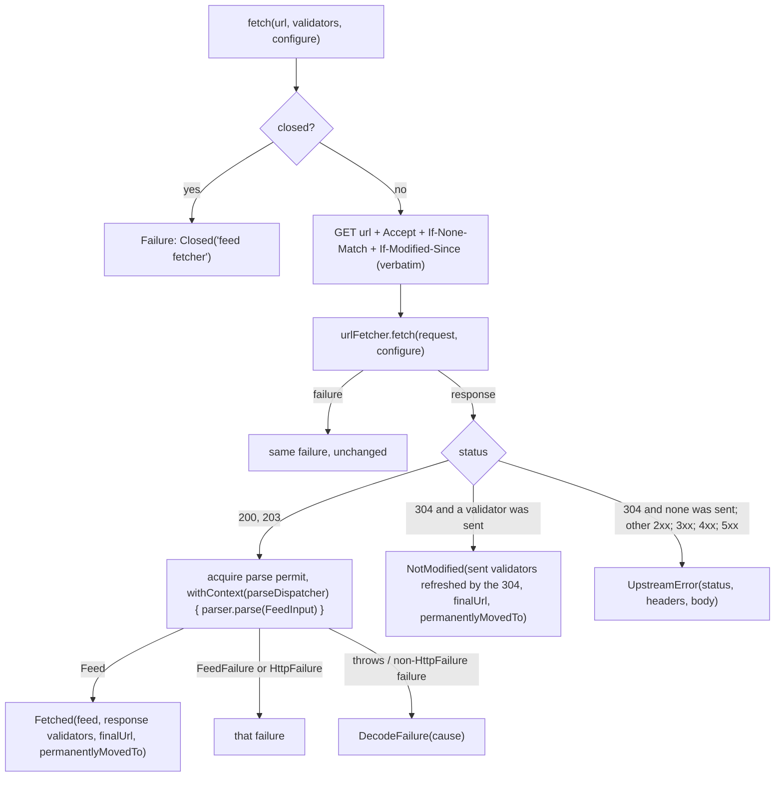
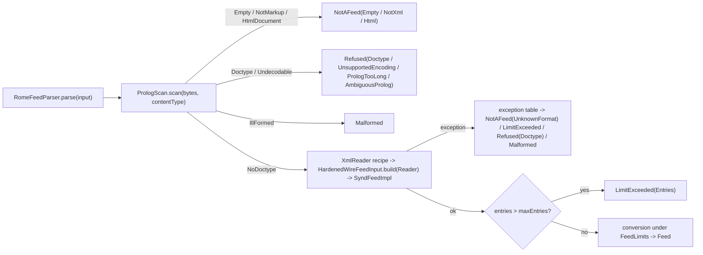

# Plan: `feeds` — `webtools-feeds`, the RSS/Atom parser port with the Rome default, the hardening contract and a conditional-GET fetcher over `UrlFetcher`

- **Covers:** `SpartanLaboratories/WebTools#69` — *"webtools-feeds: RSS/Atom parser port with the Rome default, hardening suite, and a conditional-GET fetcher over `UrlFetcher`"*.
  Sub-issue of `SpartanLaboratories/WebTools#55` (HTTP client stack). Blocked by #63 (`test-support`) and #68 (`call-facades`), both landed. It blocks #70 (`http-docs`).
- **Architecture:** [`../architecture.md`](../architecture.md), unit `feeds` (§11 unit 10 and its dated correction; §6.10 `webtools-feeds` with the dated correction at its end; §6.2 and §6.9 for the common-code
  mechanisms; §6.6 for the logging conventions; §6.7 and §6.8 for the fixtures and the check modules; §9 for the tiers). Its dated "Corrected … as built" callouts are the truth for units 1 to 9.
  Systems-level consequences: [`../consequences.md`](../consequences.md) §7 (row 10) and §8 (every "Unit 10 (#69)" paragraph). [§6 of this plan](#6-where-this-plan-refines-the-parent-architecture) lists
  each point where this unit departs from §6.10.
- **Research:** [`research/README.md`](research/README.md) (the work, the verification and the summary, which states the design inputs) with
  [`research/rome-adapter.md`](research/rome-adapter.md), [`research/parse-memory.md`](research/parse-memory.md), [`research/prolog-scan.md`](research/prolog-scan.md),
  [`research/entry-identity-and-links.md`](research/entry-identity-and-links.md) and [`research/conditional-get-and-redirects.md`](research/conditional-get-and-redirects.md); the stack-level
  [`../research/feed-parsing.md`](../research/feed-parsing.md) and [`../research/api-shape-and-failures.md`](../research/api-shape-and-failures.md). Where a findings file and the README's Summary differ, this
  plan follows the Summary.
- **Landed contracts this unit consumes:** [`../68-call-facades/consequences.md`](../68-call-facades/consequences.md) §4 and [`plan.md`](../68-call-facades/plan.md) §12 (`UrlFetcher`, `FetchSpec`,
  `LoopbackFetchers`); [`../63-test-support/plan.md`](../63-test-support/plan.md) §12 (the fakes and the `testFixtures(...)` form); [`../64-url-policy/plan.md`](../64-url-policy/plan.md) §12 (the policies);
  [`../62-http-core/plan.md`](../62-http-core/plan.md) §12 and [`../62-http-core/research/common-check-plugin.md`](../62-http-core/research/common-check-plugin.md) F11 (the check module that depends on
  another check module).
- **Branch:** `feat/issue-69-feeds` (exists; cut from `master` at `0374c8d`; holds the research commits `88af7dc`, `066bf17`, `5ae0bda` and `e89d86a`). The implementer confirms it and never re-cuts it.
- **Commit:** TBD. This `plan.md`, its sibling `consequences.md` and the dated corrections of `../architecture.md` are committed **in the same commit as the first stage of the implementation** (commit 1 of §11),
  so `git log --follow` binds the plan to the code.
- **PR:** TBD (the PR closes #69).
- **What this plans:**
  - the new Kotlin Multiplatform module `webtools-feeds` (package `com.spartanlabs.webtools.feeds`; coordinates `webtools-feeds` and `webtools-feeds-jvm`) and its unpublished check module
    `webtools-feeds-commoncheck`;
  - in `commonMain`: the parser port `FeedParser` with `FeedInput` and `FeedLimits`; the model `Feed`, `FeedEntry`, `FeedEnclosure`; `FeedValidators` and the sealed `FeedFetch`; the failure group `FeedFailure` with
    its reasons; `FeedFetcher` with `FeedFetcherConfig`; and, `internal`, the DOCTYPE prolog scan, the identity, link and text rules, a pure-Kotlin SHA-256, the conditional-GET rules and the logging seam;
  - in `jvmMain`: `RomeFeedParser` over Rome 2.1.0, the default-parser actual and the owning factories `FeedFetcher.untrusted(userAgent) { }` and `FeedFetcher.untrusted(userAgent, policy) { }`;
  - the tests of all of it, from Level 1 to Level 4c, with a Level 5 manual pass; the ABI dump; the `README.md` section and the `CHANGELOG.md` entries.
- **Status:** planning only.
- **Version moved:** none. `webtools-feeds` `1.0.0` is new, inherited from the root build, and **unreleased**: this landing is **not a release candidate**. No other module moves a version, `webtools-http` and
  `webtools-http-commoncheck` do not change, and no existing build file changes but `settings.gradle.kts`.
- **Baseline:** `master` at `0374c8d` (the merge of #68). Line references are to that commit.

The code blocks in this plan are the intended implementation. They were written against the as-built sources of `webtools-http` and against the findings files; they have not been compiled. The implementer fixes a
compile error mechanically and records any change to a rule (as opposed to a spelling) in `final-implementation.md` at the moment it is made.

---

## 1. Requirements

Each requirement is testable; §9 names the test that locks it down.

### R1. The modules and the build

- `webtools-feeds`: Kotlin Multiplatform on `webtools.kotlin-multiplatform-library` with `explicitApi()`; coordinates `webtools-feeds` and `webtools-feeds-jvm`; version `1.0.0` from the root build, carrying the same
  "UNRELEASED … not a release candidate" note as `webtools-http/build.gradle.kts:1-12`.
- The stack's marker `com.spartanlabs.webtools.http.ExperimentalForInheritanceWebToolsApi` is opted in on `commonMain` and `jvmMain` only through `languageSettings.optIn`; the test source sets stay consumers.
- Dependencies: `commonMain` `api(project(":webtools-http"))` (the public API names `UrlFetcher`, `Url`, `HttpFailure`, the marker and `CoroutineDispatcher`; `kotlinx-coroutines-core` arrives through it as
  `api`); `jvmMain` `implementation("com.rometools:rome:2.1.0")` and `implementation("org.slf4j:slf4j-api:2.0.13")`; the test fixtures of `webtools-http` for `jvmTest` as
  `"jvmTestImplementation"(testFixtures(project(":webtools-http")))`.
- A byte-identical copy of `webtools-http/src/jvmTest/resources/logback-test.xml` in `webtools-feeds/src/jvmTest/resources/`; the ABI dump `webtools-feeds/api/webtools-feeds.api`.
- `webtools-feeds-commoncheck`: unpublished, on `webtools.kotlin-common-check`; `commonMain` has `kotlin.srcDir("../webtools-feeds/src/commonMain/kotlin")`,
  `implementation(project(":webtools-http-commoncheck"))`, `implementation("org.jetbrains.kotlinx:kotlinx-coroutines-core:1.10.2")`, the opt-in on `commonMain` and `jsMain`, and a `js` actual for every `expect`
  declaration of the feeds `commonMain`.
- `settings.gradle.kts` includes both modules. `webtools-http` and its check module do not change.

### R2. The public surface and its tier

Final classes in `com.spartanlabs.webtools.feeds`; every one **Stable Core** unless marked, with KDoc on every public declaration. Configurable types are built by a top-level factory and a `@WebToolsDsl` builder
over an `internal` constructor; frozen-shape types keep a public constructor; no `data class` is public; the only defaulted parameter on a public constructor or function is a trailing `configure = {}`.

| Type | Mechanism | Tier |
|---|---|---|
| `FeedParser` | `interface` with `@SubclassOptInRequired(ExperimentalForInheritanceWebToolsApi::class)`; `fun parse(input: FeedInput): Result<Feed>`, plain, non-suspending | Experimental (implement) |
| `FeedInput(document, contentType, baseUrl)` | final class, public constructor | Stable Core |
| `FeedLimits` | final class; factories `FeedLimits { }` and `FeedLimits(from) { }`; `@WebToolsDsl` builder; the defaults as constants | Stable Core |
| `Feed`, `FeedEntry`, `FeedEnclosure` | final classes; factories with `@WebToolsDsl` builders | Stable Core |
| `FeedValidators(etag, lastModified)` | final class, public constructor; `FeedValidators.None` | Stable Core |
| `FeedFetch` with `Fetched` and `NotModified` | `sealed interface`, final leaves with public constructors | Stable Core |
| `FeedFailure` with `NotAFeed`, `Malformed`, `Refused`, `LimitExceeded` | abstract group under `HttpFailure` with `@SubclassOptInRequired`; final leaves with public constructors | Experimental (subclass); every leaf Stable Core |
| `NotAFeedReason`, `FeedRefusal`, `FeedLimit` | open constants classes in the style of `RefusalReason` | Stable Core |
| `FeedFetcherConfig`, `FeedFetcher` (+ `FeedFetcher.Companion`), the common factory `FeedFetcher(urlFetcher, configure)` | `@WebToolsDsl` configuration; final `AutoCloseable` | Stable Core |
| `RomeFeedParser` (JVM) and the owning factories `FeedFetcher.untrusted(…)` (JVM) | final supplied default usable without the opt-in; companion extensions | Stable Core |

### R3. `FeedLimits`

- Members and defaults: `maxEntries` 1,000; `maxTextChars` 262,144; `maxIdChars` 2,048; `maxLinkChars` 8,000; `maxCategoriesPerEntry` 32; `maxEnclosuresPerEntry` 8; `maxDepth` 256;
  `maxAttributesPerElement` 100; `maxElements` 100,000; `maxNamespaceUris` 64. The defaults are public constants and `FeedLimits.Defaults` holds them as a value.
- **Tighten only.** The builder refuses a value above its default or below its floor with `IllegalArgumentException` and a constant message that names the property and never a value. Floors: `maxEntries` 1,
  `maxTextChars` 16, `maxIdChars` 50 (the digest id is always 50 characters), `maxLinkChars` 32, `maxCategoriesPerEntry` 0, `maxEnclosuresPerEntry` 0, `maxDepth` 4, `maxAttributesPerElement` 4, `maxElements` 16,
  `maxNamespaceUris` 2. A floor keeps a setting from disabling the parser by mistake; it does not promise that any document parses.
- `FeedLimits(from) { }` starts from `from` and may raise a member back up to its default; `from` is never modified. Equality is on all ten members; `toString()` prints the ten numbers.
- Exceeding `maxEntries`, `maxDepth`, `maxAttributesPerElement`, `maxElements` or `maxNamespaceUris` fails the parse with `LimitExceeded`. The text, id, link, category and enclosure limits truncate, fall back or drop
  as R13 states.

### R4. The model

- `Feed(title, link, description, entries)`; `FeedEntry(id, title, link, summary, content, author, publishedAtEpochMillis, updatedAtEpochMillis, categories, enclosures)`; `FeedEnclosure(url, mimeType, lengthBytes)`.
  Links are `String?` (an absolute `http` or `https` link with the fragment kept; `Url` is not used: it drops fragments and refuses non-ASCII hosts). Dates are epoch milliseconds, `null` when absent, unparseable or
  outside years 1 to 9999, and are never used to decide whether an entry is new. Summary and content are untrusted markup.
- The factories `require` the invariants a value must hold and apply neither limits nor fallbacks: a `FeedEntry` id is not blank; a link (`Feed`, `FeedEntry`, `FeedEnclosure`) is a canonical absolute link by the
  module's link rule (R13); an enclosure `lengthBytes` is `null` or positive. Violations throw `IllegalArgumentException` with a constant message.
- Value equality over every field; `toString()` prints no text content and no URL path or query.

### R5. `FeedValidators`

- `FeedValidators(etag: String?, lastModified: String?)` applies the rules to what it is given, so a value loaded from storage obeys them too: trim SP and HTAB at both ends; empty means `null`; the ETag is at most
  256 and the `Last-Modified` at most 64 characters; every character is U+0020 to U+007E; an ETag is not `*`; otherwise the value is `null`, never truncated. `FeedValidators.None` holds neither. `toString()` prints
  presence, never a value.

### R6. `FeedFetch`

- `sealed interface FeedFetch` declares `validators: FeedValidators`, `finalUrl: Url` and `permanentlyMovedTo: Url?`; the final leaves are `Fetched(feed, validators, finalUrl, permanentlyMovedTo)` and
  `NotModified(validators, finalUrl, permanentlyMovedTo)`, with hand-written equality (the shape of `Lookup`). A third leaf is never added: a later case becomes a field.

### R7. `FeedFailure`

- Leaves, each final with a public constructor and a constant message of the form `<constant text>` or `<constant text>: <reason name>`: `NotAFeed(reason: NotAFeedReason)`, `Malformed`,
  `Refused(reason: FeedRefusal)`, `LimitExceeded(limit: FeedLimit)`. A leaf never holds a cause and never holds document content.
- Reasons (open constants classes: private constructor, constants in the companion, equality by name, `toString()` the name): `NotAFeedReason` `Html`, `Empty`, `NotXml`, `UnknownFormat`; `FeedRefusal` `Doctype`,
  `UnsupportedEncoding`, `PrologTooLong`, `AmbiguousProlog`; `FeedLimit` `Entries`, `Depth`, `Attributes`, `Elements`, `NamespaceUris`.

### R8. `FeedParser` and `FeedInput`

- `parse` is plain and non-suspending, thread-safe, and never throws for a bad document; its KDoc contract states what an implementation must do: refuse every DOCTYPE, honour every `FeedLimits` member and report
  failures as `FeedFailure` leaves with constant messages.
- `FeedInput` copies the document in and reads it back as a copy; its `toString()` prints sizes and presence only.

### R9. The fetch

In order: a closed fetcher returns `HttpFailure.Closed("feed fetcher")`; the request is `GET url` with `Accept` and, when known, `If-None-Match` and `If-Modified-Since` exactly as stored;
`urlFetcher.fetch(request, configure)`; every failure passes through unchanged. On a response:

- `200` or `203`: parse, then `Fetched` with the response's validators (`FeedValidators.None` when it carries neither; a header that appears more than once counts as absent). The parse acquires the fetcher's
  semaphore of `maxConcurrentParses` permits, then runs `parser.parse(FeedInput(body, Content-Type, baseUrl = response.url))` on `parseDispatcher`. A failure the parser returns is the result when it is an
  `HttpFailure` (a `FeedFailure` leaf in practice) and `HttpFailure.DecodeFailure(cause)` otherwise; an exception thrown out of `parse` (other than cancellation) is `DecodeFailure(cause)`; cancellation is thrown, and
  a parse that is already running is not interrupted.
- `304` to a request that carried a validator: `NotModified` whose validators are the sent ones with each one the `304` carries replacing its counterpart (a carried value that fails the rules becomes `null`; a
  header that appears more than once counts as absent). A `304` to a request that carried none: `UpstreamError(304, headers, body)`.
- Every other status (any other `2xx`, a returned `3xx`, `4xx`, `5xx`): `UpstreamError(status, headers, body)`.
- `finalUrl` is `response.url`. `permanentlyMovedTo` is the target of the last hop in the leading run of `301`/`308` hops of `response.redirectChain` (a hop's target is the next hop's `url`, the last hop's is
  `response.url`); `null` when there is none or when it equals the requested URL; reported on both leaves.
- KDoc states what the caller owns: storing the returned validators after every response; adopting a move, with the caution that a move seen over cleartext can be injected; dropping its validators when
  `finalUrl` changes; polling, back-off, `410`, first-poll behaviour and "new items".

### R10. `FeedFetcherConfig`, `FeedFetcher` and the factories

- `FeedFetcherConfig` (`@WebToolsDsl`): `parser` (default: the platform's default parser, `RomeFeedParser()` on the JVM), `parseDispatcher` (`Dispatchers.Default`), `maxConcurrentParses` (2, at least 1) and `accept`
  (default `application/atom+xml, application/rss+xml, application/rdf+xml;q=0.9, application/xml;q=0.8, text/xml;q=0.8, */*;q=0.1`; refused at construction when blank or not a sendable header value).
- `FeedFetcher : AutoCloseable`, final, with a `public companion object`: `suspend fun fetch(url, configure = {})` and `suspend fun fetch(url, validators, configure = {})`, each returning `Result<FeedFetch>`,
  the block being passed to `UrlFetcher.fetch`. `close()` is non-suspending, idempotent and never throws; it closes only a `UrlFetcher` the fetcher built. Every member may be called concurrently.
- The common factory `FeedFetcher(urlFetcher, configure = {})`: the caller owns the `UrlFetcher`. On the JVM, `FeedFetcher.untrusted(userAgent, configure = {})` and
  `FeedFetcher.untrusted(userAgent, policy: OutboundUrlPolicy.Untrusted, configure = {})` build `UrlFetcher(userAgent, policy)` (policy `OutboundUrlPolicy.untrusted()` for the first) and own it. A shared budget
  goes through a caller-built `UrlFetcher` and the common factory.
- The common factory's default parser comes from an `internal expect fun defaultFeedParser(): FeedParser`: the JVM actual returns `RomeFeedParser()`, and the check module holds a `js` actual.

### R11. The DOCTYPE prolog scan (`internal`, `commonMain`)

- The algorithm, allowlist, decoder-divergence rule, 64 KiB bound and the 125-row catalogue of [`research/prolog-scan.md`](research/prolog-scan.md), extended with two outcomes that are returned **only when no reading
  reaches markup**: the body is then `Empty` when its byte reading holds nothing after the byte-order marks but white space, comments and processing instructions, and `NotMarkup` otherwise. Any reading that
  reaches markup wins, so a UTF-16 document without a mark still parses. Mapping: `Empty` → `NotAFeed(Empty)`, `NotMarkup` → `NotAFeed(NotXml)`, `HtmlDocument` → `NotAFeed(Html)`, `Doctype` → `Refused(Doctype)`, `Undecodable` → `Refused(UnsupportedEncoding | PrologTooLong |
  AmbiguousProlog)`, `IllFormed` → `Malformed`, `NoDoctype` → the parser runs. No parser runs on any outcome but `NoDoctype`.

### R12. `RomeFeedParser` (JVM)

- Final, usable without the opt-in, public constructors `RomeFeedParser(limits: FeedLimits)` and `RomeFeedParser()`. It runs the prolog scan first, then Rome through a private `WireFeedInput` subclass with a SAX
  parser of its own per parse, the three-step `XmlReader` recipe, a counting SAX handler, the exception table of [`research/rome-adapter.md`](research/rome-adapter.md), and the conversion of R13. Everything is created
  per `parse` call; no static state is read or written. It logs nothing. Documents with XML-illegal control characters are `Malformed`.

### R13. Identity, links and text (`internal`, `commonMain`, pure Kotlin)

- Exactly as [`research/entry-identity-and-links.md`](research/entry-identity-and-links.md) Recommendation specifies (§5.6 below restates the frozen parts): the id rule, the digest (`webtools-feeds:v1:` + 32 hex
  digits, over SHA-256 in pure Kotlin), the link rule with RFC 3986 §5.2 resolution and `allowRelative = false` for a link Rome derived from a guid, the text rules, the category and enclosure rules.
- One deliberate tightening of the research's reference: a guid or link candidate for the id that is **blank** (Kotlin `isBlank()`, which includes U+00A0 and the other Unicode spaces) counts as absent, so the id
  that results always satisfies the `FeedEntry` factory's non-blank invariant.

### R14. Logging

- The module copies the logging seam and the non-fatal catch helper (`internal` stops at the module). `FeedFetcher` logs under the logger `com.spartanlabs.webtools.feeds.FeedFetcher`: `INFO` once on creation
  (numbers and kinds only) and once on close; one `DEBUG` line per fetch; a `WARN` for a `Refused` document. `RomeFeedParser` logs nothing.
- **Every URL a line of this module prints is scheme, host and port only.** Never a path, a query, a header value, a body, document content or an exception message from Rome.

### R15. Error handling

- Expected failures are `Result` values: no function of this module throws for a bad document, a bad response or a policy refusal. Programmer errors (a configuration out of range, a model invariant) throw
  `IllegalArgumentException` at construction. `CancellationException` and `Error` propagate. §7.23 of this plan lists the failure path of every new signature.

### R16. Tests and runs

- The five-level hierarchy of §9, one class per file, in the packages `com.spartanlabs.testing.<level>.webtools.feeds`, with the two abstract contract classes. Runs name `:webtools-feeds` and
  `:webtools-feeds-commoncheck` only; no suite of `webtools-http` runs.

### Acceptance

1. `./gradlew :webtools-feeds:check :webtools-feeds-commoncheck:build` passes: every level of tests, `apiCheck` against the committed dump, `verifyJavaFloor` (Rome, JDOM and their transitive jars hold to the Java
   11 floor) and the `js` compile of `commonMain`.
2. A `RomeFeedParser` returns the expected `Feed` for each fixture of RSS 0.90, 0.91, 0.92, 2.0, RSS 1.0, Atom 0.3 and Atom 1.0, and the conformance contract and the hardening contract pass for it.
3. Every hostile case of the fixed-heap gate exits with code 0 and the expected result kinds at `-Xmx128m`.
4. `FeedFetcher` over `FakeHttpTransport` and over `LoopbackFetchers.untrusted` behaves as R9 states; `FeedFetcher.untrusted` refuses a loopback URL with zero requests reaching the server.
5. The ABI dump holds no Rome, JDOM, SAX or slf4j type, and no `data class`.
6. `README.md` and `CHANGELOG.md` carry the entries of §8.

---

## 2. Current state

**Baseline.** `master` at `0374c8d`. `webtools-http` is complete and unreleased: the units 3 to 9 (#62 to #68) landed. No code in the repository parses or fetches feeds, so nothing is adopted or moved.

**What this unit plugs into** (all public in `webtools-http`; line references are to `0374c8d`):

- `UrlFetcher.fetch(request: HttpRequest, configure: FetchSpec.() -> Unit = {}): Result<HttpResponse>` (`UrlFetcher.kt:55`). It returns every status as a response except a throttle (`RateLimited`); the
  pre-check refuses a URL the policy refuses before anything is spent; a closed fetcher returns `Closed("fetcher")` (`UrlFetcher.kt:56`). The common factory is `UrlFetcher(transport, policy, configure)`
  (`UrlFetcher.kt:110`); the JVM owning factories are `UrlFetcher(userAgent, configure)` and `UrlFetcher(userAgent, policy, configure)` (`UrlFetcherOwning.kt:12`, `:25`), the second building the transport
  with the policy's settings as they are.
- `FetchSpec { cost; lane; maxWait }` (`FetchSpec.kt:7`), `HttpRequest(method, url, configure)` (`HttpRequest.kt:68`; it throws `IllegalArgumentException` for a header value that is not HTAB or U+0020 to U+007E,
  `HttpRequest.kt:26-30`), `HttpHeaders` (`get` returns the last value of a name, `HttpHeaders.kt:33`; `getAll` returns every value, `:41`), `HttpResponse` with `redirectChain: List<RedirectHop>`
  (`HttpResponse.kt:14`, `:25`) and `RedirectHop(url, status)` (`RedirectHop.kt:15`), `Url` (`Url.kt:21`; equality on the canonical text, `:53`).
- `HttpFailure` (`HttpFailure.kt:18-33`), gated by `@SubclassOptInRequired(ExperimentalForInheritanceWebToolsApi::class)` with `protected` constructors `(message)` and `(message, cause)`; `Closed(component)`
  (`:43`) and `DecodeFailure(cause)` (`:86`) are public leaves; `UpstreamFailure.UpstreamError(status, headers, body)` (`UpstreamFailure.kt:62`) and `RateLimited` (`:40`, `internal` constructor);
  `TransportFailure` leaves, each with a public constructor (`TransportFailure.kt`); `RefusalReason` (`RefusalReason.kt:13`) is the pattern for the reasons.
- The seams to copy because `internal` stops at the module: `internal interface Log` and `internal expect fun logger(name)` (`Log.kt:7`, `:17`), the slf4j actual (`Log.jvm.kt`), `catchNonFatal`
  (`NonFatal.kt:15`) and `flatMap` (`ResultExtensions.kt:20`).
- `OutboundUrlPolicy.untrusted(configure)` (`OutboundUrlPolicy.kt:209`) with `TransportSettings.UntrustedDefaults` (`TransportSettings.kt:135`): a 2 MiB decoded-body cap, 3 redirects, `allowHttpsToHttp` false, ports 80,
  443, 8080 and 8443.
- `WebToolsDsl` (`WebToolsDsl.kt:23`) and `ExperimentalForInheritanceWebToolsApi` (`ExperimentalForInheritanceWebToolsApi.kt:23`).
- The fixtures (`webtools-http/src/jvmTestFixtures/.../testing/`): `FakeHttpTransport` (`FakeHttpTransport.kt:61`; `on(match, vararg steps)`, `calls`, `unmatchedCalls`), `Step.respond(status, headers, body)`
  and `Step.respond(delay) { request -> HttpResponse }` (`Step.kt:49`, `:80`; the second builds a response with a `redirectChain` and another final URL), `Step.fail`, `RequestMatch.header(name, value)`
  (`RequestMatch.kt:81`), `VirtualClock` and `TestScope.virtualClock()` (`VirtualClock.kt:38`, `:114`), `LoopbackFetchers.untrusted(userAgent, policy, resolve, configure)` (`LoopbackFetchers.kt:37`),
  `MockWebServer.webtoolsUrl(path)` (`MockWebServerUrls.kt:18`).
- Test support to take as models (not to reuse: they are `internal` to `webtools-http`'s `jvmTest`): `ChildJvm` (`ChildJvm.kt:12`, the launcher: `java.home`, `java.class.path`, `waitFor`, `destroyForcibly`) and
  `captureTransportLogs` (`LogCapture.kt:20`, a logback `ListAppender` on a logger).

**Verified facts this unit rests on** (each re-opened at its source; the findings files hold the quotes):

- Rome 2.1.0 (`rome`, `rome-utils`, `jdom2` 2.0.6.1) is the last release (2023). Its `WireFeedInput.createSAXBuilder()` is a protected hook returning the public `com.rometools.rome.io.SAXBuilder`; its repair of ampersands
  and entities and its `XmlReader` detection run only through `build(Reader)`; JDOM's `XMLReaders.NONVALIDATING` is one process-wide factory whose JAXP limits persist from JDK 22
  ([`research/rome-adapter.md`](research/rome-adapter.md) F1 to F4).
- The JDK 11 parser recognises the limit properties only under their URL names (`http://www.oracle.com/xml/jaxp/properties/maxElementDepth`, `.../elementAttributeLimit`), measured on 11.0.32.1; JDK 23 accepts both
  forms ([`research/rome-adapter.md`](research/rome-adapter.md) F3).
- A hostile 2 MiB document needs 102 to 318 MB of heap for two parses unguarded and 43 MB with the four structural limits; JDOM's builder is quadratic in depth; `org.jdom2.Namespace` caches every distinct URI for the
  life of the JVM ([`research/parse-memory.md`](research/parse-memory.md) F1 to F7). The Gradle test worker has 512 MB and no test task of the repository sets `maxHeapSize` (F8).
- `FeedFetcher`'s Level 3 runs through `LoopbackFetchers.untrusted`. The issue text says "through `LoopbackTransports.untrusted`"; that is superseded: the common factory takes a `UrlFetcher`, and only
  `LoopbackFetchers.untrusted` gives a `UrlFetcher` that reaches loopback with every other `Untrusted` rule live in the pre-check and the transport alike.
- A check module that depends on `webtools-http-commoncheck` compiles against its `js` output ([`../62-http-core/research/common-check-plugin.md`](../62-http-core/research/common-check-plugin.md) F11, measured).
- `HttpRequest` refuses any header value outside HTAB and U+0020 to U+007E, so a stored non-ASCII validator would fail every later fetch of its feed; the transport carries `If-None-Match` and `If-Modified-Since` to
  every hop, cross-origin included, because neither is controlled or sensitive ([`research/conditional-get-and-redirects.md`](research/conditional-get-and-redirects.md) F6, F14).
- `.gitattributes` has `*.kt text eol=lf`, `*.kts text eol=lf` and `**/fixtures/**/*.http -text`; the last covers `.http` files only.
- No test task sets `maxHeapSize` or `jvmArgs`; `jvmTest` and the `test` alias run every level in one 512 MB worker (`webtools.kotlin-multiplatform-library.gradle.kts`), and the level tasks select a class by the
  package of the concrete class.

---

## 3. Assumptions

1. **A test compilation sees the main compilation's `implementation` dependencies** (Rome, JDOM, slf4j) in a Kotlin Multiplatform module. If `jvmTest` does not compile against Rome's types, the dependency is added
   as `implementation` of `jvmTest` with the same version and the change is recorded; nothing else changes.
2. **`SAXHandler.startElement` and `startPrefixMapping` are overridable and a `SAXException` thrown from them reaches the cause chain of Rome's `ParsingFeedException`** (JDOM 2.0.6.1 source: both are public and
   non-final; [`research/rome-adapter.md`](research/rome-adapter.md) Recommendation measured the typed rejection). If the chain walk does not find the private exception, the handler's rejection arrives as
   `Malformed`, and `CountingSaxHandlerComponentTest` and the Level 4c element, namespace and depth cases fail loudly; the walk in `toFeedFailure` is the single place to adjust.
3. **`SyndFeedImpl(wire, false)` yields one `SyndEntry` per wire entry in document order** (Rome 2.1.0's converters loop over the wire entries). The conversion pairs them by index for `xml:base`; if the sizes
   ever differ, an entry without a partner uses the feed-level base only.
4. **The JDK's SAX parser counts `xmlns` declarations as attributes**, so an `xmlns` flood on one element is `LimitExceeded(Attributes)` and a flood spread over many elements is
   `LimitExceeded(NamespaceUris)` ([`research/parse-memory.md`](research/parse-memory.md) F5). The hardening cases are written to those two shapes.
5. **The decoder-divergence rule holds on the build JDK only** (JDK 23.0.2 measured). The differential test is the guard on any other JDK the build runs on.
6. **`java.class.path` of a Gradle test worker is a complete class path for a child JVM**, as `webtools-http`'s `ChildJvm` relies on ([`../65-okhttp-transport/research/loopback-test-mechanics.md`](../65-okhttp-transport/research/loopback-test-mechanics.md)
   F6). If the path exceeds the platform's command-line length, the launcher passes it through an `@argfile`.
7. **`Dispatchers.Default` is acceptable for CPU-bound parses of at most two documents per fetcher.** A deployment with many fetchers or a busy `Default` pool configures `parseDispatcher`.
8. **Ids already stored by an earlier run of an unreleased build do not exist**: the digest and the id rule are frozen at this unit's first release, and nothing has been persisted by a consumer yet.

---

## 4. Non-goals

- HTML feed autodiscovery (`<link rel="alternate">` in a page), JSON Feed, and RSS Advisory Board `<redirect>` documents; `itunes:new-feed-url`.
- A stateful poller, a "new items" tracker, scheduling, back-off or `410` handling: the caller owns all of them.
- A published conformance or hardening contract variant: it ships with the feature release that graduates `FeedParser`. The two contract classes stay in `jvmTest`.
- Tolerance of XML-illegal control characters: such documents are `Malformed`.
- `xml:base` beyond the Atom feed and entry elements (Rome exposes no other).
- A future-dated `Last-Modified` guard (it needs the response's `Date`, which the validators do not carry).
- Repair of duplicate ids (entries with nothing to hash share the constant id; the caller dedupes).
- A published conditional-GET dispatcher for `mockwebserver3`: the test's own few lines stay in the test.
- A `timeSource` property on `FeedFetcherConfig`: the per-fetch figures in the `DEBUG` line use the monotonic clock.
- A change to `webtools-http`, its check module, `build-logic`, the `WebToolsDsl` KDoc list there, or the other modules.

---

## 5. Design

### 5.1 Shape: one new system on published seams

`webtools-feeds` composes only public parts of `webtools-http`: it asks a `UrlFetcher` for a `GET`, reads the `HttpResponse`, and hands the body to a `FeedParser`. It adds no cache, no budget and no transport.
Stateless means the module keeps no validator and no subscription: the caller stores `FeedFetch.validators` after every response.





### 5.2 Mechanism per type (parent §6.9 and §9, for this unit's types)

| Type | Mechanism | Why |
|---|---|---|
| `FeedParser` | interface, `@SubclassOptInRequired` | substituted by consumers and fakes; narrower contract than an open class |
| `FeedInput`, `FeedLimits`, model, `FeedValidators`, `FeedFetch`, reasons, failure leaves | plain common classes | vocabulary with no platform content |
| `FeedFetcher`, `FeedFetcherConfig`, the prolog scan, the rules | plain common classes and functions | built from `Semaphore`, `withContext`, `Job`, `TimeSource` and byte scans; compiled for `js` by the check module |
| `defaultFeedParser()` | `internal expect fun` | a platform fact with no type crossing a public signature; no `expect class` (Beta warning) |
| `logger(name)` | `internal expect fun` | slf4j is JVM-only; this module carries its own copy |
| `RomeFeedParser`, the owning factories, the Rome internals | `jvmMain` only | platform implementations; nothing in `commonMain` names them |

### 5.3 Stages

Each stage compiles on its own, its tests pass on their own, and it ends in a commit (§11). A stage that fails its procedure (§9.3) stops the next one.

| Stage | Delivers | Tests that land with it |
|---|---|---|
| 1. Skeleton and vocabulary | both modules and their build files, settings, the logging seam, `FeedFailure` and the reasons, `FeedLimits`, `FeedInput`, `FeedParser`, the model, `FeedValidators`, `FeedFetch`, the text, SHA-256, link and identity rules, the first ABI dump; this plan, `consequences.md` and the parent's dated corrections | Level 1 (common), Level 2 value types, Level 4a rule tables |
| 2. Prolog scan and `RomeFeedParser` | `PrologScan` and its failure mapping, `ResultExtensions.kt`, the Rome internals, `RomeFeedParser`, the fixtures, the `.gitattributes` line, the regenerated dump | Level 2 Rome internals, Level 4a catalogue, conformance contract, differentials |
| 3. The fetcher | `FeedFetcherConfig`, the conditional-GET rules, `FeedFetcher`, the default-parser `expect`/`actual`s (the `js` actual in the check module), the owning factories, the regenerated dump | Level 1 (JVM), Level 2 fetcher classes, Level 3 |
| 4. Hardening and documentation | `HostileDocuments`, the child-JVM gate, the hardening contract, the secrecy, isolation, close-race and JDK 11 tests; then `README.md` and `CHANGELOG.md` | Level 4c |

### 5.4 Conditional GET (R9, restated as rules)

- **Request.** `Accept` is the configured value. `If-None-Match` is `validators.etag` when non-null and `If-Modified-Since` is `validators.lastModified` when non-null, each exactly as held. Both are sent
  together when both are known (RFC 9110 §13.1.3 makes a server ignore `If-Modified-Since` when `If-None-Match` is present, so the pair is the interoperable form). Nothing is reformatted: a date is never parsed and
  reprinted, a tag is never normalised.
- **Validators on a response.** From a `200` or `203`: exactly one `ETag` line and exactly one `Last-Modified` line count; zero or several mean absent; each value passes through the `FeedValidators` constructor.
  From a `304`: the same reading, but an absent header keeps the sent value and a present one replaces it, even with `null` when it fails the rules (a `304` that names a different tag asserts the stored
  representation is current under that name).
- **Statuses.** `200` and `203` are parsed. A `204` or `205` has no content, a `206` answers only a range request, a `226` only a request with `A-IM`; none is the complete representation of a plain `GET`, so
  every other `2xx` is `UpstreamError(status)`.
- **Permanent moves.** `permanentlyMovedTo` is a fact about the chain, not an instruction. The leading-run rule keeps a `302` at the head from moving the subscription (RFC 9110 §15.4.3); the same rule is
  SimplePie's, hence FreshRSS's. The fetcher reports a move with `NotModified` as well as `Fetched`; a chain that ends in an error has no `FeedFetch` to carry it.

### 5.5 The parse path

- `parse` is non-suspending and CPU-bound. The fetcher moves it off the caller's thread with `withContext(parseDispatcher)` and bounds the number of parses running at once with a `Semaphore`
  (`maxConcurrentParses`), so a flood of feeds cannot pin every core. A parse cannot be cancelled; `withContext` returns to a cancelled caller only after the parse finished, and the permit is held until then.
- Memory: a body is copied by `HttpResponse.body()` and by the `FeedInput` constructor; `RomeFeedParser` reads the input through an `internal` view that does not copy again. With the four structural limits the worst
  accepted 2 MiB shape needs 43 MB for two parses ([`research/parse-memory.md`](research/parse-memory.md) F5), and the two extra 2 MiB copies per parse are inside the 128 MB gate heap.
- Deployment heap: about 128 MB of headroom covers the default two concurrent parses of one fetcher. The figure scales with the sum of every fetcher's `maxConcurrentParses` in the process; without the structural
  limits it would be about 640 MB.

### 5.6 The frozen identity, link and text rules (summary of [`research/entry-identity-and-links.md`](research/entry-identity-and-links.md))

The reference implementation of that file, verified against its vectors and compiled for the JVM and `js`, is the basis; the two changes are the `isNotBlank` tightening of R13 and the names/visibility below.

- **Id.** (1) `t = trimAscii(guid)`; when `t` is not blank and at most `maxIdChars` long it is the id. (2) Else `l = trimC0(link)` (the entry link exactly as Rome returned it, before any resolution); when `l` is not
  blank, at most `maxIdChars` long, holds no char at or below U+0020, none from U+007F to U+009F, no backslash, and its scheme (a colon before any `/`, `?` or `#`) is absent or `http`/`https` in any case, it is the
  id, as written. (3) Else the digest. `isPermaLink` plays no part; nothing is case-folded, normalised or resolved.
- **Digest.** SHA-256 over the UTF-8 bytes of: the domain `webtools-feeds/entry-id/1`; then, if present, `"\n"` + tag + the UTF-16 length of the value + `":"` + the value for the first present of title (`t`),
  summary else content (`b`), first enclosure URL (`e`) — each trimmed of ASCII white space, cut to 4,096 UTF-16 units without leaving a high surrogate at the cut, unpaired surrogates replaced by U+FFFD; then, if the
  model's `publishedAtEpochMillis` is non-null, `"\n"` + `d` + the length of the seconds string + `":"` + `floorDiv(ms, 1000)` as a decimal string. The id is `webtools-feeds:v1:` followed by the first 16 digest bytes as
  32 lower-case hex digits (50 characters). With nothing present the message is the domain alone and the id is the constant `webtools-feeds:v1:b2025d24e4ca603fe646f1d2df2ea6e5`. A new algorithm is a new prefix.
  The digest depends on no `FeedLimits` value.
- **Link.** `resolveLink(raw, base, maxLinkChars, allowRelative)` of the reference: trim C0 and spaces; length check before any scan; any char at or below U+0020, U+007F to U+009F or a backslash gives `null`;
  an absolute reference must be `http`/`https` with an authority with no user-info, a host of letters, digits, `-`, `.`, `_` or chars at or above U+00A0 (or a bracketed IPv6 literal) and a port of at most five
  digits and at most 65535; the scheme is lower-cased and the rest kept as written, the fragment included; a relative reference resolves by RFC 3986 §5.2.2 (strict) against a base that passes the same rules, and gives
  `null` without one. The result is at most `maxLinkChars`. `allowRelative = false` is used for an entry link that equals the entry's guid text (the link Rome derives from a permalink guid), which is a link only
  when already absolute.
- **Text.** Titles, summaries, contents, descriptions, authors, category terms and MIME types: `trimAscii`, blank is absent, truncate to `maxTextChars` UTF-16 units dropping a trailing high surrogate, absent if that
  leaves nothing. Categories: text rule, drop absent, drop exact duplicates keeping the first, cap at `maxCategoriesPerEntry`. Enclosures: URL by the link rule (absent drops the enclosure), drop a repeated URL, cap at
  `maxEnclosuresPerEntry`; `lengthBytes` is the value when positive, else `null`.
- **Dates.** `getPublishedDate()?.time` and `getUpdatedDate()?.time`, kept only inside year 1 to year 9999 (`-62_135_596_800_000` to `253_402_300_799_999` epoch milliseconds).

### 5.7 Hardening in four layers

1. The transport's decoded-byte cap (2 MiB under `Untrusted`) bounds the document.
2. The prolog scan refuses every DOCTYPE, and a prolog that cannot be read the way the parser reads it, before any parser runs.
3. The parser's own SAX settings: Rome's four DOCTYPE and entity features set directly (a provider that does not know one fails the build instead of skipping it), entity expansion off, an empty entity resolver,
   and the JDK limits (`maxDepth`, `maxAttributesPerElement`) as properties on a private `SAXParserFactory.newDefaultInstance()` per build; a counting handler for `maxElements` and `maxNamespaceUris`.
4. `FeedLimits` bounds fields and counts in the conversion (`maxEntries`, text, id, link, categories, enclosures).

### 5.8 Where the failure paths are

§7.23 tabulates them. The rule: a failure of a document or a response is a value; the only broad `try`/`catch` of the module is `inRomeRegion`, around the three Rome calls, where Rome's own runtime exceptions on hostile
input are input-triggered and carry document text; an exception from the module's own conversion is a bug and leaves `parse`, to become the fetcher's `DecodeFailure`.

---

## 6. Where this plan refines the parent architecture

Each point below is a place where this unit departs from [`../architecture.md`](../architecture.md) §6.10 (and §11 unit 10); the parent carries the same points as dated corrections.

1. **Statuses parsed.** §6.10 parses any `2xx`. This unit parses `200` and `203` and returns every other `2xx` as `UpstreamError(status)`: a `204` or `205` has no content (parsing it blames the document for a
   server's non-answer), a `206` is a fragment (storing it as `Fetched` tells the caller its entry list is complete) and a `226` is a delta (read as the whole feed, it makes the caller treat missing items as removed).
   Basis: [`research/conditional-get-and-redirects.md`](research/conditional-get-and-redirects.md) F5.
2. **A fourth layer of hardening.** §6.10 has three layers. `FeedLimits` also bounds structure: element depth 256, attributes per element 100, elements 100,000, distinct namespace URIs 64, tightening-only like
   the others, each failure a `LimitExceeded` with a reason of its own. Without them a 2 MiB document costs minutes of CPU (JDOM's builder is quadratic in depth), overflows the stack or grows JDOM's JVM-wide
   namespace cache. They are `FeedLimits` members, not constants of `RomeFeedParser`, so a deployment can tighten them and any parser behind the port is held to them by the hardening contract. Basis:
   [`research/parse-memory.md`](research/parse-memory.md) F1 to F6, F10; [`research/rome-adapter.md`](research/rome-adapter.md) F6, F7.
3. **How `RomeFeedParser` drives Rome.** §6.10 names `SyndFeedInput` with `allowDoctypes = false` and a plain `XmlReader`. `SyndFeedInput` keeps its `WireFeedInput` private, so it cannot carry a limit, and Rome's
   own `createSAXBuilder()` uses JDOM's process-wide SAX factory, on which a JAXP limit persists for every later JDOM parse in the JVM from JDK 22 and races between builds. This unit uses a private `WireFeedInput`
   subclass with a SAX parser of its own per parse, the three-step `XmlReader` recipe (the plain constructor fails or corrupts 7 of 26 encoding vectors), failures mapped by exception type and JAXP code, and
   `dc:subject` read as a category source. No public signature changes. Basis: [`research/rome-adapter.md`](research/rome-adapter.md) F1 to F5, F10; [`research/parse-memory.md`](research/parse-memory.md) F7.
4. **`FeedFetch`.** §6.10 gives `NotModified(validators, finalUrl)`. `FeedFetch` is a sealed interface declaring `validators`, `finalUrl` and `permanentlyMovedTo`, so `NotModified` reports a permanent move too:
   "not modified" is the common answer for an unchanged feed behind a permanent redirect, and a reader that skips the move on a `304` never learns it while the feed stays unchanged. Declaring the three on the parent
   lets the caller's "store, adopt, then branch" path run without a `when`. `permanentlyMovedTo` is the target of the last hop of the leading run of `301`/`308` hops, `null` when that target is the requested URL.
   Basis: [`research/conditional-get-and-redirects.md`](research/conditional-get-and-redirects.md) F9 to F11, F15.
5. **The fetcher's surface.** `fetch(url) { }` and `fetch(url, validators) { }` take `UrlFetcher.fetch`'s per-fetch block (cost, lane, wait cap); `FeedFetcher.untrusted(userAgent, policy) { }` joins
   `FeedFetcher.untrusted(userAgent) { }`, for a deployment that adds denied ranges or ports; `FeedFetcherConfig` adds `accept`, because a consumer who swaps the parser may need another list (the value follows
   SimplePie's ordering; `application/feed+json` is omitted since the default parser reads XML); the common factory's default parser comes from an `internal expect fun`, `RomeFeedParser` being the JVM actual and
   a `js` actual living in the check module, because common code cannot name a JVM class.
6. **Logging.** §6.6's habit is `Url.redacted()`, which shows the path. The module's own lines print a feed URL as scheme, host and port only: a feed URL is administrator-supplied and its path can carry a secret.
   The `UrlFetcher` it composes, and the transport under it, still print `Url.redacted()` (issue #93), which `FeedFetcher`'s KDoc states.
7. **Identity and refusals.** The digest hashes the first present of title, summary or content, and first enclosure URL, together with the published date (§6.10 says "title and date"; an RSS 2.0 item may carry only a
   description, and a title-less digest would collapse such entries). `Refused` also covers a prolog the scan cannot read the way the parser reads it. Two further outcomes of the scan, `Empty` and `NotMarkup`,
   separate bodies that are not XML at all from malformed XML.
8. **The contract** is two abstract classes in `jvmTest`, one per test level (conformance at Level 4a, hardening at Level 4c), not one `FeedParserContract`; the hardening cases that load memory run in a child JVM
   with a fixed heap, because a heap fixed on one test task leaves `jvmTest` and the `test` alias, which run every class in one 512 MB worker, ungated.
9. **The Level 3 fixture** is `LoopbackFetchers.untrusted`, not `LoopbackTransports.untrusted`: the common factory takes a `UrlFetcher`.

**Points this plan fixes that the parent leaves open.**

- `FeedFetcher` reports `Closed("feed fetcher")` after its own `close()`, a component name of its own, so a caller can tell it from the `Closed("fetcher")` of a `UrlFetcher` it closed itself.
- A `Result.failure` returned by a parser whose exception is not an `HttpFailure` becomes `DecodeFailure(cause)`, so a `Result<FeedFetch>` never carries a raw exception.
- JAXP name-length and entity-limit rejections (`JAXP00010005`, `JAXP00010001`, `…03`, `…04`, `…07`) are `Malformed`: they are not `FeedLimits` members and the entity ones are unreachable once a DOCTYPE is refused.
- The reasons of `FeedRefusal` are four (`Doctype`, `UnsupportedEncoding`, `PrologTooLong`, `AmbiguousProlog`), folding the scan's `WideOrEbcdicPrefix` and `UnlistedEncodingName` into `UnsupportedEncoding`.

---

## 7. File-by-file changes

Paths: `<cm>` = `webtools-feeds/src/commonMain/kotlin/com/spartanlabs/webtools/feeds/`, `<jm>` = `webtools-feeds/src/jvmMain/kotlin/com/spartanlabs/webtools/feeds/`. Every Kotlin file is LF (`.gitattributes`
`*.kt text eol=lf`). "Stage n" says which commit carries the file.

### 7.1 `settings.gradle.kts` and `.gitattributes` (changed)

- `settings.gradle.kts` (stage 1): the `include` line becomes
  `include(":webtools-udp", ":webtools-scraping", ":webtools-browser", ":webtools-http", ":webtools-http-commoncheck", ":webtools-feeds", ":webtools-feeds-commoncheck")`.
- `.gitattributes` (stage 2, with the first fixture): add after the existing `.http` line

  ```
  # Feed test documents hold bytes that tests compare; a line-ending conversion would change them.
  webtools-feeds/src/jvmTest/resources/feeds/** -text
  ```

### 7.2 `webtools-feeds/build.gradle.kts` (new, stage 1)

```kotlin
// webtools-feeds - RSS and Atom behind a hardened parser port: the feed model, a fetcher that does a stateless
// conditional GET over webtools-http's UrlFetcher, and RomeFeedParser, the supplied parser over Rome. Kotlin
// Multiplatform: commonMain holds the port, the model, the fetcher and the DOCTYPE prolog scan, jvmMain the Rome
// parser and the owning factories. It publishes webtools-feeds and webtools-feeds-jvm (a Maven build depends on
// webtools-feeds-jvm).
//
// 1.0.0 is the version inherited from the root build, and it is UNRELEASED: webtools-feeds is new, and it stays
// unpublished until the whole stack (issue #55) is complete. It is not a release candidate while the units of that
// work land one by one. Remove this note when 1.0.0 is released.
//
// Everything shared (the jvm() target at the Java floor, the test dependencies, the level tasks, publishing,
// binary-compatibility-validator and verifyJavaFloor) comes from the convention plugin. This file adds
// explicitApi(), the dependencies, the module-wide opt-in, the coordinates and the POM name and description. The
// ABI dump api/webtools-feeds.api is committed (:webtools-feeds:apiDump); apiCheck is part of check.

plugins {
    id("webtools.kotlin-multiplatform-library")
}

// The marker that gates webtools-http's ports and failure groups. This module's main code implements FeedParser
// (itself gated), extends HttpFailure and subclasses nothing else gated, so it opts in; its tests do not, and stay
// a consumer.
val gateMarker = "com.spartanlabs.webtools.http.ExperimentalForInheritanceWebToolsApi"

kotlin {
    explicitApi()

    sourceSets {
        // The opt-in is a language setting of the MAIN source sets only (see webtools-http/build.gradle.kts for why
        // a compilerOptions or sourceSets.all form would also reach the tests).
        commonMain {
            languageSettings.optIn(gateMarker)
            dependencies {
                // The public API names UrlFetcher, Url, HttpFailure, the marker and CoroutineDispatcher;
                // kotlinx-coroutines-core arrives through it as an api dependency.
                api(project(":webtools-http"))
            }
        }
        jvmMain {
            languageSettings.optIn(gateMarker)
            dependencies {
                // Rome 2.1.0 brings rome-utils 2.1.0 and jdom2 2.0.6.1. No Rome type is part of a public signature.
                implementation("com.rometools:rome:2.1.0")
                implementation("org.slf4j:slf4j-api:2.0.13")
            }
        }
    }
}

dependencies {
    // Fakes, a virtual clock and the loopback fetchers of webtools-http, for this module's own tests only. The
    // source-set DSL has no testFixtures(), so the configuration is named.
    "jvmTestImplementation"(testFixtures(project(":webtools-http")))
}

mavenPublishing {
    coordinates(group.toString(), "webtools-feeds", version.toString())
    pom {
        name.set("WebTools Feeds")
        description.set("RSS and Atom feeds behind a hardened parser port, with Rome as the supplied parser, and a stateless conditional-GET fetcher over webtools-http.")
    }
}
```

**Failure:** a missing fixtures variant fails dependency resolution at configuration (the form was measured by the test-support unit). `verifyJavaFloor` (part of `check`) scans the jar, the module metadata and the runtime classpath
including Rome, JDOM and `rome-utils`; a class above Java 11 bytecode fails the build.

### 7.3 `webtools-feeds-commoncheck` (new, stages 1 and 3)

`webtools-feeds-commoncheck/build.gradle.kts` (stage 1), modelled on `webtools-http-commoncheck/build.gradle.kts`:

```kotlin
// webtools-feeds-commoncheck - an unpublished, check-only module. It compiles webtools-feeds' commonMain for a second
// target (js), so a JVM API in common code is a compile error; it publishes nothing and runs no tests; its jsMain
// holds a js actual for every expect declaration in that directory. ./gradlew build and check compile it; no Node.js
// is needed.

plugins {
    id("webtools.kotlin-common-check")
}

val gateMarker = "com.spartanlabs.webtools.http.ExperimentalForInheritanceWebToolsApi"

kotlin {
    sourceSets {
        commonMain {
            // webtools-feeds' commonMain, as a path relative to this module (no project(...) access).
            kotlin.srcDir("../webtools-feeds/src/commonMain/kotlin")
            languageSettings.optIn(gateMarker)
            dependencies {
                // The webtools-http types feeds' common code uses: there is no published js artifact, so the check
                // module of webtools-http supplies its js output.
                implementation(project(":webtools-http-commoncheck"))
                // The same dependency as webtools-http's commonMain declares as api; the http check module declares it
                // as implementation, so it is not transitive here. Keep the version in step.
                implementation("org.jetbrains.kotlinx:kotlinx-coroutines-core:1.10.2")
            }
        }
        jsMain {
            languageSettings.optIn(gateMarker)
        }
    }
}
```

`webtools-feeds-commoncheck/src/jsMain/kotlin/com/spartanlabs/webtools/feeds/JsActuals.kt` (stage 1 holds `logger`; stage 3 adds `defaultFeedParser`):

```kotlin
package com.spartanlabs.webtools.feeds

// The js target exists only to compile commonMain; nothing runs it, so logging is a no-op.
private object NoOpLog : Log {
    override fun debug(message: String, vararg args: Any?) = Unit
    override fun info(message: String, vararg args: Any?) = Unit
    override fun warn(message: String, vararg args: Any?) = Unit
}

internal actual fun logger(name: String): Log = NoOpLog

// Stage 3. No parser exists for js; the default says so with the failure every parser gives for a body it cannot read.
private object NoParser : FeedParser {
    override fun parse(input: FeedInput): Result<Feed> = Result.failure(FeedFailure.NotAFeed(NotAFeedReason.UnknownFormat))
}

internal actual fun defaultFeedParser(): FeedParser = NoParser
```

**Failure:** a missing `actual` is a compile error of `:webtools-feeds-commoncheck:compileKotlinJs`; a JVM API in `commonMain` is a compile error there too.

### 7.4 The logging seam and shared internals (new, stage 1 unless stated)

- `<cm>Log.kt`: a copy of `webtools-http`'s `Log.kt:7-17` in the package `com.spartanlabs.webtools.feeds` — `internal interface Log { fun debug(message: String, vararg args: Any?); fun info(…); fun warn(…) }` and
  `internal expect fun logger(name: String): Log`.
- `<jm>Log.jvm.kt`: a copy of `Log.jvm.kt` (`internal actual fun logger(name: String): Log = Slf4jLog(LoggerFactory.getLogger(name))`, the private `Slf4jLog` delegating with `*args`).
- `<cm>NonFatal.kt`: a copy of `catchNonFatal` (`NonFatal.kt:15`): `internal inline fun <T> catchNonFatal(block: () -> T): Result<T>`; an `Exception` other than `CancellationException` becomes `Result.failure`,
  `CancellationException` is rethrown, an `Error` is not caught. Its KDoc says it is the module's one general-purpose catch.
- `<cm>ResultExtensions.kt` (stage 2): a copy of `flatMap` (`ResultExtensions.kt:20`) under the header comment "Deliberately duplicated … Keep the copies identical". Used by `RomeFeedParser`.
- `<cm>UrlOrigin.kt`: `internal fun Url.origin(): String = "$scheme://${if (':' in host) "[$host]" else host}:$port"` (scheme, host and port, always with the port) and `internal fun originOfLink(link: String): String`
  (the text before the first `/`, `?` or `#` after `://`, or `"invalid"` when there is no `://`; a link that passed the link rule has no user-info, so the authority is safe to print).
- `<cm>FeedMessages.kt`: every constant text, so tests assert on them and none holds a value:

  ```kotlin
  internal const val FEED_FETCHER_COMPONENT: String = "feed fetcher"
  internal const val FEED_FETCHER_LOGGER_NAME: String = "com.spartanlabs.webtools.feeds.FeedFetcher"
  internal const val MSG_MAX_CONCURRENT_PARSES: String = "maxConcurrentParses must be at least 1"
  internal const val MSG_ACCEPT: String = "accept must be a non-blank header value of visible ASCII, space or tab"
  internal const val MSG_ENTRY_ID: String = "id must not be blank"
  internal const val MSG_LINK: String = "a link must be a canonical absolute http or https link"
  internal const val MSG_ENCLOSURE_LENGTH: String = "lengthBytes must be positive when present"
  internal fun msgLimitRange(name: String, floor: Int, ceiling: Int): String = "$name must be at least $floor and at most $ceiling"
  ```
- `<cm>FeedLifecycle.kt` (stage 3): `internal fun kindOf(component: Any): String = component::class.simpleName ?: "custom"`.

### 7.5 The failure group and its reasons (new, stage 1)

`<cm>FeedFailure.kt`:

```kotlin
/**
 * A failure of a feed document: the exchange and the policy were fine, the bytes were not a feed this module will read. Returned by a [FeedParser] and by [FeedFetcher.fetch] inside a `Result`.
 *
 * **Experimental (subclass).** Subclassing needs `@OptIn(ExperimentalForInheritanceWebToolsApi::class)`; creating a leaf, catching, matching and reading one are Stable Core. The leaves [NotAFeed], [Malformed],
 * [Refused] and [LimitExceeded] are final with public constructors, so a parser of your own creates them. Match the leaves you care about and keep an `else`: new leaves may be added in a feature release.
 *
 * Every message is constant text plus a reason's name; it never holds document content, a header value or a URL, and a leaf never carries a cause. Equality is identity.
 */
@SubclassOptInRequired(ExperimentalForInheritanceWebToolsApi::class)
public abstract class FeedFailure : HttpFailure {
    protected constructor(message: String) : super(message)
    protected constructor(message: String, cause: Throwable?) : super(message, cause)

    /** The document is well-formed or empty or something else, but not a feed. Message: `The document is not a feed: <reason>`. */
    public class NotAFeed(
        /** Why it is not a feed. */
        public val reason: NotAFeedReason,
    ) : FeedFailure("The document is not a feed: ${reason.name}")

    /** The document is not well-formed XML, or Rome's own parser rejected it for a reason that is not one of the others. Message: `The feed document is malformed`. */
    public class Malformed : FeedFailure("The feed document is malformed")

    /** The document was refused before or while it was read: it carries a DOCTYPE, or its prolog cannot be read the way the parser reads it. Message: `The feed document was refused: <reason>`. */
    public class Refused(
        /** Why it was refused. */
        public val reason: FeedRefusal,
    ) : FeedFailure("The feed document was refused: ${reason.name}")

    /** The document exceeds a [FeedLimits] bound that fails the parse. Message: `The feed document exceeds a limit: <limit>`. */
    public class LimitExceeded(
        /** The bound that was exceeded. */
        public val limit: FeedLimit,
    ) : FeedFailure("The feed document exceeds a limit: ${limit.name}")
}
```

`<cm>NotAFeedReason.kt`, `<cm>FeedRefusal.kt`, `<cm>FeedLimit.kt`: each is the shape of `RefusalReason.kt:13-50` — `public class X private constructor(public val name: String)` with `equals` on `name`, `hashCode` of `name`,
`toString()` = `name`, and a `public companion object` of `public val` constants, each with a one-line KDoc, and a class KDoc "an open constants class … may gain constants in a feature release; a `when` over it keeps
an `else`":

| Class | Constants |
|---|---|
| `NotAFeedReason` | `Html` (a web page: `<!DOCTYPE html>` or an unprefixed `html` root), `Empty` (no content), `NotXml` (the first significant character is not `<`), `UnknownFormat` (well-formed XML whose root is not an RSS, RDF or Atom feed) |
| `FeedRefusal` | `Doctype` (the document carries a DOCTYPE), `UnsupportedEncoding` (an encoding the prolog scan cannot read: UCS-4, EBCDIC, or a name outside its allowlist), `PrologTooLong` (the prolog does not end within 64 KiB), `AmbiguousProlog` (a decoder could read the prolog differently from the scan) |
| `FeedLimit` | `Entries`, `Depth`, `Attributes`, `Elements`, `NamespaceUris` — each the `FeedLimits` member of that name |

**Failure paths:** construction cannot fail. Equality is identity for the leaves and by name for the reasons.

### 7.6 `<cm>FeedLimits.kt` (new, stage 1)

```kotlin
/**
 * The bounds a [FeedParser] applies to a document. **Stable Core.** Built with `FeedLimits { maxEntries = 200 }`, or derived with `FeedLimits(from) { … }`; every member can only be **tightened**: a value above its
 * default or below its floor is refused when the limits are built, so the generous side stays the safe one and a default can be relied on as an upper bound.
 *
 * | Member | Default | Floor | Exceeding it |
 * |---|---|---|---|
 * | [maxEntries] | 1,000 | 1 | the parse fails with `LimitExceeded(Entries)` |
 * | [maxTextChars] | 262,144 | 16 | text is cut at that many UTF-16 units, never inside a surrogate pair |
 * | [maxIdChars] | 2,048 | 50 | an id falls back from the guid to the link to the digest; the digest id is always 50 characters |
 * | [maxLinkChars] | 8,000 | 32 | the link is `null` |
 * | [maxCategoriesPerEntry] | 32 | 0 | further categories are dropped |
 * | [maxEnclosuresPerEntry] | 8 | 0 | further enclosures are dropped |
 * | [maxDepth] | 256 | 4 | the parse fails with `LimitExceeded(Depth)` |
 * | [maxAttributesPerElement] | 100 | 4 | the parse fails with `LimitExceeded(Attributes)`; namespace declarations count as attributes |
 * | [maxElements] | 100,000 | 16 | the parse fails with `LimitExceeded(Elements)` |
 * | [maxNamespaceUris] | 64 | 2 | the parse fails with `LimitExceeded(NamespaceUris)`; it counts distinct URIs, not declarations |
 *
 * A floor keeps a setting from disabling the parser by mistake; it does not promise that any document parses. The document itself is bounded by the transport's decoded-body cap (2 MiB under an `Untrusted` policy).
 * Equality is on all ten members; `toString()` prints them.
 */
public class FeedLimits internal constructor(
    public val maxEntries: Int, public val maxTextChars: Int, public val maxIdChars: Int, public val maxLinkChars: Int,
    public val maxCategoriesPerEntry: Int, public val maxEnclosuresPerEntry: Int,
    public val maxDepth: Int, public val maxAttributesPerElement: Int, public val maxElements: Int, public val maxNamespaceUris: Int,
) {
    // equals / hashCode over the ten members; toString "FeedLimits(maxEntries=…, …)"

    /** Collects the members of a [FeedLimits], seeded from the value the factory was given. Not thread-safe; use it only inside the factory's lambda. **Stable Core.** */
    @WebToolsDsl
    public class Builder internal constructor(from: FeedLimits) {
        public var maxEntries: Int = from.maxEntries          // … one `var` per member, seeded from `from`, each with a KDoc line naming its meaning
        // …
        // Checked in the order of the properties; a message names the property and never a value.
        internal fun build(): FeedLimits {
            requireRange("maxEntries", maxEntries, 1, DEFAULT_MAX_ENTRIES)
            // … the other nine, with the floors of the table
            return FeedLimits(maxEntries, maxTextChars, /* … in declaration order */ maxNamespaceUris)
        }
    }

    public companion object {
        /** 1,000. */ public const val DEFAULT_MAX_ENTRIES: Int = 1_000
        /** 262,144. */ public const val DEFAULT_MAX_TEXT_CHARS: Int = 262_144
        /** 2,048. */ public const val DEFAULT_MAX_ID_CHARS: Int = 2_048
        /** 8,000. */ public const val DEFAULT_MAX_LINK_CHARS: Int = 8_000
        /** 32. */ public const val DEFAULT_MAX_CATEGORIES_PER_ENTRY: Int = 32
        /** 8. */ public const val DEFAULT_MAX_ENCLOSURES_PER_ENTRY: Int = 8
        /** 256. */ public const val DEFAULT_MAX_DEPTH: Int = 256
        /** 100. */ public const val DEFAULT_MAX_ATTRIBUTES_PER_ELEMENT: Int = 100
        /** 100,000. */ public const val DEFAULT_MAX_ELEMENTS: Int = 100_000
        /** 64. */ public const val DEFAULT_MAX_NAMESPACE_URIS: Int = 64

        /** All ten defaults as a value. */
        public val Defaults: FeedLimits = FeedLimits(DEFAULT_MAX_ENTRIES, /* … */ DEFAULT_MAX_NAMESPACE_URIS)
    }
}

/** (KDoc: starts from [FeedLimits.Defaults]; `@throws IllegalArgumentException` for a member above its default or below its floor.) */
public fun FeedLimits(configure: FeedLimits.Builder.() -> Unit = {}): FeedLimits = FeedLimits(FeedLimits.Defaults, configure)

/** (KDoc: starts from [from], which is never modified; a member may be raised back up to its default.) */
public fun FeedLimits(from: FeedLimits, configure: FeedLimits.Builder.() -> Unit): FeedLimits = FeedLimits.Builder(from).apply(configure).build()

private fun requireRange(name: String, value: Int, floor: Int, ceiling: Int) = require(value in floor..ceiling) { msgLimitRange(name, floor, ceiling) }
```

The floors are `internal const` values beside `requireRange` (`FLOOR_MAX_ENTRIES = 1`, … `FLOOR_MAX_ID_CHARS = DIGEST_ID_CHARS`, 50). **Failure:** `build()` throws `IllegalArgumentException` (a programmer error, at construction);
the message is `msgLimitRange(...)`. **Threading:** the value is immutable; the builder is single-threaded.

### 7.7 `<cm>FeedParser.kt` and `<cm>FeedInput.kt` (new, stage 1)

```kotlin
/**
 * Parses the bytes of one feed document into a [Feed]: the parser port of this module. [RomeFeedParser] is the supplied implementation on the JVM; a consumer supplies its own through [FeedFetcherConfig.parser].
 *
 * **Experimental (implement).** Implementing it needs `@OptIn(ExperimentalForInheritanceWebToolsApi::class)`; calling it and passing one are Stable Core. An implementation must:
 * - be **thread-safe**: [parse] is called from several threads at once, on the fetcher's `parseDispatcher`, and never suspends;
 * - **never throw for a bad document**: return `Result.failure` with a [FeedFailure] leaf (a constant message, no cause, no document content). A failure that is not an `HttpFailure`, or an exception thrown out of
 *   [parse], is reported by the fetcher as `HttpFailure.DecodeFailure`;
 * - **refuse every DOCTYPE**, in any encoding the document could be read in, before it reads further (`FeedFailure.Refused`), and never resolve an external entity, DTD, include or schema location;
 * - **honour every [FeedLimits] member**: exceeding `maxEntries`, `maxDepth`, `maxAttributesPerElement`, `maxElements` or `maxNamespaceUris` fails with `LimitExceeded`; the text, id, link, category and enclosure
 *   limits truncate, fall back or drop;
 * - build every [Feed], [FeedEntry] and [FeedEnclosure] through their factories, with absolute `http`/`https` links or `null`, and a never-blank id;
 * - tell a web page, an empty body and a body that is not XML (`NotAFeed`) from malformed XML (`Malformed`) where it can;
 * - treat a parse as non-cancellable and bound its own CPU: the fetcher cannot interrupt one.
 */
@SubclassOptInRequired(ExperimentalForInheritanceWebToolsApi::class)
public interface FeedParser {
    /**
     * @param input the document, the response's `Content-Type` value and the base URL for relative links.
     * @return the feed, or a failure; never throws for a bad document.
     */
    public fun parse(input: FeedInput): Result<Feed>
}

/**
 * One document for a [FeedParser]. **Stable Core.** The bytes are copied in and read back as copies. `toString()` prints the size and whether a content type and a base URL are present, never the content.
 *
 * @param document the response body as received.
 * @param contentType the response's `Content-Type` header value, or `null`.
 * @param baseUrl the URL the document came from, the base for relative links, or `null`.
 */
public class FeedInput(document: ByteArray, public val contentType: String?, public val baseUrl: Url?) {
    private val bytes: ByteArray = document.copyOf()

    /** The document's size in bytes. */
    public val documentSize: Int get() = bytes.size

    /** @return a fresh copy of the document on every call. */
    public fun document(): ByteArray = bytes.copyOf()

    // For this module's own parsers: the stored array itself, never to be modified.
    internal fun documentView(): ByteArray = bytes

    override fun toString(): String =
        "FeedInput(documentSize=${bytes.size}, contentType=${if (contentType == null) "none" else "present"}, baseUrl=${baseUrl?.origin() ?: "none"})"
}
```

**Failure:** `FeedInput` cannot fail. **Threading:** immutable (the array is never exposed but through `documentView()`, which no thread modifies).

### 7.8 The model (new, stage 1)

`<cm>Feed.kt`, `<cm>FeedEntry.kt`, `<cm>FeedEnclosure.kt`, each: a final class with an `internal` constructor over every field, a `@WebToolsDsl` `Builder` with `public var`s seeded to `null`/empty, a top-level factory with a trailing
`configure = {}`, hand-written `equals`/`hashCode`/`toString`. Lists are copied in by the factory (`toList()`) and exposed as `List`.

```kotlin
/**
 * One entry of a feed. **Stable Core.** Built with `FeedEntry(id) { title = …; link = … }`, by [RomeFeedParser] and by a parser of your own.
 *
 * - [id]: never blank. The guid or Atom id, else the entry's link as written, else a digest `webtools-feeds:v1:<32 hex digits>` of its title, summary or content, enclosure URL and published date. The rule is frozen:
 *   an id you stored stays the same for the same entry across releases, and does not change when the feed moves host or protocol. An entry with nothing to hash has the constant digest of nothing, so several can share an id.
 * - [link]: an absolute `http` or `https` link with its fragment kept, else `null`. [Url] is not used: it drops fragments and refuses non-ASCII hosts.
 * - [summary] and [content]: **untrusted markup** (HTML, XHTML or text, the format does not say); sanitise before rendering.
 * - [publishedAtEpochMillis] and [updatedAtEpochMillis]: `null` when absent, unparseable or outside the years 1 to 9999. Never use them to decide whether an entry is new: use [id].
 * Equality is on every field. `toString()` prints counts and presence, never text, and links as scheme, host and port.
 */
public class FeedEntry internal constructor(
    public val id: String, public val title: String?, public val link: String?, public val summary: String?, public val content: String?,
    public val author: String?, public val publishedAtEpochMillis: Long?, public val updatedAtEpochMillis: Long?,
    categories: List<String>, enclosures: List<FeedEnclosure>,
) {
    public val categories: List<String> = categories.toList()
    public val enclosures: List<FeedEnclosure> = enclosures.toList()
    // equals / hashCode over the ten fields; toString "FeedEntry(idChars=…, title=present|none, link=<origin>|none, …, categories=n, enclosures=n)"

    @WebToolsDsl
    public class Builder internal constructor() {
        public var title: String? = null;  public var link: String? = null;  public var summary: String? = null;  public var content: String? = null
        public var author: String? = null; public var publishedAtEpochMillis: Long? = null; public var updatedAtEpochMillis: Long? = null
        public var categories: List<String> = emptyList(); public var enclosures: List<FeedEnclosure> = emptyList()
    }
}

/**
 * Builds a [FeedEntry]. **Stable Core.**
 * @param id the entry's identity: not blank.
 * @param configure sets the optional fields; none when omitted.
 * @throws IllegalArgumentException if [id] is blank (`MSG_ENTRY_ID`) or the link is not a canonical absolute link (`MSG_LINK`); the message never echoes a value.
 */
public fun FeedEntry(id: String, configure: FeedEntry.Builder.() -> Unit = {}): FeedEntry {
    val b = FeedEntry.Builder().apply(configure)
    require(id.isNotBlank()) { MSG_ENTRY_ID }
    require(b.link == null || isCanonicalLink(b.link!!)) { MSG_LINK }
    return FeedEntry(id, b.title, b.link, b.summary, b.content, b.author, b.publishedAtEpochMillis, b.updatedAtEpochMillis, b.categories, b.enclosures)
}
```

- `Feed(configure)`: builder vars `title`, `link`, `description`, `entries: List<FeedEntry>`; `require(link == null || isCanonicalLink(link))`; `toString()` = `Feed(title=present|none, link=<origin>|none, description=present|none, entries=n)`.
- `FeedEnclosure(url, configure)`: `url: String` (required), builder vars `mimeType: String?`, `lengthBytes: Long?`; `require(isCanonicalLink(url))` (`MSG_LINK`), `require(lengthBytes == null || lengthBytes > 0)` (`MSG_ENCLOSURE_LENGTH`);
  `toString()` = `FeedEnclosure(url=<origin>, mimeType=present|none, lengthBytes=present|none)`.
- `isCanonicalLink(s)` (in `LinkRules.kt`) is `resolveLink(s, null, Int.MAX_VALUE, allowRelative = false) == s`: the scheme is lower-case, there is no white space, control character or backslash, no user-info, and the host
  and port pass the rule. KDoc of the factories states that rule in words, so a parser of your own can meet it.

**Failure:** the factories throw `IllegalArgumentException` for a violated invariant (a programmer error; the parser builds values that satisfy them). **Threading:** immutable values; builders single-threaded.

### 7.9 `<cm>FeedValidators.kt` and `<cm>FeedFetch.kt` (new, stage 1)

```kotlin
/**
 * The conditional-GET validators of a feed: the `ETag` and the `Last-Modified` of its last response, held **verbatim**. **Stable Core.** Store what [FeedFetch.validators] returns after every response and hand it back to
 * [FeedFetcher.fetch] on the next poll. A value loaded from your storage is held to the same rules as one read from a response: SP and HTAB are trimmed at both ends; an empty value is `null`; the ETag has at most 256
 * and the `Last-Modified` at most 64 characters; every character is U+0020 to U+007E (the request type refuses anything else, so a stored non-ASCII tag would fail every later fetch); an ETag is never `*`. A value that breaks a
 * rule becomes `null`, never truncated, and a `Last-Modified` is never parsed or reformatted. Equality is on both values; `toString()` prints whether each is present, never a value.
 *
 * @param etag the entity tag as the server sent it, quotes and `W/` included, or `null`.
 * @param lastModified the `Last-Modified` date as the server sent it, or `null`.
 */
public class FeedValidators(etag: String?, lastModified: String?) {
    /** The entity tag, verbatim, or `null`. */
    public val etag: String? = sanitised(etag, ETAG_MAX_CHARS, rejectStar = true)
    /** The `Last-Modified` date, verbatim, or `null`. */
    public val lastModified: String? = sanitised(lastModified, LAST_MODIFIED_MAX_CHARS, rejectStar = false)
    // equals / hashCode / toString "FeedValidators(etag=present|absent, lastModified=present|absent)"
    public companion object { /** Neither validator: an unconditional request. */ public val None: FeedValidators = FeedValidators(null, null) }
}
// internal const val ETAG_MAX_CHARS = 256, LAST_MODIFIED_MAX_CHARS = 64
// private fun sanitised(raw: String?, maxChars: Int, rejectStar: Boolean): String? — trim SP/HTAB; null when empty, longer than maxChars, any char outside ' '..'~', or (rejectStar and == "*")

/**
 * The outcome of a successful fetch: [Fetched] or [NotModified]. **Stable Core.** The two are the whole contract, so a `when` over a [FeedFetch] needs no `else`. Whichever you got, **store [validators] first**, then adopt or ignore
 * [permanentlyMovedTo], then use the feed on [Fetched].
 *
 * What the caller owns: storing the validators after every response (a `200` replaces both, a `304` replaces each one it carries); dropping its validators when [finalUrl] differs from the one it stored with them (a
 * validator from one server must not reach another: a coincidental match returns a false `304`); deciding whether to adopt [permanentlyMovedTo] (a fact about the redirect chain, not an instruction: adopt it only
 * when the chain's first request was `https`, or after the same value was reported on several polls, because one injected `301` over cleartext would re-point the subscription); polling and back-off; the meaning of
 * `410`; what to show on the first poll; and which entries are new (`entries.filter { it.id !in seen }`; never by date).
 */
public sealed interface FeedFetch {
    /** The validators to store: what the next [FeedFetcher.fetch] should send. */
    public val validators: FeedValidators
    /** The URL the response came from: the last URL requested. */
    public val finalUrl: Url
    /** The target of the last hop of the leading run of `301`/`308` redirects, or `null` when there is none or it equals the requested URL. */
    public val permanentlyMovedTo: Url?

    /** A new representation (`200` or `203`), parsed. Equality is on every field; `toString()` prints the entry count and presence, and URLs as scheme, host and port. */
    public class Fetched(public val feed: Feed, override val validators: FeedValidators, override val finalUrl: Url, override val permanentlyMovedTo: Url?) : FeedFetch { /* equals, hashCode, toString */ }

    /** The stored representation is current (`304` to a conditional request). [validators] are the sent ones refreshed by what the `304` carried. */
    public class NotModified(override val validators: FeedValidators, override val finalUrl: Url, override val permanentlyMovedTo: Url?) : FeedFetch { /* equals, hashCode, toString */ }
}
```

**Failure:** none (values). `FeedValidators` never throws: a bad value is `null`.

### 7.10 The rules (new, `internal`, stage 1)

All pure functions, total on every input, no state, no platform API. The bodies are the verified reference of [`research/entry-identity-and-links.md`](research/entry-identity-and-links.md) (the code block under
"The verified Kotlin reference"), made `internal` and moved as below; **the only changes are** the package, the file split, the `isNotBlank` tightening in `entryId` (the reference's `isNullOrEmpty` becomes
`isNullOrBlank` for the guid and for the link) and the additions listed after the table.

| File | Contents |
|---|---|
| `<cm>TextRules.kt` | `isAsciiSpace`, `trimAscii`, `truncate`, `cleanText`, `enclosureLength`, `MIN_EPOCH_MILLIS = -62_135_596_800_000L`, `MAX_EPOCH_MILLIS = 253_402_300_799_999L`, `inSupportedYears(ms: Long): Boolean` |
| `<cm>Sha256.kt` | `K`, `rotr`, `sha256(message: ByteArray): ByteArray` (FIPS 180-4), `ByteArray.toHex(count)` |
| `<cm>LinkRules.kt` | `trimC0`, `hasForbiddenChars`, `isSchemeStart`, `isSchemeChar`, `schemeEnd`, `hasRefusedScheme`, `validAuthority`, `Ref`, `decompose`, `removeDotSegments`, `merge`, `recompose`, `resolveLink(raw, base, maxChars, allowRelative = true)` |
| `<cm>EntryIdentity.kt` | `DIGEST_FIELD_CHARS = 4_096`, `DIGEST_DOMAIN`, `DIGEST_PREFIX`, `DIGEST_ID_CHARS = DIGEST_PREFIX.length + 32`, `replaceLoneSurrogates`, `digestText`, `digestId`, `entryId` |

Additions: in `LinkRules.kt`, `internal fun isCanonicalLink(s: String): Boolean` (above) and `internal fun narrowBase(parent: String?, xmlBase: String?, maxChars: Int): String?` =
`if (xmlBase == null || xmlBase.isBlank()) parent else resolveLink(xmlBase, parent, maxChars)` (an `xml:base` that fails to resolve gives `null`, so relative links below it become `null` rather than falling back to the
document URL, which could put a link on the wrong host); in `UrlOrigin.kt`, `originOfLink`. The comments the plan asks for ("Level 1" line comments): the digest message layout and the length prefixes in `digestId`; the
three-way split of RFC 3986 §5.2.2 in `resolveLink`; why the unpaired-surrogate replacement exists (JVM and `js` encoders must agree).

**Failure:** none of these throws or returns a `Result`: a rejected link is `null`, a rejected id candidate falls through to the next rule. **Complexity:** linear in the input; a 5 MB id or a 2 MiB text node costs one pass
(the length check precedes every scan).

### 7.11 `<cm>PrologScan.kt` and `<cm>PrologScanFailure.kt` (new, `internal`, stage 2)

The body is the reference implementation of [`research/prolog-scan.md`](research/prolog-scan.md) (the code block under "Reference implementation": `PrologScanResult`, `UndecodableReason`, `PrologScan` with its three
readings), declared `internal` in the package `com.spartanlabs.webtools.feeds` — with **these changes only**:

1. `PrologScanResult` gains two members: `data object Empty : PrologScanResult` and `data object NotMarkup : PrologScanResult`.
2. In `walk`, running out of units with the prolog unfinished stays `Undecodable(PrologTooLong)` when the 64 KiB bound cut the read, and otherwise returns `PrologScanResult.Empty` (it was `NoDoctype`); a first
   significant unit that is not `<` returns `PrologScanResult.NotMarkup` (it was `NoDoctype`). A `<` followed by a character that cannot start a name or `!` or `?` stays `NoDoctype`; a `<` at the very end stays `NoDoctype`.
3. `rank` becomes `Empty -> 0`, `NotMarkup -> 1`, `NoDoctype -> 2`, `HtmlDocument -> 3`, `IllFormed -> 4`, `Doctype -> 5`, `Undecodable -> 6`, and `scan` combines the three readings as
   `if (readings.all { it == Empty || it == NotMarkup }) byteReading else readings.reduce(::worse)`: when **no reading reaches markup** the byte reading decides between `Empty` and `NotMarkup` (two bytes of white
   space are `Empty`, although each UTF-16 reading sees one unit that is not white space, because without a `0x3C` byte no reading can hold a `<`); otherwise the worst outcome wins, so **any reading that reaches
   markup wins**, which keeps a UTF-16 document without a mark parseable. Neither `Empty` nor `NotMarkup` lets a parser run, so the choice between them is a classification, never a bypass.
4. `scanReading` is unchanged: the decoder-divergence rule applies to a reading that ended `NoDoctype` only.

```kotlin
// Level 1 comment kept above rank(): three readings of the same bytes (ASCII-compatible, UTF-16BE, UTF-16LE) because Rome's lenient XmlReader lets the declaration beat the byte-order mark and the header,
// so no single encoding can be chosen first without a bypass; the result is the worst of the three, and a body is "not markup" only when no reading finds markup.

/** `null` when a parser may run (the scan found no DOCTYPE and the document starts with markup); otherwise the failure that ends the parse. */
internal fun PrologScanResult.toFailureOrNull(): FeedFailure? = when (this) {
    PrologScanResult.NoDoctype -> null
    PrologScanResult.Empty -> FeedFailure.NotAFeed(NotAFeedReason.Empty)
    PrologScanResult.NotMarkup -> FeedFailure.NotAFeed(NotAFeedReason.NotXml)
    PrologScanResult.HtmlDocument -> FeedFailure.NotAFeed(NotAFeedReason.Html)
    PrologScanResult.IllFormed -> FeedFailure.Malformed()
    PrologScanResult.Doctype -> FeedFailure.Refused(FeedRefusal.Doctype)
    is PrologScanResult.Undecodable -> FeedFailure.Refused(
        when (reason) {
            UndecodableReason.WideOrEbcdicPrefix, UndecodableReason.UnlistedEncodingName -> FeedRefusal.UnsupportedEncoding
            UndecodableReason.PrologTooLong -> FeedRefusal.PrologTooLong
            UndecodableReason.MalformedSequence -> FeedRefusal.AmbiguousProlog
        },
    )
}
```

`PrologScan.scan(body: ByteArray, contentType: String?): PrologScanResult` is total: it never throws and does at most three passes over at most 64 KiB (`MAX_PROLOG_BYTES`). It reads the response's `Content-Type` value
only for `charset=` names. **Threading:** a stateless object; each call builds its own `Units` views.

**Catalogue.** The 125 vectors of the catalogue are the Level 4a table; four rows change expectation: N17 (empty body) → `Empty`; N18 (JSON), N20 (an ampersand reference before the DOCTYPE) and N21 (the word `junk`
before the DOCTYPE) → `NotMarkup`. Ten rows are added (E01 to E10, §9).

### 7.12 The Rome internals (new, `jvmMain`, `internal`, stage 2)

**`<jm>RomeWireInput.kt`** — the parser's own SAX settings, created per `parse`:

```kotlin
private const val FEATURE_DISALLOW_DOCTYPE = "http://apache.org/xml/features/disallow-doctype-decl"
private const val FEATURE_EXTERNAL_GENERAL_ENTITIES = "http://xml.org/sax/features/external-general-entities"
private const val FEATURE_EXTERNAL_PARAMETER_ENTITIES = "http://xml.org/sax/features/external-parameter-entities"
private const val FEATURE_LOAD_EXTERNAL_DTD = "http://apache.org/xml/features/nonvalidating/load-external-dtd"
// The URL spellings: the jdk.xml.* spellings are not recognised by the JDK 11 parser, which then rejects every document.
private const val PROPERTY_MAX_ELEMENT_DEPTH = "http://www.oracle.com/xml/jaxp/properties/maxElementDepth"
private const val PROPERTY_ELEMENT_ATTRIBUTE_LIMIT = "http://www.oracle.com/xml/jaxp/properties/elementAttributeLimit"

/**
 * Rome's input with a SAX parser of its own: nothing here is shared with another parse or with the host application's XML parsing. [createSAXBuilder] never calls `super`, because Rome's own builder uses JDOM's
 * process-wide SAX factory, on which a JAXP limit persists for every later parse in the JVM from JDK 22. The four DOCTYPE and entity features are set directly (a provider that does not recognise one fails the build
 * with a `JDOMException`, which is `Malformed`, instead of being skipped), so Rome's own DOCTYPE ban is a second lock behind the prolog scan.
 */
internal class HardenedWireFeedInput(private val limits: FeedLimits) : WireFeedInput(false, Locale.US) {
    override fun createSAXBuilder(): com.rometools.rome.io.SAXBuilder =
        com.rometools.rome.io.SAXBuilder(PrivateJdkSaxReaders).apply {
            setEntityResolver { _, _ -> InputSource(StringReader("")) }
            setFeature(FEATURE_DISALLOW_DOCTYPE, true)
            setFeature(FEATURE_EXTERNAL_GENERAL_ENTITIES, false)
            setFeature(FEATURE_EXTERNAL_PARAMETER_ENTITIES, false)
            setFeature(FEATURE_LOAD_EXTERNAL_DTD, false)
            setExpandEntities(false)
            setProperty(PROPERTY_MAX_ELEMENT_DEPTH, limits.maxDepth)
            setProperty(PROPERTY_ELEMENT_ATTRIBUTE_LIMIT, limits.maxAttributesPerElement)
            setSAXHandlerFactory { factory -> CountingSaxHandler(factory, limits) }
        }
}

/** Stateless: every call builds a fresh JDK SAX factory (namespace aware, not validating, secure processing), so no limit set on one parser reaches another. */
private object PrivateJdkSaxReaders : XMLReaderJDOMFactory {
    override fun createXMLReader(): XMLReader =
        catchNonFatal {
            SAXParserFactory.newDefaultInstance().apply {
                isNamespaceAware = true
                isValidating = false
                setFeature(XMLConstants.FEATURE_SECURE_PROCESSING, true)
            }.newSAXParser().xmlReader
        }.getOrElse { throw JDOMException("no JDK SAX parser", it) }

    override fun isValidating(): Boolean = false
}
```

**`<jm>CountingSaxHandler.kt`** — the element and namespace caps, in the same pass:

```kotlin
/** Thrown by [CountingSaxHandler] when a structural limit is passed; found in the cause chain by [toFeedFailure]. A SAXException, not a SAXParseException, so the JAXP code reading never confuses the two. */
internal class LimitReached(val limit: FeedLimit) : SAXException()

/**
 * Counts what the parser builds: every element, and every distinct namespace URI, and aborts the parse as soon as a bound is passed — before JDOM adds the 65th URI to its process-wide namespace cache, which never evicts.
 * It counts distinct URIs, not declarations: a real feed repeats one declaration hundreds of times. One instance per build; not thread-safe.
 */
internal class CountingSaxHandler(factory: JDOMFactory, private val limits: FeedLimits) : SAXHandler(factory) {
    private var elements = 0
    private val namespaceUris = HashSet<String>()

    override fun startElement(namespaceURI: String?, localName: String?, qName: String?, atts: Attributes?) {
        elements++
        if (elements > limits.maxElements) throw LimitReached(FeedLimit.Elements)
        super.startElement(namespaceURI, localName, qName, atts)
    }

    override fun startPrefixMapping(prefix: String?, uri: String?) {
        if (uri != null && namespaceUris.add(uri) && namespaceUris.size > limits.maxNamespaceUris) throw LimitReached(FeedLimit.NamespaceUris)
        super.startPrefixMapping(prefix, uri)
    }
}
```

**`<jm>RomeXmlReader.kt`** — the three-step encoding recipe:

```kotlin
private const val DEFAULT_ENCODING = "UTF-8"     // the default every XmlReader gets, so the prolog scan's allowlist covers the fallback; XmlReader.setDefaultEncoding (static) is never called

/**
 * Opens the document the way the prolog scan reads it. (1) ASCII white space before the first `<` is dropped (the repair would trim it, and it hides the XML declaration from the encoding detection). (2) Input that starts with a
 * UTF-16 mark or the UTF-16 `<?` pattern uses the constructor that ignores the header. (3) Anything else uses the header-aware constructor, retried once without the header when it names a charset the JDK does not know.
 *
 * @throws IOException (checked in Java, unchecked in Kotlin) for a prolog or root element not found in 4,096 bytes, an unexpected end or a second unsupported encoding: the caller's [inRomeRegion] maps it.
 */
internal fun openXmlReader(document: ByteArray, contentType: String?): XmlReader {
    val bytes = withoutLeadingAsciiWhitespace(document)
    val ignoringHeader = { XmlReader(ByteArrayInputStream(bytes), true, DEFAULT_ENCODING) }
    return if (looksLikeUtf16(bytes)) ignoringHeader()
    else catchNonFatal { XmlReader(ByteArrayInputStream(bytes), contentType, true, DEFAULT_ENCODING) }
        .getOrElse { failure -> if (failure is UnsupportedEncodingException) ignoringHeader() else throw failure }
}

/** The bytes without their leading SP, TAB, CR and LF when those are followed by an ASCII `<`; otherwise the same array. */
internal fun withoutLeadingAsciiWhitespace(bytes: ByteArray): ByteArray

/** `FE FF`, `FF FE`, `00 3C 00 3F` or `3C 00 3F 00` at the start. */
internal fun looksLikeUtf16(bytes: ByteArray): Boolean
```

**`<jm>RomeFailureMapping.kt`** — the exception table and the region:

```kotlin
private const val ROME_INVALID_DOCUMENT = "Invalid document"
private const val JAXP_MAX_ELEMENT_DEPTH = "JAXP00010006"
private const val JAXP_ELEMENT_ATTRIBUTE_LIMIT = "JAXP00010002"
private const val DOCTYPE_FEATURE_NAME = "disallow-doctype-decl"
private const val CAUSE_CHAIN_LIMIT = 8

/**
 * Maps what Rome, JDOM and the JDK throw to a [FeedFailure], by type and by the JDK's documented error code, never by a message's wording; no message or cause is kept. In this order:
 * 1. exactly [IllegalArgumentException] (the class, not a subclass) with Rome's message `Invalid document` → `NotAFeed(UnknownFormat)` (a `NumberFormatException` from `<cloud port="abc">` is a subclass, carries document text and is `Malformed`);
 * 2. a [LimitReached] in the cause chain (at most 8 deep) → `LimitExceeded` of its limit;
 * 3. a `SAXParseException` in the chain whose message starts with `JAXP00010006` → `LimitExceeded(Depth)`, `JAXP00010002` → `LimitExceeded(Attributes)`; its message contains the `disallow-doctype-decl` feature name → `Refused(Doctype)`
 *    (Rome's own lock fired);
 * 4. anything else — every other `ParsingFeedException`, an `IOException` from `XmlReader`, any other runtime exception from the Rome region, the JAXP name-length and entity codes — → `Malformed`.
 */
internal fun Throwable.toFeedFailure(): FeedFailure

/**
 * The one broad catch of the module: runs [block] (the `XmlReader` construction, `build` and `SyndFeedImpl`) and maps what it throws. An [Exception] other than a cancellation becomes a mapped failure; a
 * [StackOverflowError] (from JDOM's serialiser on markup nested inside an RSS description or an Atom `xhtml` text, unreachable under the depth cap on a stack of 256 KiB or more) becomes `LimitExceeded(Depth)` as a backstop;
 * every other [Error] propagates.
 */
internal inline fun <T> inRomeRegion(block: () -> T): Result<T> =
    try {
        catchNonFatal(block).fold(onSuccess = { Result.success(it) }, onFailure = { Result.failure(it.toFeedFailure()) })
    } catch (_: StackOverflowError) {
        Result.failure(FeedFailure.LimitExceeded(FeedLimit.Depth))
    }
```

**`<jm>RomeConversion.kt`** — the bean-to-model conversion (pure functions over the Rome beans; nothing is cloned, printed or compared with `equals`):

```kotlin
internal class RomeRead(val wire: WireFeed, val feed: SyndFeed)

internal fun readWithRome(document: ByteArray, contentType: String?, limits: FeedLimits): Result<RomeRead> =
    inRomeRegion {
        openXmlReader(document, contentType).use { reader ->
            val wire = HardenedWireFeedInput(limits).build(reader)
            RomeRead(wire, SyndFeedImpl(wire, false))
        }
    }

/** `LimitExceeded(Entries)` when the document holds more entries than [FeedLimits.maxEntries], before any is converted; otherwise the feed. A throw out of here is a defect of this module, not of the document. */
internal fun RomeRead.toFeed(limits: FeedLimits, baseUrl: Url?): Result<Feed>
```

The conversion, field by field (the format rows are those of [`research/rome-adapter.md`](research/rome-adapter.md) F10):

- **Bases.** `atom = wire as? com.rometools.rome.feed.atom.Feed`; `feedBase = narrowBase(baseUrl?.toString(), atom?.xmlBase, limits.maxLinkChars)`; entry *i*'s base is
  `narrowBase(feedBase, atom?.entries?.getOrNull(i)?.xmlBase, limits.maxLinkChars)`. `Atom10Parser.setResolveURIs` is never called.
- **Feed.** `title` and `description` by `cleanText`; `link`: for a feed whose `feedType` starts with `atom`, the `href` of the first of `links` whose `rel` is `null` or `alternate` (Rome's `getLink()` is the `rel="self"` URL when
  one exists), else `getLink()`; resolved by `resolveLink(raw, feedBase, maxLinkChars)`.
- **Entry.** Values are read once into locals before any builder lambda (the builder's property names shadow the bean's):
  `guid = uri`, `rawLink = link`, `titleRaw = title`, `summaryRaw = description?.value`, `contentRaw = contents.orEmpty().firstOrNull()?.value`, `enclosureRaw = enclosures.orEmpty()`,
  `published = publishedDate?.time?.takeIf(::inSupportedYears)`, `updated = updatedDate?.time?.takeIf(::inSupportedYears)`.
  - `id = entryId(guid, rawLink, titleRaw, summaryRaw, contentRaw, enclosureRaw.firstOrNull()?.url, published, limits.maxIdChars)`;
  - `link = resolveLink(rawLink, entryBase, limits.maxLinkChars, allowRelative = !(rawLink != null && rawLink == guid))` — a link equal to the guid text is the link Rome derives from a permalink guid and is a link only when
    already absolute (a genuine `<link>` that equals a relative guid is also refused; the guid is absolute in practice);
  - `title`, `summary`, `content`, `author` by `cleanText(…, maxTextChars)`;
  - `categories = (categories.orEmpty().map { it.name ?: it.label } + dcSubjects).mapNotNull { cleanText(it, maxTextChars) }.distinct().take(maxCategoriesPerEntry)` where `dcSubjects` is
    `(getModule(DCModule.URI) as? DCModule)?.subjects.orEmpty().map { it.value }` (`dc:subject` never reaches `getCategories()`; it is the only category source of RSS 1.0);
  - `enclosures = enclosureRaw.mapNotNull { it.toFeedEnclosure(entryBase, limits) }.distinctBy { it.url }.take(maxEnclosuresPerEntry)`, where an enclosure is dropped when its URL fails the link rule, `lengthBytes =
    enclosureLength(length)` and `mimeType = cleanText(type, maxTextChars)`.
  The entry is built with `FeedEntry(id) { … }`, so the factory's invariants are re-checked on every entry.

**Failure:** `readWithRome` returns the mapped `FeedFailure` in the `Result`; `toFeed` returns `LimitExceeded(Entries)` and otherwise a value. An exception thrown by the conversion propagates out of `parse`.

### 7.13 `<jm>RomeFeedParser.kt` (new, stage 2)

```kotlin
/**
 * The supplied [FeedParser]: RSS 0.90 to 2.0, RSS 1.0 and Atom 0.3 and 1.0 over Rome 2.1.0. **Stable Core**, usable without an opt-in; no Rome type is part of its API.
 *
 * Hardening, in order: the DOCTYPE prolog scan (no parser runs on a DOCTYPE, on a web page, on an empty or non-XML body, or on a prolog it cannot read the way the parser reads it); then Rome with a SAX parser of its own per
 * parse, DOCTYPE and external entities off, the JDK's depth and attribute limits and a counting handler for elements and namespace URIs, all from [limits]; then the conversion under the remaining [FeedLimits]. Rome's
 * ampersand and entity repair and its encoding detection apply. Documents with XML-illegal control characters are `Malformed`.
 *
 * Immutable and thread-safe: every [parse] creates its own reader, input, builder and SAX parser, and reads and writes no static state of Rome, JDOM or the JDK. It logs nothing. A parse is CPU-bound and cannot be
 * cancelled. Needs about 128 MB of heap headroom for two concurrent parses of the largest document an `Untrusted` transport admits (2 MiB).
 *
 * @param limits the bounds to apply.
 */
public class RomeFeedParser(private val limits: FeedLimits) : FeedParser {
    /** A parser with the default [FeedLimits]. */
    public constructor() : this(FeedLimits())

    /**
     * @param input the document.
     * @return the feed, or `NotAFeed`, `Malformed`, `Refused` or `LimitExceeded`; never throws for a bad document. An exception out of this module's own conversion (a defect) propagates.
     */
    override fun parse(input: FeedInput): Result<Feed> {
        val document = input.documentView()
        PrologScan.scan(document, input.contentType).toFailureOrNull()?.let { return Result.failure(it) }
        return readWithRome(document, input.contentType, limits).flatMap { it.toFeed(limits, input.baseUrl) }
    }
}
```

Never called anywhere in the module: `SyndFeedInput`, `super.createSAXBuilder()`, `WireFeedInput.build(InputSource)` or `build(Document)`, `Atom10Parser.setResolveURIs`, `XmlReader.setDefaultEncoding`,
`ConfigurableClassLoader.setClassLoader`, and `toString`, `clone` or `equals` on a bean.

### 7.14 `<cm>FeedFetcherConfig.kt`, `<cm>DefaultFeedParser.kt` and the actuals (new, stage 3)

```kotlin
/**
 * The configuration of a [FeedFetcher]: the receiver of the factory's lambda. **Stable Core.** Not thread-safe; use it only inside the lambda.
 */
@WebToolsDsl
public class FeedFetcherConfig internal constructor() {
    /** The parser; the platform's default (`RomeFeedParser()` on the JVM) by default. Implementing your own needs the opt-in of [FeedParser]. */
    public var parser: FeedParser = defaultFeedParser()

    /** Where parses run; `Dispatchers.Default` by default. A parse is CPU-bound and cannot be cancelled: do not give it a dispatcher that must stay responsive. */
    public var parseDispatcher: CoroutineDispatcher = Dispatchers.Default

    /** How many parses of this fetcher run at once; [DEFAULT_MAX_CONCURRENT_PARSES] by default; at least 1. The heap a deployment needs grows with the sum of this over every fetcher in the process (about 128 MB of headroom for two parses of 2 MiB documents). */
    public var maxConcurrentParses: Int = DEFAULT_MAX_CONCURRENT_PARSES

    /** The `Accept` header value; [DEFAULT_ACCEPT] by default. Not blank; only HTAB and U+0020 to U+007E. */
    public var accept: String = DEFAULT_ACCEPT

    public companion object {
        /** 2. */ public const val DEFAULT_MAX_CONCURRENT_PARSES: Int = 2
        /** The default `Accept` list: the two feed types registered by their own specifications, RSS 1.0 at 0.9, the generic XML types at 0.8 and a wildcard at 0.1. */
        public const val DEFAULT_ACCEPT: String = "application/atom+xml, application/rss+xml, application/rdf+xml;q=0.9, application/xml;q=0.8, text/xml;q=0.8, */*;q=0.1"
    }

    /** @throws IllegalArgumentException if [maxConcurrentParses] is below 1 (`MSG_MAX_CONCURRENT_PARSES`) or [accept] is blank or not a sendable header value (`MSG_ACCEPT`). */
    internal fun resolve(): ResolvedFeedFetcher {
        require(maxConcurrentParses >= 1) { MSG_MAX_CONCURRENT_PARSES }
        require(isSendableNonBlank(accept)) { MSG_ACCEPT }
        return ResolvedFeedFetcher(parser, parseDispatcher, maxConcurrentParses, accept)
    }
}

internal class ResolvedFeedFetcher(val parser: FeedParser, val parseDispatcher: CoroutineDispatcher, val maxConcurrentParses: Int, val accept: String)

/** What a fetcher is made of; the factories build one, so no consumer-shaped constructor exists. */
internal class FeedFetcherParts(val urlFetcher: UrlFetcher, val resolved: ResolvedFeedFetcher, val ownsUrlFetcher: Boolean)

// isSendableNonBlank(value): the value trimmed of SP and HTAB is not empty and every character is HTAB or U+0020 to U+007E (the rule HttpRequest enforces, which this module cannot call)
```

- `<cm>DefaultFeedParser.kt`: `internal expect fun defaultFeedParser(): FeedParser`.
- `<jm>DefaultFeedParser.jvm.kt`: `internal actual fun defaultFeedParser(): FeedParser = RomeFeedParser()`.
- the `js` actual: §7.3.

### 7.15 `<cm>ConditionalHeaders.kt`, `<cm>ResponseVerdict.kt`, `<cm>PermanentMove.kt` (new, `internal`, pure, stage 3)

```kotlin
internal const val HEADER_ACCEPT = "Accept"; internal const val HEADER_IF_NONE_MATCH = "If-None-Match"; internal const val HEADER_IF_MODIFIED_SINCE = "If-Modified-Since"
internal const val HEADER_ETAG = "ETag"; internal const val HEADER_LAST_MODIFIED = "Last-Modified"; internal const val HEADER_CONTENT_TYPE = "Content-Type"

/** `Accept`, then `If-None-Match` and `If-Modified-Since` when known, each exactly as held. */
internal fun requestHeaders(accept: String, validators: FeedValidators): HttpHeaders = HttpHeaders {
    add(HEADER_ACCEPT, accept)
    validators.etag?.let { add(HEADER_IF_NONE_MATCH, it) }
    validators.lastModified?.let { add(HEADER_IF_MODIFIED_SINCE, it) }
}

internal val FeedValidators.isConditional: Boolean get() = etag != null || lastModified != null

/** From a `200` or `203`: a header counts only when exactly one line of that name is present; the constructor applies the rules. */
internal fun validatorsOf(headers: HttpHeaders): FeedValidators =
    FeedValidators(headers.getAll(HEADER_ETAG).singleOrNull(), headers.getAll(HEADER_LAST_MODIFIED).singleOrNull())

/** From a `304`: each header the `304` carries exactly once replaces its counterpart (an unusable value becomes `null`); an absent or repeated header keeps the sent value. */
internal fun FeedValidators.refreshedBy(headers: HttpHeaders): FeedValidators =
    FeedValidators(carried(headers, HEADER_ETAG, etag), carried(headers, HEADER_LAST_MODIFIED, lastModified))
private fun carried(headers: HttpHeaders, name: String, kept: String?): String? = headers.getAll(name).let { if (it.size == 1) it[0] else kept }

internal enum class StatusVerdict { Parse, NotModified, Upstream }

/** `200` and `203` are parsed; a `304` to a request that carried a validator is not modified; every other status (a `304` to an unconditional request included) is an upstream error. */
internal fun statusVerdictOf(status: Int, conditional: Boolean): StatusVerdict = when {
    status == 200 || status == 203 -> StatusVerdict.Parse
    status == 304 && conditional -> StatusVerdict.NotModified
    else -> StatusVerdict.Upstream
}

/** The target of the last hop of the leading run of `301`/`308` hops, or `null` when there is no such hop or the target is [requested]. A hop's target is the next hop's `url`; the last hop's is `response.url`. */
internal fun permanentMoveOf(requested: Url, response: HttpResponse): Url? {
    val chain = response.redirectChain
    val run = chain.takeWhile { it.status == 301 || it.status == 308 }
    if (run.isEmpty()) return null
    return (chain.getOrNull(run.size)?.url ?: response.url).takeIf { it != requested }
}
```

**Failure:** none; all total. `requestHeaders` can throw `IllegalArgumentException` only for a value the `FeedValidators` and `FeedFetcherConfig` rules already exclude (a programmer error that cannot occur).

### 7.16 `<cm>FeedFetcher.kt` (new, stage 3)

```kotlin
/**
 * Fetches feeds with a stateless conditional GET over a [UrlFetcher]. **Stable Core.** … (KDoc, in this order:)
 * - what a fetch does, in words: the request, the statuses, the validators, `permanentlyMovedTo`;
 * - what the caller owns (the list of [FeedFetch]'s KDoc);
 * - failures: every failure of the `UrlFetcher` passes through unchanged (`RefusedByPolicy`, `RateLimited`, `BudgetExhausted`, transport failures, `Closed("fetcher")` of a `UrlFetcher` the caller closed); `UpstreamError` for a status
 *   that is not a feed; a [FeedFailure] for a document that is not; `DecodeFailure` for a parser that threw; `Closed("feed fetcher")` after [close];
 * - limits: a feed over the transport's decoded-body cap (2 MiB under `Untrusted`) fails with `BodyTooLarge`, and one with more than 1,000 entries (podcasts) with `LimitExceeded(Entries)`; with an `Untrusted` policy a feed that
 *   redirects from `https` to `http` is refused (`allowHttpsToHttp` is off);
 * - lifecycle: [close] is non-suspending, idempotent, never throws and closes only a `UrlFetcher` this fetcher built (the owning factories); every member may be called concurrently; a fetch after [close] returns `Closed`;
 * - **logging**, under `com.spartanlabs.webtools.feeds.FeedFetcher`: `INFO` on creation and on close, one `DEBUG` line per fetch, a `WARN` for a refused document; every URL this module prints is scheme, host and port only; **the [UrlFetcher] it composes, and the transport under it, print a URL
 *   with `Url.redacted()`, which hides the query and shows the path, so a secret carried in a feed URL's path appears in their lines**;
 * - the heap a deployment needs (about 128 MB of headroom for the default two concurrent parses of one fetcher).
 */
public class FeedFetcher internal constructor(parts: FeedFetcherParts) : AutoCloseable {
    private val urlFetcher: UrlFetcher = parts.urlFetcher
    private val parser: FeedParser = parts.resolved.parser
    private val parseDispatcher: CoroutineDispatcher = parts.resolved.parseDispatcher
    private val accept: String = parts.resolved.accept
    private val maxConcurrentParses: Int = parts.resolved.maxConcurrentParses
    private val ownsUrlFetcher: Boolean = parts.ownsUrlFetcher
    private val parses = Semaphore(maxConcurrentParses)
    private val clock: TimeSource = TimeSource.Monotonic
    private val log: Log = logger(FEED_FETCHER_LOGGER_NAME)
    private val closing: CompletableJob = Job()       // `complete()` returns true for exactly one caller: the closed flag

    init {
        log.info("created: parser={}, parseDispatcher={}, maxConcurrentParses={}, ownsUrlFetcher={}", kindOf(parser), kindOf(parseDispatcher), maxConcurrentParses, ownsUrlFetcher)
    }

    /** As the overload with validators, with [FeedValidators.None]: an unconditional request, so a `304` is an `UpstreamError`. */
    public suspend fun fetch(url: Url, configure: FetchSpec.() -> Unit = {}): Result<FeedFetch> = fetch(url, FeedValidators.None, configure)

    /**
     * @param url the feed's URL.
     * @param validators what the last response gave (or [FeedValidators.None]); sent verbatim.
     * @param configure sets the cost, lane and `maxWait` of this fetch, passed to `UrlFetcher.fetch`.
     * @return [FeedFetch.Fetched] or [FeedFetch.NotModified], or a failure (see the class description).
     * @throws kotlinx.coroutines.CancellationException if the caller is cancelled (a parse already running is not interrupted).
     * @throws Error if a component throws one.
     */
    public suspend fun fetch(url: Url, validators: FeedValidators, configure: FetchSpec.() -> Unit = {}): Result<FeedFetch> {
        if (closing.isCompleted) return Result.failure(HttpFailure.Closed(FEED_FETCHER_COMPONENT))
        val started = clock.markNow()
        val handled = urlFetcher.fetch(HttpRequest(HttpMethod.Get, url) { headers = requestHeaders(accept, validators) }, configure).fold(
            onSuccess = { response -> answer(url, validators, response) },
            onFailure = { failure -> Handled.failed(failure) },      // unchanged: the same instance
        )
        report(url, handled, started.elapsedNow())
        return handled.result
    }

    private suspend fun answer(url: Url, sent: FeedValidators, response: HttpResponse): Handled = when (statusVerdictOf(response.status, sent.isConditional)) {
        StatusVerdict.Parse -> parsed(url, response)
        StatusVerdict.NotModified -> Handled.of(
            Result.success(FeedFetch.NotModified(sent.refreshedBy(response.headers), response.url, permanentMoveOf(url, response))), response)
        StatusVerdict.Upstream -> Handled.of(
            Result.failure(UpstreamFailure.UpstreamError(response.status, response.headers, response.body())), response)
    }

    // The semaphore bounds the parses in flight; the parse runs on parseDispatcher and cannot be interrupted, so cancellation of the caller is observed when withContext returns, and the permit is held until then.
    private suspend fun parsed(url: Url, response: HttpResponse): Handled {
        val input = FeedInput(response.body(), response.headers[HEADER_CONTENT_TYPE], response.url)
        val outcome = parses.withPermit { withContext(parseDispatcher) { timed(clock) { runParser(input) } } }
        val fetched = outcome.value.map { feed -> FeedFetch.Fetched(feed, validatorsOf(response.headers), response.url, permanentMoveOf(url, response)) }
        return Handled.of(fetched, response, entries = outcome.value.getOrNull()?.entries?.size, parseTime = outcome.elapsed)
    }

    // Exceptions thrown out of parse are DecodeFailure(cause); a failure value that is not an HttpFailure is too; cancellation is rethrown by catchNonFatal; an Error propagates.
    private fun runParser(input: FeedInput): Result<Feed> =
        catchNonFatal { parser.parse(input) }
            .fold(onSuccess = { it }, onFailure = { Result.failure(HttpFailure.DecodeFailure(it)) })
            .fold(onSuccess = { Result.success(it) }, onFailure = { if (it is HttpFailure) Result.failure(it) else Result.failure(HttpFailure.DecodeFailure(it)) })

    /** Closes the `UrlFetcher` when this fetcher built it; idempotent, non-suspending, never throws. A parse already running is not interrupted. */
    override fun close() {
        if (!closing.complete()) return
        if (ownsUrlFetcher) catchNonFatal { urlFetcher.close() }.onFailure { log.debug("close step failed: {}", it::class.simpleName) }
        log.info("closed")
    }

    override fun toString(): String =
        "FeedFetcher(parser=${kindOf(parser)}, maxConcurrentParses=$maxConcurrentParses, ownsUrlFetcher=$ownsUrlFetcher, closed=${closing.isCompleted})"

    /** The companion exists so that the JVM owning factories can be written as extensions: `FeedFetcher.untrusted(…)`. */
    public companion object
}

/**
 * Builds a [FeedFetcher] over a [UrlFetcher] the caller owns. **Stable Core.** The fetcher never closes it. Share one budget by building the `UrlFetcher` with it.
 * @param urlFetcher the fetcher to compose; the caller closes it.
 * @param configure sets the parser, the parse dispatcher, the parse concurrency and `Accept`; the defaults when omitted.
 * @throws IllegalArgumentException if `maxConcurrentParses` is below 1 or `accept` is blank or not a sendable header value.
 */
public fun FeedFetcher(urlFetcher: UrlFetcher, configure: FeedFetcherConfig.() -> Unit = {}): FeedFetcher =
    FeedFetcher(FeedFetcherParts(urlFetcher, FeedFetcherConfig().apply(configure).resolve(), ownsUrlFetcher = false))
```

Private helpers in the same file: `Handled(result: Result<FeedFetch>, status: Int?, bytes: Int?, entries: Int?, parseTime: Duration?)` with `Handled.of(result, response, entries = null, parseTime = null)` (status and body size from the response)
and `Handled.failed(failure: Throwable)` (status from an `UpstreamFailure`, else none); `Timed<T>(value, elapsed)` with `inline fun <T> timed(clock: TimeSource, block: () -> T): Timed<T>`; `Duration?.millisOrDash(): String` (the whole milliseconds, or `-`); and

```kotlin
// One DEBUG line per fetch with the outcome; a WARN for a refused document. Only origins, numbers and type names are printed.
private fun report(url: Url, handled: Handled, elapsed: Duration) {
    val fetch = handled.result.getOrNull()
    val failure = handled.result.exceptionOrNull()
    val outcome = when (fetch) { is FeedFetch.Fetched -> "Fetched"; is FeedFetch.NotModified -> "NotModified"; null -> failure?.let { it::class.simpleName } ?: "unknown" }
    if (failure is FeedFailure.Refused) log.warn("refused document: reason={}, target={}", failure.reason.name, url.origin())
    log.debug("fetch: target={}, outcome={}, status={}, bytes={}, entries={}, parseMs={}, elapsedMs={}",
        url.origin(), outcome, handled.status ?: "-", handled.bytes ?: "-", handled.entries ?: "-", handled.parseTime.millisOrDash(), elapsed.inWholeMilliseconds)
}
```

**Failure paths and unwrap points:** §7.23. **Threading:** immutable but for `closing`; the `Semaphore` and the `Job` are thread-safe; the parser is called from many threads (its contract).

### 7.17 `<jm>FeedFetcherOwning.kt` (new, stage 3)

```kotlin
/**
 * Builds a [FeedFetcher] for feed URLs an administrator supplies: an `Untrusted` policy (`OutboundUrlPolicy.untrusted()`), an owned `UrlFetcher(userAgent, policy)` and so an owned `OkHttpTransport` with a 2 MiB decoded-body cap,
 * 3 redirects and no `https`-to-`http` hop. **Stable Core.** `close()` closes the `UrlFetcher`. See the overload with a policy to add the deployment's own denied ranges or ports.
 * @param userAgent the `User-Agent` sent on every request: non-blank, visible ASCII, no leading or trailing space.
 * @param configure sets the parser, the parse dispatcher, the parse concurrency and `Accept`.
 * @return the fetcher; the caller closes it.
 * @throws IllegalArgumentException if the configuration is out of range or `userAgent` is refused by the transport; nothing stays open.
 */
public fun FeedFetcher.Companion.untrusted(userAgent: String, configure: FeedFetcherConfig.() -> Unit = {}): FeedFetcher =
    untrusted(userAgent, OutboundUrlPolicy.untrusted(), configure)

/**
 * As the overload without a policy, for a policy of the caller's own: `OutboundUrlPolicy.untrusted { extraDeniedRanges += … }`. **Stable Core.** The transport is built with the policy's settings as they are.
 * @throws IllegalArgumentException as the overload without a policy, and for a `policy.settings.maxResponseBytes` above `Int.MAX_VALUE - 8`.
 */
public fun FeedFetcher.Companion.untrusted(userAgent: String, policy: OutboundUrlPolicy.Untrusted, configure: FeedFetcherConfig.() -> Unit = {}): FeedFetcher {
    val resolved = FeedFetcherConfig().apply(configure).resolve()       // the pure check first: a refused configuration builds no transport
    return FeedFetcher(FeedFetcherParts(UrlFetcher(userAgent, policy), resolved, ownsUrlFetcher = true))
}
```

**Failure:** both throw `IllegalArgumentException` before anything stays open (the configuration is checked first; `UrlFetcher(userAgent, policy)` throws for a bad agent before it holds a socket).

### 7.18 Test support and fixtures (new, with their stages; not tests)

`webtools-feeds/src/commonTest/kotlin/com/spartanlabs/testing/support/webtools/feeds/` (stage 1 unless stated):

- `ByteDocuments.kt`: `utf8(text)`, `utf16le(text, mark)`, `utf16be(text, mark)`, `latin1(text)` and raw `bytes(vararg Int)` builders; `repeatBytes(unit, count)`.
- `PrologVectors.kt` (stage 2): the 135-row catalogue as `PrologVector(id, bytes, contentType, expected)`; documents are built from the recipe parts (`RSS_ROOT`, `DOCTYPE`, `DECLARATION`); the 70,000-byte and 64 KiB-boundary rows are generated.
- `DigestVectors.kt`, `LinkVectors.kt` (the RFC 3986 §5.4 table against `http://a/b/c/d;p?q`, the absolute rows, the null rows), `ChainFixtures.kt` (the redirect-chain table), `FeedModelFixtures.kt` (small builders of `Feed`, `FeedEntry`).

`webtools-feeds/src/jvmTest/kotlin/com/spartanlabs/testing/support/webtools/feeds/`:

- `FeedFetcherSupport.kt` (stage 3): `FEED_URL = https://feeds.example.test/rss` (a public-looking host: the pre-check refuses `localhost` and IP literals), `fetcherOn(clock, transport, configure)` =
  `FeedFetcher(UrlFetcher(transport, OutboundUrlPolicy.untrusted()) { timeSource = clock.timeSource; wallClock = clock.wallClock }) { parseDispatcher = clock.dispatcher; configure() }`, `rssBody(entries)`,
  `feedEvents(events)` (the events of the logger `com.spartanlabs.webtools.feeds`), `captureFeedLogs` (a logback `ListAppender` on that logger, after `LogCapture.kt`'s `captureTransportLogs`).
- `RecordingParser.kt`, `GateParser.kt` (a parser that blocks on a latch and counts how many calls are in flight), `ThrowingParser.kt`, `Boom.kt` (`class Boom : Error()`), `RecordingDispatcher.kt`. The tests stay consumers of the gate: each of these
  support classes that implements `FeedParser` carries its own `@OptIn(ExperimentalForInheritanceWebToolsApi::class)`, as the fakes of `webtools-http` do.
- `ConditionalGetDispatcher.kt` (stage 3): the hand-written `mockwebserver3.Dispatcher` of the Level 3 class.
- `ParserFactory.kt` (stage 2): `fun interface ParserFactory { fun create(limits: FeedLimits): FeedParser }` and `RomeParserFactory : ParserFactory` (public no-argument class, so a child JVM can build it by name).
- `FeedFixtures.kt` (stage 2): reads `feeds/<name>` from the class path as bytes; `RomePipelineProbe.kt` (stage 2): the pipeline of the differential (below); `FeedExpectations.kt`: the expected `Feed` values of the fixtures.
- `HostileDocuments.kt`, `HostileParseJvm.kt`, `HostileParseMain.kt` (stage 4), `Jdk11SmokeMain.kt` (stage 4).

Fixtures `webtools-feeds/src/jvmTest/resources/feeds/` (stage 2; synthetic, hand-written, each under 2 KB, UTF-8 with LF; no third-party content): `rss090.rdf`, `rss091u.xml`, `rss092.xml`, `rss20.xml`, `rss10.rdf`, `atom03.xml`, `atom10.xml`.
Encoded variants (UTF-16, ISO-8859-1) are generated in code from these. `webtools-feeds/src/jvmTest/resources/logback-test.xml` (stage 1) is a byte copy of `webtools-http/src/jvmTest/resources/logback-test.xml`.

### 7.19 `webtools-feeds/api/webtools-feeds.api` (new, regenerated each code stage)

`./gradlew :webtools-feeds:apiDump`, committed with each code stage; `apiCheck` (a separate invocation) must pass. Expected content, for review: the classes of §7.5 to §7.9, §7.13, §7.14, §7.16 and §7.17 with their getters; **no
constructor** on `FeedLimits`, `Feed`, `FeedEntry`, `FeedEnclosure`, `FeedFetcherConfig`, `FeedFetcher` (the `internal` constructors are not part of the ABI); the top-level factories as `FeedLimitsKt`, `FeedKt`, `FeedEntryKt`,
`FeedEnclosureKt`, `FeedFetcherKt`, `FeedFetcherOwningKt`; `FeedFetcher$Companion`; no Rome, JDOM, SAX or slf4j type anywhere; no `data class` members (`copy`, `component1`). The dump does not record
`@SubclassOptInRequired` (a review item until a compile-fail check exists, as for `webtools-http`).

### 7.20 `README.md` and `CHANGELOG.md` (changed, stage 4)

Text in §8.

### 7.21 Files that do not change

`webtools-http/**`, `webtools-http-commoncheck/**` (it compiles unchanged), `build-logic/**`, `webtools-udp/**`, `webtools-scraping/**`, `webtools-browser/**`, `build.gradle.kts`, `gradle.properties`, the existing `.gitattributes` lines.
Their unaffectedness is shown by `git diff --stat master` listing only `webtools-feeds/**`, `webtools-feeds-commoncheck/**`, `settings.gradle.kts`, `.gitattributes`, `README.md`, `CHANGELOG.md` and `docs/**`, not by running their suites.

### 7.22 Logging events this change adds

Logger `com.spartanlabs.webtools.feeds.FeedFetcher` (the only logger of the module; `RomeFeedParser` and every rule log nothing). Nothing prints a header value, a body, document content, a path, a query, a Rome exception message or a
`Throwable`.

| Level | Event | Fields |
|---|---|---|
| `INFO` | `created` once, in the constructor | parser kind, dispatcher kind, `maxConcurrentParses`, `ownsUrlFetcher` |
| `INFO` | `closed` once | — |
| `DEBUG` | `fetch` once per fetch that passed the closed check, success or failure | `target` (scheme, host, port), `outcome` (`Fetched`, `NotModified`, or the failure's class name), `status`, `bytes`, `entries`, `parseMs`, `elapsedMs`; `-` for what is unknown |
| `WARN` | `refused document` once per `Refused` result | `reason` name, `target` |
| `DEBUG` | `close step failed` | the exception's class name |

A refusal by the policy, a throttle and a transport failure are logged once by the component that creates them (`UrlFetcher` and below); here they appear only as the `outcome` of the `DEBUG` line.

### 7.23 Failure paths and unwrap points, per new signature

| Signature | Returns on failure | Expected failures (→ `Result`) | Programmer errors (→ throw) | Unwrapped where |
|---|---|---|---|---|
| `FeedParser.parse` | `Result.failure(FeedFailure leaf)` | not a feed, malformed, refused, limit | none (a throw is a contract breach) | the fetcher (`runParser`) or the caller |
| `RomeFeedParser.parse` | as above | as above | a defect in `toFeed` throws | the fetcher turns a throw into `DecodeFailure` |
| `PrologScan.scan` | total; a result value | every prolog outcome | none | `toFailureOrNull` in `parse` |
| `FeedFetcher.fetch` (both) | `Result.failure(HttpFailure)` | closed, every `UrlFetcher` failure unchanged, `UpstreamError`, a `FeedFailure`, `DecodeFailure` | none | the caller (`fold`, `getOrElse`) |
| `FeedFetcher.close` | returns normally | a failing `UrlFetcher.close()` is logged at `DEBUG` | none | — |
| `FeedFetcher(urlFetcher) { }`, `FeedFetcher.untrusted(…)` | throws | — | `IllegalArgumentException` for `maxConcurrentParses` below 1, a bad `accept`, a bad user agent or settings | the caller |
| `FeedLimits { }`, `FeedLimits(from) { }` | throws | — | `IllegalArgumentException` for a value outside its range | the caller |
| `Feed { }`, `FeedEntry(id) { }`, `FeedEnclosure(url) { }` | throws | — | `IllegalArgumentException` for a blank id, a link that is not canonical, a non-positive length | the caller or the parser's conversion |
| `FeedValidators(etag, lastModified)` | never throws | a bad value becomes `null` | none | — |
| `FeedInput(…)` | never throws | — | none | — |
| the rules (`resolveLink`, `entryId`, `cleanText`, `sha256`) | total | a rejected link is `null` | none | — |
| `inRomeRegion` | `Result.failure(FeedFailure)` | every `Exception` the Rome region throws; `StackOverflowError` | other `Error`s propagate | `readWithRome`'s caller (`RomeFeedParser.parse`) |

---

## 8. Documentation impact

**Rings touched** (Audience-Reach model):

1. **Inner core (in-editor):** `//region` blocks in the longer files (`LinkRules.kt`, `PrologScan.kt`, `RomeConversion.kt`); a Level 1 line comment where an algorithm is not obvious: the scan's three readings, the digest
   message layout, RFC 3986 §5.2.2 resolution, why unpaired surrogates are replaced, why `createSAXBuilder` never calls `super`, why the property names are URLs, why the counting handler throws before `super`.
2. **Component ring (KDoc):** every public class, interface, function, property and constant has KDoc with `@param`, `@return` and `@throws` where they apply: the contracts of `FeedParser`, `FeedFetch`, `FeedFetcher`
   (failures, ownership, logging, the `Url.redacted()` statement, the heap figure), `FeedLimits` (the table), `FeedValidators` (the rules), `FeedEntry` (the frozen id, untrusted markup, dates), `FeedFailure` and the
   three reasons classes, `RomeFeedParser`, the factories. KDoc states the rule itself and never cites a plan, a section or a requirement.
3. **Boundary ring:** the conditional-GET protocol statements (what is sent, what a `304` refreshes, what the caller stores, which hops are permanent), the hostile-document handling (what is refused before any parser
   runs, what is bounded), the logging contract (what is printed and what is not), all in the KDoc above and in the README section below.
4. **Architectural outer layer:** the parent [`../architecture.md`](../architecture.md) §6.10 and §11 unit 10 carry the dated corrections of §6 of this plan (already written; they ride in commit 1). No
   evergreen architecture document is written for feeds: the parent design keeps feeds to the README and KDoc. The state boards are not part of this change.

**Documents that move with the change:**

- `README.md` (stage 4; the repository rule: a new module, dependency, command and architecture shift update the README in the same change). Exactly:
  1. The artifacts table gains the row below.
  2. The install block gains the two lines below; the paragraph after "Requires JDK 11 or newer" gains the `webtools-feeds` paragraph below.
  3. A new `## Feeds` section is added **after "HTTP client stack"** (and its "Testing" subsection) and before "UDP transport protocol".
  4. "Build & test": the module list names `:webtools-feeds` (Kotlin Multiplatform) and `:webtools-feeds-commoncheck` (unpublished); the command list gains
     `./gradlew :webtools-feeds-commoncheck:build  # compile webtools-feeds' commonMain for js (no Node.js needed)`; the sentence "`./gradlew build` and `check` also compile every `*-commoncheck` module" stays true.
  5. The shared-build-logic table's `webtools.kotlin-multiplatform-library` row reads "(used by `webtools-http` and `webtools-feeds`)".
- `CHANGELOG.md` (stage 4): `### Added` entries under `## [Unreleased]` (below).
- `docs/plans/55-http-client-stack/architecture.md`: the uncommitted dated corrections at §6.10 and §11 unit 10 (34 lines) are committed in commit 1 after the implementer checks the diff holds only them.
- `docs/plans/55-http-client-stack/69-feeds/consequences.md`: written beside this plan and committed in commit 1; reconciled in commit 6 with `final-implementation.md`.
- `docs/webtools-http-architecture.md` is #70's.

**README text.**

````markdown
| `io.github.spartanlaboratories:webtools-feeds` | `com.spartanlabs.webtools.feeds` | Kotlin Multiplatform (JVM target) — RSS 0.90 to 2.0, RSS 1.0 and Atom 0.3 and 1.0 behind a hardened parser port (`FeedParser`) with Rome 2.1.0 as the supplied parser (`RomeFeedParser`: DOCTYPE refused before any parser runs, structural limits on depth, attributes, elements and namespaces, text/id/link/entry bounds), a feed model with a frozen entry id, and `FeedFetcher`, a stateless conditional GET over `UrlFetcher` that returns a `304` as a value and a permanent move as a fact; **not yet released** | webtools-http (and its dependencies), rome |
````

````markdown
    // not yet on Maven Central: webtools-feeds 1.0.0 is released with webtools-http
    implementation("io.github.spartanlaboratories:webtools-feeds:1.0.0")
````

````markdown
`webtools-feeds` is a Kotlin Multiplatform module that publishes `webtools-feeds` and `webtools-feeds-jvm` (a Maven build depends on `webtools-feeds-jvm`); it is not on Maven Central yet. It exposes
`webtools-http` as an `api` dependency and brings Rome 2.1.0 (with `rome-utils` and `jdom2`) at runtime; the fakes for its tests are `webtools-http`'s test fixtures.
````

````markdown
## Feeds

`webtools-feeds` (not yet released) parses RSS and Atom behind a hardened port and fetches feeds with a **stateless conditional GET** over `UrlFetcher`. It keeps no state: you store the validators it returns and
hand them back on the next poll.

```kotlin
FeedFetcher.untrusted("my-app/1.0 (+https://example.com/contact)").use { fetcher ->
    val stored: FeedValidators = loadValidators(feedId)                      // FeedValidators.None on the first poll
    fetcher.fetch(feedUrl, stored).fold(
        onSuccess = { fetch ->
            saveValidators(feedId, fetch.validators)                          // after every response
            fetch.permanentlyMovedTo?.let { moved -> considerMoving(feedId, moved) }
            when (fetch) {
                is FeedFetch.Fetched -> store(fetch.feed.entries)             // new items: entries whose id you have not seen, never by date
                is FeedFetch.NotModified -> Unit
            }
        },
        onFailure = { failure -> report(failure) },
    )
}
```

- **What you own.** Storing the validators after every response; dropping them when `finalUrl` changes (a validator from one server must not reach another); deciding whether to adopt `permanentlyMovedTo` (it is a fact
  about the redirect chain: adopt it only when the chain's first request was `https`, or after it was reported on several polls); polling, back-off, `410`, the first poll and "new items".
- **Failures** are values in the `Result`: the stack's own (`RefusedByPolicy`, `RateLimited`, `BudgetExhausted`, transport failures, `UpstreamError` for any status that is not a feed, `304` to an unconditional request
  included) pass through unchanged; a document that is not a feed is `FeedFailure.NotAFeed` (a web page, an empty or non-XML body, an unknown format), `Malformed`, `Refused` (a DOCTYPE, or a prolog the scanner cannot
  read) or `LimitExceeded`. Keep an `else` when you match.
- **Limits.** The transport caps a document at 2 MiB under `UrlFetcher`'s `Untrusted` policy and a feed may hold 1,000 entries by default (`FeedLimits`; a value can only be tightened): a larger feed, a podcast with a
  long back catalogue for one, fails with `BodyTooLarge` or `LimitExceeded(Entries)`. `https` to `http` redirects are refused by default.
- **Model.** An entry's `id` is never blank and never changes for the same entry: the guid or Atom id, else the link as written, else a digest. Links are absolute `http`/`https` or `null`. `summary` and `content` are
  untrusted markup. Dates are for display; never decide "new" by date.
- **Hardening and memory.** A DOCTYPE is refused before any parser runs, external entities and includes are never resolved, and depth, attributes, elements and namespaces are bounded. Provide about 128 MB of heap
  headroom for the default two concurrent parses of one fetcher; the figure grows with the sum of every fetcher's `maxConcurrentParses` in the process.
- **Other parsers.** `RomeFeedParser` is the default. A `FeedParser` of your own is Experimental to implement (`@OptIn(ExperimentalForInheritanceWebToolsApi::class)`); pass it with `parser = …` in the factory's lambda.
- **Logging.** `FeedFetcher` logs under `com.spartanlabs.webtools.feeds.FeedFetcher` and prints a feed URL as scheme, host and port only. The `UrlFetcher` it composes, and the transport under it, print `Url.redacted()`,
  which shows the path: a secret in a feed URL's path appears in their lines.
- **Testing.** Over a transport of your own: `FeedFetcher(UrlFetcher(FakeHttpTransport()…, OutboundUrlPolicy.untrusted())) { parseDispatcher = … }`; the pre-check refuses `localhost` and IP literals, so give the fake a
  public-looking host such as `https://feeds.example.test/rss`. For a real exchange over loopback build the `UrlFetcher` with `LoopbackFetchers.untrusted(…)` and pass it to the common factory.
````

**CHANGELOG text** (two entries under `## [Unreleased]` / `### Added`, in the style of the existing ones):

````markdown
- `webtools-feeds` (new, unreleased, `1.0.0`): RSS 0.90 to 2.0, RSS 1.0 and Atom 0.3 and 1.0 behind a hardened parser port. The port `FeedParser` (implementing it needs the opt-in) with `FeedInput` and `FeedLimits` (ten
  bounds that can only be tightened: entries, text, id and link length, categories, enclosures, and the document's depth, attributes per element, elements and distinct namespace URIs); the model `Feed`, `FeedEntry` (an id that
  is never blank and is frozen: the guid or Atom id, else the link, else a SHA-256 digest `webtools-feeds:v1:…`) and `FeedEnclosure`; the failure group `FeedFailure` (`NotAFeed`, `Malformed`, `Refused`, `LimitExceeded`) with its
  reasons; `FeedValidators` and the sealed `FeedFetch` (`Fetched`, `NotModified`, both reporting the final URL and a permanent move); `FeedFetcher`, a stateless conditional GET over `UrlFetcher` (`If-None-Match` and
  `If-Modified-Since` verbatim, a `304` as a value, only `200` and `203` parsed, parses bounded by a semaphore and a dispatcher), built with `FeedFetcher(urlFetcher) { }` or, on the JVM, `FeedFetcher.untrusted(userAgent) { }`
  and `FeedFetcher.untrusted(userAgent, policy) { }`; and `RomeFeedParser`, the supplied parser over Rome 2.1.0: a DOCTYPE and any prolog it cannot read the way the parser reads it are refused before any parser runs, the
  parser's SAX settings are its own per parse, and the four structural limits are enforced in the same pass.
- `webtools-feeds-commoncheck` (new, unpublished): compiles `webtools-feeds`' `commonMain` for `js` so a JVM API in common code is a compile error; part of `./gradlew build`.
````

---

## 9. Test plan

### 9.0 Conventions that bind every class below

- Packages `com.spartanlabs.testing.<level>.webtools.feeds`; paths `webtools-feeds/src/<set>/kotlin/com/spartanlabs/testing/<level>/webtools/feeds/<Class>.kt`, where `<set>` is `commonTest` or `jvmTest`. Level folders:
  `gating`, `component`, `integration`, `deterministic`, `nonfunctional`; no Level 4b class (no end-to-end flow beyond Level 3 exists for a library) and no Level 5 class (manual, §9.3). One test class per file; each
  class's header comment names its level ("Level 2 - …") and what it locks down. `kotlin.test` assertions on JUnit 5. **Hand-written fakes, as the rest of the stack does (no mocking library).** Test names are
  backticked sentences; **a class's heading is true of every bullet under it**.
- Pure code (the value types, the rules, the prolog scan, the verdict tables) is tested in `commonTest`, which also runs on the JVM target; anything that suspends, uses the fakes, Rome, threads, a child JVM or a
  loopback server lives in `jvmTest`. The abstract contract classes and their concrete subclasses are in `jvmTest`, in the package of the level they belong to: the level task selects by the package of the **concrete**
  class.
- **A `@Test` method returns `Unit`** (JUnit silently skips one that returns a value): `: Unit = runBlocking { … }`, and `= runTest { … }` is fine.
- Level 2 template: `runTest { val clock = virtualClock(); val fake = FakeHttpTransport(clock.timeSource).on(RequestMatch.get("/rss"), Step.respond(200, headers, rss)); fetcherOn(clock, fake).use { fetcher -> … } }`.
  `FEED_URL` is `https://feeds.example.test/rss`. A refusal's "costs nothing" is `fake.calls.isEmpty()`.
- Level 3 and Level 4c use real time under `runBlocking` with a `withTimeout(30.seconds)` bound, never `runTest`, and start and close every `MockWebServer` by hand in `try`/`finally`.
- A Level 2 test whose parser blocks (`GateParser` waiting on a latch) runs the parse on a real dispatcher of four threads under `runBlocking` with a `withTimeout(10.seconds)` bound, and shuts that dispatcher down
  in `finally`: a blocking parser on the virtual clock's test dispatcher would hold its single thread and deadlock the test.
- Feed test documents are generated in code or are the seven synthetic fixtures of §7.18; no third-party feed content is committed. The contract classes are written so any `FeedParser` can run against them: they
  declare `protected abstract val factory: Class<out ParserFactory>` and build parsers only through it; a parser behind the port adds a `ParserFactory` and a three-line subclass.
- Log assertions capture the module's logger with `captureFeedLogs` and filter by logger name. An `Error` used to prove propagation is the support `Boom`.

### Level 1 — gating (`gatingTest`)

#### `FeedsConsumerGatingTest` — `commonTest/…/gating/webtools/feeds/FeedsConsumerGatingTest.kt` — 4 tests (stage 1)
The module's common API as a consumer uses it, compiled **without any opt-in**.
- `the limits, the model and the validators are built with their factories` — `FeedLimits { maxEntries = 200 }`, `FeedEntry("id") { title = "t"; categories = listOf("c") }`, `Feed { entries = listOf(e) }`, `FeedEnclosure(url) { lengthBytes = 5 }`, `FeedValidators("\"a\"", null)`; the values read back.
- `a FeedFetch is matched without an else and a failure with one` — a `when` over `FeedFetch.Fetched`/`NotModified` with no `else`; a `when` over `NotAFeed`, `Malformed`, `Refused`, `LimitExceeded` with an `else`.
- `the failure leaves and their reasons are created and read` — each leaf built with a public constructor and read (`reason`, `limit`), each reason constant used in a `when`.
- `a FeedParser and a FeedInput appear in signatures and a FeedInput is built` — a function taking a `FeedParser` and a `FeedInput` and returning `Result<Feed>` compiles without an opt-in (nothing implements the port here); a `FeedInput` is built and read back.

#### `FeedFetcherConsumerGatingTest` — `jvmTest/…/gating/webtools/feeds/FeedFetcherConsumerGatingTest.kt` — 5 tests (stage 3)
The fetcher and the supplied parser on production defaults, compiled without an opt-in. No server and no network.
- `RomeFeedParser is built with both constructors and parses a feed` — `RomeFeedParser()` and `RomeFeedParser(FeedLimits { maxEntries = 10 })` parse a one-entry RSS body.
- `a configuration lambda for the fetcher compiles` — a reusable `FeedFetcherConfig.() -> Unit` setting `maxConcurrentParses`, `accept`, `parseDispatcher`; both `DEFAULT_*` constants readable.
- `the common factory builds a fetcher over a fake and a conditional fetch is not modified` — `FeedFetcher(UrlFetcher(fake, OutboundUrlPolicy.untrusted()))`; a `304` to a fetch with validators is `NotModified`; `close()` leaves the `UrlFetcher` open.
- `the owning factory refuses a private address, closes twice and refuses a fetch afterwards` — `FeedFetcher.untrusted("agent")`; `fetch` of `http://10.0.0.5/` → `RefusedByPolicy(DeniedAddress)` within 5 s; `close()` twice; `fetch` → `Closed("feed fetcher")`.
- `the owning factory with a policy of its own builds a fetcher` — `FeedFetcher.untrusted("agent", OutboundUrlPolicy.untrusted { extraDeniedHostSuffixes = setOf("denied.test") })`; `toString()` names `ownsUrlFetcher=true`.

### Level 2 — component (`componentTest`)

#### `FeedLimitsComponentTest` — `commonTest/…/component/webtools/feeds/FeedLimitsComponentTest.kt` — 8 tests (stage 1)
- `the defaults are the documented numbers and Defaults holds them` — the ten constants and `Defaults`.
- `a factory with no lambda equals the defaults`.
- `each member can be tightened to its floor and raised back to its default` — a loop over the ten members; only that member differs.
- `each member above its default is refused with a constant message that names the property and never a value`.
- `each member below its floor is refused` — floors 1, 16, 50, 32, 0, 0, 4, 4, 16, 2; `maxCategoriesPerEntry = 0` and `maxEnclosuresPerEntry = 0` are accepted.
- `the copy form starts from the given value, may raise a member to its default and never modifies the original`.
- `equality and hashCode are on all ten members`.
- `toString prints the ten numbers`.

#### `FeedValidatorsComponentTest` — `commonTest/…/component/webtools/feeds/FeedValidatorsComponentTest.kt` — 4 tests (stage 1)
- `None holds neither validator and equals a pair of nulls`.
- `equality and hashCode are on both values`.
- `toString prints presence and never a value`.
- `a value from storage is held to the rules of a value from a response` — `FeedValidators("W/\"x\"", "Fri, 6 Nov 2026 04:25:27 GMT")` kept verbatim; a 257-character tag, a non-ASCII tag and `*` become `null` (tables are Level 4a).

#### `FeedFetchComponentTest` — `commonTest/…/component/webtools/feeds/FeedFetchComponentTest.kt` — 4 tests (stage 1)
- `both leaves expose the shared properties through the interface` — read `validators`, `finalUrl`, `permanentlyMovedTo` from a `FeedFetch`-typed value without a `when`.
- `equality is on every field of each leaf and a leaf never equals the other kind`.
- `toString prints the entry count, presence and origins, never a path, a query or a validator value` — a URL with a path and a query sentinel.
- `an exhaustive when over the interface needs no else`.

#### `FeedComponentTest` — `commonTest/…/component/webtools/feeds/FeedComponentTest.kt` — 5 tests (stage 1)
- `a factory with no lambda gives null fields and no entries`.
- `entries are copied when the feed is built`.
- `a link that is not canonical is refused with a constant message`.
- `equality and hashCode are on the four fields`.
- `toString prints presence and counts, the link as an origin, and no text`.

#### `FeedEntryComponentTest` — `commonTest/…/component/webtools/feeds/FeedEntryComponentTest.kt` — 8 tests (stage 1)
- `the id is required and a blank one is refused with a constant message` — `""`, `" "`, a no-break space.
- `the optional fields default to null and empty lists`.
- `a canonical link is accepted and each other form is refused` — relative, `javascript:`, inner space, user-info, upper-case scheme, backslash, no host, a control character; `https://a.test/x#frag` is accepted.
- `lists are copied when the entry is built`.
- `equality is on all ten fields`.
- `hashCode agrees with equality`.
- `toString prints counts and presence, the link as an origin, and no text`.
- `the factory applies no limit and no fallback` — a 300,000-character title and a 5,000-character id are kept as given.

#### `FeedEnclosureComponentTest` — `commonTest/…/component/webtools/feeds/FeedEnclosureComponentTest.kt` — 5 tests (stage 1)
- `the url is required and must be canonical`.
- `a length is null or positive` — `0` and `-1` refused, `Long.MAX_VALUE` accepted.
- `the mime type defaults to null`.
- `equality and hashCode are on the three fields`.
- `toString prints the origin and presence, never the path`.

#### `FeedFailureComponentTest` — `commonTest/…/component/webtools/feeds/FeedFailureComponentTest.kt` — 5 tests (stage 1)
- `each leaf is a FeedFailure and an HttpFailure with a constant message that names its reason`.
- `the reasons are equal by name, print their name and are distinct constants`.
- `Malformed has no reason and no cause`, and no leaf has a cause.
- `no message holds anything but constant text and a reason name`.
- `a when over the leaves keeps an else` (the group is open).

#### `FeedInputComponentTest` — `commonTest/…/component/webtools/feeds/FeedInputComponentTest.kt` — 5 tests (stage 1)
- `the document is copied in` — changing the array afterwards changes nothing.
- `the document is read back as a copy` — each call returns a fresh array; `documentSize` agrees.
- `the content type and base URL may be null`.
- `toString prints the size, presence and the base URL as an origin, never content, a content type or a path`.
- `the internal view is the stored array and has the document's bytes`.

#### `FeedFetcherConfigComponentTest` — `commonTest/…/component/webtools/feeds/FeedFetcherConfigComponentTest.kt` — 6 tests (stage 3)
- `the defaults are two parses, the documented Accept and Dispatchers.Default`.
- `DEFAULT_ACCEPT is the documented list` — the exact text, ending with `*/*;q=0.1`, no `application/feed+json`.
- `maxConcurrentParses below 1 is refused with a constant message`.
- `a blank accept is refused`.
- `an accept with CR, LF, NUL, DEL or a non-ASCII character is refused and a tab inside is accepted`.
- `a valid configuration resolves to the values set`.

#### `PrologScanFailureComponentTest` — `commonTest/…/component/webtools/feeds/PrologScanFailureComponentTest.kt` — 4 tests (stage 2)
Mapping of a scan result to the failure that ends the parse.
- `NoDoctype maps to null: a parser may run`.
- `Empty, NotMarkup and HtmlDocument map to NotAFeed with Empty, NotXml and Html`.
- `Doctype and each Undecodable reason map to Refused with Doctype, UnsupportedEncoding (two reasons), PrologTooLong and AmbiguousProlog`.
- `IllFormed maps to Malformed`.

#### `FeedsDslMarkerComponentTest` — `jvmTest/…/component/webtools/feeds/FeedsDslMarkerComponentTest.kt` — 2 tests (stage 3)
- `each builder passed to a consumer's lambda carries WebToolsDsl` — `FeedLimits.Builder`, `Feed.Builder`, `FeedEntry.Builder`, `FeedEnclosure.Builder`, `FeedFetcherConfig`, by reflection (the ABI dump does not record annotations).
- `the public classes are final, have no copy or component functions, and expose no Rome, JDOM or SAX type` — reflection over the public classes' declared methods and fields.

#### `RomeFailureMappingComponentTest` — `jvmTest/…/component/webtools/feeds/RomeFailureMappingComponentTest.kt` — 12 tests (stage 2)
The exception table of `toFeedFailure` and `inRomeRegion`, on exceptions built by hand.
- `exactly IllegalArgumentException with the message Invalid document is NotAFeed(UnknownFormat)`.
- `a subclass of IllegalArgumentException with that message is Malformed`.
- `any other IllegalArgumentException is Malformed`.
- `a LimitReached in the cause chain is LimitExceeded of its limit, for Elements and NamespaceUris`.
- `a SAXParseException starting JAXP00010006 is LimitExceeded(Depth)`.
- `a SAXParseException starting JAXP00010002 is LimitExceeded(Attributes)`.
- `the other JAXP codes (name length, entity limits) are Malformed`.
- `a SAXParseException naming disallow-doctype-decl is Refused(Doctype)`.
- `a message that merely mentions a code, on an exception that is not a SAXParseException, does not classify`.
- `the cause chain is read to a depth of eight`.
- `an IOException, an UnsupportedEncodingException, a NullPointerException and a RuntimeException are Malformed, and no failure keeps a cause or a message`.
- `inRomeRegion maps a StackOverflowError to LimitExceeded(Depth), maps an Exception, rethrows another Error and rethrows a CancellationException`.

#### `CountingSaxHandlerComponentTest` — `jvmTest/…/component/webtools/feeds/CountingSaxHandlerComponentTest.kt` — 5 tests (stage 2)
- `elements up to the limit pass and the next throws LimitReached(Elements)`.
- `distinct namespace URIs up to the limit pass and the next throws LimitReached(NamespaceUris)`.
- `a URI declared again is not counted again`.
- `two handlers count independently`.
- `a parse with a fresh handler per document starts every count at zero` — two documents of 100 elements under a limit of 150, parsed one after the other by one `RomeFeedParser`, both succeed.

#### `RomeXmlReaderComponentTest` — `jvmTest/…/component/webtools/feeds/RomeXmlReaderComponentTest.kt` — 6 tests (stage 2)
- `leading ASCII white space is dropped only when an ASCII less-than follows it`.
- `the UTF-16 marks and the UTF-16 markup pattern are detected and UTF-8, ISO-8859-1 and plain ASCII are not`.
- `a UTF-16 document is read ignoring the header charset`.
- `a header charset the JDK does not know is retried once without the header`.
- `a declaration naming an unknown encoding is Malformed`, through `readWithRome`.
- `a document with no declaration and no charset is read as UTF-8`.

#### `RomeConversionComponentTest` — `jvmTest/…/component/webtools/feeds/RomeConversionComponentTest.kt` — 14 tests (stage 2)
Rome beans built in code (`SyndFeedImpl`, `SyndEntryImpl`, `SyndContentImpl`, `SyndEnclosureImpl`, `SyndCategoryImpl`, `DCModuleImpl`, `SyndLinkImpl`, the Atom `Feed` and `Entry` wire beans) converted under `FeedLimits`.
- `more entries than maxEntries fail with LimitExceeded(Entries) before any is converted`.
- `title, description and author are trimmed, blank is null and text is cut at maxTextChars without splitting a surrogate pair`.
- `an atom feed's link is its first alternate and an rss feed's link is getLink`.
- `an entry's id is the trimmed guid, else the link as written, else the digest`.
- `a link equal to the guid is refused when it is relative and kept when absolute`.
- `a relative link resolves against the base URL and is null without one`.
- `the atom feed's and entry's xml:base apply in turn and a base that cannot resolve makes relative links null`.
- `dates inside the years 1 to 9999 are kept and others are null`.
- `categories are the format's own (name, else label) then the dc subjects, trimmed, de-duplicated and capped`.
- `enclosures are resolved, dropped when invalid or repeated, capped, with a length of zero or less unknown`.
- `the summary is the description and the content is the first content`.
- `the digest takes the first enclosure's URL as written`.
- `an entry with nothing at all is kept with the constant digest id`.
- `hostile strings still build valid model values` — control characters, a 10 MB title, an unpaired surrogate, a 5,000-character guid.

#### `RomeFeedParserComponentTest` — `jvmTest/…/component/webtools/feeds/RomeFeedParserComponentTest.kt` — 4 tests (stage 2)
- `both constructors build a parser that parses a minimal feed`.
- `the no-argument parser uses the default limits and a tightened parser enforces its own` — two entries pass by default and fail under `maxEntries = 1`.
- `parse never throws for hostile bytes` — 1,000 seeded random byte arrays and truncations of the fixtures each give a `Result`.
- `parse does not modify the input and the same input gives equal feeds twice`.

#### `FeedFetcherRequestComponentTest` — `jvmTest/…/component/webtools/feeds/FeedFetcherRequestComponentTest.kt` — 6 tests (stage 3)
What the fetcher hands to the `UrlFetcher`: the request it builds and the per-fetch block, read from `fake.calls` and from the budget.
- `an unconditional fetch sends a GET with the default Accept and no conditional header`.
- `both validators are sent verbatim` — `RequestMatch.header("If-None-Match", "W/\"a\", \"b\"")` and an odd-form date `Fri, 6 Nov 2026 04:25:27 GMT`.
- `only the known validator is sent`.
- `a configured Accept replaces the default`.
- `the per-fetch block reaches UrlFetcher` — `cost = 0` and a negative `maxWait` each give `InvalidRequest`, with zero calls.
- `a cost of two is charged to the budget` — a `WindowedCallBudget` of one window of 2 per minute over the virtual clock: the fetch is granted and the next fails with `BudgetExhausted`.

#### `FeedFetcherStatusComponentTest` — `jvmTest/…/component/webtools/feeds/FeedFetcherStatusComponentTest.kt` — 12 tests (stage 3)
What each status becomes.
- `a 200 is parsed and Fetched carries the feed, the response's validators and the request URL as finalUrl`.
- `a 203 is parsed like a 200`.
- `a 200 with neither validator gives None, so the caller drops stale ones`.
- `a 200 that repeats the ETag line gives a null etag and keeps a single Last-Modified`.
- `a 200 with unusable validators (non-ASCII, 300 characters, the star) gives null`.
- `a 304 to a conditional request is NotModified and keeps the sent validators it does not replace`.
- `a 304 that carries an ETag replaces it and keeps the sent Last-Modified`.
- `a 304 that carries an unusable ETag makes it null`.
- `a 304 that repeats a header counts it as absent`.
- `a 304 to an unconditional request is an UpstreamError(304)`.
- `every other 2xx and a 300 is an UpstreamError that keeps the status, the headers and the body` — 201, 202, 204, 205, 206, 226 and 300.
- `404, 410 and 500 are UpstreamErrors with the status readable`.

#### `FeedFetcherMovesComponentTest` — `jvmTest/…/component/webtools/feeds/FeedFetcherMovesComponentTest.kt` — 8 tests (stage 3)
Scripted `redirectChain`s (`Step.respond(delay) { request -> HttpResponse(…) { redirectChain = … } }`).
- `no redirect gives null`.
- `A -301-> B reports B on Fetched, with finalUrl B`.
- `A -301-> B ending in a 304 reports B on NotModified`.
- `A -308-> B -302-> C reports B and finalUrl is C`.
- `A -302-> B -301-> C reports nothing`.
- `A -301-> B -301-> C -307-> D reports C`.
- `http to https on the same host is reported`.
- `a 301 that lands on the requested URL reports nothing, and a chain that ends in an error has no FeedFetch`.

#### `FeedFetcherPassThroughComponentTest` — `jvmTest/…/component/webtools/feeds/FeedFetcherPassThroughComponentTest.kt` — 6 tests (stage 3)
Every failure of the `UrlFetcher` is the fetch's result, the same instance.
- `a policy refusal is RefusedByPolicy and costs nothing` — `http://10.0.0.5/`, zero calls.
- `a throttle is RateLimited with the Retry-After`.
- `an exhausted budget is BudgetExhausted`.
- `transport failures pass through` — `Timeout`, `DnsFailed`, `BodyTooLarge`, `TooManyRedirects`.
- `a UrlFetcher the caller closed gives Closed("fetcher"), not the feed fetcher's own`.
- `the failure is the same instance the UrlFetcher returned`.

#### `FeedFetcherParseComponentTest` — `jvmTest/…/component/webtools/feeds/FeedFetcherParseComponentTest.kt` — 10 tests (stage 3)
The parse step, with recording, gating and throwing parsers.
- `the parser receives the body, the Content-Type value and the response URL as the base`.
- `each FeedFailure leaf a parser returns is the result, the same instance`.
- `a failure value that is not an HttpFailure becomes DecodeFailure`.
- `an exception thrown by parse becomes DecodeFailure with the cause`.
- `an Error thrown by parse propagates`.
- `the parser runs on parseDispatcher`.
- `at most maxConcurrentParses parses run at once` — a gate parser, three fetches, a limit of two.
- `the permit is released after a failed or throwing parse`.
- `cancelling a fetch that waits for a permit is thrown and starts no parse, and a running parse finishes`.
- `no parser runs for a 304 or for any other status`.

#### `FeedFetcherLifecycleComponentTest` — `jvmTest/…/component/webtools/feeds/FeedFetcherLifecycleComponentTest.kt` — 6 tests (stage 3)
- `close closes the UrlFetcher only when the fetcher built it` — through the `internal` parts; the common factory never closes the one it was given.
- `close is idempotent and safe from eight threads`.
- `a fetch after close returns Closed("feed fetcher") and reaches nothing`.
- `close during a running parse lets it finish and its fetch return its result`.
- `toString names the parser kind, the numbers and the closed flag, and never a URL`.
- `close of a fetcher over a UrlFetcher the caller closed does not throw`.

#### `FeedFetcherOwningFactoryComponentTest` — `jvmTest/…/component/webtools/feeds/FeedFetcherOwningFactoryComponentTest.kt` — 4 tests (stage 3)
- `untrusted(userAgent) builds a fetcher that owns its UrlFetcher`.
- `a configuration out of range is refused before anything is built` — `maxConcurrentParses = 0` throws `IllegalArgumentException` with the constant message.
- `a user agent the transport refuses is an IllegalArgumentException and nothing stays open`.
- `the policy overload applies the policy` — a denied host suffix gives `RefusedByPolicy` with no network.

#### `FeedFetcherLoggingComponentTest` — `jvmTest/…/component/webtools/feeds/FeedFetcherLoggingComponentTest.kt` — 6 tests (stage 3)
- `creation logs one INFO line with kinds and numbers`.
- `close logs one INFO line, once`.
- `a Fetched result logs one DEBUG line with the origin, status, bytes, entries and times`.
- `a NotModified result logs the outcome and dashes for the entry count`.
- `a Refused document logs one WARN and every other failure only the DEBUG line`.
- `a failure outcome names the failure's class, and an UpstreamError prints its status`.

#### `FeedFetcherConfigDefaultsComponentTest` — `jvmTest/…/component/webtools/feeds/FeedFetcherConfigDefaultsComponentTest.kt` — 2 tests (stage 3)
- `the default parser on the JVM is a RomeFeedParser`.
- `the default parse dispatcher is Dispatchers.Default`.

### Level 3 — integration (`integrationTest`)

#### `FeedFetcherLoopbackIntegrationTest` — `jvmTest/…/integration/webtools/feeds/FeedFetcherLoopbackIntegrationTest.kt` — 9 tests (stage 3)
`FeedFetcher(LoopbackFetchers.untrusted("feeds-test"))` over a `mockwebserver3.MockWebServer` on `127.0.0.1` with the hand-written conditional-GET `Dispatcher`, URLs from `webtoolsUrl` and a real Rome parse.
The dispatcher's routes: `/rss` and `/atom` → a `200` RSS 2.0 or Atom 1.0 body with `ETag` and `Last-Modified` for a request without a matching `If-None-Match`, a `304` for a matching one; `/moved` → `301` to `/rss` (so a conditional request through it ends in a `304`);
`/temp` → `302` to `/rss`; `/big304` → a `304` with `Content-Length: 5000000` and no body; `/gone` → `410`; `/throttled` → `429` with
`Retry-After: 30`; `/huge` → a `200` body of 2 MiB and one byte; `/page` → a `200` HTML page; `/doctype` → a `200` feed body that carries a DOCTYPE.
- `a 200 with validators is followed by a conditional request that gets a 304, and the headers reach the server verbatim` — `RecordedRequest` headers, the default `Accept`.
- `a 304 that declares a huge Content-Length returns promptly` — within the 30 s bound and well under the call timeout.
- `a 301 then a 200 reports the move, with finalUrl and the validators of the final response`.
- `a 301 then a 304 reports the move on NotModified`.
- `a 302 then a 200 reports the final URL and no move`.
- `a served RSS 2.0 body and a served Atom 1.0 body parse into the expected entries, ids and links`.
- `a 410 is an UpstreamError and a 429 is RateLimited`.
- `a body over 2 MiB is BodyTooLarge`.
- `a web page served as a 200 is NotAFeed(Html) and a body with a DOCTYPE is Refused(Doctype) with one WARN line`.

#### `FeedFetcherOwningFactoryIntegrationTest` — `jvmTest/…/integration/webtools/feeds/FeedFetcherOwningFactoryIntegrationTest.kt` — 3 tests (stage 3)
`FeedFetcher.untrusted` with its real `Untrusted` policy (no loopback relaxation).
- `a loopback URL is refused with RefusedByPolicy and no request reaches the server` — `server.requestCount == 0`.
- `after close a fetch is Closed("feed fetcher") and no request reaches the server`.
- `the policy overload refuses a host on a denied suffix before any network`.

### Level 4a — deterministic (`deterministicTest`)

#### `PrologScanVectorsDeterministicTest` — `commonTest/…/deterministic/webtools/feeds/PrologScanVectorsDeterministicTest.kt` — 7 tests (stage 2)
The catalogue of 135 rows: the 125 of the findings (N01 to N32, D01 to D40, H01 to H12, M01 to M10, U01 to U31; N17, N18, N20 and N21 change expectation) and E01 to E10.
- `the N rows give NoDoctype, except N17 (Empty) and N18, N20, N21 (NotMarkup)`.
- `the D rows give Doctype`.
- `the H rows give HtmlDocument`.
- `the M rows give IllFormed`.
- `the U rows give the listed Undecodable reason`.
- `the E rows give the listed outcome` — E01 zero bytes → `Empty`; E02 one space → `Empty`; E03 `EF BB BF` → `Empty`; E04 `FF FE` → `Empty`; E05 two spaces → `Empty`; E06 `hello` → `NotMarkup`; E07 a BOM then JSON → `NotMarkup`; E08 `x<rss/>` → `NotMarkup`;
  E09 a lone `<` → `NoDoctype`; E10 70,000 spaces → `Undecodable(PrologTooLong)`.
- `ids are unique and the catalogue holds 135 rows`.

#### `PrologScanReadingsDeterministicTest` — `commonTest/…/deterministic/webtools/feeds/PrologScanReadingsDeterministicTest.kt` — 6 tests (stage 2)
How the three readings combine.
- `a reading that reaches markup wins: a UTF-16 document with no mark is NoDoctype`.
- `when no reading reaches markup the byte reading decides Empty` — two white-space bytes, and a declaration followed by a comment and nothing else, are `Empty` although each UTF-16 reading sees units that are not white space.
- `NotMarkup when no reading reaches markup and the byte reading holds a significant byte that is not <`.
- `the worst outcome wins among readings that reach markup` — `Undecodable > Doctype > IllFormed > HtmlDocument > NoDoctype`.
- `the whole leading run of byte-order marks is skipped`.
- `the 64 KiB bound is exact` — a root at byte offset 65534 is `NoDoctype`, at 65535 is `PrologTooLong`.

#### `Sha256DeterministicTest` — `commonTest/…/deterministic/webtools/feeds/Sha256DeterministicTest.kt` — 6 tests (stage 1)
RFC 6234 and FIPS 180-4 vectors.
- `the digest of abc`, `the digest of the empty message`, `the 448-bit and 896-bit messages`, `one million a`, `lengths 55, 56, 63, 64 and 65 around the padding boundary` (known hex values), `toHex of a prefix`.

#### `EntryDigestDeterministicTest` — `commonTest/…/deterministic/webtools/feeds/EntryDigestDeterministicTest.kt` — 3 tests (stage 1)
- `the fourteen vectors give their ids` — the table of §5.6's source (title `Hello` with published `1700000000000` → `…ee7d21b287ec8fde2600e24ba184edb7`; `Hello` only → `…606a3e59…`; published only → `…af8884cd…`; summary only → `…90fd9202…`; content with published `0` → `…284baaab…`;
  enclosure URL only → `…86aa708c…`; nothing → `…b2025d24…`; `ab` → `…de945a20…`; precomposed `é` → `…40ddd7a0…`; decomposed `é` → `…b67b156c…`; `😀` with published `-1` → `…b6f7bc39…`; lone high surrogate → `…c51027fc…`; lone low surrogate → `…3af15400…`; 4,095 `t` then `😀` → `…ebcad230…`).
- `the equalities hold` — surrounding white space irrelevant; 10,000 `t` equals 4,096 `t`; sub-second milliseconds irrelevant, a whole second matters; `-1` and `-1000` agree; a title beats a body; summary and content share a tag; title `a` with a later field `b` differs from title `ab`; a blank title, summary and content equals nothing.
- `every digest id is 50 characters with the prefix and 32 lower-case hex digits`.

#### `EntryIdDeterministicTest` — `commonTest/…/deterministic/webtools/feeds/EntryIdDeterministicTest.kt` — 4 tests (stage 1)
- `a guid is the id: trimmed at the ends, case kept, inner text kept, isPermaLink irrelevant`.
- `the link as written is the id when there is no guid` — ` http://l/x ` gives `http://l/x`; `/p/1` gives `/p/1`; `http://x.test/p` and `https://x.test/p` differ.
- `the digest is the id when neither fits` — a 5,000,000-character guid with a link gives the link, with only a title a digest; a guid of exactly 2,048 is kept and 2,049 falls back; `javascript:alert(1)` and `mailto:a@b.test` give the digest; a valid 3,000-character link gives the digest.
- `a candidate that is blank by Unicode rules counts as absent` — a no-break space guid falls through.

#### `LinkRuleDeterministicTest` — `commonTest/…/deterministic/webtools/feeds/LinkRuleDeterministicTest.kt` — 8 tests (stage 1)
`resolveLink` against the base `https://example.org/blog/index.xml?x=1#frag`, cap 8,000, unless stated.
- `RFC 3986 section 5.4.1 normal examples resolve against http://a/b/c/d;p?q` — 21 rows (`g:h` and the empty reference give null by rule).
- `RFC 3986 section 5.4.2 abnormal examples resolve` — 18 rows (`http:g` gives null by rule).
- `absolute links keep everything but the scheme case` — `  HTTPS://Example.ORG/A  ` → `https://Example.ORG/A`, the fragment kept, `%2f` and `%2F` untouched, a non-ASCII host kept, an IPv6 literal, port `65535` kept and `65536` and `80a` null.
- `unsafe and malformed links are null` — `javascript:` in four spellings, `data:`, `file:`, `mailto:`, `ftp:`, user-info forms, a backslash, an inner space or tab, U+0085, `http://`, `https:///x`, `http://:80/x`, `http://a%41.test/`, `http://[::1/x`.
- `a trailing control character is trimmed and an inner one is null`.
- `relative references against the base` — `//cdn.example.net/x.js`, `/post/1`, `post/1?x#y`, `#only`, `../up`, `x` against `https://example.org`; and a base that is `ftp:`, has user-info or a space gives null; no base gives null.
- `the xml:base chain resolves in turn` — `narrowBase` with `/blog/`, `2026/`, `post-1.html#c` against `https://example.org/feeds/a.xml`; a base that cannot resolve gives null.
- `the cap is exact and applies after resolution; allowRelative = false refuses a relative value` — `http://x.test/` + `a` × (cap − 14) kept, one more null; a 5,000,000-character link null; a bare uuid with `allowRelative = false` null.

#### `TextRulesDeterministicTest` — `commonTest/…/deterministic/webtools/feeds/TextRulesDeterministicTest.kt` — 5 tests (stage 1)
- `trimAscii removes only TAB, LF, FF, CR and SPACE at the ends` — a no-break space is kept.
- `truncate never leaves a high surrogate at the cut` — `ab😀cd` at 2, 3, 4 and 6.
- `cleanText trims, treats blank as absent and cuts` — `cleanText("😀x", 1)` is null.
- `enclosureLength keeps a positive value and treats 0, negatives and absent as unknown`.
- `inSupportedYears holds at the year 1 and year 9999 boundaries`.

#### `FeedValidatorsDeterministicTest` — `commonTest/…/deterministic/webtools/feeds/FeedValidatorsDeterministicTest.kt` — 2 tests (stage 1)
- `the ETag table` — weak and list forms kept; surrounding SP and HTAB trimmed; empty and blank null; exactly 256 kept, 257 null; an inner HTAB, DEL, U+0080 and a CJK character null; `*` null; ` * ` null; `"*"` kept.
- `the Last-Modified table` — IMF-fixdate and the 28-character single-digit-day form kept as given; exactly 64 kept, 65 null; non-ASCII null; `*` kept (it is not an ETag).

#### `ConditionalHeadersDeterministicTest` — `commonTest/…/deterministic/webtools/feeds/ConditionalHeadersDeterministicTest.kt` — 4 tests (stage 3)
- `requestHeaders carries Accept first, then the known validators verbatim`.
- `validatorsOf reads exactly one line per header and applies the rules`.
- `refreshedBy replaces each validator the 304 carries once, keeps the others and nulls an unusable one`.
- `a repeated header is absent in both readings`.

#### `ResponseVerdictDeterministicTest` — `commonTest/…/deterministic/webtools/feeds/ResponseVerdictDeterministicTest.kt` — 2 tests (stage 3)
- `statuses 100 to 599 map to Parse only for 200 and 203`.
- `304 is NotModified only when the request was conditional`.

#### `PermanentMoveDeterministicTest` — `commonTest/…/deterministic/webtools/feeds/PermanentMoveDeterministicTest.kt` — 2 tests (stage 3)
- `the chain table` — none; `A-301->B`; `A-308->B-302->C`; `A-302->B-301->C`; `A-301->B-301->C-307->D`; `http://x/f -301-> https://x/f`.
- `a target equal to the requested URL is null, and the answer ignores the final status`.

#### `UrlOriginDeterministicTest` — `commonTest/…/deterministic/webtools/feeds/UrlOriginDeterministicTest.kt` — 3 tests (stage 1)
- `a URL prints scheme, host and port` — default and non-default ports, an IPv6 literal bracketed.
- `a URL with a path and a query sentinel prints neither`.
- `originOfLink prints the authority of a canonical link and invalid otherwise`.

#### `RomeFeedParserConformanceTest` — `jvmTest/…/deterministic/webtools/feeds/RomeFeedParserConformanceTest.kt` — runs the 39 tests of `FeedParserConformanceContract` (stage 2)
`FeedParserConformanceContract` — `jvmTest/…/deterministic/webtools/feeds/FeedParserConformanceContract.kt`, **abstract**: `protected abstract val factory: Class<out ParserFactory>`; the concrete class is
`class RomeFeedParserConformanceTest : FeedParserConformanceContract() { override val factory = RomeParserFactory::class.java }`. Documents come from the fixtures (§7.18) or are built in code; expected values are
`Feed` values compared with `assertEquals`.
- Fixtures, one test each: `rss 0.90`, `rss 0.91 userland`, `rss 0.92`, `rss 2.0`, `rss 1.0`, `atom 0.3`, `atom 1.0` map to their expected `Feed` (7).
- Mapping (15): `an rss guid is the id even when it is not a permalink`; `an item with neither guid nor link gets a digest id that is the same on every parse`; `a permalink guid that is not a url is not the entry link`;
  `an atom feed's link is its alternate and never its self link`; `an atom entry with only a self link has no link`; `content:encoded is the content and the description the summary`;
  `dc:creator wins over author and dc:date over pubDate`; `dc:subject elements are the categories of an rss 1.0 entry`; `an atom category is its term, else its label`;
  `enclosures of rss and atom, with a length of zero, negative or absent unknown`; `a relative link resolves against the base URL`; `an atom feed's and entry's xml:base apply in turn`;
  `a javascript: link is null and the entry is kept`; `dates: rfc 822 and w3c forms parse, unparseable and out-of-range years are null`; `an absent title, summary and author are null, never empty`.
- Encodings (5): `utf-8 with and without a byte-order mark`; `utf-16 little-endian with a mark, big-endian with a mark, and little-endian without one`; `iso-8859-1 by declaration, behind a leading newline and by header charset`;
  `a header charset the JDK does not know is recovered`; `an xml feed served as text/html parses`.
- Repair (2): `bare ampersands and &nbsp; are repaired, in CDATA too`; `an unknown named entity is Malformed`.
- Failures (3): `truncated, mismatched, two-root and invalid-character documents are Malformed`; `an unknown root, rss version 3.0 and atom without its namespace are NotAFeed(UnknownFormat)`;
  `html, json, plain text, an empty body and a body of only a byte-order mark are NotAFeed with their reasons`.
- Limits as data (3): `maxEntries at the limit and over it, with a tightened limit of three`; `text, id and link limits truncate, fall back or drop`; `category and enclosure caps`.
- The port (4): `the input document is not modified`; `the same input gives equal feeds`; `an empty channel and an atom feed without entries are valid with no entries`;
  `every parsed entry id is non-blank and every link canonical across all fixtures`.

#### `Sha256DifferentialDeterministicTest` — `jvmTest/…/deterministic/webtools/feeds/Sha256DifferentialDeterministicTest.kt` — 2 tests (stage 2)
- `sha256 equals MessageDigest for every length 0 to 2048 and for 1,000 seeded random messages`.
- `digestId equals an id recomputed with MessageDigest for 1,000 seeded random entries`.

#### `PrologScanRomeDifferentialDeterministicTest` — `jvmTest/…/deterministic/webtools/feeds/PrologScanRomeDifferentialDeterministicTest.kt` — 4 tests (stage 2)
The scan against the real pipeline, `RomePipelineProbe`: for each of seven `XmlReader` shapes — the six of the findings (`(is, ct)` lenient and strict, `(is, true)`, `(is, false)` and the two four-argument forms with default `UTF-8`) and
the raw three-argument form the recipe uses — it builds the reader and runs `HardenedWireFeedInput` with the DOCTYPE ban on; the outcome is "reaches DOCTYPE" (`Refused(Doctype)` from Rome), "parses" or "error".
- `no catalogue row reaches the DOCTYPE in the pipeline while the scan says NoDoctype`.
- `a seeded generator of 20,000 documents (marks, comments, processing instructions, DOCTYPEs, surrogates, legacy lead bytes, header charsets, declaration encodings) never reaches the DOCTYPE while the scan says NoDoctype`.
- `when the scan says Empty or NotMarkup, no shape of the pipeline parses the document` — over the catalogue and the generator.
- `every catalogue row the findings record as parses is parsed by RomeFeedParser when the scan says NoDoctype`.

### Level 4c — non-functional (`nonfunctionalTest`)

#### `RomeFeedParserHardeningTest` — `jvmTest/…/nonfunctional/webtools/feeds/RomeFeedParserHardeningTest.kt` — runs the 39 tests of `FeedParserHardeningContract` (stage 4)
`FeedParserHardeningContract` — `jvmTest/…/nonfunctional/webtools/feeds/FeedParserHardeningContract.kt`, **abstract**, with the same `factory`; the concrete class is
`class RomeFeedParserHardeningTest : FeedParserHardeningContract() { override val factory = RomeParserFactory::class.java }`. The first 21 tests run in the worker; the other 18 run each in a child JVM (below). Documents come from
`HostileDocuments`. A failing assertion's message names the case and the result kind, never document content.
- In process (21): `parse never throws for a thousand seeded garbage inputs`; `eight threads sharing one parser get their own results`; `external entities and a DTD are refused and nothing is requested` — DOCTYPEs with an external DTD, an external general entity and an external parameter entity pointing at a `MockWebServer` on loopback,
  `Refused(Doctype)`, `requestCount == 0`; `xi:include, stylesheet processing instructions and schema locations are not followed` — zero requests; `links, xml:base and enclosures that point at the loopback server are not requested`;
  `billion laughs and a quadratic blowup are refused as a DOCTYPE, quickly`; `a DOCTYPE in UTF-16, behind a byte-order mark and after comments is refused`; `html with and without a DOCTYPE is NotAFeed(Html)`;
  `json, plain text and an empty body are NotAFeed`; `invalid XML characters (U+0001 and &#1;) are Malformed`; `utf-16 and iso-8859-1 documents parse`; `a javascript: link is null`;
  `depth 256 parses and 257 is LimitExceeded(Depth)`; `100 attributes parse and 101 is LimitExceeded(Attributes)`;
  `64 distinct namespace URIs parse, 65 is LimitExceeded(NamespaceUris), and a URI declared many times counts once`;
  `an xmlns flood on one element is LimitExceeded(Attributes)` (the JDK counts declarations as attributes);
  `elements at a tightened limit parse and one more is LimitExceeded(Elements)`; `1,000 entries parse and 1,001 are LimitExceeded(Entries)`;
  `a text node over maxTextChars is cut without splitting a surrogate pair`; `a 5 MB id falls back to the link or the digest`; `no failure holds document content or a cause` — sentinels in element names, attribute values and text.
- Child JVM, `-Xmx128m`, two concurrent parses each (18): `an item flood` and `an atom entry flood` and `an a-element flood in the channel` and `in an item` and `an a-element-with-text flood`, each `LimitExceeded(Elements)`;
  `10,000 attributes on each of 36 elements` → `LimitExceeded(Attributes)`; `exactly 100 attributes per element on a 2 MiB document` → accepted; `101 attributes per element` → `LimitExceeded(Attributes)`;
  `rss nested 290,000 levels`, `atom xhtml nested 5,000 deep` and `an rss description nested 5,000 deep`, each `LimitExceeded(Depth)`; `distinct xmlns URIs spread over elements` → `LimitExceeded(NamespaceUris)`;
  `one xmlns URI declared on 99,000 elements` → accepted; `a 2 MiB text node` → accepted; `400 realistic items` → accepted with 400 entries; `1,000 items` → accepted with 1,000; `1,001 items` → `LimitExceeded(Entries)`;
  `a 2 MiB id` → accepted. Each asserts exit code 0, every result line the expected kind, and the 30 s bound; never allocation or fine timing.

**The gate** (support in `jvmTest/…/support/webtools/feeds/`): `HostileParseJvm.run(factory, case, parses, heapMegabytes = 128, budget = 30.seconds, javaHome = System.getProperty("java.home")): Outcome` starts
`<javaHome>/bin/java -Xmx128m -XX:+ExitOnOutOfMemoryError -cp <java.class.path> HostileParseMain <factory class name> <case> <parses>`, redirects the child's output and error to a temporary file, waits for the budget, calls
`destroyForcibly` on a timeout (then waits 5 s), and returns `Outcome(exitCode: Int?, elapsed, lines)` — `exitCode` is `null` for a child that outlived the budget; the file is read after exit and deleted in `finally`.
`HostileParseMain` builds the parser through the named `ParserFactory` with the default `FeedLimits`, generates the document itself (no 2 MiB array crosses a process boundary), starts the parses on `parses` threads released together by a `CyclicBarrier`,
and prints one line per parse: `ok:<entries>`, `NotAFeed:<reason>`, `Malformed`, `Refused:<reason>`, `LimitExceeded:<limit>` or `thrown:<class>`; it exits with `0` when every parse returned a `Result`, `11` for an escaped `StackOverflowError` and `12` for any
other `Throwable` (an out-of-memory error exits `3` through `-XX:+ExitOnOutOfMemoryError`). `HostileDocuments` is an object of pure functions returning `ByteArray` (a fixed-capacity writer: head, a repeated unit while it fits in 2,097,152 bytes, tail), one per case name.
128 MB is three times the worst accepted shape (43 MB for two parses), and the unguarded item and entry floods exit with code 3 at that heap in 12 of 12 runs, so the gate has teeth.

#### `HostileParseJvmNonFunctionalTest` — `jvmTest/…/nonfunctional/webtools/feeds/HostileParseJvmNonFunctionalTest.kt` — 3 tests (stage 4)
The launcher itself, with cases of its own that need no parser limits: `smoke` (prints one line and exits 0), `oom` (allocates until the heap is exhausted) and `hang` (sleeps 60 s).
- `a child that finishes exits 0 and its result lines are read`.
- `a child that exhausts its heap exits with code 3`.
- `a child that outlives its budget is destroyed and reports no exit code` — budget 2 s.

#### `FeedFetcherSecrecyNonFunctionalTest` — `jvmTest/…/nonfunctional/webtools/feeds/FeedFetcherSecrecyNonFunctionalTest.kt` — 5 tests (stage 4)
The fetch URL is `https://feeds.example.test/PATH-SENTINEL/feed.xml?token=QUERY-SENTINEL`; the validators, the body and the documents carry their own sentinels. The capture is the module's logger at `DEBUG`.
- `the Fetched and NotModified lines hold no path, no query, no header value and no body text`.
- `each FeedFailure outcome, the Refused WARN included, holds none of them` — sentinels in element names, text and a DOCTYPE.
- `pass-through failures hold none of them` — a policy refusal, a transport failure, an `UpstreamError` whose body holds a sentinel.
- `the toString of FeedFetch, Feed, FeedEntry, FeedEnclosure, FeedValidators, FeedInput, FeedFetcher and every failure's message hold no sentinel`.
- `no event carries a Throwable or an argument that is not a number, a name or an origin`.

#### `RomeFeedParserIsolationNonFunctionalTest` — `jvmTest/…/nonfunctional/webtools/feeds/RomeFeedParserIsolationNonFunctionalTest.kt` — 3 tests (stage 4)
- `a plain WireFeedInput still parses a 150-attribute document after a RomeFeedParser rejected one` — the limits do not leak into JDOM's process-wide factory.
- `two parsers with different limits give the right result under sixteen threads` — limit 50 must reject a 60-attribute document, limit 5,000 must accept it; zero wrong outcomes in 6,400 parses.
- `a parse leaves the context class loader and the JAXP system properties untouched`.

#### `FeedFetcherCloseRaceNonFunctionalTest` — `jvmTest/…/nonfunctional/webtools/feeds/FeedFetcherCloseRaceNonFunctionalTest.kt` — 2 tests (stage 4)
- `close racing fetches never throws and every fetch returns a Result` — real threads, a fake with delays.
- `eight threads fetch and parse through one fetcher with two permits and every result is right`.

#### `RomeFeedParserJdk11NonFunctionalTest` — `jvmTest/…/nonfunctional/webtools/feeds/RomeFeedParserJdk11NonFunctionalTest.kt` — 1 test (stage 4)
- `a valid feed parses on JDK 11 and a hostile one is rejected with the right kinds` — skipped by a JUnit assumption unless `WEBTOOLS_JDK11_HOME` names a JDK 11; then `HostileParseJvm` runs `Jdk11SmokeMain` with that JDK's `java` and the worker's class path, and asserts exit code 0 and
  the lines `ok:2` (a valid RSS), `ok:1` (a valid Atom), `LimitExceeded:Depth` (257 levels) and `Refused:Doctype`. This is the only guard against the JDK 11 property-name fault, which the build JDK cannot show.

### 9.1 Totals

| Level | Classes | Tests |
|---|---|---|
| 1 gating | 2 | 9 |
| 2 component | 25 | 157 |
| 3 integration | 2 | 12 |
| 4a deterministic | 15 | 97 |
| 4c non-functional | 6 | 53 |
| **New** | **50** | **328** |

The two abstract contract classes are not counted; their 39 and 39 tests run through their concrete subclasses. `commonTest` holds 23 of the 50 classes (1 gating, 10 component, 12 deterministic); `jvmTest` holds the other 27. All run in
`jvmTest` (the JVM target runs `commonTest`). Per stage: stage 1 lands 16 classes, stage 2 lands 11, stage 3 lands 17 and stage 4 lands 6.

### 9.2 What cannot be automated

- That implementing `FeedParser` or subclassing `FeedFailure` without the opt-in is a compile error: the test source sets stay consumers, a compile-fail check does not exist yet, and the ABI dump does not record
  `@SubclassOptInRequired` (a review item).
- A run on JDK 11, on a host that has none (the optional test above covers a host that has one); the decoder-divergence measurements on any JDK but the build's (the differential test is the guard).
- Behaviour against real public feeds, and a Linux or macOS run of the Level 3 and Level 4c suites (no CI exists, #58); the child JVM's behaviour under a different collector than the build's default.
- The IDE experience: completion of the factories, `@WebToolsDsl` scoping of the five builders, Quick Documentation of the KDoc, the "needs opt-in" diagnostic when implementing `FeedParser`.

### 9.3 Procedures (not committed tests)

**Runs** (from the repository root; on Windows `gradlew.bat`). Only the tasks of `:webtools-feeds` and the `js` compile of `:webtools-feeds-commoncheck`; **no suite of `webtools-http` or of any other module runs, before or after**:

```
./gradlew :webtools-feeds:gatingTest --rerun :webtools-feeds:componentTest --rerun :webtools-feeds:deterministicTest --rerun     # stages 1 to 3
./gradlew :webtools-feeds:integrationTest --rerun                                                                              # stage 3
./gradlew :webtools-feeds:nonfunctionalTest --rerun                                                                            # stage 4
./gradlew :webtools-feeds:apiDump                                                                                              # after each code stage; commit the dump
./gradlew :webtools-feeds:apiCheck :webtools-feeds:verifyJavaFloor                                                             # a separate invocation from apiDump
./gradlew :webtools-feeds-commoncheck:build                                                                                    # commonMain still compiles for js
./gradlew :webtools-feeds:check :webtools-feeds-commoncheck:build                                                             # once, at the end of stage 4
```

`apiDump` and `apiCheck` are separate invocations. The compile of `webtools-http`'s main and fixtures that `:webtools-feeds` needs is a build dependency, not a test run. The other modules are untouched and are proven unaffected by `git diff --stat master`
(§7.21), not by running their suites. No MockK, no Testcontainers.

**P1 — the digest and the dump (stage 1).** `printf 'webtools-feeds/entry-id/1' | sha256sum | cut -c1-32` prints `b2025d24e4ca603fe646f1d2df2ea6e5`, and `printf 'webtools-feeds/entry-id/1\nt5:Hello\nd10:1700000000' | sha256sum | cut -c1-32`
prints `ee7d21b287ec8fde2600e24ba184edb7`, the ids of the first and the seventh vector; after `apiDump`, `grep -n "<init>" webtools-feeds/api/webtools-feeds.api` shows no constructor on `FeedLimits`, `Feed`, `FeedEntry`, `FeedEnclosure`, `FeedFetcherConfig` or
`FeedFetcher`, and no line names `com/rometools`, `org/jdom2`, `org/xml/sax` or `org/slf4j`. Record both in `final-implementation.md`.

**P2 — the `js` compile and the dump (each code stage).** `:webtools-feeds-commoncheck:build` passes after stages 1, 2 and 3 (no JVM API in `commonMain`; in particular `Semaphore`, `Job()`, `Dispatchers.Default`, `String.encodeToByteArray`, `Long.floorDiv`,
`StringBuilder.deleteRange` and `KClass.simpleName` compile for `js`); `apiDump` then `apiCheck` pass, and the dump diff is the classes of §7.19 for the stage.

**P3 — the gate's teeth (stage 4, scratch).** Temporarily make `CountingSaxHandler.startElement` stop counting (comment out the cap), run `RomeFeedParserHardeningTest`, and record that the item-flood case fails with exit code 3 (out of memory) or a
timeout; restore the line. If it does not fail, the heap or the shape is wrong and the gate is revised before the stage lands. Record the outcome in `final-implementation.md`.

**P4 — JDK 11 (stage 4, if a JDK 11 is installed).** Set `WEBTOOLS_JDK11_HOME` and run `./gradlew :webtools-feeds:nonfunctionalTest --tests "*RomeFeedParserJdk11NonFunctionalTest" --rerun`; record the result, or "no JDK 11 available" in
`final-implementation.md`.

**P5 — Level 5 UAT, manual (stage 4).** With a scratch `main` in `jvmTest` (deleted afterwards), fetch a handful of public feeds through `FeedFetcher.untrusted("…")` and print only the outcome names, entry counts, validator presence and `permanentlyMovedTo` presence: one RSS 2.0
news feed, one Atom 1.0 blog, one feed that serves a conditional `304` (fetch twice, the second with the returned validators), one feed with a `301`, a podcast with more than 1,000 entries (`LimitExceeded(Entries)` expected), a feed served over a redirect from `https` to `http`
(`RefusedByPolicy` expected), and a URL that serves a web page (`NotAFeed(Html)` expected). Read the KDoc of each public type as a consumer sees it (hover text and the dump) and check the tier statements, the "caller owns" list, the logging statements and the
heap figure. The IDE checks of §9.2 are left to the maintainer. No committed test runs the network.

---

## 10. Risks and edge cases

- **Rome is dormant.** The last release is 2.1.0 (2023); a defect or a CVE in Rome or JDOM has no upstream fix on a schedule. The mitigation is structural: no Rome type is public, the parser sits behind `FeedParser`, the DOCTYPE lock is the module's own, and the
  contract classes can run any replacement (rssreader 3.12.0 is the documented candidate: silent on malformed XML, ignores Atom `rel`, no Atom 0.3).
- **JDK 11 cannot be exercised on the build host.** The JDK 11 parser does not recognise the `jdk.xml.*` spellings of the limit properties (measured on 11.0.32.1): the URL spellings are used, but the build JDK would not show a regression to the other spelling. The
  environment-gated `RomeFeedParserJdk11NonFunctionalTest` and P4 are the guard; until one has run on a JDK 11, the claim "JDK 11 or newer" for `webtools-feeds` rests on the research's measurement.
- **JDOM's namespace cache.** `org.jdom2.Namespace` keeps every distinct URI for the life of the JVM (about 290 bytes each). The 64-URI cap bounds the growth to 64 entries per hostile document; it does not remove the leak: a long-running process fed hostile
  documents with fresh URIs grows slowly. A deployment that cannot accept that tightens `maxNamespaceUris` (floor 2) or replaces the parser.
- **Digest ids depend on the text Rome produces.** A Rome upgrade, a different parser behind the port, a changed `maxTextChars`-independent but Rome-dependent conversion (an entity repaired differently) or a different `maxIdChars` can change the id of an entry that has no guid and no usable link.
  The id is stored by callers, so the rule is frozen at 1.0.0: a new algorithm is a new prefix (`v2`), never a silent change, and the conformance contract pins the ids of the fixtures.
- **Feeds beyond the bounds fail loudly.** More than 1,000 entries fails with `LimitExceeded(Entries)` (2 of 57 sampled feeds, both podcasts) and a document over 2 MiB with `BodyTooLarge`; neither truncates. `maxEntries` cannot be raised; a caller that needs a larger back catalogue
  supplies its own parser or fetches the feed in the pieces the site offers.
- **`allowHttpsToHttp` off makes some real feeds unreachable.** A feed that redirects from `https` to `http` (Planet Python's first hop) is refused as `RefusedByPolicy(InsecureRedirect)` under the defaults; a permanent move from `https` to `http` is never reported. A consumer enables the setting
  in a policy of its own, accepting the downgrade.
- **Validators surviving a change of final server.** The transport carries both conditional headers to every hop, cross-origin included, so a validator from server B can reach server C after a redirect changes; a coincidental match returns a false `304`. The fetcher keeps no state and cannot
  detect it; `FeedFetch.finalUrl` lets the caller, and the KDoc says to drop the validators when it changes.
- **The decoder-divergence rule was measured on JDK 23.0.2 only.** The swallow-prone list (EUC-JP, GB18030) and the exhaustive "no loss" results for the other charsets hold for that JDK. The rule is written in terms of the hazard, so it errs towards refusing; the differential test is the guard on the build JDK.
- **Refusals that are real feeds.** EUC-JP and GB18030 prologs with non-ASCII bytes are refused (`AmbiguousProlog`), as is RSS 0.91 Netscape, which requires a DOCTYPE (`Doctype`); encoding names off the allowlist (`ks_c_5601-1987`, `Big5-HKSCS`, `TIS-620`, …) are `UnsupportedEncoding`.
  These are false refusals, not holes, and can be added after the same probe.
- **HTML detection is narrow.** Only `<!DOCTYPE html>` in any case and an unprefixed `html` root are `NotAFeed(Html)`; a prefixed root or a fragment with no `html` root falls through to `NotMarkup`/the parser's rejection (`Malformed` or `NotAFeed(UnknownFormat)`).
- **A parse cannot be cancelled.** A cancelled caller returns when its parse finishes; with the structural limits a hostile parse is bounded to well under a second, but a custom parser without them can pin a permit. `FeedParser`'s KDoc tells implementers to bound their own CPU.
- **Memory.** About 128 MB of headroom covers two concurrent parses of one fetcher; the figure scales with the sum of every fetcher's `maxConcurrentParses`. A fetch copies a 2 MiB body twice before the parser reads it through the internal view. Without the structural limits the same
  document would need 102 to 318 MB for two parses (about 640 MB provisioned).
- **`Dispatchers.Default` shares its pool with the application.** A busy pool delays parses; `parseDispatcher` is a configuration property for that reason.
- **The gate on other collectors and hosts.** The heap minima differ between G1 and Serial for large objects; the gate heap holds for both (three times the worst accepted shape). A loaded host can slow the children; the 30 s bound detects hangs, not performance.
- **Test-only privilege.** `HostileParseMain` builds a parser by class name; it is `jvmTest` support, not shipped.
- **Concurrency.** The fetcher is immutable but for `closing`; the semaphore and the job are thread-safe; the parser is shared across threads by contract; `RomeFeedParser` allocates everything per call. Close racing a fetch is covered by a Level 4c class.
- **API evolution.** Everything here is new in the unreleased `1.0.0`; nothing is deprecated and no landed signature changes. `FeedFailure` and the reasons are open for additions in a feature release; `FeedFetch` is closed.
- **Cross-repo impact.** None in this repository's other modules. The consumer `SpartanLaboratories/KotlinBottools` builds its feed adapter on this unit later; its adoption is tracked there, not here.

---

## 11. Version control

- **Branch:** `feat/issue-69-feeds`. It exists and holds the research commits `88af7dc`, `066bf17`, `5ae0bda` and `e89d86a`; the implementer confirms it rather than cutting it again.
- **Commits.** Each leaves the build green (`apiCheck` included). The type and the split are the final call at commit time; subject lines end with `(Issue #69)`; **no attribution trailers**.
  1. `feat: add the feeds module's vocabulary and entry rules (Issue #69)` — **this `plan.md`**, the unit's `consequences.md` and the dated corrections of `../architecture.md`; `settings.gradle.kts`, both build files, `JsActuals.kt`, `logback-test.xml`;
     the logging seam and shared internals, `FeedFailure` and the reasons, `FeedLimits`, `FeedParser`, `FeedInput`, the model, `FeedValidators`, `FeedFetch`, the rules; the stage 1 test classes of §9.1; the first `api/webtools-feeds.api`. It builds on its own: nothing
     refers to a fetcher or a parser.
  2. `feat: add the DOCTYPE prolog scan and RomeFeedParser (Issue #69)` — `PrologScan.kt`, `PrologScanFailure.kt`, `ResultExtensions.kt`, the Rome internals, `RomeFeedParser.kt`, the fixtures and their `.gitattributes` line, the support files of stage 2 and the stage 2 test classes
     (including the conformance contract and the differentials); the regenerated dump.
  3. `feat: add FeedFetcher and its owning factories (Issue #69)` — `FeedFetcherConfig.kt`, `DefaultFeedParser.kt` and the JVM actual, the conditional-GET rules, `FeedFetcher.kt`, `FeedFetcherOwning.kt`, the `js` actual of `defaultFeedParser`; the stage 3 test classes
     (including the Level 3 pair) and their support; the regenerated dump.
  4. `test: add the hardening contract and the fixed-heap gate (Issue #69)` — `HostileDocuments.kt`, `HostileParseJvm.kt`, `HostileParseMain.kt`, `Jdk11SmokeMain.kt`, the contract class and the six Level 4c classes.
  5. `docs: add the feeds module to the README and the CHANGELOG (Issue #69)` — `README.md`, `CHANGELOG.md` (§8).
  6. `docs: record the feeds as-built results and consequences (Issue #69)` — the as-built `final-implementation.md` and the reconciled `consequences.md` of this folder, written when implementation ends; one line for this unit in the parent's `consequences.md` linking to this folder (never
     restating it); the dated "as built" corrections of `../architecture.md` where the build changed a point.
- **Never carried into these commits:** any plan-board file (`dashboard.html`, `plan.js`, `plan.json` under this folder, under `55-http-client-stack/` or under `68-call-facades/`, `docs/plans/board.*`, `docs/plans/index.html`), whether modified or untracked; also never
  `docs/plans/.live/`, IDE files, `build/` directories, or the scratch `main` of P5. These pre-existing working-tree changes are flagged for a separate commit by the landing, not for the implementation commits. The one modified tracked file that belongs to the first
  commit is `docs/plans/55-http-client-stack/architecture.md`, whose diff must hold only the dated #69 corrections.
- **No version bump.** `webtools-feeds` `1.0.0` is new and unreleased and **not a release candidate**; no existing module moves. The CHANGELOG entries sit under `## [Unreleased]`.
- **The PR** is based on `master`; its body states that `webtools-feeds` `1.0.0` stays unpublished until #55's stack is complete, that the landing adds two modules (the new classes in the new ABI dump) and changes no existing one, and `Closes #69`. After the merge the branch is
  deleted, locally and on the remote.

---

## 12. Interfaces with sibling units

**Names this unit takes** (a sibling must not reuse them).

- *public, `commonMain`* (`com.spartanlabs.webtools.feeds`) — `FeedParser`; `FeedInput`; `FeedLimits` (with `FeedLimits.Builder`, `FeedLimits.Companion` constants and `Defaults`, and the top-level factories `FeedLimits(configure)` and `FeedLimits(from, configure)`, the dump's `FeedLimitsKt`);
  `Feed` (with `Feed.Builder`, `FeedKt`), `FeedEntry` (with `FeedEntry.Builder`, `FeedEntryKt`), `FeedEnclosure` (with `FeedEnclosure.Builder`, `FeedEnclosureKt`); `FeedValidators` (with `Companion.None`); `FeedFetch` with `FeedFetch.Fetched` and `FeedFetch.NotModified`;
  `FeedFailure` with `FeedFailure.NotAFeed`, `Malformed`, `Refused`, `LimitExceeded`; `NotAFeedReason`, `FeedRefusal`, `FeedLimit`; `FeedFetcherConfig` (with `Companion.DEFAULT_MAX_CONCURRENT_PARSES` and `DEFAULT_ACCEPT`); `FeedFetcher` (with `FeedFetcher.Companion`) and the top-level
  `FeedFetcher(urlFetcher, configure)` (`FeedFetcherKt`).
- *public, `jvmMain`* — `RomeFeedParser`; the companion extensions `FeedFetcher.Companion.untrusted(userAgent, configure)` and `untrusted(userAgent, policy, configure)` (`FeedFetcherOwningKt`).
- *internal, `commonMain`* — `Log`, `logger`, `catchNonFatal`, `flatMap`, `kindOf`, `Url.origin`, `originOfLink`; `FeedMessages.kt`'s constants (`FEED_FETCHER_COMPONENT`, `FEED_FETCHER_LOGGER_NAME`, every `MSG_*`, `msgLimitRange`); `PrologScan`, `PrologScanResult`, `UndecodableReason`,
  `toFailureOrNull`; the rules (`trimAscii`, `truncate`, `cleanText`, `trimC0`, `hasForbiddenChars`, `resolveLink`, `isCanonicalLink`, `narrowBase`, `removeDotSegments`, `sha256`, `toHex`, `digestId`, `entryId`, `enclosureLength`, `inSupportedYears` and their constants);
  `requestHeaders`, `validatorsOf`, `refreshedBy`, `isConditional`, `StatusVerdict`, `statusVerdictOf`, `permanentMoveOf`, the `HEADER_*` constants; `ResolvedFeedFetcher`, `FeedFetcherParts`, `defaultFeedParser` (`expect`).
- *internal, `jvmMain`* — `HardenedWireFeedInput`, `PrivateJdkSaxReaders`, `CountingSaxHandler`, `LimitReached`, `openXmlReader`, `withoutLeadingAsciiWhitespace`, `looksLikeUtf16`, `toFeedFailure`, `inRomeRegion`, `RomeRead`, `readWithRome`, `toFeed`, the `defaultFeedParser` actual.
- *test support* (`com.spartanlabs.testing.support.webtools.feeds`) — `ByteDocuments`, `PrologVectors`, `DigestVectors`, `LinkVectors`, `ChainFixtures`, `FeedModelFixtures`, `FeedFetcherSupport` (`FEED_URL`, `fetcherOn`, `rssBody`, `captureFeedLogs`, `feedEvents`), `RecordingParser`, `GateParser`,
  `ThrowingParser`, `Boom`, `RecordingDispatcher`, `ConditionalGetDispatcher`, `ParserFactory`, `RomeParserFactory`, `FeedFixtures`, `FeedExpectations`, `RomePipelineProbe`, `HostileDocuments`, `HostileParseJvm`, `HostileParseMain`, `Jdk11SmokeMain`.
- *build* — the modules `:webtools-feeds` and `:webtools-feeds-commoncheck`; the coordinates `webtools-feeds` and `webtools-feeds-jvm`; the ABI dump `webtools-feeds/api/webtools-feeds.api`; the logger name `com.spartanlabs.webtools.feeds.FeedFetcher`; the digest prefix `webtools-feeds:v1:`.

**What this unit takes from each landed unit** (signatures as in the code at `0374c8d`).

- **`http-core` (#62).** `HttpRequest(method: HttpMethod, url: Url, configure: HttpRequest.Builder.() -> Unit = {})` (`HttpRequest.kt:68`; throws `IllegalArgumentException` for an unsendable header value, `:26-30`) and `HttpRequest.Builder.headers` (`:49`);
  `HttpMethod.Get` (`HttpMethod.kt:25`); `HttpHeaders { add(name, value) }` (`HttpHeaders.kt:191`, `Builder.add` `:104`), `get` (last value, `:33`), `getAll` (`:41`); `HttpResponse.status/url/headers/redirectChain/bodySize/body()` (`HttpResponse.kt:14-40`);
  `RedirectHop(url, status)` (`RedirectHop.kt:15`); `Url` with `scheme`, `host`, `port`, equality on the canonical text, `redacted()` and `toString()` (`Url.kt:21-54`); `HttpFailure` (`HttpFailure.kt:18-33`, the `protected` constructors), `Closed(component)` (`:43`), `DecodeFailure(cause)` (`:86`);
  `UpstreamFailure.UpstreamError(status, headers, body)` (`UpstreamFailure.kt:62`) and `UpstreamFailure.status`; `TransportFailure` leaves; `RefusalReason` as the pattern (`RefusalReason.kt:13`); `WebToolsDsl` (`WebToolsDsl.kt:23`);
  `ExperimentalForInheritanceWebToolsApi` (`ExperimentalForInheritanceWebToolsApi.kt:23`); the patterns copied: `Log`/`logger` (`Log.kt:7`, `:17`; `Log.jvm.kt`), `catchNonFatal` (`NonFatal.kt:15`), `flatMap` (`ResultExtensions.kt:20`).
- **`test-support` (#63).** `FakeHttpTransport(timeSource, maxResponseBytes, unmatched)` with `on(match, vararg steps)`, `calls`, `unmatchedCalls`, `isClosed` (`FakeHttpTransport.kt:61-118`); `Step.respond(status, headers, body)`, `Step.respond(delay) { request -> HttpResponse }` and `Step.fail`
  (`Step.kt:49-113`); `RequestMatch.get`, `RequestMatch.header(name, value)` (`RequestMatch.kt:47`, `:81`); `VirtualClock` (`timeSource`, `wallClock`, `dispatcher`, `advanceBy`) and `TestScope.virtualClock()` (`VirtualClock.kt:38`, `:114`);
  `MockWebServer.webtoolsUrl(path)` (`MockWebServerUrls.kt:18`); the Gradle form `"jvmTestImplementation"(testFixtures(project(":webtools-http")))`.
- **`url-policy` (#64).** `OutboundUrlPolicy.untrusted(configure)` and `untrusted(from, configure)` (`OutboundUrlPolicy.kt:209`, `:220`), `OutboundUrlPolicy.Untrusted` and its `extraDeniedHostSuffixes`/`extraDeniedRanges` properties; `TransportSettings.UntrustedDefaults` (`TransportSettings.kt:135`: 2 MiB, 3 redirects, `allowHttpsToHttp` false).
- **`okhttp-transport` (#65).** Through `UrlFetcher(userAgent, policy)`: one request per hop, `301 302 303 307 308` followed for `GET`, `redirectChain` of `RedirectHop(requested URL, status)`, `HttpResponse.url` the last URL requested, the 304 returned with its headers and no body read.
- **`call-facades` (#68).** `UrlFetcher.fetch(request: HttpRequest, configure: FetchSpec.() -> Unit = {}): Result<HttpResponse>` (`UrlFetcher.kt:55`; closed → `Closed("fetcher")` `:56`; every status a response but a throttle; the pre-check applies the fetcher's policy to every URL, a fake transport's included),
  the common factory `UrlFetcher(transport, policy, configure)` (`UrlFetcher.kt:110`), the JVM owning factories `UrlFetcher(userAgent, configure)` and `UrlFetcher(userAgent, policy, configure)` (`UrlFetcherOwning.kt:12`, `:25`), `FetchSpec { cost; lane; maxWait }` (`FetchSpec.kt:7`),
  `UpstreamFailure.RateLimited` (`UpstreamFailure.kt:40`); `LoopbackFetchers.untrusted(userAgent, policy, resolve, configure)` (`LoopbackFetchers.kt:37`).
- **`response-cache` (#66), `call-budget` (#67).** Only through `UrlFetcherConfig.budget`: `WindowedCallBudget(windows) { timeSource; wallClock }` and `RateWindow(name, published, period)` in one Level 2 test (§9).

**Provides to `http-docs` (#70, not landed).** Per the parent §11 it writes the final README pass and documents the feeds module from this unit's README section and KDoc; what it needs from here:

- the README text of §8 as the starting point (the artifacts row, the install lines, the `## Feeds` section, the build and test lines), already in place at the end of stage 4;
- the tier of every type (the table of R2; `FeedParser` and `FeedFailure` Experimental to implement or subclass, every leaf and everything else Stable Core, `RomeFeedParser` usable without an opt-in);
- the KDoc contracts: `FeedParser` (what an implementer must do), `FeedFetch` (what the caller owns, with the cleartext-injection caution for `permanentlyMovedTo`), `FeedFetcher` (failures, limits, ownership, logging, the `Url.redacted()` statement, the heap figure), `FeedLimits` (the table), `FeedValidators` (the rules), `FeedEntry` (the frozen id);
- the logging table (§7.22) and the statement that every URL the module prints is scheme, host and port only;
- the hardening layers (§5.7), the defaults (2 MiB, 1,000 entries, two concurrent parses, about 128 MB headroom) and the failures a real feed can hit (`BodyTooLarge`, `LimitExceeded(Entries)`, `RefusedByPolicy(InsecureRedirect)`);
- the facts that the common factory owns nothing it is given, that the JVM factories own the `UrlFetcher` they build, that a shared budget goes through a caller-built `UrlFetcher`, and that the contract classes are `jvmTest` classes published only with `FeedParser`'s graduation;
- that the `WebToolsDsl` KDoc list in `webtools-http` names that module's builders only; this module's five builders carry the marker too, `FeedsDslMarkerComponentTest` pins them, and `webtools-http` is unchanged here.

**`response-cache` (#66), `call-budget` (#67), `okhttp-transport` (#65), `url-policy` (#64), `test-support` (#63), `call-facades` (#68), `http-core` (#62).** Nothing is asked of them; no landed signature changes.

---

## 13. Sequencing and follow-ups

**Order of operations.** Stage 1 with P1 and P2, then commit 1 (it carries this plan, `consequences.md` and the architecture's corrections); stage 2 with P2, then commit 2; stage 3 with P2, then commit 3; stage 4 (the Level 4c classes) with P3 and P4, then commit 4;
the README and CHANGELOG, then commit 5, then P5; commit 6 when implementation ends. The implementer appends each deviation from this plan, with its reasoning, to `final-implementation.md` the moment it is made, and records the procedures' results there. A stage that fails its
procedure stops the next one.

**Follow-ups deliberately left** (each additive unless noted):

- the published `FeedParserContract` variants (conformance and hardening) as a test-fixtures variant of `webtools-feeds`, with the feature release that graduates `FeedParser` once a consumer's adapter has built against it;
- HTML feed autodiscovery, JSON Feed support, the RSS `<redirect>` document and `itunes:new-feed-url`;
- a stateful poller with a "new items" tracker;
- more entries in `FeedRefusal`'s allowlist after the same decoder probe (`ks_c_5601-1987`, `Big5-HKSCS`, `TIS-620`, …);
- tolerance of XML-illegal control characters (a `Reader` between `XmlReader` and `build`), which would change the `Malformed` behaviour;
- a future-dated `Last-Modified` guard, which needs the response's `Date`;
- a `timeSource` property on `FeedFetcherConfig` if a test needs the per-fetch figures virtual;
- a Linux and macOS run of Level 3 and Level 4c (#58), a JDK 11 run, and the IDE checks of Level 5;
- a compile-fail check that implementing `FeedParser` needs the opt-in.

---

## 14. Considerations

None. Nothing in this unit is left for a human to choose, so nothing blocks execution.

