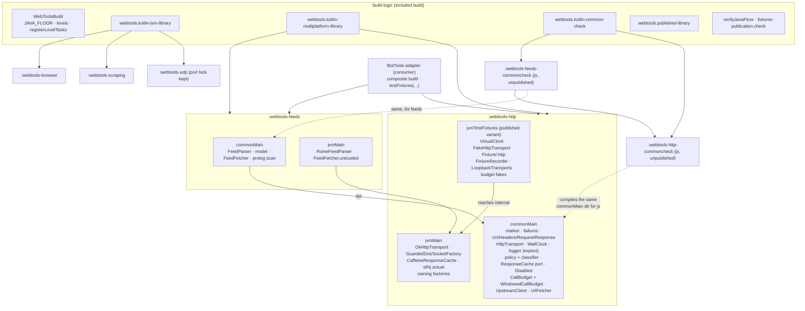
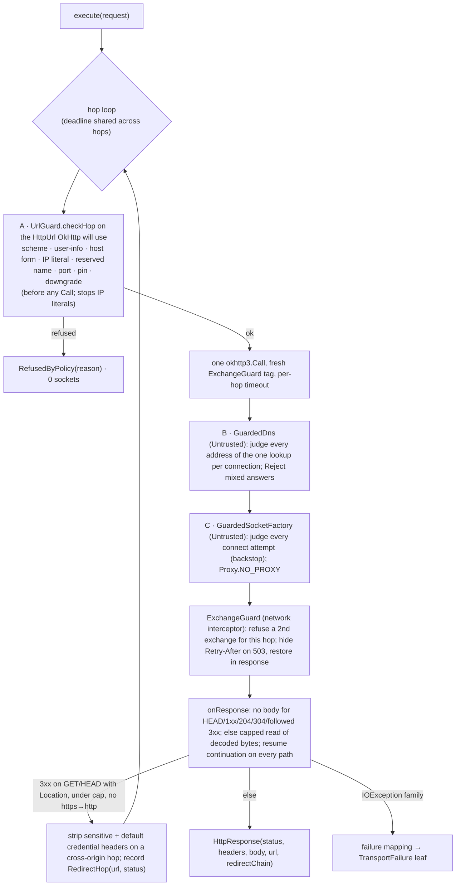
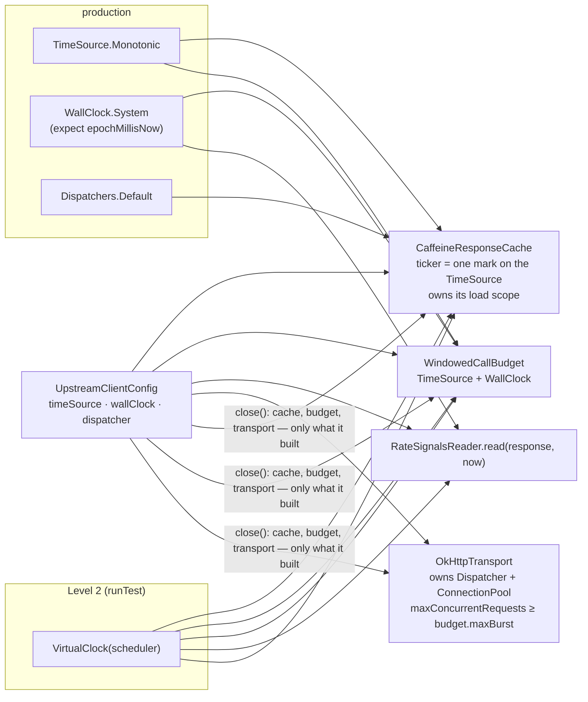

# Issue #55 — HTTP client stack (architecture)

- **Covers:** `SpartanLaboratories/WebTools#55` — *"HTTP client stack for BotTools: suspend
  transport, outbound-URL guard, response cache, call budget and test fakes"*. Folds in
  `SpartanLaboratories/WebTools#47` — *"webtools-udp 2.0.0 ships Java 23 bytecode but README
  claims JDK 11+"*.
- **What this designs:** the systems that make up a new Kotlin Multiplatform module
  `webtools-http` (transport, outbound-URL policy, response cache, call budget, call facades,
  failure model, published test support), a feeds module `webtools-feeds` built on it, the
  shared build logic every module reads (an included `build-logic` build with the Java 11
  floor), the unpublished check-only `js` compiles that keep common code common, and the
  documentation that describes them. Level-4 work: nothing is implemented from this document;
  each unit in §11 becomes a sub-issue of #55, planned and built at its own level.
- **Status:** systems design — implementation plans to follow.
- **Baseline:** `master` `806ce8e`; branch `feat/issue-55-http-client-stack` at `96c30d6` holds
  only the planning documents under `docs/plans/55-http-client-stack/`.
- **Related docs:**
  - [`research/README.md`](research/README.md) — the research questions, verification and
    summary this design rests on; the ten findings files beside it hold the evidence and the
    detailed type sketches;
  - [`47-java-23-bytecode/research/README.md`](47-java-23-bytecode/research/README.md) and
    [`java-11-floor.md`](47-java-23-bytecode/research/java-11-floor.md) — the Java floor;
  - `docs/webtools-udp-architecture.md` — the evergreen document this work's
    `docs/webtools-http-architecture.md` is modelled on;
  - `README.md`, the three module build files, `settings.gradle.kts`, `build.gradle.kts` —
    the living files this work edits;
  - [SpartanLaboratories/WebTools#58](https://github.com/SpartanLaboratories/WebTools/issues/58)
    (repository practices: CI, CONTRIBUTING, CHANGELOG, tags, the foojay bump) and
    [#50](https://github.com/SpartanLaboratories/WebTools/issues/50) (multiplatform direction
    for `webtools-udp`) — separate issues, not part of this work.

Paths under `webtools-http/src/commonMain/kotlin/com/spartanlabs/webtools/http/` are
abbreviated `common/`; `jvmMain` likewise `jvm/`; `src/jvmTestFixtures/kotlin/com/spartanlabs/webtools/http/testing/`
is `fixtures/`. Line references are to `806ce8e`.

---

## 1. Requirements

1. **A new module `webtools-http`** (`io.github.spartanlaboratories:webtools-http`, package
   `com.spartanlabs.webtools.http`, first version `1.0.0`) carries the whole HTTP stack: a
   suspend transport port with an OkHttp `okhttp-jvm` 5.5.0 default; the outbound-URL policies
   `Trusted` and `Untrusted`; a response cache port with a Caffeine 3.3.1 default; a call
   budget port with a fixed-window default; two call facades; one typed failure model carried
   in `kotlin.Result`; and the defaults of every port. `Connector` and `webtools-scraping` are
   not reworked.
2. **Kotlin Multiplatform.** `webtools-http` publishes `webtools-http` and
   `webtools-http-jvm`. `commonMain` holds the contracts and the platform-free defaults;
   `jvmMain` holds the OkHttp and Caffeine implementations. A seam that a consumer or the test
   fakes substitute is an interface; a plain platform value that nobody substitutes is
   `expect`/`actual`. The mechanism is chosen per type and the reason recorded (§6.9). Every
   multiplatform module's `commonMain` is also compiled for `js` by an unpublished check-only
   module, so a JVM API in `commonMain` is a compile error and nothing new is published.
3. **Published test support** ships as a Gradle test-fixtures variant of `webtools-http` (one
   coordinate, one version, capability `webtools-http-test-fixtures`): a fake transport with
   recorded fixtures and scripted statuses and headers; one injected time source shared by the
   cache ticker, the budget clock and coroutine `delay`; the real transport runnable against
   `mockwebserver3` 5.5.0; an environment-variable-gated fixture recorder that strips keys and
   never runs in CI.
4. **A feeds module `webtools-feeds`** built on `webtools-http`: RSS and Atom parsing behind a
   parser port with a Rome 2.1.0 default; fetching with a conditional GET (`ETag`,
   `Last-Modified`). It is multiplatform like `webtools-http`: port and model in `commonMain`,
   Rome in `jvmMain`, coordinates `webtools-feeds` and `webtools-feeds-jvm`, fake-based tests in
   `jvmTest`, its own check-only `js` compile.
5. **Java 11 for every module**, the three existing ones included (this resolves #47). The
   setting is one constant, `WebToolsBuild.JAVA_FLOOR`, in an included `build-logic` build;
   every module reads it; the root build file keeps only `group` and `version`.
6. **Configurable types are built by public factory functions** taking builder lambdas over
   `internal` constructors. Policy numbers (windows, margins, wait caps, TTLs, cache size,
   timeouts, caps) are builder properties with defaults. A type whose every constructor
   parameter is required and is its meaning keeps a public constructor.
7. **Stability tiers.** What a consumer calls or configures is Stable Core. Every seam a
   consumer implements or substitutes is Experimental behind one opt-in marker,
   `ExperimentalForInheritanceWebToolsApi`, applied only through `@SubclassOptInRequired`; the
   supplied defaults are usable without opting in. A seam graduates to `@SupportedExtension` in
   a feature release once a consumer (BotTools' adapter) has built against it. The published
   test fixtures are Stable Core with source compatibility only (§9).
8. **Legacy.** `webtools-scraping` and `webtools-browser` may break their public API where the
   repository-wide changes force an edit (no shims). `webtools-udp` keeps its public API.
9. **Settled behaviour.** A general request model (method, URL, headers, optional body);
   suspend API only (no blocking or `CompletableFuture` variant; Java callers are a non-goal);
   the hard daily stop holds within one process, with an opt-in seam to persist budget counters
   and an in-memory default; failures through `kotlin.Result` with no nullable results and no
   exceptions for expected failures; cancellation propagates; a programmer error in
   developer-written configuration throws `IllegalArgumentException` at construction, as
   `webtools-udp`'s constructors do (`MultiConnectionUDPClient.kt:188`, `:195`); `okhttp-jvm`
   5.5.0 as an ordinary `implementation` requirement moving only with the OkHttp that JDA
   adopts; Kotlin 2.2.0, kotlinx-coroutines 1.10.2, Gradle 9.7.1; no `-SNAPSHOT` dependency;
   Gradle Module Metadata beside each POM; `explicitApi()` on the new modules only; Level-2
   KDoc on every public declaration; five-level tests in packages
   `com.spartanlabs.testing.<level>.webtools.<module>` with `mockwebserver3` at Level 3;
   nothing from skrapeit, jsoup, unirest, Ktor or Jackson on a consumer's classpath; every
   third-party library an `implementation` dependency with none in a public signature, with
   one exception: `kotlinx-coroutines-core`, the runtime of the suspend API, is an `api`
   dependency because `CoroutineDispatcher` appears in configuration (§6.2); `Untrusted`
   refuses requests carrying credential headers; `Trusted` is https-only unless cleartext is
   switched on; the URL policy is a closed pair with tightening-only parameters; `WallClock`
   and `BudgetObserver` are plain gated interfaces; the level tests run on the build JDK; the
   repository's own rules (`.aiassistant/rules/CLAUDE.md:14-16`, `:20-22`) bind new code.
10. **Scope.** Each unit lands as its own sub-issue, merges on its own and leaves `master`
    building with every test green. Releasing follows the organisation's steps once #58's
    practices exist. The first consumer is BotTools (`SpartanLaboratories/KotlinBottools`:
    JDK 21, Kotlin 2.2.x, coroutines 1.10.2, JDA 6.7.0 bringing `okhttp-jvm` 5.5.0), which
    reaches the stack only through an internal adapter and develops against a sibling
    WebTools checkout through a nested Gradle composite build.

**Acceptance (systems level).** `./gradlew build` on `master` after the last unit: every module
compiles to class-file major 55 and declares `org.gradle.jvm.version: 11` on its API and
runtime variants; `webtools-http`'s and `webtools-feeds`' `commonMain` compile for `js` in
their check modules; `webtools-http` publishes a `-test-fixtures.jar` whose variants a JVM
Gradle consumer resolves with `testFixtures(...)` from a file repository and through
`includeBuild`, with `kotlinx-coroutines-test` and `mockwebserver3` absent from the main
variants; the three existing modules publish POMs and metadata identical to today's except the
JVM version; BotTools' published acceptance checks (the `Untrusted` refusals, `429` handling,
size caps and conditional GETs against `mockwebserver3`, and Level 2 on the fakes) are each
proven by a WebTools test at the level named in
[`research/codebase-blast-radius.md` §7](research/codebase-blast-radius.md).

## 2. Current state

**Build.** `settings.gradle.kts:2` applies `foojay-resolver-convention` 0.8.0 and `:7`
includes `:webtools-udp`, `:webtools-scraping`, `:webtools-browser`; the wrapper is Gradle
9.7.1. The root `build.gradle.kts:3-4` declares `kotlin("jvm")` 2.2.0 and vanniktech
`maven-publish` 0.36.0 `apply false`; `:12-15` sets `group` and `version = "1.0.0"` for all
projects; the `subprojects {}` block (`:17-92`) applies both plugins (`:18-19`), adds
`api(slf4j-api:2.0.13)` and the JUnit 5 test dependencies (`:29-32`), registers the seven level
test tasks over `sourceSets["test"]` selecting by JUnit tag (`:44-62`), and holds the publishing
skeleton (`:64-91`). No build file sets `jvmToolchain`, `jvmTarget`, `-Xjdk-release` or
`explicitApi()`; every published artifact is Java 23 bytecode declaring
`org.gradle.jvm.version: 23`, while `README.md:26` promises "JDK 11 or newer".
`webtools-udp/build.gradle.kts:101` sets `version = "2.0.0a"` (unreleased); `:103-117` holds
the UDP port lock, which calls `tasks.named<Test>(...)` on `test`, `integrationTest`,
`e2eTest` and `nonfunctionalTest` at module evaluation (`:115-117`). `gradle.properties` holds
only `kotlin.code.style=official`; `.gitattributes` covers `*.kt` and `*.kts` only.

**Tests.** 99 test files; the 95 tagged ones carry a `@Tag` equal to their
`testing.<level>` package segment; 4 untagged `testing/support/` helpers. Every level of every
module passes on an unmodified `master`: 642 tests executed, 15 `@Disabled` by design
([blast radius §5](research/codebase-blast-radius.md)).

**HTTP in the repository today.** `Connector` (`webtools-scraping/.../Connector.kt`) is the
only HTTP client: a blocking, stateful line reader over `java.net.URLConnection` (`:85`,
`:218`, `:229`) that sets the JVM-wide `http.agent` to a browser string on every connect
(`:150`), calls `Unirest.setTimeouts(0, 0)` in its `init` (`:65`), and offers one-shot `get`
(`:263`, Unirest), `skrape` (`:281`, skrapeit) and `download` (`:198`, jsoup + `ImageIO`).
`WebViewer` (`webtools-browser/.../WebViewer.kt:40`, `:51`) drives headless Chrome, which
resolves and fetches by itself (`:63`). `resolveLocalAddress()`
(`webtools-udp/.../General.kt:32`) is a UDP `connect` to read the local address.

**Idioms the new code follows.** `ReliableSendFailure.kt:15` is an open `abstract class … :
Exception` carried in `Result`, deliberately not sealed; `README.md:70-76` states the
"keep an `else` branch" rule for enums that may grow. `ResultExtensions.kt:3-5` records the
deliberate duplication of the `internal inline` `flatMap` between `webtools-udp` and
`webtools-scraping`. Logging is parameterised slf4j with `{}` placeholders. `webtools-udp`
keeps 36 source files in one flat package. Level-2 tests use hand-written `Fake*` classes;
MockK appears nowhere.

**Verified outside-world facts** (231 claims re-opened at source on 2026-10-21; 227 hold,
none fails — [`research/README.md` § Verification](research/README.md)):

- The Kotlin Gradle plugin 2.2.0 configures, compiles, tests and publishes a multiplatform
  module on Gradle 9.7.1 with the configuration cache on, writing metadata `[2,2,0]` and a
  `kotlin-stdlib` 2.2.0 requirement; the pairing is undocumented and raises one Gradle-10
  deprecation (KT-78620, fixed in the 2.3 line) ([build topology F1](research/kmp-build-topology.md)).
- A single `jvm()` target compiles `java.*` in `commonMain` silently; a second target makes
  the compiler reject it; a target cannot be declared and left unpublished; an unpublished
  check-only module compiling the same `commonMain` directory for `js` works and downloads
  nothing while its tests are disabled (build topology F3).
  > **Corrected 2026-10-25 (#62 as built):** `./gradlew build` still downloads Node.js and Yarn; see §6.8.
- `jvmTarget = 11` alone compiles JDK 21 calls (`MutableList.removeFirst()` bound to
  `List.removeFirst`); `jvmTarget` plus `-Xjdk-release=11` rejects them; a multiplatform
  `jvm()` target writes no `org.gradle.jvm.version` unless the attribute is set explicitly;
  the three existing modules compile under the floor with identical `javap -protected`
  signatures and pass every level on a real JDK 11; no dependency on any candidate classpath
  is above Java 11; a toolchain request would need the foojay bump
  ([java-11-floor F1–F5](47-java-23-bytecode/research/java-11-floor.md)).
- A JVM-only `testFixtures` compilation published through the experimental
  `kotlin.publishing.adhocSoftwareComponent` resolves with `testFixtures(...)` from a file
  repository and through `includeBuild`, its dependencies reaching only the consumer's test
  classpath; Kotlin has no first-class feature for this (KT-63142, KT-69482 open)
  ([test fixtures F4–F7](research/kmp-test-fixtures.md)).
- OkHttp 5.5.0 re-sends a `503` carrying `Retry-After: 0` and a `421` regardless of client
  flags; network interceptors run after the connect; only `Authorization` is stripped on a
  cross-host redirect; `Dns` is never consulted for a digits-and-dots or colon host; a body
  read after `executeAsync` returns is not cancellable ([transport F1–F5](research/http-transport.md);
  [policy F1, F4](research/outbound-url-policy.md)).
- Caffeine 3.3.1's `AsyncCache.get` is single-flight; exceptional completion logs a WARNING
  per failure and leaves a joinable window; `CompletionStage.await()` cancels the shared
  future, `asDeferred().await()` does not; `refreshAfterWrite` is unavailable on an async
  cache ([cache F1–F7](research/response-cache.md)).
- OpenDota and Open-Meteo count in fixed wall-clock windows and count refused requests; a
  greedy token bucket let 119 calls into one server minute against 60; aligned windows with a
  1 s guard overspent in 0 of 1,000 skewed trials; `kotlin.time.Clock`/`Instant` need an
  error-level opt-in on 2.2.0 ([budget F1, F2, F10](research/call-budget.md)).
- `TestCoroutineScheduler.timeSource`, `advanceTimeBy(Duration)` and `runCurrent()` are stable
  in `kotlinx-coroutines-test` 1.10.2; `MockWebServer.start()` binds loopback;
  `mockwebserver3-junit5`'s `@StartStop` closes the server only from JUnit 5.13
  ([test support F1, F6](research/test-support-and-time.md)).
- `@SubclassOptInRequired` is stable on 2.2.0, gates implementing and delegating but not
  mentioning a type, and cannot be placed on a `fun interface` or a sealed type; a directly
  marked type in a default-path signature contaminates every caller; adding a defaulted
  parameter breaks binary compatibility for Kotlin callers and `@IntroducedAt` is Kotlin 2.3+
  ([API shape F1, F2, F7](research/api-shape-and-failures.md)).
- Rome 2.1.0 refuses DOCTYPE by default but skips a hardening feature its SAX provider does
  not recognise; its last release is 2023-03-12; rssreader 3.12.0 swallows malformed XML into
  an empty stream and ignores Atom `rel` ([feeds F1, F2](research/feed-parsing.md)).

## 3. Assumptions

- **KGP 2.2.0 keeps working on Gradle 9.7.1.** Measured on this toolchain; undocumented. If a
  Gradle or plugin update breaks it, the fallback is KGP 2.3.x or 2.4.x pinned to
  `languageVersion = apiVersion = 2.2` and `coreLibrariesVersion = "2.2.0"`, which was
  measured to publish the same metadata; the design is otherwise unchanged.
- **A consumer's Gradle compiles `build-logic` with its own embedded Kotlin.** BotTools is on
  9.7.1 (embedded Kotlin 2.4.0), measured to compile a `build-logic` that depends on KGP 2.2.0.
  A consumer on an older Gradle 9 is unverified; if it failed, `build-logic` would need to
  restrict itself to the oldest embedded Kotlin a consumer uses.
- **`-Xjdk-release=11` is effective on the JDK distributions that build the repository.**
  Measured on Oracle JDK 23 and Temurin 21; Kotlin documents the flag as "not guaranteed to be
  effective for each JDK distribution". The `verifyJavaFloor` guard (§6.1) is the backstop; a
  distribution without `ct.sym` data would surface as a guard failure, not a silent artifact.
- **Maven Central accepts a `-test-fixtures.jar` without its own sources and javadoc jars.**
  Central hosts such Gradle-published artifacts; the Portal validator was not run. If it
  refused, an extra adhoc sources variant for the fixtures is additive.
- **A newer OkHttp 5.x a consumer resolves keeps the `Dns` and `SocketFactory` hooks and the
  network-interceptor chain.** The guards are layered so that a change in one path is caught by
  another (§6.3); a removed hook would fail a Level 3 test, not a production guarantee silently.
- **The check-only `js` compile needs only the multiplatform `kotlinx-coroutines-core`.**
  Measured for `webtools-http`'s `commonMain`; `webtools-feeds`' check module additionally
  depends on `webtools-http`'s check module for the `js` klib (§6.8), which was not probed. If
  that dependency does not resolve, the feeds check module compiles both `commonMain`
  directories as source.
- **No test requests a JDK toolchain.** The level tests run on the build JDK (requirement 9),
  so foojay 0.8.0 is never consulted and the bump stays #58's.

## 4. Non-goals

- Reworking `Connector`, `WebViewer` or any legacy source; moving existing code onto the stack
  (adoption verdicts and named follow-ups in §8).
- A blocking, `CompletableFuture` or Java-friendly API; streaming bodies; per-request timeout
  overrides; an `EventListener`-style transport observer (decoration is the hook).
- A consumer-implemented URL-guard seam, a loosening parameter on `Untrusted`, or `Untrusted`
  through a proxy.
- A multi-process or shared-counter budget, a file-backed `BudgetStore`, calendar-month
  windows, per-window costs, a generic IETF `RateLimit` header reader.
- Stale-while-revalidate in the cache; a cache default for non-JVM targets beyond
  `ResponseCache.Disabled`.
- HTML feed auto-discovery; a stateful feed poller or "new items" tracker; a published
  conditional-GET `mockwebserver3` dispatcher; a published test-fixtures variant of
  `webtools-feeds` (its `FeedParserContract` is published with `FeedParser`'s graduation).
- A published `js` (or any non-JVM) artifact; `webtools-udp` multiplatform (#50).
- Running the level tests on a JDK 11 launcher, the foojay bump, CI, `CONTRIBUTING.md`,
  `CHANGELOG.md`, tags and releasing (#58); enabling the configuration cache repository-wide
  (the requirement is compatibility).
- Defining `@SupportedExtension` now (nothing in 1.0.0 carries it) or ABI dumps for the three
  existing modules.
- Removing the redundant `@Tag` annotations from the 95 tagged legacy test files.

## 5. System inventory — overview

| # | System | Responsibility (one sentence) | Placement |
|---|---|---|---|
| 6.1 | Shared build logic | Configure every module from one place: the three convention plugins, the Java floor constant and its guard, the package-selected level tasks, the publishing skeleton. | `build-logic/` (included build) |
| 6.2 | `webtools-http` common core | Own the vocabulary every other system speaks: the marker, the failure model, request/response value types, the transport port, the wall-clock port, the logging seam. | `common/`, `jvm/` |
| 6.3 | Outbound-URL policy and transport | Decide which URLs may be fetched and fetch them exactly once per hop under caps, through OkHttp. | `common/` (policy, classifier), `jvm/` (OkHttp) |
| 6.4 | Response cache | Serve one decoded value per key to many concurrent callers, for a bounded time, never caching a failure. | `common/` (port), `jvm/` (Caffeine) |
| 6.5 | Call budget | Grant permits under provider windows and lanes, pause on server signals, hold a hard daily stop. | `common/` (port and default) |
| 6.6 | Call facades | Compose cache, budget and transport into `UpstreamClient` (endpoints) and `UrlFetcher` (administrator-supplied URLs). | `common/` (classes, common factories), `jvm/` (owning factories) |
| 6.7 | Published test support | Let a consumer test its providers with no network at Level 2 and over loopback at Level 3, through the fixtures variant. | `fixtures/` (JVM-only compilation) |
| 6.8 | Check-only `js` modules | Turn "common code is common" into a compile error without publishing anything. | `webtools-http-commoncheck/`, `webtools-feeds-commoncheck/` |
| 6.9 | Common-code mechanism per type | The recorded choice, per type, between interface, plain common class and `expect`/`actual`. | (a table, not code) |
| 6.10 | `webtools-feeds` | Parse RSS/Atom behind a hardened parser port and fetch feeds with a caller-owned conditional GET over `UrlFetcher`. | `webtools-feeds/` |
| 6.11 | Documentation | Keep the README and an evergreen `docs/webtools-http-architecture.md` true. | `README.md`, `docs/` |

## 6. System inventory — detail

### 6.1 Shared build logic — `build-logic`

- **Responsibility:** one place where every module's compile target, test layout and
  publishing shape are decided.
- **Placement:** an included build at `build-logic/` (`pluginManagement { includeBuild("build-logic") }`
  in `settings.gradle.kts`, first statement). The root `build.gradle.kts` keeps only
  `allprojects { group; version }`; its `plugins`, `subprojects {}`, level-task and publishing
  blocks (`:1-5`, `:17-92`) move here. Plugin versions (KGP 2.2.0, vanniktech 0.36.0) are
  pinned once in `build-logic/build.gradle.kts`.
- **Owns:**
  - `WebToolsBuild` — an object holding `JAVA_FLOOR = 11`, the ordered level list
    (`gating`, `component`, `integration`, `deterministic`, `e2e`, `nonfunctional`, `uat`) and
    `registerLevelTasks(project, classesDirs, classpath)`, which registers seven plain `Test`
    tasks selecting by package filter `com.spartanlabs.testing.<level>.*` with
    `isFailOnNoMatchingTests = false`. The package filter replaces the JUnit-tag filter
    (`build.gradle.kts:60`); on the three existing modules it selects exactly the same 99
    classes.
  - `webtools.published-library` — applies vanniktech, `mavenCentral()`,
    `publishToMavenCentral()`, `signAllPublications()` and the shared `pom {}` block
    (`build.gradle.kts:64-91`). Per-module `coordinates(...)` and `pom { name; description }`
    stay in each module, as today.
  - `webtools.kotlin-jvm-library` — applies `org.jetbrains.kotlin.jvm` by id and the
    published-library plugin; sets `jvmTarget`, `-Xjdk-release` and `java { sourceCompatibility;
    targetCompatibility }` from `JAVA_FLOOR`; adds `kotlin("test")`, `kotlin("test-junit5")`
    and logback as test dependencies; `useJUnitPlatform()`; the level tasks over
    `sourceSets["test"]`; the floor guard.
  - `webtools.kotlin-multiplatform-library` — applies `org.jetbrains.kotlin.multiplatform` by
    id and the published-library plugin; declares `jvm()` with `jvmTarget`, `-Xjdk-release`
    and the explicit `TargetJvmVersion` attribute from `JAVA_FLOOR`; `useJUnitPlatform()`; the
    level tasks over `jvm().compilations["test"]`; a lifecycle `test` task depending on
    `jvmTest` so `./gradlew test` (`README.md:471`) keeps covering the module; `configure(KotlinMultiplatform(javadocJar = Empty, sourcesJar = Sources))`;
    the floor guard; the ABI dump through `binary-compatibility-validator` 0.18.2 (one JVM
    dump per module, `apiCheck` wired into `check`).
  - `webtools.kotlin-common-check` — applies the multiplatform plugin with only a `js` target
    whose test task is disabled, for the check-only modules (§6.8). Lands with the first
    check module.
    > **Corrected 2026-10-25 (#62 as built):** the `js` target has no environment; see §6.8.
  - `verifyJavaFloor` — a typed verification task registered by both library plugins and
    wired into `check`: reads the module's built jars (including the fixtures jar), the
    generated `.module` files and the resolved runtime classpath; fails on any
    non-multi-release class above major 55 or any `java-api`/`java-runtime` variant whose
    `org.gradle.jvm.version` is not `JAVA_FLOOR`. It is a Gradle task, not a level test,
    because the facts live in the publishable files.
  - The **fixtures-publication check** (lands with §6.7): a Gradle TestKit test in
    `build-logic`'s own test source set that publishes `webtools-http` to a build-local file
    repository, then resolves `testFixtures("io.github.spartanlaboratories:webtools-http:<v>")`
    once from that repository and once through `includeBuild`, asserting the capability,
    `org.gradle.jvm.version == 11` on both fixtures variants, and that neither main variant
    lists `kotlinx-coroutines-test` or `mockwebserver3`. It is the only thing that notices a
    KGP or Gradle upgrade changing the experimental publishing behaviour. Wired into the root
    `check` through the included build's task.
- **Does not own:** module coordinates, dependencies, `explicitApi()` (set per module: it must
  apply to the new modules and not to the legacy ones, so it cannot hang off the kind of
  plugin), `api(slf4j-api)` (declared in each of the three existing modules' build files so
  their published POMs stay identical; the new modules declare slf4j `implementation` in
  `jvmMain` only), the `webtools-udp` port lock (stays at
  `webtools-udp/build.gradle.kts:103-117`, unchanged, because the plugin that registers the
  level tasks is applied in the module's `plugins {}` block before the lock's `tasks.named`
  calls run).
- **Mechanism, not toolchain.** The floor is `jvmTarget = 11` plus `-Xjdk-release=11` on the
  build JDK. No `jvmToolchain(11)`: it would force the foojay bump into this work, make every
  consumer's composite build need a JDK 11, and still not write the KMP attribute.

### 6.2 `webtools-http` common core

- **Responsibility:** the vocabulary and the contracts every other system in the module
  speaks, with nothing platform-specific in a signature.
- **Placement:** `common/`, one flat package `com.spartanlabs.webtools.http` (no `.internal`
  subpackage: `internal` does the hiding, and a flat package never needs a type to move).
  `explicitApi()`. Module build: `webtools.kotlin-multiplatform-library`, `jvm()` only,
  `jvmMain` dependencies `okhttp-jvm` 5.5.0, `caffeine` 3.3.1 and `slf4j-api` 2.0.13, all
  `implementation`.
- **The one `api` dependency.** `kotlinx-coroutines-core` 1.10.2 is the only third-party
  library either new module exposes as `api`, declared in `commonMain`. `webtools-feeds`
  re-exports it through its `api` dependency on `webtools-http` (§6.10).
  - **Why it is `api`.** It is the runtime of a suspend API, and `CoroutineDispatcher` appears
    in configuration at three points:
    - the cache's `loadDispatcher` (§6.4);
    - `UpstreamClientConfig.dispatcher` (§6.6);
    - the feed fetcher's `parseDispatcher` (§6.10).
  - **Why the dispatcher must be injectable.** Under `runTest`, a library-owned scope on
    `Dispatchers.Default` runs `delay` in real time. Injecting the test dispatcher is what lets
    one virtual clock drive the cache, the budget and `delay` together. It also lets a consumer
    choose where work runs, for example a `limitedParallelism` view that bounds parse threads.
  - **Why this does not widen the rule.** Every consumer of a suspend API already depends on
    `kotlinx-coroutines-core`, and BotTools pins the same 1.10.2. The published `-jvm` API
    variant lists it, so a newer version in a consumer's graph is selected as usual. The rule
    that keeps library types out of public signatures still holds for every implementation
    library: OkHttp, Caffeine, Rome and slf4j.
- **Owns:**
  - **The marker** `ExperimentalForInheritanceWebToolsApi`: `@RequiresOptIn(level = ERROR)`,
    `@Target()` (so it can only be the argument of `@SubclassOptInRequired` and `@OptIn`),
    `BINARY` retention, `@MustBeDocumented`. It is never placed directly on a declaration, so a
    default-path signature can never contaminate a caller. The module's own build opts in
    module-wide; the fixtures source opts in; consumers opt in only to implement or delegate.
    The class is never removed, even after every seam graduates.
  - **The failure model**, an open hierarchy carried in `Result`, following
    `ReliableSendFailure.kt:15`: `abstract class HttpFailure : Exception` (subclass-gated) with
    direct final leaves `Closed` (one leaf for transport, cache, budget and client; message
    names the component), `BudgetExhausted(wait, reason, window)` and `DecodeFailure`; the
    abstract groups `TransportFailure` (nothing usable came back: `Timeout`, `ConnectFailed`,
    `DnsFailed(host)`, `TlsFailed`, `Protocol`, `Io`, `InvalidRequest`,
    `RefusedByPolicy(reason)`, `BodyTooLarge(limit, declared)`, `TooManyRedirects(limit)`,
    `RetryRefused`) and `UpstreamFailure(status)` (the server answered: `RateLimited(status,
    retryAfter)`, `UpstreamError(status, headers, body)`). Leaf primary constructors are frozen;
    leaves a seam implementer or decoder must create are public, the rest `internal`. Messages
    are a constant per type plus non-sensitive fields; never a URL with its query, a header, a
    body, a credential or a resolved address. New leaves may be added in a feature release;
    the KDoc and README say "match the groups you care about and keep an `else`".
  - **The reason vocabularies** `RefusalReason` (`Scheme`, `UserInfo`, `HostForm`,
    `ReservedName`, `DeniedAddress`, `Port`, `HostNotPinned`, `InsecureRedirect`,
    `SensitiveHeader`) and `ExhaustedReason` (`Window`, `Paused`, `CostExceedsLimit`,
    `QueueFull`): open constants classes with private constructors, equality by name, no
    `of()`. They are library-produced, so an enum would make every added entry a compile error
    in a consumer's exhaustive `when`. The producers (§6.3, §6.5) land later.
  - **Request and response types:** `HttpMethod` (final class with constants and
    `of(name): Result`), `Url` (parsed once; `http`/`https` only; no user-info; `redacted()`
    never includes the query; `parse(text): Result<Url>`), `HttpHeaders` (ordered,
    case-preserving, case-insensitive lookup, validated, per-entry sensitive flag set through
    `addSensitive`; builder), `RequestBody(bytes, contentType)`, `HttpRequest(method, url,
    headers, body)` (factory + builder), `HttpResponse(status, headers, body, url,
    redirectChain)` (factory + builder) where `redirectChain` is a list of `RedirectHop(url,
    status)` so a feed fetcher can tell a permanent move from a temporary one. No received-at
    time (it would bypass the injected clock), no charset (the caller's decoder gets bytes),
    no streaming. Developer-written values are checked with `require`; text from outside the
    process returns `Result`.
  - **The transport port** `HttpTransport : AutoCloseable` (subclass-gated): `suspend fun
    execute(request): Result<HttpResponse>`; `close()` with a default empty body so fakes need
    not override it. A `304` is a response, never a failure. Cancellation is thrown, never
    wrapped. The contract (one request per hop, caps, `Closed` after `close()`) is stated in
    KDoc and pinned by the fake and the Level 3 suite.
  - **The wall-clock port** `WallClock` (plain gated interface, `nowEpochMillis(): Long`) and
    `WallClock.System`. Epoch milliseconds, not `kotlin.time.Instant`, because `Instant` and
    `Clock` need an error-level opt-in on 2.2.0 and a library must not expose experimental
    stdlib API.
  - **The logging seam:** an `internal interface Log` (`debug`, `info`, `warn` with
    `{}`-placeholder messages) obtained through `internal expect fun logger(name: String): Log`.
    `jvm/` provides the slf4j actual (`LoggerFactory.getLogger(name)`); the check module
    provides a no-op `js` actual. Every logging site in the module uses it, so one style and
    one test-capture path (logback in `jvmTest`). Levels and the "never" list are in §6.6.
  - **Internal helpers:** a private copy of `Result.flatMap` (Kotlin `internal` stops at the
    Gradle module, so `webtools-udp`'s copy is unreachable; the copies stay identical, and
    the header names the siblings), and a `suspend` non-fatal catch helper that converts
    `Exception` other than `CancellationException` to `Result.failure` and rethrows everything
    else (no `runCatching` around a suspend call anywhere in the module).
  - **The first compile proof.** This unit is where the marker, a gated interface, a default
    mentioning that interface in a constructor default, and a consumer without the opt-in are
    compiled together in `commonMain` and `jvmMain` for the first time (research gap); its
    plan includes that check before anything else.
- **Does not own:** any default implementation, any policy number, the fixtures.

### 6.3 Outbound-URL policy and transport

Two subsystems with one seam between them: the policy decides, the transport enforces.

#### 6.3.1 Outbound-URL policy (`common/`, plus `jvm/` enforcement)

- **Responsibility:** decide, for every hop and every resolved address, whether a fetch may
  proceed, from data parameters that can only tighten.
- **Owns:**
  - `OutboundUrlPolicy`, a sealed pair (the closed set is the contract): `Trusted` (optional
    `pinnedHosts`; `allowCleartext = false`; no address filtering, no name or port rule) and
    `Untrusted` (`allowedPorts` default `{80, 443, 8080, 8443}`, `null` for any;
    `extraDeniedRanges`; `extraDeniedHostSuffixes`; `mixedAnswers` default `Reject`). Each is
    built by a factory with a builder (`OutboundUrlPolicy.trusted { }`, `untrusted { }`) and
    carries its `TransportSettings` default. There is no parameter that lowers `Untrusted`'s
    protection; "fetch from a private address" is `Trusted`. `Untrusted` refuses a request
    carrying a sensitive-flagged header or one named `Authorization`, `Proxy-Authorization` or
    `Cookie` (`SensitiveHeader`).
  - `TransportSettings` (factory + builder): call, connect, read and write timeouts; body cap
    (decoded bytes); redirect cap; `allowHttpsToHttp = false`; concurrency (`maxConcurrentRequests`,
    `maxConcurrentRequestsPerHost`); idle-connection TTL (default 4 s, under the 5 s idle
    defaults of Apache and Node, so a transport that never retries rarely meets a stale pooled
    connection). The settings belong to the policy because `Untrusted`'s caps and timeouts are
    part of what makes it untrusted (`Untrusted`: 15 s call, 5 s socket timeouts, 2 MiB, 3
    redirects, 8/2 concurrency; `Trusted`: 30 s, 10 s, 5 MiB, 5, 16/5). All numbers are
    judgement, parameterised with these defaults.
  - `CidrBlock` (`parse(text): Result`), `MixedAnswers` (an enum: consumer-chosen, so growth
    never breaks a producer).
  - **The classification core**, `internal`, pure functions over bytes and strings in
    `common/`, Level 4a-testable in `commonTest` and measured to pass identically on JVM and
    `js`: `AddressRanges.deny(bytes)` (the IANA special-purpose tables: an IPv4 deny list plus
    multicast; IPv6 default-deny outside `2000::/3` with the documented blocks inside it denied;
    IPv4-mapped and NAT64 well-known addresses judged by their embedded IPv4), `StrictIp`
    (strict dotted-decimal and strict IPv6 only; every lenient form such as `127.1`,
    `2130706433`, `0177.0.0.1` is refused as `HostForm`, which removes the parser-disagreement
    class of bypass), `HostRules` (reserved names: single labels, `localhost`, `local`,
    `internal`, `home.arpa`, `localdomain` and their subdomains, plus the policy's suffixes),
    `UrlGuard(policy, relaxation)` with `checkHop(...)` and `checkAddress(bytes)`, and
    `GuardRelaxation` whose only non-`None` value, `LoopbackForTests`, exempts exactly
    `localhost`, `127.0.0.1`, `[::1]`, `127.0.0.0/8`, `::1` and the port rule for those hosts.
    `LoopbackForTests` is reachable only through the fixtures (§6.7): the main artifact has no
    loosening knob.
  - **JVM enforcement** (`jvm/`, `internal`): `GuardedDns` (wraps `Dns.SYSTEM` or a stub;
    judges every returned address; rejects a mixed answer whole under `Reject`),
    `GuardedSocketFactory` (judges the `InetSocketAddress` of every `connect`, including
    fallback attempts; the version-independent backstop), two marker exceptions carrying the
    `RefusalReason` with constant messages, and `Proxy.NO_PROXY` for `Untrusted` (a proxy
    resolves names itself and bypasses both guards; `Trusted` keeps OkHttp's default selector).
- **Refusals** carry a coarse reason and never an address, a range or a query; logs carry
  `Url.redacted()`, the reason name and the matched range class only.

#### 6.3.2 OkHttp transport (`jvm/`)

- **Responsibility:** deliver one request per hop to the network, read a capped body where
  cancellation can reach it, and map every outcome to the failure model.
- **Owns:** `OkHttpTransport : HttpTransport`, final, built by a factory taking `userAgent`
  (required, validated) and an `OutboundUrlPolicy`, plus an `internal` constructor (for the
  fixtures) taking the `UrlGuard`/relaxation, a `Dns` and an optional donor `OkHttpClient`.
  Inside:
  - the client: a **new** `Dispatcher` (sized from the settings; the facade raises
    `maxConcurrentRequests` to the budget's `maxBurst` when it builds both, because OkHttp's
    queue is invisible to the call timeout and the wait cap) and `ConnectionPool` even when
    derived from a donor (`newBuilder()` shares pools, and `close()` must not stop someone
    else's threads); inherited interceptors, cache, cookie jar and authenticators cleared;
    `retryOnConnectionFailure(false)`, `followRedirects(false)`, `followSslRedirects(false)`;
    timeouts from the settings; the policy's `Dns`, `SocketFactory` and proxy choice;
  - the `ExchangeGuard` network interceptor: a fresh per-hop counter on a `Request` tag that
    throws on a second exchange (fail closed, covering `421` and any future re-send path), and
    hiding of `Retry-After` on a `503` from OkHttp's follow-up logic with restoration in the
    response (so the `503` is delivered, once);
  - the redirect loop: `UrlGuard.checkHop` before any `Call` (the only check that stops
    IP-literal hosts); one `Call` per hop under one shared deadline; `GET`/`HEAD` only; every
    sensitive-flagged header and the default credential names stripped on a cross-origin hop;
    `https`→`http` refused unless allowed; the `3xx` returned as a response when not followed;
    each hop recorded in `redirectChain` with its status;
  - the exchange: `suspendCancellableCoroutine` with `invokeOnCancellation { call.cancel() }`,
    the capped body read **inside** `Callback.onResponse` (decoded bytes; early refusal on a
    declared length over the cap; no body read for `HEAD`, `1xx`, `204`, `304` or a followed
    redirect), the continuation resumed on every path before anything is rethrown;
  - the failure mapping (marker exceptions first, then `UnknownHostException`, timeouts, TLS,
    connect, protocol, other `IOException`), `Closed` after `close()` without touching the
    dispatcher;
  - `close()`: cancel in-flight calls, shut the dispatcher executor down, evict the pool
    (without it the JVM lingers 60 s). Idempotent, non-suspend.
- **Does not own:** retries (never), the policy's rules, logging of headers, bodies, queries
  or OkHttp objects (never).

### 6.4 Response cache

- **Responsibility:** one decoded value per key, served to any number of concurrent callers
  from one load, for a bounded time, with failures never stored.
- **Owns (`common/`):** `ResponseCache : AutoCloseable` (subclass-gated): one suspend
  `getOrLoad(key, policy, maxAge, loader): Result<Lookup<V>>` (no default on `maxAge`; an
  overload without it), `invalidate`, `invalidateAll`, `stats()`, `close()`;
  `CacheKey<V>(endpointId, params)` (phantom-typed; equality over the id and the parameters
  sorted by name with a stable sort; `toString` prints parameter names only; never a tenant,
  a header, a credential or the decoder); `CachePolicy(ttl, missTtl = 60 s)` (factory +
  builder, so `staleFor` can be added later); `Lookup` sealed `Found(value, weight)` /
  `Missing` (a confirmed miss is a value, never null and never a failure); `CacheStats`;
  `ResponseCache.Disabled` (pass-through: no storage, no sharing; the only implementation
  constructible in common code).
- **Owns (`jvm/`):** `CaffeineResponseCache`, final, factory + builder over `timeSource`
  (default `TimeSource.Monotonic`), `maxWeight` (1,000; weight 1 per entry unless the loader
  reports one), `loadDispatcher` (default `Dispatchers.Default`), `maintenanceExecutor`
  (default the common pool). Inside: an `AsyncCache` with a variable `Expiry` reading the
  entry's TTL, a `Ticker` derived from one mark on the injected `TimeSource`, `maximumWeight`
  with a weigher, `recordStats()`, no `Scheduler`, no listeners; loads run in a cache-owned
  `CoroutineScope(SupervisorJob() + loadDispatcher)` started **after** the Caffeine mapping
  function returns; failures complete the future normally as a zero-lifetime entry that each
  waiter removes by identity before returning (no exceptional completion, so no Caffeine
  WARNING and no joinable failed future); waiters use `asDeferred().await()` so one waiter's
  cancellation leaves the load and the other waiters intact; a load nobody waits for still
  completes and lands; `maxAge` is an age check on read with a compare-and-remove (one load
  for N stale callers); `close()` cancels the scope and completes every waiter with `Closed`.
- **Does not own:** what is a miss (the endpoint declares it), the budget (it runs inside the
  loader the facade supplies), raw bodies (an endpoint that wants bytes decodes to
  `HttpResponse`).

### 6.5 Call budget

- **Responsibility:** grant permits under a provider's clock-aligned windows and lane shares,
  pause on server signals, and hold a hard daily stop that survives a restart when a store is
  supplied.
- **Owns (`common/`, all of it):**
  - the port `CallBudget : AutoCloseable` (subclass-gated): `acquire(cost, lane, maxWait):
    Result<Permit>` (fails fast with `BudgetExhausted(wait, reason, window)` when the computed
    wait exceeds the cap; a cancelled wait is refunded), `utilisation(): BudgetUtilisation`,
    non-suspend `close()` (marks closed; waiters fail with `Closed`), `suspend flush():
    Result<Unit>` (exact final persist; default body succeeds); `Permit` (`cost`, `lane`,
    `complete()` / `complete(signals)` idempotent and run under `NonCancellable`, `release()`
    for a permit that never sent; not `AutoCloseable` because both are suspend); the plain
    `suspend fun withPermit(cost, lane, maxWait, block)` (completes as spent in `finally`
    unless the block did); `CallBudget.Unlimited`;
  - the vocabulary: `Lane(name)` (plain final class, name equality, constants `Interactive`,
    `Tracker`), `RateWindow(name, published, period, margin, hard)` (factory + builder;
    `limit = published - margin`; `period` aligned to multiples since the Unix epoch),
    `RateSignals(throttled, retryAfter, readings)` and `WindowReading(remaining, resetIn)`
    (unmarked value types: marking them would force the opt-in on every `complete`),
    `RetryAfter.parse(value, now)` / `parse(value, now, serverDate)` (seconds or any of the
    three HTTP-date forms, in common Kotlin, differential-tested against `java.time` in
    `jvmTest`), `BudgetUtilisation` / `WindowUtilisation`;
  - the seams: `RateSignalsReader` (plain gated interface; `read(response, nowEpochMillis):
    RateSignals`; `Standard` default: `429`, or `503` with `Retry-After`, no counts; a
    consumer supplies a per-provider reader), `BudgetStore` (gated; suspend `load()`
    returning `BudgetSnapshot.Empty` when nothing is stored, `save(snapshot)`),
    `InMemoryBudgetStore` (default), `BudgetSnapshot` / `WindowSnapshot` (plain values, no
    serializer shipped), `BudgetObserver` (plain gated interface; `onEvent(BudgetEvent)`;
    `None` default) with `BudgetEvent` leaves (`Granted`, `Refused`, `Paused`, `HardStop`,
    `Reconciled`, `StoreFailed`);
  - the default `WindowedCallBudget`, final, factory + builder over `windows` (required),
    `laneShares` (default `Interactive` 20 %), `boundaryGuard` (1 s), `maxPause` (24 h),
    `maxQueued` (1,000), `persistAhead` (10), `maxRestoreSkew` (5 min), `timeSource`,
    `wallClock`, `store`, `observer`; exposes `maxBurst` (the smallest window's enforced
    limit). Algorithm: an integer ledger of fixed windows aligned to the epoch with a guard
    band (a grant within the guard of a boundary is charged to both adjacent windows);
    reservations planned ahead under a coroutine `Mutex`, strict FIFO per lane, awaited outside
    the lock; a cancellation refunds and re-plans the waiters behind it; a lane share is a
    held-back floor, never lent; a server-reported remaining count only raises local usage;
    the pause is the maximum of every hint, never shortens, covers every lane; a `hard`
    window refuses until its boundary and is persisted write-ahead in blocks of
    `persistAhead`, so a crash never under-counts; restore runs once at the first `acquire`
    and drops stale days, keeps `max(local, saved)` and ignores a snapshot stamped further
    ahead than `maxRestoreSkew` (logged). The budget's one event-emission point both logs
    through the seam and forwards to the observer.
- **Time.** The budget reads elapsed time from the injected `kotlin.time.TimeSource` (shared
  with the cache ticker and, under `runTest`, with `delay`) and wall time from `WallClock`
  (§6.2). It never reads the system clock directly.
- **Does not own:** retries (never), the transport's dispatcher (it publishes `maxBurst`;
  the facade sizes), multi-process counting.

### 6.6 Call facades

- **Responsibility:** compose cache, budget and transport in the one fixed order — cache,
  then budget inside the cache loader, then transport — so a hit costs nothing and N coalesced
  callers cost one permit; and own what they built.
- **Owns (`common/`):**
  - `Endpoint<T>` (factory `Endpoint(id, decode, configure)` + builder: `name`, `ttl`,
    `missTtl`, `cost`, `lane`, `misses(statuses)`): the decode function travels with the
    endpoint because the cache key cannot see it.
  - `CallSpec` (per call: path segments, query pairs, headers, `method`, body, `lane`,
    `maxWait`, `maxAge`) and `FetchSpec` (`cost`, `lane`, `maxWait`).
  - `UpstreamClient : AutoCloseable`, final: `call(endpoint, configure): Result<Lookup<T>>`,
    `utilisation()`, `cacheStats()`, `close()`. The common factory takes an `HttpTransport`
    and a `baseUrl`; `UpstreamClientConfig` holds `policy` (default `Trusted` pinned to the
    base URL's host), `timeSource`, `wallClock`, `dispatcher`, `rateSignals`,
    `defaultMaxWait`, default headers (credentials through `addSensitive`), and either a
    caller-owned `cache(...)`/`budget(...)` (never closed by the client) or
    `budget(windows) { }` (built and owned). Without a cache the common factory uses
    `ResponseCache.Disabled`; without a budget, `CallBudget.Unlimited`.
  - `UrlFetcher : AutoCloseable`, final: `fetch(request, configure): Result<HttpResponse>`,
    `close()`. The common factory takes an `HttpTransport` and a policy; `UrlFetcherConfig`
    holds `budget` (default `Unlimited`), `rateSignals`, `wallClock`, `defaultMaxWait`. No
    endpoint, no decode, no cache: an administrator-supplied URL population is an unbounded
    key space, and a conditional GET is its cache.
- **Owns (`jvm/`):** the owning factories `UpstreamClient(baseUrl, userAgent) { }` (builds
  and owns an `OkHttpTransport`, a `CaffeineResponseCache` and, when windows are configured, a
  `WindowedCallBudget`; sizes the transport's concurrency to the budget's `maxBurst`) and
  `UrlFetcher(userAgent) { }` (an `Untrusted` `OkHttpTransport`, `Unlimited` budget).
- **The call pipeline** (`UpstreamClient.call`): build the request (a `CallSpec` violation
  returns `InvalidRequest` before anything is spent); for a `GET`, `cache.getOrLoad(CacheKey(endpoint.id,
  canonicalParams), CachePolicy(ttl, missTtl), maxAge) { loader }` where the canonical
  parameters are the encoded path then the query pairs sorted by name (never headers, body,
  lane, `maxAge` or credentials); a non-`GET` goes straight to the loader. Loader:
  `budget.withPermit(cost, lane, maxWait) { transport.execute(request) ... }`; a transport
  failure before anything was sent (`RefusedByPolicy`, `InvalidRequest`, `Closed`) releases
  the permit, any other failure completes it as spent with no signals; on a response
  `rateSignals.read(response, wallClock.nowEpochMillis())` then `permit.complete(signals)`;
  classification in order: throttled or `429` → `RateLimited` (no retry); `2xx` → decode
  (a thrown or plain `Throwable` becomes `DecodeFailure`, an `HttpFailure` passes through);
  a status in `misses` → `Lookup.Missing`; anything else → `UpstreamError`. Failures are never
  stored; `Missing` is stored for `missTtl`. A coalesced caller with a tighter deadline wraps
  its own call in `withTimeoutOrNull`, which cancels only the waiter.
- **`UrlFetcher.fetch`**: the policy's per-hop URL check first (a refusal costs nothing and
  reaches neither budget nor transport), then budget, transport, signals, `complete`; every
  status is a response except a throttle, which is `RateLimited` because the budget has
  already paused.
- **Lifecycle and ownership.** Every long-lived type is a `kotlin.AutoCloseable` with a
  non-suspend, idempotent, non-throwing `close()`. A client closes what it built, in the order
  cache, budget, transport, and nothing it was handed. The injected `timeSource`,
  `wallClock` and `dispatcher` reach every owned component, so one virtual clock drives all
  three under test.
- **Logging** (through the seam of §6.2; the site that creates a failure or event logs it
  once): `INFO` on create/close (settings numbers only) and budget restore; `WARN` on a
  budget pause, a hard stop (once per window), a store failure, a policy refusal (reason name,
  range class, `Url.redacted()`), `RetryRefused`, an upstream throttle; `DEBUG` one line per
  call (endpoint id, hit/miss/joined, lane, cost, waited, status, bytes, elapsed), per
  redirect hop, per budget refusal; **never** headers, bodies, query strings, credentials,
  resolved addresses, cache-key values or OkHttp objects. The existing modules' habit of
  logging full URLs (`Connector.kt:86`, `:96`) is not followed.

### 6.7 Published test support

- **Responsibility:** make the production stack testable without bending it: a clock, a
  script engine, a fixture codec, a loopback factory, a recorder.
- **Placement:** `fixtures/`, package `com.spartanlabs.webtools.http.testing`, a JVM-only
  `testFixtures` compilation associated with `main` (so it reaches `internal` declarations)
  and published as two variants (`testFixturesApiElements`, `testFixturesRuntimeElements`,
  capability `io.github.spartanlaboratories:webtools-http-test-fixtures:<v>`, `TargetJvmVersion`
  from `JAVA_FLOOR`, `mapToMavenScope` + `mapToOptional`) through
  `kotlin.publishing.adhocSoftwareComponent`, beside a `-test-fixtures.jar` in the root
  module's directory. Dependencies on `jvmTestFixturesApi`: the main module,
  `kotlinx-coroutines-test` 1.10.2, `mockwebserver3` 5.5.0; nothing else (no
  `mockwebserver3-junit5`, no `okhttp-tls`, no JUnit, no JSON, no logback, no
  `logback-test.xml`). `-Xexplicit-api=strict` on the fixtures compile task (the `explicitApi()`
  extension does not reach the compilation); KDoc on the fixtures is a review item. The
  module's own `jvmTest` sees the fixtures through the compilation association.
- **Stability:** Stable Core with source compatibility only (§9). Consumers compile their tests
  against the fixtures in their own build, so a change that keeps consumer test sources
  compiling may ship in a feature release. The fixtures keep defaulted parameters (the builder
  rule of requirement 6 binds the production API, not the fakes), and no ABI dump covers the
  variant.
- **Owns:**
  - `VirtualClock(scheduler, startEpochMillis)` — `timeSource` (the scheduler's stable
    `TimeSource`), `wallClock` (start plus virtual elapsed), `dispatcher`
    (`StandardTestDispatcher(scheduler)`), `maintenanceExecutor` (same thread), `advanceBy`
    (`advanceTimeBy` + `runCurrent`); `TestScope.virtualClock()`. Faking one clock of three
    passes for the wrong reason, so the fixtures' own Level 2 test proves the cache, the
    budget and `delay` move together.
  - `FakeHttpTransport` — final, opted in inside the fixtures only (an `open` fake would let
    a consumer implement the seam without opting in): `on(match, steps...)` where the most
    recently added matching stub wins, steps run in order and the last repeats, each step has
    a virtual-time delay and responds or fails with a `TransportFailure`; `calls` recorded
    with virtual stamps; an unmatched request throws `UnmatchedRequestError` (an
    `AssertionError`, redacted URL) unless `Unmatched.Respond(step)` is set; mirrors `Closed`
    after `close()` and `BodyTooLarge` over a configured cap; mirrors nothing else (policy,
    DNS, TLS, redirects and timeouts are the real transport's job). `RequestMatch` is a
    `fun interface` (a frozen single-method predicate the consumer writes, not a seam).
  - `Fixture` / `FixtureLoader` — the `*.http` format (optional `#` provenance lines, a
    status line, headers, a blank line, body bytes verbatim; body-only files by extension),
    about forty lines of hand-written parsing; fixtures load from the consumer's own
    classpath, the jar ships none. `Fixture.toMockResponse()` and
    `MockWebServer.enqueue(fixture)` let one file serve Level 2 and Level 3.
  - `FixtureRecorder` — a decorating `HttpTransport` constructible only from a
    `RecordingGate.Enabled`; `RecordingGate.evaluate(env)` is `Disabled` unless
    `WEBTOOLS_HTTP_RECORD` is set, and `Disabled` whenever any of the twelve CI variables is
    set; records successful responses only; never writes request headers; redacts sensitive
    query names by token and sensitive response headers; drops `Set-Cookie`; scrubs
    caller-supplied secret values from the whole file and refuses to write if one survives;
    atomic writes to a deterministic name. The worked example of the decorator pattern that is
    the transport's observation hook.
  - `LoopbackTransports.untrusted(userAgent, settings, resolve)` / `trusted(...)` — the real
    `OkHttpTransport` built through the `internal` constructor with
    `GuardRelaxation.LoopbackForTests` (every other `Untrusted` rule live) or `Trusted` with
    cleartext; `MockWebServer.webtoolsUrl(path)`. Level 3 starts and closes `mockwebserver3`
    by hand under `runBlocking` (real clocks; real I/O under `runTest` is a trap).
  - `RecordingBudgetObserver`, `FakeBudgetStore` — worked examples of the other gated seams.
  - The **fixtures-publication check** in `build-logic` (§6.1).
- **Contributions from other units.** The variant is owned here; `LoopbackTransports` and the
  `MockWebServer` helpers land with the transport unit, and the two budget fakes with the
  budget unit, each into this compilation.
- **Does not own:** the consumer's fixture files, `.gitattributes` (a consumer adds
  `**/fixtures/**/*.http -text`; this repository adds the same line for its own `jvmTest`
  resources), the consumer build's `inputs.property` for the record variable (documented).

### 6.8 Check-only `js` modules

> **Corrected 2026-10-25 (#62 as built):** the check modules declare `js()` with no environment.
> `js { nodejs { testTask { enabled = false } } }` makes `./gradlew build` download Node.js and
> Yarn, because a disabled task's dependencies still run, and gives the root project base-plugin
> tasks. See `62-http-core/research/common-check-plugin.md` F2 and F5.

- **Responsibility:** compile each multiplatform module's `commonMain` for a second target so
  that a JVM API in common code is a compile error, without publishing anything.
- **Placement:** `webtools-http-commoncheck/` and `webtools-feeds-commoncheck/`, included in
  `settings.gradle.kts`, applying `webtools.kotlin-common-check` (§6.1): `js { nodejs {
  testTask { enabled = false } } }` only, `commonMain` pointed at the sibling's
  `src/commonMain/kotlin` directory, the same multiplatform `commonMain` dependencies, no
  publishing plugin, part of `./gradlew build`. `webtools-feeds-commoncheck` depends on
  `webtools-http-commoncheck`'s `js` output for the `webtools-http` types feeds' common code
  uses (there is no published `js` artifact to depend on).
- **Owns:** a `js` actual for every `expect` in the sibling's `commonMain` — the no-op
  `logger` actual and the `Date.now()`-based epoch-millis actual (§6.9) — in its `jsMain`.
- **Does not own:** tests (`commonTest` is not covered by the check; the Level 4a classifier
  and parser tests in `commonTest` run on the JVM), any artifact, any Node download (compile
  only).

### 6.9 Common-code mechanism per type

The rule: a seam that a consumer or a fake substitutes is an interface; a value that nobody
substitutes is a plain common class; `expect`/`actual` is used only where common code needs a
platform fact and no type crosses a public signature. No `expect class` is used (Beta warning
on 2.2.0; nothing needs one).

| Type | Mechanism | Reason |
|---|---|---|
| `HttpTransport`, `ResponseCache`, `CallBudget`, `Permit`, `WallClock`, `RateSignalsReader`, `BudgetStore`, `BudgetObserver`, `FeedParser` | interface (`@SubclassOptInRequired`) | Substituted by consumers and by the fakes; an interface is a narrower contract than an overridable class and gates cleanly. |
| `Url`, `HttpHeaders`, `HttpMethod`, `RequestBody`, `HttpRequest`, `HttpResponse`, `RedirectHop` | plain common class | A JVM `actual typealias` to `okhttp3.HttpUrl`/`Headers` would put OkHttp in a public signature; `java.net.URI` parses hosts differently from OkHttp (the parser-disagreement bypass), so the port's own `Url` is converted to `HttpUrl` inside the transport and a Level 4a differential test pins agreement. |
| `CidrBlock`, `AddressRanges`, `StrictIp`, `HostRules`, `UrlGuard` | plain common (classifier `internal`) | Pure functions over bytes; measured to pass the same tests on JVM and `js`; `java.net.InetAddress`'s predicates miss 16 of 26 non-public forms, so the JVM type is not the model. |
| `OutboundUrlPolicy`, `TransportSettings`, `CachePolicy`, `CacheKey`, `Lookup`, `CacheStats`, `Lane`, `RateWindow`, `RateSignals`, `WindowReading`, `BudgetSnapshot`, `WindowSnapshot`, `BudgetUtilisation`, `BudgetEvent`, `Endpoint`, `CallSpec`, `FetchSpec`, failure leaves, reason constants, feed model, `FeedValidators`, `FeedFetch`, `FeedLimits` | plain common class | Vocabulary with no platform content; `Duration`, `TimeSource`, `Result`, `AutoCloseable`, `ByteArray` and `List` are all common stdlib. |
| `WindowedCallBudget`, `InMemoryBudgetStore`, `ResponseCache.Disabled`, `CallBudget.Unlimited`, `RetryAfter`, `UpstreamClient`, `UrlFetcher`, `FeedFetcher`, the DOCTYPE prolog scan | plain common class/function | Built from `Mutex`, `delay`, `TimeSource`, `floorDiv` and byte scans only; measured to compile for `js`. |
| `logger(name): Log` | `internal expect fun` | slf4j is JVM-only; the repository rule wants lifecycle, data-flow and failure logging from common code; `expect fun` raises no Beta warning; a missing `actual` is a compile error, which is what the check module enforces. JVM: slf4j; `js` check: no-op. `webtools-feeds` carries its own copy (`internal` stops at the module). |
| `epochMillisNow(): Long` behind `WallClock.System` | `internal expect fun` | A plain platform reading nobody substitutes (substitution is `WallClock`). The alternative, `kotlin.time.Clock.System` under `@OptIn(ExperimentalTime)`, works and was measured binary-compatible across stdlib 2.2.0–2.4.10, but the stdlib's own KDoc tells libraries not to depend on experimental time API; one actual per target costs one line each (`System.currentTimeMillis()`, `Date.now()`). |
| `OkHttpTransport`, `GuardedDns`, `GuardedSocketFactory`, `CaffeineResponseCache`, `RomeFeedParser`, the owning facade factories, everything in `fixtures/` | `jvmMain` / fixtures only | Platform implementations; nothing in `commonMain` names them. |

### 6.10 `webtools-feeds`

- **Responsibility:** parse hostile RSS/Atom documents behind a hardened port and fetch feeds
  with a stateless conditional GET over `UrlFetcher`.
- **Placement:** `webtools-feeds/`, package `com.spartanlabs.webtools.feeds`,
  `webtools.kotlin-multiplatform-library`, `explicitApi()`, coordinates `webtools-feeds` and
  `webtools-feeds-jvm`, version `1.0.0`. `commonMain`: `api(project(":webtools-http"))` (the
  public API names `UrlFetcher`, `Url`, `HttpFailure`, the marker, and `CoroutineDispatcher`
  through `parseDispatcher`; `kotlinx-coroutines-core` arrives through it as `api`, §6.2).
  `jvmMain`: `rome` 2.1.0 `implementation`, `slf4j-api` `implementation`. `jvmTestImplementation(testFixtures(project(":webtools-http")))`;
  fake-based tests in `jvmTest`. Its own check module (§6.8), its own `logback-test.xml` in
  `jvmTest` resources, its own copies of the logging seam and (only if it chains `Result`s)
  `flatMap`.
- **Owns (`commonMain`):**
  - `FeedParser` (gated): `parse(input: FeedInput): Result<Feed>` — a plain, not suspend,
    function: CPU-bound, bounded by the transport's byte cap, never suspends; the fetcher
    moves it off the caller's thread. `FeedInput(document, contentType, baseUrl)`;
    `FeedLimits` (factory + builder: `maxEntries` 1,000 failing loudly, `maxTextChars`,
    `maxIdChars`, `maxLinkChars`, `maxCategoriesPerEntry`, `maxEnclosuresPerEntry`; tighten
    only).
  - The model: `Feed(title, link, description, entries)`, `FeedEntry(id, title, link,
    summary, content, author, publishedAtEpochMillis, updatedAtEpochMillis, categories,
    enclosures)` (`id` never blank: guid or Atom id, else link, else a pure-Kotlin digest of
    title and date; `link` absolute `http`/`https` only, else null; dates `Long?` epoch millis,
    never used for "is new"; summary and content documented as untrusted markup),
    `FeedEnclosure`.
  - Conditional GET: `FeedValidators(etag, lastModified)` (verbatim header values; oversize
    or non-printable values become null; `None`), `FeedFetch` sealed `Fetched(feed,
    validators, finalUrl, permanentlyMovedTo)` / `NotModified(validators, finalUrl)` — a
    `304` is a success value; the caller stores the returned validators after every response.
  - `FeedFailure`, an abstract gated group under `HttpFailure` with final leaves `NotAFeed(reason)`,
    `Malformed`, `Refused(reason)` (DOCTYPE; constant message, no document content),
    `LimitExceeded(limit)`; reasons are constants classes. Transport, policy and upstream
    failures pass through `fetch` unchanged (a non-`2xx`/`304` is `UpstreamError`; a throttle
    is `RateLimited` from `UrlFetcher`), so one `Result` carries either family and the feeds
    module adds no leaf that duplicates a stack leaf.
  - `FeedFetcher : AutoCloseable`, final: the common factory takes a `UrlFetcher` (so a
    `FakeHttpTransport` reaches it through `UrlFetcher(transport, policy)`) and a builder
    (`parser` default `RomeFeedParser` on the JVM, `parseDispatcher`, `maxConcurrentParses` 2);
    `fetch(url, validators): Result<FeedFetch>`. The fetch: `GET` with an `Accept` list and
    `If-None-Match`/`If-Modified-Since` verbatim; `urlFetcher.fetch`; `304` to a conditional
    request → `NotModified`; `2xx` → parse under a semaphore on `parseDispatcher`, then
    `Fetched` with the response's validators (none → `FeedValidators.None`, so the caller does
    not keep stale ones); `permanentlyMovedTo` from a `301`/`308` hop in `redirectChain`;
    `close()` closes only a `UrlFetcher` the fetcher built. Polling, back-off, unsubscribing
    on `410`, first-poll behaviour and "new items" (`entries.filter { it.id !in seen }`) are
    the caller's.
  - The `internal` DOCTYPE prolog scan (BOM/encoding-aware, skipping the XML declaration,
    comments and processing instructions), in common code so it is Level 4a-testable and does
    not depend on any parser's feature flags.
- **Owns (`jvmMain`):** `RomeFeedParser(limits)`, final, no opt-in to use: the prolog scan
  first (`Refused`), then Rome's `XmlReader` for RFC 7303 encoding detection with the healer
  on, `SyndFeedInput` with `allowDoctypes = false` (not exposed), `ParsingFeedException` →
  `Malformed`, `IllegalArgumentException("Invalid document")` → `NotAFeed`,
  `StackOverflowError` → `LimitExceeded(depth)`, bean-to-model conversion under `FeedLimits`.
  The owning factory `FeedFetcher.untrusted(userAgent) { }` builds and owns an `Untrusted`
  `UrlFetcher` and is the documented path. The documented swap is rssreader 3.12.0 behind the
  same port (silent on malformed XML, ignores Atom `rel`, no Atom 0.3) — a consumer's choice.
- **Hardening is three layers:** the transport's decoded-byte cap (2 MiB for `Untrusted`)
  bounds the document; the prolog scan refuses every DOCTYPE before any parser runs (Rome's
  own ban is the second lock); `FeedLimits` bound fields and counts. A named Level 4c suite
  (XXE against a loopback server asserting zero requests, billion laughs, deep nesting,
  attribute and element floods under a fixed heap and the fetcher's concurrency, a 2 MiB text
  node, `xi:include`, HTML, JSON, empty, invalid characters, UTF-16 and ISO-8859-1 documents,
  bare ampersands, a 50 KB `ETag`, a `javascript:` link, a 5 MB id) gates any parser behind
  the port.
- **The conformance suite.** The hardening cases, plus valid and malformed feeds, are written
  as an abstract `FeedParserContract` in `jvmTest` and run against `RomeFeedParser`; they are
  the gate for the Rome default. `webtools-feeds` 1.0.0 publishes no test-fixtures variant;
  the suite is published as one in the feature release that graduates `FeedParser` (§9).

### 6.11 Documentation

- **Responsibility:** keep `README.md` and an evergreen `docs/webtools-http-architecture.md`
  true to what is on `master`.
- **README** (each unit edits its own part in the same change, per the repository-README
  rule): `:3-4` five published artifacts (a check module is not published); the artifacts
  table gains `webtools-http` (runtime deps `okhttp-jvm`, `caffeine`, `kotlinx-coroutines-core`,
  `slf4j-api`) and `webtools-feeds` (`webtools-http` and its transitives, `rome`); `:12-13`
  adds that the new modules are `suspend`; the install snippet gains the two modules, the
  Maven note (`webtools-http-jvm`, `webtools-feeds-jvm`) and the Gradle-only
  `testFixtures(...)` line; `:26` stays true and gains the consumer-stdlib note (`okhttp-jvm`
  5.5.0 requires `kotlin-stdlib` 2.2.21) and the build-JDK note (Gradle 9.7.1 needs JDK 17
  to 26); the Components section gains `### webtools-http` and `### webtools-feeds` tables
  with the tier note in the style of `:70-76`; `webtools-scraping`'s section gains one
  sentence pointing to `webtools-http` for suspend calls, caps, a URL policy, caching and a
  budget; a short "HTTP client stack" how-to (build a client, the two policies, the failure
  model, the fixtures) and a short "Feeds" how-to after Components; `:463-466` five modules
  and `build-logic`; `:480-484` `commonTest`/`jvmTest` layout, "selects them by package", the
  published fixtures distinct from `testing/support/`.
- **`docs/webtools-http-architecture.md`**, modelled on `docs/webtools-udp-architecture.md`:
  the component map, the cache-budget-transport sequence, where each outbound-URL check runs,
  scope and dispatcher ownership, the failure-to-cause mapping, the tier table, the
  test-support assembly, with a history line linking this document. No protocol document
  (HTTP is the protocol); feeds documented in the README and KDoc only.

## 7. Interactions

### 7.1 Module and system map



### 7.2 The call path: cache, then budget inside the loader, then transport

```mermaid
sequenceDiagram
    participant C as caller (adapter)
    participant UC as UpstreamClient
    participant RC as ResponseCache
    participant CB as CallBudget
    participant T as HttpTransport
    participant R as RateSignalsReader
    C->>UC: call(endpoint) { path/query/lane/maxWait/maxAge }
    UC->>UC: build request; CallSpec violation → InvalidRequest (nothing spent)
    UC->>RC: getOrLoad(CacheKey(id, canonical params), CachePolicy(ttl, missTtl), maxAge, loader)
    alt live entry (age ≤ maxAge)
        RC-->>UC: Found / Missing (no permit, no call)
    else miss or stale (one load for N waiters, library scope)
        RC->>CB: acquire(cost, lane, maxWait)
        alt wait > maxWait or paused
            CB-->>RC: BudgetExhausted(wait) → not stored
        else granted (charged now)
            CB-->>RC: Permit
            RC->>T: execute(request)
            alt refused before sending (RefusedByPolicy / InvalidRequest / Closed)
                T-->>RC: failure → permit.release()
            else response or other failure
                T-->>RC: HttpResponse / TransportFailure
                RC->>R: read(response, wallClock.now)
                R-->>RC: RateSignals
                RC->>CB: permit.complete(signals) (NonCancellable; pause / reconcile)
            end
            RC->>RC: 429/throttled → RateLimited · 2xx → decode · miss status → Missing · else UpstreamError
        end
        RC-->>UC: Result<Lookup<T>> (failure never stored; Missing stored for missTtl)
    end
    UC-->>C: Result<Lookup<T>>
```

`UrlFetcher.fetch` is the same path without the cache and the decode, with the policy's
per-hop URL check run first so a refusal costs nothing. `FeedFetcher.fetch` sits on
`UrlFetcher.fetch` and adds the conditional-GET headers before and the parse after.

### 7.3 Inside the transport: one request per hop, three guard layers



### 7.4 Time, dispatchers and ownership



What crosses each boundary:

| From → to | Crosses | Kind | Contract |
|---|---|---|---|
| facade → `ResponseCache` | `CacheKey`, `CachePolicy`, `maxAge`, a suspend loader | call | one load per key at a time; failures never stored; `Closed` after `close()` |
| cache loader → `CallBudget` | `cost`, `lane`, `maxWait` → `Permit`; `RateSignals` on `complete` | call | fail fast beyond the cap; charged at grant; `complete`/`release` idempotent, `NonCancellable` |
| loader → `HttpTransport` | `HttpRequest` → `Result<HttpResponse>` | call | one request per hop; capped body; `304` is a response; cancellation thrown |
| transport → policy | `UrlGuard.checkHop`/`checkAddress` | call (pure) | a `RefusalReason?`; no I/O; coarse reasons |
| transport → OkHttp | `Dns`, `SocketFactory`, network interceptor, `Call` | call, JVM only | nothing OkHttp-typed leaves `jvmMain` |
| budget → `BudgetStore` | `BudgetSnapshot` | suspend call | write-ahead; a save error is logged and ignored |
| budget → `BudgetObserver` | `BudgetEvent` | event (callback) | one emission point; also the log site |
| facade → `RateSignalsReader` | `HttpResponse`, `nowEpochMillis` | call | never throws for bad input |
| `FeedFetcher` → `UrlFetcher` | `HttpRequest` with validators → `Result<HttpResponse>` | call | policy pre-check free; throttle as `RateLimited` |
| `FeedFetcher` → `FeedParser` | `FeedInput` → `Result<Feed>` | call (plain, off-thread under a semaphore) | pure function of bytes |
| fixtures → `jvmMain` | `internal` constructor and `GuardRelaxation.LoopbackForTests` | compile-time association | reachable from the fixtures jar only |
| modules → `build-logic` | plugin ids, `WebToolsBuild.JAVA_FLOOR`, level task names | build configuration | task names exist before a module body runs |
| check modules → sibling | the `commonMain` source directory; `js` actuals | compile | every `expect` needs a `js` actual; `commonMain` deps must be multiplatform |

## 8. Integration with existing systems

| Existing system | How the design meets it |
|---|---|
| Root `build.gradle.kts:1-5`, `:17-92` | **In scope now (build-logic).** The `plugins` and `subprojects {}` blocks are removed; everything moves into the three convention plugins; `allprojects { group; version }` (`:12-15`) stays; the comment at `:7-11` is reworded to say the shared configuration lives in `build-logic`. |
| Level tasks (`build.gradle.kts:44-62`) | **In scope now (build-logic).** Registered by `WebToolsBuild.registerLevelTasks` in both plugins, selecting by package instead of `includeTags` (`:60`); measured to select the same 99 classes. |
| `settings.gradle.kts` | **In scope now.** `pluginManagement { includeBuild("build-logic") }` first (build-logic); `:7` gains `:webtools-http`, `:webtools-http-commoncheck` (http-core), `:webtools-feeds`, `:webtools-feeds-commoncheck` (feeds). foojay 0.8.0 (`:2`) stays: never consulted (#58). |
| `webtools-udp/build.gradle.kts` | **In scope now (build-logic, java-floor).** `plugins { id("webtools.kotlin-jvm-library") }` and `api("org.slf4j:slf4j-api:2.0.13")` added; the header comment (`:1-2`, "inherited from the root build") rewritten; the `2.0.0a` note (`:92-100`) gains the floor; `version` (`:101`) unchanged; the port lock (`:103-117`) **unchanged**, verbatim. |
| `webtools-scraping/build.gradle.kts`, `webtools-browser/build.gradle.kts` | **In scope now (build-logic, java-floor).** Plugin line, `api(slf4j-api)`, and an explicit `version = "1.0.0a"` (java-floor). Dependencies unchanged. No source file of either module changes: the floor compiles them with identical signatures, so the permission to break their API is not used. |
| `webtools-udp`'s public API | **Unchanged** (`javap -protected` identical under the floor); the deprecate-don't-break rule is not engaged. |
| `README.md` | **In scope now**, distributed: the floor sentence (`:26`) stays true (java-floor); build and test sections (`:463-484`) with build-logic; artifact table, install, components and how-tos with http-core, test-support and feeds; the final pass with http-docs (§6.11). |
| `docs/webtools-udp-architecture.md`, `docs/webtools-udp-protocol.md` | **Unchanged**: no reference to the build, module layout, JDK, slf4j or `Connector`. |
| `gradle.properties`, `.gitignore` | **Unchanged**: `build/` at any depth, `.gradle` and `.kotlin` are already ignored; the configuration cache stays unset. |
| `.gitattributes` | **In scope now (test-support):** `**/fixtures/**/*.http -text` for this repository's own `.http` resources. |
| `logback-test.xml` (three byte-identical copies) | **In scope now:** one more copy each in `webtools-http/src/jvmTest/resources` (http-core) and `webtools-feeds/src/jvmTest/resources` (feeds); never in the fixtures jar. |
| `ResultExtensions.kt` (two identical `internal inline flatMap` copies) | **In scope now:** a third copy in `webtools-http` `commonMain` and, only if feeds chains `Result`s, a fourth in `webtools-feeds`; the two legacy files are not edited. Not published (two lines would become Stable Core surface). |
| `.aiassistant/rules/CLAUDE.md` | **Bound, not edited.** New code adds the rule the existing code lacks a precedent for: never log credentials; log URLs without their query. |

### Adoption verdicts — every existing class doing HTTP or using a mechanism this design touches

| Site | Does today | Verdict |
|---|---|---|
| `Connector.open` / `next` / `hasNext` / `iterator` / `close` (`Connector.kt:85`, `:218`, `:229`, `:249`, `:255`, `:178`) | a blocking, stateful line reader over `URLConnection`; `Thread.sleep` polling (`:110-121`); JVM-wide `http.agent` (`:150`); no timeouts, caps or policy | **Named follow-up `connector-line-reader-api`** (`webtools-scraping`): the stack has no streaming counterpart, so a move is a new suspend API, not a substitution. Not adopted here. |
| `Connector.get` (`:263`, Unirest; `Unirest.setTimeouts(0, 0)` at `:65`) | one-shot GET returning the body `String`, no status check | **Named follow-up `connector-get-skrape-on-webtools-http`** (`webtools-scraping`, after `webtools-http` 1.0.0 is released): the easiest move; it removes unirest and its Apache HttpClient tree; it must choose a blocking wrapper or a `suspend` shape and define non-2xx semantics. Not adopted here. |
| `Connector.skrape` (`:281`, skrapeit) | one-shot GET returning `responseBody`; the skrapeit DSL is otherwise unused | Same follow-up; removes the heaviest transitive tree (Ktor 1.5.4, htmlunit 2.50.0). |
| `Connector.download` (`:198`, jsoup + `ImageIO`) | GET bytes, decode to `BufferedImage` | **Named follow-up `connector-download-fetch-half`**: the fetch half is a capped-bytes GET; the `ImageIO` half stays a JVM helper in `webtools-scraping`. |
| `WebViewer.getPage` / `screenshot` (`WebViewer.kt:40`, `:51`; `driver.get(url)` at `:63`) | drives headless Chrome, which resolves and fetches itself | **Not adopted; not an HTTP client.** Neither the transport nor the resolver guard applies. **Named follow-up `webviewer-url-precheck`** (`webtools-browser`): a URL-level pre-check for administrator-supplied URLs would need the classifier's host rules, today `internal`; a separate feature. |
| `resolveLocalAddress()` (`General.kt:32`) | a UDP `connect` to read the local address | **Not adopted; not HTTP.** Stays in `webtools-udp`. |
| The 95 `@Tag` annotations on legacy test classes | select levels by tag | **Left in place** (harmless; the package filter selects the same classes). **Named follow-up `remove-redundant-test-tags`**, optional. |
| `webtools-udp`'s `ReliableSendFailure` open hierarchy and `README.md:70-76` rule | the failure-model precedent | **Followed**, not changed. A later adoption of the marker by `webtools-udp` is out of scope (the marker's name says "WebTools" so no rename would be needed). |
| `webtools-udp`'s `nanoClock: () -> Long` (`LinkQualityTracker.kt:11-15`) | a bare lambda for a clock | **Not changed.** The stack uses the stdlib `TimeSource` and a named `WallClock` interface instead; no retrofit. |
| foojay 0.8.0 (`settings.gradle.kts:2`) | never consulted today | **Unchanged**; **follow-up in #58** (bump to 1.0.0), and **named follow-up `jdk11-test-launcher`** (run the level tasks on a JDK 11 launcher once the bump exists). |

### Relationship to the neighbouring issues

- **#47** is resolved by the `java-floor` unit (§11): it is re-parented under #55 and *is*
  that unit's sub-issue; its documents already live in `47-java-23-bytecode/`.
- **#58** (CI, CONTRIBUTING, CHANGELOG, tags, foojay). Nothing here depends on it to merge.
  The Experimental-to-Supported promotion record needs the CHANGELOG #58 creates; until then
  the module build file's comment block is the only change history, as `webtools-udp/build.gradle.kts:4-100`
  shows. Releasing `webtools-http` 1.0.0 follows #58's steps.
- **#50** (`webtools-udp` multiplatform). The `build-logic` KMP plugin, the check-module
  pattern and the logging seam are reusable by it; nothing here is designed for it.

## 9. Extension & stability

"Experimental (implement)" means implementing, delegating to or subclassing the type needs
`@OptIn(ExperimentalForInheritanceWebToolsApi::class)`; calling and passing it are Stable
Core. Everything not listed is `internal`.

| Surface | Open/closed and mechanism | Parameterised policy | Tier |
|---|---|---|---|
| `ExperimentalForInheritanceWebToolsApi` | annotation; `@Target()`; never removed | — | Stable Core |
| `HttpTransport`, `ResponseCache`, `CallBudget`, `Permit`, `WallClock`, `RateSignalsReader`, `BudgetStore`, `BudgetObserver`, `FeedParser` | interface + supplied default; grows only by methods with bodies; defaults `final` | — | Experimental (implement); graduation to `@SupportedExtension` once BotTools' adapter has built against the seam |
| `HttpFailure`, `TransportFailure`, `UpstreamFailure`, `FeedFailure` | open abstract hierarchy (inheritance, like `ReliableSendFailure`); subclass-gated | — | Experimental (subclass); every leaf Stable Core; new leaves in a feature release with "keep an `else`" |
| `RefusalReason`, `ExhaustedReason`, feeds reasons | open constants classes (may gain entries in a feature release) | — | Stable Core |
| `OutboundUrlPolicy` (`Trusted`, `Untrusted`) | `sealed` — the closed pair is the contract | ports, extra denied ranges and host suffixes, `mixedAnswers`, pin, cleartext, all `TransportSettings` numbers | Stable Core |
| `Lookup` (`Found`/`Missing`), `FeedFetch` (`Fetched`/`NotModified`) | `sealed` — closed sets that are the contract | — | Stable Core |
| `MixedAnswers`, `RecordMode` | enums (consumer-chosen input) | — | Stable Core |
| `HttpMethod`, `Url`, `HttpHeaders`, `RequestBody`, `HttpRequest`, `HttpResponse`, `RedirectHop`, `CidrBlock`, `TransportSettings`, `CacheKey`, `CachePolicy`, `CacheStats`, `Lane`, `RateWindow`, `RateSignals`, `WindowReading`, `RetryAfter`, `BudgetSnapshot`, `WindowSnapshot`, `BudgetEvent` leaves, `BudgetUtilisation`, `WindowUtilisation`, `withPermit`, `Endpoint`, `CallSpec`, `FetchSpec`, `UpstreamClient`, `UrlFetcher` and their configs, feed model, `FeedInput`, `FeedLimits`, `FeedValidators`, `FeedFetcher` | final classes; configurable ones built by factory + builder over an `internal` constructor; frozen-shape ones keep a public constructor; no public `data class`; no defaulted parameters on public constructors or Stable Core functions (explicit overloads instead) | every number a builder property with today's default | Stable Core |
| `OkHttpTransport`, `CaffeineResponseCache`, `WindowedCallBudget`, `InMemoryBudgetStore`, `RomeFeedParser`, `WallClock.System`, `RateSignalsReader.Standard`, `ResponseCache.Disabled`, `CallBudget.Unlimited`, `BudgetObserver.None` | final supplied defaults, usable without opt-in; named for their technology | their builders | Stable Core |
| Fixtures (`VirtualClock`, `FakeHttpTransport`, `RequestMatch`, `Step`, `Unmatched`, `Fixture`, `FixtureLoader`, `LoopbackTransports`, `MockWebServer` helpers, `RecordingGate`, `Redaction`, `FixtureRecorder`, `RecordingBudgetObserver`, `FakeBudgetStore`, error types) | final; `RequestMatch` a `fun interface` (a frozen predicate, not a seam); fakes opted in inside the fixtures only; defaulted parameters allowed | the fake's cap and unmatched policy; redaction lists; the record gate | Stable Core, **source compatibility only** (no ABI dump of the fixtures jar) |
| `build-logic` plugins and `WebToolsBuild` | precompiled script plugins | `JAVA_FLOOR`, the level list | internal to the repository (not published) |

ABI: `binary-compatibility-validator` 0.18.2 dumps the JVM ABI of `webtools-http` and
`webtools-feeds` (`api/*.api`, `apiCheck` in `check`). Dumps do not record
`@SubclassOptInRequired`; a review item until a compile-fail check exists (§13). No dump covers
the fixtures variant.

Graduation: a seam moves from Experimental to `@SupportedExtension` in a feature release once
BotTools' adapter has built against it. The release that graduates `FeedParser` also publishes
`webtools-feeds`' `FeedParserContract` as a test-fixtures variant (§6.10).

## 10. Alternatives considered

- **Root `subprojects {}` with `plugins.withId` branches, or `buildSrc`, instead of an
  included `build-logic`.** Both work (measured). Rejected: cross-project configuration is
  what Gradle documents as improper, needs string-typed `extensions.configure` for the KMP
  extension, and `buildSrc` invalidates the whole configuration on every change. The
  `subprojects` shape would win only if an included build were unwanted; it is the smallest
  diff.
- **`jvmToolchain(11)` as the floor.** Rejected: it gives the same API limit at the cost of
  the foojay bump, a JDK 11 on every consumer's composite machine, and it still writes no KMP
  attribute. It would win if the level tests had to run on a JDK 11 inside this work.
- **A published `js` target instead of check-only modules.** Rejected: it adds a coordinate
  and a klib that nothing consumes, Node and Yarn downloads for tests, and a published surface
  the requirements do not name. It wins the day a non-JVM consumer exists; the check modules
  are then deleted and `js { nodejs() }` added to the plugin.
- **The `java-test-fixtures` plugin beside the KMP plugin (recipe A) instead of a hand-built
  `testFixtures` compilation (recipe B).** Identical consumer contract (measured). Rejected: A
  re-implements an internal Gradle variant mapping and carries a KGP-2.2.0-only workaround for
  a runtime variant published without dependencies. A is the fallback if B stops working on a
  later KGP.
- **A separate `webtools-http-testing` artifact instead of a fixtures variant.** What every
  surveyed KMP library does. Rejected by requirement 3 (one coordinate, one version); it would
  win if the experimental publishing API were removed without replacement.
- **`okhttp-coroutines`' `executeAsync` as published.** Rejected: it requires coroutines
  1.11.0, and reading the body after it returns is not cancellable (29.4 s against 0 ms).
- **OkHttp-native redirects.** Rejected: the hop check would run after the socket, only
  `Authorization` is stripped, the cap is fixed at 20, and native follow-up reached
  `169.254.169.254` through a resolver guard (measured).
- **A resolver guard only, or a network interceptor / `EventListener` as the guard.**
  Rejected: a resolver guard misses every IP-literal host; interceptors run post-connect and a
  listener cannot veto. Three layers because every one alone leaks (measured, 39 host forms).
- **A consumer-implemented `UrlGuard` seam at 1.0.0.** Rejected: no surveyed guard exposes a
  verdict callback, a callback that can return "allow" can silently defeat `Untrusted`, and
  the Experimental tier exists for seams a real consumer has shaped. Additive later, as a
  deny-only interface.
- **Public `OkHttpClient` in a signature (Apollo, Coil).** Rejected by the no-library-type
  rule; the donor client stays an `internal` constructor parameter for the fixtures.
- **An opaque library-owned `Scheduling` value in place of `CoroutineDispatcher` in
  configuration, keeping coroutines `implementation`.** Rejected: a consumer could no longer
  pass its own dispatcher (for example a `limitedParallelism` view that bounds parse threads),
  every component would gain a bespoke type in place of the idiom, and it would keep off the
  compile classpath nothing a suspend API's consumer does not already have. The rule exists to
  keep implementation libraries (OkHttp, Caffeine, Rome) out of consumers' compile classpaths;
  the coroutines runtime is part of what a suspend API is.
- **A full binary guarantee for the fixtures (an ABI dump, and builders in place of defaulted
  parameters).** Rejected: consumers compile their tests against the fixtures in their own
  build and publish no jars compiled against them, and builders would make every fake as
  ceremonious as the production API. Additive if a consumer ever publishes such jars.
- **Publishing `FeedParserContract` as a test-fixtures variant of `webtools-feeds` 1.0.0.**
  Rejected for 1.0.0: it doubles the exposure to the experimental publishing API and the
  publication check, a fixtures variant in a module whose tests depend on another module's
  fixtures variant was not probed, and no second `FeedParser` implementation exists to use it.
  It is published with `FeedParser`'s graduation (§9).
- **A typed cache per endpoint; Aedile; `scope.future { }` with exceptional completion;
  `invalidate`-before-`get` for `maxAge`.** Rejected in turn: it multiplies bounds and cannot
  give one bound per client; Aedile pins Caffeine 3.2.4, exposes `AsyncCache` and runs the
  load in the first caller's context; exceptional completion logs a WARNING per failure and
  leaves a joinable failed future; invalidate-then-get ran 10–12 loads for 50 stale callers
  against 1.
- **Cancelling the shared load when the last waiter leaves (Store5).** Rejected: a
  ref-counted multicaster with its own race class; the wasted work of run-to-completion is
  bounded by `maxWait` plus the call timeout for one load per key. Revisit if abandoned
  reservations pile up.
- **A token bucket, GCRA or Bucket4j as the budget default.** Rejected: a greedy bucket
  doubles at every provider boundary (119 in a 60 minute); GCRA paces below what a
  clock-reset provider allows; Bucket4j is JVM-only, its current line needs Java 17, and it
  offers no suspending FIFO with refunds, lanes or pauses. A Bucket4j- or Redis-backed
  `CallBudget` is a later implementation of the port for multi-process counting.
- **Lending unused lane reserve.** Rejected: in a plan-ahead ledger it drove interactive
  grants to zero (measured).
- **`kotlin.time.Clock`/`Instant` or kotlinx-datetime in signatures.** Rejected: an
  error-level opt-in on every 2.2.x consumer; the budget needs no calendar arithmetic.
- **A sealed failure root, or enums for library-produced reasons.** Rejected: each added
  leaf or entry is a compile error in a consumer's exhaustive `when` and a runtime
  `NoWhenBranchMatchedException` in a compiled one; Apollo's sealed hierarchy shows the cost.
- **Flat constructors with defaulted parameters plus hidden deprecated overloads (Coil).**
  Rejected: a permanent overload per addition kept correct by hand; `@IntroducedAt` is
  Kotlin 2.3+. Builders are additive by construction.
- **`fun interface` for `WallClock` and `BudgetObserver`.** Rejected: cannot carry the gate;
  one rule for every seam.
- **One facade class.** Rejected: two types encode the invariant that an untrusted URL cannot
  reach `call` and `fetch` cannot be handed an endpoint's cache.
- **Decoder per call.** Rejected: the cache key cannot see it, so inconsistent decoders would
  corrupt a shared entry.
- **A stateful feed fetcher holding validators.** Rejected: an unbounded map keyed by
  administrator-supplied URLs, lost on restart; the only such fetcher (Rome's) is archived;
  feedparser, gofeed and feed-rs are stateless.
- **The feed fetcher on `HttpTransport` directly.** Rejected in favour of `UrlFetcher`: it
  gets the free policy pre-check and a throttle as `RateLimited` without parsing `Retry-After`
  itself; fakes still reach it through `UrlFetcher(transport, policy)`.
- **rssreader 3.12.0 or prof18's parser as the default.** Rejected: silent on malformed XML
  and ignoring Atom `rel`; needing Kotlin 2.4.10 and an unhardened SAX parser. rssreader is
  the documented swap behind the port.
- **A JVM-only feeds module.** Rejected by requirement 4; its public types are JVM-free in
  either shape.
- **kotlin-logging in `commonMain`.** Rejected: a startup line, a runtime dependency on every
  consumer, and no gain with one published target. The `internal expect fun` seam is the
  smallest thing that logs by default.
- **Logging through `BudgetObserver` only.** Rejected: silent unless every constructing path
  installs an observer.
- **KGP's built-in `abiValidation` instead of BCV.** Rejected: experimental on 2.2.0 and its
  DSL changed by 2.4.

## 11. Decomposition

Eleven plannable units. Each is a sub-issue of #55, merges on its own and leaves `master`
building with every test green. `webtools-http` and `webtools-feeds` stay unreleased at
`1.0.0` until the stack is complete, so the units that build them move no version; the
three existing modules move only in `java-floor`. "Blocked by" names true dependencies;
units 5, 7 and 8 are independent of one another, and 6 needs only 5 and 4.

| # | Slug | Sub-issue title | Blocked by | Level | Versions moved |
|---|---|---|---|---|---|
| 1 | `build-logic` | Build: move shared configuration into an included `build-logic` build with convention plugins and package-selected level tasks | — | 3 | none (published POMs and metadata identical) |
| 2 | `java-floor` (**#47**) | webtools-udp 2.0.0 ships Java 23 bytecode but README claims JDK 11+ (existing title; re-parented) | 1 | 2 | `webtools-scraping` 1.0.0 → `1.0.0a`, `webtools-browser` 1.0.0 → `1.0.0a` (fix; consumers pin a lettered version with `strictly`); `webtools-udp` rides in the unreleased `2.0.0a` |
| 3 | `http-core` | webtools-http: module skeleton, opt-in marker, failure model, request/response types, transport and wall-clock ports, logging seam and the check-only `js` compile | 1, 2 | 3 | `webtools-http` 1.0.0 (new, unreleased) |
| 4 | `test-support` | webtools-http: published test-fixtures variant with the fake transport, virtual clock, `.http` fixtures, recorder and the publication check | 3 | 3 | none |
| 5 | `url-policy` | webtools-http: outbound-URL policies `Trusted`/`Untrusted`, `TransportSettings` and the common address classifier | 3 | 3 | none |
| 6 | `okhttp-transport` | webtools-http: `OkHttpTransport` with manual redirects, the one-exchange guard, the resolver and socket guards, and the loopback test factories | 4, 5 | 3 | none |
| 7 | `response-cache` | webtools-http: `ResponseCache` port and `CaffeineResponseCache` default | 3, 4 | 3 | none |
| 8 | `call-budget` | webtools-http: `CallBudget` port, `WindowedCallBudget`, rate signals, the persistence and observer seams and their fakes | 3, 4 | 3 | none |
| 9 | `call-facades` | webtools-http: `UpstreamClient` and `UrlFetcher` composing cache, budget and transport | 6, 7, 8 | 3 | none |
| 10 | `feeds` | webtools-feeds: RSS/Atom parser port with the Rome default, hardening suite, and a conditional-GET fetcher over `UrlFetcher` | 4, 9 | 3 | `webtools-feeds` 1.0.0 (new, unreleased) |
| 11 | `http-docs` | Docs: evergreen `docs/webtools-http-architecture.md` and the README's HTTP-stack and feeds sections | 10 | 1 | none |

**Landing order:** 1 → 2 → 3 → 4 → {5 → 6, 7, 8 in any order} → 9 → 10 → 11.

**Scope per unit** (what it delivers; what it leaves to others):

1. **`build-logic`** — Creates the included build with `WebToolsBuild` (the level list and
   `registerLevelTasks`; `JAVA_FLOOR` is added by unit 2), the plugins
   `webtools.published-library`, `webtools.kotlin-jvm-library` and
   `webtools.kotlin-multiplatform-library` (with the lifecycle `test` alias, the explicit
   `TargetJvmVersion` attribute hook and the BCV wiring ready for the first KMP module);
   rewrites `settings.gradle.kts` and the root build to `group`/`version` only; puts the
   three existing modules on the JVM plugin with `api(slf4j-api)` in their own files; keeps
   the `webtools-udp` port lock verbatim; moves the level tasks to the package filter; updates
   the README's build section. Leaves: the floor and its guard (2), any KMP module (3), the
   common-check plugin (3), the fixtures check (4). *Level 3:* the build is one system; the
   change is additive build behaviour with no library API change. Measured: the three modules
   publish identical output.
2. **`java-floor` (#47)** — Adds `WebToolsBuild.JAVA_FLOOR = 11` and wires `jvmTarget`,
   `-Xjdk-release` and the Java compatibility settings (JVM plugin) and the `TargetJvmVersion`
   attribute (KMP plugin) from it; adds the `verifyJavaFloor` task into `check`; sets
   `version = "1.0.0a"` in `webtools-scraping` and `webtools-browser` and extends
   `webtools-udp`'s `2.0.0a` note; confirms `README.md:26` as written and adds the build-JDK
   note. Leaves: a JDK 11 test launcher (follow-up), the foojay bump (#58). *Level 2:* a bug
   fix (bytecode and metadata) with no public API, state or wire change, local to the build.
   Its documents live in `47-java-23-bytecode/`.
3. **`http-core`** — Creates `webtools-http` (KMP plugin, `explicitApi()`, coordinates,
   dependencies, `logback-test.xml`, the ABI dump) and `webtools-http-commoncheck` with the
   `webtools.kotlin-common-check` plugin added to `build-logic`; delivers the marker, the
   full failure model with both reason vocabularies, `HttpMethod`, `Url`, `HttpHeaders`,
   `RequestBody`, `HttpRequest`, `HttpResponse`, `RedirectHop`, `HttpTransport`, `WallClock`
   (+`System` over the `expect` epoch-millis function), the logging seam with its slf4j and
   no-op actuals, the internal `flatMap` and non-fatal helper; Level 4a tests for parsing,
   validation and query encoding in `commonTest`, the `Url`-vs-`HttpUrl` differential in
   `jvmTest`; the README artifact-table row and install line. Its plan starts with the
   compile proof of the marker, a gated interface, a default mentioning it and a consumer
   without opt-in. Leaves: every default implementation and policy. *Level 3:* one new
   module's additive API.
4. **`test-support`** — Delivers the `testFixtures` compilation and its publication (recipe
   B: two variants, the capability, `TargetJvmVersion` from the floor, Maven scope mapping,
   `-Xexplicit-api=strict`), `VirtualClock`, `FakeHttpTransport` with `RequestMatch`, `Step`
   and `Unmatched`, `Fixture`/`FixtureLoader` and the `.http` codec, `FixtureRecorder` with
   `RecordingGate` and `Redaction`, the `.gitattributes` line, the fixtures-publication check
   in `build-logic` wired into `check`, and the README's `testFixtures(...)` line. Leaves:
   `LoopbackTransports` and the `MockWebServer` helpers (6), the budget fakes (8), the
   "three clocks move together" proof against the real cache and budget (re-run in 7 and 8).
   *Level 3:* one system (the fixtures variant); the build check is this unit's own test, not
   a change to another system's behaviour.
5. **`url-policy`** — Delivers `OutboundUrlPolicy` with `Trusted`/`Untrusted` builders,
   `TransportSettings` with both default sets, `CidrBlock`, `MixedAnswers`, the `internal`
   classification core (`AddressRanges`, `StrictIp`, `HostRules`, `UrlGuard`,
   `GuardRelaxation`) in `commonMain`, and the JVM enforcement types (`GuardedDns`,
   `GuardedSocketFactory`, the marker exceptions) with their stub-based Level 2 tests; Level
   4a tables in `commonTest` (every IANA row's first and last address, the public controls,
   the host-form catalogue, the published bypass vectors) and the JDK-predicate-gap and
   differential tests in `jvmTest`. Leaves: wiring into a client (6). *Level 3:* one
   subsystem, additive.
6. **`okhttp-transport`** — Delivers `OkHttpTransport` (factory + `internal` constructor),
   `ExchangeGuard`, the redirect loop, the capped in-callback body read, the failure mapping,
   `close()`, the transport's logging; adds `LoopbackTransports`, `webtoolsUrl`,
   `toMockResponse` and `enqueue(fixture)` to the fixtures; Level 3 against `mockwebserver3`
   (`requestCount == 1` for `503`+`Retry-After: 0`, `408`, `429`, a dying pooled connection
   and each hop; `304` with `Content-Length`; caps with and without a length and a gzip
   bomb; cancel during an endless body; `close()` lets the JVM exit; hop 2 refused with the
   second server at 0 requests; cross-origin stripping; the unrelaxed `Untrusted` refusing
   loopback; rebinding and `NO_PROXY`) and Level 4c (slow drip, endless chunked, redirect
   chain over the cap). Leaves: sizing from `maxBurst` (9). *Level 3.*
7. **`response-cache`** — Delivers the `ResponseCache` port, `CacheKey`, `CachePolicy`,
   `Lookup`, `CacheStats`, `ResponseCache.Disabled` and `CaffeineResponseCache` with the
   load-start, failure-as-value, `asDeferred` waiting, `maxAge` compare-and-remove and
   `Closed` behaviours; Level 2 on `VirtualClock` (hits, expiry, miss TTL, `maxAge`,
   coalescing, one waiter's cancellation, close), Level 4a for key canonicalisation, Level 4c
   for the size bound and the 2,000-retry failure-identity check. Leaves: the loader's content
   (9). *Level 3.*
8. **`call-budget`** — Delivers `CallBudget`, `Permit`, `withPermit`, `Lane`, `RateWindow`,
   `RateSignals`, `WindowReading`, `RateSignalsReader` (+`Standard`), `RetryAfter`,
   `BudgetStore`, `InMemoryBudgetStore`, the snapshot types, `BudgetObserver`, `BudgetEvent`,
   `BudgetUtilisation`, `CallBudget.Unlimited` and `WindowedCallBudget`, all in `commonMain`;
   the non-suspend `close()` plus `flush()` design (§13); adds `RecordingBudgetObserver` and
   `FakeBudgetStore` to the fixtures; Level 2 on `VirtualClock` (FIFO, refunds and re-plans,
   lane floors, pauses from each hint, hard stop, restore rules, write-ahead after a simulated
   crash, `complete` from a cancelled coroutine, the three clocks together), Level 4a (the
   HTTP-date table against `java.time`, window arithmetic, the guard's two-cell charge, share
   rounding, a seeded property test). Leaves: reading signals from a real response in a
   pipeline (9). *Level 3.*
9. **`call-facades`** — Delivers `Endpoint`, `CallSpec`, `FetchSpec`, `UpstreamClient`,
   `UrlFetcher`, their configs, the common factories and the JVM owning factories (with the
   `maxBurst` dispatcher sizing and the cache→budget→transport closing order); Level 2 on the
   fake transport (refusal costs nothing: zero calls, no permit, nothing cached; a `429` with
   `Retry-After` pauses the budget and the next call fails fast; a decode failure is never
   stored; a miss status is stored; non-`GET` bypasses the cache), Level 3 for a real
   end-to-end call over loopback, and the README how-to. Leaves: feeds. *Level 3.*
10. **`feeds`** — Creates `webtools-feeds` and `webtools-feeds-commoncheck`; delivers the
    port, model, limits, validators, `FeedFetch`, `FeedFailure`, `FeedFetcher` and the prolog
    scan in `commonMain`, `RomeFeedParser` and `FeedFetcher.untrusted` in `jvmMain`; Level 2
    on the fakes (conditional headers sent verbatim, `304` → `NotModified` keeping or
    replacing validators, `200` capturing them, a response with none returning `None`), Level
    3 through `LoopbackTransports.untrusted` with a ten-line conditional-GET dispatcher,
    Level 4a for the prolog scan and the id/link rules, the Level 4c hardening suite with a
    fixed heap; README artifact row, install line and how-to. The hardening and conformance
    suite is an abstract `FeedParserContract` in `jvmTest`, the gate for the Rome default.
    Leaves: a published `FeedParserContract` variant, which ships with the feature release
    that graduates `FeedParser`. *Level 3:* one new module built on published seams;
    depending on a sibling module does not make it two systems.
11. **`http-docs`** — Writes `docs/webtools-http-architecture.md` and makes the final README
    pass (the "HTTP client stack" and "Feeds" sections, the stability notes, the test-layout
    paragraph) consistent with what landed. *Level 1:* Markdown only; no plan folder.

**Mapping of #47.** #47 keeps its number and becomes the sub-issue for unit 2, re-parented
under #55 (`gh` sub-issue link). Its folder `47-java-23-bytecode/` already holds its
research; its `plan.md`, `impact.md` and `final-implementation.md` go beside it. Its title may
stay as filed; the resolution comment names the mechanism (`WebToolsBuild.JAVA_FLOOR`,
`-Xjdk-release=11`, `verifyJavaFloor`) and the lettered versions.

## 12. Risks at the systems level

- **Kotlin 2.2.0 on Gradle 9.7.1 is outside Kotlin's documented range.** It works (measured)
  with one Gradle-10 deprecation from `jvm()` (KT-78620). On Gradle 10 the build fails with
  KGP 2.2.x; the exit is KGP 2.3.21+ with `languageVersion = apiVersion = 2.2` and
  `coreLibrariesVersion = "2.2.0"`, which keeps the published metadata and stdlib requirement
  (measured on 2.4.21). `build-logic` pins the version once, so the move is one line.
- **The fixtures rest on an experimental publishing API** (`adhocSoftwareComponent`,
  experimental through 2.4.21; KT-63142 and KT-69482 open). Only the fixtures-publication
  check notices a change. Recipe A is the fallback with the same consumer contract.
- **The public surface has not been compiled.** The opt-in behaviour comes from compiler test
  data and one JVM-only measurement. Unit 3's plan compiles the marker, a gated interface, a
  default mentioning it and a consumer without opt-in in `commonMain` and `jvmMain` before
  anything else; the generic `Endpoint<T>` factory-over-class resolution is argued from
  non-generic precedents and is checked in unit 9's plan.
- **OkHttp version alignment.** `okhttp-jvm` 5.5.0 is an ordinary requirement; a consumer's
  newer 5.x wins. The "never re-sends" and the policy guarantees are layered against that:
  the fail-closed `ExchangeGuard` does not depend on which re-send paths exist, and the socket
  factory backstops the resolver guard. A Level 3 suite pins every scenario. The consumer also
  needs `kotlin-stdlib` ≥ 2.2.21 (pulled by `okhttp-jvm`) — documented in the README.
- **`-Xjdk-release` is an `-X` flag**, "not guaranteed to be effective for each JDK
  distribution". `verifyJavaFloor` fails the build rather than letting a Java 23 class or a
  wrong attribute reach a publication. No Linux host or JDK 24–26 build host was exercised.
- **Lettered versions order below the unlettered ones.** `1.0.0a` of the two legacy modules
  orders below the Java 23 `1.0.0`; a consumer graph that also asks for plain `1.0.0`
  silently keeps the defect unless it pins with `strictly`. `webtools-udp` is unaffected (the
  floor rides in the unreleased `2.0.0a`). The README and the release note say so.
  > **Corrected 2026-10-25 (#47 as built):** `webtools-udp` is not unaffected: `2.0.0a` orders
  > below `2.0.0` by the same rule, so a consumer graph that also asks for plain `2.0.0` keeps the
  > Java 23 build unless it pins `strictly`. See `47-java-23-bytecode/impact.md`.
- **Central validation of the fixtures jar** (no sources or javadoc of its own) and signing of
  a KMP publication with an adhoc variant were not run against the real validator; the first
  release is where it is settled.
- **Rome is dormant** (last release 2023-03-12; an open date-parsing bug) and builds a DOM
  whose memory amplification on a hostile 2 MiB document is unmeasured. The port, the prolog
  scan and the Level 4c suite under a fixed heap bound the exposure; a streaming parser behind
  the same port is the exit, and rssreader is the documented swap.
- **Concurrency and performance shape.** Three library-owned contexts: OkHttp's dispatcher
  threads (bounded by the settings, sized to `maxBurst`), the cache's `SupervisorJob` scope on
  an injectable dispatcher, and the budget's `Mutex` with an O(waiters × windows) re-plan on
  cancel or completion (bounded by `maxQueued` and the wait cap). Worst-case memory is
  concurrent requests × body cap (16 × 5 MiB for `Trusted` defaults). The transport never
  retries, so stale pooled connections surface as `Io` failures the caller retries on its own
  schedule; the 4 s idle TTL keeps that rare and is a parameter.
- **A shared cache load carries the first caller's lane and wait cap.** An interactive caller
  joining a tracker load bounds its own wait with `withTimeoutOrNull`; the tracker lane uses
  a short `maxWait`. A per-call deadline on `CallSpec` is an additive later feature.
- **Migration.** No existing consumer API changes. Consumers on JDK 11–22 who could not load
  the current artifacts can after `java-floor`; nothing else moves.
- **Cross-repo impact.** `SpartanLaboratories/KotlinBottools` builds its adapter and feeds
  plugin against this stack through a nested composite and pins a release that meets its
  three conditions (Java ≤ 21 bytecode, Kotlin 2.2.x-readable metadata, no `-SNAPSHOT`), all
  satisfied here. No change in that repository is designed or scheduled by this document.
- **No CI exists** (#58). Until it does, the floor guard, the publication check, the check
  modules and the level tasks run only on a developer's `./gradlew build`.

## 13. Known gaps

- **The budget's non-suspend `close()` is not designed.** The port's contract is fixed here
  (non-suspend, idempotent; waiters fail with `Closed`; `flush()` does the exact persist), but
  how a `Mutex`-based ledger resumes its waiters without suspending is unit 8's plan to settle
  (a closed flag checked under the lock plus cancellation of the waiters' continuations is
  the obvious shape; unprobed).
- **No compile-fail check for the gate exists.** ABI dumps do not record
  `@SubclassOptInRequired`; dropping it from a port passes `apiCheck`. A TestKit snippet
  compiled with and without the opt-in is the candidate; not evaluated.
- **The feeds check module's dependency on the http check module's `js` klib** was not
  probed; the fallback (compile both `commonMain` trees as source) is stated in §3.
- **Network behaviour unmeasured:** real provider idle timeouts, HTTP/2 coalescing over real
  TLS, `421` on a coalesced connection, real DNS answers for the bypass catalogue, `Retry-After`
  on a `3xx` (not honoured, as OkHttp does not).
- **Feed parsing unmeasured:** Rome's DOM amplification, no real-feed corpus, how the JDK
  StAX reader treats a DOCTYPE with `SUPPORT_DTD` off (decides whether the rssreader swap is
  safe without the prolog scan; until measured, the scan is assumed necessary), Rome's
  Atom date and `xml:base` mappings.
- **Calendar-month windows** cannot be expressed with a fixed period; per-window and
  fractional costs are not modelled.
- **Judgement defaults, not measurements:** every `TransportSettings` number, the 4 s idle
  TTL, the `Untrusted` port set, the reserved-name list, `maxWeight` 1,000, `missTtl` 60 s,
  the budget's guard, pause cap, queue and persist-ahead numbers, `FeedLimits`, the `Accept`
  list, the recorder's CI-variable list and sensitive-token set, `warnAboveBytes`.
- **Nothing published or signed; no Linux build; no IntelliJ import** of `build-logic`, the
  `jvmTestFixtures` source set or the check modules.
- **BCV 0.18.2 on this toolchain** and its `jvm()`-only dump layout were read, not run.
- **A "200 with an empty object" confirmed miss** is not expressible (`Endpoint` declares
  misses by status only); a `missWhen` predicate is additive if BotTools needs it.
- **Whether `RateLimited.retryAfter = max(signals.retryAfter, pausedFor)` is redundant** once
  `complete` has applied the signals is unchecked.
- **Where the Experimental-to-Supported promotion is recorded** before #58's CHANGELOG exists.

## 14. Considerations

None.
