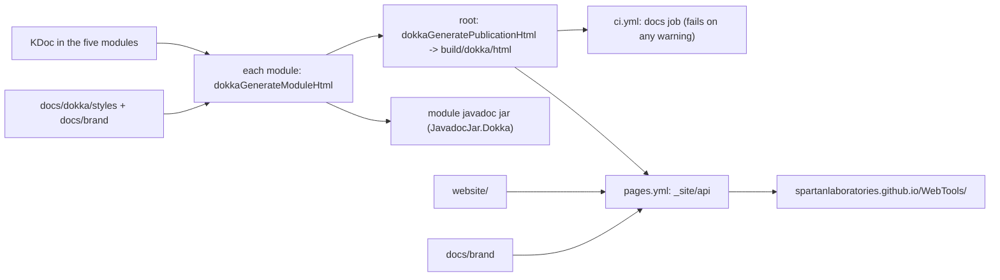

> **Superseded by [`../plan.md`](../plan.md)** (2026-11-09), which adds the checks that the root build and build-logic agree, makes the aggregation test use the real root blocks and fail on a broken link in one module, and corrects the wording about `.nojekyll`. This copy is the plan before that amendment, kept for the record only; its relative links are written from the issue folder, one level up.

# Plan: Dokka API documentation, project site and the 1.0.0 release preparation

- **Covers:** SpartanLaboratories/WebTools#99 - *Generate API docs with Dokka: javadoc jars, GitHub Pages site and 1.0.0 release preparation*.
- **Architecture:** none. The design is carried by the **Design** section below (its responsibility, its seams, how it attaches to the existing Gradle build). It makes no consumer-facing API change, so no stability tier applies. The standard it implements is [`documentation/dokka.md`](https://github.com/SpartanLaboratories/.github/blob/main/documentation/dokka.md) of `SpartanLaboratories/.github`; the worked example is `SpartanLabsGaming/MyGameTools`.
- **Branch:** `feat/issue-99-dokka-api-docs`, cut from `master` at `5ae9734`. This plan document is committed in the same commit as the first stage of the implementation it describes (stage 1 under **Version control**).
- **Plans:** Dokka 2 (V2 plugin mode) on all five published modules, the javadoc jars built from its output, one aggregated reference served at `/api/` beside a landing page on GitHub Pages, a CI job that fails on a broken KDoc link or an undocumented public declaration, and the preparation of the `1.0.0` release of `webtools-http` and `webtools-feeds`.
- **Status:** planning only.
- **Target versions:** `webtools-udp` `2.0.0a` to `2.0.1` (the only version move); `webtools-http` and `webtools-feeds` stay at `1.0.0` and are prepared for release; `webtools-scraping` and `webtools-browser` stay at `1.0.0a`.

## 1. Requirements

The issue text names only `webtools-http`; this work prepares `webtools-feeds` the same way (R10) because the two modules release together.

Each requirement carries its acceptance criterion.

| # | Requirement | Acceptance |
|---|---|---|
| R1 | Dokka 2 in V2 plugin mode is applied through the published-library convention plugin to the five published modules: `webtools-udp`, `webtools-scraping`, `webtools-browser`, `webtools-http`, `webtools-feeds`. The two `*-commoncheck` modules do not get it. | `./gradlew :webtools-udp:dokkaGenerateModuleHtml` (and the same for each of the five) succeeds; `:webtools-http-commoncheck:tasks --all` and `:webtools-feeds-commoncheck:tasks --all` list no `dokka*` task. |
| R2 | Every published module's javadoc jar carries its Dokka output: `JavadocJar.Dokka("dokkaGeneratePublicationHtml")`, set explicitly in both library convention plugins, the multiplatform one included. | The jars `dokkaJavadocJar` (Kotlin/JVM) and `jvmDokkaJavadocJar` / `kotlinMultiplatformDokkaJavadocJar` (multiplatform) hold `index.html` and `navigation.html`; no module publishes `JavadocJar.Empty()`. |
| R3 | The five modules are aggregated into one Dokka publication at the root project with `dokka(project(":module"))` for each, output in `build/dokka/html`, the Kotlin plugins on the root classpath with `apply false`. | `./gradlew dokkaGeneratePublicationHtml` writes `build/dokka/html/index.html` that lists five modules, and every module directory under it holds its package pages (none renders empty). |
| R4 | A CI job runs `./gradlew dokkaGeneratePublicationHtml`, so a broken KDoc link fails the build, and so does an undocumented public declaration. `failOnWarning` and `reportUndocumented` are both on for all five modules. The check completes with **no warnings**: this change adds all the missing KDoc and fixes all the broken links, the published test fixtures included. | `./gradlew dokkaGeneratePublicationHtml` exits 0 and prints no Dokka warning (Dokka's warnings are the lines that start `w: [:`; `w: JS Environment Not Selected` comes from configuring the check-only js modules and is not one); the Level 3 integration tests show a broken link and an undocumented public function each fail the task. |
| R5 | `webtools-http`'s published test fixtures (`com.spartanlabs.webtools.http.testing`, Dokka source set `jvmTestFixtures`) are part of the reference and the javadoc jar. | The `webtools-http-jvm-<version>-javadoc.jar` published by the fixtures-publication check holds pages under `com.spartanlabs.webtools.http.testing/`; the aggregate lists the package. |
| R6 | `webtools-scraping` and `webtools-browser` get Dokka and appear at `/api/` like any published module, with **no version move, no re-release and no CHANGELOG entry of their own**. Their source changes by the one KDoc comment each needs (a `Companion`). | `git diff` shows no `version` change in either build file and no CHANGELOG line naming either module's release. |
| R7 | `.github/workflows/ci.yml` has **one** job, the Dokka task, on push and pull request to `master` (plus `workflow_dispatch`). Build and test jobs are left to issue #58, which stays open. | The file holds exactly one job, `docs`. |
| R8 | `website/` holds a landing page and `.github/workflows/pages.yml` deploys it to GitHub Pages on each push to `master`, the API reference at `/api/`. The page follows the structure of MyGameTools' page, its content taken from `README.md`, with the Spartan Laboratories logo in navy and bronze. | After the first push to `master`, `https://spartanlaboratories.github.io/WebTools/` and `.../api/` answer 200 (the manual acceptance checks under **Test plan**). |
| R9 | Branding: the Spartan Laboratories logo in `docs/brand/`, a stylesheet adapted from MyGameTools' in `docs/dokka/styles/`, applied at the root and in each module's Dokka configuration. | `build/dokka/html/styles/dokka-styles.css` and `build/dokka/html/images/spartan-laboratories-logo.png` exist in the aggregate (its module directories share them), and each module's own publication (`<module>/build/dokka/html/`, the content of its javadoc jar) holds the same two. |
| R10 | 1.0.0 release preparation for **both** `webtools-http` and `webtools-feeds`. All of `CHANGELOG.md`'s `[Unreleased]` content (it all belongs to these two modules) moves into `## [1.0.0] - <landing date>` with the "(unreleased, `1.0.0`)" markers dropped. The "UNRELEASED ... not a release candidate" notes come out of `webtools-http/build.gradle.kts:7-9` and `webtools-feeds/build.gradle.kts:7-9`. The README's "not yet on Maven Central" / "not yet released" wording for both comes out. Neither module's version moves. | `grep -in "unreleased" CHANGELOG.md webtools-http/build.gradle.kts webtools-feeds/build.gradle.kts` matches only the empty `## [Unreleased]` heading; `grep -in "not yet" README.md` matches nothing about these modules. |
| R11 | `webtools-udp` moves `2.0.0a` to `2.0.1`: its javadoc jar is the artifact that changes, and a letter suffix is for bug fixes only. It is the only version move. | `version = "2.0.1"` in `webtools-udp/build.gradle.kts`; no other `version =` line changes. |
| R12 | GitHub Pages is enabled once with GitHub Actions as its source, before the merge. | `gh api repos/SpartanLaboratories/WebTools/pages --jq .build_type` prints `workflow`. This is a repository setting, performed outside the change set (see **Version control**). |

## 2. Current state

Baseline: `master` at `5ae9734`. Facts below were established there with Gradle 9.7.1, JDK 23, Kotlin Gradle plugin (KGP) 2.2.0, Dokka 2.3.0 and vanniktech maven-publish 0.36.0.

**The build today.**

- `settings.gradle.kts` has `pluginManagement { includeBuild("build-logic") }` and the foojay resolver; it includes seven projects (five published, two `*-commoncheck`).
- The root `build.gradle.kts` holds only the header comment and `allprojects { group = "io.github.spartanlaboratories"; version = "1.0.0" }`; it applies no plugin and has no `repositories`.
- Convention plugins in `build-logic/src/main/kotlin/`: `webtools.published-library` (applies vanniktech, `mavenCentral()`, signing, shared POM; its header comment states it never calls `configure(...)`), `webtools.kotlin-jvm-library` (applies `org.jetbrains.kotlin.jvm` and `webtools.published-library`; no `mavenPublishing { configure }`), `webtools.kotlin-multiplatform-library` (its `//region publishing`, `:84-88`, pins `configure(KotlinMultiplatform(javadocJar = JavadocJar.Empty(), sourcesJar = SourcesJar.Sources()))`), `webtools.kotlin-common-check`.
- Vanniktech 0.36.0 picks `JavadocJar.Dokka("dokkaGeneratePublicationHtml")` by itself when `org.jetbrains.dokka` is applied ([`MavenPublishBaseExtension.kt`, `defaultJavaDocOption`](https://github.com/vanniktech/gradle-maven-publish-plugin/blob/0.36.0/plugin/src/main/kotlin/com/vanniktech/maven/publish/MavenPublishBaseExtension.kt)). The Kotlin/JVM route would rely on that auto-pick; the multiplatform plugin pins the empty jar and would not follow it. The org standard requires every publishing convention plugin to set the Dokka jar explicitly.
- `webtools-udp/build.gradle.kts:116` is `version = "2.0.0a"`, under a comment chain that ends at `:112-115`. `webtools-scraping` and `webtools-browser` are `1.0.0a` (`:22`, `:21`). `webtools-http` and `webtools-feeds` inherit `1.0.0` from the root; both carry the "UNRELEASED" note at `:7-9`.
- `webtools-http/build.gradle.kts` `//region test fixtures` (`:69-...`) creates the `testFixtures` compilation on `jvm()`; Dokka sees it as source set `jvmTestFixtures` and, by default, documents published compilations only. A comment at `:88-89` says KDoc on the fixtures "stays a review item".
- `build-logic/build.gradle.kts` declares the plugin marker dependencies (Kotlin 2.2.0 jvm and multiplatform, vanniktech 0.36.0, binary-compatibility-validator 0.18.2) and the build-logic test tasks; `copiesWebToolsHttp()` (`:77-85`) declares the inputs of the tasks that copy `webtools-http`: its build file, the root `build.gradle.kts` and three source trees.
- `gradlew` is tracked with mode `100644` (`git ls-files -s gradlew`): `./gradlew` fails with "Permission denied" on a Linux runner. The wrapper jar's SHA-256 matches `https://services.gradle.org/distributions/gradle-9.7.1-wrapper.jar.sha256`.
- There is no `.github/` directory, no `docs/brand/`, no `docs/dokka/`, no `website/`. GitHub Pages is not enabled (`gh api repos/SpartanLaboratories/WebTools/pages` answers 404); the repository is public.
- `.gitattributes` pins LF for `*.kt` and `*.kts` only; `.gitignore` has no website rules.
- `docs/dashboards/systems.json` records `webtools-scraping` and `webtools-browser` with `"status": "archived"`.

**What Dokka reports.** With Dokka applied and undocumented reporting on, the five modules report **8 broken KDoc links** and **155 undocumented public declarations in 69 files** (Dokka 2.2.0 and 2.3.0 report the same set; 2.3.0 also prints the source location of each link warning). The complete inventory is in **Appendix A**.

- Broken links: `webtools-udp/src/main/kotlin/com/spartanlabs/webtools/udp/HandshakeWireFormat.kt:16` (`[credential]`), `.../MultiConnectionUDPClient.kt:37` (`[onMessage]`), `.../ReliableReorderBuffer.kt:26,29,32,35` (`[seq]`), `webtools-http/src/commonMain/kotlin/com/spartanlabs/webtools/http/Log.kt:5` and `webtools-feeds/src/commonMain/kotlin/com/spartanlabs/webtools/feeds/Log.kt:5` (`[args]`). Each names something not in scope where it is written.
- Undocumented: `webtools-http` 116 (97 main, 19 fixtures), `webtools-feeds` 32, `webtools-udp` 5, `webtools-browser` 1, `webtools-scraping` 1. By kind: `toString` 73, `equals` 36, `hashCode` 36, `Companion` objects 6, and one each of `save` and `load` (`FakeBudgetStore`), `onEvent` (`RecordingBudgetObserver`), `fillInStackTrace` (`ReliableWindowFullException`). Every `equals`/`hashCode`/`toString` is an explicit override (for example `Feed.kt:25-31`); a KDoc comment on the override, or on the companion, silences that entry.

**How Dokka behaves** (measured at the baseline):

- A default Dokka run with broken links still ends `BUILD SUCCESSFUL`; a broken link fails the build only with `failOnWarning`. With it on, each failing module's `dokkaGenerateModuleHtml` and `dokkaGeneratePublicationHtml` end with `Failed with warningCount=N and errorCount=0`.
- `assemble` and `check` run no Dokka task of the build itself; only the jar-publishing tasks and the explicit Dokka tasks do (`webtools-http`'s `check` reaches Dokka only through the nested publication of `fixturesPublicationCheck`). `dokkaJavadocJar` (Kotlin/JVM) and `jvmDokkaJavadocJar` / `kotlinMultiplatformDokkaJavadocJar` (multiplatform) produce jars of real HTML (257 files for `webtools-udp`, 767 for `webtools-http`).
- A theme file listed in `customStyleSheets` or `customAssets` that does not exist fails the Dokka task (`NoSuchFileException`), so every generated test build that runs a Dokka task must carry the two theme files. Dokka copies them without reading them, so a text placeholder is enough there.
- Dokka writes a class's page at `<module>/<package>/-<hyphenated-class>/index.html` (for example `webtools-http/com.spartanlabs.webtools.http.testing/-fake-http-transport/index.html`), in the aggregate and in a module's own publication alike. A publication's `styles/` and `images/` sit at its root: one set for the whole aggregate, one in each module's own publication.
- The Dokka generator resolves its own dependencies from the project's repositories, so the root project needs `repositories { mavenCentral() }`; the modules get theirs from `webtools.published-library`.
- Kotlin plugins on the root classpath with `apply false` are required: with Dokka applied at the root and the Kotlin plugin applied to modules through the convention plugins, the two load in different classloaders and every module renders empty (Gradle issues [25616](https://github.com/gradle/gradle/issues/25616) and [35117](https://github.com/gradle/gradle/issues/35117)).

**The test harness's use of the root build** (`build-logic/src/test/kotlin/com/spartanlabs/testing/`):

- `support/webtools/buildlogic/ModuleSource.rootBuildFile()` returns the whole root `build.gradle.kts`; `FixturesPublicationEndToEndTest` and `FixturesCheckWiringEndToEndTest` copy it into generated builds, which only need the root's `group`/`version`. A root script with `dokka(project(":webtools-udp"))` cannot be copied whole into a build that holds only `webtools-http`.
- An including build (`includeBuild("<WebTools root>") { name = "webtools" }`) configures and compiles `:webtools:webtools-http` with the new root script, and `:webtools:webtools-http:check --dry-run` still does not schedule `fixturesPublicationCheck`.

**The CI and Pages action versions.** `gradle/actions@v6` moved its caching into a separately licensed component ("By upgrading to v6, you accept the Terms of Use": [release notes](https://github.com/gradle/actions/releases/tag/v6.0.0)); `setup-gradle@v5` (last release v5.0.2) is under MIT and needs no such acceptance. `actions/upload-pages-artifact` excludes dotfiles by default since [v4](https://github.com/actions/upload-pages-artifact/releases/tag/v4.0.0); v5 has the input `include-hidden-files`, which the standard's `.nojekyll` needs. Current majors: `actions/checkout@v7`, `actions/setup-java@v6`, `actions/upload-pages-artifact@v5`, `actions/deploy-pages@v5`.

**The Pages endpoint.** [Create a GitHub Pages site](https://docs.github.com/en/rest/pages/pages#create-a-github-pages-site): `POST /repos/{owner}/{repo}/pages` with `build_type` of `legacy` or `workflow`.

**The logo's colours:** navy `#103050` / `#103040`, bronze `#907040` / `#806040`, light bronze `#C0A080`.

## 3. Assumptions

| Assumption | If false |
|---|---|
| The `1.0.0` release of `webtools-http` and `webtools-feeds`, and the `2.0.1` release of `webtools-udp`, follow straight after the landing, so the versions the README and the site name resolve on Maven Central soon after the merge. | Until then the Install snippets name versions that do not resolve; nothing in the change set breaks. |
| The final `./gradlew dokkaGeneratePublicationHtml` still ends warning-free after the KDoc is written (a KDoc link written in new text can itself be broken). | The implementer fixes the new warning in the same change; the task is the gate. |
| `README.md:793` ("It takes about a minute") is stale once the fixtures-publication check runs Dokka. The new time is not known until the check has run. | The implementer writes the time measured on the first warm run; a cold run is longer and says so. |
| The logo's navy lettering needs a light glow to read on the navy header (taken from MyGameTools' treatment of its navy Spartan Laboratories logo). | Raise the glow's alpha; the manual acceptance checks (section 9) cover it. |

## 4. Non-goals

- CI build and test jobs, `CONTRIBUTING.md`, tags and a release workflow: issue #58 (stays open).
- Publishing itself. A Maven Central re-release of `webtools-scraping` or `webtools-browser`: their javadoc jars on Central keep the placeholder until a later release of those modules.
- Dokka for the `*-commoncheck` modules.
- Rendering `protected` members: Dokka's `documentedVisibilities` stays at its public-only default. Documenting `internal` declarations.
- Any signature or behaviour change in the five modules: the KDoc pass edits comments only; the ABI dumps (`api/*.api`) stay identical.
- Tests of the site's HTML/CSS and of its displayed versions (follow-up, see section 12).

## 5. Design

**Responsibility.** Turn the KDoc of the five published modules into (a) the javadoc jar each module publishes, (b) one aggregated HTML reference, gated in CI and served at `/api/` beside a hand-written landing page, and (c) the release preparation of `webtools-http` and `webtools-feeds`.

**Seams and attachment.**

- *Per module:* `webtools.published-library` applies `org.jetbrains.dokka`, themes the module's pages, turns on `failOnWarning` and `reportUndocumented`, and links "view source" to GitHub. Both library plugins set `JavadocJar.Dokka(WebToolsBuild.DOKKA_PUBLICATION_TASK)` on their platform. `webtools-http` additionally unsuppresses `jvmTestFixtures`.
- *Aggregate:* the root project applies Dokka (and, `apply false`, both Kotlin plugins) and declares the five modules; its settings carry the plugin versions in `pluginManagement.plugins`, which must equal the marker dependencies of `build-logic/build.gradle.kts`.
- *Publication:* `pages.yml` runs the root task, assembles `website/` plus `docs/brand/` plus `build/dokka/html` (as `api/`) into `_site` and deploys it; `ci.yml` runs the same task on every push and pull request.
- *Test harness:* the build-logic checks stop copying the root build file whole; they read the root's `pluginManagement`, `plugins` and `allprojects` blocks, so they prove the real root plugin block and settings without needing a `dokka(project(...))` line for a module the generated build lacks.



**Failure design.** The build has no new runtime code. Failures are Gradle task failures: `failOnWarning` turns a broken link or an undocumented public declaration into a failed `dokkaGenerateModuleHtml` / `dokkaGeneratePublicationHtml`; a missing theme file fails with `NoSuchFileException` by design (a moved file is caught at once); `pages.yml` fails with an `::error::` annotation if `build/dokka/html/index.html` is missing, with no fallback search. The harness additions return `Result` (see section 6).

**No consumer-facing API change; no stability tier.** The KDoc pass changes comments only.

**Rationale for the specific choices.**

- Dokka `2.3.0` rather than MyGameTools' `2.2.0`: both report the same warnings at the baseline, and 2.3.0 prints the source location of each link warning and carries security updates of its bundled dependencies.
- The root's `moduleVersion` is empty: the five modules version independently, so the aggregate names no version of its own.
- `setup-gradle` stays on `v5` while the other actions use their current majors: v6 requires accepting a separate Terms of Use for its caching component; v5 is MIT.
- The two library plugins each set the platform because `KotlinJvm(...)` and `KotlinMultiplatform(...)` are different classes; each takes the same `JavadocJar.Dokka(...)` and `SourcesJar.Sources()`.

## 6. File-by-file changes

Paths are relative to the repository root. Error-handling and logging notes appear where a signature is new.

### A. Gradle build (root)

**`settings.gradle.kts`** - keep `includeBuild("build-logic")` and the foojay plugin; extend `pluginManagement`:

```kotlin
pluginManagement {
    includeBuild("build-logic")
    // The versions of the plugins the root build script applies by id (it applies the two Kotlin plugins
    // with `apply false` and Dokka). Kotlin and Dokka must equal the marker dependencies in
    // build-logic/build.gradle.kts, so the root and the convention plugins load one plugin version.
    plugins {
        id("org.jetbrains.kotlin.jvm") version "2.2.0"
        id("org.jetbrains.kotlin.multiplatform") version "2.2.0"
        id("org.jetbrains.dokka") version "2.3.0"
    }
}
```

The `pluginManagement` block must keep `pluginManagement {` and its closing `}` at column 0 (the test harness reads it by that shape).

**`build.gradle.kts`** (root) - order: header comment, `plugins`, `repositories`, `dependencies`, `dokka`, `allprojects`. Amend the header comment: the root now also aggregates the API reference of the five published modules into one Dokka publication (`build/dokka/html`); everything else stays in a module build file or a convention plugin. Keep the existing `allprojects` block unchanged. Add:

```kotlin
plugins {
    // Dokka and the Kotlin Gradle plugin must share ONE plugin classloader, or every module renders an
    // empty reference: Dokka (applied here) would sit in the root classloader while the Kotlin plugin
    // (applied to the modules by the convention plugins) sat in per-module child classloaders and Dokka
    // could not load KotlinBasePlugin (Gradle issues 25616 and 35117). The root has no source, so both
    // Kotlin plugins are applied `apply false`, only to put them on the root plugin classpath.
    id("org.jetbrains.kotlin.jvm") apply false
    id("org.jetbrains.kotlin.multiplatform") apply false
    id("org.jetbrains.dokka")
}

// The Dokka generator resolves its own dependencies from the project's repositories; the modules get
// theirs from webtools.published-library.
repositories { mavenCentral() }

dependencies {
    dokka(project(":webtools-udp"))
    dokka(project(":webtools-scraping"))
    dokka(project(":webtools-browser"))
    dokka(project(":webtools-http"))
    dokka(project(":webtools-feeds"))
}

dokka {
    moduleName.set("WebTools")
    moduleVersion.set("")   // the five modules version independently, so the aggregate names no version of its own
    dokkaPublications.configureEach { failOnWarning.set(true) }
    pluginsConfiguration.html {
        customStyleSheets.from(file("docs/dokka/styles/dokka-styles.css"))
        customAssets.from(file("docs/brand/spartan-laboratories-logo.png"))
        footerMessage.set("&copy; 2026 Spartan Laboratories")
    }
}
```

The `*-commoncheck` modules are not declared. `plugins {` and `allprojects {` keep their opening line and closing `}` at column 0.

### B. build-logic

**`build-logic/build.gradle.kts`**

- Add beside the other markers: `implementation("org.jetbrains.dokka:org.jetbrains.dokka.gradle.plugin:2.3.0")`. Update the comment above the markers to say Dokka's marker pulls `dokka-gradle-plugin`.
- `webToolsHttpDir` comment (`:50-53`): "(and the repository's root settings and build files next to it)".
- `Test.copiesWebToolsHttp()` (`:77-86`): `inputs.files("../webtools-http/build.gradle.kts", "../build.gradle.kts", "../settings.gradle.kts")`; rewrite the comment above it: the checks copy the module's files into their generated builds and read the repository's root `settings.gradle.kts` and `build.gradle.kts` for their `pluginManagement`, `plugins` and `allprojects` blocks, so all of them are inputs of the task.
- No new task and no new test source set.

**`build-logic/src/main/kotlin/WebToolsBuild.kt`** - add beside `VERIFY_JAVA_FLOOR_TASK`:

```kotlin
/**
 * The task name `dokkaGeneratePublicationHtml`: the Dokka task whose output is each published module's
 * javadoc jar. Both library convention plugins pass it to `JavadocJar.Dokka(...)`; the root project, the
 * CI job and the Pages workflow run the same task.
 */
const val DOKKA_PUBLICATION_TASK: String = "dokkaGeneratePublicationHtml"
```

A compile-time constant: no failure path.

**`build-logic/src/main/kotlin/webtools.published-library.gradle.kts`**

- `plugins { id("org.jetbrains.dokka"); id("com.vanniktech.maven.publish") }` (Dokka first).
- Header comment: replace the sentence that it "never calls `configure(...)`" (and its explanation of vanniktech's auto-pick) with: this plugin applies Dokka and themes it; each library plugin sets the platform with its Dokka javadoc jar (`mavenPublishing { configure(...) }` is a per-platform call, `KotlinJvm` versus `KotlinMultiplatform`).
- Add after the `mavenPublishing { }` block:

```kotlin
//region API documentation
// Each module renders its own pages with its OWN html plugin configuration; the root build's block only
// styles the aggregate's index page, so the theme is applied here too. The paths resolve against the root
// project, where docs/ lives. A missing theme file fails the Dokka task (NoSuchFileException), by design.
// failOnWarning and reportUndocumented make a broken KDoc link and an undocumented public declaration
// fail dokkaGenerateModuleHtml and dokkaGeneratePublicationHtml.
dokka {
    pluginsConfiguration.html {
        val root = isolated.rootProject.projectDirectory
        customStyleSheets.from(root.file("docs/dokka/styles/dokka-styles.css"))
        customAssets.from(root.file("docs/brand/spartan-laboratories-logo.png"))
        footerMessage.set("&copy; 2026 Spartan Laboratories")
    }
    dokkaPublications.configureEach {
        failOnWarning.set(true)
    }
    dokkaSourceSets.configureEach {
        reportUndocumented.set(true)
        // "View source" links: each source set's directory is src/<set>/kotlin, in this module's folder on GitHub.
        sourceLink {
            localDirectory.set(file("src/$name/kotlin"))
            remoteUrl("https://github.com/SpartanLaboratories/WebTools/blob/master/${project.name}/src/$name/kotlin")
            remoteLineSuffix.set("#L")
        }
    }
}
//endregion
```

**`build-logic/src/main/kotlin/webtools.kotlin-jvm-library.gradle.kts`**

- Imports: `com.vanniktech.maven.publish.JavadocJar`, `com.vanniktech.maven.publish.KotlinJvm`, `com.vanniktech.maven.publish.SourcesJar` (before `org.jetbrains.kotlin.gradle.dsl.JvmTarget`).
- `plugins { id("org.jetbrains.kotlin.jvm"); id("webtools.published-library"); id("com.vanniktech.maven.publish") }` with the same trailing comment the multiplatform plugin has ("listed again so this script's own mavenPublishing {} accessor is generated; re-applying is idempotent").
- Add a `//region publishing`:

```kotlin
//region publishing
mavenPublishing {
    // The javadoc jar is the module's Dokka output, never an empty placeholder (the org standard).
    configure(KotlinJvm(javadocJar = JavadocJar.Dokka(WebToolsBuild.DOKKA_PUBLICATION_TASK), sourcesJar = SourcesJar.Sources()))
}
//endregion
```

- Header comment: add that the plugin sets the Dokka javadoc jar.

**`build-logic/src/main/kotlin/webtools.kotlin-multiplatform-library.gradle.kts`** - `:86` becomes `configure(KotlinMultiplatform(javadocJar = JavadocJar.Dokka(WebToolsBuild.DOKKA_PUBLICATION_TASK), sourcesJar = SourcesJar.Sources()))`. Replace the comment above it (`:84-85`, "an empty javadoc jar ... in case Dokka is ever applied") with: the javadoc jar is the module's Dokka output, never an empty placeholder; the jvm and the root publication both take the same `dokkaGeneratePublicationHtml` output.

Failure handling for A and B: all Gradle configuration. A wrong plugin id, version or task name fails configuration or the jar task with Gradle's own message; nothing is caught. The convention plugins use no `try`/`Result`.

### C. Module build files

**`webtools-http/build.gradle.kts`**

- Remove the three-line "UNRELEASED" note (`:7-9`: from "1.0.0 is the version inherited from the root build, and it is UNRELEASED" through "Remove this note when 1.0.0 is released."), keeping the surrounding comment paragraphs and one blank `//` separator.
- In `//region test fixtures`, after the `kotlin { jvm { ... } }` block that creates the `testFixtures` compilation, add:

```kotlin
// The fixtures are published API (the -test-fixtures jar), and Dokka documents only published compilations by
// default: unsuppress the source set so the reference and the javadoc jar include com.spartanlabs.webtools.http.testing.
dokka {
    dokkaSourceSets.named("jvmTestFixtures") {
        suppress.set(false)
    }
}
```

- Replace the comment at `:88-89` ("KDoc on the fixtures stays a review item.") with: the convention plugin's `reportUndocumented` and `failOnWarning` require KDoc on the fixtures.

**`webtools-feeds/build.gradle.kts`** - remove the same note (`:7-9`).

**`webtools-udp/build.gradle.kts`** - not edited in the implementation. The version moves in its own `build:` commit after the code (section 11), which inserts above `version`, as the last lines of the comment chain:

```
// 2.0.1: the javadoc jar carries the Dokka API reference in place of an empty placeholder. No source or
// public API change.
```

and changes `version = "2.0.0a"` to `version = "2.0.1"`. Nothing else in the file changes.

`webtools-scraping/build.gradle.kts` and `webtools-browser/build.gradle.kts`: unchanged.

### D. The KDoc pass (comments only)

Edits: the 8 link fixes and the 155 declarations of **Appendix A**. No signature, modifier or body changes; the ABI dumps stay identical (`:webtools-http:apiCheck :webtools-feeds:apiCheck` prove it for the two modules that have dumps).

*Link fixes.* In each of the 8 lines of Appendix A, write the unresolvable name in backticks instead of square brackets (`` `credential` ``, `` `onMessage` ``, `` `seq` ``, `` `args` ``). The `Log.kt` pair (an `internal` interface) is reported by Dokka all the same.

*Writing guidance.* Each KDoc states the actual contract; read the implementation and the class's own KDoc before writing, and never state what the code does not do.

| Kind | What the KDoc says |
|---|---|
| `equals` | Which properties take part in equality, read from the implementation (`Url.kt:53` compares `text`; `Feed.kt:25-26` compares title, link, description and entries). A one-line form: `Two [X] are equal when they have the same ...`. State any property deliberately left out (a cache, a timestamp). |
| `hashCode` | `Returns a hash code consistent with [equals]: it is computed from the same properties.` Add what differs if the implementation hashes a subset (never differs from `equals`' set). |
| `toString` | What the string is for (diagnostics and logs) and that **its format is not part of the API and may change**; plus any redaction the implementation applies (for example `Feed.toString` prints presence and counts, never text, and the link as scheme, host and port; `HttpHeaders` and `HttpRequest` never print a sensitive header value; `Url.redacted()` is the form the stack logs). Read the implementation; where the class KDoc already says it ("`toString()` prints presence and counts, never text"), repeat it as the member's contract. |
| `Companion` | What the companion object holds: its constants or factory members, for example `UdpChannel.Companion` the channel-numbering constants it declares. Read the object's members and name them. |
| fixture overrides | What the fake does: `FakeBudgetStore.load` returns the stored snapshot after its scripted `loadDelay` in virtual time or fails per `failLoads`; `save` the same for `saveDelay` and `failSaves`; `RecordingBudgetObserver.onEvent` records the event for later inspection. Read each body and write what it does. |
| `ReliableWindowFullException.fillInStackTrace` | Why it is overridden (read the body: the typed failure is a value in a `Result`, so it carries no stack trace) and what it returns. |

A KDoc comment on the override, or on the companion, silences that entry. Where an `equals`/`hashCode`/`toString` trio sits together, each of the three gets its own KDoc block.

The pass is done when `./gradlew dokkaGeneratePublicationHtml` exits 0 and prints no Dokka warning (no line starting `w: [:`), with `failOnWarning` and `reportUndocumented` on.

### E. Branding

**`docs/brand/spartan-laboratories-logo.png`** - copied byte for byte from MyGameTools (324,247 bytes at the baseline):

```sh
mkdir -p docs/brand
gh api repos/SpartanLabsGaming/MyGameTools/contents/docs/brand/spartan-laboratories-logo.png \
  -H "Accept: application/vnd.github.raw" > docs/brand/spartan-laboratories-logo.png
```

Both the site and the Dokka theme reference this one file.

**`docs/dokka/styles/dokka-styles.css`** - start from MyGameTools' `docs/dokka/styles/dokka-styles.css` (fetch it with `gh api` as above) and apply these changes. The structure (regions, element rules, selectors) is unchanged except where stated.

1. Header comment: names the WebTools theme ("Spartan Laboratories theme for the WebTools Dokka API reference"), says it is loaded by the root `build.gradle.kts` and by `webtools.published-library` through `customStyleSheets`, and names the palette: Spartan Laboratories navy and bronze on deep navy ink (dark) and warm parchment (light).
2. Rename every custom property `--sg-*` to `--sl-*`; `--sg-crimson` becomes `--sl-navy`, `--sg-crimson-hover` becomes `--sl-navy-hover`, `--sg-crimson-50` becomes `--sl-navy-50`.
3. Remove the `.sg-parent-credit` rules (the comment block, `.sg-parent-credit`, `.sg-parent-credit:before`, `.sg-parent-credit:hover`, `.theme-dark .sg-parent-credit:hover`): there is no parent-company credit.
4. `--dokka-logo-image-url` is `url('../images/spartan-laboratories-logo.png')`; `--dokka-logo-height` and `--dokka-logo-width` stay `56px`.
5. Values (every brand token; replace the crimson/warm values):

| Token | Light (`:root`) | Dark (`.theme-dark`) |
|---|---|---|
| `--sl-navy` (key colour) | `#103050` | `#103050` |
| `--sl-navy-hover` | `#1a4673` | `#1a4673` |
| `--sl-navy-50` | `rgba(16, 48, 80, 0.5)` | same |
| `--sl-bronze` | `#907040` | `#907040` |
| `--sl-bronze-soft` | `#C0A080` | `#C0A080` |
| `--sl-ink` | `#0e1c2e` | `#0e1c2e` |
| `--sl-ink-raised` | `#16263a` | `#16263a` |
| `--color-key-blue`, `-hover`, `-50` | `var(--sl-navy)`, `var(--sl-navy-hover)`, `var(--sl-navy-50)` | `#3b6ea8`, `#4a80bd`, `rgba(59, 110, 168, 0.5)` (the key colour marks the active row, focus rings and tabs, and navy would vanish on the dark page) |
| `--color-background-nav` / `-dt` | `var(--sl-ink)` | `var(--sl-ink)` |
| `--color-background-page` / `-dt` | `#f7f5ef` | `#101a26` |
| `--color-background-footer` / `-dt` | `#e9e3d4` | `var(--sl-ink-raised)` |
| `--color-text`, `--default-font-color` | `#14202e` | `#e8edf3` (`--color-text-dt`, `--default-font-color`) |
| `--color-text-light` / `-dt` | `rgba(20, 32, 46, 0.72)` | `rgba(232, 237, 243, 0.68)` |
| `--hover-link-color`, `--active-section-color`, `--sidemenu-section-active-color`, `--active-tab-border-color` | `var(--sl-navy)` | `var(--sl-bronze-soft)` (first three) |
| `--border-color` | `rgba(144, 112, 64, 0.28)` | `rgba(192, 160, 128, 0.20)` |
| `--navigation-highlight-color`, `--blockquote-background`, `--toc-hover-color` | `rgba(144, 112, 64, 0.10)`, `0.08`, `0.12` | `rgba(192, 160, 128, 0.08)`, `0.06`, `0.10` |
| `--color-background-inline-code` | `rgba(16, 48, 80, 0.07)` | `rgba(192, 160, 128, 0.12)` |
| `--color-background-code-block` | `rgba(144, 112, 64, 0.06)` | `#0b131d` |
| code tokens | keyword `#103050`, builtin `#2f6f3e`, function `#7a5a28`, number `#6b2fa0`, operator `#6b5a40` | `-alternative`: keyword `#8fb8e0`, builtin `#a8d8a0`, function `#f0d9a8`, operator `#b4c0ce`, number `#c49bf0` |
| `--sl-header-bg` | `linear-gradient(90deg, #0a1420 0%, #0e1c2e 55%, #103050 100%)` | `linear-gradient(90deg, #08111b 0%, #0c1828 55%, #0e2540 100%)` |
| `--sl-logo-glow` | `radial-gradient(circle closest-side, rgba(238, 226, 204, 0.78), rgba(192, 160, 128, 0.32) 62%, transparent 100%)` | same |
| `--sl-sidebar-tone` | `#f1ede2` | `#0b131d` |
| `--sl-meander` stroke | `%23907040`, opacity `0.10` | `%23C0A080`, opacity `0.07` |
| `--sl-content-bg` | `linear-gradient(180deg, #f7f5ef 0%, #f2eee3 55%, #ece6d6 100%)` | `linear-gradient(180deg, #101a26 0%, #122033 55%, #16263a 100%)` |

6. Element rules: content links `.main-content a:not([data-name])` use `var(--sl-navy)` with `border-bottom-color: rgba(16, 48, 80, 0.3)`, hover `var(--sl-navy-hover)`; in `.theme-dark` they use `var(--sl-bronze-soft)` with `border-bottom-color: rgba(192, 160, 128, 0.3)` and hover `#e0c9ac`. `h1`/`h2` use `var(--sl-navy)` (light) and `var(--sl-bronze-soft)` (dark). Every other `var(--sg-crimson...)` reference becomes `var(--sl-navy...)`.
7. The logo sits on the soft bronze/cream glow (`--sl-logo-glow`), painted behind the logo image in `.library-name--link:before` exactly as in MyGameTools' sheet, so the navy lettering stays legible on the always-dark header.

### F. The website

New folder `website/`. Base URL `https://spartanlaboratories.github.io/WebTools/`. Each file is adapted from MyGameTools; fetch the originals into place first:

```sh
mkdir -p website/assets
for f in index.html 404.html robots.txt sitemap.xml README.md assets/styles.css assets/site.js assets/favicon.svg; do
  gh api repos/SpartanLabsGaming/MyGameTools/contents/website/$f -H "Accept: application/vnd.github.raw" > website/$f
done
```

then rewrite as below. Claim nothing `README.md` does not state; the copy below is taken from it. The one addition is the `archived` status of `webtools-scraping` and `webtools-browser`, taken from `docs/dashboards/systems.json`.

**`website/robots.txt`**

```
User-agent: *
Allow: /

Sitemap: https://spartanlaboratories.github.io/WebTools/sitemap.xml
```

**`website/sitemap.xml`** - MyGameTools' file with both `<loc>` values replaced by `https://spartanlaboratories.github.io/WebTools/` and `https://spartanlaboratories.github.io/WebTools/api/`.

**`website/assets/favicon.svg`** - navy tile, bronze rim, light-bronze "W":

```svg
<svg xmlns="http://www.w3.org/2000/svg" viewBox="0 0 32 32">
  <defs>
    <linearGradient id="g" x1="2" y1="2" x2="30" y2="30" gradientUnits="userSpaceOnUse">
      <stop offset="0" stop-color="#1a4673"/>
      <stop offset="1" stop-color="#103050"/>
    </linearGradient>
  </defs>
  <rect x="1" y="1" width="30" height="30" rx="8" fill="url(#g)" stroke="#907040" stroke-width="1.6"/>
  <path d="M8 10.5 L11.2 21.5 L16 13 L20.8 21.5 L24 10.5"
        fill="none" stroke="#C0A080" stroke-width="2.4" stroke-linecap="round" stroke-linejoin="round"/>
</svg>
```

**`website/assets/site.js`** - MyGameTools' file with two edits: the header comment's first line reads `/* WebTools - project site behaviour.` and `STORE_KEY = "webtools-theme"`.

**`website/assets/styles.css`** - MyGameTools' file with every colour set to the navy-and-bronze palette. Apply:

1. Header comment: "WebTools - project site ... Palette: the Spartan Laboratories brand shared with the Dokka API reference (docs/dokka/styles/dokka-styles.css) - navy + bronze on deep navy ink / warm parchment."
2. `:root` (dark) and `:root[data-theme="light"]` token values:

| Token | Dark (`:root`) | Light (`[data-theme="light"]`) |
|---|---|---|
| `--bg` | `#101a26` | `#f7f5ef` |
| `--bg-elev` | `#16263a` | `#e9e3d4` |
| `--bg-code` | `#0b131d` | `#0e1c2e` |
| `--border` | `#2b3f57` | `#d6cdb8` |
| `--border-soft` | `#1f3147` | `#e3dcc9` |
| `--text` | `#e8edf3` | `#14202e` |
| `--muted` | `#a3b2c3` | `#4f5e6f` |
| `--heading` | `#C0A080` | `#103050` |
| `--brand` | `#1a4673` | `#103050` |
| `--brand-soft` | `#C0A080` | `#103050` |
| `--accent` | `#C0A080` | `#907040` |
| `--ring` | `rgba(192, 160, 128, .40)` | `rgba(16, 48, 80, .35)` |
| `--shadow` | `0 18px 40px -22px rgba(0, 0, 0, .9)` | `0 18px 40px -26px rgba(16, 48, 80, .45)` |
| `--ink` | `#0e1c2e` | (unchanged: header is ink in both themes) |
| `--ink-text` | `#eef2f7` | |
| `--ink-muted` | `#b4c0ce` | |
| `--ink-border` | `#2b3f57` | |
| `--bronze` | `#907040` | |
| `--bg-header` | `linear-gradient(90deg, #0a1420 0%, #0e1c2e 55%, #103050 100%)` | |
| `--bg-page` | `linear-gradient(180deg, #101a26 0%, #122033 55%, #16263a 100%)` | `linear-gradient(180deg, #f7f5ef 0%, #f2eee3 55%, #ece6d6 100%)` |
| `--logo-glow` | `radial-gradient(circle closest-side, rgba(238, 226, 204, .78), rgba(192, 160, 128, .32) 62%, transparent 100%)` | same |
| `--meander` stroke | `%23C0A080`, opacity `0.07` | `%23907040`, opacity `0.10` |
| `--tok-comment` | `#7f93a8` | (code stays dark in both themes) |
| `--tok-string` | `#a8d8a0` | |
| `--tok-keyword` | `#d9b88c` | |
| `--tok-type` | `#8fb8e0` | |
| `--tok-number` | `#c49bf0` | |
| `--tok-func` | `#f0d9a8` | |
| `--tok-annotation` | `#C0A080` | |

3. Hard-coded colours elsewhere in the sheet: `.btn-primary` second gradient stop `#7d1020` becomes `#0a2036`; in `.code-head`, `.code-title`, `.copy`, `.copy:hover`, `.dots i`, `.code-card pre`: `#b3a29e` becomes `#a3b2c3`, `#d8ccc8` becomes `#d4dce6`, `#241a1c` becomes `#16263a`, `#3a2a2c` becomes `#2b3f57`, `#2e2124` becomes `#1c3250`, `#4a3538` becomes `#3a5070`, `#eadfdb` becomes `#e8edf3`; `.copy.done` keeps its green.
4. Remove the `.parent-credit` rules (the comment and the three rules at the end of the footer region) and the `.card-icon` rule; add `.arch-diagram .layer.archived rect { stroke-dasharray: 5 4; }` beside the other `.arch-diagram` rules.

**`website/404.html`** - MyGameTools' file with: `<title>Page not found - WebTools</title>`; `/WebTools/` in the favicon and stylesheet `href`s (absolute paths, because GitHub serves the page from any depth); body copy:

```html
<p class="eyebrow">404</p>
<p class="code grad">Not found</p>
<p class="lede" style="margin-inline:auto">
  That page is not part of this site. The API reference lives under <code>/api/</code>,
  and everything else starts from the home page.
</p>
<p class="hero-actions" style="justify-content:center">
  <a class="btn btn-primary" href="/WebTools/">Home</a>
  <a class="btn btn-ghost" href="/WebTools/api/">API docs</a>
</p>
```

**`website/index.html`** - keep MyGameTools' document skeleton, `<head>` structure, skip link, `<header>` (nav toggle, theme-toggle SVGs, GitHub icon), `<script src="assets/site.js" defer>`, and the CSS classes it uses; replace the content as follows. Code samples are copied from `README.md` and written with `&`, `<`, `>` as entities inside `<pre><code data-lang="kotlin|bash|xml">`.

*Head.* `<title>WebTools - internet I/O for Kotlin/JVM, one artifact per concern</title>`; `description` and `og:description`: "WebTools is a collection of Kotlin/JVM internet I/O helpers published as independent artifacts: an HTTP client stack, RSS and Atom feeds, and a UDP connection layer. Apache-2.0, on Maven Central."; `canonical` and `og:url` `https://spartanlaboratories.github.io/WebTools/`; `theme-color` `#0e1c2e`; `og:title` as the title.

*Header.* `.brand`: `` and the text `WebTools`. There is no version pill: the five modules version independently, so no one version names the project. Nav links in order: `#features` Features, `#architecture` Architecture, `#modules` Modules, `#install` Install, `#quickstart` Quick start, `api/` API docs (class `nav-api`), GitHub (`https://github.com/SpartanLaboratories/WebTools`), theme toggle.

*Hero.* Eyebrow `Kotlin / JVM &middot; Apache-2.0 &middot; Maven Central`. `<h1>Internet I/O in <span class="grad">single-concern artifacts</span>.</h1>`. Lede: "A small Kotlin/JVM collection of internet I/O helpers, published as independent, single-concern artifacts: depend only on the one you need. Every fallible operation returns <code>kotlin.Result</code> rather than throwing, so callers decide how to recover." Actions: primary `#install` "Get started", ghost `api/` "Browse the API docs". Badges (four, `img.shields.io` forms as MyGameTools'): CI (`https://github.com/SpartanLaboratories/WebTools/actions/workflows/ci.yml/badge.svg`), Maven Central for `io.github.spartanlaboratories/webtools-udp` with `color=103050`, `Kotlin-2.2` with `color=103050`, `License-Apache%202.0` with `color=907040`. Code card titled `PollFeed.kt`: the block of `README.md:307-320` (the `FeedFetcher.untrusted(...).use { fetcher -> ... }` example), verbatim.

*Stats strip* (four `<div><strong>..</strong><span>..</span></div>`): `5` / "independently published artifacts"; `11` / "Java bytecode floor of every JVM module"; `0` / "retries: a throttle, a transport failure and a <code>5xx</code> are each returned once"; `7` / "test-level tasks, each runnable on its own".

*What you get* (`#features`, `.cards`; heading "What you get", lede "Each artifact adds one concern, so you can take the parts you want and leave the rest."). Eight `<article class="card">` with an `h3` and one paragraph, no icon:

1. **A typed failure model** - "Every fallible operation returns <code>kotlin.Result</code>. <code>HttpFailure</code> carries <code>TransportFailure</code> (nothing usable came back), <code>UpstreamFailure</code> (<code>RateLimited</code>, <code>UpstreamError</code>), <code>BudgetExhausted</code>, <code>DecodeFailure</code> and <code>Closed</code>."
2. **One fixed call path** - "<code>UpstreamClient</code> checks each call against the outbound-URL policy, then the response cache, then the call budget, then the transport. A hit costs nothing, and N concurrent callers of one key cost one permit and one request."
3. **Outbound-URL policies** - "<code>Trusted</code> for an upstream you chose, <code>Untrusted</code> for a URL a third party supplied: lenient host forms, reserved names, denied addresses, other ports and sensitive headers are refused."
4. **A response cache** - "<code>CaffeineResponseCache</code>: one load per key at a time, per-entry lifetimes, a weight bound, a per-call <code>maxAge</code>, failures never stored. <code>ResponseCache.Disabled</code> stores and shares nothing."
5. **A call budget** - "<code>WindowedCallBudget</code>: epoch-aligned rate windows with a boundary guard, per-lane floors, first-come-first-served waits that fail fast or are refunded and re-planned, pauses from <code>Retry-After</code>, and a hard window that survives a restart through a <code>BudgetStore</code>."
6. **Hardened feeds** - "RSS 0.90 to 2.0, RSS 1.0 and Atom 0.3 and 1.0 behind <code>FeedParser</code>. <code>RomeFeedParser</code> refuses a DOCTYPE before any parser runs and bounds depth, attributes, elements and namespaces; <code>FeedFetcher</code> does a stateless conditional GET and returns a <code>304</code> as a value."
7. **UDP with a reliable channel** - "<code>MultiConnectionUDPServer</code> multiplexes every client over one socket after a NAT-traversal handshake. <code>UdpChannel</code> gives each connection an <code>UNRELIABLE</code> or a <code>RELIABLE_ORDERED</code> delivery mode."
8. **Test support** - "<code>webtools-http</code>'s test fixtures (Gradle <code>testFixtures(...)</code>): <code>FakeHttpTransport</code>, <code>VirtualClock</code>, <code>.http</code> fixtures, a recorder, <code>LoopbackFetchers</code> and <code>FakeBudgetStore</code>."

*Architecture* (`#architecture`, class `section section-alt`; heading "Architecture", lede "Five artifacts, one concern each. Only <code>webtools-feeds</code> depends on another."). Left: an inline `<svg viewBox="0 0 420 360" role="img" aria-labelledby="arch-title arch-desc">` with `<title id="arch-title">How the five WebTools artifacts relate</title>` and `<desc id="arch-desc">webtools-feeds builds on webtools-http. webtools-udp stands alone. webtools-scraping and webtools-browser are archived.</desc>` and these groups (same `.layer`, `.n`, `.m`, `.edge` classes as MyGameTools'):

```html
<g class="layer accent" transform="translate(30 20)"><rect width="360" height="64" rx="12"/>
  <text class="n" x="18" y="27">webtools-feeds</text><text class="m" x="18" y="48">FeedFetcher · RomeFeedParser · Feed</text></g>
<path class="edge" d="M210 84 V112"/><text class="m" x="222" y="103">api dependency</text>
<g class="layer accent" transform="translate(30 112)"><rect width="360" height="64" rx="12"/>
  <text class="n" x="18" y="27">webtools-http</text><text class="m" x="18" y="48">UpstreamClient · UrlFetcher · OkHttpTransport</text></g>
<g class="layer world" transform="translate(30 214)"><rect width="360" height="64" rx="12"/>
  <text class="n" x="18" y="27">webtools-udp</text><text class="m" x="18" y="48">MultiConnectionUDPServer · MultiConnectionUDPClient · UdpChannel</text></g>
<g class="layer archived" transform="translate(30 296)"><rect width="175" height="54" rx="12"/>
  <text class="n" x="12" y="24">webtools-scraping</text><text class="m" x="12" y="43">Connector · archived</text></g>
<g class="layer archived" transform="translate(215 296)"><rect width="175" height="54" rx="12"/>
  <text class="n" x="12" y="24">webtools-browser</text><text class="m" x="12" y="43">WebViewer · archived</text></g>
```

Right: a `.table` (caption "Responsibility of each artifact", columns Artifact / Responsibility):

| Artifact | Responsibility (text) |
|---|---|
| `webtools-http` | The suspend HTTP client stack: request and response types, a typed failure model, the transport, cache, budget and outbound-URL policy ports with their supplied implementations, and the `UpstreamClient` and `UrlFetcher` facades. |
| `webtools-feeds` | RSS and Atom behind a hardened parser port, the feed model with a frozen entry id, and `FeedFetcher`, a stateless conditional GET over `UrlFetcher`. Exposes `webtools-http` as an `api` dependency. |
| `webtools-udp` | A multi-client UDP connection layer: one common port, a NAT-traversal handshake, framed datagrams, keepalive, a link-quality probe and a reliable-ordered channel. Depends on `slf4j-api` only. |
| `webtools-scraping` | `Connector`: open a URL and read it line by line, plus one-shot `get`, `skrape` and image `download` helpers. Archived. |
| `webtools-browser` | `WebViewer`: headless-browser screenshots through Selenium Manager. Archived. |

Below the table, a paragraph: "Read how each is built: <a href="https://github.com/SpartanLaboratories/WebTools/blob/master/docs/webtools-http-architecture.md">the HTTP stack and feeds</a>, <a href=".../docs/webtools-udp-architecture.md">the UDP components, threads and lifecycles</a> and <a href=".../docs/webtools-udp-protocol.md">the UDP wire protocol</a>." (all `rel="noopener"`).

*Modules* (`#modules`; heading "Modules", lede "Depend on the one artifact you need."). A `.table-wrap` / `.table` with columns Artifact, Coordinates, Version, Status, API; one row per module (`<code>` for coordinates; the version cell is `<span data-version>`; the API cell a link to `api/<module-directory>/`, where `<module-directory>` is `webtools-udp`, `webtools-scraping`, `webtools-browser`, `webtools-http`, `webtools-feeds`, the directory Dokka writes per module):

| Artifact | Coordinates | Version | Status |
|---|---|---|---|
| `webtools-udp` | `io.github.spartanlaboratories:webtools-udp` | `2.0.1` | Stable Core |
| `webtools-http` | `io.github.spartanlaboratories:webtools-http` | `1.0.0` | Stable Core |
| `webtools-feeds` | `io.github.spartanlaboratories:webtools-feeds` | `1.0.0` | Stable Core |
| `webtools-scraping` | `io.github.spartanlaboratories:webtools-scraping` | `1.0.0a` | archived |
| `webtools-browser` | `io.github.spartanlaboratories:webtools-browser` | `1.0.0a` | archived |

Below it, a note: "Everything a consumer calls, passes, configures or matches is Stable Core. Implementing a seam of <code>webtools-http</code> or <code>webtools-feeds</code> (a <code>HttpTransport</code>, <code>ResponseCache</code>, <code>CallBudget</code>, <code>FeedParser</code>, ...) is Experimental and needs <code>@OptIn(ExperimentalForInheritanceWebToolsApi::class)</code>."

*Install* (`#install`, `section section-alt`; heading "Install", lede "Published to Maven Central. Requires JDK 11 or newer; built with Kotlin 2.2."). Three tabs exactly as MyGameTools' markup (ids `tab-kts`/`panel-kts`, `tab-groovy`/`panel-groovy`, `tab-maven`/`panel-maven`), each a `.code-card`:

- Gradle (Kotlin), title `build.gradle.kts`, `data-lang="kotlin"`:
  ```kotlin
  dependencies {
      implementation("io.github.spartanlaboratories:webtools-udp:2.0.1")
      // and/or
      implementation("io.github.spartanlaboratories:webtools-http:1.0.0")
      implementation("io.github.spartanlaboratories:webtools-feeds:1.0.0")
      // tests only (Gradle): fakes, a virtual clock, .http fixtures and a recorder
      testImplementation(testFixtures("io.github.spartanlaboratories:webtools-http:1.0.0"))
  }
  ```
- Gradle (Groovy), title `build.gradle`: the same three `implementation` lines in single-quoted Groovy form and `testImplementation testFixtures('io.github.spartanlaboratories:webtools-http:1.0.0')`.
- Maven, title `pom.xml`, `data-lang="xml"` (entity-escaped): three `<dependency>` blocks, `webtools-udp` `2.0.1`, `webtools-http-jvm` `1.0.0`, `webtools-feeds-jvm` `1.0.0`, groupId `io.github.spartanlaboratories`.

Notes (`.notes`, three `.note`):

1. **Maven and the -jvm artifacts** - "<code>webtools-http</code> and <code>webtools-feeds</code> are Kotlin Multiplatform modules that publish <code>webtools-http</code> and <code>webtools-http-jvm</code> (likewise for feeds). A Gradle build resolves the right one itself; a Maven build depends on the <code>-jvm</code> artifact. <code>testFixtures(...)</code> is Gradle-only."
2. **Kotlin standard library** - "<code>webtools-http</code>'s <code>okhttp-jvm</code> 5.5.0 dependency requires <code>kotlin-stdlib</code> 2.2.21, so a consumer's Kotlin standard library resolves to 2.2.21 or newer."
3. **The archived modules** - "<code>webtools-scraping</code> and <code>webtools-browser</code> are archived. Their install lines and the Java 11 floor notes for their older releases are in the <a href="https://github.com/SpartanLaboratories/WebTools#install">README</a>."

*Quick start* (`#quickstart`; heading "Quick start", lede "A call to an upstream, a UDP session, and a test without a network."). Three `.code-card`s in `.quick-grid`, each `data-lang="kotlin"`, verbatim from `README.md`: **Calling an upstream** (title `Upstream.kt`): the block `README.md:193-220`; **A UDP client** (title `UdpClient.kt`): the block `README.md:652-666`; **Testing without a network** (title `FakeTransportTest.kt`): the block `README.md:287-294`.

*Testing & building* (`#testing`, `section section-alt`, `wrap narrow`; heading "Testing &amp; building"; lede "Seven level tasks, each independently runnable so CI can gate them separately. Building needs a JDK 17 to 26; every JVM module compiles to Java 11 bytecode against the Java 11 API."). A `.table` with columns Gradle task / Level / Scope:

| Task | Level | Scope |
|---|---|---|
| `gatingTest` | 1 - Gating | Fast pre-commit checks |
| `componentTest` | 2 - Component | Isolated component behaviour |
| `integrationTest` | 3 - Integration | Real sockets and external interfaces |
| `deterministicTest` | 4a - Deterministic | Pure input-to-output mappings |
| `e2eTest` | 4b - End-to-end | Full-stack flows |
| `nonfunctionalTest` | 4c - Non-functional | Robustness and security properties |
| `uatTest` | 5 - Acceptance | Manual acceptance (mostly `@Disabled`) |

then a terminal `.code-card` (`data-lang="bash"`, title `Terminal`):

```bash
./gradlew build                          # compile + full test suite, every module
./gradlew :webtools-udp:build            # one module only
./gradlew componentTest                  # just the isolated component tests
./gradlew verifyJavaFloor                # the Java 11 floor of every published module
./gradlew :build-logic:test              # build-logic's pre-commit gate
./gradlew dokkaGeneratePublicationHtml   # generate this site's API reference
```

*Go deeper* (`#resources`; heading "Go deeper"; `.links` of `a.link-card`, `rel="noopener"` on external ones): **API reference** (`api/`, "The full Dokka documentation for every published module, regenerated on each push to <code>master</code>."); **GitHub** (the repository, "Source, issues and pull requests."); **Changelog** (`.../blob/master/CHANGELOG.md`, "Every release, in Keep a Changelog form."); **HTTP stack and feeds** (`docs/webtools-http-architecture.md`, "The stack as built: components, call path, failure model, threads, stability tiers and known limitations."); **UDP architecture** (`docs/webtools-udp-architecture.md`, "Components, threads and lifecycles."); **UDP wire protocol** (`docs/webtools-udp-protocol.md`, "Every datagram's byte layout and the handling of malformed input."); **Maven Central** (`https://central.sonatype.com/namespace/io.github.spartanlaboratories`, "Every published artifact and version.").

*Footer.* `.site-footer` with `.footer-inner`: one `<p>` "Built by <a href="https://github.com/SpaSinghOut" rel="noopener">Spartak Singh</a> under <a href="https://github.com/SpartanLaboratories" rel="noopener">Spartan Laboratories</a>. Licensed under <a href="https://www.apache.org/licenses/LICENSE-2.0.txt" rel="noopener">Apache 2.0</a>."; one `.footer-links` `<p>` with `GitHub` and `API docs` only (the repository has no `SECURITY.md` or `CODE_OF_CONDUCT.md`). No parent-company credit row.

Every displayed version is a `<span data-version>` or a snippet line; the Modules table, the Install snippets and nothing else name a version.

**`website/README.md`** - MyGameTools' notes with: the title "Project website", source <https://spartanlaboratories.github.io/WebTools/>, "a static, dependency-free landing page for WebTools"; the same file table (the `index.html` row lists "hero, features, architecture, modules, install, quick start, testing, links"; the `assets/brand/` row names the Spartan Laboratories logo; the `404.html` row `/WebTools/...`; drop the `.nojekyll` row's claim that the file is committed here: it is added at publish time, say so); "How it is published" naming `pages.yml`, its steps, and the one-time enabling (`gh api -X POST repos/SpartanLaboratories/WebTools/pages -f build_type=workflow`, or Settings, Pages, Source, GitHub Actions); "Working on it locally" as in MyGameTools' (copy `docs/brand/.` into `website/assets/brand/`; serve `website/`; generate the API into `website/api` with `./gradlew dokkaGeneratePublicationHtml` and `cp -r build/dokka/html website/api`, git-ignored); and "When cutting a release": "The versions on the page are written by hand: the Modules table (`data-version` cells), the Install snippets and nothing else. Bump them together with the `version` of the module's build file at each release: `grep -rn "2\.0\.1\|1\.0\.0" website/index.html`. Each module versions on its own: `webtools-udp`, `webtools-http`, `webtools-feeds`, `webtools-scraping` and `webtools-browser` have separate rows."

### G. Workflows

**`.github/workflows/ci.yml`** (new) - exactly:

```yaml
name: CI

on:
  push:
    branches: [master]
  pull_request:
    branches: [master]
  workflow_dispatch:

concurrency:
  group: ci-${{ github.ref }}
  cancel-in-progress: ${{ github.event_name == 'pull_request' }}

permissions:
  contents: read

jobs:
  docs:
    name: API docs (Dokka)
    runs-on: ubuntu-latest
    steps:
      - uses: actions/checkout@v7
      - uses: actions/setup-java@v6
        with:
          distribution: temurin
          java-version: "23"
      # setup-gradle stays on v5: v6 moved its caching into a separately licensed component whose
      # Terms of Use must be accepted on upgrade; v5 is MIT-licensed and needs no acceptance.
      - uses: gradle/actions/setup-gradle@v5
      - run: ./gradlew dokkaGeneratePublicationHtml --stacktrace
```

One job: build and test jobs are issue #58's.

**`.github/workflows/pages.yml`** (new) - as MyGameTools' file with the differences listed in the comments:

```yaml
name: Pages

# Publishes the project website (website/) with the Dokka API reference mounted at /api/.
# Enable once for the repository with GitHub Actions as the Pages source:
#   gh api -X POST repos/SpartanLaboratories/WebTools/pages -f build_type=workflow
# (or Settings -> Pages -> Build and deployment -> Source -> GitHub Actions).

on:
  push:
    branches: [master]
  workflow_dispatch:

permissions:
  contents: read
  pages: write
  id-token: write

# One deployment at a time; never cancel one in flight - a cancelled deploy leaves the
# live site on the previous commit.
concurrency:
  group: pages
  cancel-in-progress: false

jobs:
  build:
    name: Build site
    runs-on: ubuntu-latest
    steps:
      - uses: actions/checkout@v7
      - uses: actions/setup-java@v6
        with:
          distribution: temurin
          java-version: "23"
      # setup-gradle stays on v5 (see ci.yml).
      - uses: gradle/actions/setup-gradle@v5

      # The root project aggregates the five published modules into one publication (see build.gradle.kts).
      - name: Generate API docs (Dokka)
        run: ./gradlew dokkaGeneratePublicationHtml --stacktrace

      - name: Assemble _site
        run: |
          set -euo pipefail
          rm -rf _site
          mkdir -p _site
          cp -R website/. _site/
          rm -f _site/README.md   # notes for maintainers, not part of the published site

          # Brand assets (the Spartan Laboratories logo) live once in docs/brand and are shared with
          # the Dokka theme; the page references them under assets/brand/.
          mkdir -p _site/assets/brand
          cp -R docs/brand/. _site/assets/brand/

          # Dokka's V2 plugin writes the aggregated publication to build/dokka/html. There is no
          # fallback search: a changed output directory must fail here rather than ship a site
          # with no API reference.
          docs="build/dokka/html"
          if [ ! -f "$docs/index.html" ]; then
            echo "::error::No Dokka output found - expected build/dokka/html/index.html"
            exit 1
          fi
          echo "Publishing API docs from $docs"
          cp -R "$docs" _site/api

          # Dokka ships files and directories whose names start with an underscore; Jekyll would
          # drop them, so opt the whole artifact out of it.
          touch _site/.nojekyll

      - uses: actions/upload-pages-artifact@v5
        with:
          path: _site
          include-hidden-files: true   # since v4 the artifact drops dotfiles; .nojekyll must ship

  deploy:
    name: Deploy to GitHub Pages
    needs: build
    runs-on: ubuntu-latest
    environment:
      name: github-pages
      url: ${{ steps.deployment.outputs.page_url }}
    steps:
      - id: deployment
        uses: actions/deploy-pages@v5
```

### H. Repository hygiene

- **`.gitignore`** - append:

```
### Project website ###
# The Pages workflow mounts the Dokka publication at /api/; a local preview copy of it
# under website/ is generated output, never committed.
/website/api/
# Likewise the brand assets: docs/brand is the one source, copied in by the workflow.
/website/assets/brand/
/_site/
```

- **`.gitattributes`** - append after the `*.kts` line:

```
# gradlew and the workflow files are run by a Linux runner; a carriage return in either breaks them.
gradlew text eol=lf
.github/workflows/*.yml text eol=lf
```

- **`gradlew`** - mode `100644` becomes `100755`. It is a mode-only change that no working-tree edit can carry: `git update-index --chmod=+x gradlew` (or the equivalent in the committing tool). Acceptance: `git ls-files -s gradlew` reports `100755`.
- No IDE file is committed.

### I. build-logic test harness

All under `build-logic/src/test/kotlin/com/spartanlabs/testing/`. Read the neighbouring test before writing: each class has the form of its neighbour (`@TestInstance(PER_CLASS)`, `@BeforeAll` runs the nested builds, `@AfterAll` closes the workspace, one test class per file, JUnit 5, no MockK because no collaborator is mocked: the nested builds are the real boundary).

**`support/webtools/buildlogic/ModuleSource.kt`** - replace `rootBuildFile()` with:

```kotlin
/**
 * The text of the top-level block `blockName { ... }` of the repository-root file [fileName] (a sibling of the
 * module directory): from the line that starts with `blockName {` at column 0 to the first line that is a lone
 * `}` at column 0, both included.
 *
 * @param fileName the root file, for example `build.gradle.kts` or `settings.gradle.kts`.
 * @param blockName the block's name, for example `pluginManagement`, `plugins` or `allprojects`.
 * @return the block's text, or a failure: an [IllegalStateException] when [MODULE_PROPERTY] is unset or the file
 *   has no such block (a programmer error: the root file lost the block's shape), a [NoSuchFileException] when the
 *   file is missing, or the I/O error.
 */
fun rootBlock(fileName: String, blockName: String): Result<String> =
    moduleDir().mapCatching { module ->
        val file = module.resolve("..").resolve(fileName).normalize()
        if (!Files.isRegularFile(file)) throw NoSuchFileException(file.toString())
        Regex("""(?ms)^${Regex.escape(blockName)} \{.*?^\}""").find(Files.readString(file))?.value
            ?: throw IllegalStateException("$fileName has no top-level block '$blockName { ... }' closed at column 0")
    }.onSuccess { log.debug("read block {} of {} ({} chars)", blockName, fileName, it.length) }
```

The class KDoc's last sentence ("The repository's root build file is the module directory's sibling") becomes "The repository's root files are the module directory's siblings". Callers unwrap with `getOrThrow()` in `@BeforeAll`, where a failure fails the test class with its cause.

**`support/webtools/buildlogic/SampleProject.kt`**

- `GREETER` gets KDoc, exactly:

```kotlin
/** Greets by name. */
class Greeter {
    /** Returns the greeting for [name]. */
    fun greet(name: String): String = "Hello, " + name
}
```

(Without it a Dokka task of a generated build would report undocumented declarations and `failOnWarning` would fail it.)

- A private shared map beside the other constants: `DOKKA_THEME_FILES: Map<String, String>` = `"docs/dokka/styles/dokka-styles.css"` to `"/* theme placeholder */\n"` and `"docs/brand/spartan-laboratories-logo.png"` to `"placeholder\n"` (Dokka copies both without reading them). `multiplatformJvm` and `kotlinJvm` add the map to their files (`mapOf(...) + DOKKA_THEME_FILES`); `fixturesProducer` adds it under `$FIXTURES_PRODUCER/`. Their KDoc lists the two files.
- `fixturesProducer(rootAllprojectsBlock: String, signingProperties: String)` replaces `fixturesProducer(rootBuildScript, signingProperties)`: `require` both non-blank (`IllegalArgumentException`: programmer error); the producer's root `build.gradle.kts` is `rootAllprojectsBlock.trimEnd() + "\n" + PRODUCER_TEST_FOLDER`; KDoc says it is the repository's `allprojects` block.
- `fixturesWiringRoot(rootPluginManagement: String, rootBuildScript: String)`: `require` both non-blank; `settings.gradle.kts` is `rootPluginManagement.trimEnd()` followed by a blank line, `rootProject.name = "webtools"`, a blank line and `include(":webtools-http")` (the real `pluginManagement`, so the wiring root's settings carry the real plugin versions); `build.gradle.kts` is `rootBuildScript`; `gradle.properties` as before. Remove `WIRING_ROOT_SETTINGS`.
- New factory:

```kotlin
/**
 * A two-module composite for the Dokka aggregation: the shape of [includedBuildComposite] (modules
 * [COMPOSITE_JVM_MODULE] and [COMPOSITE_MULTIPLATFORM_MODULE], each with `sample.Greeter` and one component-level test
 * class) with a root that aggregates both modules the way the repository's root does: its `plugins` block applies
 * the two Kotlin plugins `apply false` and `org.jetbrains.dokka`, `repositories { mavenCentral() }`,
 * `dokka(project(":jvm-lib"))` and `dokka(project(":kmp-lib"))`, a `dokka { }` block with the theme files and
 * `failOnWarning`, and the shared `allprojects { group; version }`. Its `settings.gradle.kts` is [rootPluginManagement]
 * (the repository's real block, which includes `build-logic` and carries the plugin versions) followed by the root
 * project name and the two `include`s. The two theme files are at the root. `build-logic/` is not part of this
 * description; [BuildLogicSource.copyInto] adds it.
 *
 * @param rootProjectName the composite's root project name.
 * @param rootPluginManagement the repository's `pluginManagement` block text.
 * @return the project description.
 * @throws IllegalArgumentException if either argument is blank.
 */
fun dokkaAggregationComposite(rootProjectName: String, rootPluginManagement: String): SampleProject
```

  with the module files taken from a private helper shared with `includedBuildComposite`.

**`e2e/webtools/buildlogic/FixturesPublicationEndToEndTest.kt`**

- `@BeforeAll`: `SampleProject.fixturesProducer(ModuleSource.rootBlock("build.gradle.kts", "allprojects").getOrThrow(), signingProperties(key, passphrase))`.
- New test `11 - the published javadoc jars hold the Dokka reference and the jvm one includes the test fixtures`: `JarClasses.entries` of `repository.jvmModuleDir(version).resolve("webtools-http-jvm-$version-javadoc.jar")` and of `repository.rootModuleDir(version).resolve("webtools-http-$version-javadoc.jar")`; both hold an entry ending `index.html`; the jvm jar holds an entry containing `com.spartanlabs.webtools.http.testing/` and one ending `com.spartanlabs.webtools.http.testing/-fake-http-transport/index.html`; message names the entries on failure. Update the class KDoc: "...and the Dokka javadoc jars carry the fixtures' reference". The producer build also runs the real module's Dokka task with `failOnWarning`, so this class also proves the module's KDoc is warning-free.

**`e2e/webtools/buildlogic/FixturesCheckWiringEndToEndTest.kt`** - the root workspace is built from `ModuleSource.rootBlock("settings.gradle.kts", "pluginManagement")`, `rootBlock("build.gradle.kts", "plugins")` and `rootBlock("build.gradle.kts", "allprojects")` (the last two joined by a blank line as the `rootBuildScript`): `SampleProject.fixturesWiringRoot(pluginManagement, plugins + "\n\n" + allprojects)`. The class KDoc says the root has the repository's real settings and plugin block, so an including build is still proved against the real root.

**`gating/webtools/buildlogic/BuildLogicPluginsGatingTest.kt`** - add `"dokka-gradle-plugin-"` to `appliedPluginJarPrefixes` (and "dokka" to the class KDoc's list of plugins the convention plugins apply).

**`integration/webtools/buildlogic/PublishingConventionIntegrationTest.kt`** - rename `the multiplatform jvm publication ships a sources jar and an empty javadoc jar` to `... and a Dokka javadoc jar` and make both javadoc tests assert `index.html` and `navigation.html` are entries of the jar (a private helper `javadocEntries(jar: Path): List<String>` reading the zip, as the current test does) for `sample-1.0.0-javadoc.jar` of the Kotlin/JVM sample and `sample-jvm-1.0.0-javadoc.jar` of the multiplatform sample; rename the JVM test `... ships a sources jar and a Dokka javadoc jar`. Class KDoc: replace "an empty javadoc jar" with "a Dokka javadoc jar" in the fourth bullet and say the Kotlin/JVM one is also a Dokka jar.

**`integration/webtools/buildlogic/DokkaConventionIntegrationTest.kt`** (new) - see the test plan (section 9).

**`e2e/webtools/buildlogic/DokkaAggregationEndToEndTest.kt`** (new), **`nonfunctional/webtools/buildlogic/DokkaConfigurationCacheReuseNonFunctionalTest.kt`** (new) - see section 9.

**Error handling summary for the harness.** Expected failures return `Result` (`rootBlock`; the existing `copyInto`, `ProjectWorkspace.write`, `JarClasses.entries`); the tests unwrap with `getOrThrow()` at the point they need the value (`@BeforeAll`). Programmer errors throw: `require` in the `SampleProject` factories (`IllegalArgumentException`), a block that lost its shape (`IllegalStateException` inside `rootBlock`'s `Result`). Logging: `ModuleSource.rootBlock` logs at DEBUG (block, file, length); `NestedBuild` already logs each nested build at INFO.

### J. Docs, README and CHANGELOG (written last, when the landing date is known)

See section 8.

## 7. Logging

No production code changes, so the shipped artifacts log nothing new. The CI job and Pages workflow log through GitHub Actions: `::error::No Dokka output found - expected build/dokka/html/index.html` on a missing aggregate. Dokka itself reports each broken link as `Couldn't resolve link ...` and each undocumented declaration as `Undocumented: ...` at warning level, which `failOnWarning` turns into `Failed with warningCount=N and errorCount=0`.

## 8. Documentation impact

Rings touched:

- **Component ring (KDoc).** The 8 link fixes and 155 KDoc blocks of Appendix A; `WebToolsBuild.DOKKA_PUBLICATION_TASK`, `ModuleSource.rootBlock` and `SampleProject.dokkaAggregationComposite` carry full KDoc; the touched class KDocs (`ModuleSource`, `SampleProject` factories, `PublishingConventionIntegrationTest`, `FixturesPublicationEndToEndTest`, `FixturesCheckWiringEndToEndTest`, `BuildLogicPluginsGatingTest`) are updated for what they now say.
- **Boundary ring.** The javadoc jars (consumer-visible), the generated reference and the landing page; the comments in `webtools.published-library`, the two library plugins, the root build script, `settings.gradle.kts` and `build-logic/build.gradle.kts`.
- **Outer ring.** `README.md`, `CHANGELOG.md`, `website/README.md`.

**`README.md`** (same change; every item below):

1. Top: after the "State boards / Work boards" lines, add: `API reference and project site: <https://spartanlaboratories.github.io/WebTools/> (landing page) and <https://spartanlaboratories.github.io/WebTools/api/> (the Dokka reference of the five published modules).`
2. Component table rows `webtools-http` and `webtools-feeds` (`:11-12`): remove `; **not yet released**`.
3. Install block (`:26-36`): `webtools-udp:2.0.1`; remove the three comments `// not yet on Maven Central: webtools-http 1.0.0 is released when ...`, `...; also not yet on Maven Central` (keep the `// tests only (Gradle): fakes, a virtual clock, .http fixtures and a recorder` part) and `// not yet on Maven Central: webtools-feeds 1.0.0 is released with webtools-http`.
4. Remove the sentence "It is not on Maven Central yet." (`:44`) and the clause "; it is not on Maven Central yet" (`:47`).
5. `:182` "`webtools-http` (not yet released) composes" and `:303` "`webtools-feeds` (not yet released) parses": drop the parenthesis.
6. "Build & test": add `./gradlew dokkaGeneratePublicationHtml  # the API reference of the five published modules, aggregated in build/dokka/html; fails on a broken KDoc link or an undocumented public declaration (the CI "docs" job runs it)` to the command block, and after the block a short paragraph: each module's javadoc jar is its Dokka output; the root project aggregates the five modules; the theme is `docs/dokka/styles/dokka-styles.css` with the logo in `docs/brand/`; `webtools-http`'s test fixtures are part of the reference; the Dokka versions of `settings.gradle.kts` (`pluginManagement.plugins`) and `build-logic/build.gradle.kts` must agree.
7. "Shared build logic" table: `webtools.published-library` row now "the Maven Central publishing skeleton: signing, the shared POM metadata and Dokka (theme, source links, `failOnWarning`, `reportUndocumented`)"; the two library rows add "javadoc jar from Dokka". `:793` ("It takes about a minute"): replace with the time measured on the first warm run of `:build-logic:fixturesPublicationCheck` (the check now runs Dokka for `webtools-http`), saying a cold run is longer.

**`CHANGELOG.md`**: `## [Unreleased]` stays as an empty heading. Add:

- `## [2.0.1] - <landing date>`: `### Added` - the Dokka API reference of every published module, at <https://spartanlaboratories.github.io/WebTools/api/>, with the project site at <https://spartanlaboratories.github.io/WebTools/>; a CI job that generates it on every push and pull request and fails on a broken KDoc link or an undocumented public declaration. `### Changed` - `webtools-udp`: the javadoc jar carries the Dokka API reference in place of an empty placeholder; no source or public API change.
- `## [1.0.0] - <landing date>`: the whole content of `[Unreleased]`, `### Added` and `### Changed` as they are, with "(unreleased, `1.0.0`)" removed wherever it appears (`webtools-http (unreleased, `1.0.0`): X` becomes `webtools-http: X`; the `webtools-feeds` entry likewise).
- No entry names `webtools-scraping` or `webtools-browser`.

The version sections are written last, when the landing date is known.

**`website/README.md`** - section 6 F.

**Other documents.** `docs/webtools-http-architecture.md` and `docs/webtools-udp-architecture.md` contain no release-status wording to change. The state boards under `docs/dashboards/` describe the code at a named commit and are generated, never hand-edited here.

## 9. Test plan

Runs that exercise the change, and only those: `:build-logic:test`, `:build-logic:integrationTest`, `:build-logic:e2eTest`, `:build-logic:nonfunctionalTest`, `:build-logic:fixturesPublicationCheck`, `./gradlew dokkaGeneratePublicationHtml` (exit 0 and no Dokka warning, that is no line starting `w: [:`), `./gradlew assemble` (each module compiles), `./gradlew :webtools-http:apiCheck :webtools-feeds:apiCheck`. **No module test suite runs**: the five modules change only in comments, two build notes and the fixtures' Dokka line; `apiCheck` proves the ABI unchanged and `assemble` that each module compiles. `webtools-udp` has no ABI dump; the compile and its Dokka task prove its comment-only edits. The first cold run of the build-logic nested-build tasks needs the network (Dokka's generator and its dependencies download).

Tests live under `build-logic/src/test/kotlin/com/spartanlabs/testing/<level>/webtools/buildlogic/`.

| Level and kind | Path | Behaviours locked down |
|---|---|---|
| Level 1 gating | `gating/webtools/buildlogic/BuildLogicPluginsGatingTest.kt` (changed) | The plugin-under-test metadata carries `dokka-gradle-plugin-*` beside the Kotlin, vanniktech and binary-compatibility-validator jars. |
| Level 3 integration | `integration/webtools/buildlogic/DokkaConventionIntegrationTest.kt` (new) | For the Kotlin/JVM sample and the multiplatform sample: `dokkaGeneratePublicationHtml` succeeds and `build/dokka/html` has `index.html`, `styles/dokka-styles.css`, `images/spartan-laboratories-logo.png` and a file ending `sample/-greeter/index.html`. A Kotlin/JVM sample with a source file `src/main/kotlin/sample/Broken.kt` (added with `SampleProject.withFile`) whose KDoc links `[missing]` `buildAndFail`s and the output contains `Couldn't resolve link`. A sample with an undocumented public function (`src/main/kotlin/sample/Undocumented.kt`: `fun undocumented() {}`) `buildAndFail`s and the output contains `Undocumented:`. |
| Level 3 integration | `integration/webtools/buildlogic/PublishingConventionIntegrationTest.kt` (changed) | Both library plugins' javadoc jars hold Dokka HTML (`index.html` and `navigation.html` in the jar); the shared POM, Central repository and signing assertions are unchanged. |
| Level 4b end-to-end | `e2e/webtools/buildlogic/DokkaAggregationEndToEndTest.kt` (new) | `dokkaAggregationComposite("composite", realPluginManagement)` with the copied `build-logic` (no injected classpath): `dokkaGeneratePublicationHtml` succeeds; `build/dokka/html/index.html` names `jvm-lib` and `kmp-lib`; under `build/dokka/html/jvm-lib/` and `.../kmp-lib/` a file ending `sample/-greeter/index.html` exists (the guard against modules rendering empty when the root and module classloaders differ); the output does not contain `loaded multiple times`. |
| Level 4b end-to-end | `e2e/webtools/buildlogic/FixturesPublicationEndToEndTest.kt` (changed) | Existing ten checks unchanged in meaning (producer builds with the real `allprojects` block); new check 11: both `webtools-http` javadoc jars hold `index.html`, the jvm one holds the `com.spartanlabs.webtools.http.testing` pages (the fixtures are in the reference). The producer's Dokka task runs the real module with `failOnWarning`: the module's KDoc is warning-free. |
| Level 4b end-to-end | `e2e/webtools/buildlogic/FixturesCheckWiringEndToEndTest.kt` (changed) | The root workspace has the real `pluginManagement`, `plugins` and `allprojects` blocks: `:webtools-http:check --dry-run` schedules `:build-logic:fixturesPublicationCheck`; an including build (`includeBuild(...) { name = "webtools" }`) configures `:webtools:webtools-http` with that root and its dry-run `check` does not schedule it. |
| Level 4c non-functional | `nonfunctional/webtools/buildlogic/DokkaConfigurationCacheReuseNonFunctionalTest.kt` (new) | In the form of `ConfigurationCacheReuseNonFunctionalTest` (`SampleProject.multiplatformJvm("sample")`): a second identical `dokkaGeneratePublicationHtml` prints `Reusing configuration cache`. |

Existing tests that exercise the changed convention plugins and stay unchanged but run: `IncludedBuildEndToEndTest` (the composite still configures through the included build, the Kotlin plugin loads once, `verifyJavaFloor` passes), the other Level 3 integration tests, the Level 4c configuration-cache classes, and the Level 2 component tests.

**Manual (Level 5 user acceptance), after the landing:**

1. `https://spartanlaboratories.github.io/WebTools/` renders with the logo and the navy-and-bronze theme in both modes; the nav links, tabs and copy buttons work; the logo's lettering is legible on the header.
2. `/api/` lists five modules and the `com.spartanlabs.webtools.http.testing` package; each module's "view source" link opens the right file on GitHub; the sidebar, focus rings and active row are legible in dark mode.
3. A `webtools-udp` 2.0.1 javadoc jar opens and holds the reference.
4. The page's `404` path renders the `404.html` page.

**What cannot be automated:** the two workflows run only on GitHub: the `docs` job is first exercised on this change's pull request, `pages.yml` on the push to `master`; the Pages enablement; the visual theme.

## 10. Risks and edge cases

- **Publishing is now gated on KDoc.** Every Dokka task fails on a new warning, so a new public declaration without KDoc or a new broken link fails the module's javadoc jar, `dokkaGeneratePublicationHtml`, the CI job and, for `webtools-http`, `fixturesPublicationCheck` (and so `./gradlew build` and `check`). By design; the fix is the KDoc.
- **The two theme files are required inputs of every Dokka task.** Moving or renaming `docs/dokka/styles/dokka-styles.css` or `docs/brand/spartan-laboratories-logo.png` fails the build (`NoSuchFileException`), by design. Generated test builds carry placeholders.
- **`pages.yml` is first exercised on `master`.** A failure there leaves the site undeployed but breaks no build; `workflow_dispatch` re-runs it. The Pages source must be set to GitHub Actions first (R12), or the deploy job fails.
- **The site's displayed versions are hand-maintained** (the Modules table and the Install snippets); a release that forgets them leaves them stale. `website/README.md` documents the step; a check is a follow-up.
- **Dokka 2.3.0 differs from MyGameTools' pinned 2.2.0.** The two report the same warnings at the baseline; 2.3.0 is chosen for the source location in link warnings and the bundled dependency security updates. The root `pluginManagement` version and the build-logic marker must agree, or the root and the modules load two Dokka versions.
- **The executable bit of `gradlew`** depends on the mode change being in the change set; without it `./gradlew` fails on the Linux runner with "Permission denied" and both workflows fail at the last step.
- **Time added to `fixturesPublicationCheck`.** It now runs Dokka for `webtools-http` (the `jvm` and the root publication share the one task): the README's "about a minute" is replaced by the measured time. Its first run also downloads Dokka's generator.
- **Versions named before they resolve.** README and site name `webtools-udp:2.0.1` and `webtools-http`/`webtools-feeds` `1.0.0` as installable; they resolve once the release completes after the landing.
- **Classloader hazard.** The root's `apply false` Kotlin plugins are what keep the modules from rendering empty. The Level 4b end-to-end `DokkaAggregationEndToEndTest` guards it; a Kotlin version bump in one of `settings.gradle.kts` and `build-logic/build.gradle.kts` without the other breaks it.
- **`webtools-scraping` / `webtools-browser`** appear at `/api/` with no release of their own: their Maven Central javadoc jars keep the placeholder.
- **ABI.** No signature changes; `apiCheck` of the two modules with dumps stays green. `webtools-udp` has no dump; its edits are comments.
- **Line endings.** `.github/workflows/*.yml` and `gradlew` are pinned to LF so a Windows checkout cannot ship a carriage return to the runner.
- **Concurrency.** The nested-build tasks keep sharing `testKitHomeLock`; the new classes use the same task wiring (their packages are selected by the existing level filters), so no new contention.
- **Cross-repo impact.** None in code. MyGameTools is read-only reference.

## 11. Version control

- **Branch:** `feat/issue-99-dokka-api-docs` (exists, cut from `master` at `5ae9734`).
- **Pre-existing working-tree changes:** the only untracked path is `docs/plans/99-dokka-api-docs/`. This plan is committed in stage 1 with the work it plans; the generated board files beside it are not part of these commits. No IDE or tool files are committed.
- **One-time step outside the change set, before the merge:** enable Pages with GitHub Actions as the source, once: `echo '{"build_type":"workflow"}' | gh api -X POST repos/SpartanLaboratories/WebTools/pages --input -` (`POST /repos/SpartanLaboratories/WebTools/pages`, body `{"build_type":"workflow"}`). Verify with `gh api repos/SpartanLaboratories/WebTools/pages --jq .build_type`.
- **Commits** (each a coherent unit, in this order; the stages are independently landable):
  1. `docs: document every public declaration and fix the broken KDoc links (Issue #99)` - Appendix A; **includes this plan**, so `git log --follow` binds the plan to the first stage. Comment-only; nothing fails yet.
  2. `feat: generate API docs with Dokka, gate them in CI and fill the javadoc jars (Issue #99)` - sections 6 A, B, C (both module build files: the `webtools-http` `dokka {}` block and comment, and the two note removals), E, G (`ci.yml` only) and I. Requires commit 1.
  3. `build: make gradlew executable and pin LF endings for it and the workflows (Issue #99)` - the mode change (`git update-index --chmod=+x gradlew`) and `.gitattributes`.
  4. `feat: add the project website and its Pages workflow (Issue #99)` - `website/`, `.github/workflows/pages.yml`, the `.gitignore` rules.
  5. `build: bump webtools-udp to 2.0.1 (Issue #99)` - `webtools-udp/build.gradle.kts` only (section 6 C), after the code above.
  6. `docs: prepare the 1.0.0 release of webtools-http and webtools-feeds (Issue #99)` - `README.md` and `CHANGELOG.md` (section 8; entries and dates written last).
- Commit type `feat:` is the change's type; the comment-only stage 1 and the documentation stage 6 are `docs:`, the version bump and the mode change `build:`.
- No tool, co-author or generated-by attribution in any commit message or PR body; no IDE files.

## 12. Sequencing and follow-ups

**Order:** commit 1 first (the KDoc pass is what lets the Dokka task pass); commit 2 after it; commit 3 any time after 2; commit 4 after 2 (it needs the root aggregate); commit 5 once the code is complete; commit 6 last, once the landing date is known. The warning-free `./gradlew dokkaGeneratePublicationHtml` run, the `apiCheck` run and the build-logic runs are made on the working tree with every stage applied, before it is split into the commits. Pages enablement (section 11) happens before the merge.

**Follow-ups, left deliberately:**

- A check that the site's displayed versions match the modules' build-file versions (the risk above).
- CI build and test jobs, `CONTRIBUTING.md`, tags and a release workflow: issue #58.
- A later release of `webtools-scraping` and `webtools-browser` so their Central javadoc jars carry the reference.
- Extracting the fixtures' Dokka unsuppression into the convention plugin when a second module publishes fixtures (the existing fixtures block in `webtools-http/build.gradle.kts` already says to extract the fixtures wiring then).

## 13. Considerations

None.

## Appendix A - the Dokka inventory at the baseline

Counts: 8 broken links (below), 155 undocumented public declarations in 69 files.

**Broken KDoc links** (write the name in backticks instead of brackets):

| File | Line(s) | Name |
|---|---|---|
| `webtools-udp/src/main/kotlin/com/spartanlabs/webtools/udp/HandshakeWireFormat.kt` | 16 | `[credential]` |
| `webtools-udp/src/main/kotlin/com/spartanlabs/webtools/udp/MultiConnectionUDPClient.kt` | 37 | `[onMessage]` |
| `webtools-udp/src/main/kotlin/com/spartanlabs/webtools/udp/ReliableReorderBuffer.kt` | 26, 29, 32, 35 | `[seq]` |
| `webtools-http/src/commonMain/kotlin/com/spartanlabs/webtools/http/Log.kt` | 5 | `[args]` |
| `webtools-feeds/src/commonMain/kotlin/com/spartanlabs/webtools/feeds/Log.kt` | 5 | `[args]` |

**Undocumented public declarations**, by module, source tree and file. A KDoc block on each listed member (or on the `Companion`) removes it from the report. `X.Companion` means the companion object itself.

**webtools-browser** - `webtools-browser/src/main/kotlin/com/spartanlabs/webtools/browser/`

| File | Undocumented members |
|---|---|
| `WebViewer.kt` | `WebViewer.Companion` |

**webtools-scraping** - `webtools-scraping/src/main/kotlin/com/spartanlabs/webtools/scraping/`

| File | Undocumented members |
|---|---|
| `Connector.kt` | `Connector.Companion` |

**webtools-udp** - `webtools-udp/src/main/kotlin/com/spartanlabs/webtools/udp/`

| File | Undocumented members |
|---|---|
| `DatagramType.kt` | `DatagramType.Companion` |
| `MultiConnectionUDPServer.kt` | `MultiConnectionUDPServer.Companion` |
| `ReliableWindowFullException.kt` | `ReliableWindowFullException.fillInStackTrace` |
| `UDPSendReceiveServer.kt` | `UDPSendReceiveServer.Companion` |
| `UdpChannel.kt` | `UdpChannel.Companion` |

**webtools-feeds** - `webtools-feeds/src/commonMain/kotlin/com/spartanlabs/webtools/feeds/`

| File | Undocumented members |
|---|---|
| `Feed.kt` | `Feed.equals`, `Feed.hashCode`, `Feed.toString` |
| `FeedEnclosure.kt` | `FeedEnclosure.equals`, `FeedEnclosure.hashCode`, `FeedEnclosure.toString` |
| `FeedEntry.kt` | `FeedEntry.equals`, `FeedEntry.hashCode`, `FeedEntry.toString` |
| `FeedFetch.kt` | `FeedFetch.Fetched.equals`, `FeedFetch.Fetched.hashCode`, `FeedFetch.Fetched.toString`, `FeedFetch.NotModified.equals`, `FeedFetch.NotModified.hashCode`, `FeedFetch.NotModified.toString` |
| `FeedFetcher.kt` | `FeedFetcher.toString` |
| `FeedInput.kt` | `FeedInput.toString` |
| `FeedLimit.kt` | `FeedLimit.equals`, `FeedLimit.hashCode`, `FeedLimit.toString` |
| `FeedLimits.kt` | `FeedLimits.equals`, `FeedLimits.hashCode`, `FeedLimits.toString` |
| `FeedRefusal.kt` | `FeedRefusal.equals`, `FeedRefusal.hashCode`, `FeedRefusal.toString` |
| `FeedValidators.kt` | `FeedValidators.equals`, `FeedValidators.hashCode`, `FeedValidators.toString` |
| `NotAFeedReason.kt` | `NotAFeedReason.equals`, `NotAFeedReason.hashCode`, `NotAFeedReason.toString` |

**webtools-http, `src/commonMain`** - `webtools-http/src/commonMain/kotlin/com/spartanlabs/webtools/http/`

| File | Undocumented members |
|---|---|
| `BudgetEvent.kt` | `BudgetEvent.Granted.toString`, `BudgetEvent.HardStop.toString`, `BudgetEvent.Paused.toString`, `BudgetEvent.Reconciled.toString`, `BudgetEvent.Refused.toString`, `BudgetEvent.Restored.toString`, `BudgetEvent.StoreFailed.toString` |
| `BudgetObserver.kt` | `BudgetObserver.None.toString` |
| `BudgetSnapshot.kt` | `BudgetSnapshot.equals`, `BudgetSnapshot.hashCode`, `BudgetSnapshot.toString` |
| `BudgetUtilisation.kt` | `BudgetUtilisation.equals`, `BudgetUtilisation.hashCode`, `BudgetUtilisation.toString` |
| `CacheKey.kt` | `CacheKey.equals`, `CacheKey.hashCode`, `CacheKey.toString` |
| `CachePolicy.kt` | `CachePolicy.equals`, `CachePolicy.hashCode`, `CachePolicy.toString` |
| `CacheStats.kt` | `CacheStats.equals`, `CacheStats.hashCode`, `CacheStats.toString` |
| `CallBudget.kt` | `CallBudget.Unlimited.toString` |
| `CidrBlock.kt` | `CidrBlock.equals`, `CidrBlock.hashCode`, `CidrBlock.toString` |
| `Endpoint.kt` | `Endpoint.toString` |
| `ExhaustedReason.kt` | `ExhaustedReason.equals`, `ExhaustedReason.hashCode`, `ExhaustedReason.toString` |
| `HttpHeaders.kt` | `HttpHeaders.Entry.equals`, `HttpHeaders.Entry.hashCode`, `HttpHeaders.Entry.toString`, `HttpHeaders.equals`, `HttpHeaders.hashCode`, `HttpHeaders.toString` |
| `HttpMethod.kt` | `HttpMethod.equals`, `HttpMethod.hashCode`, `HttpMethod.toString` |
| `HttpRequest.kt` | `HttpRequest.toString` |
| `HttpResponse.kt` | `HttpResponse.toString` |
| `InMemoryBudgetStore.kt` | `InMemoryBudgetStore.toString` |
| `Lane.kt` | `Lane.equals`, `Lane.hashCode`, `Lane.toString` |
| `Lookup.kt` | `Lookup.Found.equals`, `Lookup.Found.hashCode`, `Lookup.Found.toString`, `Lookup.Missing.toString` |
| `OutboundUrlPolicy.kt` | `OutboundUrlPolicy.Trusted.equals`, `OutboundUrlPolicy.Trusted.hashCode`, `OutboundUrlPolicy.Trusted.toString`, `OutboundUrlPolicy.Untrusted.equals`, `OutboundUrlPolicy.Untrusted.hashCode`, `OutboundUrlPolicy.Untrusted.toString` |
| `PauseSource.kt` | `PauseSource.equals`, `PauseSource.hashCode`, `PauseSource.toString` |
| `RateSignals.kt` | `RateSignals.equals`, `RateSignals.hashCode`, `RateSignals.toString` |
| `RateSignalsReader.kt` | `RateSignalsReader.Standard.toString` |
| `RateWindow.kt` | `RateWindow.equals`, `RateWindow.hashCode`, `RateWindow.toString` |
| `RedirectHop.kt` | `RedirectHop.equals`, `RedirectHop.hashCode`, `RedirectHop.toString` |
| `RefusalReason.kt` | `RefusalReason.equals`, `RefusalReason.hashCode`, `RefusalReason.toString` |
| `RequestBody.kt` | `RequestBody.toString` |
| `ResponseCache.kt` | `ResponseCache.Disabled.toString` |
| `StoreOperation.kt` | `StoreOperation.equals`, `StoreOperation.hashCode`, `StoreOperation.toString` |
| `TransportSettings.kt` | `TransportSettings.equals`, `TransportSettings.hashCode`, `TransportSettings.toString` |
| `UpstreamClient.kt` | `UpstreamClient.toString` |
| `Url.kt` | `Url.equals`, `Url.hashCode` |
| `UrlFetcher.kt` | `UrlFetcher.toString` |
| `WallClock.kt` | `WallClock.System.toString` |
| `WindowReading.kt` | `WindowReading.equals`, `WindowReading.hashCode`, `WindowReading.toString` |
| `WindowSnapshot.kt` | `WindowSnapshot.equals`, `WindowSnapshot.hashCode`, `WindowSnapshot.toString` |
| `WindowUtilisation.kt` | `WindowUtilisation.equals`, `WindowUtilisation.hashCode`, `WindowUtilisation.toString` |
| `WindowedCallBudget.kt` | `WindowedCallBudget.toString` |

**webtools-http, `src/jvmMain`** - `webtools-http/src/jvmMain/kotlin/com/spartanlabs/webtools/http/`

| File | Undocumented members |
|---|---|
| `CaffeineResponseCache.kt` | `CaffeineResponseCache.toString` |
| `OkHttpTransport.kt` | `OkHttpTransport.toString` |

**webtools-http, `src/jvmTestFixtures`** (the published fixtures) - `webtools-http/src/jvmTestFixtures/kotlin/com/spartanlabs/webtools/http/testing/`

| File | Undocumented members |
|---|---|
| `FakeBudgetStore.kt` | `FakeBudgetStore.load`, `FakeBudgetStore.save`, `FakeBudgetStore.toString` |
| `FakeHttpTransport.kt` | `FakeHttpTransport.toString` |
| `Fixture.kt` | `Fixture.equals`, `Fixture.hashCode`, `Fixture.toString` |
| `FixtureLoader.kt` | `FixtureLoader.toString` |
| `FixtureRecorder.kt` | `FixtureRecorder.toString` |
| `RecordedCall.kt` | `RecordedCall.toString` |
| `RecordingBudgetObserver.kt` | `RecordingBudgetObserver.onEvent`, `RecordingBudgetObserver.toString` |
| `RecordingGate.kt` | `RecordingGate.Disabled.toString`, `RecordingGate.Enabled.toString` |
| `Redaction.kt` | `Redaction.toString` |
| `Step.kt` | `Step.toString` |
| `Unmatched.kt` | `Unmatched.Fail.toString`, `Unmatched.Respond.toString` |
| `VirtualClock.kt` | `VirtualClock.toString` |
