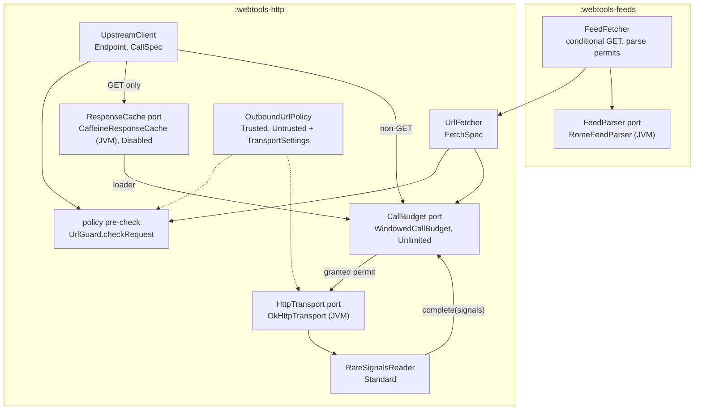
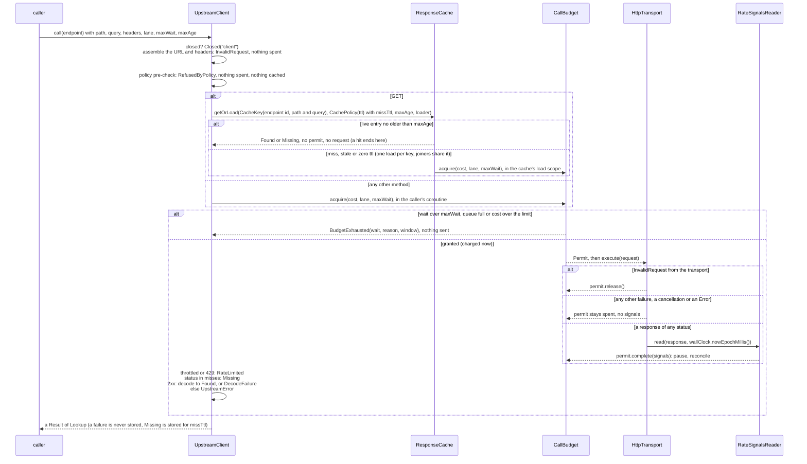
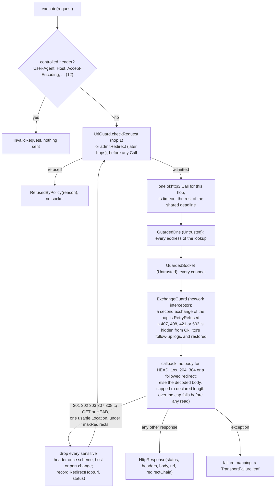

# webtools-http architecture

Applies to `webtools-http` `1.x` and `webtools-feeds` `1.x`. How the HTTP client
stack is put together: its modules and systems, the order in which they compose
on a call, where each outbound-URL check runs, the failure model, every thread
and coroutine context it uses, ownership and closing, what it logs and never
logs, the stability tiers, the test support and the platform reach. HTTP itself
is the protocol, so there is no separate wire document. Code and KDoc are
authoritative on any conflict with this document.

History (decision records, not current fact):
[design](plans/55-http-client-stack/architecture.md); the plan and the as-built
record of each system sit in their own folders beside it.

## 1. Scope & audience

For a maintainer reasoning about a change to the stack, a consumer wiring a
provider or a feed reader onto it, and anyone checking a proposed change against
the existing topology. Any change to a component, a thread or coroutine context,
an ownership rule, a log line's content or a tier updates this document
directly.

## 2. Modules

| Module | Published as | Source sets | Role |
|---|---|---|---|
| `webtools-http` | `io.github.spartanlaboratories:webtools-http` and `webtools-http-jvm`, plus a test-fixtures variant (capability `io.github.spartanlaboratories:webtools-http-test-fixtures`, a `-test-fixtures.jar` beside the module) | `commonMain`, `jvmMain`, `jvmTestFixtures`; tests in `commonTest`, `jvmTest` | The stack: request and response types, the failure model, the outbound-URL policies, the transport, the response cache, the call budget and the two call facades |
| `webtools-feeds` | `io.github.spartanlaboratories:webtools-feeds` and `webtools-feeds-jvm` | `commonMain`, `jvmMain`; tests in `commonTest`, `jvmTest` | RSS and Atom parsing behind a parser port, and a stateless conditional-GET fetcher over `UrlFetcher` |
| `webtools-http-commoncheck` | not published | `jsMain`, plus `webtools-http`'s `commonMain` directory | Compiles `webtools-http`'s `commonMain` for `js` (§12) |
| `webtools-feeds-commoncheck` | not published | `jsMain`, plus `webtools-feeds`' `commonMain` directory | Compiles `webtools-feeds`' `commonMain` for `js`, against `webtools-http-commoncheck`'s output |

Both published modules apply the `webtools.kotlin-multiplatform-library`
convention plugin from the included `build-logic` build: one `jvm()` target at
the Java 11 floor, `verifyJavaFloor` in `check`, and the ABI dump
(`api/webtools-http.api`, `api/webtools-feeds.api`) checked by `apiCheck`.
Each module adds `explicitApi()` itself. Packages are flat:
`com.spartanlabs.webtools.http`, `com.spartanlabs.webtools.feeds`, and
`com.spartanlabs.webtools.http.testing` for the fixtures; `internal` does the
hiding.

Dependencies:

- **`webtools-http`.** `kotlinx-coroutines-core` 1.10.2 is the one `api`
  dependency (in `commonMain`): it is the runtime of a suspend API, and a
  `CoroutineDispatcher` appears in configuration (`UpstreamClientConfig.dispatcher`,
  `CaffeineResponseCache.Builder.loadDispatcher`, `FeedFetcherConfig.parseDispatcher`).
  `jvmMain` takes `okhttp-jvm` 5.5.0, `caffeine` 3.3.1 and `slf4j-api` 2.0.13 as
  `implementation`; no OkHttp, Caffeine or slf4j type appears in a public
  signature. `okhttp-jvm` 5.5.0 requires `kotlin-stdlib` 2.2.21, so a consumer's
  standard library resolves to 2.2.21 or newer.
- **`webtools-feeds`.** `api(project(":webtools-http"))`, which also brings the
  coroutines `api`; `jvmMain` takes `rome` 2.1.0 (with `rome-utils` and `jdom2`)
  and `slf4j-api` as `implementation`. No Rome type is part of its API.
- **The fixtures variant** adds `kotlinx-coroutines-test` 1.10.2 and
  `mockwebserver3` 5.5.0, on the fixtures' variants only; neither main variant
  lists them.

## 3. Component map

`webtools-http` (`common` is `commonMain`, `jvm` is `jvmMain`):

| Component | Where | Visibility | Role |
|---|---|---|---|
| `HttpRequest`, `HttpResponse`, `HttpHeaders`, `HttpMethod`, `RequestBody`, `RedirectHop`, `Url` | common | public | The value types. `Url` is parsed once (`http`/`https` only, never user-info) and normalised as OkHttp's `HttpUrl` normalises an ASCII host; `toString()` is the full URL, `redacted()` the form the stack logs. `HttpHeaders` keeps order and spelling, looks up case-insensitively and flags an entry sensitive. `HttpResponse.redirectChain` lists each followed hop |
| `HttpTransport` | common | public, gated | The port between the stack and the network: `execute(request): Result<HttpResponse>`, one request per hop, and `close()` |
| `OkHttpTransport` and its factory | jvm | public | The supplied transport (§5.3) |
| `OutboundUrlPolicy` (`Trusted`, `Untrusted`), `TransportSettings`, `CidrBlock`, `MixedAnswers` | common | public | Which URLs and addresses a fetch may reach, and the caps, timeouts and concurrency that go with that choice (§5) |
| `UrlGuard`, `StrictIp`, `HostRules`, `AddressRanges`, `GuardRelaxation` | common | internal | The classifier: pure functions over strings and bytes that judge a request, a hop, a redirect target, an address and a resolver answer |
| `GuardedDns`, `GuardedSocketFactory` / `GuardedSocket`, `PolicyEnforcement` | jvm | internal | The `Untrusted` enforcement below OkHttp: every resolved address and every connect is judged |
| `ExchangeGuard`, `CallBridge`, `CappedBody`, `FailureMapping`, `TransportClient`, `RedirectDecision` | jvm | internal | The transport's parts: one exchange per hop, the callback bridge, the capped body read, the failure mapping, the client and its dispatcher, the redirect rules |
| `ResponseCache` (with `Disabled`), `CacheKey`, `CachePolicy`, `Lookup`, `CacheStats` | common | public; the port gated | The cache port and its values; `Disabled` is the pass-through |
| `CaffeineResponseCache` and its factory | jvm | public | The supplied cache (§4.3) |
| `CallBudget` (with `Unlimited`), `Permit`, `withPermit`, `Lane`, `RateWindow`, `RateSignals`, `WindowReading`, `RetryAfter`, `BudgetUtilisation`, `WindowUtilisation` | common | public; `CallBudget` and `Permit` gated | The budget port, its permit and its vocabulary |
| `WindowedCallBudget` and its factory; `BudgetLedger`, `WindowLedger`, `LedgerCell` | common | public; the ledger internal | The supplied budget (§4.4) |
| `RateSignalsReader` (with `Standard`), `BudgetStore` (with `InMemoryBudgetStore`, `BudgetSnapshot`, `WindowSnapshot`), `BudgetObserver` (with `None`), `BudgetEvent`, `PauseSource`, `StoreOperation` | common | public; readers, stores, observers and `BudgetEvent` gated | The budget's seams: reading a provider's signals, persisting a hard window, observing grants and refusals |
| `UpstreamClient`, `UpstreamClientConfig`, `Endpoint`, `CallSpec` | common; the owning factory in jvm | public | The facade for the endpoints of one upstream API (§4.1) |
| `UrlFetcher`, `UrlFetcherConfig`, `FetchSpec` | common; the owning factories in jvm | public | The facade for administrator-supplied URLs (§4.2) |
| `CallDispatch`, `RequestAssembly`, `ResponseVerdict`, `FacadeLifecycle`, `TransportSizing` | common, jvm | internal | The facades' shared send path, URL and cache-key assembly, status classification, ownership and transport sizing |
| `HttpFailure`, `TransportFailure`, `UpstreamFailure` and their leaves; `RefusalReason`, `ExhaustedReason` | common | public; the three groups gated | The failure model (§6) |
| `WallClock` (with `System`) | common | public, gated | Wall-clock time in epoch milliseconds |
| `ExperimentalForInheritanceWebToolsApi`, `WebToolsDsl` | common | public | The opt-in marker of the gated seams (§10) and the DSL marker of every builder passed to a consumer's lambda |
| `Log` / `logger`, `epochMillisNow` | common `expect`, jvm `actual` | internal | The logging seam (slf4j on the JVM) and the platform wall-clock reading |
| `flatMap`, `catchNonFatal` | common | internal | `Result` chaining, and the non-fatal catch that rethrows a `CancellationException` and every `Error` |

`webtools-feeds`:

| Component | Where | Visibility | Role |
|---|---|---|---|
| `FeedFetcher`, `FeedFetcherConfig`; `FeedFetcher.untrusted` | common; the owning factories in jvm | public | The stateless conditional GET over `UrlFetcher` (§4.5) |
| `FeedParser`, `FeedInput`, `FeedLimits` | common | public; the port gated | The parser port, its input and the bounds a parser applies |
| `RomeFeedParser` | jvm | public | The supplied parser, over Rome 2.1.0 |
| `Feed`, `FeedEntry`, `FeedEnclosure` | common | public | The model; an entry's `id` is never blank and never changes for the same entry |
| `FeedValidators`, `FeedFetch` (`Fetched`, `NotModified`) | common | public | The conditional-GET validators and the outcome of a fetch |
| `FeedFailure` and its leaves; `NotAFeedReason`, `FeedRefusal`, `FeedLimit` | common | public; the group gated | The feed document's failures, under `HttpFailure` |
| `PrologScan`, `EntryIdentity`, `Sha256`, `ConditionalHeaders`, `PermanentMove`, `UrlOrigin` | common | internal | The DOCTYPE prolog scan, the frozen id digest, the request headers, the permanent-move rule and the URL form the module logs |
| `RomeWireInput`, `RomeXmlReader`, `CountingSaxHandler`, `RomeConversion`, `RomeFailureMapping` | jvm | internal | How `RomeFeedParser` drives Rome: its own SAX parser per parse, the encoding recipe, the structural counters, the conversion and the failure mapping |
| `Log` / `logger`, `defaultFeedParser` | common `expect`, jvm `actual` | internal | The module's own logging seam, and the default parser (`RomeFeedParser` on the JVM) |

Ownership: an `UpstreamClient` holds one transport, one cache and one budget; a
`UrlFetcher` holds one transport and one budget; a `FeedFetcher` holds one
`UrlFetcher` and one parser. Which of them each facade also *owns*, and so
closes, is decided by the factory that built it (§8).

## 4. How the systems compose



The order is fixed: the policy's pre-check, then the cache, then the budget
**inside the cache's loader**, then the transport. A hit costs nothing, a
refusal by the pre-check costs nothing, and N concurrent callers of one key
cost one permit and one request. Nothing is ever retried.

### 4.1 `UpstreamClient.call`



- **The key** is the endpoint id, the request's encoded path and its query
  pairs; never a header (so never a credential sent in one), the body, the lane
  or `maxAge`. A credential passed as a query pair is part of the key, as every
  pair is. The key holds no host: two clients that share one cache need
  distinct endpoint ids.
- **A shared load** runs the first caller's request, lane and wait cap. A
  joining caller with a tighter deadline wraps its own `call` in
  `withTimeoutOrNull`, which frees that caller and leaves the load running.
- **`RateLimited.retryAfter`** is the longer of the server's `Retry-After` and
  the budget's `pausedFor`, read once after `complete(signals)`; zero when
  neither named a wait.
- **What a call spends.** Once a permit is granted, a response of any status
  spends it, and only the transport's `InvalidRequest`, which always comes
  before anything is sent, gives it back. Every other transport failure,
  `RefusedByPolicy` and `Closed` included, can follow a request the server
  received, so it leaves the permit spent: a window that guards a bill is
  never under-counted.

### 4.2 `UrlFetcher.fetch`

The same path without the cache and the decoder: closed check, the
`FetchSpec`'s limits and the transport-controlled headers (each an
`InvalidRequest`), the policy pre-check, then `acquire`, `execute`, the signal
read and `complete`. **Every status is the response** (a `304` and a returned
`3xx` included) except a throttle, which is `RateLimited`. An
administrator-supplied URL population is an unbounded key space, so the fetcher
keeps no cache: a conditional GET is its cache.

### 4.3 The response cache

`CaffeineResponseCache` keeps one decoded value per key for the policy's `ttl`
(a `Missing` for `missTtl`), measured from the load's completion. Concurrent
calls for one key join the load in flight; a stored entry older than the call's
`maxAge` is reloaded once. A failure is never stored: a loader's `Exception` is
every waiter's failure (the same instance), a loader's `Error` is rethrown to
every waiter, and a loader's own cancellation (a `withTimeout` inside it) is an
`IllegalStateException` failure. `maxWeight` (1,000) bounds the total weight
of the stored entries; a `Found` weighs 1 unless it reports a weight, so in the
facades the bound is an entry count. `ResponseCache.Disabled` stores and shares
nothing and is the only cache constructible in common code.

### 4.4 The call budget

`WindowedCallBudget` is an integer ledger of fixed rate windows aligned to
multiples of their period since the Unix epoch, with a boundary guard (a grant
within the guard of a boundary counts in both adjacent periods), per-lane
held-back floors (20 % for `Lane.Interactive` by default, never lent), and
first-come-first-served waits per lane. A wait longer than `maxWait` fails at
once with `BudgetExhausted` carrying the wait it would have needed; a cancelled
wait is refunded and the waiters behind it re-planned. `complete(signals)`
raises the local count to what the server reports (never lowers it), and a
throttle pauses every lane until the longest hint, capped by `maxPause`. A
`hard` window refuses until its boundary once full, and is saved write-ahead
through the `BudgetStore` so a restart restores it; a failing store is logged
and ignored, and grants continue from the in-process count. `flush()` is the
exact final write; `close()` writes nothing. `CallBudget.Unlimited` grants
everything and never pauses.

### 4.5 Feeds

`FeedFetcher.fetch(url, validators)` sends `GET` with `Accept` and, when the
validators hold them, `If-None-Match` and `If-Modified-Since` exactly as held,
through `UrlFetcher.fetch`. A `200` or `203` is parsed (under a permit of
`maxConcurrentParses`, on `parseDispatcher`) and returned as `Fetched` with the
response's validators; a `304` to a conditional request is `NotModified`; every
other status, a `304` to an unconditional request and every other `2xx`
included, is `UpstreamError`. Both outcomes carry `finalUrl` and
`permanentlyMovedTo` (the target of the leading run of `301`/`308` hops, or
`null`). The fetcher keeps no state: the caller stores the validators after
every response and owns polling, back-off, `410` and "which entries are new"
(by `id`, never by date).

A hostile document meets four layers:

1. the transport's decoded-body cap (2 MiB under `Untrusted`);
2. the DOCTYPE prolog scan in common code, before any parser runs: a DOCTYPE or
   other markup declaration, an encoding outside the set it reads, a prolog over
   64 KiB and a prolog that decodes two ways are `Refused`; a web page, an empty
   body or a body that is not XML is `NotAFeed`;
3. `RomeFeedParser`: Rome with a SAX parser of its own per parse (DOCTYPE and
   external entities off, the JDK's depth and attribute limits set as JAXP
   properties, a counting handler for elements and namespace URIs), setting no
   process-wide XML configuration; depth over 256, more than 100 attributes on
   an element, more than 100,000 elements or more than 64 distinct namespace
   URIs fail with `LimitExceeded`;
4. the conversion under the remaining `FeedLimits`: more than 1,000 entries
   fails with `LimitExceeded`; text, id, link, category and enclosure limits
   truncate, fall back or drop. Every limit can only be tightened.

## 5. Where each outbound-URL check runs

`OutboundUrlPolicy` is a closed pair. `Trusted` (for a known upstream) checks
the scheme (`https` only unless `allowCleartext`), optionally pins hosts, and
applies the downgrade rule; it filters no address and has no name or port rule,
so a private address is fetchable. `Untrusted` (for a URL a third party
supplied) also refuses a lenient or malformed host form (`127.1`, `2130706433`,
`0177.0.0.1`, an empty label), a single-label name or a reserved name
(`localhost`, `local`, `internal`, `home.arpa`, `localdomain`, their subdomains
and the policy's `extraDeniedHostSuffixes`), a denied IP literal or resolved address (the
IANA special-purpose tables, multicast, everything outside `2000::/3`, the
Azure platform endpoint `168.63.129.16`, ISATAP identifiers, IPv4-mapped and
NAT64 forms judged by their embedded IPv4, and the policy's
`extraDeniedRanges`), a port outside `allowedPorts` (80, 443, 8080, 8443 by
default), and a request carrying a sensitive header (`Authorization`,
`Proxy-Authorization`, `Cookie`, `Set-Cookie` or any entry added as sensitive).
No `Untrusted` parameter admits an address or name its tables deny
(`allowedPorts` sets the port list, and `DropDenied` uses only the allowed
addresses of a mixed answer); to fetch from a private address, use `Trusted`.

| Check | Runs in | When | Stops |
|---|---|---|---|
| `UrlGuard.checkRequest` (the hop check, plus the sensitive-header refusal under `Untrusted`) | each facade's pre-check | before the cache and the budget | everything the URL alone shows, at no cost |
| `UrlGuard.checkRequest` | `OkHttpTransport` | before hop 1, after the controlled-header check, before any `Call` | the same, for a transport used directly; with the pre-check, the only check of a literal hop-1 host before the socket guard, since OkHttp never resolves a literal through `Dns` |
| `UrlGuard.admitRedirect` | `OkHttpTransport` | for each redirect target, before its `Call` | a target with a foreign scheme, one that cannot be resolved, or one the hop check refuses; an `https` to `http` hop unless `allowHttpsToHttp` |
| `GuardedDns` (`Untrusted` only) | OkHttp's route selection, on a transport dispatcher thread | every lookup | a name that resolves to a denied address; a mixed answer is refused whole under `MixedAnswers.Reject` (the default) or reduced to its allowed addresses under `DropDenied` |
| `GuardedSocket` (`Untrusted` only) | every `connect`, fallback attempts included | last, below OkHttp | any denied address that reached a socket; the version-independent backstop |
| `Proxy.NO_PROXY` (`Untrusted` only) | the client | always | a proxy, which would resolve and connect by itself and bypass both guards; the socket guard makes its own `Socket(Proxy.NO_PROXY)` sockets, so a JVM-wide SOCKS setting cannot reach them either |

A refusal is `RefusedByPolicy(reason)` with a `RefusalReason` (`Scheme`,
`UserInfo`, `HostForm`, `ReservedName`, `DeniedAddress`, `Port`,
`HostNotPinned`, `InsecureRedirect`, `SensitiveHeader`); it carries no
address, range or query. A `Trusted` transport keeps OkHttp's default resolver,
socket factory and proxy selection, so the JVM's `http.proxyHost` and
`socksProxyHost` apply to it.

### 5.1 Transport settings

Each policy carries its `TransportSettings`; an `Untrusted` policy's caps and
timeouts are part of what makes it untrusted. Every default is a judgement, and
changing one is a behaviour change:

| Setting | `TrustedDefaults` | `UntrustedDefaults` |
|---|---|---|
| `callTimeout` (all hops together) | 30 s | 15 s |
| `connectTimeout`, `readTimeout`, `writeTimeout` | 10 s each | 5 s each |
| `maxResponseBytes` (decoded bytes) | 5 MiB | 2 MiB |
| `maxRedirects` | 5 | 3 |
| `allowHttpsToHttp` | false | false |
| `maxConcurrentRequests`, `maxConcurrentRequestsPerHost` | 16, 5 | 8, 2 |
| `idleConnectionTtl` | 4 s | 4 s |

The JVM owning factory of `UpstreamClient` raises both concurrency limits to at
least the budget's `maxBurst` when its budget is a `WindowedCallBudget`, so a
granted permit never queues in OkHttp outside the call timeout and the wait cap;
it never lowers them and sets no ceiling. `UrlFetcher` and `FeedFetcher`
transports keep their policy's settings as they are.

### 5.2 Testing relaxation

`GuardRelaxation.LoopbackForTests` exempts exactly `localhost`, the loopback
addresses (`127.0.0.0/8`, `::1`) and the port rule for those hosts; every other
`Untrusted` rule stays live. It is `internal` and reachable only through the
test fixtures (`LoopbackTransports`, `LoopbackFetchers`): the main artifact has
no switch that turns the address guard off.

### 5.3 Inside the transport



OkHttp's own re-send paths are off (`retryOnConnectionFailure(false)`, no
native redirects), and each transport builds its own client, dispatcher and
connection pool. A `Range` request is sent with
`Accept-Encoding: identity`. A redirect keeps its method (`HEAD` stays `HEAD`
after a `303`) and sends no body and no `Referer`; a `300`, a `3xx` to any
other method, or one with no single usable `Location` is the response.

## 6. Failure model

Every expected failure is a value inside `kotlin.Result`, never thrown:

```text
HttpFailure                       (gated, abstract)
├── Closed(component)             a component used after close()
├── BudgetExhausted(wait, reason, window)
├── DecodeFailure                 a decoder or a parser failed
├── TransportFailure              (gated, abstract) nothing usable came back
│   ├── Timeout · ConnectFailed · DnsFailed(host) · TlsFailed · Protocol · Io
│   ├── InvalidRequest(rule) · RefusedByPolicy(reason)
│   └── BodyTooLarge(limit, declared) · TooManyRedirects(limit) · RetryRefused
├── UpstreamFailure(status)       (gated, abstract) the server answered
│   ├── RateLimited(status, retryAfter)
│   └── UpstreamError(status, headers, body)
└── FeedFailure                   (webtools-feeds; gated, abstract) the bytes are not a feed
    └── NotAFeed(reason) · Malformed · Refused(reason) · LimitExceeded(limit)
```

| Failure | Produced by | Cause |
|---|---|---|
| `Timeout` | transport | the shared `callTimeout` expired across the hops, or a connect, read or write timed out |
| `ConnectFailed` | transport | the connection was refused, had no route or met an unreachable port |
| `DnsFailed(host)` | transport | the name did not resolve |
| `TlsFailed` | transport | the TLS handshake failed; it carries no cause, so an expired and an untrusted certificate look alike |
| `Protocol` | transport | the response broke HTTP, a status outside 100..599 included |
| `Io` | transport; a facade, for a non-fatal exception a transport threw | any other I/O failure |
| `InvalidRequest(rule)` | facades (spec limits, URL assembly, controlled or unsendable headers); transport (controlled headers, a request OkHttp's builder refuses) | the request cannot be sent; always before anything is sent, so the only failure that gives a permit back |
| `RefusedByPolicy(reason)` | a facade's pre-check; the transport (before hop 1, a redirect target, a resolved address, a connect) | the outbound-URL policy (§5) |
| `BodyTooLarge(limit, declared)` | transport (and `FakeHttpTransport` with a cap) | the decoded body exceeds `maxResponseBytes` |
| `TooManyRedirects(limit)` | transport | more than `maxRedirects` hops |
| `RetryRefused` | transport | a second exchange of one hop; the fail-closed backstop |
| `RateLimited(status, retryAfter)` | `UpstreamClient`, `UrlFetcher` (and so `FeedFetcher`) | a `429`, or what the configured `RateSignalsReader` reports as throttled |
| `UpstreamError(status, headers, body)` | `UpstreamClient` (a status not in `misses` and not `2xx`); `FeedFetcher` (a status that is not a feed) | the server answered with a status the caller must treat as a failure; `UrlFetcher` returns such a status as the response |
| `BudgetExhausted(wait, reason, window)` | the budget | `Window` or `Paused` (the wait exceeds `maxWait`), `CostExceedsLimit` (no wait would admit it; `wait` is infinite), `QueueFull` (the lane already has `maxQueued` waiters) |
| `Closed(component)` | each component after `close()` | `transport`, `cache`, `budget`, `client`, `fetcher`, `feed fetcher` |
| `DecodeFailure` | `UpstreamClient`; `FeedFetcher` | an endpoint's decoder, or a parser, that threw or returned a failure that is not an `HttpFailure` |
| `NotAFeed`, `Malformed`, `Refused`, `LimitExceeded` | a `FeedParser` | §4.5 |

Rules that hold across the model:

- **Open groups.** The failure groups and the reason vocabularies
  (`RefusalReason`, `ExhaustedReason`, `PauseSource`, `StoreOperation`,
  `NotAFeedReason`, `FeedRefusal`, `FeedLimit`) may gain members in a feature
  release; match the groups you care about and keep an `else`.
- **Messages** are a constant per type plus named non-sensitive fields; never a
  URL with its query, a header value, a body, a credential or a resolved
  address. A `cause`, when present, is the producer's exception (OkHttp's, or a
  consumer's decoder, reader or transport) and may carry what the message never
  does.
- **Cancellation** is thrown as `CancellationException`, never put in a
  `Result`.
- **Not `HttpFailure`.** A programmer error in developer-written configuration
  (a negative wait, a blank user agent, a cost below 1 passed to the budget
  directly) throws `IllegalArgumentException` at the call that receives it,
  with a constant message. An `Error` propagates. A cache loader's own
  cancellation is an `IllegalStateException` failure.

## 7. Threads, coroutines and time

The stack owns few threads. Every call that sends a request or may wait is
`suspend` and main-safe: no blocking step runs on the caller's thread.
`FeedParser.parse` is a plain, CPU-bound call that `FeedFetcher` runs on
`parseDispatcher`.

| Context | Created | Runs |
|---|---|---|
| the caller's coroutine | — | every facade's checks and the wait for a result; a non-`GET` `call`'s and every `fetch`'s budget wait (the budget owns no scope, thread or timer: a wait is a `delay` in the waiting coroutine) |
| `webtools-http-dispatcher-<n>` | per `OkHttpTransport`, its own `ThreadPoolExecutor` (OkHttp's default shape, idle threads end after 60 s), daemon threads, at most `maxConcurrentRequests` busy | DNS through `GuardedDns`, connect, TLS, the write, the capped body read inside the callback |
| the cache's load scope (`webtools-http-cache-load`) | per `CaffeineResponseCache`, on `loadDispatcher` (`Dispatchers.Default` by default) | every loader of a cached `GET`, so its budget wait and its transport call; the caller only awaits, and its cancellation cancels only itself |
| `maintenanceExecutor` | the caller's (`ForkJoinPool.commonPool()` by default); never shut down by the cache | Caffeine's maintenance |
| `parseDispatcher` | the caller's (`Dispatchers.Default` by default) | `FeedParser.parse`, at most `maxConcurrentParses` (2) at once per fetcher; a parse cannot be cancelled, so a cancelled caller returns when its parse ends |
| the thread of the call that produced the event | — | `BudgetObserver.onEvent`, after the budget's lock is released, so an observer may call back into the budget |
| `Dispatchers.IO` | — | `FixtureRecorder`'s serialisation and writes (test support) |

Concurrency:

- Every member of the transport, the cache, the budget, the facades and the
  feed fetcher may be called concurrently from any thread and coroutine. A
  builder or configuration is not thread-safe: use it only inside its lambda.
- `WindowedCallBudget` keeps all state under one coroutine `Mutex`, held across
  a store call for at most `storeTimeout` (2 s); a blocking store cannot be
  interrupted, so `BudgetStore` requires a cancellable implementation.
- The cache runs one load per key at a time; a loader must not wait for a load
  of its own key.
- The transport's only mutable state is its closed flag.

Time:

- Elapsed time is read from an injected `kotlin.time.TimeSource`
  (`TimeSource.Monotonic` by default) and wall time from `WallClock`
  (`WallClock.System` by default, epoch milliseconds). The budget reads the wall
  clock to place itself in the provider's calendar and the `TimeSource` to
  measure every wait; a backward wall-clock step across a boundary copies the
  counts of the periods it left, and a forward jump is trusted.
- `UpstreamClientConfig` passes its `timeSource` and `wallClock` to the budget
  it builds, its `timeSource` and `dispatcher` to the cache it builds, and its
  `wallClock` to the signal reader, so one `VirtualClock` drives the cache, the
  budget and `delay` together under test. The transport's shared deadline reads
  `TimeSource.Monotonic`; the real transport runs on real time only.

## 8. Lifecycles and closing

Every long-lived type is a `kotlin.AutoCloseable` whose `close()` is
non-suspending, idempotent and never throws. A component closes what it built,
never what it was handed.

| Built with | Owns | `close()` |
|---|---|---|
| `OkHttpTransport(userAgent, policy)` | its client, its dispatcher's thread pool and its connection pool | cancels every call in flight (each ends with `Closed("transport")`), shuts the thread pool down and evicts the connection pool; the threads are daemon threads, so a forgotten `close()` does not keep the JVM alive |
| `CaffeineResponseCache { }` | its load scope | cancels the loads in flight, ends every waiting call with `Closed("cache")` without waiting for a loader to unwind, drops every entry; `invalidate`, `invalidateAll` and `stats` keep working |
| `WindowedCallBudget(windows) { }` | nothing it was given (never its store or observer) | every waiting call and every later `acquire` returns `Closed("budget")`; writes nothing, so call `flush()` first; `flush()`, `utilisation()` and the permits' `complete`/`release` keep working |
| `UpstreamClient(transport, baseUrl) { }` | only a budget built by `budget(windows)` | closes it |
| `UpstreamClient(baseUrl, userAgent) { }` (JVM) | an `OkHttpTransport`, a `CaffeineResponseCache` unless `cache(...)` was called, and a budget built by `budget(windows)` | closes them in the order cache, budget, transport; `utilisation()`, `cacheStats()` and `flush()` keep working |
| `UrlFetcher(transport, policy) { }` | nothing | — |
| `UrlFetcher(userAgent) { }`, `UrlFetcher(userAgent, policy) { }` (JVM) | an `OkHttpTransport` | closes it; never a budget |
| `FeedFetcher(urlFetcher) { }` | nothing | in-flight requests are left alone |
| `FeedFetcher.untrusted(userAgent) { }`, `FeedFetcher.untrusted(userAgent, policy) { }` (JVM) | a `UrlFetcher` and so its transport | closes them, which cancels every request still on the network (`Closed("transport")`); a parse already running is never interrupted |

After `close()`, each component returns `Closed("<component>")`; a fetch racing
a feed fetcher's `close()` may meet the composed fetcher's or the transport's
name, so match `HttpFailure.Closed`. An owning factory that throws closes what
it had already built. A facade's `close()` stops at a `CancellationException`
thrown by a part's `close()`; none of the supplied parts throws one.

## 9. Logging

Every log line goes through the `internal` logging seam, which is slf4j on the
JVM and a no-op on `js`; messages use `{}` placeholders. A failure or an event
is logged once, by the site that creates it.

| Logger | `INFO` | `WARN` | `DEBUG` |
|---|---|---|---|
| `com.spartanlabs.webtools.http.OkHttpTransport` | creation (policy kind and settings, numbers only); close | a policy refusal (reason name, range class, `Url.redacted()`); a refused second exchange | each call, each followed hop, each failure |
| `com.spartanlabs.webtools.http.GuardedDns` | — | — | under `DropDenied`, a lookup that dropped addresses (host, counts, range classes) |
| `com.spartanlabs.webtools.http.CaffeineResponseCache` | creation (`maxWeight`); close | a load coroutine that failed outside the loader (the exception's class name) | each load's end (the key's id and parameter names, the outcome kind, whether it was stored); nothing per hit or join |
| `com.spartanlabs.webtools.http.WindowedCallBudget` | creation (settings, numbers only); close; a restore | a pause; a hard stop; a store failure (the cause's class name) | each refusal; each reconciliation; nothing per grant |
| `com.spartanlabs.webtools.http.UpstreamClient` | creation (the base URL, redacted); close | a pre-check refusal; a throttle; a reader or `utilisation()` that throws | each call that passed the pre-check (endpoint id, method, whether its own loader ran, lane, cost, status, bytes, timings, outcome); an `InvalidRequest` it raises; a `DecodeFailure` (the cause's class name); a close step that threw |
| `com.spartanlabs.webtools.http.UrlFetcher` | creation; close | a pre-check refusal; a throttle; a reader or `utilisation()` that throws | each fetch that passed the pre-check (method, URL, lane, cost, status, bytes, timings); an `InvalidRequest` it raises; a close step that threw |
| `com.spartanlabs.webtools.feeds.FeedFetcher` | creation; close | a refused document (the reason, and the URL as scheme, host and port) | each fetch that returns a `Result` (outcome, status, byte and entry counts, times); a failed close of an owned `UrlFetcher` |
| `com.spartanlabs.webtools.http.testing.FixtureRecorder` (test support) | each fixture written (target path, size) or kept | a refused or failed write; a body above its warning size | — |

**Never logged** by either module's main code: a header value, a body, a query string, a credential, a
resolved address, a cache-key or decoded value, a store exception's message, or
an OkHttp object. `RomeFeedParser` logs nothing of its own; Rome itself logs
rarely, under `com.rometools.*`.

**URLs.** The stack prints a URL through `Url.redacted()`, which hides the query
and shows the path, and `UpstreamClient` prints an endpoint id as given. A
secret carried in a path segment (a webhook token, a token in a base path or a
per-call segment) is therefore written to the `OkHttpTransport`, `UrlFetcher`
and `UpstreamClient` lines and printed by the `toString()` of `HttpRequest`,
`HttpResponse` and `RedirectHop`
([#93](https://github.com/SpartanLaboratories/WebTools/issues/93)).
`webtools-feeds` prints its own URLs as scheme, host and port only, but the
`UrlFetcher` and transport under a `FeedFetcher` follow the rule above.

## 10. Stability tiers

| Surface | Tier |
|---|---|
| Everything a consumer calls, passes, configures or matches: the value types, the policies and settings, the facades and their specs and configurations, `Endpoint`, the cache, budget and feed values, every failure leaf, the reason vocabularies, the feed model | **Stable Core** |
| The supplied implementations: `OkHttpTransport`, `CaffeineResponseCache`, `ResponseCache.Disabled`, `WindowedCallBudget`, `CallBudget.Unlimited`, `InMemoryBudgetStore`, `RateSignalsReader.Standard`, `BudgetObserver.None`, `WallClock.System`, `RomeFeedParser` | **Stable Core**, usable without any opt-in; final, every number a builder property or a policy setting |
| The markers `ExperimentalForInheritanceWebToolsApi` and `WebToolsDsl` | **Stable Core**; never removed |
| Implementing, delegating to or subclassing the seams `HttpTransport`, `WallClock`, `ResponseCache`, `CallBudget`, `Permit`, `RateSignalsReader`, `BudgetStore`, `BudgetObserver`, `BudgetEvent`, `HttpFailure`, `TransportFailure`, `UpstreamFailure`, `FeedParser`, `FeedFailure` | **Experimental**: needs `@OptIn(ExperimentalForInheritanceWebToolsApi::class)`, applied through `@SubclassOptInRequired`, and may change in a minor release. Calling and passing these types needs no opt-in |
| The test fixtures (`com.spartanlabs.webtools.http.testing`) | **Stable Core, source compatibility only**: consumers compile their tests against them in their own build; no ABI dump covers them |

- **Supported Extension.** Nothing carries `@SupportedExtension` yet. A seam
  graduates to it in a feature release once a consumer has built against it,
  and the promotion is recorded in the CHANGELOG. The release that graduates
  `FeedParser` also publishes its two contract classes (§11) as a test-fixtures
  variant of `webtools-feeds`.
- **Closed sets** are `sealed` only where the closed set is the contract:
  `OutboundUrlPolicy`, `Lookup`, `FeedFetch` (and `RecordingGate` and
  `Unmatched` in the fixtures); a `when` over one needs no `else`. `MixedAnswers` and `RecordMode`
  are enums a consumer chooses.
- **Construction.** Configurable types are built by public factory functions
  with builder lambdas over `internal` constructors; there is no public
  `data class`. Every builder passed to a consumer's lambda carries
  `@WebToolsDsl`, so a nested block cannot reach an outer builder's member
  without its label.
- **ABI.** `binary-compatibility-validator` dumps the JVM ABI of both modules.
  The dump does not record `@SubclassOptInRequired`, so dropping the gate from a
  seam would pass `apiCheck`; no automated check covers the gate.

## 11. Test support and test levels

### 11.1 The published fixtures

A JVM-only `testFixtures` compilation of `webtools-http`, associated with
`main` (so it reaches `internal` declarations such as the loopback relaxation),
published as the variants `testFixturesApiElements` and
`testFixturesRuntimeElements`. A consumer takes it in Gradle only:
`testImplementation(testFixtures("io.github.spartanlaboratories:webtools-http:<version>"))`.

| Fixture | For | What it is |
|---|---|---|
| `VirtualClock`, `TestScope.virtualClock()` | Level 2 | one `TestCoroutineScheduler` behind a `timeSource`, a `wallClock`, a `dispatcher` and an inline `maintenanceExecutor`, so the cache, the budget and `delay` move together on `advanceBy`; never at Level 3 |
| `FakeHttpTransport`, `RequestMatch`, `Step`, `Unmatched` | Level 2 | a scripted transport: the most recent matching stub wins, steps run in order and the last repeats, every call is recorded with a virtual stamp; an unmatched request throws `UnmatchedRequestError` by default (`Unmatched.Fail`); mirrors `Closed` and `BodyTooLarge`, nothing else (no policy, DNS, TLS, redirects or timeouts). The worked example of implementing `HttpTransport` |
| `Fixture`, `FixtureLoader` | Levels 2 and 3 | the `.http` file format (provenance comments, a status line, headers, a blank line, the body verbatim) and body-only files typed by extension, loaded from the consumer's own classpath; the jar ships none |
| `FixtureRecorder`, `RecordingGate`, `Redaction`, `RecordMode` | recording | a decorating transport that writes live responses as `.http` files; only constructible from `RecordingGate.Enabled`, which needs `WEBTOOLS_HTTP_RECORD` and no CI variable; request headers are never written, sensitive response headers and supplied secrets are redacted, and a file in which a secret survives is refused |
| `LoopbackTransports`, `LoopbackFetchers`, `MockWebServer.webtoolsUrl`, `Fixture.toMockResponse`, `MockWebServer.enqueue(fixture)` | Level 3 | the real `OkHttpTransport`, or a `UrlFetcher` over it, against a loopback `mockwebserver3` server with every policy rule live except the loopback ones (§5.2) |
| `RecordingBudgetObserver`, `FakeBudgetStore` | Level 2 | the worked examples of `BudgetObserver` and `BudgetStore`; the store scripts failures and virtual-time delays |

Each fixture that implements a gated seam carries its own `@OptIn`, which is the
line a consumer's own implementation needs. Level 3 tests start and close the
`mockwebserver3` server by hand under `runBlocking`: real I/O under `runTest`
turns a timeout into a spurious one.

The fixtures-publication check (`:build-logic:fixturesPublicationCheck`,
wired into `webtools-http`'s `check` when WebTools is the root build) publishes
a signed copy of the module to a temporary repository and resolves the fixtures
from it, through a composite build and from an in-build multiplatform module,
asserting the capability, the Java floor on both variants and that neither main
variant lists the test libraries.

### 11.2 The modules' own tests

Both modules keep their tests in `commonTest` (run on the JVM target) and
`jvmTest`, in the packages `com.spartanlabs.testing.<level>.webtools.http` and
`com.spartanlabs.testing.<level>.webtools.feeds` (the fixtures' own tests in
`...webtools.http.testing`); the level tasks select by package.
`webtools-feeds`' tests use `webtools-http`'s fixtures through
`testFixtures(project(":webtools-http"))`.

| Level | What it holds here |
|---|---|
| 1 gating | consumer-shaped compile checks, without any opt-in: a consumer names, passes and matches the gated types, uses the supplied defaults and builds through the DSL |
| 2 component | each component against fakes and `VirtualClock`: the cache, the budget, the facades, the transport's parts, the fetcher, the Rome adapter |
| 3 integration | the real transport and the facades against loopback `mockwebserver3` servers: redirects, caps, cancellation, the guards, conditional GETs |
| 4a deterministic | pure mappings: the classifier, `Url` parsing (with a differential against OkHttp's `HttpUrl`), `RetryAfter` (against `java.time`), the ledger, the prolog scan, the feed conformance contract `FeedParserConformanceContract` |
| 4c nonfunctional | secrecy suites over log lines, messages and `toString()`; linear-time and garbage-input checks; close races and contention; the feed hardening contract `FeedParserHardeningContract`, whose memory-loading cases run in a child JVM at `-Xmx128m` |

There are no Level 4b or Level 5 tests in these modules. Two Level 4c checks
are environment-bound: the JDK 11 parser check of `webtools-feeds` runs only
where `WEBTOOLS_JDK11_HOME` names a JDK 11, and the URL parser's linear-time
check exceeds its bound when the level tasks run in parallel
([#87](https://github.com/SpartanLaboratories/WebTools/issues/87)).

## 12. Platform reach

Both modules publish one target, the JVM, at the Java 11 floor (class-file
major 55 and `org.gradle.jvm.version` 11 on both library variants). Their
`commonMain` holds the contracts and every platform-free implementation
(`WindowedCallBudget`, the facades, the classifier, `FeedFetcher`, the prolog
scan); `jvmMain` holds `OkHttpTransport`, the guards, `CaffeineResponseCache`,
`RomeFeedParser`, the owning factories and the `actual`s.

The check-only modules compile each `commonMain` directory for `js()` with no
environment, so a JVM API in common code is a compile error. They publish
nothing, run no tests and download no Node.js; `./gradlew build` and `check`
compile them. Their `jsMain` holds a `js` actual for every `expect`:

| `expect` | JVM | `js` check |
|---|---|---|
| `logger(name)` (each module has its own) | slf4j `LoggerFactory.getLogger(name)` | a no-op |
| `epochMillisNow()`, behind `WallClock.System` | `System.currentTimeMillis()` | `Date.now()` |
| `defaultFeedParser()` | `RomeFeedParser()`, with the default `FeedLimits` | a parser that returns `NotAFeed(UnknownFormat)` |

Nothing runs on `js`: `commonTest` runs on the JVM target only. No non-JVM
artifact is published, and in common code the only supplied cache is
`ResponseCache.Disabled` and there is no supplied transport.

## 13. Known limitations

Current behaviour, stated so a consumer can plan around it:

- A secret in a URL's path is logged (§9,
  [#93](https://github.com/SpartanLaboratories/WebTools/issues/93)).
- A count a server reading or a backward clock step raises on a hard window is
  saved only with the next grant or `flush()`, so a crash before either
  restores the lower stored count
  ([#91](https://github.com/SpartanLaboratories/WebTools/issues/91)). Grants
  made while the store fails are unsaved, and a clock set forward by mistake
  and left uncorrected can under-count a hard window.
- A refusal after the permit costs a permit: under `Untrusted` with a windowed
  budget, a name resolving to a denied address fails with nothing sent, yet the
  permit stays spent, because a `RefusedByPolicy` does not say which hop it
  came from.
- A budget counts one process. Several processes behind one address, or
  sharing one store, are invisible to it; a snapshot store is last-writer-wins.
- The JVM `UpstreamClient` raises its transport's concurrency to the budget's
  burst with no ceiling: a large smallest window lets that many requests run at
  once, each up to `maxResponseBytes`.
- A server that ignores `Accept-Encoding: identity` on a `Range` request
  delivers a coded body undecoded, with its `Content-Encoding`.
- `webtools-feeds` refuses rather than guesses: more than 1,000 entries,
  more than 2 MiB under `Untrusted`, an `https` to `http` redirect, a prolog in
  an encoding off its list and RSS 0.91 Netscape (which requires a DOCTYPE) all
  fail. Conditional headers go to every hop, so the caller drops its validators
  when `finalUrl` changes. Each parse grows JDOM's process-wide namespace cache
  by at most 64 URIs; provide about 128 MB of heap headroom per two concurrent
  parses.
